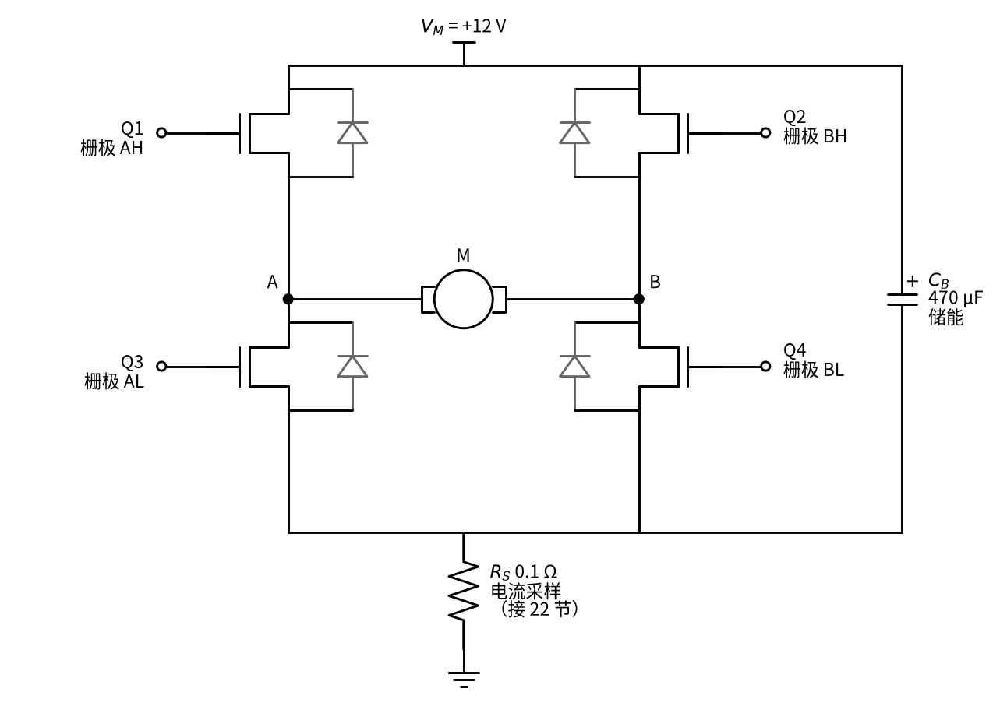
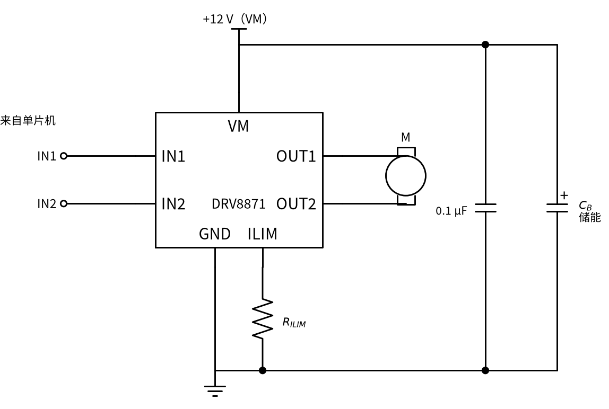
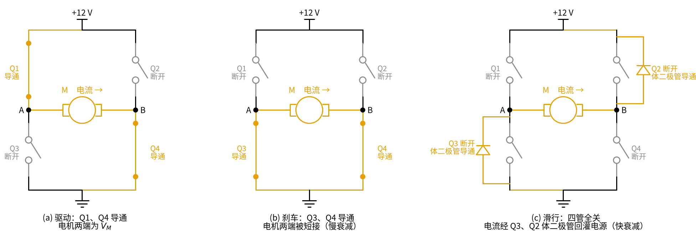
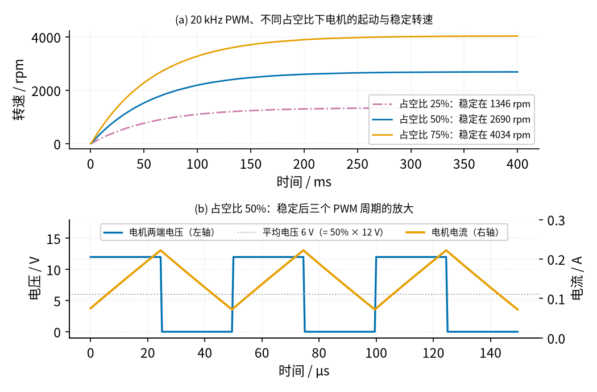
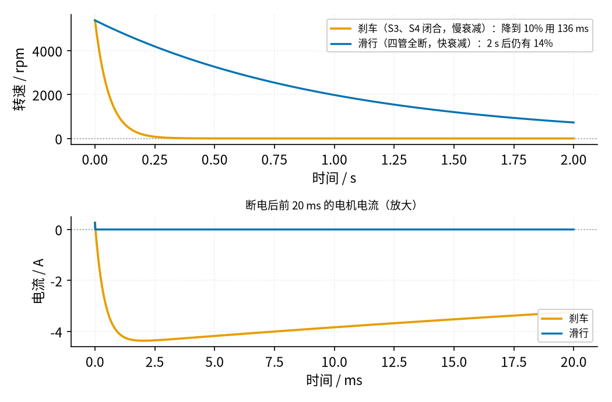

# 26 H 桥电机驱动 · 原理与实现篇

[上一页：直觉篇](page1.md) · [直觉篇](page1.md) · 本页：原理与实现篇 · [参数与调试篇](page3.md) · [下一页：参数与调试篇](page3.md) · 前置节点：[06 MOS 管开关 · 直觉篇](../06-mosfet-switch/page1.md) · [07 三极管开关与继电器驱动 · 直觉篇](../07-bjt-relay-driver/page1.md)

## 最小知识

读这一页需要四样东西，前面几节都讲过：

1. **MOS 管当开关用**：栅极电压够高时漏极和源极之间相当于一个很小的电阻 $R_{DS(on)}$ ，栅极电压为 0 时相当于断开（[06 MOS 管开关 · 直觉篇](../06-mosfet-switch/page1.md)）。
2. **电感的电流不能突变**：电感两端的电压 $V_L = L \cdot \Delta I / \Delta t$ 。中文意思：**电感两端加多大的电压，电流就以多快的速度变化**；电压不变，电流就按直线上升或下降（[07 三极管开关与继电器驱动 · 原理与实现篇](../07-bjt-relay-driver/page2.md) 用它解释了断电尖峰）。
3. **MOS 管里藏着一只二极管**：每只功率 MOS 管的源极和漏极之间都有一只「体二极管」，方向是从源极指向漏极。管子关断时，它仍然可以让电流反向通过。
4. **直流电机是「电阻 + 电感 + 发电机」**：线圈有电阻 $R$ 和电感 $L$ ；转起来以后，电机还会产生一个和转速成正比的反电动势 $e$ ，方向总是阻碍外加电压。

## 电路：四只 N 沟道 MOS 管搭成的 H 桥

把直觉篇的四个开关换成 MOS 管，就是下面的图 26-p2-1。



*图 26-p2-1　用四只 N 沟道 MOS 管搭的 H 桥：Q1、Q2 是高边（上管），Q3、Q4 是低边（下管），灰色二极管是各管自带的体二极管；C_B 是储能电容，R_S 是电流采样电阻*

看图 26-p2-1 时注意三点：

- **Q1 和 Q3 组成左半桥，Q2 和 Q4 组成右半桥**。每个半桥的中点（A、B）接电机。
- **上管的栅极驱动比下管难**。Q1 导通时它的源极就是 A 点，会升到接近 12 V，栅极必须比 12 V 再高几伏。这正是 06 节「高边开关」讲过的问题，实际电路用带「自举」电路的专用驱动芯片解决。**自举**的意思是：下管导通、A 点接近 0 V 时，先给一只小电容充上约 10 V（数值是示意）；等上管要导通、A 点升到 12 V，这只电容「骑」在 A 点上，把上管的栅极电压垫高到约 12 + 10 = 22 V，比源极高出 10 V（[TI SLUA618](https://www.ti.com/lit/pdf/slua618) 第 5.2 节）。也有人上管改用 P 沟道管，驱动简单一些，但 P 沟道管导通电阻通常更大。
- **体二极管就是现成的续流通路**。07 节说过，电感电流不能突然断掉；四只管子全部关断时，电机电流会经过一对体二极管流回电源，不会产生击穿管子的高压。TI 的应用笔记把这一点总结为：电感电流必须有路可走，否则会损坏开关（[TI SLVA321A](https://www.ti.com/lit/an/slva321a/slva321a.pdf)）。

储能电容 $C_B$ 不能省：PWM 每开关一次，电源线上都要突然多拿或少拿一份电流，长导线的电感会让电源电压跳动；电容就近供应这份电流。DRV8871 的手册在电源引脚说明里也要求接 0.1 µF 旁路电容和「足够的」储能电容（[TI DRV8871 数据手册](https://www.ti.com/lit/ds/symlink/drv8871.pdf) 引脚功能表）。

整块的驱动芯片把这四只管子、上管驱动和保护都集成在一起。以 DRV8871 为例，它内部就是四只 N 沟道 MOS 管组成的 H 桥，高边加低边的导通电阻典型值合计 565 mΩ，用 IN1、IN2 两个引脚控制：

| IN1 | IN2 | 状态 | 对应直觉篇 |
|---|---|---|---|
| 0 | 0 | 滑行：四管全关（1 ms 后进入睡眠） | 四个开关全断开 |
| 0 | 1 | 反转：电流 OUT2 → OUT1 | S2、S3 闭合 |
| 1 | 0 | 正转：电流 OUT1 → OUT2 | S1、S4 闭合 |
| 1 | 1 | 刹车：两只下管导通（慢衰减） | S3、S4 闭合 |

（真值表摘自 DRV8871 数据手册表 1。）注意这张表里**没有**能让同一侧上下管同时导通的输入组合：芯片在逻辑上就把直通排除了，切换时还自动插入 220 ns 的死区。

这块芯片在电路里的接法见下面的图 26-p2-4：IN1、IN2 接单片机的两个输出脚；VM 接 12 V 电源，并就近接 0.1 µF 旁路电容和储能电容 $C_B$ ；OUT1、OUT2 接电机；ILIM 引脚经限流电阻 $R_{ILIM}$ 接地，阻值在参数与调试篇选。



*图 26-p2-4　DRV8871 的接法：VM 旁并 0.1 µF 旁路电容和储能电容 C_B，ILIM 经 R_ILIM 接地*

## 推导一：电机两端的电压分给了谁

电机两端加电压 $V$ ，它要分给三样东西：

$$V = R \cdot I + L \cdot \frac{\Delta I}{\Delta t} + e, \qquad e = K_e \omega$$

中文意思：**外加电压 = 线圈电阻上的压降 + 让电流变化所需的电感电压 + 转动产生的反电动势**。 $\omega$ 是转速（单位 rad/s，乘 $60/(2\pi)$ 换成 rpm）， $K_e$ 是电机常数，本节取 0.02 V·s/rad。

电机转稳以后电流不再变化，中间一项为 0。空载时电流很小，电阻压降也很小，于是

$$\omega \approx \frac{V}{K_e}$$

中文意思：**电机的稳定转速几乎正比于加在它两端的电压**。12 V 时约 $12 / 0.02 = 600\text{ rad/s}$ ，扣掉电阻压降后仿真得 5377 rpm（约 563 rad/s）。

## 推导二：PWM 的平均电压

用「驱动—刹车」交替的方式做 PWM：一个周期 $T = 1/f$ 里，前 $D \cdot T$ 时间正转（Q1、Q4 导通，电机两端 $V_M$ ），后 $(1-D) \cdot T$ 时间刹车（Q3、Q4 导通，电机两端 0 V）。DRV8871 手册也推荐这种方式：「用 PWM 时，通常在驱动和刹车之间切换效果最好」。一个周期的平均电压是

$$\bar{V} = \frac{V_M \cdot DT + 0 \cdot (1-D)T}{T} = D \cdot V_M$$

中文意思：**平均电压 = 占空比 × 电源电压**。12 V 电源、占空比 50%，电机「感受到」的就是 6 V。

驱动、刹车两种状态（以及推导三要讲的滑行）的电流路径画在下面的图 26-p2-5 里，Q1–Q4 的位置和图 26-p2-1 相同，橙色是电流走的路：



*图 26-p2-5　左：驱动，Q1、Q4 导通；中：刹车，Q3、Q4 导通，电流在下管里循环；右：滑行，四管全关，电流经 Q3、Q2 的体二极管回灌电源*

为什么电机只看平均值？因为电机的电感让电流来不及跟着电压跳。驱动期间电感两端的电压约是 $V_M - e \approx V_M (1-D)$ （稳定以后，反电动势 e 约等于平均电压 $D \cdot V_M$ ，线圈电阻上那点压降先忽略），持续 $D/f$ ，电流上升

$$\Delta I \approx \frac{V_M \cdot D (1-D)}{L f}$$

中文意思：**电流纹波和频率成反比、和电感成反比，占空比 50% 时最大**。 $V_M$ = 12 V、 $L$ = 1 mH、 $f$ = 20 kHz、 $D$ = 0.5 时， $\Delta I = 12 \times 0.25 / (10^{-3} \times 20000) = 0.15\text{ A}$ 。电流只在平均值上下抖动 0.15 A，转子的惯量又比电流慢得多，所以转速几乎是平的。

## 推导三：刹车为什么比滑行停得快

刹车时电机两端被两只下管短接，电机变成发电机，电流 $I = -e / (R + 2R_{LS})$ 。这个电流产生的转矩和转动方向相反，大小正比于转速。这里的三个新量可以按「转动版的牛顿第二定律 F = ma」来理解：**转矩**就是让电机转动的「力」（准确说是力矩），等于 $K_e \times$ 电流，这个 $K_e$ 和反电动势公式 $e = K_e \omega$ 里的是同一个电机常数；**转动惯量 J** 相当于转动时的「质量」，表示转子有多「沉」、多难转起来或停下来；**摩擦系数 b** 让摩擦转矩等于 $b \omega$ ，转得越快摩擦越大。于是「转速的变化快慢 = (转矩 − 摩擦转矩) / J」，代码里 `w += (KE * i - B * w) / J * DT` 就是这一句。转速按指数规律下降，时间常数为

$$\tau_{刹车} = \frac{J}{K_e^2 / (R + 2R_{LS}) + b}$$

中文意思：**电机常数越大、回路电阻越小，刹车越猛**。本节 $J = 10^{-5}\text{ kg·m}^2$ 、 $R + 2R_{LS} = 2.516\text{ Ω}$ 、摩擦系数 $b = 10^{-5}$ ，算出 $\tau_{刹车} \approx 59\text{ ms}$ ，降到 10% 要 $2.3 \tau \approx 136\text{ ms}$ 。

滑行时四管全关，电流只能经 Q3、Q2 的体二极管回灌电源（图 26-p2-5 右）。电感两端的反向电压约为 $-(V_M + 2V_D + e) \approx -(12 + 1.6 + 11.3) \approx -25\text{ V}$ （ $V_D$ ≈ 0.8 V 是体二极管的压降；全速时电机还在转，反电动势 $e = 0.02 \times 563 \approx 11.3\text{ V}$ 和电源同向相加），全速时的电流约 0.28 A（稳定时转矩等于摩擦转矩， $I = b\omega / K_e = 10^{-5} \times 563 / 0.02$ ），它约 $0.28 \times 10^{-3} / 25 \approx 11\text{ µs}$ 就降到 0，这叫**快衰减**；之后电机里没有电流，只靠摩擦减速，时间常数 $J/b = 1\text{ s}$ 。刹车让电流在下管里慢慢循环，叫**慢衰减**（[TI SLVA321A](https://www.ti.com/lit/an/slva321a/slva321a.pdf) 对这两种衰减方式有详细的对比，并指出对直流电机，慢衰减会把反电动势短路，使转子很快停下）。

## 代数小结

| 要算的量 | 公式 | 本节数值 |
|---|---|---|
| 平均电压 | $D \cdot V_M$ | 50% → 6 V |
| 稳定转速 | $\omega \approx (D V_M - R_{总} I) / K_e$ | 50% → 2690 rpm |
| 电流纹波 | $V_M D(1-D)/(Lf)$ | 20 kHz、50% → 0.15 A |
| 刹车时间常数 | $J / (K_e^2/(R+2R_{LS}) + b)$ | 59 ms |

## 仿真：20 kHz PWM 调速

下面的程序逐步计算电机的电流和转速。每 0.5 µs 走一步，判断这一刻是「驱动」还是「刹车」，再用推导一的公式更新电流和转速。图里有中文标签，所以开头借用教程的 figstyle 设置中文字体（不然中文会显示成方框）；请在仓库根目录运行。

```python
import sys, pathlib
sys.path.insert(0, str(pathlib.Path("code/figs").resolve()))  # 在仓库根目录运行
import figstyle                         # 只借用它设置中文字体
import numpy as np                      # 数值计算
import matplotlib                       # 画图库
matplotlib.use("Agg")                   # 不弹窗口，直接存图
import matplotlib.pyplot as plt

VM, R, L = 12.0, 2.0, 1e-3              # 电源 12 V，线圈电阻 2 Ω，电感 1 mH
KE, J, B = 0.02, 1e-5, 1e-5             # 电机常数、转动惯量、摩擦系数
R_HS, R_LS = 0.307, 0.258               # 上管、下管导通电阻（DRV8871 典型值）
F, DT = 20e3, 0.5e-6                    # PWM 20 kHz；每步 0.5 µs，一个周期正好 100 步

def run(duty, t_end=0.4):
    n = int(t_end / DT)
    i, w = 0.0, 0.0                     # 电流 i（A）、转速 w（rad/s）
    I, W = np.empty(n), np.empty(n)
    for k in range(n):
        drive = (k % 100) < duty * 100  # 周期前 duty 部分驱动，其余刹车
        v = VM if drive else 0.0        # 电机两端电压
        r = R + (R_HS + R_LS if drive else 2 * R_LS)   # 回路总电阻
        i += (v - KE * w - r * i) / L * DT              # 电感：电流变化 = 剩余电压 / L
        w += (KE * i - B * w) / J * DT                  # 转子：转矩减摩擦，推动转速
        I[k], W[k] = i, w
    return I, W

fig, ax = plt.subplots(figsize=(6, 3))
t = np.arange(int(0.4 / DT)) * DT
for duty in (0.25, 0.5, 0.75):
    I, W = run(duty)
    rpm = W[-20000:].mean() * 60 / (2 * np.pi)        # 最后 10 ms 的平均转速
    ripple = I[-20000:].max() - I[-20000:].min()       # 电流峰峰纹波
    print(f"占空比 {duty:.0%}：转速 {rpm:.0f} rpm，电流纹波 {ripple:.3f} A")
    ax.plot(t * 1e3, W * 60 / (2 * np.pi), label=f"占空比 {duty:.0%}")
ax.set_xlabel("时间 / ms"); ax.set_ylabel("转速 / rpm"); ax.legend()
fig.tight_layout()
fig.savefig("hbridge_pwm.png", dpi=100)
print("已保存 hbridge_pwm.png")
```

教程仓库里 `code/26_sim.py` 是这段程序的完整版，它画出了下面的图 26-p2-2。上面的简化版只画转速、用默认配色，所以你得到的图和下图样子不同，但打印的数字应当一致。



*图 26-p2-2　上：20 kHz PWM 下三种占空比的起动过程；下：占空比 50% 稳定后放大三个周期，蓝色为电机两端电压，橙色为电机电流*

读图 26-p2-2：

- 上图里红紫色点划线（25%）、蓝色（50%）、橙色（75%）三条转速曲线分别稳定在 1346、2690、4034 rpm，**正好是 1 : 2 : 3**，说明转速确实正比于占空比。平均模型（把电压当作 $D \cdot V_M$ 的直流）算出的是 1347、2694、4039 rpm，误差不到 0.2%。
- 下图里蓝色电压在 12 V 和 0 V 之间来回跳，橙色电流却只是一条小锯齿：驱动时上升，刹车时下降，峰峰值 0.150 A，和推导二的 0.15 A 一致。
- 起动大约要 0.2 s，这是转子惯量决定的，和 PWM 频率无关。

## 刹车与滑行的对比

再让电机全速运转，然后分别切到刹车（两只下管导通）和滑行（四管全关）。结果见下面的图 26-p2-3。



*图 26-p2-3　全速 5384 rpm 时断开驱动：橙色为刹车，蓝色为滑行；上图为 2 s 内的转速，下图为前 20 ms 的电流*

图 26-p2-3 的上图中，橙色刹车曲线 136 ms 就降到 10%，和推导三的估算完全一致；蓝色滑行曲线 2 s 后还有 14%（ $e^{-2} \approx 0.135$ ）。下图解释了原因：刹车时电流马上反向，约 2 ms 就达到 −4.36 A，这股「发电电流」就是刹车力；滑行时电流 11 µs 内就经体二极管降到 0，之后电机里没有电流，也就没有电磁力帮忙减速。

刹车的代价也在这张图里：−4.36 A 的电流几乎等于起动电流，下管和电机线圈都要承受它。转速越高、电机越大，刹车电流越大。

## 例题

**例 1（完整示范）**：本节电机接 12 V H 桥，20 kHz、占空比 50% 的「驱动—刹车」PWM。估算平均电压、电流纹波和稳定转速。已知稳定时电流约 0.144 A，平均回路电阻约 2.6 Ω。驱动和刹车两种状态的电流路径见图 26-p2-5 左、中。

<details><summary>答案</summary>

1. 平均电压 $D \cdot V_M = 0.5 \times 12 = 6\text{ V}$ 。
2. 电流纹波 $12 \times 0.5 \times 0.5 / (10^{-3} \times 20000) = 0.15\text{ A}$ 。
3. 反电动势 $e = 6 - 2.6 \times 0.144 \approx 5.63\text{ V}$ ，转速 $\omega = 5.63 / 0.02 \approx 281\text{ rad/s}$ ，乘 $60/(2\pi)$ 约 2690 rpm，和仿真一致。

</details>

**例 2（留空练习）**：同一电路把占空比改成 75%。平均电压 = ____ V；电流纹波 = ____ A；忽略电阻压降时稳定转速约 ____ rpm，仿真值是 4034 rpm，差别主要来自 ____。

<details><summary>答案</summary>

9 V；纹波 $12 \times 0.75 \times 0.25 / 20 = 0.1125\text{ A}$ （仿真 0.113 A）；忽略电阻压降时 $9 / 0.02 = 450\text{ rad/s}$ ，约 4297 rpm；差别来自线圈和 MOS 管电阻上的压降（约 $2.6 \times 0.216 \approx 0.56\text{ V}$ ），扣掉后 $8.44 / 0.02 = 422\text{ rad/s}$ ，约 4030 rpm。

</details>

**例 3（变体迁移）**：用 DRV8871 让小车以约 30% 的速度**倒车**，也采用「驱动—刹车」交替的 PWM。接法见图 26-p2-4。IN1、IN2 各应怎样给？电机两端的平均电压是多少？

<details><summary>答案</summary>

查真值表：反转是 IN1 = 0、IN2 = 1，刹车是 IN1 = 1、IN2 = 1。两者都要 IN2 = 1，所以 **IN2 固定为高电平，IN1 做 PWM**：IN1 为低的 30% 时间里驱动，为高的 70% 时间里刹车。也就是 IN1 的「高电平占空比」是 70%，不是 30%，这一点最容易弄反。电机两端（按 OUT1 减 OUT2 计）的平均电压是 $-0.3 \times 12 = -3.6\text{ V}$ 。

</details>
