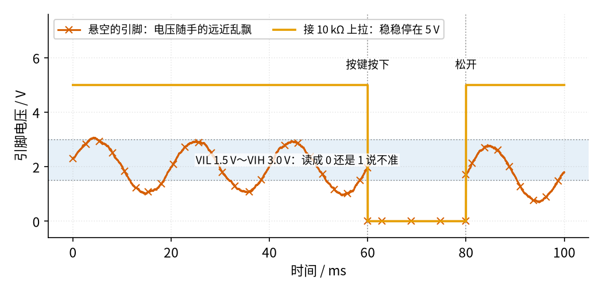
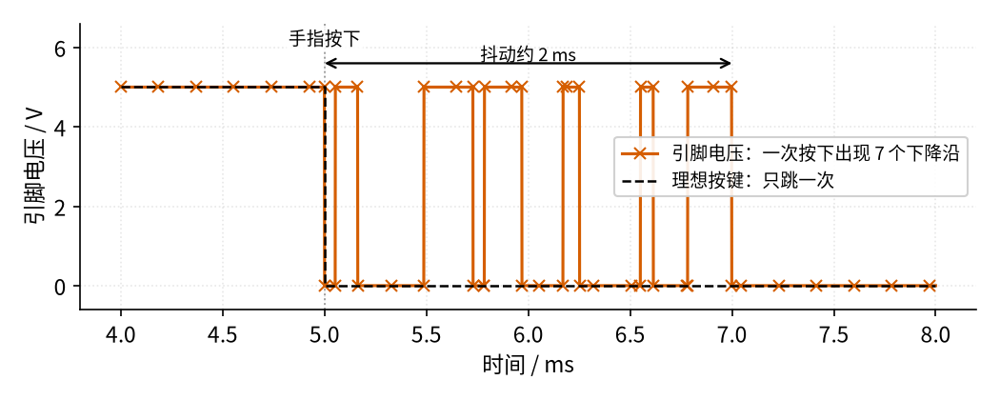
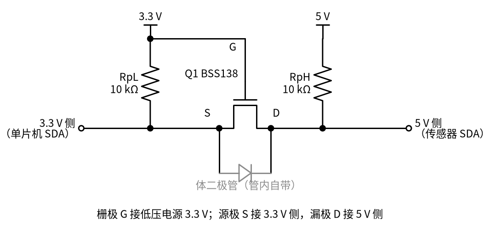

# 26 上拉/下拉电阻与电平转换 · 直觉篇

[上一页：24 隔离电源与数字隔离器 · 动手实验篇](../24-isolated-power/page4.md) · 本页：直觉篇 · [原理与实现篇](page2.md) · [参数与调试篇](page3.md) · [下一页：原理与实现篇](page2.md) · 前置节点：[P1 元件速成 · 原理与实现篇](../P1-components-basics/page2.md) · [14 电压比较器 · 原理与实现篇](../14-voltage-comparator/page2.md) · [21 MOS 管开关 · 原理与实现篇](../21-mosfet-switch/page2.md)

## 痛点：按键没按，单片机却说「按了」

做一个最简单的实验：单片机的一个输入引脚接一只按键，按键另一端接地。按下时引脚接地，读到 0；松开时……读到什么？很多初学者以为松开就是 1，结果程序里的读数一会儿 0、一会儿 1，手靠近板子时乱得更厉害。

第二个麻烦在按下那一刻。明明只按了一下，程序却数到三四次，菜单一下子跳过好几项。

第三个麻烦出现在两种芯片之间：单片机用 3.3 V 供电，传感器用 5 V 供电，两根信号线能不能直接接在一起？直接接，5 V 会灌进 3.3 V 的引脚；就算没烧，3.3 V 的高电平送到 5 V 芯片那里，也可能不够「高」，对方认不出来。

这三个问题看起来不相干，其实都和「引脚在没人驱动时该是什么电平」有关。解决它们靠的都是几只普通电阻，再加一个电容或一只小 MOS 管。

## 类比：门上的弹簧

把输入引脚想成一扇没装锁的门。没有人推它时，门在风里晃来晃去，你说不清它是开着还是关着，这就是**悬空**的引脚：它和电源、地都没有连接，电压由周围的电场、手的远近、空气湿度决定。

给门装一根**弹簧**，没人推时门总被拉回「关」的位置；有人推门，人的力气比弹簧大，门就开了，松手后又被拉回来。电路里的弹簧就是一只接到电源的电阻，叫**上拉电阻**：没人驱动时，它把引脚拉到高电平；按键按下时，按键把引脚直接接地，按键「力气」大得多，引脚变成低电平。如果弹簧换个方向，平时把门推向「开」，就是接到地的**下拉电阻**，此时按键要接到电源那一端。

弹簧的软硬要合适：

- 弹簧太硬（电阻太小），人推门很费劲，对应按下按键时有很大的电流白白流到地，费电；
- 弹簧太软（电阻太大），门被风一吹还会晃，松手后也要很久才合上，对应抗干扰差、电平回升很慢。

下面这张图比较了两种情况。没有上拉电阻时，引脚电压像无人看管的门一样乱飘；接上 10 kΩ 上拉以后，它稳稳地停在 5 V：

*图 26-p1-1　悬空的引脚和接了上拉电阻的引脚（示意，干扰按人手靠近、0.5 pF 杂散电容估算）*

图 26-p1-1 里浅蓝色带是单片机「说不准」的区间：以 ATmega328P 为例，5 V 供电时低于 1.5 V 才保证读成 0，高于 3.0 V 才保证读成 1。朱红色带 × 的曲线是悬空引脚，大约一半时间落在这个区间，读数就是随机的。橙色曲线接了 10 kΩ 上拉，同样的干扰在它上面只剩几十微伏，可以忽略。两条线在按键按下的 60～80 ms 都是 0 V，区别只在没按的时候。

## 按一下，跳七下：按键抖动

按键里面是两片金属。手指按下时，金属片撞在一起会弹开、再撞上、再弹开，持续零点几毫秒到几毫秒才停稳。Jack Ganssle 实测了 18 种开关（[A Guide to Debouncing](https://www.ganssle.com/debouncing.htm)），大部分在几毫秒内停止抖动，个别的长达上百毫秒。单片机读一次引脚只要不到 1 μs，它把每一次弹跳都看得清清楚楚：

*图 26-p1-2　按键按下后前 3 ms 的引脚电压（示意波形，抖动时长按实测平均值量级取 2 ms）*

图 26-p1-2 中黑色虚线是理想按键，只从 5 V 跳到 0 V 一次；朱红色带 × 的实际波形在 2 ms 里出现了 7 个下降沿（电压从高电平跳到低电平的那一下），程序如果「见到下降沿就计一次」，就会以为按了 7 次。办法有两类：一是在硬件上加一个电容，让电压变化慢下来，再交给带回差的施密特输入，这正是 [14 电压比较器 · 直觉篇](../14-voltage-comparator/page1.md) 里用回差消除反复翻转的思路；二是在程序里等抖动结束再确认。下一页会把两种方法都算清楚。

## 3.3 V 和 5 V 之间：一只 MOS 管当「翻译」

很多芯片之间的信号线是**开漏**的：芯片只会把线「拉低」或「松手」，从不主动推高，高电平全靠上拉电阻。常见的 I²C 总线就是这样，两根线上挂着好几颗芯片，谁想发 0 就把线拉低。

既然高电平是电阻给的，那么 3.3 V 那一边用电阻拉到 3.3 V，5 V 那一边用电阻拉到 5 V，中间再放一只 N 沟道 MOS 管，就能让两边「看见」对方的拉低动作，各自的高电平又互不干扰：

*图 26-p1-3　单 MOS 管双向电平转换（按 NXP/Nexperia 应用笔记 AN10441 的电路画）*

图 26-p1-3 的道理可以分三种情况说：

1. **两边都松手**：Q1 的栅极 3.3 V，源极也被拉到 3.3 V，栅源电压为 0，Q1 关断。左边停在 3.3 V，右边停在 5 V，各管各的。
2. **3.3 V 一侧拉低**：源极变成接近 0 V，栅源电压约 3.3 V，超过门限，Q1 导通，右边也被拉低。
3. **5 V 一侧拉低**：漏极变低，管子里那只体二极管先导通，把源极也往下拉；源极一低，栅源电压就超过门限，Q1 跟着导通，左边被拉低。

这和 [21 MOS 管开关 · 直觉篇](../21-mosfet-switch/page1.md) 里「栅源电压够大就导通」是同一件事，只是这里栅极电压固定，靠源极电压的变化来开关。灰色画出来的体二极管是每只 MOS 管内部自带的（见 [21 MOS 管开关 · 直觉篇](../21-mosfet-switch/page1.md) 的介绍），平时容易被忽略，在这里却是第三种情况能工作的关键。

## 一句话

**没人驱动的引脚要用上拉或下拉电阻给它一个确定的电平；按键抖动用 RC 放慢、再用施密特门限或程序延时滤掉；开漏总线跨电压时，一只栅极接低压电源的 N 沟道 MOS 管加两边各自的上拉电阻，就能双向转换电平**。
