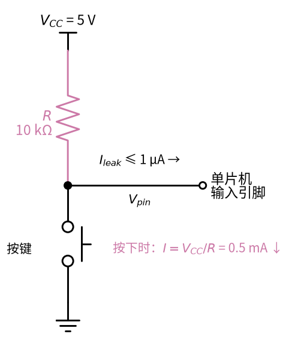
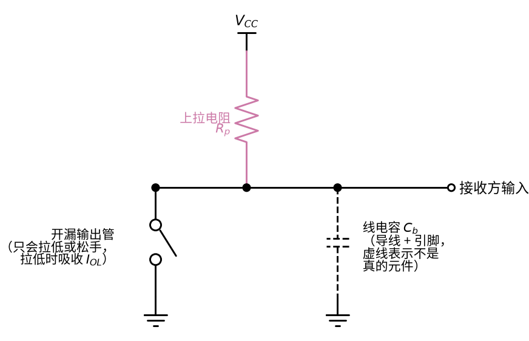
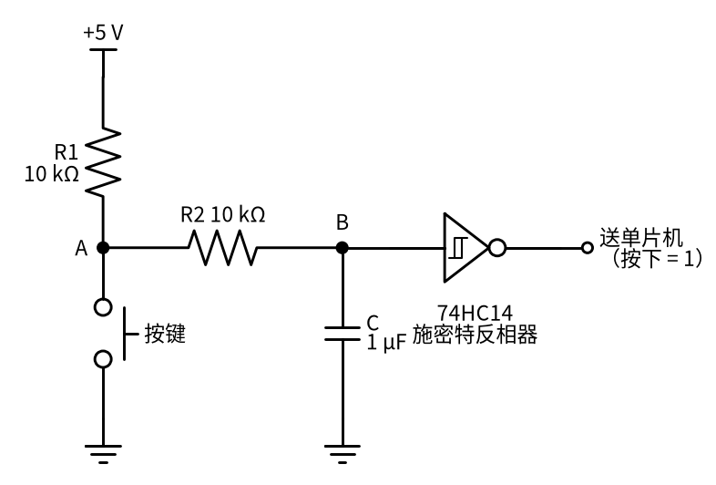
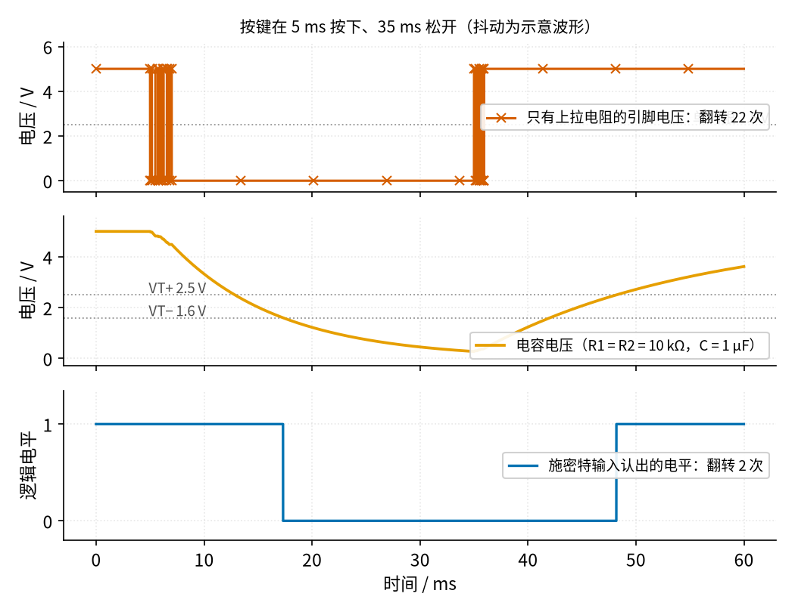
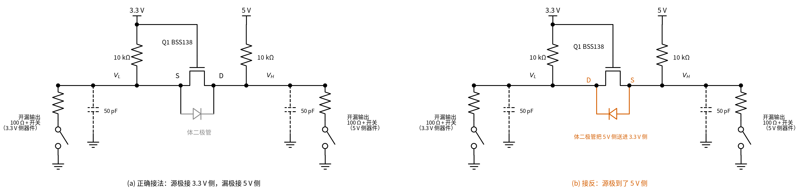
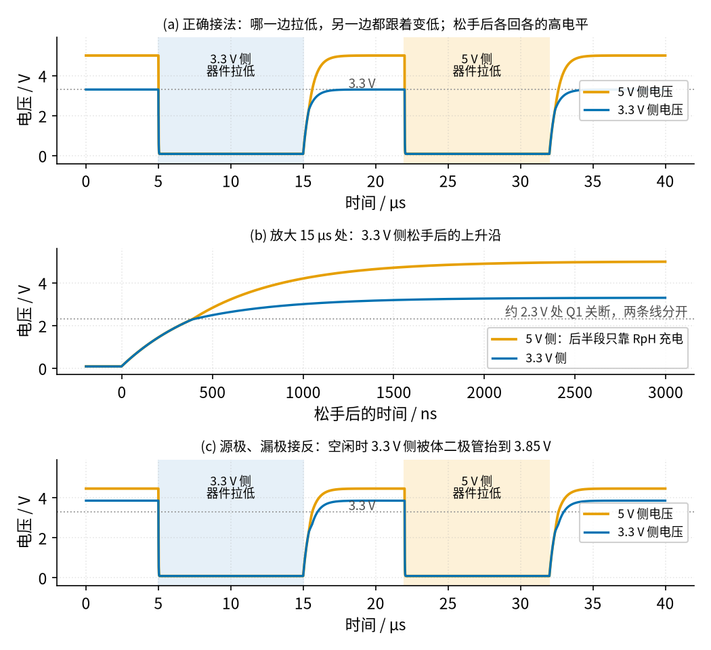
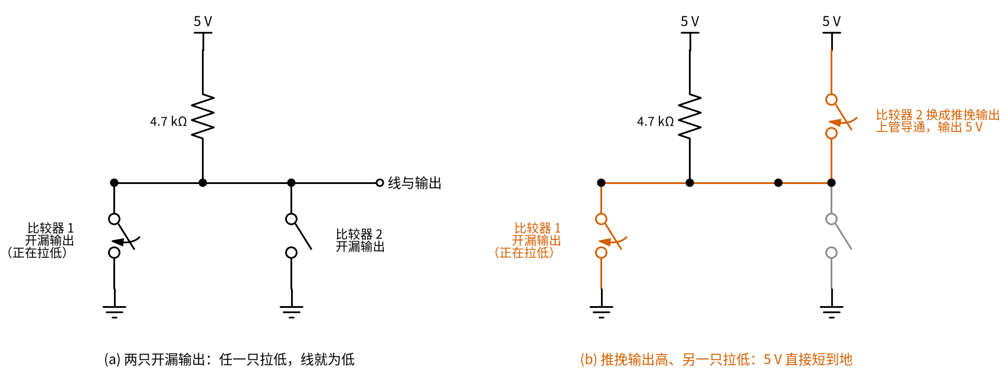

# 26 上拉/下拉电阻与电平转换 · 原理与实现篇

[上一页：直觉篇](page1.md) · [直觉篇](page1.md) · 本页：原理与实现篇 · [参数与调试篇](page3.md) · [下一页：参数与调试篇](page3.md) · 前置节点：[P1 元件速成 · 原理与实现篇](../P1-components-basics/page2.md) · [14 电压比较器 · 原理与实现篇](../14-voltage-comparator/page2.md) · [21 MOS 管开关 · 原理与实现篇](../21-mosfet-switch/page2.md)

## 最小知识

读这一页需要四样东西，前面几节都讲过：

- **输入门限**：数字输入不是「高于一半就算 1」那么简单。ATmega328P 数据手册写明，低于 $0.3 V_{CC}$ 保证读成 0，高于 $0.6 V_{CC}$ 保证读成 1，中间不作保证；它还说明输入漏电流不超过 1 μA，内部上拉电阻为 20～50 kΩ。
- **RC 充放电**（[P1 元件速成 · 原理与实现篇](../P1-components-basics/page2.md)）：电容经电阻从 $V_0$ 向 $V_\infty$ 变化时， $v(t) = V_\infty + (V_0 - V_\infty) e^{-t/\tau}$ ，其中 $\tau = RC$ 。
- **施密特门限**（[14 电压比较器 · 直觉篇](../14-voltage-comparator/page1.md)）：电压要升过上门限 $V_{T+}$ 才翻成 1，要降过下门限 $V_{T-}$ 才翻成 0。本页用 74HC14 施密特反相器，接 5 V。TI 数据手册只给出 4.5 V 和 6 V 两栏，典型值分别是 $V_{T+} = 2.5\text{ V}$ / $3.3\text{ V}$ 、 $V_{T-} = 1.6\text{ V}$ / $2.0\text{ V}$ ；按两栏线性插值到 5 V，得到 $V_{T+} \approx 2.77\text{ V}$ 、 $V_{T-} \approx 1.73\text{ V}$ ，本页都用这组 5 V 的值（TI 的 SN74HC14 SPICE 模型在 5 V 下也是这两个数）。
- **MOS 管导通条件**（[21 MOS 管开关 · 直觉篇](../21-mosfet-switch/page1.md)）：栅源电压 $V_{GS}$ 超过门限 $V_{GS(th)}$ 才导通。BSS138 的门限按 onsemi 手册是 0.8～1.5 V（典型 1.3 V），本页仿真用 Diodes 公司 BSS138 SPICE 模型里的 1 V。

## 推导一：上拉电阻上的两种电平

电路见图 26-p2-4：电源经上拉电阻 R 接到单片机输入引脚，按键从引脚接地。松手时只有很小的漏电流流进引脚，按下时电流全部经按键流到地：



*图 26-p2-4　推导一的电路：上拉电阻 R、引脚漏电流和按键*

**松手时**，引脚只有很小的漏电流 $I_{leak}$ 流过上拉电阻 $R$ ，引脚电压是

$$V_{pin} = V_{CC} - I_{leak} R$$

中文意思：**松手时引脚比电源只低「漏电流乘电阻」那么一点**。

取最坏的 1 μA 和内部上拉的上限 50 kΩ，只低 0.05 V；外接 10 kΩ 只低 0.01 V。所以上拉电阻在几十千欧以内，松手时一定读成 1。

**按下时**，按键把引脚接地，电阻上流过

$$I = \frac{V_{CC}}{R}$$

中文意思：**按住按键的整段时间，电源一直经上拉电阻往地里送这么多电流**。

5 V、10 kΩ 时是 0.5 mA；若换成 1 kΩ，就是 5 mA，电池供电的设备会明显吃亏。

## 推导二：上拉电阻决定上升沿有多快

开漏输出「松手」后，线上的杂散电容 $C_b$ （导线、引脚加起来，常见几十到几百皮法）只能经上拉电阻 $R_p$ 充电。开漏输出管只会把线拉低或者松手，不会主动输出高电平，电路见图 26-p2-5：



*图 26-p2-5　推导二的电路：开漏输出、上拉电阻和线电容*


$$v(t) = V_{CC}\left(1 - e^{-t/(R_p C_b)}\right)$$

中文意思：**松手后线电压按 RC 充电曲线从 0 爬向电源电压**。

I²C 规范把「上升时间」定义为从 $0.3 V_{CC}$ 升到 $0.7 V_{CC}$ 的时间。分别令 $v = 0.3 V_{CC}$ 和 $v = 0.7 V_{CC}$ ，解出两个时刻再相减：

$$t_r = R_p C_b \ln\frac{1 - 0.3}{1 - 0.7} = R_p C_b \ln\frac{0.7}{0.3} \approx 0.8473 R_p C_b$$

中文意思：**上升时间和上拉电阻成正比，电阻大一倍，上升沿就慢一倍**。

TI 应用笔记 SLVA689A 由此给出上拉电阻的上限和下限：

$$R_{p(max)} = \frac{t_r}{0.8473 C_b}, \qquad R_{p(min)} = \frac{V_{CC} - V_{OL(max)}}{I_{OL}}$$

式中 $I_{OL}$ 是输出管拉低时允许吸收的电流，I²C 规定 3 mA。

中文意思：**电阻太大，上升沿超过规范；电阻太小，输出管「拉不动」，低电平降不到 $V_{OL}$ 以下**。

I²C 快速模式（400 kHz）要求 $t_r \le 300\text{ ns}$ ，输出管在 3 mA 时 $V_{OL}$ 不超过 0.4 V。3.3 V、 $C_b = 200\text{ pF}$ 时， $R_{p(max)} = 300\text{ ns} / (0.8473 \times 200\text{ pF}) \approx 1.77\text{ kΩ}$ ， $R_{p(min)} = (3.3 - 0.4) / 3\text{ mA} \approx 967\text{ Ω}$ ，只能在 0.97～1.77 kΩ 之间挑。

## 推导三：RC 去抖要多久才认出按下和松开

下面的电路照 Ganssle《A Guide to Debouncing》第 2 部分的 RC 去抖电路画：R1 从 5 V 接到 A 点，按键从 A 接地，R2 从 A 接到电容，电容电压送进 74HC14：



*图 26-p2-1　RC 加施密特反相器的按键去抖电路*

图 26-p2-1 里，按键按下时 A 点接地，电容只能经 R2 放电，时间常数 $\tau_1 = R_2 C$ ；按键松开时，电容经 R1 和 R2 串联充电，时间常数 $\tau_2 = (R_1 + R_2) C$ 。R2 的作用是不让按键直接短路电容，否则接触瞬间的大电流会损伤触点，电容也会在一次短暂的接触里被放光，失去「放慢」的作用。

**按下**：电容从 5 V 放电，降到 $V_{T-}$ 时 74HC14 翻转，

$$t_{press} = R_2 C \ln\frac{V_{CC}}{V_{T-}}$$

中文意思：**按下后要等电容电压降过下门限，等待时间等于 R2·C 乘一个对数系数**。

**松开**：电容从接近 0 V 开始充电，升到 $V_{T+}$ 时翻回，

$$t_{release} = (R_1 + R_2) C \ln\frac{V_{CC}}{V_{CC} - V_{T+}}$$

中文意思：**松开后要等电容电压升过上门限，充电要经过两只电阻，所以通常比按下时慢**。

代入 $R_1 = R_2 = 10\text{ kΩ}$ 、 $C = 1\text{ μF}$ 和 5 V 门限： $t_{press} = 10\text{ ms} \times \ln(5/1.73) \approx 10.6\text{ ms}$ ， $t_{release} = 20\text{ ms} \times \ln(5/2.23) \approx 16.1\text{ ms}$ 。用 TI 的 SN74HC14 模型做 SPICE 仿真，得到 10.4 ms 和 16.3 ms，相差不到 2%。两者都比常见的几毫秒抖动长，又远低于 Ganssle 说的「50 ms 以内人感觉不到延迟」。

抖动期间触点时通时断，电容电压会往回弹一点，但只要没有越过另一个门限，施密特输入就不会翻转，这就是回差在这里的作用。

## 推导四：电平转换管什么时候导通

[直觉篇](page1.md) 电平转换电路里那只 Q1 的栅极固定接 3.3 V，源极接 3.3 V 一侧的线电压 $V_L$ ，所以

$$V_{GS} = 3.3\text{ V} - V_L \gt V_{GS(th)} \quad\Longleftrightarrow\quad V_L \lt 3.3\text{ V} - V_{GS(th)}$$

中文意思：**低压侧线电压低于「3.3 V 减门限」时管子导通，两边连在一起；高于它时管子关断，两边各走各的**。按仿真用的模型门限 1 V，这个分开点是 $3.3\text{ V} - 1\text{ V} = 2.3\text{ V}$ ；按 onsemi 手册的典型 1.3 V 则是 2.0 V。门限随管子不同，分开点也会差几百毫伏。

5 V 一侧拉低时，Q1 一开始是关断的，靠体二极管（正极在源极、负极在漏极）把 $V_L$ 拉到「高压侧电压加 0.6 V 左右」，一旦 $V_L$ 低于约 2.3 V，沟道导通，把 $V_L$ 拉到和高压侧几乎一样低。

## 代数小结

| 量 | 公式 | 本节数值 | 记忆要点 |
|---|---|---|---|
| 松手时引脚电压 | $V_{CC} - I_{leak} R$ | 5 V − 1 μA × 10 kΩ = 4.99 V | 漏电流小，几乎等于电源 |
| 按下时电流 | $V_{CC} / R$ | 5 V / 10 kΩ = 0.5 mA | 电阻越小越费电 |
| 上升时间 | $0.8473 R_p C_b$ | 1.5 kΩ、200 pF：254 ns | 电阻越大越慢 |
| 上拉下限 | $(V_{CC} - V_{OL}) / I_{OL}$ | 3.3 V：967 Ω | 输出管要拉得动 |
| 按下判定时间 | $R_2 C \ln(V_{CC}/V_{T-})$ | 10.6 ms | 只经 R2 放电 |
| 松开判定时间 | $(R_1+R_2) C \ln(V_{CC}/(V_{CC}-V_{T+}))$ | 16.1 ms | 经两只电阻充电 |
| 电平转换导通条件 | $V_L \lt V_{DD1} - V_{GS(th)}$ | 低于约 2.3 V（门限 1 V） | 栅极接低压电源 |

## 仿真一：按键抖动经过 RC 和施密特门限

下面这段程序把推导三变成数字：先随机生成一段按下、松开时各带抖动的触点状态（抖动时长取 Ganssle 实测的毫秒量级，是示意波形），然后一步一步算电容电压，最后按施密特门限判断。图里有中文标签，所以开头借用教程的 figstyle 设置中文字体（不然中文会显示成方框）；请在仓库根目录运行，需要 numpy 和 matplotlib，图存在当前目录：

```python
import sys, pathlib
sys.path.insert(0, str(pathlib.Path("code/figs").resolve()))  # 在仓库根目录运行
import figstyle                         # 只借用它设置中文字体
import numpy as np                      # 数值计算
import matplotlib                       # 画图库
matplotlib.use("Agg")                   # 不弹窗口，直接存图
import matplotlib.pyplot as plt

VCC, VTP, VTM = 5.0, 2.77, 1.73         # 电源；74HC14 上门限、下门限（5 V 典型值，插值）
R1, R2, C = 10e3, 10e3, 1e-6            # 去抖电路取值
DT = 2e-6                               # 每步 2 µs
t = np.arange(0, 60e-3, DT)
rng = np.random.default_rng(3)

# 1. 触点状态：5 ms 按下、35 ms 松开，之后各抖动 2 ms、1 ms
closed = (t >= 5e-3) & (t < 35e-3)
for t0, dur, final in [(5e-3, 2e-3, True), (35e-3, 1e-3, False)]:
    tt, state = t0, final
    while tt < t0 + dur:                # 抖动期间「接通 / 断开」交替出现
        seg = rng.uniform(20e-6, dur / 5)
        closed[(t >= tt) & (t < min(tt + seg, t0 + dur))] = state
        tt, state = tt + seg, not state

# 2. 电容电压：按下时经 R2 放电，松开时经 R1+R2 充电（每步用指数精确解）
vc = np.empty(len(t)); v = VCC
for k, s in enumerate(closed):
    v = v * np.exp(-DT / (R2 * C)) if s else VCC + (v - VCC) * np.exp(-DT / ((R1 + R2) * C))
    vc[k] = v

# 3. 施密特输入：高于上门限才算 1，低于下门限才算 0，中间保持原状
logic = np.empty(len(t), dtype=int); s = 1
for k, x in enumerate(vc):
    s = 0 if (s == 1 and x < VTM) else 1 if (s == 0 and x > VTP) else s
    logic[k] = s

raw = np.where(closed, 0, 1)            # 只接上拉电阻时读到的电平
print("只接上拉：翻转", np.count_nonzero(np.diff(raw)), "次")
print("RC + 施密特：翻转", np.count_nonzero(np.diff(logic)), "次")
k1 = np.argmax(logic == 0); k2 = k1 + np.argmax(logic[k1:] == 1)
print(f"按下后 {(t[k1] - 5e-3) * 1e3:.1f} ms 认出按下，松开后 {(t[k2] - 35e-3) * 1e3:.1f} ms 认出松开")

fig, ax = plt.subplots(2, 1, figsize=(6, 4), sharex=True)
ax[0].plot(t * 1e3, raw * VCC, label="只接上拉")
ax[0].plot(t * 1e3, vc, label="电容电压")
ax[0].axhline(VTP, ls=":"); ax[0].axhline(VTM, ls=":")
ax[1].plot(t * 1e3, logic, label="施密特输出")
ax[1].set_xlabel("时间 / ms"); ax[0].set_ylabel("电压 / V"); ax[1].set_ylabel("逻辑")
ax[0].legend(); ax[1].legend()
fig.tight_layout()
fig.savefig("debounce.png", dpi=100)
print("已保存 debounce.png")
```

运行后会打印：只接上拉时翻转 22 次，RC 加施密特只翻转 2 次（一次按下、一次松开），约 11.5 ms 认出按下、约 15.5 ms 认出松开。仓库里的 `code/26_sim.py` 用同样的模型画出下面的图 26-p2-2：



*图 26-p2-2　按键抖动经过 RC 和施密特门限：上层只有上拉电阻，中层电容电压，下层施密特输入认出的电平*

图 26-p2-2 上层朱红色带 × 的曲线是只有上拉电阻时引脚的电压，按下和松开处各是一团密集的跳变。中层橙色曲线是电容电压，抖动只在它上面留下几个小台阶；两条灰色点线分别是 2.77 V 和 1.73 V 门限。下层蓝色曲线是施密特输入认出的电平，只在电容电压越过门限时各翻转一次。

仿真得到的 11.5 ms 比推导的 10.6 ms 多约 1 ms，因为前 2 ms 抖动里触点有一半时间是断开的，放电「打了折扣」；松开的 15.5 ms 比 16.1 ms 略短，因为电容在 30 ms 里只放到约 0.25 V，没有到 0，充电起点高了一点。两处差别都不到 1 ms，说明推导的公式可以直接用来选元件。把同一段抖动波形交给 TI 的 SN74HC14 SPICE 模型，得到 11.4 ms 和 15.7 ms，和这里的结果相差不到 2%。

## 仿真二：电平转换管两个方向的动作

`code/26_sim.py` 里还有一个 MOS 管电平转换模型（函数 `level_shifter`）：BSS138 的门限和导通能力取自 Diodes 公司的 BSS138 SPICE 模型（门限 1 V），体二极管 0.6 V 起导通，没有计入管子自身的结电容；两边各 10 kΩ 上拉、各 50 pF 线电容；两边的器件都是开漏输出，导通电阻 100 Ω。先让 3.3 V 一侧在 5～15 μs 拉低，再让 5 V 一侧在 22～32 μs 拉低，运行 `code/26_sim.py` 会打印下面用到的 0.08 V、404 ns 后 2.31 V 分开、接反时 3.85 V 这几个数；图 26-p2-3 由 `code/figs/26_figs.py` 调用同一个函数画出。模型的电路见图 26-p2-6，左边是正确接法，右边是源极、漏极接反的接法（推导四的电路也是左边这张）：



*图 26-p2-6　仿真二的模型电路：(a) 正确接法，(b) 源极、漏极接反*




*图 26-p2-3　单 MOS 管电平转换的仿真：(a) 正确接法，(b) 上升沿放大，(c) 源漏接反*

图 26-p2-3 中橙色是 5 V 一侧的线电压，蓝色是 3.3 V 一侧的线电压：

- **(a) 正确接法**：浅蓝底色那段是 3.3 V 一侧在拉低，浅黄底色那段是 5 V 一侧在拉低。两段时间里两条线都降到约 0.08 V，无论哪一边先动手，另一边都跟着变低；松手后蓝色回到 3.3 V、橙色回到 5 V，各自的高电平互不干扰。
- **(b) 上升沿放大**：两条线先一起上升，约 404 ns 后升到 2.31 V，与推导四的「3.3 V − 1 V = 2.3 V 时关断」一致；之后 Q1 关断，橙色只靠自己那只 10 kΩ 继续充到 5 V。用完整的 Diodes SPICE 模型仿真，分开点同样是 2.32 V，但要约 0.77 μs 才到：管子自身有几十 pF 的结电容，和 50 pF 线电容是同一量级，把上升沿拖慢了将近一倍。
- **(c) 源极、漏极接反**：源极到了 5 V 一侧，体二极管变成从 5 V 侧指向 3.3 V 侧，空闲时把蓝色抬到 3.85 V，比 3.3 V 电源还高。拉低功能看起来照常，所以这种错误很容易被忽略，3.3 V 的芯片却一直在承受过压。

## 例题

**例 1（完整示范）**：一个 3.3 V 单片机经 BSS138 电平转换接 5 V 传感器的 I²C 总线，跑 100 kHz 标准模式（ $t_r \le 1000\text{ ns}$ ），5 V 一侧线电容估计 150 pF。5 V 一侧的上拉电阻可以取多大的范围？

<details><summary>答案</summary>

1. 上限： $R_{p(max)} = 1000\text{ ns} / (0.8473 \times 150\text{ pF}) \approx 7.87\text{ kΩ}$ 。
2. 下限：输出管 3 mA 时 $V_{OL} \le 0.4\text{ V}$ ， $R_{p(min)} = (5 - 0.4) / 3\text{ mA} \approx 1.53\text{ kΩ}$ 。
3. 所以 1.53～7.87 kΩ 都可以，常用值 4.7 kΩ 落在中间， $t_r = 0.8473 \times 4.7\text{ kΩ} \times 150\text{ pF} \approx 597\text{ ns}$ ，线被拉低时电流 $5 / 4.7 \approx 1.06\text{ mA}$ 。

</details>

**例 2（留空练习）**：图 26-p2-1 的电路把 C 换成 0.47 μF，R1、R2 仍为 10 kΩ。按下判定时间 = ____ ms；松开判定时间 = ____ ms；如果最长抖动是 6.2 ms，按下判定时间是否仍然比它长：____。

<details><summary>答案</summary>

按下 $4.7\text{ ms} \times \ln(5/1.73) \approx 5.0\text{ ms}$ ；松开 $9.4\text{ ms} \times \ln(5/2.23) \approx 7.6\text{ ms}$ （SPICE 4.9 ms、7.7 ms）；按下判定时间 5.0 ms 比 6.2 ms 短。不过施密特门限还有回差把关：只要抖动中触点断开的时间不足以让电容回升到 2.77 V，输出就不会多翻，参数与调试篇的扫描会说明这个时间常数仍然够用。

</details>

**例 3（变体迁移）**：直觉篇的电平转换要求两边都是开漏输出。现在有两只比较器的开漏输出接到同一根线上，共用一只 4.7 kΩ 上拉到 5 V（[14 电压比较器 · 参数与调试篇](../14-voltage-comparator/page3.md) 的窗口比较器就是这样接的）。线上什么时候是高电平？如果其中一只换成推挽输出（能主动输出 5 V），会出什么问题？

<details><summary>答案</summary>

两种接法见图 26-p2-7：左边两只开漏输出共用 4.7 kΩ 上拉，右边比较器 2 换成推挽输出。



*图 26-p2-7　例 3：(a) 两只开漏输出的线与，(b) 一只换成推挽输出时的短路路径*

两只都「松手」时线才为高，只要任一只拉低，线就为低，相当于两个输出做了「与」运算，叫**线与**。如果换成推挽输出，它输出高电平 5 V 时，另一只恰好拉低，两只输出管就经过一段几乎没有电阻的导线把 5 V 直接短到地，电流只受管子内阻限制，可能烧坏芯片。所以线与和 I²C 总线上只能接开漏（或开集电极）输出，高电平统一交给上拉电阻。

</details>
