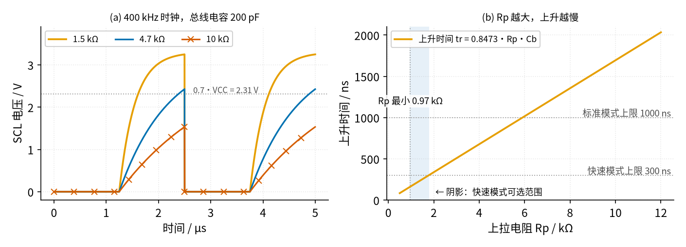
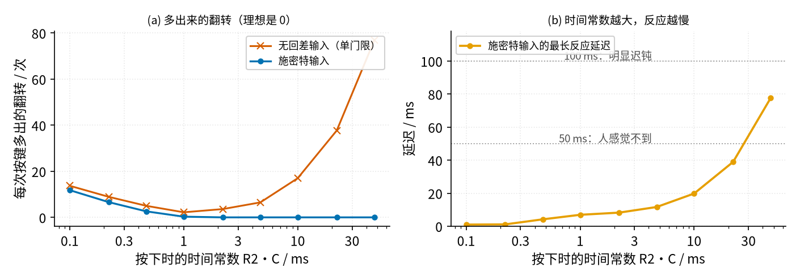

# 26 上拉/下拉电阻与电平转换 · 参数与调试篇

[上一页：原理与实现篇](page2.md) · [直觉篇](page1.md) · [原理与实现篇](page2.md) · 本页：参数与调试篇 · 本页是课程最后一页 · 前置节点：[P1 元件速成 · 原理与实现篇](../P1-components-basics/page2.md) · [14 电压比较器 · 原理与实现篇](../14-voltage-comparator/page2.md) · [21 MOS 管开关 · 原理与实现篇](../21-mosfet-switch/page2.md)

## 本页要解决的问题

上一页把公式都推出来了。真正动手时还要回答：上拉电阻取 4.7 kΩ 还是 10 kΩ？去抖的时间常数到底多大才够，又不至于让按键反应迟钝？电平转换的管子随便找一只 N 沟道 MOS 管行不行？电路不正常时先查哪里？

## 1. 参数含义与常见取值

| 参数 | 含义 | 常见取值 | 取值依据 |
|---|---|---|---|
| 内部上拉 $R_{PU}$ | 单片机引脚里自带的上拉 | 20～50 kΩ（ATmega328P） | 数据手册；不用外接元件，但偏「软」，抗干扰一般 |
| 按键外接上拉 | 按键、拨码开关的上拉 | 4.7～10 kΩ | 按下电流 0.5～1 mA；松手电平几乎等于电源 |
| I²C 上拉 $R_p$ | 开漏总线的上拉 | 3.3 V、200 pF 快速模式：0.97～1.77 kΩ | SLVA689A 的上限、下限公式 |
| 总线电容 $C_b$ | 导线和各引脚电容之和 | 几十～400 pF | 标准模式、快速模式上限都是 400 pF |
| 74HC14 门限 | 施密特输入的上、下门限 | 4.5 V 时典型 2.5 V / 1.6 V | 最小、最大值范围很宽：上门限 1.55～3.13 V，下门限 0.9～2.45 V |
| 去抖时间 | 硬件或软件等抖动结束的时间 | 20～50 ms | Ganssle：设计按 20 ms 留余量，50 ms 以内人感觉不到 |
| BSS138 门限 | 电平转换管 $V_{GS(th)}$ | 0.8 / 1.3 / 1.5 V（最小 / 典型 / 最大） | 低压侧电源要比最大门限高出足够多 |
| BSS138 导通电阻 | $R_{DS(on)}$ | $V_{GS} = 4.5\text{ V}$ 时典型 1.0 Ω、最大 6.0 Ω | 手册的值是在 4.5 V 下测的；本电路 $V_{GS} \le 3.3\text{ V}$ ，导通电阻会更大，但仍远小于几 kΩ 的上拉，导通时两边几乎等电位，结论不变 |
| BSS138 耐压、电流 | $V_{DS}$ 、 $I_D$ | 50 V、0.22 A | 对 5 V 信号绰绰有余 |

几点说明：

- **74HC14 的门限分散很大**。上门限最小 1.55 V、最大 3.13 V，设计去抖时要按最坏情况核算：按下判定时间用 $V_{T-}$ 的最大值 2.45 V 算会变短，松开判定时间用 $V_{T+}$ 的最大值 3.13 V 算会变长。
- **电容的误差也大**。Ganssle 提醒电解电容常见 +80% / −20%，陶瓷电容约 ±30%，时间常数要留出这部分余量。
- **低压侧电源不能太低**。导通时 $V_{GS}$ 最多等于低压侧电源电压。3.3 V 减去 BSS138 最大门限 1.5 V 还剩 1.8 V，管子能可靠导通；低压侧只有 1.8 V 时余量就很小了，应当查手册换门限更低的管子。

## 2. 扫描一：上拉电阻从 0.5 kΩ 到 12 kΩ

在 3.3 V、总线电容 200 pF、400 kHz 时钟下，比较三种上拉电阻，再把上升时间画成上拉电阻的函数，结果见图 26-p3-1。上升时间就是推导里的 $0.8473 R_p C_b$ ，可以自己用计算器核对；图中的数字也由 `code/figs/26_figs.py` 打印（以 p3_1 开头的行）：

*图 26-p3-1　上拉电阻扫描：(a) 三种上拉的时钟波形，(b) 上升时间与上拉电阻的关系*

图 26-p3-1 的左图里，橙色 1.5 kΩ 的上升时间 254 ns，半个周期结束时已升到 3.25 V；蓝色 4.7 kΩ 的上升时间 796 ns，半个周期结束时 2.43 V，刚刚越过灰色点线 0.7 VCC = 2.31 V，已经超出快速模式 300 ns 的规定；朱红色带 × 的 10 kΩ 上升时间 1695 ns，半个周期结束时只有 1.53 V，接收方根本看不到高电平。右图的橙色直线说明上升时间和电阻成正比，两条灰色点线分别是快速模式的 300 ns 和标准模式的 1000 ns 上限，竖线是 967 Ω 的下限。浅蓝色阴影就是快速模式能用的范围，只有 0.97～1.77 kΩ 这么窄；换成 100 kHz 的标准模式，上限放宽到 5.9 kΩ。

所以「上拉一律 10 kΩ」只适合按键这种慢信号；高速总线要按速度和电容算。

## 3. 扫描二：去抖时间常数从 0.1 ms 到 47 ms

让 R1 = R2 = R、C = 1 μF，R 从 100 Ω 扫到 47 kΩ。每个取值都模拟 20 次按键，每次按下、松开的抖动时长在 0.5～6.2 ms 之间随机（示意，6.2 ms 取自 Ganssle 实测的最长值）。同一个电容电压分别交给施密特输入和「只有一个 2.5 V 门限、线上叠加 20 mV 噪声」的普通输入（噪声是示意值），统计每次按键多出的翻转次数和最长反应延迟，结果见图 26-p3-2。下面的数字由 `code/figs/26_figs.py` 打印（以 p3_2 开头的行）；抖动和噪声都用了固定的随机种子，所以每次运行结果都一样，可以在仓库根目录运行 `python code/figs/26_figs.py` 复现（它会重新生成同样的配图）：

*图 26-p3-2　去抖时间常数扫描：(a) 每次按键多出的翻转，(b) 最长反应延迟*

图 26-p3-2 的左图中，蓝色施密特输入的曲线从 0.1 ms 时每次多翻 12.5 次，降到 1 ms 时的 0.6 次，2.2 ms 以上为 0。朱红色带 × 的单门限曲线在 1 ms 附近最低（每次多翻 2.2 次），时间常数再大反而越来越糟，47 ms 时每次多翻约 77 次：电容电压变化越慢，它在门限附近停留越久，20 mV 的噪声就能让输入来回翻转。这正是 Ganssle 强调「绝不要把 RC 直接接到没有回差的单片机引脚上」的原因。

右图的橙色曲线是施密特输入的最长反应延迟。10 ms 时最长 17.5 ms，22 ms 时 33.9 ms，都在灰色点线 50 ms 以下；47 ms 时 66.9 ms，开始让人觉得迟钝。本节选的 10 ms 正好在「不多翻」和「反应快」之间。

## 4. 故障排查表

| 现象 | 原因 | 怎么查 | 怎么改 |
|---|---|---|---|
| 按键没按时读数乱跳，手靠近更明显 | 输入悬空，没有上拉或下拉 | 断电量引脚到电源、到地有没有电阻；程序里看是否开启了内部上拉 | 外接 10 kΩ 上拉或下拉，或打开内部上拉 |
| 按一次计数好几次 | 按键抖动没有处理 | 示波器单次触发看按下瞬间的波形 | 加 RC 和施密特门、或软件每 1～5 ms 采样、连续 20～50 ms 一致才确认 |
| 加了 RC，计数反而更乱 | RC 直接接到没有回差的引脚，慢变化的电压在门限附近被噪声反复触发 | 查手册看该引脚有无施密特输入；示波器看电容电压是否缓慢穿过门限 | RC 后面加 74HC14 之类的施密特门，或去掉 RC 改用软件去抖 |
| I²C 时通时不通，速度一高就出错 | 上拉电阻太大或总线太长，上升沿太慢 | 示波器量 0.3～0.7 VCC 的上升时间，和 300 ns / 1000 ns 比 | 按 $R_{p(max)}$ 公式减小上拉，或降低速率、缩短导线 |
| 低电平只降到 0.6 V 以上，偶尔读错 | 上拉电阻太小，输出管拉不下来 | 量低电平电压，算 $V_{CC}/R_p$ 是否超过 3 mA | 增大上拉到 $R_{p(min)}$ 以上；多个模块各带一组上拉时只留一组 |
| 电池设备待机电流大 | 上拉电阻长时间被拉低（如常闭开关、拉低的总线） | 逐个断开上拉电阻看电流变化 | 改用大阻值或内部上拉，或改成常开接法，睡眠前把引脚设成不耗电的状态 |
| 电平转换后 3.3 V 侧空闲电压高于 3.3 V | MOS 管源极、漏极接反，体二极管从 5 V 侧往 3.3 V 侧送电 | 量 3.3 V 侧空闲电压；对照手册引脚图确认 S、D | 源极接低压侧、漏极接高压侧，栅极接低压电源 |
| 电平转换后一侧始终为高、拉不下来 | 栅极接到了高压电源或悬空，或某一侧没有上拉 | 量栅极电压和两侧上拉电阻 | 栅极接低压侧电源，两侧各接一只上拉 |
| 按键接到中断引脚（一出现下降沿就打断正在运行的程序、先去处理它的引脚）后程序偶尔跑飞 | 没去抖的按键在中断里连续触发 | 在中断里计数，看一次按下触发多少次 | Ganssle 建议不要把未去抖的开关接中断引脚或触发器（一种数字存储电路，每来一个时钟边沿就动作一次）的时钟端，先去抖再接 |

## 5. 练习

**练习 1（易）**：门磁开关在门关着时一直闭合，把单片机引脚拉到地，上拉电阻 10 kΩ 接 3 V 电池。仅这一只上拉电阻，每天消耗多少毫安时？如果电池可用容量是 220 mAh（示意值），只算这一项能撑多少天？换成 1 MΩ 呢？

答案

10 kΩ：电流 $3 / 10\text{ kΩ} = 0.3\text{ mA}$ ，每天 $0.3 \times 24 = 7.2\text{ mAh}$ ，约 30 天就耗光。1 MΩ：电流 3 μA，每天 0.072 mAh，约 3000 天。代价是 1 MΩ 太「软」，松开时只要有 0.5 μA 的漏电流就会掉 0.5 V，抗干扰也差，最好配合硬件去抖电容使用，或者改用门开着才闭合的常开接法。

**练习 2（中）**：5 V 的 I²C 标准模式总线（ $t_r \le 1000\text{ ns}$ ），总线电容 300 pF，输出管 3 mA 时 $V_{OL} \le 0.4\text{ V}$ 。上拉电阻的范围是多少？在 2.2 kΩ 和 3.3 kΩ 中你会选哪个？

答案

上限 $1000\text{ ns} / (0.8473 \times 300\text{ pF}) \approx 3.93\text{ kΩ}$ ，下限 $(5 - 0.4) / 3\text{ mA} \approx 1.53\text{ kΩ}$ 。两个都在范围内。3.3 kΩ 的上升时间 $0.8473 \times 3.3\text{ kΩ} \times 300\text{ pF} \approx 839\text{ ns}$ ，离上限只有 16% 余量；2.2 kΩ 是 559 ns，余量大得多，低电平电流 2.3 mA 也没超过 3 mA。总线电容是估计值，选 2.2 kΩ 更稳。

**练习 3（难）**：按 Ganssle 的保守值，希望按键按下后至少 20 ms 才确认，松开后不超过 50 ms 确认。C = 1 μF，74HC14 门限按典型值 2.5 V / 1.6 V，电源 5 V。R2、R1 各取多大？再用 74HC14 下门限的最大值 2.45 V 核算一遍按下判定时间。

答案

1. $R_2 = 20\text{ ms} / (1\text{ μF} \times \ln(5/1.6)) \approx 17.6\text{ kΩ}$ ，取标准值 18 kΩ，按下判定时间 $18\text{ ms} \times 1.139 \approx 20.5\text{ ms}$ 。
2. 松开： $(R_1 + R_2) \times 1\text{ μF} \times \ln 2 \le 50\text{ ms}$ ，得 $R_1 + R_2 \le 72\text{ kΩ}$ ，所以 $R_1 \le 54\text{ kΩ}$ 。取 $R_1 = 18\text{ kΩ}$ 时松开判定约 $36\text{ ms} \times 0.693 \approx 25\text{ ms}$ 。
3. 下门限 2.45 V 时，按下判定时间 $18\text{ ms} \times \ln(5/2.45) \approx 12.8\text{ ms}$ ，比 20 ms 短了不少，但仍大于 6.2 ms 的最长抖动；若一定要保证 20 ms，就要按 2.45 V 重新算 R2（约 28 kΩ）。

**练习 4（难，变体迁移）**：只需要把一个 5 V 芯片的推挽输出送给 3.3 V 芯片（单方向），有人用 10 kΩ 和 20 kΩ 两只电阻分压。分压后的高电平是多少？3.3 V 芯片输入电容按 10 pF 算，上升沿的时间常数是多少？这种接法能不能反过来用，把 3.3 V 的信号送给 5 V 芯片？

答案

1. 高电平 $5 \times 20 / (10 + 20) \approx 3.33\text{ V}$ ，正好适合 3.3 V 输入。
2. 从 3.3 V 输入看进去，分压器可以等效成「3.33 V 电源串一个内阻」，内阻就是两只电阻的并联（这是戴维南等效，做法见 [P1 元件速成 · 原理与实现篇](../P1-components-basics/page2.md) 第七节）。直觉上：5 V 输出是一个固定电压，它不会跟着电容的充放电变化，对「变化的那部分电流」来说就像接地，所以输入电容同时经 10 kΩ（通向 5 V 输出）和 20 kΩ（通向地）两条路充放电，两条路并在一起。等效电阻 $10 \times 20 / 30 \approx 6.67\text{ kΩ}$ ，时间常数 $6.67\text{ kΩ} \times 10\text{ pF} \approx 67\text{ ns}$ ，几百 kHz 的信号没问题，再快就要减小电阻（代价是 5 V 输出为高时一直有 $5 / 30\text{ kΩ} \approx 0.17\text{ mA}$ 的电流）。
3. 不能反过来用：分压只能降低电压，3.3 V 的信号经过分压只会更低。而且分压是单向的，不能用在 I²C 这种两边都要拉低的线上，那里仍要用原理与实现篇讨论过的上拉加 MOS 管电平转换。

## 小结与下一步

- 悬空输入一定要接上拉或下拉。按键用 4.7～10 kΩ，或打开内部 20～50 kΩ 上拉；电池设备要算一算上拉电阻被长时间拉低时的耗电。
- 上拉电阻有上下限：太大，上升沿慢，速度上不去；太小，费电而且输出管拉不下来。I²C 按 $R_{p(max)}$ 、 $R_{p(min)}$ 两个公式挑。
- 硬件去抖是 RC 加施密特门，按下、松开的判定时间分别用 $R_2 C \ln(V_{CC}/V_{T-})$ 和 $(R_1+R_2) C \ln(V_{CC}/(V_{CC}-V_{T+}))$ 估算；没有回差的引脚不要直接接 RC。
- 双向电平转换：源极接低压侧、漏极接高压侧、栅极接低压电源，两边各一只上拉。

本节是整套课程阅读顺序的最后一个节点，没有下一页了。上拉电阻和开漏输出在前面已经出现过：[14 电压比较器 · 参数与调试篇](../14-voltage-comparator/page3.md) 的开集电极输出要靠上拉电阻，[21 MOS 管开关 · 直觉篇](../21-mosfet-switch/page1.md) 的栅极电阻和这里的上拉一样决定了开关快慢。想换个方向复习，可以回到 [课程首页](../README.md) 按依赖图挑一个节点重新读。

## 参考资料

- TI，*I2C Bus Pullup Resistor Calculation*（SLVA689A）：<https://www.ti.com/lit/an/slva689/slva689.pdf>
- Nexperia，*Level shifting techniques in I2C-bus design*（AN10441）：<https://assets.nexperia.com/documents/application-note/AN10441.pdf>
- onsemi，BSS138 数据手册：<https://www.onsemi.com/pdf/datasheet/bss138-d.pdf>
- TI，SN74HC14 数据手册：<https://www.ti.com/lit/ds/symlink/sn74hc14.pdf>
- Microchip，ATmega328P（汽车级）数据手册：<https://ww1.microchip.com/downloads/en/DeviceDoc/Atmel-7810-Automotive-Microcontrollers-ATmega328P_Datasheet.pdf>
- Jack Ganssle，*A Guide to Debouncing*，第 1 部分 <https://www.ganssle.com/debouncing.htm>，第 2 部分 <https://www.ganssle.com/debouncing-pt2.htm>
