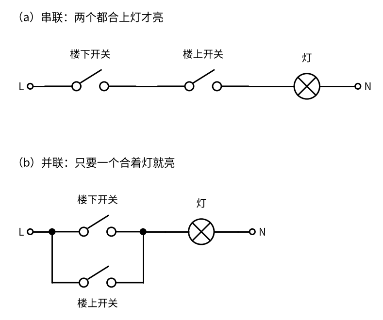
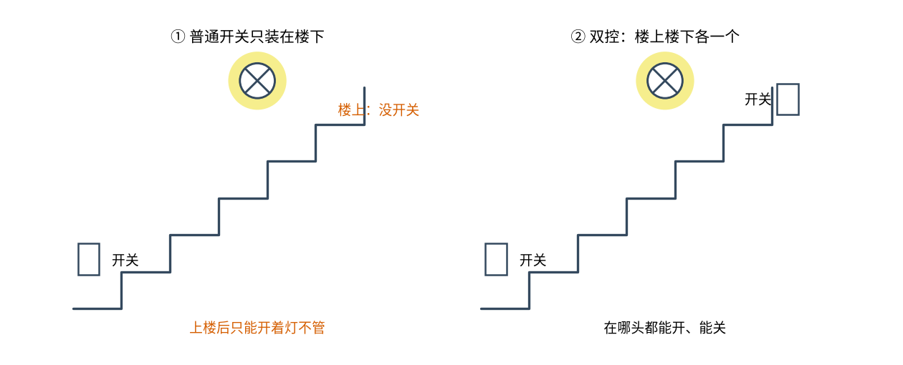
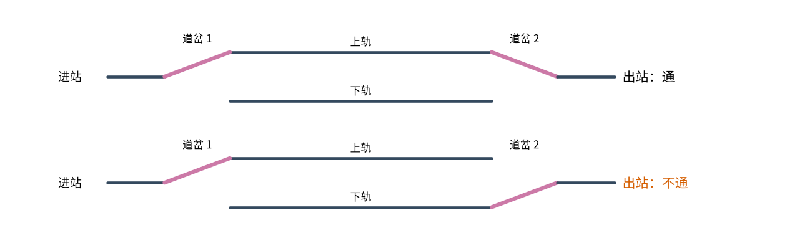
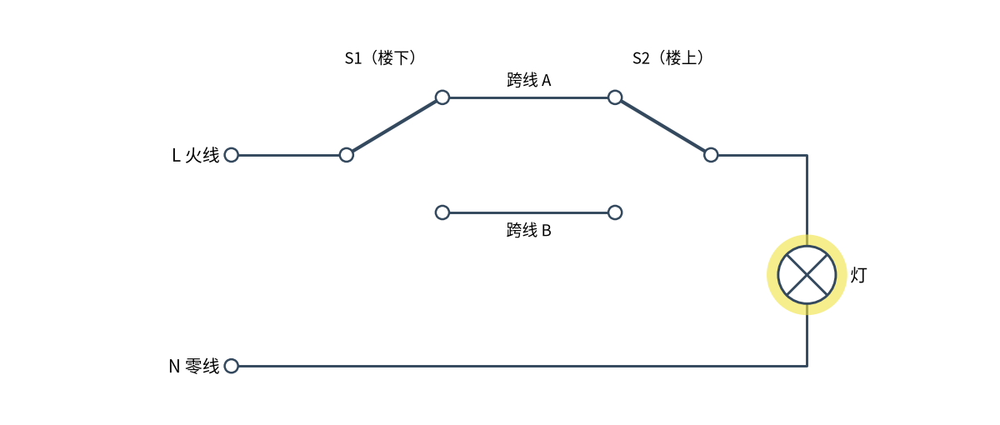

# 27 双控开关 · 直觉篇

[上一页：26 H 桥电机驱动 · 动手实验篇](../26-h-bridge/page4.md) · 本页：直觉篇 · [原理与实现篇](page2.md) · [参数与调试篇](page3.md) · [下一页：原理与实现篇](page2.md) · 前置节点：[01 元件速成 · 直觉篇](../01-components-basics/page1.md)

> [!WARNING]
> **市电危险**：本电路的实际版本接 220V/380V 市电，触电可能致命。本页的仿真和动手实验只在 12V 以下的低压电源上进行；任何接线、改线都必须在断电并验电后操作，由持证电工完成。
>
> 本节点特有的危险点：① 墙上的双控开关盒里，**灯关着的时候也有导线带电**：火线一直接在一只开关上，两根跨线里总有一根带电；② 开关如果错接在零线上，灯照样能开能关，看不出毛病，但灯灭时灯头仍然带 220 V，换灯泡时最容易出事；③ 只关墙上的开关不等于断电，动手前必须断开配电箱里对应的断路器并验电。

## 一、痛点：楼下开了灯，上楼以后怎么关？

家里的楼梯、长走廊、卧室门口和床头，都有同一个麻烦：**进去的时候在这头开灯，出来的时候在那头关灯**。

如果只在楼下装一个普通开关（见图 27-p1-1 左边），上楼前开灯没问题，到了楼上就只剩两个选择：开着灯不管，或者再摸黑走下来关。装两个普通开关也不行：两个开关串联，必须两个都合上灯才亮，楼上的人关了灯，楼下的人就开不了；两个开关并联，只要有一个合着，另一个就关不掉。

两个普通开关的串联和并联接法画在图 27-p1-4 里。

*图 27-p1-4　两个普通开关控制一盏灯：（a）串联　（b）并联*

图 27-p1-4（a）里电流要依次穿过两个开关，任何一个断开灯就灭，所以楼上关掉以后楼下打不开。（b）里两个开关是两条并排的路，只要一条通着灯就亮，所以另一个人关不掉。两种接法都做不到"拨任意一个灯就翻转"。

*图 27-p1-1　只在楼下装开关与上下各装一个开关的对比*

我们想要的是图 27-p1-1 右边：**不管另一个开关现在拨在哪边，拨一下手边的开关，灯就从亮变灭或者从灭变亮**。这叫"双控"，也叫"两地控制"。

## 二、类比：铁路上的两个道岔

把电流想成一列火车。火车从左边进站，从右边出站。中间铺了两条平行的轨道，叫"上轨"和"下轨"。两头各有一个道岔，道岔只能把火车引到上轨或下轨中的一条。

看图 27-p1-2：上面一行，两个道岔都扳到上轨，火车走上轨开出去，结果是通的；下面一行，左边的道岔扳到上轨，右边的扳到下轨，火车在上轨走到尽头发现没路了，结果是**不通**。

*图 27-p1-2　两个道岔指向同一条轨道，火车才过得去*

关键在这里：无论现在是通还是不通，**只要扳动任意一个道岔，"两个道岔是否指向同一条轨"就会反过来**，于是通变不通、不通变通。图 27-p1-2 下面一行只要把右边的道岔扳回上轨，就和上面一行一样了。

## 三、看一张完整的电路

把道岔换成开关，把两条轨道换成两根导线，就是双控开关电路，见图 27-p1-3。

*图 27-p1-3　双控电路：两只单刀双掷开关和两根跨线*

图 27-p1-3 里的两只开关都叫**单刀双掷开关**：中间那个能转动的"刀"一端固定在公共端，另一端只能搭在两个触点中的一个上（01 里讲过，开关就是用手把电路接通或断开，见 [01 元件速成 · 直觉篇](../01-components-basics/page1.md)；单刀双掷开关不是"通或断"，而是在两条路之间二选一）。两只开关之间的两根导线叫**跨线**，作用就是那两条轨道。

图中 S1 的刀搭在跨线 A 上，S2 的刀也搭在跨线 A 上，电流从火线 L 出发，经 S1、跨线 A、S2、灯，回到零线 N，灯亮。这时：

- 在楼下拨 S1：S1 改搭跨线 B，两把刀不在同一根线上，灯灭；
- 或者在楼上拨 S2：效果一样，灯灭。

灭了以后再拨任意一只，两把刀又回到同一根跨线上，灯又亮。

要数"拨过几次"，得先定一个起点。电工装好以后交房时，习惯让灯处在**灭**的状态，我们就把这时两只开关的位置叫"出厂位置"：S1 的刀搭在跨线 A 上，S2 的刀搭在跨线 B 上。注意，图 27-p1-3 画的不是出厂位置，而是从出厂位置拨过 S2 一次、灯已经亮了的状态。从灯灭的出厂位置开始，用 0 和 1 记两只开关"有没有被拨过"，灯的状态就是两者的**异或**（意思是"两者不一样"）：一个拨过、一个没拨过，灯亮；都没拨或者都拨过，灯灭。四种情况可以列成一张表：

| S1 拨过没有 | S2 拨过没有 | S1 的刀在 | S2 的刀在 | 灯 |
|---|---|---|---|---|
| 0（没拨） | 0（没拨） | 跨线 A | 跨线 B | 灭（出厂位置） |
| 1（拨过） | 0（没拨） | 跨线 B | 跨线 B | 亮 |
| 0（没拨） | 1（拨过） | 跨线 A | 跨线 A | 亮（就是图 27-p1-3） |
| 1（拨过） | 1（拨过） | 跨线 B | 跨线 A | 灭 |

从表里任何一行出发，只改一只开关（也就是只改一列里的 0 或 1），都会跳到灯的状态相反的另一行。这就是"拨任意一只，灯都翻转"。表里没有任何一行要求"另一只开关必须在某个位置"，所以楼上楼下的人谁也不用管对方刚才拨成了什么样。

还要注意图 27-p1-3 的一个细节：开关在**火线**一侧，灯在零线一侧。这不是随便画的，国家标准要求"相线（就是火线）应经开关控制"，下一页的仿真会说明接反了会怎样。

## 四、一句话总结

**双控开关就是两只单刀双掷开关加两根跨线：两把刀搭在同一根跨线上灯就亮，拨任意一只都会让灯翻转**。下一页用一个小程序把四种开关组合全部列出来，画成状态图，再看三种常见的接错法各会出什么毛病。

## 参考资料

- Wikipedia，Multiway switching（两只单刀双掷开关加一对跨线实现两地控制，四种组合中两种亮灯）：https://en.wikipedia.org/wiki/Multiway_switching
- Samotech，How to wire a 2-way light switch (UK)（每只开关有 COM、L1、L2 三个端子，火线进第一只的 COM，第二只的 COM 去灯）：https://www.samotech.co.uk/guides/wiring/how-to-wire-2-way-light-switch-uk/
- GB 50303-2015《建筑电气工程施工质量验收规范》第 20.1.4 条（相线应经开关控制）：https://gf.cabr-fire.com/article-19525.htm
