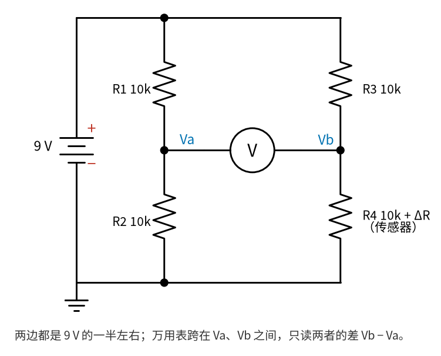
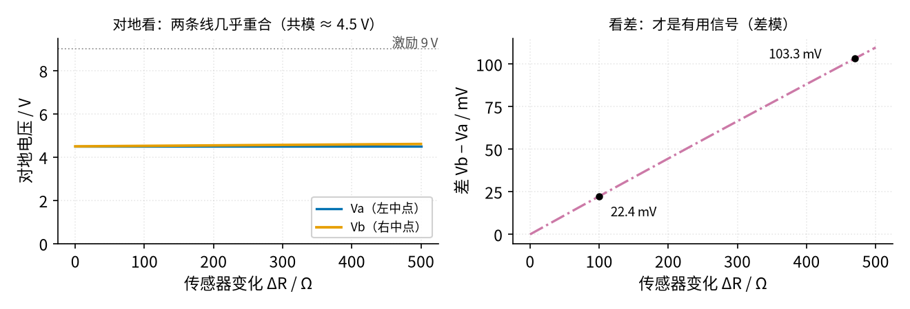
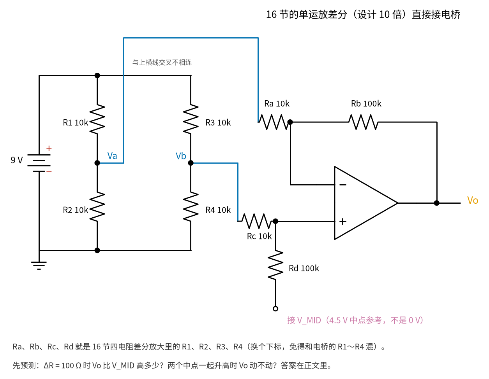
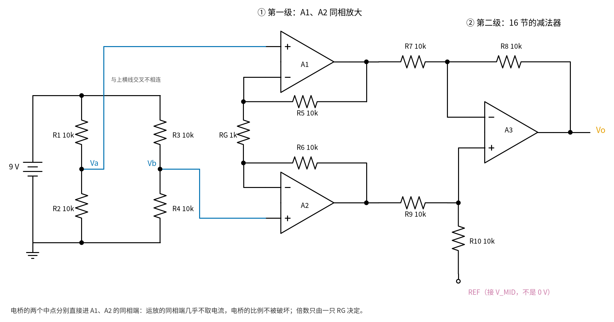
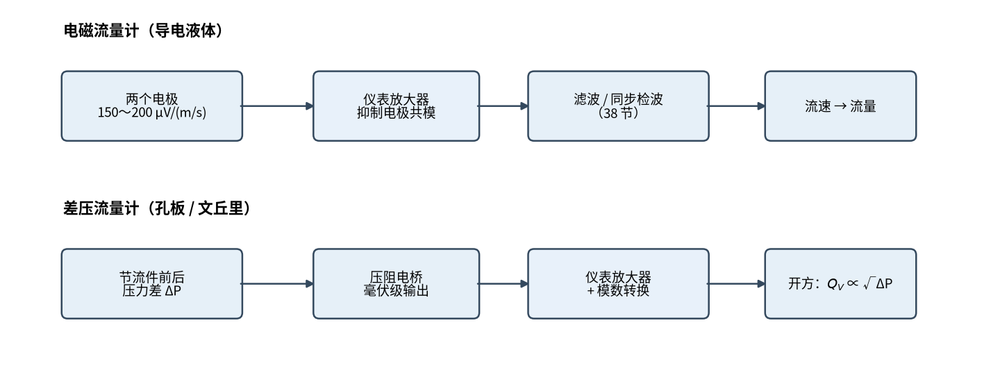

# 30 仪表放大器与电桥 · 直觉篇

[上一页：29 上拉/下拉电阻与电平转换 · 动手实验篇](../29-pullup-level-shift/page4.md) · 本页：直觉篇 · [原理与实现篇](page2.md) · [参数与调试篇](page3.md) · [动手实验篇](page4.md) · [下一页：原理与实现篇](page2.md) · 前置节点：[16 差分放大 · 原理与实现篇](../16-differential-amp/page2.md)、[12 电压跟随器 · 直觉篇](../12-voltage-follower/page1.md)、[08 同相放大 · 直觉篇](../08-noninverting-amp/page1.md)

> **开头三问**（先猜，读完本节再回来对答案）
>
> 1. 用 [16 差分放大](../16-differential-amp/page2.md) 那只"设计 10 倍"的单运放差分放大直接接电桥，ΔR = 100 Ω 时输出是多少？真的是 10 × 22.4 mV 吗？
> 2. 电桥两个中点一起从 4.5 V 升到 6 V 左右（差不变），输出该不该动？实际会动多少？
> 3. 单电源 9 V 的电路里，输出"围绕 4.5 V 上下摆"，这个 4.5 V 是从哪儿来的，能不能当成地？

## 痛点：几毫伏的信号，骑在几伏的"底子"上

从这一节开始，我们沿着工业流量计的信号链往前走。第一站是"前端放大"：传感器送来的电压太小，要先放大到几伏，后面的滤波、比较、模数转换（把电压变成数字交给单片机或电脑）才有东西可处理。

难点不在"小"，而在"小的东西骑在大的东西上"：

- **差压流量计、压力变送器**：里面的压力传感器是一个**电桥**（四只电阻接成一圈，[16 差分放大 · 直觉篇](../16-differential-amp/page1.md) 已经见过）。管道里的压力一变，其中一只电阻变一点点，两个中点之间就出现毫伏级的电压差；可两个中点各自对地都在激励电压的一半左右，比如 4.5 V。
- **电磁流量计**：导电的液体流过磁场，两个电极之间感应出电压，每 1 m/s 流速只有 150～200 μV；而两个电极对地还带着几百毫伏到 ±2 V 的直流（电极和液体接触产生的"极化电压"），以及 50 Hz 干扰（数据来自 ADI 的文章 https://www.analog.com/en/resources/analog-dialogue/articles/electromagnetic-flow-meters.html ）。

两种情况一个模样：有用的是两根线之间的**差**（差模），要扔掉的是两根线上**一样的部分**（共模）。[16 差分放大 · 直觉篇](../16-differential-amp/page1.md) 已经给出了"只放大差"的办法——四电阻差分放大，也在 [16 差分放大 · 原理与实现篇](../16-differential-amp/page2.md) 例 3 里提前露了一面三运放仪表放大器。这一节把那道例题展开成一节课：为什么工业仪表的前端几乎都用它，它的"抗干扰能力"由什么决定，又有什么限制。

打个比方：你要称一只信封的重量，可它放在一辆 2 吨重的卡车上。直接称整车，信封的几十克被 2 吨的零头淹没；聪明的办法是称两次——放信封和不放信封——只看两次之差。电桥就是"同时称两次"的秤，仪表放大器就是只看差、不看车重的读数员。

## 一、电桥：把"电阻变一点点"变成"两点之间的电压差"

先看 图 30-p1-1。左右两列各是一个分压器（ [01 元件速成 · 直觉篇](../01-components-basics/page1.md) 讲过的两只电阻串联）：左边 R1、R2 都是 10 kΩ，中点 Va 正好是 9 V 的一半 4.5 V；右边 R3 是 10 kΩ，R4 是传感器，平时也是 10 kΩ，中点 Vb 也是 4.5 V。

*图 30-p1-1　电桥：两个分压器并排，中间只看差*

传感器一受力（或受热），R4 多出一点 ΔR，右边分压器的下半段变大，Vb 就比 4.5 V 高一点点，而 Va 不动。图 30-p1-1 里的电压表跨在两个中点之间，读到的就是 Vb − Va。用数字算一次：ΔR = 100 Ω（也就是 1%）时，Vb = 9 × 10.1/20.1 ≈ 4.5224 V，差是 22.4 mV。

为什么不直接量 Vb 对地？因为 4.5224 V 和 4.5000 V 只差 0.5%，电池电压只要变化 1%（9 V 变 90 mV），Vb 对地就变约 45 mV，比这 22 mV 还大。而两个中点都跟着电池一起变，差值几乎不受影响——这就是电桥的好处。

## 二、共模大、差模小：一张图看清

图 30-p1-2 把这件事画出来：横轴是传感器的变化 ΔR，从 0 到 500 Ω。

*图 30-p1-2　电桥输出：对地看几乎不变，看差才有信号*

图 30-p1-2 左边，Va、Vb 两条对地电压几乎叠在 4.5 V 上，这就是**共模**——两根线一样的部分，约 4.5 V；右边是两者之差，ΔR = 100 Ω 时 22.4 mV、470 Ω 时 103.3 mV，这才是**差模**信号。共模是差模的约 200 倍，放大器必须把差模放大、把共模挡住。

## 三、先试最直接的办法：把 16 节的差分放大接上去

[16 差分放大 · 原理与实现篇](../16-differential-amp/page2.md) 的四电阻差分放大就是"只放大差"的，最自然的想法是把它直接接到电桥上，见 图 30-p1-3。请先停下来预测一下：设计倍数 10 倍（Ra = Rc = 10 kΩ、Rb = Rd = 100 kΩ），ΔR = 100 Ω 时输出应该是 224 mV 吗？两个中点一起升高时，输出会不会动？图里的 Ra、Rb、Rc、Rd 就是 16 节的 R1、R2、R3、R4，换个下标只是为了不和电桥的 R1～R4 混在一起。

**想好了再往下读。**

*图 30-p1-3　典型错误：单运放差分放大直接接电桥*

按 code/30_sim.py 第 6 节逐个节点算（运放当理想的），图 30-p1-3 这个接法暴露出两个毛病：

1. **倍数被电桥的内阻吃掉一截**。电桥中点不是理想电压源：从 Va 往回看，R1、R2 并联，相当于串着 5 kΩ 的内阻（ [01 元件速成 · 直觉篇](../01-components-basics/page1.md) 的并联公式）。它和 10 kΩ 的 Ra、Rc 串在一起，输入电阻变成 15 kΩ，倍数从 10 掉到 6.67，ΔR = 100 Ω 时只得 149 mV，而不是 224 mV。你可以把倍数调大补回来，但电桥内阻随传感器变化，补不准。
2. **共模漏进来，比信号还显眼**。设两个中点一起从 4.5 V 升到 6.06 V，也就是升高 1.56 V、差不变（ [30 仪表放大器与电桥 · 动手实验篇](page4.md) 的共模测试做得更多：用一只电阻把两个中点在 2.94 V 和 6.06 V 之间来回切换，变化 3.125 V），四只电阻用最普通的 1% 精度、偏差都朝最坏方向：输出漂 44.6 mV，相当于 ΔR = 100 Ω 那份信号的 30%。换句话说，"车重"变一点，读数员就以为信封重了三成。

这两条在 [16 差分放大 · 参数与调试篇](../16-differential-amp/page3.md) 已经露过苗头。按 ADI 的教程 MT-061（ https://www.analog.com/media/en/training-seminars/tutorials/MT-061.pdf ），用四只 1% 电阻、倍数为 1 的差分放大，最坏只有约 34 dB 的共模抑制能力，也就是共模只被压小约 50 倍。下面的仪表放大器把这两个毛病一起治好；同样 1.56 V 的共模变化，它的输出只漂约 31 mV，折合到输入只有 1.47 mV，而 图 30-p1-3 的接法折合到输入是 6.70 mV（数字都来自 code/30_sim.py 第 6 节）。

## 四、仪表放大器：先缓冲放大，再相减

办法分两步，看 图 30-p1-4。

*图 30-p1-4　仪表放大器 = 两个同相放大 + 一个差分放大*

- **第一步，两个同相放大（A1、A2）**。Va、Vb 都进运放的同相端，像 [12 电压跟随器 · 直觉篇](../12-voltage-follower/page1.md) 一样几乎不取电流，电桥的内阻不再影响结果。两个反相端之间跨一只 RG：差模在 RG 上产生电流，被放大 21 倍（R = 10 kΩ、RG = 1 kΩ 时）；共模让 RG 两端一样高，没有电流，**只被原样传过去，不被放大**。
- **第二步，一个差分放大（A3）**。把 A1、A2 的输出相减，得到对参考电压 V_MID 的输出。这时差模已经大了 21 倍，共模还是原来那么大，"信号对干扰"的比例先变好了 21 倍，差分级再减一次。

图 30-p1-4 里的 REF（参考端）画成一个空心端点，旁边写着接 V_MID：输出 Vo 是对 REF 的电压。在单电源 9 V 的实验里，REF 接的 V_MID 是用分压加跟随器做出的 4.5 V 中点参考，输出围绕它上下摆。V_MID 怎么做、为什么它不是真正的地，见 [30 仪表放大器与电桥 · 原理与实现篇](page2.md) 第五节。图 30-p1-4 中 Va 那根线要越过电桥上方的导线才能到 A1，图上标了"交叉不相连"，提醒你线交叉不等于连在一起。

## 五、它在流量计里站在哪里

图 30-p1-5 是两种流量计的信号链。

*图 30-p1-5　仪表放大器在两种流量计里的位置*

图 30-p1-5 上一行，电磁流量计的电极信号先进仪表放大器，挡掉几百毫伏的共模，再交给后面的滤波和 [38 同步检波（电磁流量计） · 直觉篇](../38-synchronous-demod/page1.md)。下一行，差压流量计的压力电桥输出毫伏级信号，放大后数字化，最后还要开平方，因为流量和压差不是正比关系（ [30 仪表放大器与电桥 · 参数与调试篇](page3.md) 第四节会算给你看）。

## 新手常见误解

- **"差分放大就够了，仪表放大器只是多两个运放"**：多出来的两个运放带来了高输入电阻和"先放大差模、不放大共模"，在差分级电阻配对完全相同的前提下，整机共模抑制比比"只有差分级"高 20 lg 21 ≈ 26 dB——同样的共模误差，折算到输入只剩二十一分之一（这里拿来比较的是"把第一级拿掉、只留差分级"，不是 图 30-p1-3 那种倍数还被电桥内阻吃掉的接法）。
- **"16 节的差分放大直接接电桥就行"**：图 30-p1-3 算过，倍数从 10 掉到 6.67，1.56 V 的共模变化还会让输出漂 44.6 mV，相当于信号的 30%。
- **"共模被仪表放大器放大了"**：没有。第一级只放大差，共模原样通过；A1、A2 输出的平均值仍是 4.5 V 左右。
- **"RG 越小越好，倍数越大越好"**：第一级倍数太大，电极的直流差（极化电压）也被放大，会把运放输出顶到头。ADI 的文章建议电磁流量计第一级一般不超过 10 倍。
- **"电桥输出和激励电压无关"**：恰恰相反，输出与激励成正比，所以要么激励很稳，要么让模数转换的参考也取自同一个激励（比例测量，见 [30 仪表放大器与电桥 · 原理与实现篇](page2.md)）。

## 一句话总结

**电桥把传感器的微小变化变成两点之间的毫伏级差，仪表放大器用两个同相放大先把差放大、让共模原样通过，再用差分级减掉共模；RG 一只电阻定倍数，输出围绕参考端 REF 摆动。**
