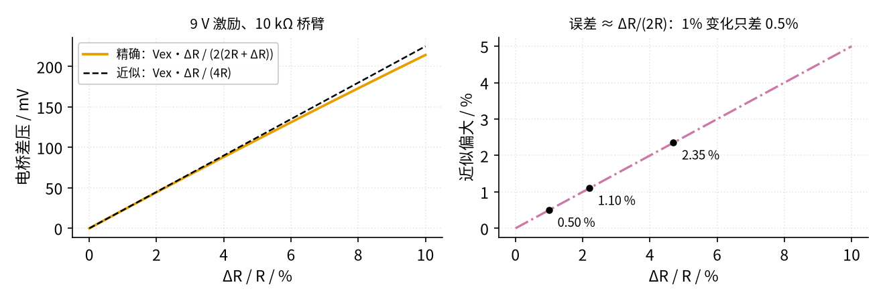
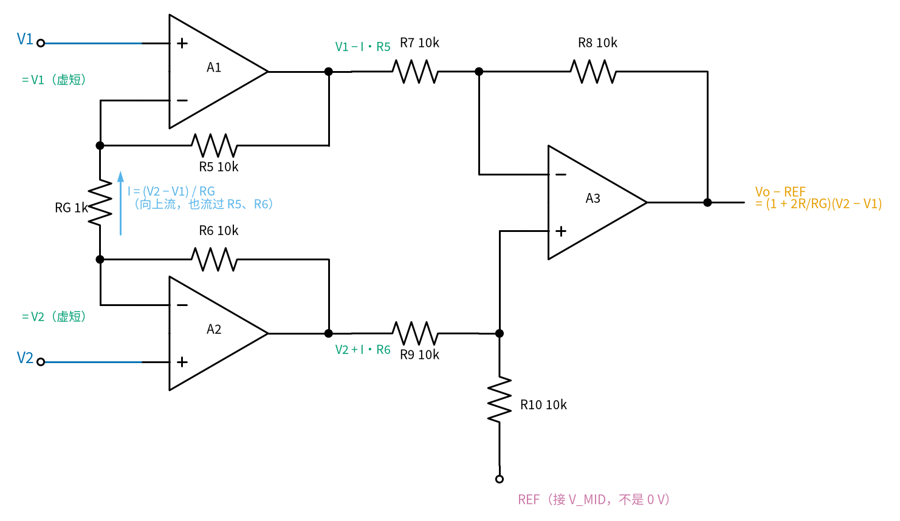
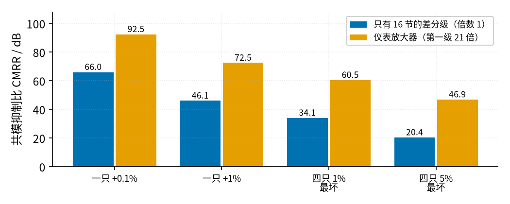
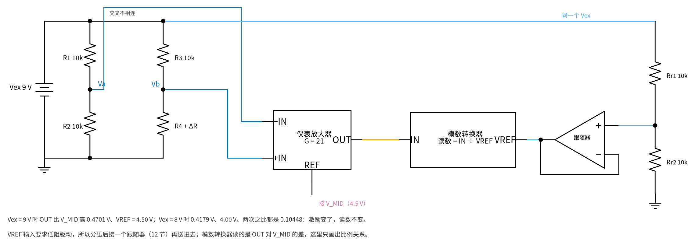
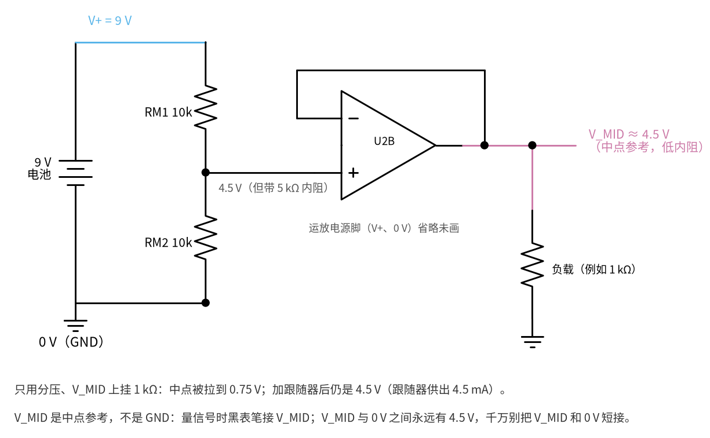

# 30 仪表放大器与电桥 · 原理与实现篇

[上一页：直觉篇](page1.md) · [直觉篇](page1.md) · 本页：原理与实现篇 · [参数与调试篇](page3.md) · [动手实验篇](page4.md) · [下一页：参数与调试篇](page3.md) · 前置节点：[16 差分放大 · 原理与实现篇](../16-differential-amp/page2.md)、[08 同相放大 · 原理与实现篇](../08-noninverting-amp/page2.md)、[12 电压跟随器 · 直觉篇](../12-voltage-follower/page1.md)

## 这一页要解决的问题

1. 电桥两个中点之间的差压到底多大？常见的"近似公式"差多少？
2. 三运放仪表放大器的倍数为什么是 $G = 1 + 2R/R_G$ ？A1、A2 的输出各是多少？
3. 电阻不准时，共模会漏进多少？为什么仪表放大器比单个差分放大强 26 dB？
4. 激励电压不稳怎么办——什么叫"比例测量"？
5. 单电源 9 V 里，输出围绕的 4.5 V 中点参考 V_MID 怎么做出来，为什么它不是地？

本页用到的都是已经学过的事：分压公式（ [01 元件速成 · 直觉篇](../01-components-basics/page1.md) ）、运放负反馈时的"虚短""虚断"（ [02 运放入门 · 直觉篇](../02-opamp-basics/page1.md) ），同相放大的倍数 1 + Rf/Rg（ [08 同相放大 · 直觉篇](../08-noninverting-amp/page1.md) ）、电压跟随器（ [12 电压跟随器 · 直觉篇](../12-voltage-follower/page1.md) ），以及四电阻差分放大的结论（ [16 差分放大 · 原理与实现篇](../16-differential-amp/page2.md) ）。

## 一、电桥差压：精确式与近似式

**中文意思**：两个中点各是一个分压器；左边 Va 是激励的一半，右边 Vb 因为下臂多了 ΔR 而稍高。两者相减就是差压。

**公式**：四臂都是 R、右下臂为 R + ΔR、激励为 $V_{ex}$ 时，

$$V_b - V_a = V_{ex}\frac{R+\Delta R}{2R+\Delta R} - \frac{V_{ex}}{2} = \frac{V_{ex}\Delta R}{2(2R+\Delta R)}$$

ΔR 远小于 R 时，分母里的 ΔR 可以忽略，得到常见的近似式：

$$V_b - V_a \approx \frac{V_{ex}}{4}\cdot\frac{\Delta R}{R}$$

**代一个数**：9 V 激励、R = 10 kΩ、ΔR = 100 Ω。精确式给 9 × 100 / (2 × 20100) = 22.388 mV；近似式给 9 / 4 × 0.01 = 22.500 mV，偏大 0.50%。



*图 30-p2-1　电桥差压：精确式与近似式，以及近似偏大多少*

图 30-p2-1 左边两条线在小变化时几乎重合；右边告诉你近似式偏大的比例约等于 ΔR/(2R)：ΔR/R = 1% 时偏 0.50%，2.2% 时偏 1.10%，4.7% 时偏 2.35%。实验里的 RX = 100、220、470 Ω 就落在 图 30-p2-1 的这三个点上。这也说明电桥本身有一点**非线性**——变化越大，输出越"跟不上"，精密仪表要么让变化保持很小，要么在软件里用精确式反算。

## 二、三运放仪表放大器的倍数

看 图 30-p2-2，一步一步来（ R5 = R6 = R、 R7 = R8 = R9 = R10 ）：



*图 30-p2-2　三运放仪表放大器：从虚短一步步推出倍数*

**第 1 步，虚短**：A1、A2 都有负反馈，所以反相端电压等于同相端，RG 上端是 $V_1$ ，下端是 $V_2$ 。

**第 2 步，RG 上的电流**： $I = \frac{V_2 - V_1}{R_G}$ 。运放输入端几乎不取电流（虚断），这股电流只能从 R6 流进、从 R5 流出，图 30-p2-2 中箭头标出了方向。

**第 3 步，两个输出**：A2 输出比 $V_2$ 高 $I R_6$ ，A1 输出比 $V_1$ 低 $I R_5$ ：

$$V_{A2} = V_2 + I R,\qquad V_{A1} = V_1 - I R$$

$$V_{A2} - V_{A1} = (V_2 - V_1) + 2IR = (V_2 - V_1)\left(1 + \frac{2R}{R_G}\right)$$

**第 4 步，差分级**：A3 是 [16 差分放大 · 原理与实现篇](../16-differential-amp/page2.md) 的四电阻差分放大，四只电阻相等时倍数为 1，参考端接 REF：

$$V_o - V_{REF} = \left(1 + \frac{2R}{R_G}\right)(V_2 - V_1)$$

**共模呢？** 如果 $V_1 = V_2$ （只有共模），RG 两端一样高， $I = 0$ ，A1、A2 输出都等于输入——共模被原样传过去，**倍数是 1**。差模却被乘了 $1 + 2R/R_G$ 。这就是仪表放大器的关键。

**代一个数**：R = 10 kΩ、 $R_G$ = 1 kΩ，倍数 1 + 20 = 21。实验电桥 RX = 100 Ω 时 $V_1$ = 4.5000 V、 $V_2$ = 4.5224 V，差 22.388 mV；电流 22.39 μA；A1 输出 4.5000 − 0.2239 = 4.2761 V，A2 输出 4.5224 + 0.2239 = 4.7463 V；输出对 V_MID 为 21 × 22.388 mV = 0.4701 V。

注意 图 30-p2-2 中 A1、A2 的输出对称地往两边"撑开"，中心是输入共模（这里约等于 V_MID，4.51 V 左右）：第一级倍数越大，撑得越开，越容易碰到运放输出的上下限，[30 仪表放大器与电桥 · 参数与调试篇](page3.md) 第二节专门讨论。

## 三、共模抑制比：电阻不准时会漏多少

**中文意思**：共模抑制比（CMRR）= 差模倍数 ÷ 共模倍数，常用分贝表示，越大越好。共模倍数来自差分级四只电阻不匹配。

**公式**：差分级 R7（A1 输出→反相端）、R8（反馈）、R9（A2 输出→同相端）、R10（同相端→REF），分别对应 16 节四电阻差分放大里的 R1、R2、R3、R4。按 [16 差分放大 · 原理与实现篇](../16-differential-amp/page2.md) 的叠加法，两个输入都等于 $V_{cm}$ 时，

$$A_{cm} = \frac{R_{10}}{R_9+R_{10}}\left(1+\frac{R_8}{R_7}\right) - \frac{R_8}{R_7}$$

$$\mathrm{CMRR} = 20\lg\left|\frac{A_{dm}}{A_{cm}}\right|$$

这里 $A_{dm}$ 取差分级的设计倍数 1（电阻偏 1% 时实际差模倍数只变约 1%，对分贝数影响不到 0.1 dB）。四只电阻相等时 $A_{cm} = 0$ ；只要 R10 偏大 1%（10.1 kΩ）， $A_{cm}$ = 10.1/20.1 × 2 − 1 = 0.00498，CMRR = 20 lg(1/0.00498) = 46.1 dB。

**加上第一级**：第一级把差模放大 21 倍、共模不放大，所以整个仪表放大器的 CMRR 比差分级单独时多出 20 lg 21 = 26.4 dB。



*图 30-p2-3　同样的电阻误差：单个差分级与仪表放大器的共模抑制比*

图 30-p2-3 是用上面的精确式算出的四种情况。"四只 1% 最坏"就是 R7、R10 偏大 1%、R8、R9 偏小 1%，差分级只剩 34.1 dB，和 MT-061（ https://www.analog.com/media/en/training-seminars/tutorials/MT-061.pdf ）给出的约 34 dB 一致。从 图 30-p2-3 还能看出：靠第一级放大能多赚 26 dB，但真正高的 CMRR 还得靠电阻匹配（ADI 电磁流量计文章的例子：100 dB 才能把 0.3 V 的共模压到 3 μV）——单片仪表放大器里的电阻由厂家在芯片内做好并匹配，这正是买现成芯片的理由。

## 四、比例测量：激励变了也不怕

电桥差压和 $V_{ex}$ 成正比：同样 ΔR = 100 Ω，9 V 激励给 22.388 mV，激励掉到 8 V 只剩 19.900 mV（比值 0.8889）。办法是让"尺子"跟着一起变，见 图 30-p2-4。

> **最小补充：模数转换器（ADC）**　它把输入电压变成一个数字，这个数字等于"输入电压 ÷ 参考电压 VREF"再乘一个固定的满量程数。所以 VREF 是它的"尺子"：尺子变长 10%，同一个输入读出来就小 10%。本节只用这一条性质。



*图 30-p2-4　比例测量：电桥激励和模数转换参考取自同一个 Vex*

图 30-p2-4 里，Vex 一路给电桥，另一路经 Rr1、Rr2 分成一半，再经跟随器送到模数转换器的 VREF。读数 = 输出 ÷ VREF，而输出和 VREF 都与 Vex 成正比，Vex 在分子分母里约掉了：

$$\frac{V_o - V_{MID}}{V_{REF}} = \frac{G \cdot V_{ex}\Delta R/(2(2R+\Delta R))}{V_{ex}/2} = \frac{G\Delta R}{2R+\Delta R}$$

代数：G = 21、ΔR = 100 Ω，9 V 激励时输出比 V_MID 高 0.4701 V、VREF = 4.50 V；8 V 激励时 0.4179 V、4.00 V，两次之比都是 0.10448（code/30_sim.py 第 8 节）。这就叫**比例测量**（ratiometric），压力变送器普遍这样做，激励不必极稳。

要注意分子是 **Vo − V_MID**，不是 Vo 对 0 V 的电压：模数转换器必须量"输出比 V_MID 高多少"。常见的两种做法：用差分输入的模数转换器，正输入接 Vo、负输入接 V_MID；或者让模数转换器的"地"就是 V_MID。如果模数转换器只能量对 0 V 的电压（例如 Arduino 的模拟输入），就要再量一次 V_MID，在程序里相减——而 V_MID 本身也等于 Vex/2，同样跟着激励走，相减之后比例关系仍然成立。图 30-p2-4 里分压后已经画了一个跟随器：真实芯片的 VREF 输入要低阻驱动，不能直接接分压点——和下一节的中点参考是同一个道理。

## 五、中点参考 V_MID：单电源里的参考电压

LM358 用一节 9 V 电池供电，输出只能在 0 V 到 7.5 V 左右之间摆（ [30 仪表放大器与电桥 · 参数与调试篇](page3.md) 第二节）。仪表放大器的输出要能"比参考高"也能"比参考低"，参考就得放在中间。做法见 图 30-p2-5。



*图 30-p2-5　中点参考 V_MID：分压定电压，跟随器给电流*

- **分压定电压**：RM1、RM2 相等，中点是 9 V 的一半 4.5 V（ [01 元件速成 · 直觉篇](../01-components-basics/page1.md) 的分压）。
- **跟随器给电流**：分压中点自带 5 kΩ 内阻，一挂负载就被拉低。 图 30-p2-5 下方第一行算了：只用分压、挂 1 kΩ，中点掉到 0.75 V；加 [12 电压跟随器 · 直觉篇](../12-voltage-follower/page1.md) 的跟随器之后，运放输出替负载供电流（4.5 mA），V_MID 仍是 4.5 V。仪表放大器的 REF 和 R10 就要从 V_MID 取电流，所以跟随器不能省。

> **⚠️ 误区：V_MID 不是 GND**　V_MID 是电源的中点，信号都以它为参考，但它对电池负极（0 V）始终有 4.5 V。所以：（1）量输出时黑表笔接 V_MID，读到的是"Vo − V_MID"；黑表笔接 0 V，读到的是 4.5 V 加上信号。（2）千万别用导线把 V_MID 和 0 V 连起来，那等于把跟随器输出短路到 0 V。（3）原理图里 V_MID 画成一个标了"V_MID"的点，不画成接地符号；本节所有图都这样画。

> **📌 名字别混：中点参考 ≠ 虚地**　[05 反相放大 · 直觉篇](../05-inverting-amp/page1.md) 的「虚地」说的是另一件事：运放的同相端接地、有负反馈时，反相端被反馈拉到和地几乎一样的电位，但它并没有真的接地。那是运放**输入端**的一种状态，一旦反馈断开或输出饱和就不存在了。本节的中点参考 V_MID 是一个**实实在在的电压源**：分压定出 4.5 V，跟随器负责供电流，不管后面接什么电路它都在。本教程从这里开始，电源中点一律叫中点参考、记作 V_MID；「虚地」只保留 05 节的意思。

## 用 Python 算一遍

```python
import math

def bridge(vex, r, dr):
    """电桥差压：精确式和近似式（单位 V）"""
    exact = vex * dr / (2 * (2 * r + dr))   # 精确：Vex·ΔR / (2(2R+ΔR))
    approx = vex / 4 * dr / r               # 近似：Vex/4 · ΔR/R
    return exact, approx

def ina(va, vb, r=10e3, rg=1e3, vref=4.5):
    """三运放仪表放大器（差分级四电阻相等）"""
    i = (vb - va) / rg                      # RG 上的电流
    a1 = va - i * r                         # A1 输出
    a2 = vb + i * r                         # A2 输出
    vo = vref + (a2 - a1)                   # 差分级倍数 1
    return i, a1, a2, vo

def acm(r7, r8, r9, r10):
    """差分级共模倍数"""
    return r10 / (r9 + r10) * (1 + r8 / r7) - r8 / r7

vex, r = 9.0, 10e3
for rx in (100, 220, 470):
    ex, ap = bridge(vex, r, rx)
    va, vb = vex / 2, vex / 2 + ex          # 左中点 4.5 V，右中点高 ex
    i, a1, a2, vo = ina(va, vb)
    print(f"RX={rx:3d}Ω  差压 {ex*1e3:7.3f} mV（近似 {ap*1e3:7.3f}，偏大 {(ap/ex-1)*100:.2f}%）"
          f"  I={i*1e6:6.2f} μA  A1={a1:.4f} V  A2={a2:.4f} V  Vo−V_MID={vo-4.5:.4f} V")

g1 = 1 + 2 * 10e3 / 1e3                     # 第一级倍数 21
cases = {"一只 +0.1%": (10e3, 10e3, 10e3, 10.01e3),
         "一只 +1%":   (10e3, 10e3, 10e3, 10.1e3),
         "四只 1% 最坏": (10.1e3, 9.9e3, 9.9e3, 10.1e3),
         "四只 5% 最坏": (10.5e3, 9.5e3, 9.5e3, 10.5e3)}
for name, rs in cases.items():
    c = 20 * math.log10(1 / abs(acm(*rs)))   # 差模倍数按设计值 1
    print(f"{name:8s}  差分级 CMRR {c:5.1f} dB   仪表放大器 {c + 20*math.log10(g1):5.1f} dB")

e9, _ = bridge(9.0, r, 100)
e8, _ = bridge(8.0, r, 100)
print(f"比例测量：9 V 时 {e9*1e3:.3f} mV，8 V 时 {e8*1e3:.3f} mV，"
      f"输出÷VREF 都是 {21*e9/4.5:.5f} / {21*e8/4.0:.5f}")

par = 1e3 * 10e3 / (1e3 + 10e3)             # 1 kΩ 负载与 RM2 并联
print(f"中点参考：只用分压挂 1 kΩ → {9*par/(10e3+par):.2f} V；加跟随器 → 4.50 V，供出 {4.5/1e3*1e3:.1f} mA")
```

运行结果（在仓库根目录 `python` 执行上面代码）：RX = 100 / 220 / 470 Ω 时 Vo − V_MID 为 0.4701 / 1.0282 / 2.1698 V；四种电阻情况的仪表放大器 CMRR 为 92.5 / 72.5 / 60.5 / 46.9 dB；比例测量两次比值都是 0.10448；只分压挂 1 kΩ 掉到 0.75 V。

## 例题

**例 1（完整）**：实验电桥 RX = 220 Ω，把 RG 换成 2 kΩ，求倍数、差压、RG 电流、A1、A2 输出和 Vo − V_MID。

- 倍数：G = 1 + 2 × 10 kΩ / 2 kΩ = 11。
- 差压：9 × 220 / (2 × 20220) = 48.961 mV（近似式 49.500 mV，偏大 1.10%）。
- 电流：48.961 mV ÷ 2 kΩ = 24.48 μA。
- A1 输出：4.5000 − 24.48 μA × 10 kΩ = 4.2552 V；A2 输出：4.5490 + 0.2448 = 4.7938 V。
- Vo − V_MID = 11 × 48.961 mV = 0.5386 V。两个输出都在 LM358 单电源 9 V 的可用范围（0～7.5 V）之内。

**例 2（自己填：给定 RG，先求倍数）**：RX = 470 Ω，RG = 1 kΩ，其他不变。

```python
# 不运行：先把每个 ____ 换成算式，填完再运行（原样运行会报 NameError）
vex, r, rx, rg = 9.0, 10e3, 470, 1e3
g = ____             # 倍数 1 + 2R/RG
vd = ____            # 精确差压，单位 V
i = ____             # RG 上的电流
a1 = 4.5 - ____      # A1 输出
a2 = 4.5 + vd + ____ # A2 输出
vo_m = ____          # Vo − V_MID
```

<details><summary>答案</summary>

倍数 1 + 20 = 21；差压 9 × 470 / (2 × 20470) = 103.32 mV；电流 103.3 μA；A1 = 4.5 − 1.0332 = 3.4668 V；A2 = 4.6033 + 1.0332 = 5.6365 V；Vo − V_MID = 21 × 103.32 mV = 2.1698 V。反过来"给定倍数求 RG"留到 [30 仪表放大器与电桥 · 参数与调试篇](page3.md) 练习 1。

</details>

**例 3（变式：换单片芯片和 5 V）**：用 INA333（倍数 G = 1 + 100 kΩ/RG，见 TI 数据手册 https://www.ti.com/lit/ds/symlink/ina333.pdf ），5 V 激励电桥，ΔR/R = 1%，REF 接 2.5 V。要 21 倍，RG = 100 kΩ / 20 = 5 kΩ；差压精确值 5 × 100 / (2 × 20100) = 12.438 mV（近似 12.50 mV）；输出 2.5 + 21 × 0.012438 = 2.761 V。若改用 INA126（G = 5 + 80 kΩ/RG，https://www.ti.com/lit/ds/symlink/ina126.pdf ），RG 同样取 5 kΩ 得 21 倍；注意 INA126 不接 RG 时最小也有 5 倍。

## 本页小结

- 电桥差压精确式 $V_{ex}\Delta R/(2(2R+\Delta R))$ ，近似式 $V_{ex}\Delta R/(4R)$ 偏大约 ΔR/(2R)。
- 仪表放大器：虚短让 RG 上流过 $(V_2-V_1)/R_G$ ，A1、A2 对称撑开，倍数 $1 + 2R/R_G$ ；共模在第一级倍数为 1。
- 差分级电阻不匹配决定共模倍数；第一级倍数 21 让总 CMRR 多 26.4 dB，四只 1% 最坏从 34.1 dB 变成 60.5 dB。
- 比例测量：让模数转换参考跟着激励走，激励漂移就被约掉。
- 中点参考 V_MID = 分压 + 跟随器；它是参考点，不是 GND，和 0 V 之间永远差 4.5 V。
- 下一步看 [30 仪表放大器与电桥 · 参数与调试篇](page3.md)：倍数能放多大、共模电压范围、差压流量计为什么要开平方。
