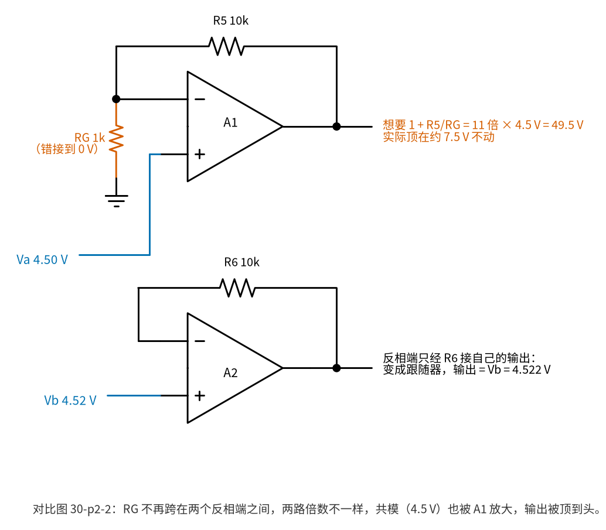
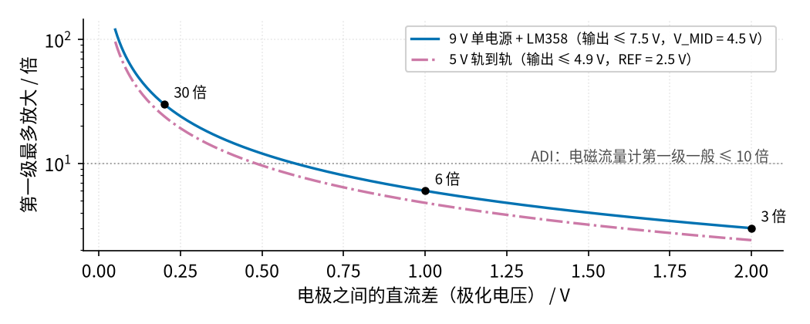
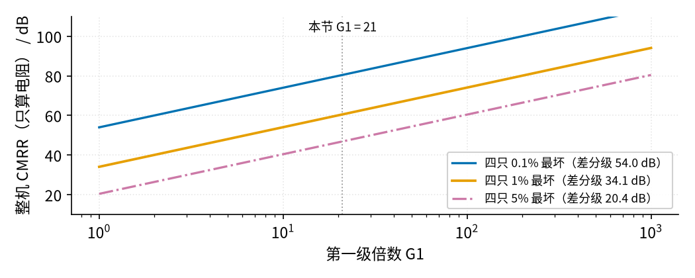
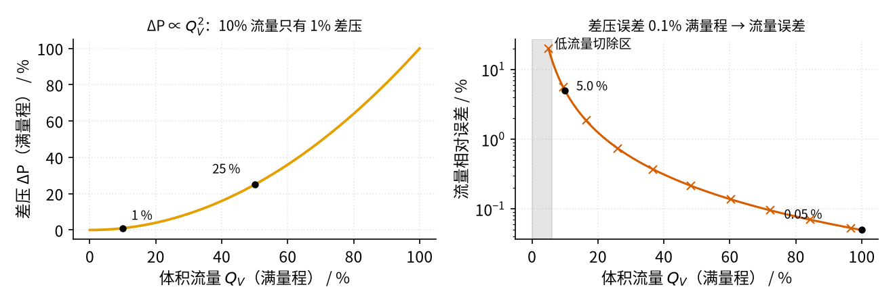
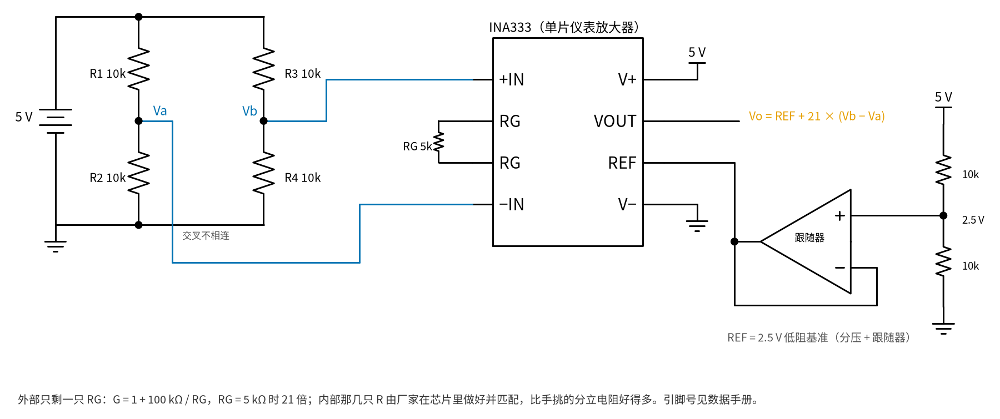

# 30 仪表放大器与电桥 · 参数与调试篇

[上一页：原理与实现篇](page2.md) · [直觉篇](page1.md) · [原理与实现篇](page2.md) · 本页：参数与调试篇 · [动手实验篇](page4.md) · [下一页：动手实验篇](page4.md) · 前置节点：[16 差分放大 · 参数与调试篇](../16-differential-amp/page3.md)、[08 同相放大 · 参数与调试篇](../08-noninverting-amp/page3.md)、[12 电压跟随器 · 直觉篇](../12-voltage-follower/page1.md)

## 一、RG：一只电阻定倍数

[30 仪表放大器与电桥 · 原理与实现篇](page2.md) 推出 $G = 1 + 2R/R_G$ 。R = 10 kΩ 时：

| RG | 倍数 G | 用途举例 |
|---|---|---|
| 不接（开路） | 1 | 只当高输入电阻的差分级用 |
| 2.2 kΩ | 10.09 | 电磁流量计第一级常用的范围 |
| 1 kΩ | 21 | 本节实验 |
| 470 Ω | 43.55 | 毫伏级电桥 |
| 100 Ω | 201 | 很小的电桥信号，要用好运放 |

单片芯片的公式不同，一定以数据手册为准：INA333 是 $G = 1 + 100\ \mathrm{k}\Omega/R_G$ （RG = 1 kΩ 得 101 倍，5 kΩ 得 21 倍， https://www.ti.com/lit/ds/symlink/ina333.pdf ）；INA126 是 $G = 5 + 80\ \mathrm{k}\Omega/R_G$ （不接 RG 最小 5 倍，RG = 5 kΩ 得 21 倍， https://www.ti.com/lit/ds/symlink/ina126.pdf ）。

**RG 要接在两个反相端之间**。如果把它错接到某个反相端和 0 V 之间，就成了 图 30-p3-1 的样子。

*图 30-p3-1　RG 错接到 0 V：A1 变成同相放大，A2 变成跟随器*

图 30-p3-1 里，A1 的反相端经 RG 接 0 V，它就成了 [08 同相放大 · 直觉篇](../08-noninverting-amp/page1.md) 那种普通同相放大：倍数 1 + R5/RG = 11，而且是对 0 V 放大，4.5 V 的共模也被放大，想输出 49.5 V，9 V 单电源的 LM358 最高只能到约 7.5 V，输出顶死不动。A2 的反相端只经 R6 接自己的输出，变成 [12 电压跟随器 · 直觉篇](../12-voltage-follower/page1.md) ，只输出 Vb。两路倍数不一样，共模也被放大，"共模倍数 1"的好处全没了（数字见 `code/30_sim.py` 第 12 节）。面包板上若看到 A1 输出贴着 7.5 V 不动，先查 图 30-p3-1 这种接法。

## 二、第一级倍数不能随便加大：输出会"顶到头"

A1、A2 的输出是"输入 ± I·R"，围绕共模对称撑开。电极之间若有直流差 $V_{dc}$ （电磁流量计的极化电压），第一级会把它也放大 G 倍，两个输出各偏离中心 $G V_{dc}/2$ 。单电源 9 V 的 LM358B（SPICE 用的也是 TI 的 LM358B 模型），数据手册给出输入共模范围到 (V+) − 1.5 V、输出在 1 mA 负载时离正电源约 1.4 V（ https://www.ti.com/lit/ds/symlink/lm358b.pdf ），所以输出最多到约 7.5 V；以 V_MID = 4.5 V 为中心，只剩 3 V 的余量：

$$G_{max} = \frac{3\ \mathrm{V}}{V_{dc}/2} = \frac{6\ \mathrm{V}}{V_{dc}}$$

*图 30-p3-2　电极直流差越大，第一级能放大的倍数越小*

图 30-p3-2 中 0.2 V 直流差时第一级最多 30 倍，1 V 时 6 倍，2 V（ADI 文章说极化电压可到 ±2 V）只剩 3 倍。5 V 轨到轨芯片（REF = 2.5 V、输出到 4.9 V）余量是 2.4 V，曲线更低。这就是 图 30-p3-2 那条虚线的来历：ADI 的电磁流量计文章（ https://www.analog.com/en/resources/analog-dialogue/articles/electromagnetic-flow-meters.html ）建议第一级一般不超过 10 倍，剩下的倍数放到隔直之后。

还要记住：**输入共模**本身也有范围。LM358B 单电源时输入能到 0 V 附近、上限是 V+ − 1.5 V；本节电桥中点 4.5 V 没问题，若桥臂不对称让中点升到 8 V，运放就不能正常工作了。

## 三、共模抑制比随第一级倍数上升

第一级每放大 10 倍，CMRR 多 20 dB，见 图 30-p3-3。

*图 30-p3-3　整机共模抑制比与第一级倍数（只算电阻失配）*

图 30-p3-3 的三条线分别从 54.0、34.1、20.4 dB 起步（差分级单独），到本节的 21 倍时加了 26.4 dB。看上去倍数越大越好，但第二节已经说明倍数受输出余量限制；而且 图 30-p3-3 只算了电阻失配，实际运放本身的 CMRR、频率升高后的 CMRR 下降都会让曲线压低，这部分要查具体芯片的数据手册。

## 四、差压流量计：为什么要开平方

节流件就是故意让管子变窄的零件：孔板是夹在管道里、中间开一个圆孔的一块金属板；文丘里管是一段先慢慢收窄、再慢慢放宽的管子。液体挤过窄处时流得更快、压力随之降低，窄处前后就出现压差。节流件（参见 Emerson 405 孔板资料 https://www.emerson.com/is/content/emerson/en/measurement-instrumentation/technical/products/dp-flow/documents/dl-rmt-00821-0100-4810.pdf ）前后的压差 ΔP 与体积流量 $Q_V$ （下标 V 表示体积 volume；本教程里不带下标的 Q 留给品质因数）的平方成正比，反过来 $Q_V = k\sqrt{\Delta P}$ 。

*图 30-p3-4　差压与流量的平方关系，以及小流量时误差被放大*

图 30-p3-4 左边：10% 流量只产生 1% 满量程的差压，电桥只输出满量程的百分之一。右边：差压测量误差固定为满量程的 0.1% 时，换算成流量误差在满流量处只有 0.05%，30% 流量时 0.56%，10% 流量时达到 5.00%——因为 $Q_V = k\sqrt{P}$ ，差压读数多出 ΔP 时 $Q_V$ 变成 $k\sqrt{P}\sqrt{1 + \Delta P/P}$ ，记 x = ΔP/P，x 很小时 $\sqrt{1+x} \approx 1 + x/2$ ，所以 $\Delta Q_V/Q_V \approx \Delta P/(2P)$ （这里 P 就是 ΔP 的读数，ΔP 是它的误差）。小流量时 P 很小，同样的绝对误差变成很大的相对误差。所以差压变送器有"低流量切除"：流量低于某个值就直接显示 0（Emerson 3051S 手册中的开平方输出与低流量切除设置， https://www.emerson.com/is/content/emerson/en/measurement-instrumentation/technical/products/pressure/documents/doc-rosemount-3051s-00809-0100-4801.pdf ），图 30-p3-4 右边灰色区示意了这个区域。对前端放大来说，结论是：**零点漂移在小流量时最致命**，调零和温漂要格外在意。

## 五、用单片仪表放大器

*图 30-p3-5　用 INA333 单片仪表放大器读 5 V 电桥*

图 30-p3-5 用 INA333 替代三只运放：外部只剩一只 RG，内部电阻由厂家匹配，比手挑的分立电阻好得多。注意两点：

- **REF 必须由低阻源驱动**。REF 背后就是差分级的 R10，若用两只 10 kΩ 分压直接接 REF，分压器的 5 kΩ 内阻串进了 R10，等于让 R10 失配，CMRR 立刻变差。所以 图 30-p3-5 写了"接 2.5 V 低阻基准（跟随器）"，做法同 [12 电压跟随器 · 直觉篇](../12-voltage-follower/page1.md) 。
- **引脚号以数据手册为准**，不同封装不同，本教程不列引脚号。

## 故障排查表

| 现象 | 原因 | 怎么查 | 怎么改 |
|---|---|---|---|
| 输出贴在 7.5 V 或 0 V 附近不动 | A1/A2 被撑到头，或 RG 太小 | 量 A1、A2 输出对 0 V | 加大 RG，降低第一级倍数 |
| 倍数比算的大或小很多 | RG 插错位置，或阻值读错 | 断电量 RG 两端电阻 | RG 必须跨在两个反相端之间 |
| 倍数是 1 | RG 没插好（开路） | 拔插 RG，量电阻 | 插紧 RG |
| 晃动导线输出跟着变 | 共模漏进来、REF 不是低阻 | 量 V_MID 对 0 V 是否稳定 | V_MID 用跟随器驱动，差分级电阻配对 |
| 零点偏开几十到两三百 mV | 运放失调被放大 21 倍、电桥没平衡 | 短接 RX（J1），看输出 | 调 RP1 把输出调回 V_MID |
| 读数随电池电压漂 | 电桥输出与激励成正比 | 同时记录 V+ | 用比例测量或稳压激励 |
| 读数缓慢漂移 | 电阻发热、手摸电阻 | 别碰元件，等几分钟 | 用低温漂电阻，桥臂远离热源 |
| RX 加大几倍，输出却不到几倍 | 单臂电桥本身有非线性，不是电路坏了 | 用 [原理与实现篇](page2.md) 第一节的精确式算期望值 | 拿精确式对照，或在软件里线性化 |
| 万用表末位乱跳，手靠近更厉害 | 电桥两根引线拾到 50 Hz，不对称的那部分被当差模放大 | 把两根电桥引线绞在一起再看 | 电桥紧挨仪放插，两根线等长并绞合 |
| 轻敲面包板读数跳，插拔一次 CMRR 变一次 | 面包板触点氧化或孔被撑松，接触电阻串进了配对电阻 | 断电，表笔压引脚测一次、压面包板孔测一次，比较 | 配对电阻剪短腿直接插，换掉松了的那一排 |
| 示波器上线条发毛，万用表读数偏 | 运放电源脚旁没有去耦电容，自激振荡 | 示波器看输出有没有很高频的振荡 | 每片 LM358 的 8 脚到 4 脚就近并一只 0.1 µF 陶瓷电容 |

后四行的依据：面包板接触电阻会变大的讨论见 https://electronics.stackexchange.com/questions/650690/breadboard-contact-resistance ；高阻节点拾取 50 Hz 的讨论见 https://electronics.stackexchange.com/questions/562997/noise-pick-up-in-high-impedance-nodes ；TI 关于去耦电容的博客（ https://e2e.ti.com/blogs_/archives/b/precisionhub/posts/the-decoupling-capacitor-is-it-really-necessary ）演示了不加去耦的运放会振荡。10 kΩ 电阻串进 10 Ω 接触电阻就是 0.1% 的失配，足以吃掉配对换来的 CMRR。

**为什么调零是必做步骤**：本节用到两种芯片——第二节计算和 SPICE 用的 LM358B，以及实验用的经典 LM358，两种都能用来做实验，但失调指标不同，这里按更宽松的经典 LM358 取最坏值——它的数据手册（ https://www.ti.com/lit/ds/symlink/lm358.pdf ）写明输入失调电压最大 7 mV。A1、A2 两只最坏时方向相反、相差 14 mV，它和电桥差压一样被第一级放大 21 倍，输出就偏 0.294 V（ `code/30_sim.py` 第 11 节），比 RX = 100 Ω 时的信号 0.470 V 小不了多少。所以 [30 仪表放大器与电桥 · 动手实验篇](page4.md) 先短接 RX、转 RP1 调零，再测倍数。

**集成仪放好在哪里**：分立搭建时，差分级的 CMRR 由四只 1% 电阻的配对决定，只有三四十 dB（ [原理与实现篇](page2.md) 的计算）；整机 CMRR 大约是第一级倍数乘以差分级 CMRR。ADI 的 AD8221 数据手册（ https://www.analog.com/media/en/technical-documentation/data-sheets/AD8221.pdf ）说明，它的差分级电阻在芯片里用激光修调，倍数为 1 时，BR 等级保证 CMRR 不低于 90 dB，普通 AR 等级不低于 80 dB。这就是正式产品几乎都直接用集成仪放的原因。

## 练习

**练习 1**：R = 10 kΩ，想要 G = 11，RG 取多少？用 INA333 想要 G = 11 呢？

答案

分立三运放：1 + 20 kΩ/RG = 11，RG = 2 kΩ。INA333：1 + 100 kΩ/RG = 11，RG = 10 kΩ。

**练习 2**：差分级用四只 1% 电阻（最坏情况，差分级 34.1 dB），第一级倍数 21。4.5 V 的共模变化了 1 V，输出变化多少？

答案

整机 CMRR = 34.1 + 26.4 = 60.5 dB，但共模倍数只看差分级（第一级对共模是 1 倍）。用 [原理与实现篇](page2.md) 第三节的共模倍数公式，R7、R10 取 10.1 kΩ，R8、R9 取 9.9 kΩ：Acm = 10.1/20.0 × (1 + 9.9/10.1) − 9.9/10.1 = 0.0198，1 V 共模变化让输出变 19.8 mV。输出端的 19.8 mV 要除以差模倍数 21，才是"输入端要有多大的真差压才会产生同样的输出"：19.8 mV ÷ 21 = 0.94 mV 的假差压，约为 RX = 100 Ω 时 22.4 mV 的 4%。

**练习 3**：电磁流量计电极之间的直流差为 0.5 V，用 9 V 单电源 LM358 三运放，第一级最多放大几倍？如果按 ADI 的建议取 10 倍，是否安全？

答案

最多 6 V ÷ 0.5 V = 12 倍。取 10 倍时两输出各偏离中心 2.5 V，离 3 V 的上限还有 0.5 V 余量，可用，但极化电压变大时就危险了。

**练习 4**：差压变送器在 20% 流量时，差压误差为满量程的 0.1%，流量误差是多少？

答案

20% 流量时差压只有满量程的 4%，差压相对误差 0.1 ÷ 4 = 2.5%，流量误差约一半，1.25%。

**练习 5（推理题）**：[30 仪表放大器与电桥 · 原理与实现篇](page2.md) 三运放电路里的 R5 比标称值大了 1%（10.1 kΩ），其他电阻都准。差模倍数变成多少？整机的共模抑制会变差吗？

答案

A1 输出 = Va − I·R5，A2 输出 = Vb + I·R6，两者之差 = Vd·(1 + (R5 + R6)/RG) = Vd·(1 + 20.1/1) ，倍数从 21 变成 21.1，只是差 0.5%，调一下 RG 或者在程序里校准即可。共模不受影响：两个输入一起升高时 RG 两端电压相同、RG 上没有电流，R5、R6 上也就没有压降，第一级对共模始终是 1 倍，不管 R5、R6 配不配对（ `code/30_sim.py` 第 13 节）。所以第一级的电阻**不需要配对**，需要配对的是差分级的四只。

**练习 6（变体迁移：电子秤）**：先看完整例题，再做留空题，最后自己做变体。

*完整例题*：厨房电子秤的称重传感器内部是四只 350 Ω 应变片组成的惠斯通全桥，5 V 激励，满载时输出 10 mV 的差压。用 INA333（ $G = 1 + 100\ \mathrm{k}\Omega/R_G$ ，5 V 单电源）放大，REF 接 2.5 V，满载时希望输出比 REF 高 2 V。

1. 倍数：2 V ÷ 10 mV = 200。
2. RG = 100 kΩ ÷ (200 − 1) = 502.5 Ω，取 E96 系列（1% 精度电阻的标准阻值表，每十倍之间有 96 个值，如 432、442、453、…、499、511）最近的 499 Ω，实际倍数 201.4，满载输出 2.014 V（对地 4.514 V）。
3. 共模：全桥两个中点都在 5 V 的一半，2.5 V，在芯片输入范围之内。
4. REF：和 图 30-p3-5 一样，用两只 10 kΩ 分压后接一个跟随器得到 2.5 V，不能直接接分压点。
5. 激励掉到 4.8 V 时满载只剩 9.6 mV，倍数按 200 算输出 1.92 V，读数少了 4%。办法是 [原理与实现篇](page2.md) 第四节的比例测量：模数转换器的参考也取自同一个激励，并且取激励的一半（和 REF 一样，第四节的比例测量图就是这样接的：5 V 时 2.5 V，4.8 V 时 2.4 V），倍数按 200 估算，两次之比 2.0 V ÷ 2.5 V、1.92 V ÷ 2.4 V 都是 0.800，读数不变（数字见 `code/30_sim.py` 第 14 节）。

*留空题*：同一只传感器，满载希望输出比 REF 高 1 V。倍数 = ____，RG 理论值 = ____ Ω，取标准值 ____ Ω，实际满载输出 = ____ V。

答案

倍数 100；RG = 100 kΩ ÷ 99 = 1010 Ω，取 1.00 kΩ，倍数 101，满载输出 1.010 V。1010 Ω 离 1.00 kΩ（差 10.1 Ω）和离 1.02 kΩ（差 9.9 Ω）几乎一样近，取 1.02 kΩ 也算对：倍数 99.0，满载输出 0.990 V。

*变体*：换成 3.3 V 单电源系统，传感器灵敏度 2 mV/V，REF 取 3.3 V 的一半 1.65 V，满载希望输出比 REF 高 1.5 V。满载差压是多少？RG 取多少？

答案

满载差压 2 mV/V × 3.3 V = 6.6 mV；倍数 1.5 V ÷ 6.6 mV = 227.3；RG = 100 kΩ ÷ 226.3 = 441.9 Ω，取 E96 的 442 Ω，倍数 227.2，满载输出 1.500 V，对地 3.150 V，离 3.3 V 电源还有 0.15 V，要查 INA333 数据手册里输出能贴近电源轨多近，再决定要不要把满载目标降低一点。

## 本页小结

- RG 一只电阻定倍数，必须接在 A1、A2 两个反相端之间；单片芯片按各自公式算。
- 第一级倍数受输出余量限制：9 V 单电源 LM358 以 4.5 V 为中心只剩 3 V，直流差为 $V_{dc}$ 时最多 $6\ \mathrm{V}/V_{dc}$ 倍；电磁流量计第一级一般不超过 10 倍。
- 整机 CMRR = 差分级 CMRR + 20 lg G1；差分级电阻失配决定基础。
- 差压流量计 $Q_V = k\sqrt{\Delta P}$ ，小流量时误差被放大，零点最重要。
- REF 必须低阻驱动。动手验证这些，见 [30 仪表放大器与电桥 · 动手实验篇](page4.md)。
