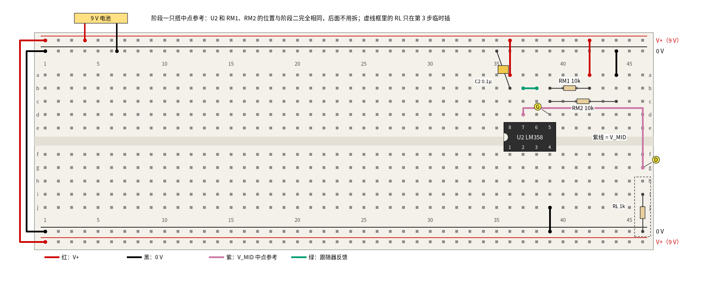
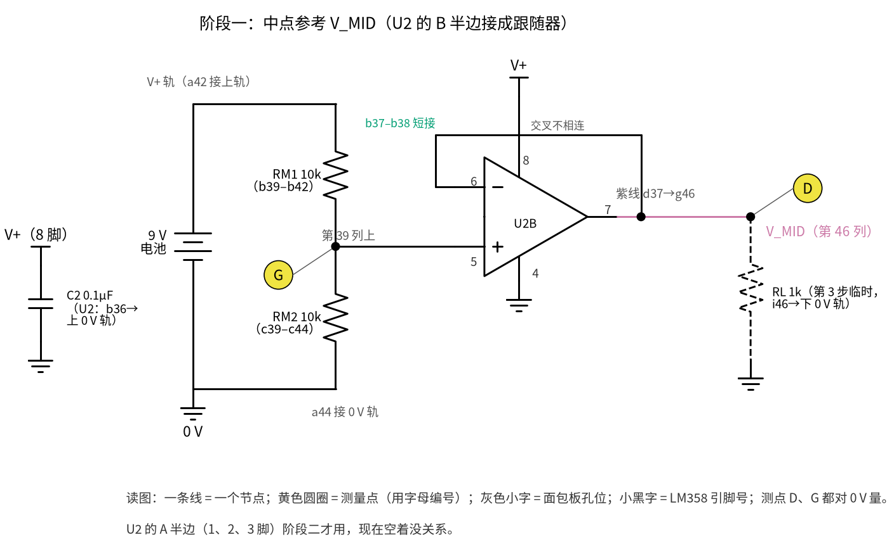
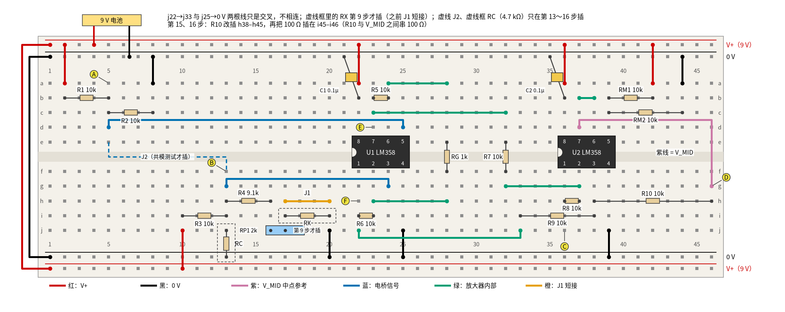
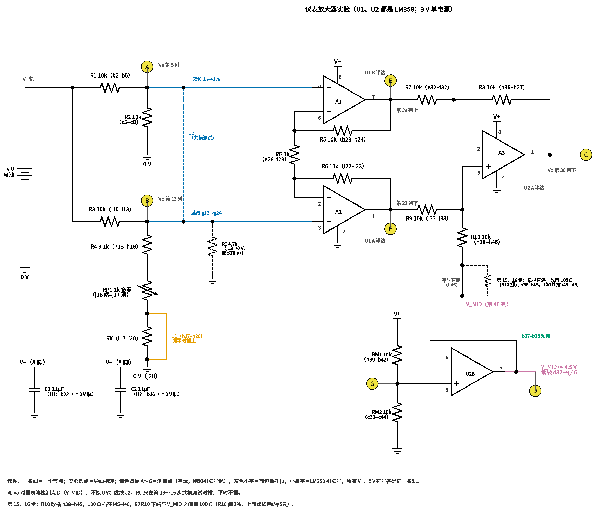
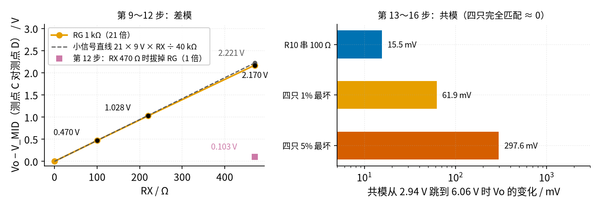
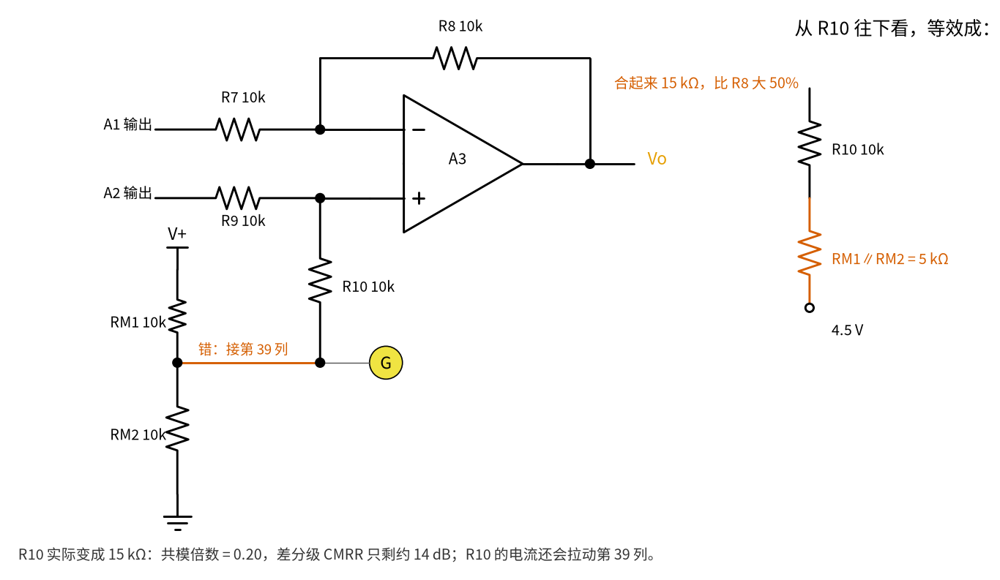

# 30 仪表放大器与电桥 · 动手实验篇

[上一页：参数与调试篇](page3.md) · [直觉篇](page1.md) · [原理与实现篇](page2.md) · [参数与调试篇](page3.md) · 本页：动手实验篇 · 下一页：31 节跨阻放大器（TIA）（即将上线） · 前置节点：[12 电压跟随器 · 直觉篇](../12-voltage-follower/page1.md)、[16 差分放大 · 动手实验篇](../16-differential-amp/page4.md)

## 这次实验要验证什么

只用两片 LM358、一节 9 V 电池和一块万用表，分两个阶段把前三页的结论量出来：

1. **阶段一：中点参考 V_MID**。两只 10 kΩ 分压加一个跟随器，造出 4.5 V 的中点参考 V_MID；挂上 1 kΩ 负载它也不掉（只用分压会掉到 0.75 V）。对应 [30 仪表放大器与电桥 · 原理与实现篇](page2.md) 第五节。
2. **倍数只由 RG 决定**：RG = 1 kΩ 时倍数 21，RX = 100 / 220 / 470 Ω 时输出比 V_MID 高 0.470 / 1.028 / 2.170 V；拔掉 RG 倍数变 1，只剩 0.103 V。对应原理与实现篇第二节。
3. **第一级两个输出对称撑开**：A1 往下、A2 往上，差正好是"倍数 × 电桥差压"。
4. **共模被扔掉，而且第一级倍数越大扔得越干净**：两个电桥中点一起从 2.94 V 抬到 6.06 V，输出几乎不动；故意让 R10 偏 1%，输出变化约 15.5 mV，算出 CMRR 约 72.5 dB；再拔掉 RG，同样约 15.5 mV 的变化只对应 46 dB。对应 [30 仪表放大器与电桥 · 参数与调试篇](page3.md) 第三节。

所有"应该读到"的数都来自 code/30_sim.py 的计算和 spice/30/run.py 的仿真（在仓库根目录运行，约 4 分钟，需要 spice/models 目录）。

**两套编号别混**：测量点用**字母** A～G（图上黄色圆圈里的字母），芯片引脚用"几脚"（图上芯片旁的小黑字数字），面包板孔位用"行字母 + 列号"（如 d37）。三套名字的对应：

| 测点 | 孔位 | 是什么 | 原理与实现篇里的名字 |
|---|---|---|---|
| A | a5 | 左电桥中点 Va | V1（A1 的输入） |
| B | f13 | 右电桥中点 Vb | V2（A2 的输入） |
| C | j36 | 输出 Vo（U2 的 1 脚） | Vo |
| D | g46 | 中点参考 V_MID（U2 的 7 脚经紫线引来） | REF 接的 V_MID |
| E | d23 | A1 输出（U1 的 7 脚） | V1 − I·R5 |
| F | h22 | A2 输出（U1 的 1 脚） | V2 + I·R6 |
| G | d39 | RM1、RM2 的分压中点（U2 的 5 脚） | — |

差分级的 R7、R8、R9、R10 就是 [16 差分放大 · 原理与实现篇](../16-differential-amp/page2.md) 的 R1、R2、R3、R4。

## ⚠️ 安全须知

- **只用一节 9 V 叠层电池**，全电路最高 9 V，远低于 12 V 的上限。电池扣两头不能碰在一起，没插进面包板的一头先用胶带包好。
- **LM358 缺口朝左，8 脚接 V+、4 脚接 0 V**。接反时芯片很快发烫，**不要用手去摸**，立刻拔掉电池扣。
- **V_MID 不是 0 V**：紫线 d37→g46（从 U2 的 7 脚所在的第 37 列，到第 46 列的测点 D）任何时候都不能和 0 V 轨连在一起，那等于把 U2 的输出短路。量信号时黑表笔接测点 D（V_MID），量"对电池负极的电压"时黑表笔接 0 V 轨，测量表每一行都写明了。
- **改接线之前先拔电池扣**。本页要换三次 RX、拔插两次 RG、挪一次 R10，RC 要在 0 V 轨和 V+ 轨之间来回挪 5 次（第 13～16 步），每次都先断电。

## 器材清单

| 元件 | 型号或数值 | 数量 | 说明 |
|---|---|---|---|
| 运放 | LM358（DIP-8 直插） | 2 | U1 两个半边做 A1、A2；U2 的 A 半边做 A3，B 半边做中点参考跟随器 |
| 9 V 电池 | 6F22 叠层电池 + 电池扣 | 1 | 唯一的电源 |
| 电阻 | 10 kΩ，1% 金属膜 | 11 | R1、R2、R3、R5～R10、RM1、RM2 |
| 电阻 | 9.1 kΩ | 1 | R4，和 RP1 串起来凑成约 10 kΩ |
| 微调电位器 | 2 kΩ 多圈（3296 型） | 1 | RP1，调零用；三只脚都插进面包板，只有"一端 + 滑动端"两只接进电路 |
| 电阻 | 1 kΩ | 2 | RG；RL（第 3 步临时负载） |
| 电阻 | 100 Ω、220 Ω、470 Ω | 各 1 | RX（模拟传感器电阻变化）；100 Ω 那只第 15 步还要借来串在 R10 下面 |
| 电阻 | 4.7 kΩ | 1 | RC，共模测试时把两个中点一起往下拉或往上拉 |
| 陶瓷电容 | 0.1 µF（104） | 2 | C1、C2：每片 LM358 一只去耦电容，8 脚就近接到 0 V 轨 |
| 跳线 | 红、黑、紫、蓝、绿、橙 | 若干 | 颜色约定见图下方图例；J1、J2 用短跳线 |
| 面包板 | 830 孔 | 1 | 上下各两条电源轨 |
| 万用表 | 数字式，有直流 200 mV、2 V 挡 | 1 | 共模那几步的变化只有零点几到十几毫伏 |

> **最小补充：去耦电容**　电池和面包板电源轨的导线有电阻和电感，运放输出电流突然变化时，8 脚上的电压会跟着抖，严重时运放自己振荡起来（[30 仪表放大器与电桥 · 参数与调试篇](page3.md) 故障排查表最后一行）。在每片芯片的 8 脚旁边就近接一只 0.1 µF 陶瓷电容到 0 V，给它一个"贴身的小水池"。LM358 的 4 脚就是 0 V，所以电容接到 0 V 轨，就等于跨在 8 脚和 4 脚之间，和参数与调试篇排障表里"8 脚到 4 脚并 0.1 µF"是同一个接法。陶瓷电容没有正负极，两只脚随便插。

差分级 R7～R10 这四只最好先用万用表量一遍，挑阻值最接近的四只放进去：四只 1% 电阻在最坏情况下会让第 14 步的输出变化达到 61.9 mV（code/30_sim.py 第 3 节的共模增益 0.0198 × 3.125 V），挑过之后通常小得多。

## 搭建步骤

面包板最上面一条轨（T1）和最下面一条轨（B2）是 V+（9 V），中间两条（T2、B1）是 0 V。下面写"T1-36"就是 T1 轨上第 36 列旁边的孔。V_MID 不占电源轨，它就是第 37 列 U2 的 7 脚，用一根紫线送到第 46 列。

### 阶段一：先只搭中点参考

1. 电源线：电池红线接 T1、黑线接 T2；左端用红线把 T1-1 和 B2-1 连起来、黑线把 T2-1 和 B1-1 连起来。**电池扣先别扣上。**
2. 按 图 30-p4-1 搭中点参考：
   - 插 U2：缺口朝左，跨在中间槽上，1 脚在 f36、8 脚在 e36。
   - 电源：红线 a36→T1-36（8 脚接 V+），黑线 j39→B1-39（4 脚接 0 V）；去耦电容 C2 插 b36 和 T2-35（8 脚就近到 0 V）。
   - 分压：RM1 插 b39–b42，红线 a42→T1-42；RM2 插 c39–c44，黑线 a44→T2-44。
   - 跟随器：绿色短线 b37–b38（7 脚接 6 脚，反馈）；紫线 d37→g46，把 V_MID 引到第 46 列。

**先量电池电压，填进后面检查代码的第一行**（ `VBAT = …` ）：新电池常在 9.3 V 以上，用过的可能不到 8.5 V，所有"应该读到"的数都跟着它按比例变。

3. 扣上电池，黑表笔接 0 V 轨，红表笔量测点 G（d39，分压中点）和测点 D（g46，V_MID），都应约 4.50 V。然后把 RL（1 kΩ）临时插在 i46 和 B1-46 之间：测点 D 仍约 4.50 V，跟随器替负载供出 4.5 mA；如果没有跟随器、直接拿分压中点去带这 1 kΩ，SPICE 和计算都说它会掉到 0.75 V（ 图 30-p4-2 下方注释）。量完拔掉 RL。



*图 30-p4-1　阶段一面包板：分压 + 跟随器做中点参考 V_MID（虚线框 RL 只在第 3 步临时插）*



*图 30-p4-2　阶段一原理图（标注与 图 30-p4-1 的孔位一一对应）*

> **对照看**：图 30-p4-1 的 b39–b42 就是 图 30-p4-2 的 RM1（上面接 V+），c39–c44 是 RM2（下面接 0 V），两只的公共端在第 39 列，也就是 U2 的 5 脚和测点 G；绿色短线 b37–b38 是原理图里从 7 脚绕回 6 脚的那根反馈线；紫线 d37→g46 就是原理图右边标"V_MID"的那条线，终点测点 D。b36 到上方 0 V 轨的黄色小方块是 C2，原理图左边单独画成"V+（8 脚）—C2—0 V"。原理图里 V_MID 画成一个空心点而不是接地符号，提醒你它不是 0 V。

这一阶段的 U2、C2 和 RM1、RM2 在阶段二里**原地不动**，后面所有"黑表笔接 V_MID"都是接测点 D。

### 阶段二：电桥 + 三运放仪表放大器

4. **左半桥**：R1 插 b2–b5，R2 插 c5–c8；红线 a2→T1-2（第 2 列接 V+），黑线 a8→T2-8（第 8 列接 0 V）。两只的公共端第 5 列是 Va，测点 A（a5）。
5. **右半桥**：
   - 红线 j10→B2-10（第 10 列接 V+）；R3 插 i10–i13，R4 插 h13–h16。
   - RP1 的三只脚插 j16、j17、j18（哪只是滑动端见下一条）。
   - RX 的位置 i17–i20 **先空着**（图 30-p4-3 里画成虚线框），用橙色短线 J1 把 h17 和 h20 连起来。
   - 黑线 j20→B1-20（第 20 列接 0 V）。第 13 列是 Vb，测点 B（f13）。
   - **RP1 哪只是滑动端**：3296 型的三只脚排成一排，**中间那只是滑动端**，旋钮旁通常印着 1、2、3，2 就是它。拿不准就用万用表欧姆挡：两只边脚之间始终是 2 kΩ，转旋钮不变；边脚和中间脚之间的读数会跟着旋钮变。所以中间脚插 j17（和 RX、J1 同一列），一只边脚插 j16（和 R4 同一列），另一只边脚 j18 所在的第 18 列什么都不接，让它悬空。
6. **U1 和第一级**：
   - U1 插在第 22 列（缺口朝左，1 脚在 f22、8 脚在 e22）。
   - 电源：红线 a22→T1-22（8 脚接 V+），黑线 j25→B1-25（4 脚接 0 V），去耦电容 C1 插 b22 和 T2-21。
   - 元件：R5 插 b23–b24（7 脚—6 脚，A1 的反馈），R6 插 i22–i23（1 脚—2 脚，A2 的反馈），RG 插 e28–f28（竖着跨过中间槽）。
   - 绿线：a24–a28（A1 的反相端 6 脚 → RG 上端），h23–h28（A2 的反相端 2 脚 → RG 下端）。
   - 蓝线：d5→d25 把 Va 送到 A1 的同相端（5 脚），g13→g24 把 Vb 送到 A2 的同相端（3 脚）。
7. **差分级（U2 的 A 半边）**，U2 的电源和 C2 阶段一已经接好：
   - 反相路：绿线 c23–c32（A1 输出 7 脚 → R7 上端）；R7 插 e32–f32；绿线 g32–g37（R7 下端 → U2 的 2 脚，A3 反相端）；R8 插 h36–h37（1 脚—2 脚，A3 的反馈）。
   - 同相路：绿线 j22–j33（A2 输出 1 脚 → R9 左端，这根线从 j 排外侧绕过，和 j25 的黑线只是交叉、不相连）；R9 插 i33–i38（→ U2 的 3 脚，A3 同相端）；R10 插 h38–h46（下端落在紫线 V_MID 所在的第 46 列）。
   - 第 36 列下排是 U2 的 1 脚，也就是输出 Vo，测点 C（j36）。
8. 扣上电池，黑表笔接测点 D（V_MID），红表笔接测点 C，用 2 V 挡、再换 200 mV 挡，慢慢转 RP1，让读数尽量接近 0（能到 ±5 mV 以内就行）。RP1 的可调范围是让 Vb 在 4.288～4.735 V 之间变，即对 Va 差 −212～+235 mV，足够盖住运放失调和电阻误差。为什么非调零不可，见 [30 仪表放大器与电桥 · 参数与调试篇](page3.md) 的"为什么调零是必做步骤"。仿真里电桥直接用精确的 10 kΩ、没有 RP1，RX 短接时读到 0.54 mV，这只是 LM358 模型自带的失调乘 21，不是"调零后"的结果；真实芯片不调零时可以偏到几十甚至两三百毫伏。



*图 30-p4-3　阶段二面包板全图（虚线框 RX 第 9 步才插，之前由 J1 短接；虚线 J2、虚线框 RC 只在第 13～16 步插）*



*图 30-p4-4　阶段二原理图（括号里是 图 30-p4-3 的孔位）*

> **对照看**：先在 图 30-p4-3 找两个电桥中点：第 5 列（测点 A）和第 13 列（测点 B），对应 图 30-p4-4 左边的 Va、Vb。两根蓝线 d5→d25、g13→g24 在原理图里就是进 A1 的 5 脚、进 A2 的 3 脚的两条蓝线。e28–f28 那只竖着跨过中间槽的 RG，就是原理图中间夹在两只运放反相端之间的 RG；绿线 a24–a28、h23–h28 就是原理图里从 6 脚、2 脚连到 RG 两端的短线。第 23 列上排（测点 E）是 A1 的 7 脚输出，第 22 列下排（测点 F）是 A2 的 1 脚输出。R10 的下端 h46 落在紫线 V_MID 上，原理图里写作"V_MID（第 46 列）"。b22、b36 旁的两只黄色小方块是 C1、C2，原理图左下角画成两只"V+（8 脚）—电容—0 V"。虚线的 J2 把第 5、13 两列连起来，RC 从第 13 列接到 0 V 或 V+，两张图都画成虚线。

### 测量：改变 RX、拔插 RG

9. 断电，拔掉 J1，把 RX = 100 Ω 插进 i17–i20，通电。按下面的测量表量测点 A、B、C、E、F。
10. RX 换成 220 Ω，再量测点 B 和 C。
11. RX 换成 470 Ω，再量测点 B 和 C。
12. RX 保持 470 Ω，拔掉 RG：倍数从 21 变成 1，测点 C 应从 2.170 V 掉到约 0.103 V。量完把 RG 插回。

### 共模测试：两个中点一起动

**先想清楚为什么要换挡**：第 8 步的调零，是靠 RP1 故意让电桥差一点点，去抵消两只运放的失调。共模测试要插 J2，把 Va、Vb 直接连在一起——RP1 造出的那点差没了，调零也就失效了。

这时输出等于"两只运放失调之差 × 21"：LM358 每只失调最大 7 mV，最坏相差 14 mV，输出偏 0.294 V（code/30_sim.py 第 11 节），超过 200 mV 挡的量程（最大显示 199.9 mV）。

好在我们要的是**两次读数之差** ΔVo，失调在两次里一样大，相减就消掉了，只是每次的读数本身可能超过 200 mV。所以：**先用 2 V 挡**（最后一位是 1 mV，15.5 mV 的变化看得出来）；如果第 13 步在 2 V 挡读到的绝对值小于 0.190 V，第 13、14 步可以都换成 200 mV 挡，读得更细。**两次必须用同一个挡。**

13. 断电，拔掉 RX、插回 J1，插上 J2（e5–f13，把第 5 列和第 13 列连在一起，Va = Vb，差压为 0。J2 的两头占了 e5 和 f13：测点 A 已经放在同一列的 a5，不受影响；要量测点 B，就把红表笔压在 J2 插进 f13 那一头的金属上），RC（4.7 kΩ）一头插 j13、另一头插 B1-13（0 V）。通电，量测点 A 对 0 V（约 2.94 V），再用 2 V 挡量测点 C 对测点 D，记作 Vo(低)。
14. 只把 RC 的下端从 B1-13 挪到 B2-13（V+）。测点 A 对 0 V 约 6.06 V，再用同一挡量测点 C 对测点 D，记作 Vo(高)。两次之差 ΔVo = Vo(高) − Vo(低)，共模变化 3.125 V。理想电阻时 ΔVo 只有约 0.1 mV，2 V 挡上就是"两次读数一样"；你读到的大小取决于 R7～R10 的实际配对。
15. 让 R10 故意偏 1%：断电，R10 下端从 h46 挪到 h45，再把 100 Ω 插在 i45–i46。重复第 13、14 步。ΔVo 应比第 14 步多出约 15.5 mV。
16. 保持第 15 步的接法，拔掉 RG，再重复第 13、14 步。ΔVo 和第 15 步几乎一样（SPICE 两次差 0.02 mV），但这时倍数只有 1，CMRR 从约 72.5 dB 掉到约 46 dB——第一级倍数 21 正好贡献了 20 × lg 21 ≈ 26 dB。做完恢复 R10、插回 RG、拔掉 J2 和 RC。

## 测量表

| 步骤 | 测什么 | 红表笔 | 黑表笔 | 挡位 | 应该读到 | 读不到时先查 |
|---|---|---|---|---|---|---|
| 3 | 分压中点 | 测点 G（d39） | 0 V 轨 | 20 V | 4.50 V | RM1、RM2 是否一上一下接 V+、0 V |
| 3 | 中点参考 V_MID | 测点 D（g46） | 0 V 轨 | 20 V | 4.50 V | b37–b38 短线；U2 的 8、4 脚电源 |
| 3 | 挂 RL 后的 V_MID | 测点 D（g46） | 0 V 轨 | 20 V | 4.50 V（只用分压时 0.75 V） | 测点 D 掉很多：紫线是否接在 d37（7 脚）而不是 d39 |
| 8 | 调零 | 测点 C（j36） | 测点 D | 2 V，再 200 mV | 0（±5 mV 内） | 转不到 0：RP1 中间脚是否在 j17、边脚在 j16；J1 是否插好 |
| 9 | 左中点 Va | 测点 A（a5） | 0 V 轨 | 20 V | 4.500 V | R1、R2 是否都是 10 kΩ |
| 9 | 电桥差压 | 测点 B（f13） | 测点 A | 200 mV | 22.4 mV | RX 是否插进 i17–i20；J1 是否已拔 |
| 9 | A1 输出 | 测点 E（d23） | 0 V 轨 | 20 V | 4.276 V | RG 是否在 e28–f28；R5 是否在 b23–b24；绿线 a24–a28 |
| 9 | A2 输出 | 测点 F（h22） | 0 V 轨 | 20 V | 4.746 V | R6 是否在 i22–i23；绿线 h23–h28 |
| 9 | 输出 | 测点 C（j36） | 测点 D | 2 V | 0.470 V | 黑表笔是否误接 0 V（会读到约 4.97 V） |
| 10 | 输出 | 测点 C | 测点 D | 2 V | 1.028 V | 差压应为 49.0 mV |
| 11 | 输出 | 测点 C | 测点 D | 20 V | 2.170 V | 测点 F 若顶在 7.5 V 附近：RG 太小或插错 |
| 12 | 无 RG 输出 | 测点 C | 测点 D | 2 V | 0.103 V | 仍是 2 V 左右：RG 两端是否还有别的通路 |
| 13 | 共模（低） | 测点 A（a5） | 0 V 轨 | 20 V | 2.94 V | J2 是否插在 e5–f13；RC 是否在 j13 和 B1-13 |
| 14 | 共模（高） | 测点 A | 0 V 轨 | 20 V | 6.06 V | RC 下端是否换到 B2-13（V+） |
| 13、14 | Vo(低)、Vo(高) 和 ΔVo | 测点 C | 测点 D | 2 V（第 13 步读数绝对值小于 0.190 V 时两次都可改用 200 mV） | 单次读数可偏到 ±0.29 V（调零失效）；两次差约 0.1 mV（配对差时到几十 mV） | 单次读数超过 0.3 V：两片芯片的电源、C1/C2 是否插对；读数跳：手别碰 RC 和蓝线 |
| 15 | ΔVo（R10 + 100 Ω） | 测点 C | 测点 D | 与第 13 步相同 | 比第 14 步多约 15.5 mV | 100 Ω 是否在 i45–i46，R10 是否已挪到 h45 |
| 16 | ΔVo（无 RG） | 测点 C | 测点 D | 与第 13 步相同 | 与第 15 步几乎相同 | 变化很大：RG 是否真的拔了 |

预期曲线见 图 30-p4-5：左边是 RX 与输出的关系（实线是 RG = 1 kΩ，灰色虚线是小信号近似 9 V × RX ÷ 40 kΩ 再乘 21，方点是第 12 步在 RX = 470 Ω 时拔掉 RG），右边是共模从 2.94 V 跳到 6.06 V 时输出的变化：R10 串 100 Ω 约 15.5 mV（计算；SPICE 15.65 mV），四只 1% 最坏 61.9 mV，四只 5% 最坏 297.6 mV——这就是第 14 步你的 ΔVo 可能落在的范围。



*图 30-p4-5　本实验的预期读数（左图来自 SPICE；右图柱长是公式计算，SPICE 对照见 spice/30/run.py）*

如果你的三点不在一条线上，先看 图 30-p4-5 左边：它本来就略向下弯，这是电桥本身的非线性（原理与实现篇第一节），不是电路故障。470 Ω 时的 2.170 V 比近似式（差压按 9 V × RX ÷ 40 kΩ 算，也就是图上那条灰色虚线，470 Ω 处标着 2.221 V）给出的 2.221 V 低约 2.3%；如果你是拿自己第 9 步的读数画一条过原点的直线来比，它在 470 Ω 处是 2.210 V，2.170 V 比它低约 1.8%。

## 没有示波器怎么办

本页全部是直流，一块万用表就够了，不需要示波器。要注意的是共模那几步：变化只有零点几到十几毫伏，黑表笔一定接 V_MID（测点 D）而不是 0 V——测点 C 对 0 V 是 4.5 V 左右，要用 20 V 挡，最后一位是 10 mV，根本看不出 15 mV 的变化；对测点 D 量就能用 2 V 挡（最后一位 1 mV），条件允许再换 200 mV 挡（最后一位 0.1 mV）。读数末位来回跳时，等三五秒取中间值。

## 用 Python 检查你的读数

代码分两部分：开头两条横线之间是**输入**，把这里改成你量到的数——电池电压（第 3 步前量）和断电后用欧姆挡量的 RX、RG、R5、R6；程序用这些实测值重新算出每一步"应该读到"的数，再和你的读数 `mine` 比较，偏差超过 10% 就提醒你。

```python
import math

# ===== 把这里改成你量到的数（断电后用万用表欧姆挡量电阻，第 3 步前量电池电压）=====
VBAT = 9.00                           # ← 第 3 步前先量电池电压，单位 V
RX_REAL = {100: 100.0, 220: 220.0, 470: 470.0}   # ← 三只 RX 的实测值，单位 Ω
RG_REAL = 1000.0                      # ← RG 实测值，单位 Ω
R5_REAL = 10e3                        # ← R5 实测值，单位 Ω
R6_REAL = 10e3                        # ← R6 实测值，单位 Ω
# ===== 改到这里为止 =====

# 由上面的实测值算出"应该读到"的数（调零后右臂 R4 + RP1 按 10 kΩ 算）
R = 10e3
g = 1 + (R5_REAL + R6_REAL) / RG_REAL
def vdiff(rx):
    return VBAT * rx / (2 * (2 * R + rx))
va = VBAT / 2
i100 = vdiff(RX_REAL[100]) / RG_REAL
cm_lo = VBAT / 2 * 4.7 / (2.5 + 4.7)              # 两中点戴维南 VBAT/2（4.5 V）/2.5 kΩ，RC 4.7 kΩ 拉到 0 V
cm_hi = VBAT / 2 + VBAT / 2 * 2.5 / (2.5 + 4.7)   # RC 拉到 V+
acm_r10 = 10.1 / 20.1 * 2 - 1                     # R10 串 100 Ω 后的共模倍数（只由电阻标称值决定，此项不随实测值变）
expect = {
    "第3步 V_MID（挂 RL）/V": VBAT / 2,
    "第9步 差压 /mV": vdiff(RX_REAL[100]) * 1e3,
    "第9步 A1 /V": va - i100 * R5_REAL,
    "第9步 A2 /V": va + vdiff(RX_REAL[100]) + i100 * R6_REAL,
    "第9步 输出 /V": g * vdiff(RX_REAL[100]),
    "第10步 输出 /V": g * vdiff(RX_REAL[220]),
    "第11步 输出 /V": g * vdiff(RX_REAL[470]),
    "第12步 无RG /V": vdiff(RX_REAL[470]),
    "第13步 测点A /V": cm_lo,
    "第14步 测点A /V": cm_hi,
    "第15步 多出的ΔVo /mV": acm_r10 * (cm_hi - cm_lo) * 1e3,
    "第16步 多出的ΔVo /mV": acm_r10 * (cm_hi - cm_lo) * 1e3,
}
mine = dict(expect)            # ← 换成你的读数，例如 mine["第9步 输出 /V"] = 0.462
mine["第11步 输出 /V"] = 2.150  # 示例：偏差约 −0.9%，不会报警

for k, e in expect.items():
    m = mine[k]
    dev = (m - e) / e * 100
    flag = "  ⚠ 偏差超过 10%，按测量表最后一栏检查" if abs(dev) > 10 else ""
    print(f"{k:16s} 计算 {e:7.3f}  你的 {m:7.3f}  偏差 {dev:+5.1f}%{flag}")

# 由三次 RX 读数反推倍数（差压用精确式）
for rx in (100, 220, 470):
    vo = mine[{100: "第9步 输出 /V", 220: "第10步 输出 /V", 470: "第11步 输出 /V"}[rx]]
    print(f"RX = {rx} Ω：倍数 ≈ {vo / vdiff(RX_REAL[rx]):.1f}（按你的电阻算 {g:.1f}）")

# CMRR = 20 lg(差模倍数 × 共模变化 ÷ ΔVo)
dcm = cm_hi - cm_lo
for step, gg in [("第15步", g), ("第16步", 1)]:
    dvo = mine[f"{step} 多出的ΔVo /mV"] / 1e3
    print(f"{step}（倍数 {gg:.0f}）算出的 CMRR ≈ {20 * math.log10(gg * dcm / dvo):.1f} dB（共模变化 {dcm:.3f} V）")
```

运行结果（电池按 9.00 V、电阻按标称值，示例读数只改了第 11 步）：12 项里 11 项偏差为 0，第 11 步偏差 −0.9%；三次反推倍数 21.0、21.0、20.8；第 13、14 步测点 A 计算值 2.938 V、6.062 V，共模变化 3.125 V；第 15 步 CMRR 约 72.5 dB，第 16 步约 46.1 dB，相差 26.4 dB。电池换成 8.50 V 时，所有电压和第 15 步的 ΔVo 都按 8.50/9.00 等比例变小，但 CMRR 不变。

## 实验记录表

先把检查代码第一段改成你量到的数并运行，把它打印的"计算"那一列抄进"计算值"，再填实测值和偏差。下面"计算值"一栏先给出 9.00 V、标称电阻时的数，供对照。

| 步骤 | 条件 | 实测值 | 计算值 | 偏差 |
|---|---|---|---|---|
| 3 | V_MID，挂 RL | | 4.50 V | |
| 8 | 调零后 C−D | | 0（±5 mV） | |
| 9 | RX 100 Ω，测点 C 对 D | | 0.470 V | |
| 10 | RX 220 Ω，测点 C 对 D | | 1.028 V | |
| 11 | RX 470 Ω，测点 C 对 D | | 2.170 V | |
| 12 | 拔 RG，测点 C 对 D | | 0.103 V | |
| 13、14 | ΔVo（原样，两次读数相减） | | 约 0.1 mV～几十 mV | |
| 15 | ΔVo（R10 + 100 Ω） | | 比上一行多约 15.5 mV | |
| 16 | ΔVo（再拔 RG） | | 与上一行几乎相同 | |

## 思考题

**1.** 第 12 步拔掉 RG 后输出变成 0.103 V，比 2.170 V 的二十一分之一（0.1033 V）几乎一样。为什么拔掉 RG 后倍数正好是 1，而不是"更大"？

<details><summary>答案</summary>

倍数是 1 + 2R/RG。拔掉 RG 等于 RG 无穷大，RG 上没有电流，R5、R6 上也就没有压降，A1、A2 都变成 [12 电压跟随器 · 直觉篇](../12-voltage-follower/page1.md) 里的跟随器，第一级倍数 1；差分级本来就是 1 倍。所以整体倍数是 1。

</details>

**2.** 第 15、16 步的 ΔVo 几乎一样，为什么说第 15 步的 CMRR 比第 16 步好 26 dB？

<details><summary>答案</summary>

CMRR 比较的是"差模倍数"和"共模倍数"。共模倍数只由差分级 R7～R10 的配对决定，第一级对共模永远是 1 倍，所以 ΔVo 不变；差模倍数却从 21 变成 1。同样大的共模误差，对 21 倍的信号来说只占二十一分之一，20 × lg 21 ≈ 26.4 dB。

</details>

**3.** 如果有人为了省一片芯片，把 R10 的下端直接接到 RM1、RM2 的分压中点（第 39 列，测点 G），而不是接 V_MID，会怎样？先自己想，再展开答案看 图 30-p4-6。

<details><summary>答案</summary>



*图 30-p4-6　思考题 3：R10 接到分压中点，等于多串了 5 kΩ*

图 30-p4-6 右边是从 R10 往下看的等效电路：分压中点自带 5 kΩ 内阻（RM1、RM2 并联），等于在 R10 下面串了 5 kΩ，R10 变成 15 kΩ，比 R8 大 50%。按 16 节的四电阻公式，共模倍数变成 15/25 × 2 − 1 = 0.2，差分级 CMRR 只剩约 14 dB；而且 R10 上的电流还会拉动分压中点。哪怕只串 50 Ω（0.5%），差分级 CMRR 也只剩约 52 dB。所以 REF 必须由跟随器这种低阻源驱动（参数与调试篇第五节；TI E2E 的讨论见 https://e2e.ti.com/support/amplifiers-group/amplifiers/f/amplifiers-forum/699230/faq-ina210-what-effect-do-external-resistors-on-vref-have-on-cmrr-gain-error ）。

</details>

## 自测清单

- 我能用分压加跟随器做出单电源里的中点参考 V_MID，并说清它为什么不是 0 V、为什么不能和 0 V 短接。
- 我能在面包板上找到电桥两中点、RG、A1/A2 输出和 V_MID 对应的孔位，并和原理图一一对上。
- 我能由 RG 算出倍数，再由 RX 算出差压和输出，并用万用表验证到 10% 以内。
- 我能用"两次测量相减"测出 ΔVo，并算出 CMRR，解释第一级倍数为什么能提高 CMRR。
