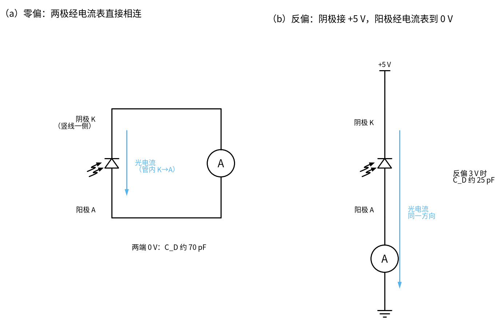
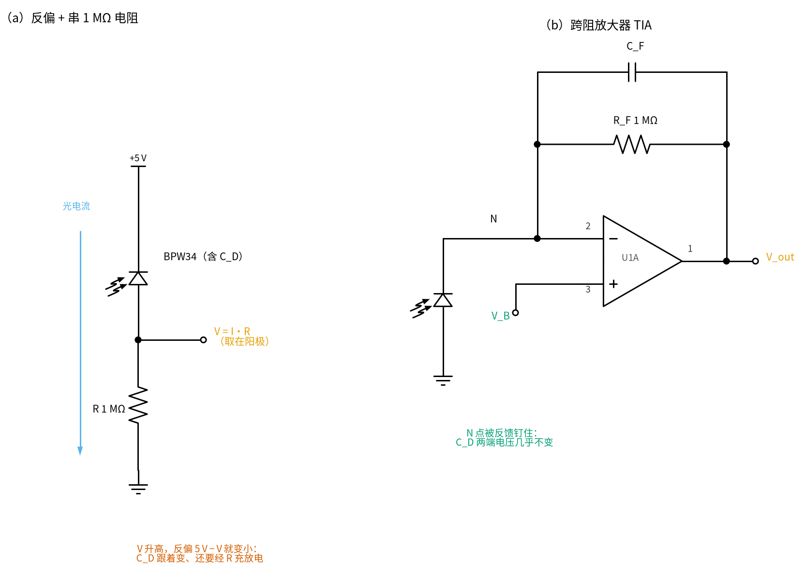
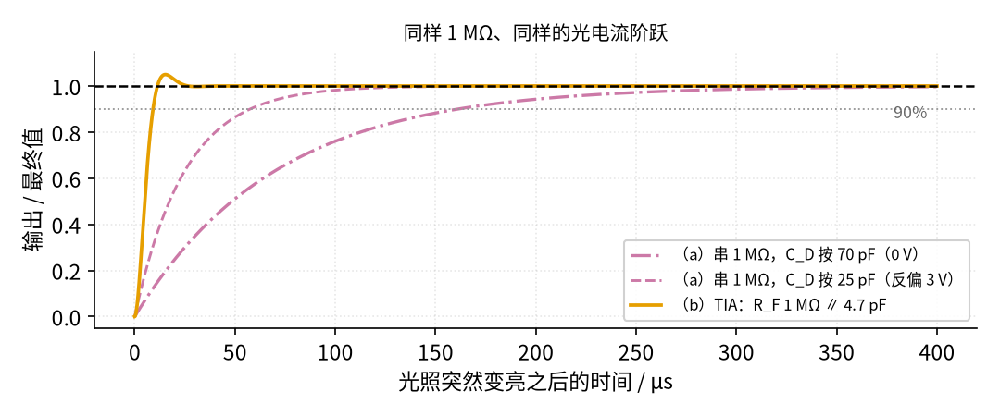
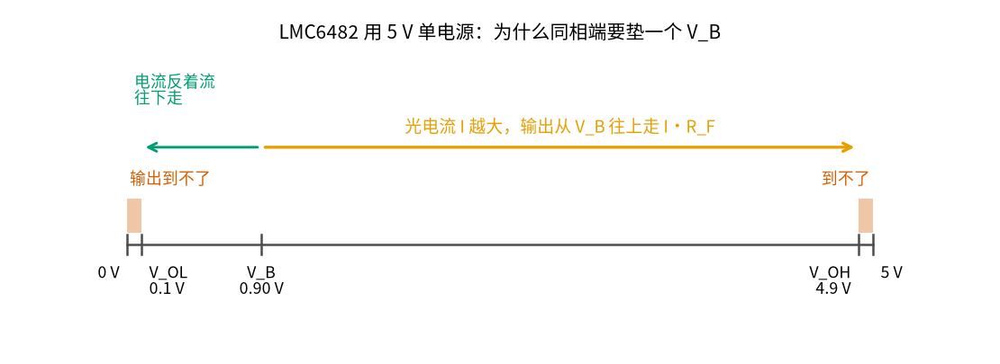

# 31 跨阻放大器（TIA） · 直觉篇

[上一页：30 仪表放大器与电桥 · 动手实验篇](../30-instrumentation-amp/page4.md) · 本页：直觉篇 · [原理与实现篇](page2.md) · [参数与调试篇](page3.md) · [动手实验篇](page4.md) · [下一页：原理与实现篇](page2.md) · 前置节点：[05 反相放大 · 直觉篇](../05-inverting-amp/page1.md)、[03 半导体入门 · 直觉篇](../03-semiconductor-basics/page1.md)、[18 微分电路 · 直觉篇](../18-differentiator/page1.md)、[23 光耦隔离 · 参数与调试篇](../23-optocoupler/page3.md)、[24 振荡器 · 动手实验篇](../24-oscillator/page4.md)、[30 仪表放大器与电桥 · 原理与实现篇](../30-instrumentation-amp/page2.md)

> **开头三问**（先猜，读完本节再回来对答案）
>
> 1. 光电二极管在光照下给出的是"电压"还是"电流"？直接串一只 1 MΩ 电阻去"变成电压"，有什么问题？
> 2. 跨阻放大器的输出 = 某个电压 + 电流 × 电阻。这个"某个电压"在单电源 5 V 电路里为什么不取 0 V？
> 3. 反馈电阻旁边只并了几皮法（pF）的小电容，去掉它会怎样？

## 痛点：光电二极管给的是电流，不是电压

光电式的转速、流量、烟雾、血氧测量，最前面常常是一只**光电二极管**：一种专门让光照进 PN 结的二极管。它的本事是把光变成**电流**：光越强，从阴极流向阳极的反向电流越大，而且在很宽的范围内和光强成正比。以本节实验用的 BPW34 为例，[Vishay BPW34 数据手册](https://www.vishay.com/docs/81521/bpw34.pdf) 写着 1000 lx（大约是阴天户外的亮度）时短路电流 I_k 典型 70 µA；而弱光、遮光盒里只有几纳安（nA）到几微安。

单片机的 ADC、万用表、示波器都只会量电压。所以第一步总是：**把电流变成电压**，而且要变得准（正比）、变得快（光一闪就跟上）。[03 半导体入门 · 直觉篇](../03-semiconductor-basics/page1.md) 讲过二极管是"单向阀"、反向时几乎不导电；光电二极管就是在反向时，让光"撬开"一点点电流。[23 光耦隔离 · 参数与调试篇](../23-optocoupler/page3.md) 里的高速光耦 6N137，里面装的就是"光电二极管 + 放大器"，本节等于把那颗芯片拆开来自己搭。

## 最小必要知识：光电二极管

本节只用到光电二极管的下面四件事，先记住，后面每一节都会用到。

1. **外形和两只脚**：BPW34 是一块扁平的方形小片，正面是受光的窗口，下面伸出两只脚。哪只是阴极（K）、哪只是阳极（A），不要靠记，用万用表**二极管挡**认：先用手或纸片挡住窗口（光照会让读数乱变），红表笔接一脚、黑表笔接另一脚，有零点几伏读数时，**红表笔那只是阳极**；反过来接应该显示超量程（"1" 或 OL）。原理图里竖线那一侧是阴极。
2. **两种接法**：图 31-p1-1（a）两极直接经电流表相连，两端 0 V，叫**零偏**；（b）阴极接 +5 V、阳极经电流表到 0 V，叫**反偏**。两种接法里，光电流在管子**内部都是从阴极流向阳极**（天蓝色箭头），外电路里则从阳极流出去。本节的跨阻放大器让管子接近零偏（两端只差运放钉住的那点电压），[动手实验篇](page4.md) 第 7 步的串电阻小实验则是反偏。
3. **电流和光成正比**：手册给的典型值是 1000 lx 时约 70 µA；光强减半，电流也减半。
4. **结电容 C_D 随反偏变小**：0 V 时约 70 pF，反偏 3 V 时约 25 pF（同一份手册）。这只电容决定了后面所有"快不快、振不振"的问题。

*图 31-p1-1　光电二极管的两种接法：零偏（左）与反偏（右），天蓝色箭头是光电流*

## 一、最直接的办法：串一只电阻

图 31-p1-2 左边是最直接的想法：把光电二极管反偏，阴极接 +5 V，阳极下面串一只 1 MΩ 电阻到 0 V，光电流流过电阻就变成电压 V = I·R，从阳极（电阻上端）取出来。

*图 31-p1-2　反偏串电阻（左）与跨阻放大器（右）*

这个办法有三个毛病：

- **不正比**：电阻上的电压升高，二极管两端的反偏电压就减小（5 V − I·R）。反偏越小，结电容越大；I·R 接近 5 V 时，二极管就不再反偏，光电流被它自己"吃掉"，输出不再和光强成正比。
- **慢**：二极管自带结电容 C_D，电流要先给它充电，电压才能升起来。按 0 V 时的 70 pF 算，时间常数 τ = R·C_D = 1 MΩ × 70 pF = 70 µs，带宽只有 2.27 kHz；反偏时 C_D 会小一些（3 V 时约 25 pF，τ = 25 µs），但 1 MΩ 仍然慢（数字来自 `code/31_sim.py`）。
- **装不下**：70 µA × 1 MΩ = 70 V。但电源只有 5 V，I·R 最多到 5 V 左右就顶住了。电阻取小，弱光时又只有零点几毫伏。

## 二、跨阻放大器：让运放把电流"接过去"

图 31-p1-2 右边是**跨阻放大器**（transimpedance amplifier，简称 TIA）。"跨阻"的意思是：输入是电流、输出是电压，两者之比的单位是欧姆。它其实就是 [05 反相放大 · 直觉篇](../05-inverting-amp/page1.md) 那块"跷跷板"拿掉了输入电阻：负反馈让运放的反相端（2 脚，记作 N 点）一直待在同相端（3 脚）的电压上。

光电流从二极管的阴极被"抽"走，N 点的电压却不能变，运放只好从输出经 R_F 补上同样大的电流。于是：

$$V_{out} = V_B + I \cdot R_F$$

这里 V_B 是同相端的**偏置**电压（本节实验用 5 V 经 10 kΩ / 2.2 kΩ 分压得 0.9016 V）。三个毛病一起解决：

- 二极管两端电压被运放钉住不变，光电流全部走 R_F，**输出和光强成正比**；
- 结电容 C_D 两端电压不变，**不用充电**，速度不再由 R·C_D 决定；
- R_F 可以按量程挑：1 MΩ 管弱光，47 kΩ 管室内光。

## 三、快多少：同一只 1 MΩ，两种接法

图 31-p1-3 是光电流突然从 0 跳到一个固定值时，两种接法输出的变化（都按"最终值 = 1"画）。

*图 31-p1-3　同样 1 MΩ：串电阻 vs 跨阻放大器*

串电阻的接法 10%～90% 上升时间：按 70 pF 算 153.8 µs，按反偏 3 V 的 25 pF 算 54.9 µs；跨阻放大器（R_F 1 MΩ、C_F 4.7 pF、LMC6482）只要 7.38 µs，比 70 pF 那条快了约 20 倍、比 25 pF 那条也快 7 倍多，代价是 5.0% 的小过冲。这些数来自 `code/31_sim.py` 的单极点运放模型，[原理与实现篇](page2.md) 第四节会解释过冲从哪里来。

## 四、输出能摆多大：V_B 和量程

图 31-p1-4 把 5 V 单电源下的几个电压画在一根横轴上。

*图 31-p1-4　5 V 单电源：输出只能在 V_OL 和 V_OH 之间*

LMC6482 的输出接近"轨到轨"，但也到不了 0 V 和 5 V，典型在 0.1 V 到 4.9 V 之间（见 [TI LMC6482 数据手册](https://www.ti.com/lit/ds/symlink/lmc6482.pdf)）。如果同相端直接接 0 V，没光时输出应该是 0 V，运放却做不到，暗处读数就会卡在一个不准的几十毫伏。所以本节把同相端抬到 V_B = 0.9016 V：没光时输出就是 V_B，有光时往上走，最多走到 4.9 V。能装下的最大电流 = (4.9 − 0.9016) V ÷ R_F：R_F = 1 MΩ 只有 4.00 µA，R_F = 47 kΩ 有 85.07 µA。

> **📌 名字别混**　V_B 是"偏置"，只给这一只 TIA 的同相端用；[30 仪表放大器与电桥 · 原理与实现篇](../30-instrumentation-amp/page2.md) 的 V_MID 是 4.5 V 的"中点参考"（分压加跟随器）；05 节的「虚地」是反相端被反馈拉到地电位。本节的 N 点被拉到的是 V_B（0.90 V），不是 0 V，所以本节不叫它"虚地"。[原理与实现篇](page2.md) 第一节会再对比一次。

## 五、去掉几皮法的 C_F 会怎样

R_F 上并的 C_F 只有几 pF，看起来可有可无。回想 [18 微分电路 · 直觉篇](../18-differentiator/page1.md) 里那个只有 C 和 R_f 的理想微分器：电容接在反相端、电阻接在反馈上，被拐角"踢一脚"就振个不停。这里 C_D 就是那只电容，R_F 就是那只电阻，所以不加 C_F，输出在阶跃之后会振上好几毫秒、甚至一直振下去，而不是安静地停在最终值；C_F 太大又会把快速的光脉冲抹圆。怎么选、为什么，放在 [原理与实现篇](page2.md) 第四、五节和 [参数与调试篇](page3.md) 第一、二节。

## 六、它在工程里长什么样

- **TI OPT101**（[数据手册](https://www.ti.com/lit/ds/symlink/opt101.pdf)）：把光电二极管和单电源跨阻放大器做进同一颗芯片，内部反馈电阻 1 MΩ，数据手册写的带宽是 14 kHz（R_F = 1 MΩ 时）。
- **TI TIDU535 参考设计**（[设计指南](https://www.ti.com/lit/ug/tidu535/tidu535.pdf)）：5 V 单电源、跨阻 53.6 kV/A、带宽大于 1 MHz，同相端也加了一个小偏置。
- **流量计里**：光电式转速/流量探头用光电二极管数叶片或齿，前端就是一个跨阻放大器，后面接 [36 施密特整形与脉冲](../36-schmitt-pulse-shaping/page1.md) 那一类整形电路（预告）。

## 新手常见误解

- **"光电二极管和光敏电阻一样，接个电阻就能用"**：能出读数，但不正比、慢、量程小（第一节）。
- **"TIA 的反相端就是虚地"**：只有同相端接 0 V 时才是；本节接在 V_B，N 点在 0.90 V。
- **"R_F 越大越灵敏越好"**：1 MΩ 在室内灯光下就会顶到 4.9 V（第四节），选 R_F 先看最大光电流。
- **"C_F 只是滤噪声的，不装也行"**：它管的是稳定性，不装可能一直振。
- **"随便一只运放都行"**：LM358 的输入偏置电流有几十纳安，和 1 MΩ 一乘就是几十毫伏误差（[参数与调试篇](page3.md) 第三节）。

## 一句话总结

**跨阻放大器让运放把反相端钉在偏置 V_B 上，光电流全部流过 R_F，输出 = V_B + I·R_F；R_F 按最大光电流选，C_F 按稳定性和速度选。**
