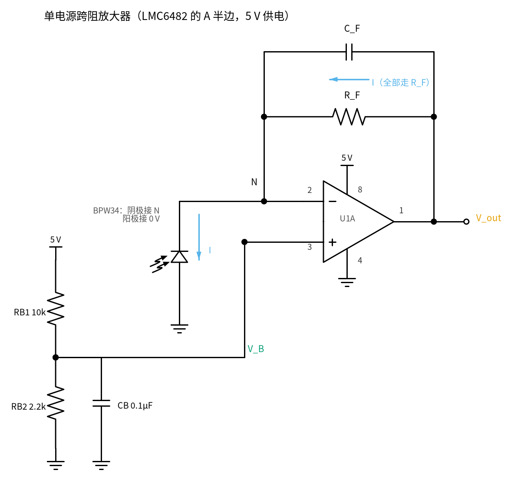
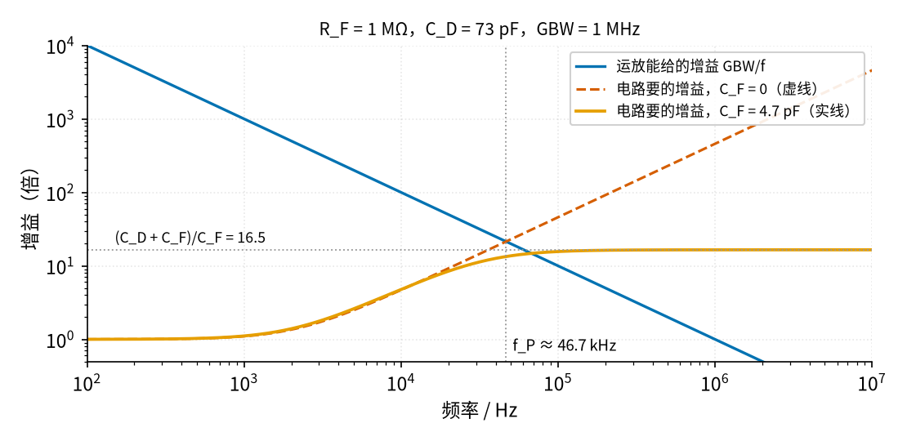
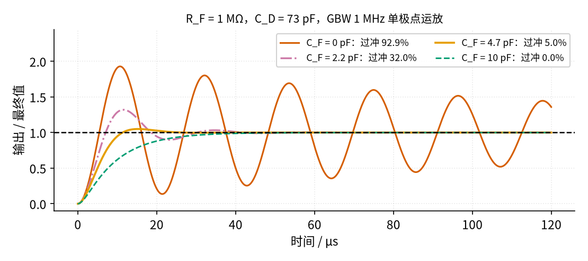
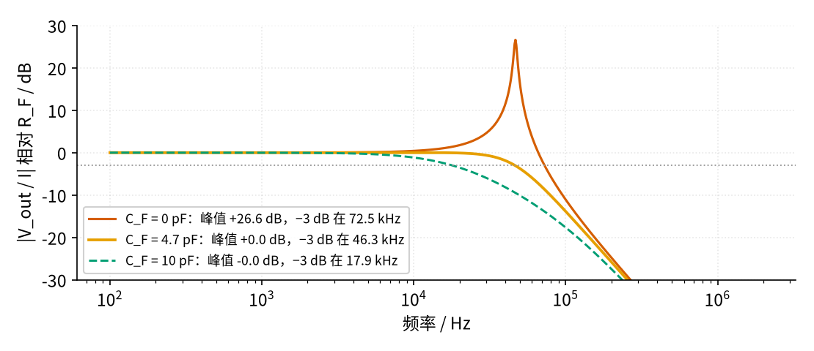

# 31 跨阻放大器（TIA） · 原理与实现篇

[上一页：直觉篇](page1.md) · [直觉篇](page1.md) · 本页：原理与实现篇 · [参数与调试篇](page3.md) · [动手实验篇](page4.md) · [下一页：参数与调试篇](page3.md) · 前置节点：[05 反相放大 · 原理与实现篇](../05-inverting-amp/page2.md)、[14 积分器 · 直觉篇](../14-integrator/page1.md)、[30 仪表放大器与电桥 · 原理与实现篇](../30-instrumentation-amp/page2.md)

## 这一页要解决的问题

1. 单电源 5 V 的跨阻放大器怎么接：二极管哪头接哪里、偏置 V_B 怎么做、引脚怎么编号。
2. 输出公式 V_out = V_B + I·R_F 怎么来，R_F 怎么按量程选。
3. 为什么不加 C_F 可能一直振，C_F 最少要多大，加了以后带宽剩多少。

## 一、电路和引脚

图 31-p2-1 是本节的完整电路：LMC6482 的 A 半边（U1A）做跨阻放大器，5 V 单电源。



*图 31-p2-1　单电源跨阻放大器（LMC6482 的 A 半边）*

LMC6482 是 8 脚双运放，引脚（[TI LMC6482 数据手册](https://www.ti.com/lit/ds/symlink/lmc6482.pdf)）：1 脚 OUTA、2 脚 −INA、3 脚 +INA、4 脚 V−、5 脚 +INB、6 脚 −INB、7 脚 OUTB、8 脚 V+。电源范围 3～15.5 V，5 V 时输出典型能到 0.1～4.9 V。本页只用 A 半边，B 半边在 [动手实验篇](page4.md) 里接成跟随器，不让它悬空。

**二极管方向**：BPW34 的**阴极接 N 点**（2 脚），**阳极接 0 V**。光电流在二极管内部从阴极流向阳极，也就是从 N 点"往下抽"；运放为了守住 N 点，只能把输出抬高，让电流经 R_F 流进 N 点，所以输出在 V_B 之上。接反会怎样，留到 [动手实验篇](page4.md) 思考题 1。

N 点对 0 V 有 V_B ≈ 0.90 V，BPW34 两端其实有约 0.9 V 的反向电压。数据手册给的结电容是 0 V 时 70 pF、3 V 时 25 pF，0.9 V 时落在两者之间。本页按 0 V 的 70 pF 再加上 LMC6482 的 3 pF 输入电容，取 C_D = 73 pF 设计：C_D 越大越容易振，按大的算是保守做法。

## 二、输出公式

运放有负反馈、输出没顶到头时，两个输入端电压几乎相等（[05 反相放大 · 原理与实现篇](../05-inverting-amp/page2.md) 讲过的"虚短"），所以 N 点 = V_B。LMC6482 的输入偏置电流只有飞安（fA）级，几乎不分流。对 N 点列电流方程：从输出经 R_F 流进来的电流，等于被二极管抽走的光电流 I：

$$\frac{V_{out} - V_B}{R_F} = I \quad\Rightarrow\quad V_{out} = V_B + I \cdot R_F$$

V_B 由分压得到：V_B = 5 V × 2.2/(10 + 2.2) = 0.9016 V。CB 0.1 µF 把分压点的噪声滤掉，因为 V_B 上的任何波动都会原样出现在输出上。

> **📌 名字别混：偏置 V_B、中点参考 V_MID、虚地**　
> - **V_B（偏置）**：本节同相端那个 0.90 V，由 RB1、RB2 分压、CB 滤波，只给这只 TIA 用，几乎不需要供电流，所以不用跟随器。
> - **V_MID（中点参考）**：[30 仪表放大器与电桥 · 原理与实现篇](../30-instrumentation-amp/page2.md) 第五节的 4.5 V，是分压加跟随器做出来的低阻电压源，要给好几级电路当参考、还要供电流。
> - **虚地**：[05 反相放大 · 直觉篇](../05-inverting-amp/page1.md) 里，同相端接地时反相端被反馈拉到 0 V。本节反相端被拉到的是 V_B，所以叫"N 点"，不叫虚地。

**为什么偏置取 0.90 V，而不是 0.1～0.2 V**：ADI 的文章 [《Stabilize Your Transimpedance Amplifier》](https://www.analog.com/en/resources/technical-articles/stabilize-transimpedance-amplifier-circuit-design.html)解释了单电源 TIA 给同相端加小偏置的原因：让暗态输出高于 V_OL，输出级才工作在线性区；同时提醒偏置不能太大，否则二极管反向漏电会变大。Electronics Stack Exchange 上的 [单电源 TIA 问答](https://electronics.stackexchange.com/questions/731625/photodiode-transimpedance-amplifier-with-single-supply)采纳答案建议约 +0.1 V。本节故意取大一点，是为了在 [动手实验篇](page4.md) 里能做"校准②"：让电流反方向流，输出从 V_B 往下走 410 mV，仍高于 V_OL = 0.1 V。偏置也不能太大：反向电压越大，二极管的暗电流越大。BPW34 手册的暗电流是 10 V 反偏时典型 2 nA，乘 1 MΩ 才 2 mV；本节只反偏 0.9 V，只会更小。

## 三、量程：R_F 怎么选

输出只能从 V_B 走到 V_OH = 4.9 V，所以能装下的最大光电流是

$$I_{max} = \frac{V_{OH} - V_B}{R_F}$$

R_F = 1 MΩ 时 I_max = 4.00 µA，R_F = 47 kΩ 时 85.07 µA。BPW34 在 1 klx 下的短路电流 I_k 典型 70 µA（手册里反偏 5 V 时的反向光电流 I_ra 是 75 µA，两个名字别混），乘 47 kΩ 是 3.29 V，装得下；乘 1 MΩ 是 70 V，必然顶到 4.9 V。所以本节 [动手实验篇](page4.md) 测室内光用 47 kΩ，1 MΩ 只用在注入几百纳安的校准上。选 R_F 的顺序是：**先估最大电流，再定 R_F**，不是越大越好。

## 四、为什么可能一直振：两条线的交点

运放的放大倍数随频率下降。单极点模型下，开环增益大约是 A(f) = GBW/f：GBW = 1 MHz 时，1 kHz 有 1000 倍，100 kHz 只有 10 倍。（LMC6482 手册的 1.5 MHz 是 15 V 下的值，3 V 表格写 1 MHz，本节 5 V 保守取 1 MHz。）

另一方面，从运放输出看回去，反馈网络是 Z_F（R_F 并 C_F）和 Z_D（C_D）组成的分压。运放要维持虚短，需要的倍数叫**噪声增益**：

$$NG = 1 + \frac{Z_F}{Z_D}$$

低频时 Z_D 很大，NG ≈ 1；频率升高，C_D 的阻抗变小，NG 跟着上升。不加 C_F 时它一路上升；加了 C_F，高频时 Z_F 由 C_F 决定，NG 停在一个平台

$$NG_{\infty} = \frac{C_D + C_F}{C_F}$$

C_F = 4.7 pF 时平台是 (73 + 4.7)/4.7 = 16.53。把两条线画在同一张图上（图 31-p2-2）：



*图 31-p2-2　运放能给的增益 vs 电路要的增益*

**直觉**：两条线相交的地方，运放刚好"给不起"了。回想 [18 微分电路 · 直觉篇](../18-differentiator/page1.md) 里的振铃：只有 C 和 R_f 的理想微分器，被三角波的拐角"踢一脚"，输出就像弹簧挂着重物一样上下弹个不停，频率由运放的 GBW 和这一对 R、C 决定。跨阻放大器的结构一模一样：C_D 就是那只电容（接在反相端），R_F 就是那只电阻（跨在反馈上）。[18 微分电路 · 参数与调试篇](../18-differentiator/page3.md) 给过振铃频率的估算式，换成这里的元件，就是下面的 f_P：

$$f_P \approx \sqrt{\frac{GBW}{2\pi R_F C_D}}$$

1 MΩ、73 pF、1 MHz 时 f_P ≈ 46.7 kHz。图 31-p2-2 里，C_F = 0 那条（虚线）在交点处还在往上斜，电路就会在交点附近振铃，好几毫秒都停不下来，甚至一直振；加了 C_F 的那条（实线）在交点前已经变平，输出最多有个小过冲。C_F 的作用是让反馈在高频时"先松一点"，给弹簧加阻尼。判断时记住一句："交点处 NG 要已经变平"。

TI 的应用笔记 [SBOA055A](https://www.ti.com/lit/an/sboa055a/sboa055a.pdf) 式 6 给的也是这个 f_P。注意：手册里 f_P 指的是按下一节选好 C_F 之后的跨阻带宽；不加 C_F 时的振铃频率在数值上接近，但不是同一个量。

把运放的"慢"和 C_D、C_F 放在一起，就是 [20 有源滤波 · 原理与实现篇](../20-active-filter/page2.md) 里那种二阶电路。推导要用复数，这里只用结论：**C_F 越大，阻尼越大，过冲越小，带宽也越窄**。下表是 `code/31_sim.py` 按单极点运放模型算出的数（R_F 1 MΩ、C_D 73 pF、GBW 1 MHz）：

| C_F | 阻尼 ζ | 阶跃过冲 | 10%～90% 上升时间 | −3 dB 带宽 |
|---|---|---|---|---|
| 0 | 0.023 | 92.9% | 3.55 µs | 72.5 kHz（带 +26.6 dB 尖峰） |
| 2.2 pF | 0.341 | 32.0% | 4.76 µs | 65.5 kHz（带 +3.9 dB 尖峰） |
| 4.7 pF | 0.691 | 5.0% | 7.38 µs | 46.3 kHz |
| 10 pF | 1.398 | 0% | 19.47 µs | 17.9 kHz |

表里的阻尼 ζ 和 20 节的品质因数 Q 是同一件事的两种说法（ζ = 1/(2Q)，ζ 越大越"稳"）；20 节的巴特沃斯 Q = 0.707 对应 ζ = 0.707。4.7 pF 时 ζ = 0.691，已经很接近巴特沃斯：平坦、过冲小。

图 31-p2-3 是光电流阶跃时这四种 C_F 的输出：



*图 31-p2-3　光电流阶跃：C_F 从 0 到 10 pF*

单极点模型算出的过冲：C_F = 0 时 92.9%（模型里振荡慢慢衰减；真实运放内部还有更多延迟，用 TI 的 LMC6482 SPICE 模型、1 µA 阶跃算出过冲 106.6%，振铃峰峰值 0.3 ms 时 1261 mV、1 ms 时 356 mV、2.9 ms 时还有 11.5 mV，要好几毫秒才慢慢停下；面包板上再多一点延迟，就可能一直振下去）；2.2 pF 时 32.0%；4.7 pF 时 5.0%；10 pF 时 0%，但 10%～90% 上升时间从 4.7 pF 时的 7.38 µs 拉长到 19.47 µs。SPICE 和单极点模型的过冲数字不完全一样（例如 4.7 pF 时 SPICE 几乎为 0），趋势一致（数据来自厂家 SPICE 模型）；实际电路以示波器实测为准。

## 五、C_F 最少要多大、带宽剩多少

SBOA055A 式 (5) 给出"刚好够稳"的 C_F：

$$C_F = \frac{1 + \sqrt{1 + 8\pi R_F C_D \cdot GBW}}{4\pi R_F \cdot GBW}$$

图 31-p2-4 是频率响应：



*图 31-p2-4　跨阻的频率响应（1 MΩ、C_D 73 pF）*

C_F = 0 时在 f_P ≈ 46.7 kHz 附近有 +26.6 dB 的尖峰：这个频率附近的噪声被放大 20 多倍，就是振铃的来源。4.7 pF 时没有尖峰，−3 dB 带宽 46.3 kHz（SPICE 44.66 kHz）；10 pF 时只剩 17.9 kHz。C_F 越大越稳，但越慢。

## 用 Python 算一遍

下面的代码只用标准库，算出偏置、量程、最小 C_F 和 f_P。

```python
import math

GBW = 1.0e6           # LMC6482 增益带宽积（按 3 V 表格保守取值）
VCC, RB1, RB2 = 5.0, 10e3, 2.2e3
VOH = 4.9             # 输出上限（典型）

VB = VCC * RB2 / (RB1 + RB2)
print(f"偏置 V_B = {VB:.4f} V")

def cf_min(rf, cd, gbw=GBW):          # SBOA055A 式 (5)
    return (1 + math.sqrt(1 + 8 * math.pi * rf * cd * gbw)) / (4 * math.pi * rf * gbw)

def f_p(rf, cd, gbw=GBW):             # SBOA055A 式 (6)：补偿后的带宽
    return math.sqrt(gbw / (2 * math.pi * rf * cd))

for rf, cd in [(1e6, 73e-12), (1e6, 28e-12)]:
    cf = cf_min(rf, cd)
    print(f"R_F = {rf/1e3:g} kΩ，C_D = {cd*1e12:g} pF：量程 {(VOH - VB) / rf * 1e6:.2f} µA，"
          f"C_F ≥ {cf*1e12:.2f} pF，f_P = {f_p(rf, cd)/1e3:.1f} kHz")

# 留余量：GBW 只按典型值的 60% 算（例 1、例 2 选值用）
for rf in (1e6, 47e3):
    print(f"R_F = {rf/1e3:g} kΩ、C_D = 73 pF、GBW 按 60%：C_F ≥ {cf_min(rf, 73e-12, 0.6 * GBW)*1e12:.2f} pF")

# 例1 选 4.7 pF 之后
rf, cd, cf = 1e6, 73e-12, 4.7e-12
print(f"例1：1/(2π R_F C_F) = {1 / (2 * math.pi * rf * cf) / 1e3:.2f} kHz，"
      f"高频噪声增益 (C_D+C_F)/C_F = {(cd + cf) / cf:.2f}")
print(f"例1：90.16 nA 时输出 = {VB + 90.16e-9 * rf:.4f} V")
```

运行结果：V_B = 0.9016 V；1 MΩ、73 pF 时量程 4.00 µA，C_F ≥ 3.49 pF，f_P = 46.7 kHz；把 C_D 换成反偏 3 V 的 28 pF（25 pF + 3 pF），C_F 降到 2.19 pF、f_P 升到 75.4 kHz，说明加大反偏能让电路更快。GBW 只按 60% 算时，73 pF 下 1 MΩ 要 C_F ≥ 4.54 pF，47 kΩ 要 C_F ≥ 23.31 pF。例1 选 4.7 pF 后 1/(2πR_F C_F) = 33.86 kHz，高频噪声增益 16.53；注入 90.16 nA 时输出 0.9918 V。

## 例题

**例 1（完整）**：R_F = 1 MΩ，C_D = 73 pF，GBW = 1 MHz。求最小 C_F、f_P，并选一个标准值。

1. 先算根号里的量：8π × 10^6 × 73×10^-12 × 10^6 = 1834.7，√(1 + 1834.7) = 42.845。
2. 分母：4π × 10^6 × 10^6 = 1.257×10^13。
3. C_F = (1 + 42.845) / 1.257×10^13 = 3.49 pF。
4. f_P = √(10^6 / (2π × 10^6 × 73×10^-12)) = 46.7 kHz。
5. 选值：3.3 pF 比最小值 3.49 pF 还小，不够（单极点模型过冲 16.6%，见 [参数与调试篇](page3.md) 第一节的扫描）；比 3.49 pF 大的最近标准值是 3.9 pF，但它只比最小值多 12%，GBW 只要掉到典型值的 80% 就不够了。C_D 和 GBW 都有偏差，ADI 那篇文章建议 GBW 按典型值的 60% 设计：把 GBW = 0.6 MHz 代入式 (5)，最小 C_F 升到 4.54 pF，3.9 pF 也不够，所以取 **4.7 pF**。面包板上 R_F 两端还会再叠加约 2～3 pF 的寄生电容（ https://electronics.stackexchange.com/questions/302850/what-order-of-magnitude-should-i-expect-the-parasitic-capacitance-to-be-for-a-so ，见 [参数与调试篇](page3.md) 第一节），实际效果以示波器为准。单极点模型过冲 5.0%，−3 dB 带宽 46.3 kHz；简单式 1/(2πR_F C_F) = 33.86 kHz，比 46.3 kHz 小：C_F 接近最小值时，跨阻是一个接近"最平坦"的二阶响应，−3 dB 点落在 f_P（46.7 kHz）附近，而不是 1/(2πR_F C_F)。C_F 取得越大，两者越接近（10 pF 时 1/(2πR_F C_F) 和实际带宽都在十几千赫）。

**例 2（留空）**：把 R_F 换成 47 kΩ，C_D、GBW 不变。

1. 8π·R_F·C_D·GBW = ______，√(1 + 它) = ______。
2. 4π·R_F·GBW = ______。
3. 最小 C_F = ______ pF；按例 1 的规则（GBW 取 60%）再算一次 = ______ pF；选标准值 ______ pF。
4. 选定后高频噪声增益平台 (C_D + C_F)/C_F = ______，1/(2πR_F C_F) = ______ kHz。

<details><summary>例 2 答案</summary>

1. 86.23；9.340。
2. 5.906×10^11。
3. (1 + 9.340)/5.906×10^11 = 17.51 pF；按例 1 的规则把 GBW 换成 0.6 MHz 再算，最小 C_F = 23.31 pF。22 pF 比它小（22 pF 只能撑到 GBW 为典型值的 66%），所以取 **27 pF**。
4. (73 + 27)/27 = 3.70；1/(2π × 47 kΩ × 27 pF) = 125.4 kHz。单极点模型的阶跃过冲 1.0%、−3 dB 带宽 154.1 kHz。R_F 小了，最小 C_F 反而要更大，但带宽高得多。[动手实验篇](page4.md) 第二阶段用的就是 47 kΩ ∥ 27 pF。

</details>

**例 3（变式，按带宽选 C_F）**：TI 的 [SBOA268](https://www.ti.com/lit/an/sboa268a/sboa268a.pdf)换了一种思路：先按要求的带宽定 C_F 的上限，再检查运放的 GBW 够不够。照这个思路做：同一个单电源电路（V_B = 0.9016 V，V_OH = 4.9 V，C_D = 73 pF），最大光电流 20 µA，带宽至少 5 kHz。求 R_F、C_F，并检查 GBW = 1 MHz 够不够、C_F 是否大于式 (5) 的下限。

<details><summary>例 3 答案</summary>

R_F ≤ (4.9 − 0.9016)/20 µA = 199.9 kΩ，留余量取 180 kΩ（20 µA 时输出 4.50 V）；带宽 ≥ 5 kHz 要求 C_F ≤ 1/(2π × 180 kΩ × 5 kHz) = 176.8 pF，取 150 pF，带宽 5.89 kHz；SBOA268 的条件要求 GBW > (C_D + C_F)/(2πR_F C_F²) = 8.76 kHz，1 MHz 绰绰有余；式 (5) 的下限是 8.49 pF，150 pF 远大于它，所以一定稳。这种"慢而稳"的设计适合测光强，不适合看快脉冲。下面是计算过程：

```python
import math
VB, VOH, CD, GBW = 0.9016, 4.9, 73e-12, 1.0e6
I_max, f_bw = 20e-6, 5e3
rf = (VOH - VB) / I_max                      # 最大允许的 R_F
print(f"R_F ≤ {rf/1e3:.1f} kΩ → 留余量取 180 kΩ")
rf = 180e3
c_max = 1 / (2 * math.pi * rf * f_bw)       # 带宽 ≥ 5 kHz 时 C_F 的上限
print(f"C_F ≤ {c_max*1e12:.1f} pF → 取 150 pF")
cf = 150e-12
need = (CD + cf) / (2 * math.pi * rf * cf**2)   # SBOA268 的 GBW 条件
cf5 = (1 + math.sqrt(1 + 8 * math.pi * rf * CD * GBW)) / (4 * math.pi * rf * GBW)
print(f"20 µA 时输出 {VB + I_max*rf:.2f} V；带宽 1/(2π R_F C_F) = {1/(2*math.pi*rf*cf)/1e3:.2f} kHz；要求 GBW > {need/1e3:.2f} kHz；式(5) 的下限 {cf5*1e12:.2f} pF")
```

SBOA268 原文的例子是 R_F 100 kΩ、带宽 10 kHz、输入电容 6 pF：反馈电容（原文叫 C1，这里写 C_F，免得和去耦电容 C1 混）C_F ≤ 159.2 pF 取 150 pF，带宽 10.61 kHz，GBW 只需大于 11.03 kHz（`code/31_sim.py` 复算）。

</details>

## 本页小结

- 二极管阴极接 N（2 脚）、阳极接 0 V；同相端（3 脚）接偏置 V_B = 0.9016 V；输出 V_out = V_B + I·R_F。
- V_B 是偏置，V_MID 是中点参考，「虚地」只指 05 节同相端接地的情况，三者别混。
- R_F 按最大光电流选：I_max = (V_OH − V_B)/R_F。
- C_D 让噪声增益随频率上升，和运放增益线相交时若还在上升就会振；C_F 让它变平。最小 C_F 用 SBOA055A 式 (5)，再留余量。
