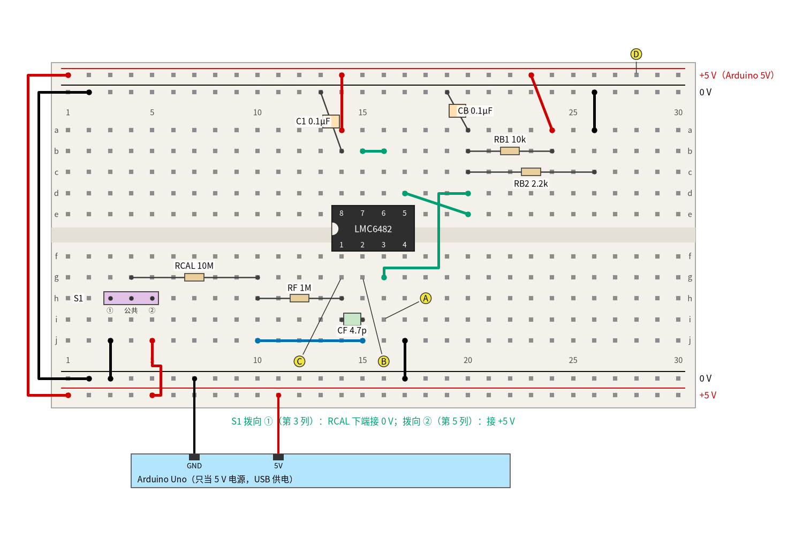
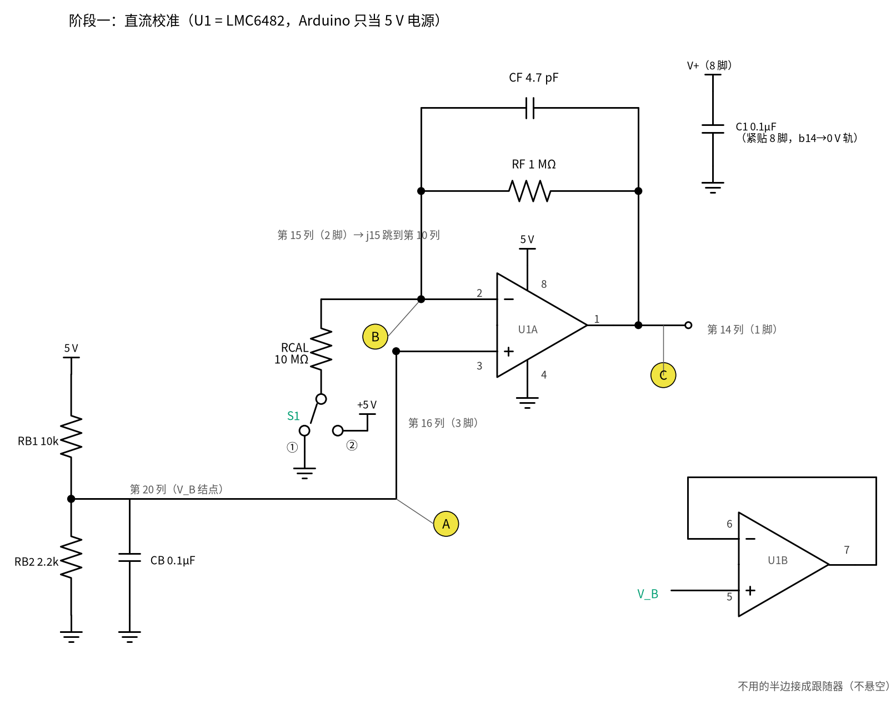
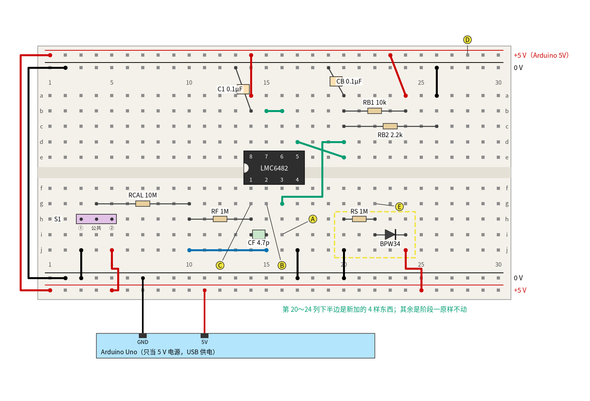
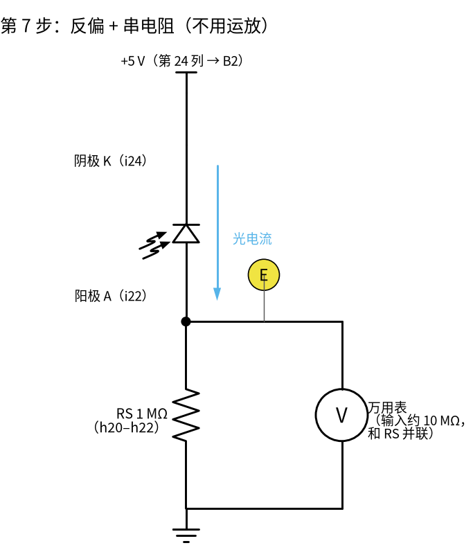
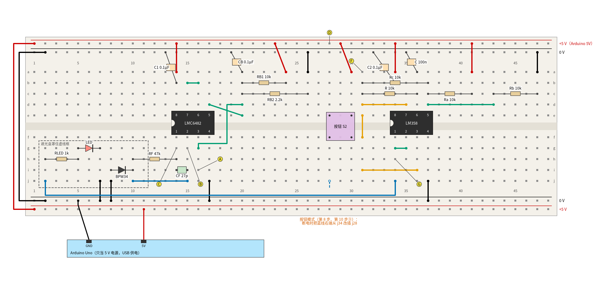
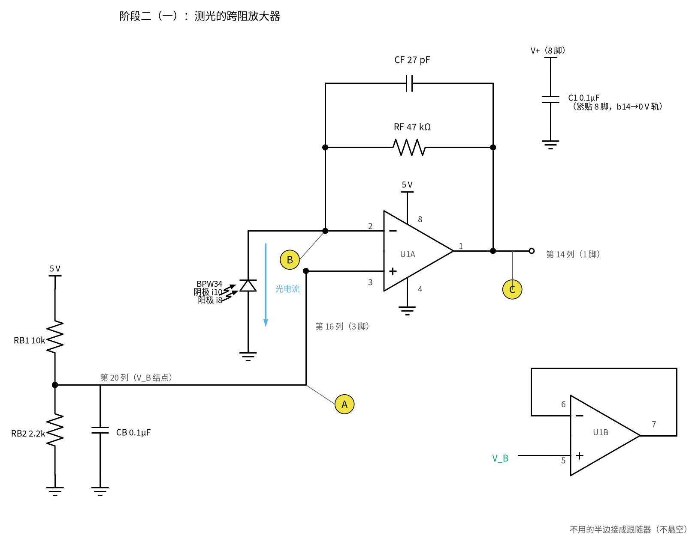
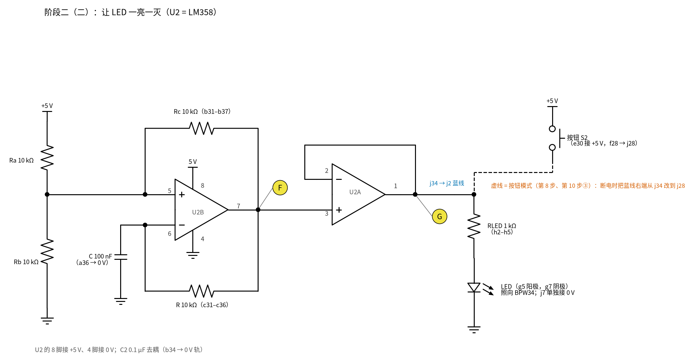
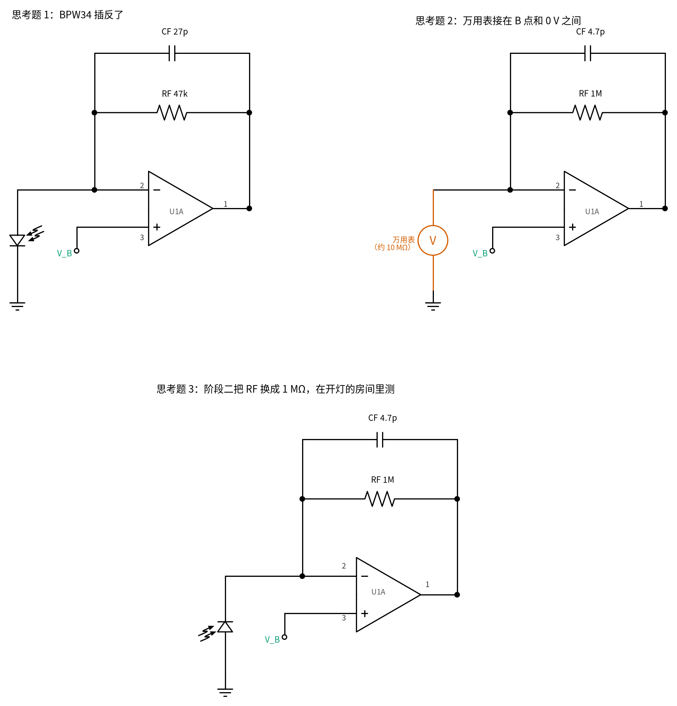

# 31 跨阻放大器（TIA） · 动手实验篇

[上一页：参数与调试篇](page3.md) · [直觉篇](page1.md) · [原理与实现篇](page2.md) · [参数与调试篇](page3.md) · 本页：动手实验篇 · 下一页：32 节电荷放大器（即将上线） · 前置节点：[05 反相放大 · 动手实验篇](../05-inverting-amp/page4.md)、[18 微分电路 · 直觉篇](../18-differentiator/page1.md)、[24 振荡器 · 动手实验篇](../24-oscillator/page4.md)、[30 仪表放大器与电桥 · 动手实验篇](../30-instrumentation-amp/page4.md)

## 这次实验要验证什么

一片 LMC6482、一片 LM358、一只 BPW34 光电二极管、一块 Arduino Uno（**只当 5 V 电源**，不写任何程序）和一块万用表，分两个阶段把前三页的结论量出来：

1. **阶段一：用 10 MΩ 电阻"造"一个已知电流来校准**。光电流看不见、摸不着，先用 RCAL = 10 MΩ 从偏置点 V_B 往 0 V 或 +5 V 拉出一个算得出来的电流（90.16 nA 或 409.84 nA），验证输出公式 $V_{out} = V_B + I \cdot R_F$ ：C 比 A 高 90.16 mV，或低 409.84 mV。RCAL 接 0 V 还是 +5 V 由拨动开关 S1 切换。对应 [原理与实现篇](page2.md) 第二节。
2. **偏置电流是直接误差**：同一块板只把 LMC6482 换成 LM358，读数变小几十毫伏（典型约 70.2 mV，以实测为准）。对应 [参数与调试篇](page3.md) 第二节。
3. **R_F × C_F 决定速度**：把 C_F 临时换成 1 µF，时间常数变成 1 s，拨一下 S1、按下秒表，就能用万用表看到输出"慢慢走过去"。
4. **为什么不直接串电阻**：BPW34 反偏串 1 MΩ，不用运放，量电阻上的电压：盖上盒子只有几 mV，开灯就顶到 5 V 附近。亲手看到"一头太小、一头装不下"，再去接 TIA（第 7 步，对应 [直觉篇](page1.md) 第一节）。
5. **阶段二：真的测光**。换成 R_F = 47 kΩ、C_F = 27 pF，接上 BPW34，测暗、室内灯、LED 照射三种情况，把读数换算成光电流。LED 由按钮或 [24 振荡器](../24-oscillator/page4.md) 那个 LM358 方波振荡器来点亮。选做：用示波器看 C_F 有无时的振铃，先预测、再实测（第 10 步）。

**两套编号别混**：测量点用**字母** A～G（图上黄色圆圈里的字母），芯片引脚用"几脚"（图上芯片旁的小数字），面包板孔位用"行字母 + 列号"（如 g15）。对应关系：

| 测点 | 孔位 | 是什么 | 原理与实现篇里的名字 |
|---|---|---|---|
| A | i16 | U1 的 3 脚（同相端），偏置电压 | V_B |
| B | g15 | U1 的 2 脚（反相端），光电二极管和 RF 汇合的点 | N（"虚短"后约等于 V_B，但**不是**虚地） |
| C | g14 | U1 的 1 脚（输出） | V_out |
| D | 上方 +5 V 轨第 28 列 | 电源 | V_CC（Arduino 5V） |
| E | g22（只在第 7 步） | 串电阻演示里 BPW34 阳极和 RS 的交点 | [直觉篇](page1.md) 开头"反偏"接法里电流表的位置，这里换成了电阻 |
| F | a31（阶段二） | U2 的 7 脚，方波振荡器输出 | 24 节的 V_out |
| G | h34（阶段二） | U2 的 1 脚，跟随器输出，推 LED | — |

**测点 B 只和 A 比**：万用表永远不要接在 B 和 0 V 之间（思考题 2 会算给你看为什么）。

## ⚠️ 安全须知

- **全电路只有 Arduino 的 5 V**（USB 供电），远低于本教程 12 V 的上限。没有 Arduino 时可以用 3 节 AA 电池盒（约 4.5 V），电池盒两根线没插进面包板时用胶带包好，不要碰在一起。
- **改接线、插拔任何元件或导线之前，一律先拔 USB 线**（断电），改完核对一遍再插回。通电时只允许做两件事：**拨动开关 S1**、**按按钮 S2**。它们本来就是给手操作的元件，手指碰不到任何导体。
- **芯片一律缺口朝左，8 脚接 +5 V、4 脚接 0 V**。接反时芯片会发烫，**不要用手去摸**，立刻拔掉 USB 线。LMC6482 是 CMOS 芯片，拿之前先摸一下金属外壳放掉静电。
- **10 µF 电解电容分正负极**（第 9 步）：长脚（正极）插 a36（U2 的 6 脚那一列），白带一侧（负极）插上方 0 V 轨。这一点的电压一直在 1 V 以上，接对了就不会反。
- **万用表不要接在 B 和 0 V 之间，也不要跨在 RCAL 两端**。万用表自己有约 10 MΩ 内阻，接上去就等于多了一个 10 MΩ 电阻，测的东西会被它改掉（ [参数与调试篇](page3.md) 第三节）。
- LED 不要近距离直视；本页 LED 电流最大约 3.2 mA，正常亮度。

## 器材清单

| 元件 | 型号或数值 | 数量 | 说明 |
|---|---|---|---|
| U1 | LMC6482AIN（DIP-8） | 1 | 双运放，CMOS 输入，输入、输出都轨到轨；用 A 半边（1、2、3 脚） |
| U2 | LM358（DIP-8） | 1 | 第 5 步先借来插在 U1 的位置做对比；阶段二插在第 34 列，做振荡器和跟随器 |
| 光电二极管 | BPW34 | 1 | 第 7 步和阶段二用；用万用表二极管挡分清阳极、阴极 |
| LED | 5 mm 红色 | 1 | 阶段二的光源 |
| RCAL | 10 MΩ | 1 | 校准电流用，阶段一 |
| RF | 1 MΩ、47 kΩ | 各 1 | 阶段一 1 MΩ，阶段二 47 kΩ |
| RS | 1 MΩ | 1 | 第 7 步串电阻演示用（和 RF 的 1 MΩ 是两只，同时插在板上） |
| RB1、RB2 | 10 kΩ、2.2 kΩ | 各 1 | 分出 V_B ≈ 0.90 V |
| 振荡器电阻 R、Ra、Rb、Rc | 10 kΩ | 4 | 和 24 节一样；另备 75 kΩ 一只做慢速版的 R |
| RLED | 1 kΩ | 1 | LED 限流 |
| CF | 4.7 pF、27 pF 陶瓷（C0G/NP0） | 各 1 | 阶段一 4.7 pF，阶段二 27 pF |
| CF（慢速演示） | 1 µF 无极性（薄膜或陶瓷） | 1 | 只在第 6 步用；不要用电解电容 |
| 振荡器电容 C | 100 nF 陶瓷或薄膜；10 µF / 16 V 以上电解 | 各 1 | 100 nF 是快速版（约 1.5 ms 一个周期），10 µF 是慢速版（约 1 s） |
| C1、CB、C2 | 0.1 µF 陶瓷 | 3 | C1、C2 分别是 U1、U2 的电源去耦，CB 稳住 V_B |
| S1 | 单刀双掷拨动开关，3 脚、脚距 2.54 mm，**必须是先断后合型**（break-before-make，说明里写 non-shorting；买时看清楚） | 1 | 阶段一切换 RCAL 接 0 V 还是 +5 V。两边脚分别接 0 V、+5 V，先合后断型拨动瞬间会把这两根轨短接 |
| S2 | 6 mm 四脚轻触按钮 | 1 | 阶段二给 LED 一个"一下子亮"的快边沿 |
| Arduino Uno | 带 USB 线 | 1 | 只当 5 V 电源 |
| 面包板、杜邦线 | 830 孔 | 1 套 | 红线接 +5 V、黑线接 0 V、绿线/蓝线/橙线接信号 |
| 万用表 | 3 位半即可 | 1 | 要有 200 mV、2 V、20 V 直流电压挡，20 MΩ 电阻挡，二极管挡，通断挡 |
| 示波器（选做） | 带宽 ≥ 20 MHz | 1 | 只在第 10 步用 |
| 遮光盒 | 纸盒或黑布 | 1 | 测暗电流 |
| 秒表 | 手机即可 | 1 | 第 6 步 |

## 最小必要知识：本页三样新东西

**Arduino Uno 在本节只当 5 V 电源。** 不需要装软件、不需要上传程序。Uno 电源排针上印着 5V、GND 的两个孔，USB 线插上电脑或手机充电头后，5V 脚就输出约 5 V（电脑 USB 实际可能在 4.7～5.1 V 之间，所以第 2 步要先量一次测点 D）。本页所有"+5 V"都是它；拔掉 USB 线就是"断电"。用 Arduino 读数、写程序要到 [35 程控增益与 AGC](../35-pga-agc/page1.md) 才讲（预告，那一节会一步一步教）。

**拨动开关 S1（单刀双掷）**：三只脚排成一排，中间是"公共脚"。滑块推向哪一边，公共脚就和哪一边的脚接通，另一边断开。本页把它插在 h3、h4、h5：公共脚 h4 连着 RCAL，左脚 h3 接 0 V（位置①），右脚 h5 接 +5 V（位置②）。不同厂家的开关可能"推左接右"，**拿不准就在断电时用万用表通断挡量一下**：滑块推到左边，公共脚和哪只脚"嘀"，那只脚就是这时接通的。

**轻触按钮 S2（四脚）**：按下接通、松手断开。四只脚两两在内部本来就连着，哪两只连着各家不同；**只用对角的两只脚**（本页是 e30 和 f28）就不用管内部怎么连：不按时这两只一定断开，按下时一定接通。机械触点按下的一瞬间会"抖"几下（接通、断开、再接通，几毫秒内），第 10 步看波形时会提到。

## 搭建步骤

面包板的四条电源轨：最上面一条是 **+5 V 轨（下文叫 T1）**，第二条是 **0 V 轨（T2）**；最下面两条从上往下是 **0 V 轨（B1）**、**+5 V 轨（B2）**。芯片一律**缺口朝左**，跨在中间凹槽上：LMC6482 的 1～4 脚在 f 行第 14～17 列，8～5 脚在 e 行第 14～17 列（8 脚 e14、7 脚 e15、6 脚 e16、5 脚 e17）。

### 阶段一：直流校准（RF = 1 MΩ，CF = 4.7 pF）

**第 1 步：按图 31-p4-1 搭电路（全程不插 USB）**

1. **电源轨**：红线 T1 第 1 列 → B2 第 1 列，黑线 T2 第 2 列 → B1 第 2 列，让上下两组轨连通。Arduino 的 GND 用黑线接 B1 第 7 列，5V 用红线接 B2 第 11 列。
2. **芯片和去耦**：插上 LMC6482（缺口朝左，1 脚 f14）。红线 a14 → T1 第 14 列（8 脚接 +5 V）；黑线 j17 → B1 第 17 列（4 脚接 0 V）；C1（0.1 µF）一脚插 b14、一脚插 T2 第 13 列（轨上第 12 列是组间空档，没有孔），紧贴 8 脚去耦。
3. **偏置 V_B**：RB1（10 kΩ）插 b20–b24，红线 a24 → T1 第 23 列（第 24 列是轨的组间空档）；RB2（2.2 kΩ）插 c20–c26，黑线 a26 → T2 第 26 列；CB（0.1 µF）一脚 a20、一脚 T2 第 19 列。第 20 列上半就是 V_B。绿线 d20 → g16，把 V_B 送到 3 脚（f16 所在的第 16 列下半）。
4. **不用的 B 半边接成跟随器**：绿线 b15–b16（7 脚连 6 脚），绿线 d17 → e20（5 脚接 V_B）。不用的半边不能悬空，否则它可能自己振荡、多耗电。
5. **反馈 RF ∥ CF**：RF（1 MΩ）插 h10–h14；CF（4.7 pF）插 i14–i15；蓝线 j15 → j10，把第 10 列（RF 的左端）接回第 15 列（2 脚）。这样 RF 和 CF 都跨在 1 脚（第 14 列）和 2 脚（第 15 列）之间。
6. **校准电阻和开关**：RCAL（10 MΩ）插 g4–g10，右端在第 10 列，也就连到了 2 脚。S1 三只脚插 h3、h4、h5，公共脚 h4 和 RCAL 左端 g4 同在第 4 列下半。黑线 j3 → B1 第 3 列（位置① = 0 V）；红线 j5 → B2 第 5 列（位置② = +5 V）。最后把 S1 拨到①。



*图 31-p4-1　阶段一面包板：RF 1 MΩ、CF 4.7 pF、RCAL 10 MΩ 经 S1 接 0 V 或 +5 V；黄色字母是测点*



*图 31-p4-2　阶段一原理图（和图 31-p4-1 一一对应）*

> **对照看**：图 31-p4-2 里 U1A 的 2 脚（−）连着三样东西：RF、CF 和 RCAL。面包板上它们分别是 h10–h14（经蓝线 j15→j10 回到第 15 列）、i14–i15、g4–g10（右端在第 10 列）。原理图里 RCAL 的另一头进了开关 S1 的公共脚，面包板上就是第 4 列下半的 h4；开关的①脚接地 = h3 经黑线 j3 到 B1，②脚接 +5 V = h5 经红线 j5 到 B2。3 脚（+）的 V_B 来自 RB1、RB2 的交点，面包板上是第 20 列上半，经绿线 d20→g16 送到第 16 列下半，测点 A 就插在 i16。右下角的 U1B 跟随器就是绿线 b15–b16 和 d17→e20；C1 就是 b14 到 T2 的那只 0.1 µF。

**第 2 步：上电，量电源和偏置**

1. 再按图 31-p4-1 逐孔核对一遍，确认 S1 在①，然后插上 USB 线。
2. 量测点 D 对 0 V 轨（20 V 挡），这就是 VCC，记下来填进下面的检查代码。
3. 量测点 A 对 0 V 轨（2 V 挡）：应该约 0.9016 V（5 × 2.2/12.2）。

**第 3 步：校准①（S1 在①，RCAL 接 0 V）**

1. 量 C 对 A（红表笔 C、黑表笔 A，200 mV 挡）：应该约 **+90.16 mV**。电流 0.9016 V ÷ 10 MΩ = 90.16 nA 从 2 脚经 RCAL 流到 0 V，这个电流只能由输出经 RF 送过来，所以输出比 V_B 高 90.16 nA × 1 MΩ。
2. 量 B 对 A（200 mV 挡）：应该只有零点几毫伏（SPICE 0.098 mV，就是运放的失调）。这是"虚短"：B 被反馈拉到和 A 几乎一样，**但它在 0.90 V 而不是 0 V**，所以不叫虚地。

**第 4 步：校准②（S1 拨到②，RCAL 接 +5 V）**

1. 通电状态下把 S1 拨到②（拨开关不算改接线）。
2. 量 C 对 A（2 V 挡）：应该约 **−409.84 mV**；量 C 对 0 V 轨：约 0.4918 V。这回电流 (5 − 0.9016) V ÷ 10 MΩ = 409.84 nA 从 +5 V 流**进** 2 脚，输出必须往下走才能把它吸走，所以 C 比 A 低。同一个公式，电流方向一反，读数就变号。
3. 如果第 3 步（200 mV 挡）显示超量程，而这一步读到约 **+90 mV**，那是两步的读数对调了：开关是"推左接右"，你以为的①其实是②。−410 mV 超出了 200 mV 挡，所以第 3 步只显示超量程。断电后按上面"最小必要知识"框用通断挡确认一下，再把 j3、j5 两根线互换。如果这一步读数和第 3 步一样，是 S1 根本没切过去（公共脚虚接或开关坏了），见测量表。

**第 5 步：换 LM358 对比偏置电流**

1. **拔 USB**，S1 拨回①。小心撬下 LMC6482，同样缺口朝左插上 LM358，其他一根线都不动。
2. 插 USB，量 C 对 A（200 mV 挡）：典型约 **70.2 mV**，比第 3 步少了约 20 mV（SPICE 用 TI 的 LM358 模型算得 74.19 mV）。LM358 的输入是 PNP 晶体管，它的偏置电流从 2 脚**流出**，典型 20 nA、最坏 250 nA，相当于 RCAL 的 90.16 nA 被它"抵掉"一部分。不同芯片差别很大，**以实测为准**，最坏情况甚至会变成负的。
3. 选做：把 S1 拨到②，校准②约 −429.8 mV（SPICE −425.8 mV），偏置电流的影响方向不变。
4. **拔 USB**，换回 LMC6482，S1 拨回①。这片 LM358 留着，阶段二还要用。

**第 6 步：慢速演示 RF × CF**

1. **拔 USB**，把 i14–i15 的 4.7 pF 换成 1 µF 无极性电容。现在 τ = RF × CF = 1 MΩ × 1 µF = 1 s。确认 S1 在①。
2. 插 USB，万用表红表笔 C、黑表笔 0 V 轨（2 V 挡），等约 10 s，读数稳定在约 **0.9918 V**（校准①）。
3. 准备好手机秒表。把 S1 拨到②，同时按下秒表。
4. 读 1 s、2 s、3 s、5 s 时 C 的读数：约 **0.6757、0.5595、0.5167、0.4952 V**，最后停在 0.4918 V。一个人看表、一个人读数更容易；万用表每秒只更新两三次，读到最接近的就行。想再看一次，就拨回①等 10 s，再拨②。
5. **拔 USB**，CF 换回 4.7 pF，S1 拨回①。

**第 7 步：不用运放，直接串电阻会怎样（约 5 分钟）**

这一步在阶段一的板子空位上做，不动 TIA，对应 [直觉篇](page1.md) 第一节那张"串电阻"的反例图。

1. **先分清 BPW34 的两极**：万用表二极管挡，红表笔接一脚、黑表笔接另一脚，有约零点几伏读数时红表笔那只是**阳极**。
2. **拔 USB**。按图 31-p4-3 在第 20～24 列下半边加 4 样东西：RS（1 MΩ）插 h20–h22；BPW34 阳极插 i22、阴极插 i24；黑线 j20 → B1 第 20 列；红线 j24 → B2 第 25 列（第 24 列是轨的组间空档）。现在 BPW34 阴极接 +5 V、阳极经 RS 接 0 V，是反偏；测点 E 是第 22 列（g22）。



*图 31-p4-3　第 7 步面包板：在空位上加"反偏 + 串电阻"演示，E 是电阻上端*



*图 31-p4-4　第 7 步原理图（和图 31-p4-3 一一对应）*

> **对照看**：图 31-p4-4 最上面的 +5 V 就是红线 j24 → B2；BPW34 阴极 K 在 i24、阳极 A 在 i22；阳极和 RS 上端都在第 22 列，就是测点 E（g22）；RS 下端 h20 经黑线 j20 到 B1，就是原理图底下的地。万用表红表笔插 g22、黑表笔接 0 V 轨，它就并在 RS 两端。天蓝箭头是光电流：从 +5 V 进阴极、管内流到阳极、再经 RS 到地。

3. 插 USB。万用表红表笔 E、黑表笔 0 V 轨（200 mV 挡起）。**用遮光盒罩住 BPW34**：读数就是暗电流乘电阻。万用表 10 MΩ 和 RS 并联后是 0.909 MΩ，按手册暗电流典型 2 nA 约 **1.82 mV**，最大 30 nA 约 27.3 mV，以实测为准。
4. **拿掉盒子**（20 V 挡）：读数一下涨到 **5 V 附近**就不动了，甚至可能比 5 V 还高零点几伏。按 [原理与实现篇](page2.md) 的估算，300 lx 左右的室内灯约 21 µA，乘 0.909 MΩ 是 19.1 V，电源只有 5 V，装不下：E 往上走，BPW34 两端的反偏就变小，到 0 以后它干脆自己当起了小光电池。
5. 对比一下：盒里几 mV 读数太小、开灯又顶到头，同一只电阻顾不了两头。阶段二的 TIA 让 BPW34 两端电压一直不变，就没有这个问题。
6. 如果读数不管罩不罩都差不多是 5 V 减零点几伏：BPW34 插反了，成了正偏，电流不超过 5 V ÷ 1 MΩ = 5 µA，不会损坏任何东西，断电后掉个头即可。
7. **拔 USB**。拔掉 RCAL、S1、j3 和 j5 两根线，以及这一步加的 RS、BPW34、j20、j24（BPW34 留着阶段二用）。

### 阶段二：测光（RF = 47 kΩ，CF = 27 pF）

**第 8 步：按图 31-p4-5 搭阶段二（全程不插 USB）**

1. **Arduino 的 GND 线**从 B1 第 7 列挪到 B1 第 5 列（第 7 列一会儿给 LED 用；第 6 列是轨的组间空档，没有孔；阶段一 S1 的 j5 线这时已经拆掉）；5V 线不动。
2. **TIA 改两只元件**：RF 换成 47 kΩ（仍插 h10–h14），CF 换成 27 pF（仍插 i14–i15）。第 1 步的电源、芯片、偏置、跟随器都不动。
3. **BPW34**：阳极插 i8、阴极插 i10（阴极经第 10 列、蓝线 j15→j10 连到 2 脚）；黑线 j8 → B1 第 8 列，阳极接 0 V。这样 BPW34 两端被反偏约 0.90 V（阴极在 V_B，阳极在 0 V）。
4. **LED 支路**：RLED（1 kΩ）插 h2–h5；LED 长脚（阳极）插 g5、短脚（阴极）插 g7；**单独一根黑线** j7 → B1 第 7 列，让 LED 的 3 mA 电流不走 BPW34 的那根地线。把 LED 头弯过来，对着 BPW34 的受光面，相距约 1 cm。遮光盒要能把第 2～11 列下半（LED 和 BPW34）一起罩住。
5. **U2（LM358）**：缺口朝左，1 脚插 f34（1～4 脚在 f34～f37，8～5 脚在 e34～e37：8 脚 e34、7 脚 e35、6 脚 e36、5 脚 e37）。红线 a34 → T1 第 34 列（8 脚）；黑线 j37 → B1 第 37 列（4 脚）；C2（0.1 µF）一脚 b34、一脚 T2 第 32 列。
6. **方波振荡器（U2 的 B 半边，快速版）**：橙线 d35 → d31，把 7 脚输出引到第 31 列上半；R（10 kΩ）插 c31–c36（输出 → 6 脚）；C（100 nF）一脚 a36、一脚 T2 第 35 列（6 脚 → 0 V；第 36 列是轨的组间空档）；Rc（10 kΩ）插 b31–b37（输出 → 5 脚）；Ra（10 kΩ）插 c37–c41，红线 a41 → T1 第 41 列；绿线 d37 → d43；Rb（10 kΩ）插 c43–c47，黑线 a47 → T2 第 47 列。电路和 [24 振荡器 · 动手实验篇](../24-oscillator/page4.md) 完全一样，只是 24 节用的是 A 半边（1、2、3 脚），这里换到 B 半边（7、6、5 脚），道理一样。
7. **跟随器（U2 的 A 半边）**：橙线 e31 → f31，把振荡器输出带过凹槽；橙线 i31 → i36，送到 3 脚；绿线 g34–g35，1 脚连 2 脚。24 节提醒过：LED 不要直接挂在振荡器输出上，否则会把高电平拉低、改变门限；这里用 U2 的另一半接成跟随器去推它。
8. **按钮 S2**：四只脚插 e28、e30、f28、f30（跨在凹槽上），只用对角的 e30 和 f28；红线 a30 → T1 第 29 列（第 30 列是轨的组间空档）。
9. **蓝线（驱动 LED）**：左端插 j2（RLED 左端那一列）。**右端先插 j28（按钮模式）**：这样只有按住 S2 时 LED 才亮，第 8 步测稳定读数用。图 31-p4-5 画的是右端插在 j34 的"振荡器模式"，第 9 步再改过去。



*图 31-p4-5　阶段二面包板（蓝线右端插 j34 = 振荡器模式；插 j28 = 按钮模式）*



*图 31-p4-6　阶段二原理图（一）：测光的跨阻放大器*



*图 31-p4-7　阶段二原理图（二）：让 LED 一亮一灭*

> **对照看**：图 31-p4-6 和阶段一的图 31-p4-2 只差三处：RF、CF 换了数值，RCAL 和 S1 换成了 BPW34。BPW34 的竖线（阴极）连到 2 脚那一侧，面包板上阴极在 i10，第 10 列再经蓝线 j15→j10 到 2 脚；阳极 i8 经黑线 j8 到 B1。天蓝箭头就是光电流：从输出经 RF 来到 N 点，再穿过 BPW34 到 0 V。
>
> 图 31-p4-7 的左半边是 24 节的振荡器：同相端 5 脚（e37）那一点连着 Ra（c37–c41，上接 +5 V）、Rb（经绿线 d37→d43 到 c43–c47，下接 0 V）和 Rc（b31–b37，回到输出）；反相端 6 脚（e36）连着 R（c31–c36，回到输出）和 C（a36 → 上方 0 V 轨）。7 脚输出 = 第 31 列上半 = 测点 F（a31）。橙线 e31→f31、i31→i36 把它送进跟随器 U2A 的 3 脚；绿线 g34–g35 就是图里 1 脚绕回 2 脚的那根反馈线；1 脚 = 测点 G（h34）。"j34 → j2 蓝线"把 G 接到 RLED（h2–h5）、LED（g5 阳极、g7 阴极）、黑线 j7→B1。右上角的虚线和按钮 S2 就是按钮模式：蓝线右端改插 j28，按下 S2 时 +5 V 经 a30、e30、f28、j28 直接送到 RLED。U2 的 8 脚 a34→T1、4 脚 j37→B1、去耦 C2 b34→T2 写在图左下角的灰字里。

10. **测三种光照（按钮模式）**。逐孔核对后插 USB，按下表量 C 对 A（200 mV 挡起，超量程再换 2 V、20 V 挡）：
   - **暗**：遮光盒罩住虚线框，不按按钮。暗电流约 2 nA × 47 kΩ ≈ 0.094 mV，还比不上运放自己的失调（LMC6482AI 在 5 V 下典型 ±0.11 mV、最大 ±0.75 mV；不带 A 的 LMC6482I 最大 ±3 mV，见 [TI LMC6482 数据手册](https://www.ti.com/lit/ds/symlink/lmc6482.pdf) ）。所以这次读数**基本就是失调**，±1 mV 以内都正常。
   - **室内灯**：拿掉盒子。读数取决于你房间的亮度，**零点几伏到 1 V 左右，以实测为准**。粗略估算：BPW34 在 1 klx 时约 70 µA，按比例 300 lx 约 21 µA，乘 47 kΩ 约 0.99 V。
   - **LED 亮**：罩上盒子，按住 S2。LED 电流约 (5 − 1.815) V ÷ 1 kΩ ≈ 3.18 mA（SPICE）。读数以实测为准；如果 C 对 0 V 轨已经到了约 4.9 V（C − A 约 4.0 V），说明光太强、输出到顶了，断电后把 LED 弯远一点再量。
11. 把三次读数除以 47 kΩ，就是三种情况下的光电流（下面的 Python 代码会帮你算）。

**第 9 步：用万用表看 LED 一亮一灭（慢速版振荡器）**

1. **拔 USB**。R 从 10 kΩ 换成 75 kΩ（仍插 c31–c36）；C 从 100 nF 换成 10 µF 电解电容，**正极（长脚）插 a36，负极插 T2 第 35 列**。这就是 24 节的慢速版，周期约 1.06 s（SPICE 1.061 s）。
2. 蓝线右端从 j28 改插 j34（振荡器模式，就是图 31-p4-5 画的样子）。
3. 插 USB。LED 应该大约每秒亮一次、灭一次。先确认振荡器在工作：量 F 对 0 V 轨（20 V 挡），读数在约 3.79 V 和 0.63 V 之间跳；量 G 对 0 V 轨，在约 3.51 V 和 0.62 V 之间跳。G 的高电平到不了 3.79 V，是因为 LM358 的输入接近 V+ − 1.5 V 时跟随器就跟不满了；0.62 V 低于 LED 的导通电压，LED 灭。
4. 量 C 对 A：**罩着盒子**时，读数在"暗"（±1 mV 以内）和"LED 亮"之间来回跳；**拿掉盒子**时，在"室内灯"和"室内灯 + LED"之间跳。跟随器推 LED 的电流约 1.73 mA（SPICE），比按钮模式的 3.18 mA 小，所以这里的"LED 亮"读数比第 8 步低一些，这也正常。

**第 10 步（选做）：用示波器看 C_F 的作用——先预测，再实测**

① **换回快速版，看方波**

1. **拔 USB**，R 换回 10 kΩ、C 换回 100 nF（蓝线仍在 j34）。周期约 1.485 ms（SPICE），LED 一秒闪约 670 次，眼睛看起来是一直亮着。
2. 示波器探头钩在测点 C（j14 那一列），**地夹夹 0 V 轨**（B1），探头设 ×10。**探头不要碰测点 B**：探头约 10 pF 的电容挂在 B 上，等于多了一个和光电二极管并联的电容，波形会变。
3. 插 USB。垂直 200 mV/格起、水平 0.5 ms/格，触发选上升沿、**普通（Normal）**，触发电平放在方波上下两个电平中间。能看到一串方波：C 跟着 LED 一亮一灭。
4. 水平改成 5 µs/格看上升沿：LED 电流从 10 % 到 90 % 要约 10 µs（SPICE 10.28 µs，LM358 推得不快），C 的上升沿也差不多这么慢。

② **拔掉 C_F：会振吗？**

> **先写下你的预测，再动手**：拔掉 C_F 之前先写下你的预测：会不会振？大约多少 kHz？（提示：18 节的式子，GBW 按 1 MHz、C_D 按 73 pF。）

<details><summary>预测的参考答案</summary>

按 [18 微分电路 · 参数与调试篇](../18-differentiator/page3.md) 的估算式，把 R 换成 R_F = 47 kΩ、C 换成 C_D = 73 pF：f ≈ √(1 MHz ÷ (2π × 47 kΩ × 73 pF)) ≈ 215 kHz，周期约 4.6 µs。所以"会振，二百多 kHz"是对的预测。用 TI 的 LMC6482 模型做 SPICE，振铃频率是 290.5 kHz：估算式只给数量级，以实测为准。但下面你会看到，这一步的结果可能和预测不一样。

</details>

1. **拔 USB**，拔掉 CF（i14–i15 空着）。插 USB，同样看上升沿。
2. 多半会**几乎看不出振铃**：SPICE 算得只过冲约 1.9 %。原因是"踢得太慢"：18 节里振铃是被三角波的拐角"踢一脚"踢出来的；这里 LED 的光要 10 µs 才升满，比振铃的一个周期（约 3.4 µs）还长，等于慢慢推弹簧，弹簧就不怎么弹。电路其实还是"没阻尼"的，只是没被踢到。

③ **换按钮，踢快一点**

1. **拔 USB**，蓝线右端从 j34 改插 j28（按钮模式）。CF 仍然空着。
2. 插 USB。罩上盒子，先按住 S2 看 C 的稳态：C − A 不要超过约 2 V（振铃最高会冲到稳态的近两倍，2 V 时峰值约 0.90 + 2 × 1.95 ≈ 4.8 V，再大就碰到 4.9 V 的上限了），超过就断电把 LED 弯远一点。
3. 水平 10 µs/格，触发电平放在 A 和稳态中间，按一下 S2。按钮一接通，LED 电流"一下子"就到 3.18 mA，这一脚踢得够快：SPICE 算得过冲约 **95 %**、振铃约 **290 kHz**（周期约 3.4 µs），大约 0.1 ms 后才平静下来（SPICE 进入 ±5 % 要 106.9 µs）。按钮抖动可能让波形出现好几串振铃，只看第一串。

④ **插回 C_F**

1. **拔 USB**，27 pF 插回 i14–i15。插 USB，再按 S2：上升沿干净，几乎不过冲，约 3.3 µs 就进入 ±5 %（SPICE 3.33 µs）。"没 C_F 一踢就振、有 C_F 踢了也不振"，这就是 C_F 的作用。
2. 面包板自己有几 pF 的杂散电容，BPW34 在 0.9 V 反偏下的结电容也比模型用的 0 V 值小，所以**波形以实测为准**，看到这个对比就达到目的了。
3. **拔 USB**，蓝线右端插回 j34。

## 测量表

万用表都用直流电压挡。"应该读到"一栏是 `code/31_sim.py` 按标称值、VCC = 5.00 V 算的，或厂家 SPICE 模型的仿真值；你的 VCC 不是 5.00 V 时，用下一节的检查代码换算。

| 步骤 | 测什么 | 红表笔 | 黑表笔 | 挡位 | 应该读到 | 读不到时先查 |
|---|---|---|---|---|---|---|
| 2 | 电源 VCC | D | 0 V 轨 | 20 V | 约 5 V（4.7～5.1 V） | USB 线；红线 T1→B2、黑线 T2→B1 是否插紧 |
| 2 | 偏置 V_B | A | 0 V 轨 | 2 V | 0.9016 V | RB1、RB2 有没有插反（插反约 4.1 V）；绿线 d20→g16 |
| 3 | 校准① 输出偏移 | C | A | 200 mV | +90.16 mV | 读数约 0：RCAL 没接上，或 S1 公共脚 h4 虚接、拨在中间；读数乱跳或贴近某一轨：RF 没接或蓝线 j15→j10 没接 |
| 3 | 校准① 若显示超量程 | C | A | 200 mV | 不应超量程 | S1 装反（实际在②，约 −410 mV 超出 200 mV 挡）：换 2 V 挡确认，第 4 步会读到约 +90 mV；断电后互换 j3、j5 |
| 3 | 虚短 | B | A | 200 mV | 零点几 mV | 几百 mV 以上：芯片 8 脚、4 脚电源；芯片方向 |
| 4 | 校准② 输出偏移 | C | A | 2 V | −409.84 mV | 和第 3 步一样：S1 没切过去（用通断挡确认哪边接通）；约 +90 mV：S1 装反，①②对调；j5 红线 |
| 4 | 校准② 输出 | C | 0 V 轨 | 2 V | 0.4918 V | 同上 |
| 5 | LM358 校准① | C | A | 200 mV | 约 70.2 mV（以实测为准） | 和第 3 步完全一样：芯片没换成功；为负：这只 LM358 偏置电流偏大，属正常范围 |
| 6 | 慢速演示拨开关前 | C | 0 V 轨 | 2 V | 0.9918 V | 读数一直在变：再多等几秒；CF 是不是 1 µF |
| 6 | 拨开关后 1、2、3、5 s | C | 0 V 轨 | 2 V | 0.6757、0.5595、0.5167、0.4952 V | 一下就跳到 0.49 V：CF 还是 4.7 pF；比这慢得多：电容标称值不对 |
| 7 | 串电阻，罩盒 | E | 0 V 轨 | 200 mV | 约 1.82 mV（以实测为准，最大约 27 mV） | 约 5 V 减零点几伏且不随光变：BPW34 插反 |
| 7 | 串电阻，开灯 | E | 0 V 轨 | 20 V | 5 V 附近（可能略高） | 只有几十 mV：j24 红线没插到 B2 |
| 8 | 暗 | C | A | 200 mV | ±1 mV 以内 | 几十 mV 以上：盒子漏光；BPW34 是否插反（见思考题 1） |
| 8 | 室内灯 | C | A | 2 V | 零点几伏到 1 V 左右，以实测为准 | C 对 0 V 约 4.9 V：BPW34 插反或光太强 |
| 8 | LED 亮（按住 S2） | C | A | 20 V | 以实测为准，C 对 0 V 不超过约 4.9 V | 和暗时一样：LED 没亮（长短脚、j7 黑线、蓝线是否在 j28、按钮是否用对角脚） |
| 9 | 振荡器输出 | F | 0 V 轨 | 20 V | 在约 3.79 V 和 0.63 V 之间跳 | 不跳：C 的正负极、R 是否 75 kΩ、U2 的 8 脚和 4 脚 |
| 9 | 跟随器输出 | G | 0 V 轨 | 20 V | 在约 3.51 V 和 0.62 V 之间跳 | F 跳 G 不跳：橙线 e31→f31、i31→i36，绿线 g34–g35 |
| 9 | 罩盒时 C − A | C | A | 2 V | 在 ±1 mV 和"LED 亮"之间跳 | 不跳：蓝线右端是不是插在 j34 |

## 没有示波器怎么办

第 10 步是唯一需要示波器的地方，没有也不影响本页的主要结论：

- **速度用第 6 步看**：τ = RF × CF 是同一个公式。把 CF 放大 21 万倍（4.7 pF → 1 µF），1 µs 级的事就变成了秒级，万用表加秒表就能量。你读到的 1 s、2 s、3 s 值能对上指数曲线，就说明"RF × CF 决定速度"这件事成立。
- **"光一变，输出就跟着变"用第 9 步看**：慢速版振荡器让 LED 大约每秒亮灭一次，万用表的 C − A 就跟着在两个值之间跳。这说明 TIA 输出确实在跟着光电流走，而且对秒级的变化毫无压力。
- **振铃本身万用表看不到**：振铃只持续约 0.1 ms，万用表每秒才更新两三次，只能读到平均值。这部分只能留到有示波器时再做，或者看 [参数与调试篇](page3.md) 里的仿真波形。

## 用 Python 检查你的读数

把下面代码复制到本机的 Python 里，只改两条 `# =====` 中间的数，以及 `mine` 那几行。它按你量到的 VCC 和电阻值重新算出每一步"应该读到"的数，和你的读数比较；偏差超过 10 % 会打出提示。

```python
import math

# ===== 把这里改成你量到的数（电阻断电后用欧姆挡量，VCC 在第 2 步量测点 D 对 0 V 轨）=====
VCC = 5.00           # ← 测点 D 对 0 V 轨，单位 V
RB1 = 10e3           # ← RB1 实测，单位 Ω
RB2 = 2.2e3          # ← RB2 实测，单位 Ω
RF = 1.0e6           # ← 阶段一 RF 实测，单位 Ω
RCAL = 10e6          # ← RCAL 实测（20 MΩ 挡），单位 Ω
TAU = 1.0            # ← 第 6 步的时间常数 RF × 1 µF，单位 s（电容标称 ±10 % 时就按 1.0 算）
RS = 1.0e6           # ← 第 7 步 RS 实测，单位 Ω
RDMM = 10e6          # ← 万用表电压挡输入电阻（说明书里查，常见 10 MΩ）
RF2 = 47e3           # ← 阶段二 RF 实测，单位 Ω
# ===== 改到这里为止 =====

vb = VCC * RB2 / (RB1 + RB2)
c1 = vb / RCAL * RF                    # 校准①：C − A
c2 = -(VCC - vb) / RCAL * RF           # 校准②：C − A
expect = {
    "第2步 A 对 0V /V": vb,
    "第3步 C−A /mV": c1 * 1e3,
    "第4步 C−A /mV": c2 * 1e3,
    "第4步 C 对 0V /V": vb + c2,
}
for t in (1, 2, 3, 5):                 # 第 6 步：C 从 vb+c1 指数地走向 vb+c2
    expect[f"第6步 {t}s C 对 0V /V"] = vb + c2 + (c1 - c2) * math.exp(-t / TAU)

mine = dict(expect)                    # ← 换成你的读数，例如 mine["第3步 C−A /mV"] = 88.7
mine["第3步 C−A /mV"] = 88.7           # 示例：偏差约 −1.6 %，不报警

for k, e in expect.items():
    m = mine[k]
    dev = (m - e) / e * 100
    flag = "  ⚠ 偏差超过 10 %，按测量表最后一栏检查" if abs(dev) > 10 else ""
    print(f"{k:14s} 计算 {e:8.4f}  你的 {m:8.4f}  偏差 {dev:+5.1f} %{flag}")

# 反推：由校准①的读数算出"等效 RF"，和欧姆挡量的比较
print(f"由第 3 步反推 RF ≈ {mine['第3步 C−A /mV'] / 1e3 / (vb / RCAL) / 1e6:.3f} MΩ（欧姆挡 {RF/1e6:.3f} MΩ）")

# 第 5、7、8 步没有固定的"应该"，只把读数换算成电流
lm358 = 70.2                           # ← 第 5 步 LM358 的 C−A，单位 mV
d5 = mine["第3步 C−A /mV"] - lm358             # 同一块板、只换芯片，差值就是 I_B × RF
print(f"第 5 步：LM358 比 LMC6482 少 {d5:.1f} mV → 偏置电流约 {d5/1e3/RF*1e9:.1f} nA")
rp = 1 / (1 / RS + 1 / RDMM)           # 第 7 步：万用表和 RS 并联
e_dark = 1.5                           # ← 第 7 步罩盒时 E 对 0 V，单位 mV（示例数）
print(f"第 7 步：RS ∥ 万用表 = {rp/1e6:.3f} MΩ，罩盒 {e_dark} mV → 暗电流约 {e_dark/1e3/rp*1e9:.2f} nA")
light = {"暗": 0.11, "室内灯": 990.0, "LED 亮": 2500.0}   # ← 第 8 步三次 C−A，单位 mV（这三个是示例数，换成你的）
for k, v in light.items():
    print(f"第 8 步 {k}：C−A = {v:.2f} mV → 光电流 {v/1e3/RF2*1e6:.3f} µA")
```

示例里只把第 3 步改成了 88.7 mV，其余都等于计算值，所以每一行偏差都在 ±2 % 以内、没有报警；由第 3 步反推出的 RF 约 0.984 MΩ。后面几段不做"对不对"的判断：LM358 那一行把第 5 步和第 3 步的差换算成偏置电流（示例 18.5 nA，落在数据手册典型 20 nA 附近就很正常）；第 7 步那一行先算出 RS 和万用表并联是 0.909 MΩ，示例罩盒 1.5 mV 对应暗电流约 1.65 nA，和手册典型 2 nA 同一个量级；光照那三行把 C − A 除以 47 kΩ 换算成光电流，示例的室内灯 990 mV 对应约 21 µA。注意第 8 步"暗"那一行算出来的 0.002 µA 并不是暗电流，而是失调电压除以 RF，原因见第 8 步。第 7 步能量出暗电流、第 8 步量不出，是因为第 7 步的电阻大了约 19 倍，而且没有运放的失调掺进来。

## 实验记录表

| 项目 | 计算值 | 你的读数 | 偏差 |
|---|---|---|---|
| VCC（D 对 0 V） | — | | |
| V_B（A 对 0 V） | 0.9016 V | | |
| 校准① C − A | +90.16 mV | | |
| 虚短 B − A | 零点几 mV | | |
| 校准② C − A | −409.84 mV | | |
| 校准② C 对 0 V | 0.4918 V | | |
| LM358 校准① C − A | 约 70.2 mV | | |
| 慢速演示 1 s / 2 s / 3 s / 5 s | 0.6757 / 0.5595 / 0.5167 / 0.4952 V | | |
| 串电阻 E：罩盒 / 开灯 | 约 1.82 mV / 5 V 附近 | | |
| 暗 C − A | ±1 mV 以内 | | |
| 室内灯 C − A 及换算光电流 | 零点几伏到 1 V 左右，以实测为准 | | |
| LED 亮（按钮）C − A 及换算光电流 | 以实测为准 | | |
| 慢速振荡：F、G 的高 / 低 | 3.79 / 0.63 V；3.51 / 0.62 V | | |
| （选做）我的振铃预测 | 写下来：会不会振、多少 kHz | | |
| （选做）LED 边沿、无 CF 的过冲 | 约 1.9 %（SPICE） | | |
| （选做）按钮、无 CF 的过冲和振铃频率 | 约 95 %、约 290 kHz（SPICE） | | |
| （选做）按钮、有 CF 的过冲 | 几乎为 0 | | |

## 思考题



*图 31-p4-8　三道思考题的电路（左上：题 1；右上：题 2；下：题 3）*

**1.** 做第 8 步时，小李把 BPW34 插反了（阳极到了第 10 列、阴极到了第 8 列）。不论罩不罩盒子，C 对 0 V 都约 4.9 V 不动。用 [原理与实现篇](page2.md) 的输出公式解释：为什么插反后读数不随光变？这时测点 B 还等于 A 吗？

<details><summary>答案</summary>

插反后 BPW34 从 B（约 0.9 V）到 0 V 变成**正偏**，像一只普通硅二极管一样导通。运放想维持虚短，就得经 RF 往 B 送很大的电流，输出一路往上，顶到约 4.9 V 的上限也送不够，于是运放"认输"，输出卡在 4.9 V。SPICE 算得：C = 4.900 V，B 被二极管拉到约 0.593 V，流过二极管的电流 (4.9 − 0.593) V ÷ 47 kΩ ≈ 91.6 µA。B − A 约 −0.31 V，**虚短已经不成立了**，公式 $V_{out} = V_B + I \cdot R_F$ 也就不再适用。光电流和这 91.6 µA 的正向电流比起来只是零头，所以读数不随光变。量 B 对 A 有几百 mV，就是一眼能看出来的标志。图 31-p4-8 左上的二极管三角形朝下，从 B 指向 0 V，正是正偏导通的方向。

</details>

**2.** 阶段一做完校准后，小王拔掉了 RCAL，想"直接看看反相端是多少伏"，就把万用表（输入电阻 10 MΩ）接在测点 B 和 0 V 轨之间。万用表显示多少？这时 C − A 会变成多少？

<details><summary>答案</summary>

万用表显示约 0.9016 V（虚短仍然成立，B 约等于 V_B），看起来一切正常。但万用表的 10 MΩ 内阻从 B 接到 0 V，恰好就是一只 RCAL（图 31-p4-8 右上：表的位置和 RCAL 原来的位置一模一样）：它从 B 拉走 0.9016 V ÷ 10 MΩ ≈ 90.16 nA，输出只好抬高 90.16 nA × 1 MΩ ≈ 90.16 mV 来供这股电流。也就是说，**你一接表，C − A 就从约 0 变成约 +90 mV**（SPICE 算得 +90.1 mV），表本身显示的却是"正常"的 0.90 V。测点 B 是电路里阻抗最高、最怕被碰的点，所以本页规定 B 只和 A 比：B − A 两端电压只有零点几 mV，表的内阻里几乎没有电流。

</details>

**3.** 有人嫌 47 kΩ 灵敏度太低，阶段二把 RF 换回 1 MΩ（CF 换回 4.7 pF），在约 100 lx 的室内灯下测。会读到什么？按 BPW34 在 1 klx 时约 70 µA 估算，1 MΩ 时能测的最大光电流是多少？

<details><summary>答案</summary>

输出最多走到约 4.9 V，从 V_B = 0.9016 V 往上只有 3.998 V 的余量，1 MΩ 时最大光电流 3.998 V ÷ 1 MΩ ≈ 4.00 µA。100 lx 时光电流约 0.1 × 70 µA = 7 µA，已经超出这个范围，C 卡在约 4.9 V，读不出光强的变化。47 kΩ 的范围是 3.998 V ÷ 47 kΩ ≈ 85.07 µA，正好覆盖室内灯到 LED 近照。RF 不是越大越好：它同时决定灵敏度和量程，要按最大光电流来选（ [原理与实现篇](page2.md) 第三节）。这和第 7 步串 1 MΩ 一开灯就顶到 5 V 是同一件事：电阻太大，装不下。

</details>

## 自测清单

- [ ] 我能说出测点 A～G 各在哪个孔、对应哪个芯片引脚，并且知道 B 只和 A 比。
- [ ] 校准①、校准② 的 C − A 和计算值相差在 10 % 以内，我能用 $V_{out} = V_B + I \cdot R_F$ 解释正负号。
- [ ] 我能解释为什么测点 B 约 0.90 V 却仍然"虚短"，以及它为什么不叫虚地。
- [ ] 换成 LM358 后读数变了，我能把差值换算成偏置电流。
- [ ] 第 6 步的四个读数和指数曲线对得上，我知道 τ = RF × CF。
- [ ] 我能用第 7 步的两个读数说明：为什么光电二极管不直接串电阻用。
- [ ] 我能把第 8 步的读数换算成光电流，并说明暗读数主要来自失调。
- [ ] 我知道 1 MΩ 和 47 kΩ 各自能测的最大光电流，会按量程选 RF。
- [ ] 我会用拨动开关、按钮代替"通电时改线"，知道按钮为什么只用对角两脚。
- [ ] （选做）我先写下了振铃预测，再看到了：LED 慢边沿几乎不振、按钮快边沿没 CF 就振、插回 CF 就不振。

## 参考资料

- [TI LMC6482 数据手册](https://www.ti.com/lit/ds/symlink/lmc6482.pdf)（失调电压、偏置电流、输出摆幅、管脚排列，§7.2.1.2.3 关于 Cf 要在实际电路上核对）
- [TI LM358 数据手册](https://www.ti.com/lit/ds/symlink/lm358.pdf)（偏置电流、输入共模范围）
- [Vishay BPW34 数据手册](https://www.vishay.com/docs/81521/bpw34.pdf)（光电流、暗电流、结电容）

<sub>给老师 / 进阶：本页"应该读到"的数来自 `code/31_sim.py`（单极点模型计算）和 `spice/31/run.py`（TI、厂家 SPICE 模型，在仓库根目录运行，需要 spice/models 目录），逐项对照见 `review/spice/31.md`。</sub>

---

[上一页：参数与调试篇](page3.md) · [直觉篇](page1.md) · [原理与实现篇](page2.md) · [参数与调试篇](page3.md) · 本页：动手实验篇 · 下一页：32 节电荷放大器（即将上线）
