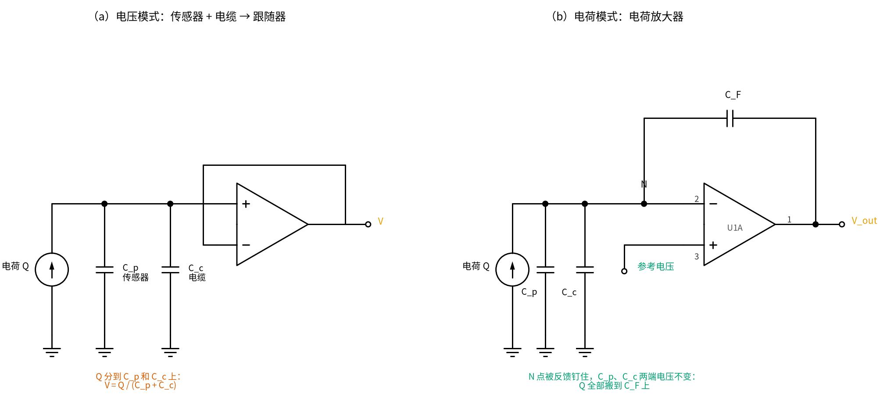
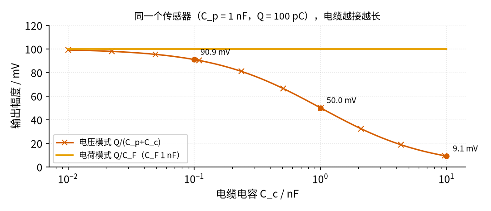
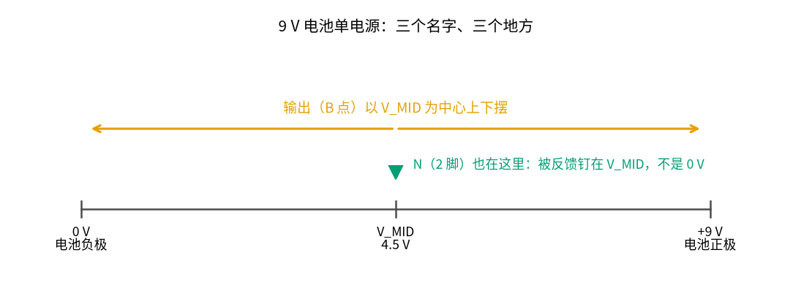

# 32 电荷放大器 · 直觉篇

[上一页：31 跨阻放大器（TIA） · 动手实验篇](../31-transimpedance-amp/page4.md) · 本页：直觉篇 · [原理与实现篇](page2.md) · [参数与调试篇](page3.md) · [动手实验篇](page4.md) · [下一页：原理与实现篇](page2.md) · 前置节点：[14 积分器 · 直觉篇](../14-integrator/page1.md)、[31 跨阻放大器（TIA） · 直觉篇](../31-transimpedance-amp/page1.md)

> **开头三问**（先猜，读完本节再回来对答案）
>
> 1. 压电片被敲一下，给出的是"电压"、"电流"还是"电荷"？传感器和放大器之间的电缆从 1 m 换成 10 m，读数会不会变？
> 2. 把 [31 跨阻放大器](../31-transimpedance-amp/page1.md) 反馈里的电阻 R_F 换成电容 C_F，输出跟输入的什么量成正比？
> 3. 电荷放大器能不能拿来称一个放着不动的砝码（静力）？

## 痛点：涡街流量计的传感器只给"一小包电荷"

管道里插一根挡流柱，水或蒸汽流过时，柱子后面会左右交替地甩出旋涡，这叫**卡门涡街**。旋涡每甩一次，柱子就被横向推一下，推的频率和流速成正比。**涡街流量计**就是数这个频率来算流量（艾默生 Rosemount 8800 的技术说明讲了频率和流量之间的换算系数， https://www.emerson.com/documents/automation/technical-note-vortex-adaptive-digital-signal-processing-8800-series-rosemount-en-76500.pdf ）。横河（Yokogawa）YEWFLO 的技术报告（ https://web-material3.yokogawa.com/rd-tr-r00027-004.pdf ）写明：检测这个横向力的是**压电元件**，后面接的是"电荷转换器"。

压电元件（压电陶瓷片，本节实验用的是几毛钱一片的蜂鸣片）的本事是：受力时两面出现**电荷**，单位是皮库（pC）或纳库（nC）。力撤掉，电荷又回去。它不像电池那样能持续供电，也不像 31 节的光电二极管那样持续给电流。它只在力**变化**的那一刻，"吐出"一小包电荷。

麻烦在于：流量计的传感器装在管道上，放大器装在几米外的表头里，中间隔着一根**电缆**。电缆两根芯线之间本身就是一只电容，越长越大。下面会看到，如果用"量电压"的老办法，电缆一换，读数就变。

## 一、压电片 = 电荷源 + 一只电容

把压电片画成电路：一个"电荷源"Q，旁边并着它自己两片电极之间的电容 C_p（图 32-p1-1 左边）。电缆的电容 C_c 也并在同两根线上。

*图 32-p1-1　电压模式（左）与电荷模式（右）：同一个传感器、同一根电缆*

**电压模式**（左）：直接用一个 [12 电压跟随器](../12-voltage-follower/page1.md) 去量压电片两端的电压。电荷 Q 只能待在两只电容上，电压就是 [01 元器件入门](../01-components-basics/page1.md) 里电容的老公式 V = Q/C，只不过 C 是两只电容之和：

$$V = \frac{Q}{C_p + C_c}$$

设 Q = 100 pC、C_p = 1 nF。电缆电容 0.1 nF 时读到 90.91 mV；电缆加长到 1 nF，只剩 50.00 mV；10 nF 时只剩 9.09 mV（数字来自 `code/32_sim.py`）。同一下敲击，换根电缆读数差了 10 倍，这台流量计就没法标定了。图 32-p1-2 把这条"缩水"曲线画了出来。

*图 32-p1-2　同一份 100 pC：两种接法的输出随电缆电容的变化*

## 二、电荷放大器：让运放把电荷"搬"到 C_F 上

图 32-p1-1 右边是**电荷放大器**。它和 [31 跨阻放大器](../31-transimpedance-amp/page1.md) 长得几乎一样，只是反馈元件从电阻 R_F 换成了电容 C_F。

负反馈让运放的反相端（2 脚，记作 N 点）一直待在同相端（3 脚）的电压上不动。于是 C_p 和 C_c 两端的电压**始终不变**：电压不变，电容上的电荷就不变，它们一点电荷都"截留"不了。压电片吐出来的电荷 Q 无处可去，只能流过 N 点，全部存进 C_F。运放输出只好移动 Q/C_F 来装下这份电荷：

$$V_{out} - V_{ref} = -\frac{Q}{C_F}$$

V_ref 是同相端的参考电压，负号表示"电荷往 N 点流进来，输出往下走"。式子里**没有 C_p，也没有 C_c**：电缆多长都一样（图 32-p1-2 里那条水平线），这正是 TI 应用笔记 SLOA033A（ https://www.ti.com/lit/an/sloa033a/sloa033a.pdf ）推荐电荷模式的理由。

这其实就是 [14 积分器 · 直觉篇](../14-integrator/page1.md) 里的那只积分器：电流流进来，电容上的电压就是电流的累积，而电流的累积正是电荷。积分器量的是"一共流过多少"，电荷放大器只是把这个"多少"直接读出来。

## 三、单电源：参考电压放在 4.5 V

本节实验只用一节 9 V 电池。运放输出既要能往上走、也要能往下走（压电片受压和松开时电荷方向相反），所以同相端不能接 0 V。我们用两只 10 kΩ 电阻把 9 V 分成一半，再经运放跟随器缓冲，得到 **V_MID = 4.5 V**，接在同相端（图 32-p1-3）。

*图 32-p1-3　9 V 电池单电源：0 V、V_MID 和 +9 V 三个电位*

这样输出平时停在 4.5 V，正电荷让它往下走、负电荷让它往上走，各有约 4 V 的余量。

> **📌 名字别混**　**V_MID** 是本节的"中点参考"：分压 + 跟随器做出来的 4.5 V，和 [30 仪表放大器与电桥](../30-instrumentation-amp/page2.md) 的 V_MID 是同一个意思。**N 点**是运放的反相端（2 脚），被负反馈拉到和同相端一样的 4.5 V。[05 反相放大](../05-inverting-amp/page1.md) 的「虚地」说的是同相端接 0 V 时，反相端也被拉到 0 V。本节同相端在 V_MID，N 点在 4.5 V 而不是 0 V，道理相同但电位不同，所以本节只叫它"N 点"，不叫"虚地"。**0 V** 是电池负极，万用表黑表笔通常夹这里。三者在图 32-p1-3 上的位置一眼就能分开。另外，本节的 **Q** 是电荷（单位 C，常用 nC、pC），和 [20 有源滤波器](../20-active-filter/page2.md) 里的品质因数 Q 不是一回事。

## 四、电荷"存"进去以后：为什么还要一只 R_F

电容是理想的"记事本"：存进去的电荷不会自己跑掉。可惜运放的输入端并不是完全绝缘的，总有一点点**输入偏置电流**流进或流出 N 点。这点电流也会被 C_F 一直累积，输出就慢慢地朝一个电源轨漂过去，最后顶死不动。

所以实际的电荷放大器总在 C_F 旁边并一只很大的电阻 R_F（本节用 10 MΩ），给这点漏电流一条出路。代价是：存进 C_F 的电荷也会经 R_F 慢慢放掉。放电的快慢由时间常数 τ = R_F·C_F 决定，所以：

- 敲一下、松一下这种**快速变化**，电荷放大器能如实读出；
- 一直压着不动的**静力**，读数会在几个 τ 之后回到零。

这就是第三问的答案方向：电荷放大器只能测**变化**的力。具体能低到多少赫兹、R_F 太小或不加各会怎样，在 [原理与实现篇](page2.md) 第三节和 [参数与调试篇](page3.md) 第一节。

## 五、它在工程里长什么样

- **涡街流量计**：两片压电元件差动接法抵消管道振动（横河技术报告），后面是电荷放大器。旋涡频率和流速成正比，而压电片受到的力和流速的平方成正比：流速变成 10 倍，频率变成 10 倍，电荷变成约 100 倍。信号幅度跨这么大，后面就需要 [35 程控增益与 AGC](../35-pga-agc/page1.md)（预告）把它拉回同一个大小。
- **加速度计和冲击检测**：TI 的 SBOA287（ https://www.ti.com/lit/an/sboa287/sboa287.pdf ）用 3.3 V 单电源、1.65 V 参考，C_F = 68 pF、R_F = 240 MΩ，输入串一只 39.2 kΩ 电阻，做出 10 Hz～10 kHz 的电荷放大器。和本节的接法几乎一模一样，只是数值不同。
- 电荷放大器后面通常跟着带通滤波（[33 带通与 50 Hz 陷波](../33-bandpass-notch/page1.md)，预告）、开关电容跟踪滤波（[34 开关电容滤波与跟踪滤波](../34-switched-cap-filter/page1.md)，预告）和施密特整形（[36 施密特整形与频率/脉冲计数](../36-schmitt-pulse-shaping/page1.md)，预告），最后数脉冲得到流量。

## 新手常见误解

- **"压电片输出的是电压，接个跟随器就行"**：能出读数，但读数里藏着电缆电容，换根线就变（第一节）。
- **"电荷放大器和 TIA 一样，输出正比于电流"**：它的输出正比于电流的**累积**，也就是电荷（第二节）。
- **"C_F 越小越灵敏，越小越好"**：灵敏度确实是 1/C_F，但 C_F 太小，一下用力的敲击就会把输出顶到电源轨，噪声也被放大（[原理与实现篇](page2.md) 第四节）。
- **"不加 R_F 才准，加了会漏电"**：不加 R_F，偏置电流迟早把输出推到轨上；加了 R_F，只是不能测静力（第四节）。
- **"N 点就是虚地，拿万用表量一下它对 0 V 是多少"**：本节 N 点在 4.5 V；更要命的是万用表一接上去就从 N 点抽电流，读数立刻跑掉（[参数与调试篇](page3.md) 第三节）。

## 一句话总结

**电荷放大器让运放把反相端钉在 V_MID 上，压电片的电荷无处可留、全部搬进 C_F，输出 = V_MID − Q/C_F，与电缆电容无关；R_F 给偏置电流一条出路，代价是只能测变化的力。**

---

[上一页：31 跨阻放大器（TIA） · 动手实验篇](../31-transimpedance-amp/page4.md) · 本页：直觉篇 · [原理与实现篇](page2.md) · [参数与调试篇](page3.md) · [动手实验篇](page4.md) · [下一页：原理与实现篇](page2.md)
