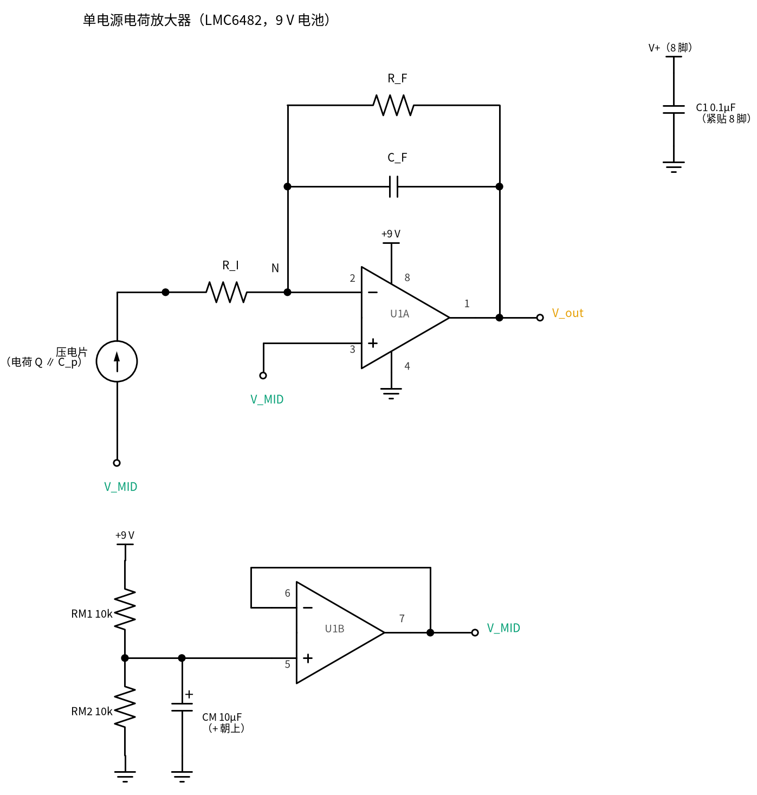
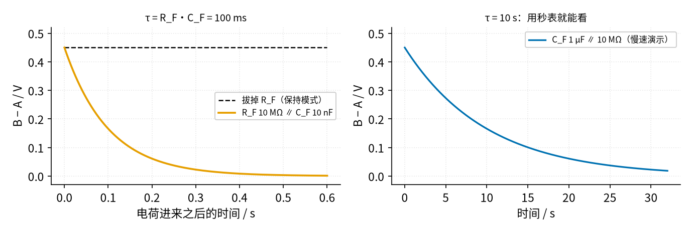
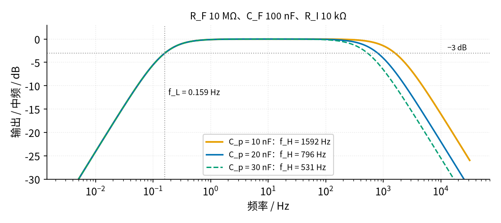

# 32 电荷放大器 · 原理与实现篇

[上一页：直觉篇](page1.md) · [直觉篇](page1.md) · 本页：原理与实现篇 · [参数与调试篇](page3.md) · [动手实验篇](page4.md) · [下一页：参数与调试篇](page3.md) · 前置节点：[14 积分器 · 原理与实现篇](../14-integrator/page2.md)、[31 跨阻放大器（TIA） · 原理与实现篇](../31-transimpedance-amp/page2.md)

## 这一页要解决的问题

1. 单电源 9 V 的电荷放大器怎么接：LMC6482 两个运放各干什么，每个元件接在哪一脚。
2. 输出公式 V_out − V_MID = −Q/C_F 怎么来；实验里没有压电片时，怎样用一只电容"注入"已知电荷。
3. 能放大的频率有下限和上限：f_L 由 R_F、C_F 决定，f_H 由 R_I 和传感器电容决定。
4. 同一份电荷，电压模式和电荷模式的读数差多少。

## 一、电路和引脚

图 32-p2-1 是本节的完整电路。LMC6482 是双运放，8 脚封装：1 脚 A 输出、2 脚 A 反相端、3 脚 A 同相端、4 脚 V−、5 脚 B 同相端、6 脚 B 反相端、7 脚 B 输出、8 脚 V+（LMC6482 数据手册引脚图， https://www.ti.com/lit/ds/symlink/lmc6482.pdf ）。



*图 32-p2-1　单电源电荷放大器（LMC6482，9 V 电池），标出全部引脚*

- **U1B（5、6、7 脚）做 V_MID**：RM1、RM2 两只 10 kΩ 把 9 V 分成 4.5 V，CM 10 µF 滤掉分压点上的噪声，U1B 接成跟随器（6、7 脚相连）。7 脚输出低阻的 V_MID，可以给 U1A 的 3 脚和压电片的冷端同时用。和 [30 仪表放大器与电桥](../30-instrumentation-amp/page2.md) 的做法一样。
- **U1A（1、2、3 脚）是电荷放大器**：3 脚接 V_MID；2 脚（N 点）与 1 脚之间并联 C_F 和 R_F；传感器经 R_I 接到 N 点。
- **C1 0.1 µF**：8 脚到 0 V 的去耦电容，紧贴 8 脚插。一片双运放只需要一只。
- 压电片的另一端（冷端）接 V_MID，不接 0 V。这样压电片两端平时都在 4.5 V，没有直流电压。

N 点被 C_F、R_F 和 U1A 的负反馈钉在 V_MID。本节称它"N 点"，原因见 [直觉篇](page1.md) 的「📌 名字别混」。

## 二、输出公式：电荷守恒

只看 N 点这一个节点。运放 2 脚几乎不吃电流，所以从传感器那边流进 N 点的电荷，全部要从 C_F（和 R_F）流出去。先看不装 R_F 的最干净情况：

1. N 点电压不变（一直是 V_MID），所以传感器电容 C_p、电缆电容 C_c 两端电压都不变，它们上面的电荷也不变。
2. 传感器产生的电荷 Q 只能流进 C_F。C_F 靠 N 点一侧的极板多了 Q，两端电压就变化 Q/C_F。
3. C_F 的一端（N 点）不动，另一端（输出）只能动：

$$V_{out} - V_{MID} = -\frac{Q}{C_F}$$

本节的测点 B 是运放输出（1 脚），测点 A 是 V_MID，所以万用表红表笔接 B、黑表笔接 A 读到的"B − A"就是 V_out − V_MID。后文都这样写。

这就是 [14 积分器](../14-integrator/page2.md) 的 V_out = −(1/RC)∫V_in dt，把"电流的积分"直接写成电荷 Q。中频段（R_F 和 R_I 都不起作用的频率）的灵敏度就是 1/C_F：C_F = 100 nF 时为 1×10⁷ V/C，也就是 10 mV/nC。

**实验里怎么造出"已知电荷"**：压电片敲一下多少电荷不好说，所以实验第一阶段先用一只已知电容 C_S 代替它。C_S 一端接 N 点（经 R_I），另一端（称为 S 端）接一只拨动开关 S1 的公共脚。S1 拨在①时 S 端接 V_MID；然后把 S1 一下拨到②（接 0 V）：S 端电压跳变 ΔV_S = −4.5 V，N 点不动，C_S 两端电压变了 4.5 V，它上面必须多出 C_S × 4.5 V 的电荷，这份电荷只能经 N 点从 C_F 搬过来：

$$V_{out} - V_{MID} = -\frac{C_S \cdot \Delta V_S}{C_F}$$

C_S = 1 nF、C_F = 10 nF 时，注入 4.50 nC，输出变化 +0.4500 V。如果②接的是 +9 V（ΔV_S = +4.5 V），输出变化 −0.4500 V。这个"电荷注入"的办法也是 SLOA033A（ https://www.ti.com/lit/an/sloa033a/sloa033a.pdf ）里的等效电路：电荷源可以等效成一个电压源串一只电容。

## 三、频率下限 f_L：R_F 把电荷慢慢放掉

装上 R_F 之后，C_F 上的电荷会经 R_F 放掉，输出按 e 指数回到 V_MID，时间常数 τ = R_F·C_F。在频率上，这就是一个高通，下限

$$f_L = \frac{1}{2\pi R_F C_F}$$

- 实验第一阶段 R_F = 10 MΩ、C_F = 10 nF：τ = 100 ms，f_L = 1.592 Hz。注入的 0.45 V 在 0.1 s 后剩 165.5 mV，0.3 s 后剩 22.4 mV，1 s 后只剩 0.02043 mV。万用表一秒刷新两三次，根本来不及看到峰值。
- 所以实验另做一个**慢速演示**：C_S 换成 100 nF、C_F 换成 1 µF，R_F 仍是 10 MΩ，τ = 10 s，用秒表就能看。
- 实验第二阶段（压电片）R_F = 10 MΩ、C_F = 100 nF：τ = 1.0 s，f_L = 0.1592 Hz。



*图 32-p2-2　电荷进来之后：不装 R_F（保持）与装上 R_F（衰减）*

图 32-p2-2 左边的虚线是不装 R_F 的情况：电荷一直存着，这叫**保持模式**。本节实验第一阶段先用保持模式，读数稳定，万用表能慢慢读；最后才断电插上 R_F，再通电看衰减。保持模式的代价（偏置电流造成漂移）在 [参数与调试篇](page3.md) 第一节。

## 四、频率上限 f_H 和噪声增益：R_I 和 C_p

**R_I 的三个用处**：

1. **限流**：手指用力一敲，压电片可能瞬间给出很高的电压。R_I = 10 kΩ 把冲进 N 点的电流限住，再配上两只反并的 1N4148 钳位二极管（接在 N 点和 V_MID 之间，见 [动手实验篇](page4.md)），运放输入端就不会被打坏。
2. **隔离、防振**：如果没有 R_I，C_S（或压电片）就直接挂在 N 点上，另一头接 V_MID。运放输出经 C_F 连到 N 点，所以输出端等于在推一串电容：阶段一是 C_F 10 nF 串 C_S 1 nF，约 0.909 nF；阶段二是 C_F 100 nF 串 C_p，约 9.09～23.08 nF；按住复位按钮时更直接，输出经按钮推整只 C_S 或 C_p。运放的输出端自己带一点内阻，推电容时输出电压要"慢半拍"才跟上；负反馈发现不对就去纠正，纠过了头又往回拉，来回摆就成了振荡。[TI LMC6482 数据手册](https://www.ti.com/lit/ds/symlink/lmc6482.pdf) 第 7.2.1.2.2 节说，LMC648x 接成单位增益时一般只能直接带约 100 pF 的电容（手册条件 V_S = 15 V）；这里的电路很接近单位增益（下面会算出噪声增益只有 1.1），要推的却是 100 pF 的 9.1～300 倍（`code/32_sim.py` 第 13 段）。R_I = 10 kΩ 串在这只电容和 N 点之间，把它和运放隔开，这叫**隔离电阻**。注意：这里的反馈元件是 C_F，电路是积分器，不是 [18 微分电路 · 直觉篇](../18-differentiator/page1.md) 里反馈接电阻的微分电路（那一页讲"电容–电容"接法时，以及最后的一句话总结里都说了：输入是电容、反馈也只有电容的接法不是微分电路，而是电容做的反相放大）。两节只是电阻的**位置**相同：18 节在输入电容前串 R_1，这里在 C_S 前串 R_I；振的原因不一样。SPICE 的结果在 [参数与调试篇](page3.md) 第四节：不加 R_I 时输出峰峰值 533 mV、约 687 kHz 的振荡，加上就是 0。
3. **定上限**：R_I 和传感器电容组成一个低通，

$$f_H = \frac{1}{2\pi R_I (C_p + C_c)}$$

本节阶段二不用电缆，C_c = 0，只用 C_p 算。有电缆时要把电缆电容加进去：电缆越长，f_H 越低，但中频读数 Q/C_F 不变。

蜂鸣片的电容各家不同，本节按 10～30 nF 的**假设范围**算（实验要求自己用电容挡实测）：C_p = 10 / 20 / 30 nF 时，f_H = 1591.5 / 795.8 / 530.5 Hz。手指敲击的主要成分在几百赫兹以下，够用。图 32-p2-3 是阶段二参数下的完整幅频曲线。



*图 32-p2-3　阶段二（R_F 10 MΩ、C_F 100 nF、R_I 10 kΩ）的通带*

读图：纵轴是输出相对中频的分贝数（分贝见 [20 有源滤波器 · 原理与实现篇](../20-active-filter/page2.md)），水平虚线是 −3 dB。三条曲线在左边重合，和 −3 dB 线交在 f_L = 0.159 Hz（竖虚线）；右边按 C_p 不同分开，C_p 越大，越早往下掉。中间平坦的一段就是电荷放大器"读数和电缆无关"的频率范围。

**噪声增益**：运放自己的输入噪声和失调电压，被放大的倍数不是 1，而是 1 + C_p/C_F（反相端对地的电容与反馈电容之比，和 [31 跨阻放大器](../31-transimpedance-amp/page2.md) 第四节同一个道理）。C_F = 100 nF 时，C_p = 10 / 20 / 30 nF 的噪声增益是 1.10 / 1.20 / 1.30；如果 C_F 只用 1 nF，就变成 11 / 21 / 31。

**C_F 也不能太小**：输出最多离开 V_MID 约 ±4.4 V。C_F = 100 nF 时能装下 440 nC；C_F = 1 nF 时只能装下 4.4 nC，手指稍用力就顶到电源轨。

**有限增益误差**：运放增益不是无穷大，频率越高增益越小，输出就略小于 Q/C_F。按 LMC6482 增益带宽积 1.5 MHz（手册 V+ = 15 V 条件下的值）估算，阶段一在 1 kHz 时，C_C = 0 / 10 / 100 nF 对应的误差是 0.073 / 0.140 / 0.735 %，全都很小。

## 五、对照：同一份电荷，电压模式读多少

把 U1A 改成跟随器，S1 照样从①（V_MID）拨到②（0 V）。此时输入节点（3 脚）悬空，C_S 的电荷只能和电缆电容 C_C、运放输入电容 C_in（按 3 pF）分：

$$V_{out} - V_{MID} = \Delta V_S \cdot \frac{C_S}{C_S + C_C + C_{in}}$$

C_C = 0 / 10 / 100 nF 时，分别是 −4.4865 / −0.4090 / −0.0446 V。而电荷模式在这三种情况下都是 +0.4500 V，正负号相反是因为电荷模式是反相接法。动手实验第 7、8 步就是把这组对比真的做出来。

## 用 Python 算一遍

```python
import math

VMID, CS, CF, RF, RI, CIN = 4.5, 1e-9, 10e-9, 10e6, 10e3, 3e-12

# 1) 电荷注入：S 端从 V_MID 跳到 0 V / +9 V
for dv in (-VMID, +VMID):
    print(f"ΔV_S = {dv:+.1f} V：注入 {abs(CS*dv)*1e9:.2f} nC，B − A = {-CS*dv/CF:+.4f} V")

# 2) 电荷模式 vs 电压模式，电缆电容 C_C
for cc in (0, 10e-9, 100e-9):
    vq = -CS * (-VMID) / CF
    vv = -VMID * CS / (CS + cc + CIN)
    print(f"C_C = {cc*1e9:5.0f} nF：电荷模式 {vq:+.4f} V，电压模式 {vv:+.4f} V")

# 3) 下限与衰减
for cf in (10e-9, 1e-6, 100e-9):
    print(f"C_F = {cf*1e9:6.0f} nF：τ = {RF*cf:.2f} s，f_L = {1/(2*math.pi*RF*cf):.4g} Hz")
print("0.45 V 经 0.1 / 0.3 / 1 s：", [f"{0.45*math.exp(-t/0.1)*1e3:.4g} mV" for t in (0.1, 0.3, 1.0)])

# 4) 上限与噪声增益（压电片电容按 10～30 nF 假设）
for cp in (10e-9, 20e-9, 30e-9):
    print(f"C_p = {cp*1e9:.0f} nF：f_H = {1/(2*math.pi*RI*cp):.1f} Hz，"
          f"噪声增益 {1+cp/100e-9:.2f}（C_F 100 nF） / {1+cp/1e-9:.0f}（C_F 1 nF）")
```

运行结果：注入 4.50 nC，B − A = +0.4500 V 和 −0.4500 V；电荷模式三行都是 +0.4500 V，电压模式依次 −4.4865、−0.4090、−0.0446 V；τ 分别是 0.10 s、10.00 s、1.00 s，f_L 为 1.592、0.01592、0.1592 Hz；0.45 V 衰减后剩 165.5 mV、22.4 mV、0.02043 mV；f_H 为 1591.5、795.8、530.5 Hz，噪声增益 1.10/11、1.20/21、1.30/31。

## 例题

**例 1（完整）**：阶段一电路，C_S = 1 nF，C_F = 10 nF，不装 R_F。S1 从①（V_MID）拨到②（0 V）。求注入的电荷、B − A 和输出对 0 V 的电压。

解：ΔV_S = 0 − 4.5 = −4.5 V。C_S 上的电荷变化 C_S × 4.5 V = 4.50 nC，全部来自 C_F。B − A = −C_S·ΔV_S / C_F = −(1 nF × −4.5 V)/10 nF = +0.4500 V。输出对 0 V = 4.5 + 0.45 = 4.95 V。

**例 2（留空）**：同一电路，在 C_S 的输入端（R_I 前）再并上一只 100 nF 的"假电缆"C_C，接到 0 V。S1 的②已经在断电时改接到 +9 V。通电、按一下复位按钮，S1 在①（V_MID），再拨到②（+9 V）。

- ΔV_S = ______ V；
- C_C 两端的电压变不变？______；
- B − A = ______ V，和不接 C_C 时相比 ______。

<details><summary>例 2 答案</summary>

ΔV_S = +4.5 V。R_I 上几乎没有电流，C_C 的上端和 N 点一样一直在 V_MID，两端电压不变，不截留电荷。B − A = −(1 nF × 4.5 V)/10 nF = −0.4500 V，和不接 C_C 一样。（SPICE 里有限增益让它差 0.04 % 左右，见 [动手实验篇](page4.md) 第 7 步。）

</details>

**例 3（变式，换成电压模式）**：把 U1A 改成跟随器，C_C = 10 nF 仍并在输入端，S1 从①（V_MID）拨到②（0 V）。B − A 是多少？电荷模式读多少？电压模式读数的绝对值是电荷模式的多少倍？

<details><summary>例 3 答案</summary>

电压模式：B − A = −4.5 V × 1 nF/(1 nF + 10 nF + 3 pF) = −0.4090 V。电荷模式：+0.4500 V。电压模式绝对值是电荷模式的 0.4090/0.4500 ≈ 0.909 倍。这里 C_C 正好让两者接近，C_C 换成 100 nF 时电压模式只剩 −0.0446 V，所以关键不是"谁大"，而是电压模式一换电缆就变；电荷模式的读数和 C_C 无关。

</details>

## 本页小结

- U1B 做 V_MID（4.5 V），U1A 做电荷放大器；C1 0.1 µF 紧贴 8 脚。
- 电荷守恒：N 点不动，传感器和电缆电容不截留电荷，V_out − V_MID = −Q/C_F；用 C_S 注入时 Q = C_S·ΔV_S。
- f_L = 1/(2πR_F C_F)：R_F 让电荷放掉，所以不能测静力；不装 R_F 就是保持模式。
- f_H = 1/(2πR_I C_p)；噪声增益 1 + C_p/C_F；C_F 太小会被一下敲击顶到电源轨。
- 电压模式的读数被 C_C 分掉，电荷模式不受影响。

---

[上一页：直觉篇](page1.md) · [直觉篇](page1.md) · 本页：原理与实现篇 · [参数与调试篇](page3.md) · [动手实验篇](page4.md) · [下一页：参数与调试篇](page3.md)
