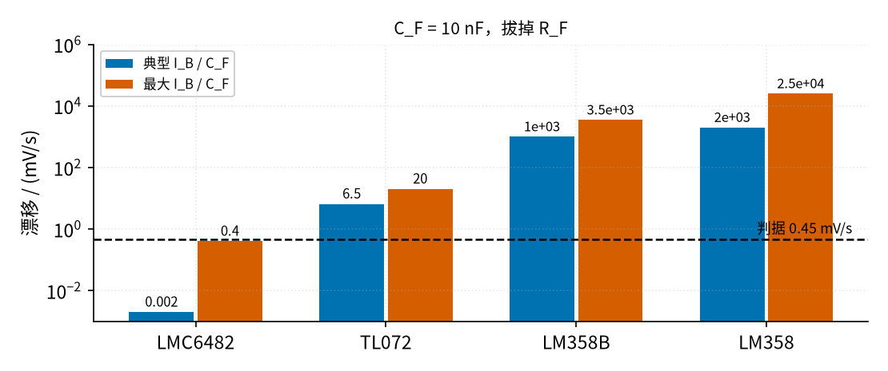
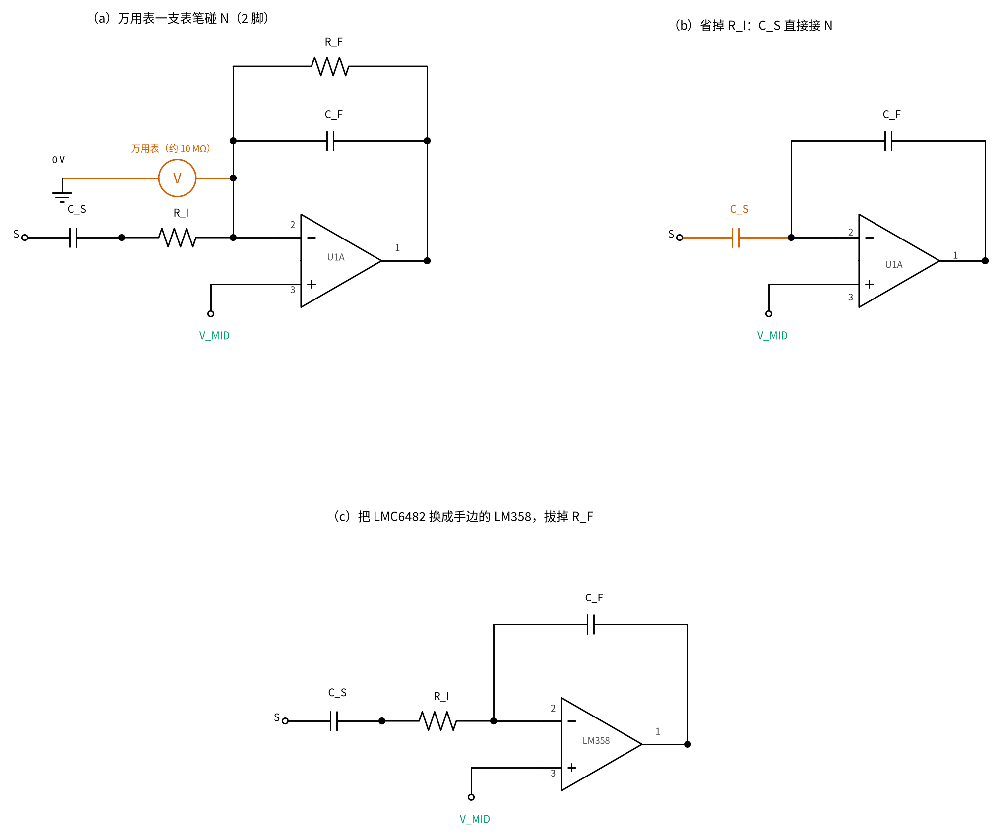
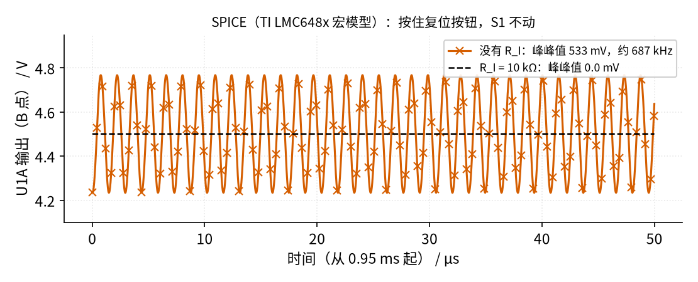

# 32 电荷放大器 · 参数与调试篇

[上一页：原理与实现篇](page2.md) · [直觉篇](page1.md) · [原理与实现篇](page2.md) · 本页：参数与调试篇 · [动手实验篇](page4.md) · [下一页：动手实验篇](page4.md) · 前置节点：[14 积分器 · 参数与调试篇](../14-integrator/page3.md)、[31 跨阻放大器（TIA） · 参数与调试篇](../31-transimpedance-amp/page3.md)

[原理与实现篇](page2.md) 用的是"干净"的模型：运放不吃电流、二极管不漏电、表笔不碰电路、周围没有市电。本页把这些假设一个个拿掉：运放的输入偏置电流、钳位二极管的漏电、万用表本身、市电耦合和电缆，再给出故障排查表、误区清单和练习。

## 一、输入偏置电流：保持模式下输出会漂

不装 R_F 时，N 点只连着 C_F 和运放 2 脚。运放 2 脚的输入偏置电流 I_B 没有别的路可走，只能一直往 C_F 里充，输出就以 I_B/C_F 的速度朝一个电源轨漂过去（[14 积分器 · 参数与调试篇](../14-integrator/page3.md) 讲过同样的现象）。装上 R_F 以后不漂了，但 I_B 在 R_F 上产生一个固定偏移 I_B·R_F。

下表的 I_B 来自各数据手册的电气特性表（典型 / 最大；LMC6482 的最大值 4 pA 是 −40～85 °C 全温度范围的限值，其余为 25 °C 值），漂移按 C_F = 10 nF、偏移按 R_F = 10 MΩ 算：

| 运放 | I_B 典型 / 最大 | R_F 10 MΩ 上的偏移 | 保持模式漂移（C_F 10 nF） | 典型值下顶到轨（4.4 V）用时 |
|---|---|---|---|---|
| LMC6482（CMOS 输入） | 0.02 pA / 4 pA | 0.0002 / 0.04 mV | 0.002 / 0.4 mV/s | 2.2×10⁶ s |
| TL072（JFET 输入） | 65 pA / 200 pA | 0.65 / 2 mV | 6.5 / 20 mV/s | 677 s |
| LM358B（双极型） | 10 nA / 35 nA | 100 / 350 mV | 1000 / 3500 mV/s | 4.4 s |
| LM358（双极型） | 20 nA / 250 nA | 200 / 2500 mV | 2000 / 25000 mV/s | 2.2 s |

实验第一阶段的判据是：**10 s 内漂移不超过 0.45 V 的 1 %（4.5 mV）**，也就是漂移 ≤ 0.45 mV/s。图 32-p3-1 把四种运放的漂移和这条判据画在一起（对数纵轴）。



*图 32-p3-1　保持模式（C_F 10 nF）的漂移速度与判据*

LMC6482 连最大值都在判据以内，这是本节选它的原因。SPICE 用 TI 的 LMC648x 宏模型跑出来的漂移是 −0.129 mV/s，比手册典型值大，因为宏模型里有一些为收敛而加的漏电通路；但仍低于 0.45 mV/s。符号（往上还是往下漂）取决于 I_B 的方向，不同芯片可能不同。详细对照见 [review/spice/32.md](../review/spice/32.md)。

## 二、钳位二极管接在哪里：V_MID，而不是电源轨

阶段二要在 N 点加两只反并的 1N4148 钳位，防止敲击尖峰打坏运放。常见的接法是把 N 点钳到两条电源轨，但那样每只二极管上常年反偏约 4.5 V，会有漏电流流进 N 点。Vishay 1N4148 数据手册给的反向漏电上限是 25 nA（20 V，25 °C）。按上限估算，25 nA × 10 MΩ = 0.25 V 的偏移；R_F 换成 100 MΩ 时是 2.5 V，几乎吃掉一半量程。

本节把两只二极管接在 **N 点和 V_MID 之间**：正常工作时 N 点被钉在 V_MID，二极管两端只有零点几毫伏，几乎不漏电，也不导通。SPICE 里按住压电片时 N 点最多偏离 V_MID 0.44 mV，0.1 ms 的快敲也只偏离 0.76 mV，远低于二极管开始导通的约 0.4 V。只有尖峰大到运放来不及跟上时，二极管才导通，把 N 点限在 V_MID ± 约 0.6 V 以内。

## 三、三种"一接就错"的情况

图 32-p3-2 是三种初学者最容易犯的错，每一种都会让读数"看起来像电路坏了"。



*图 32-p3-2　三种错接：表笔碰 N 点、省掉 R_I、换成 LM358 并且不装 R_F*

**（a）万用表一支表笔碰 N 点**：想看看 N 点是不是 4.5 V，红表笔碰 2 脚，黑表笔在 0 V。万用表电压挡的输入电阻约 10 MΩ，于是从 N 点到 0 V 多了一条 10 MΩ 的路，流过 4.5 V / 10 MΩ = 0.45 µA。保持模式下这个电流以 45 V/s 的速度往 C_F 里充，输出一瞬间就顶到轨；就算插着 R_F，输出也要移动 0.45 µA × 10 MΩ = 4.50 V，同样顶到轨。表上读到的"N 点电压"也早已不是正常工作时的值。**结论：N 点永远不测，测 A（V_MID）和 B（输出）就够了。**

**（b）省掉 R_I，C_S 直接接 N 点**：电路一通电就自己振起来，见第四节。

**（c）手边只有 LM358，就拿它代替 LMC6482，并且不装 R_F**：按第一节的表，典型 2000 mV/s，约 2.2 s 就顶到轨。万用表上看到的是一个一直在跑的数，根本读不出注入的 0.45 V。

## 四、为什么必须有 R_I：不加它会振

不加 R_I 时，1 nF 的 C_S（阶段二则是几十纳法的压电片）直接挂在 N 点上，另一头接 V_MID。运放输出经 C_F 连到 N 点，于是输出端在推一串电容：阶段一 C_F 10 nF 串 C_S 1 nF，约 0.909 nF；阶段二 C_F 100 nF 串 C_p，约 9.09～23.08 nF；按住复位按钮时，输出经按钮直接推整只 C_S 或 C_p。[TI LMC6482 数据手册](https://www.ti.com/lit/ds/symlink/lmc6482.pdf) 第 7.2.1.2.2 节说，它接成单位增益时一般只能直接带约 100 pF 的电容，这里是它的 9.1～300 倍（`code/32_sim.py` 第 13 段）。输出推大电容时电压"慢半拍"，负反馈纠正过头再拉回，来回摆就是振荡。手册第 7.2.1.2.1 节（Capacitive Load Compensation）给的办法，就是在输出和电容之间串一只电阻把它隔开（图 7-8 用 300 Ω 隔开 330 pF），R_I 正是这只**隔离电阻**。这里的反馈元件是 C_F，电路是积分器，不是 [18 微分电路](../18-differentiator/page1.md) 里反馈接电阻的微分电路；两节只是"在输入电容前串一只电阻"的位置相同，振的原因不同。



*图 32-p3-3　SPICE（TI LMC648x 宏模型）：有无 R_I 的输出对比*

图 32-p3-3 是 SPICE 的结果：不加 R_I，按住复位按钮时，输出振荡的峰峰值 533 mV、频率约 687 kHz；松开按钮后照样振，峰峰值 533.7 mV。串上 R_I = 10 kΩ，峰峰值为 0，不振。687 kHz 远超万用表能看到的频率，万用表只会显示一个"有点奇怪的平均值"，所以这个故障用万用表很难发现。SBOA287（ https://www.ti.com/lit/an/sboa287/sboa287.pdf ）的参考设计也在传感器和 N 点之间串了 39.2 kΩ 的 R_in。

## 五、市电、电缆和参考电压

**市电耦合**：N 点是一个阻抗很高的节点。墙上的市电线和 N 点之间哪怕只有 0.1 pF 的杂散电容，也会把交流电荷注入 C_F，输出幅度 = V_市电 × C_杂散 / C_F，和频率无关。美国 120 V / 60 Hz：C_F = 1 / 10 / 100 nF 时输出 12.0 / 1.20 / 0.120 mV；230 V / 50 Hz 地区是 23.0 / 2.30 / 0.230 mV。所以 N 点的走线要短，手不要靠近；C_F 小时尤其明显。

**电缆屏蔽层接 0 V**：真实的传感器电缆是屏蔽线，芯线到屏蔽层的电容就是 C_C。屏蔽层接 0 V（或接 V_MID），芯线因为 R_I 后面的 N 点被钉住，两端电压几乎不变，C_C 不截留电荷。本节实验用一只电容从输入端接到 0 V 来模拟屏蔽线，就是这个道理。

**电缆一动就有信号（摩擦电效应）**：普通电缆弯曲、被踩时，芯线绝缘层和屏蔽层之间摩擦，会产生电荷，电荷放大器照样把它放大。工业压电传感器配专门的低噪声电缆，就是为了压低这种效应。本节实验里，压电片的引线要用胶带固定，测量时别去碰。

**冷端要接 V_MID，不接 0 V**：压电片的冷端如果接在 0 V，那么 V_MID 一变（例如电池从 9 V 掉到 8.5 V，V_MID 降 0.25 V），C_p 两端的电压就变了，等于注入了 C_p × 0.25 V 的电荷。按 C_p = 20 nF 估算是 5.0 nC，C_F = 100 nF 时输出跳 50.0 mV。冷端接在 V_MID 上，C_p 两端都跟着 V_MID 走，就没有这个问题。

**输出只接万用表**：本节电源是 9 V，输出可以到接近 9 V。很多单片机的模拟输入只能承受 0～5 V，直接接上去可能损坏。本节实验只用万用表读数；怎样把信号安全地送进单片机，[35 程控增益与 AGC](../35-pga-agc/page1.md) 再讲（预告）。

## 六、故障排查表

| 现象 | 可能原因 | 怎么查 | 怎么修 |
|---|---|---|---|
| A 对 0 V 不是电池电压的一半 | RM1、RM2 插错列，或 U1B 的 5、6、7 脚没连对 | 量 C 对 0 V（电池电压），再量分压点 e20 对 0 V（d20 已插着 d17 → d20 的线） | 照 [动手实验篇](page4.md) 第 1 步逐孔核对 |
| 松开复位按钮后 B − A 一直在跑，几秒到轨 | 芯片不是 LMC6482（误区 A5），或 N 点那一列有手指、助焊剂等漏电 | 看芯片丝印；手离开面包板再看 | 换 LMC6482；清洁面包板，N 点那几个孔不插别的东西 |
| 松开复位按钮后 B − A 稳，拨 S1 后却不变 | C_S 没插在 i4–i7，或 S1 的三只脚没插在 h3/h4/h5 | 断电，用通断挡查 S1 拨到①时 h4–h3 通、拨到②时 h4–h5 通；对照第 1 步的表 | 重新插 C_S 和 S1 |
| B − A 是一个"不太稳、有点奇怪"的数，换表笔位置会变 | 没有 R_I，电路在几百千赫振荡（误区 A3） | 断电检查 g7–g10 有没有 R_I；有示波器时看 B 点 | 插上 10 kΩ R_I |
| 表笔一碰，输出就顶到轨 | 表笔碰到了 N 点（误区 A2） | 看红表笔在哪个孔 | 只测 A、B、C 三个测点 |
| 电压模式下读数比电荷模式大很多（C_C = 0），且有点慢慢变 | 正常：C_C = 0 时电压模式输出 −4.4865 V，已贴近 0 V 轨 | — | 这一格只看数量级；做 C_C 10 nF、100 nF 两格对比 |
| 阶段二手一靠近，读数就跳几毫伏 | 市电耦合到 N 点（误区 B2） | 手拿开读数恢复 | N 点走线短；压电片引线固定、远离手 |
| 阶段二不敲时读数也在跳，碰引线就跳 | 引线摩擦电（误区 B3） | 用胶带固定引线后对比 | 引线固定，敲击时只敲陶瓷片中间 |

## 七、误区清单（A1–A11、B1–B4）

- **A1** 以为压电片输出电压，接跟随器就行：读数被电缆电容分掉。
- **A2** 用万用表去量 N 点：10 MΩ 的表一接，0.45 µA 直接灌进 C_F。
- **A3** 省掉 R_I：大电容直接挂在 N 点，电路自己振。
- **A4** 读数时手还按着复位按钮：输出被短接到 N 点，永远是 0。
- **A5** 用 LM358 / LM358B / TL072 做保持模式：漂移超过判据。
- **A6** C_F 用太小：一下敲击就顶到电源轨，噪声增益也大。
- **A7** 不加 R_F 去做长期测量：迟早漂到轨；加了 R_F 又以为能测静力。
- **A8** 钳位二极管接到电源轨：漏电流乘 R_F 变成偏移。
- **A9** 压电片冷端接 0 V：V_MID 一变就等于注入电荷。
- **A10** 电压模式下把读数当成"传感器灵敏度"：换电缆就变。
- **A11** 把 9 V 供电的输出直接接到只能承受 5 V 的输入上（例如单片机的模拟输入）：可能超过 5 V。
- **B1** N 点那一列插多余的东西：漏电和杂散电容都直接进 C_F。
- **B2** 市电通过杂散电容耦合到 N 点：手一靠近读数就变。
- **B3** 电缆或引线的摩擦电效应：线一动就有"信号"。
- **B4** 参考电压 V_MID 不干净：用电阻分压不加跟随器和 CM，V_MID 的噪声和负载变化直接出现在输出上。

### 动手前补查

- [ ] 芯片是 LMC6482，缺口朝左，1～4 脚在 f14～f17、8～5 脚在 e14～e17？
- [ ] C1 0.1 µF 从 8 脚那一列（b14）接到 0 V？
- [ ] V_MID 由分压 + U1B 跟随器给出，CM 10 µF 正极在分压点？
- [ ] 传感器和 N 点之间有 R_I 10 kΩ？
- [ ] 读数前已经松开复位按钮？带电时只拨开关、按按钮，改接线一律先拔电池扣？
- [ ] 红表笔只碰 A、B、C 三个测点，从不碰 N 点？
- [ ] 输出只接万用表，没有接到任何只能承受 5 V 的器件？
- [ ] 阶段二的两只 1N4148 接在 N 点和 V_MID 之间，阴极方向相反，并用胶带包好？
- [ ] 压电片冷端接 V_MID，引线用胶带固定？
- [ ] 第 8 步（电压模式）的四处改动，回到电荷模式之前先断电、再全部改回了吗（先拔 i14–i15 短线，再把 C_F 插回、g13 → g14 插回、蓝线回 j15 → j10、绿线回 d16 → g16）？

## 用 Python 算一遍

```python
CF, RF, VMID, TOP = 10e-9, 10e6, 4.5, 4.4

# 1) 偏置电流：R_F 上的偏移、保持模式漂移、顶到轨用时（典型值）
IB = {"LMC6482": 0.02e-12, "TL072": 65e-12, "LM358B": 10e-9, "LM358": 20e-9}
crit = 0.01 * 0.45 / 10                       # 10 s 内不超过 0.45 V 的 1 %
for name, ib in IB.items():
    print(f"{name:8s} 偏移 {ib*RF*1e3:.4g} mV，漂移 {ib/CF*1e3:.4g} mV/s，"
          f"顶到轨 {TOP/(ib/CF):.3g} s，{'合格' if ib/CF <= crit else '不合格'}")

# 2) 钳位二极管接电源轨时的漏电偏移（Vishay 1N4148 上限 25 nA）
print(f"25 nA × 10 MΩ = {25e-9*RF:.2f} V，× 100 MΩ = {25e-9*100e6:.1f} V")

# 3) 万用表 10 MΩ 碰 N 点
i = VMID / 10e6
print(f"表笔电流 {i*1e6:.2f} µA，保持模式 {i/CF:.0f} V/s，有 R_F 时输出要移 {i*RF:.2f} V")

# 4) 市电经 0.1 pF 杂散电容
for cf in (1e-9, 10e-9, 100e-9):
    print(f"C_F {cf*1e9:.0f} nF：120 V → {120*0.1e-12/cf*1e3:.3g} mV，230 V → {230*0.1e-12/cf*1e3:.3g} mV")

# 5) 冷端错接 0 V，电池掉 0.5 V（V_MID 降 0.25 V），C_p 20 nF，C_F 100 nF
print(f"注入 {20e-9*0.25*1e9:.1f} nC，输出跳 {20e-9*0.25/100e-9*1e3:.1f} mV")
```

运行结果：LMC6482 偏移 0.0002 mV、漂移 0.002 mV/s、顶到轨 2.2×10⁶ s，合格；TL072 偏移 0.65 mV、漂移 6.5 mV/s、677 s，不合格；LM358B 100 mV、1000 mV/s、4.4 s，不合格；LM358 200 mV、2000 mV/s、2.2 s，不合格。钳位漏电偏移 0.25 V 和 2.5 V。表笔电流 0.45 µA，45 V/s，输出要移 4.50 V。市电 12 / 1.2 / 0.12 mV（120 V）和 23 / 2.3 / 0.23 mV（230 V）。冷端错接注入 5.0 nC，输出跳 50.0 mV。

## 例题

**例 1（完整）**：把 LMC6482 换成 TL072（注意 TL072 是 ±电源运放，这里只看偏置电流）。阶段一保持模式，C_F = 10 nF，按典型 I_B = 65 pA。10 s 漂多少？合不合格？

解：漂移 = I_B/C_F = 65 pA / 10 nF = 6.5 mV/s，10 s 漂 65 mV，是判据 4.5 mV 的十几倍，不合格。顶到轨要 4.4 V ÷ 6.5 mV/s = 677 s。

**例 2（留空）**：换成 LM358，按典型 I_B = 20 nA，其他同例 1。

- 漂移 = ______ mV/s；
- 松开复位按钮后大约 ______ s 输出顶到轨；
- 插上 R_F 10 MΩ 后漂移停了，但偏移是 ______ mV，是注入信号 0.45 V 的 ______ %。

<details><summary>例 2 答案</summary>

漂移 20 nA / 10 nF = 2000 mV/s；4.4 V ÷ 2 V/s = 2.2 s 顶到轨；偏移 20 nA × 10 MΩ = 200 mV，是 0.45 V 的 44 %（200/450）。所以 LM358 既做不了保持模式，也做不了带 R_F 的测量。

</details>

**例 3（变式，换成市电耦合）**：同样是"一个小电流一直往 C_F 里灌"，这次来源是市电。N 点和 120 V / 60 Hz 电线之间有 0.1 pF 杂散电容。C_F 取 1 nF 和 100 nF 时，输出的 60 Hz 幅度各多少？如果想让它小于 0.5 mV，C_F 至少多大？

<details><summary>例 3 答案</summary>

幅度 = 120 V × 0.1 pF / C_F：C_F = 1 nF 时 12.0 mV，100 nF 时 0.120 mV。要小于 0.5 mV：C_F ≥ 120 V × 0.1 pF / 0.5 mV = 24 nF。代价是灵敏度也降到原来的 1/24。（这里按与频率无关的电容分压算，R_F 在 60 Hz 下的影响很小：SPICE 在 C_F = 1 nF 时给出 11.6 mV，R_F 让它小了约 3 %。）

</details>

## 练习

**练习 1**：本节钳位二极管若改接到两条电源轨，R_F = 10 MΩ。按 Vishay 1N4148 漏电上限 25 nA，输出偏移最多多少？R_F 换成 100 MΩ 呢？为什么本节接在 V_MID？

<details><summary>答案</summary>

25 nA × 10 MΩ = 0.25 V；× 100 MΩ = 2.5 V。接在 N 点和 V_MID 之间时，二极管两端只有零点几毫伏（SPICE 最大 0.76 mV），几乎不漏电。

</details>

**练习 2**：复算 SBOA287：R_F = 240 MΩ、C_F = 68 pF，R_in = 39.2 kΩ、传感器电容 390 pF，灵敏度 0.35 pC/G。求 f_L、f_H 和 1 G 时的输出。

<details><summary>答案</summary>

f_L = 1/(2π × 240 MΩ × 68 pF) = 9.75 Hz；f_H = 1/(2π × 39.2 kΩ × 390 pF) = 10.41 kHz；V = 0.35 pC / 68 pF = 5.147 mV/G。和文档的 10 Hz、10 kHz、5.14 mV 一致。

</details>

**练习 3**：阶段二 C_p 按 20 nF，C_F 用 100 nF 和 1 nF 时，噪声增益各多少？各能装下多少电荷（输出 ±4.4 V）？

<details><summary>答案</summary>

噪声增益 1 + 20/100 = 1.20 和 1 + 20/1 = 21。能装下的电荷 4.4 V × 100 nF = 440 nC 和 4.4 V × 1 nF = 4.4 nC。

</details>

**举一反三**：涡街流量计的流速从 1 m/s 变到 10 m/s。旋涡频率变成几倍？压电片上的电荷（∝ 升力 ∝ 流速²）变成几倍？如果低流速时电荷放大器输出 0.01 V，高流速时是多少？一个固定的 C_F 够不够用？

<details><summary>答案</summary>

频率 ×10，电荷 ×100，输出从 0.01 V 变成 1 V。固定 C_F 要么低流速时信号太小（被噪声淹没），要么高流速时顶到轨。所以工程上在电荷放大器后面加程控增益或 AGC，见 [35 程控增益与 AGC](../35-pga-agc/page1.md)（预告）。

</details>

## 本页小结

- 保持模式漂移 = I_B/C_F，判据 ≤ 0.45 mV/s：只有 LMC6482 这类 CMOS 输入运放合格。
- 钳位二极管接在 N 点和 V_MID 之间，正常工作时不漏电、不导通。
- N 点永远不测；R_I 不能省，省了会在约 687 kHz 振荡；LM358 2.2 s 就到轨。
- 市电耦合幅度 = V × C_杂散 / C_F；电缆屏蔽接 0 V、引线固定、压电片冷端接 V_MID。
- 9 V 供电的输出只接万用表，不接只能承受 5 V 的输入。

---

[上一页：原理与实现篇](page2.md) · [直觉篇](page1.md) · [原理与实现篇](page2.md) · 本页：参数与调试篇 · [动手实验篇](page4.md) · [下一页：动手实验篇](page4.md)
