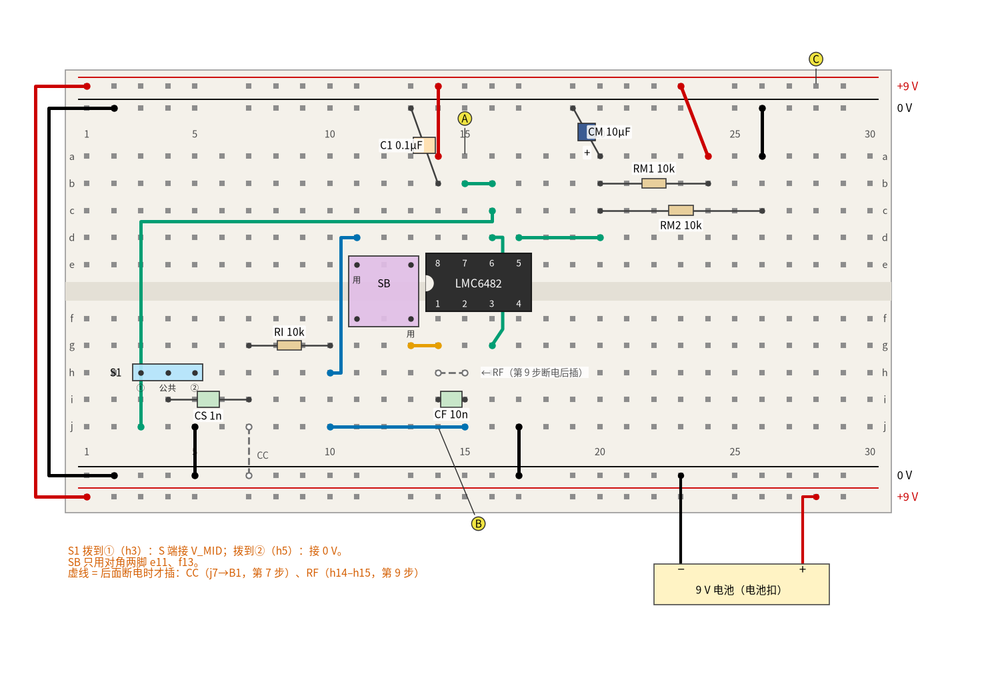
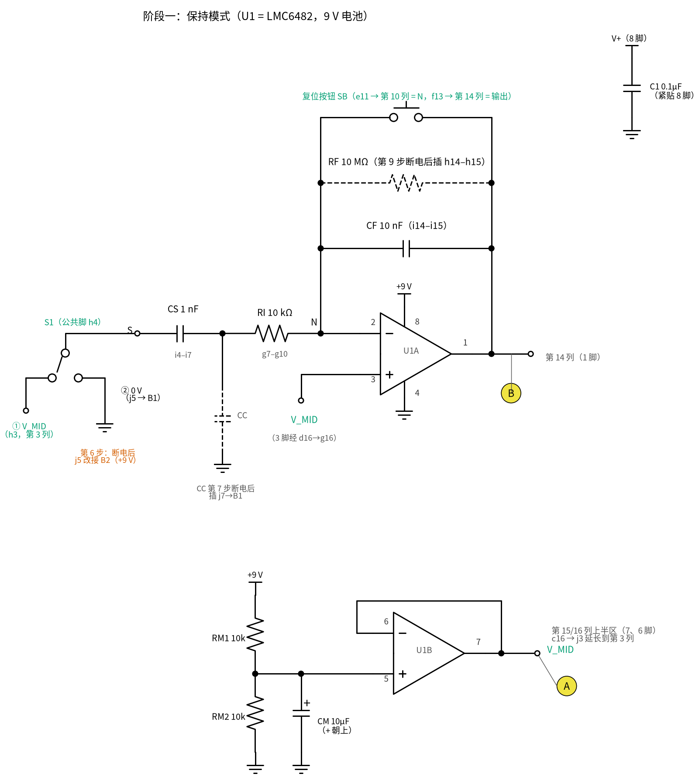
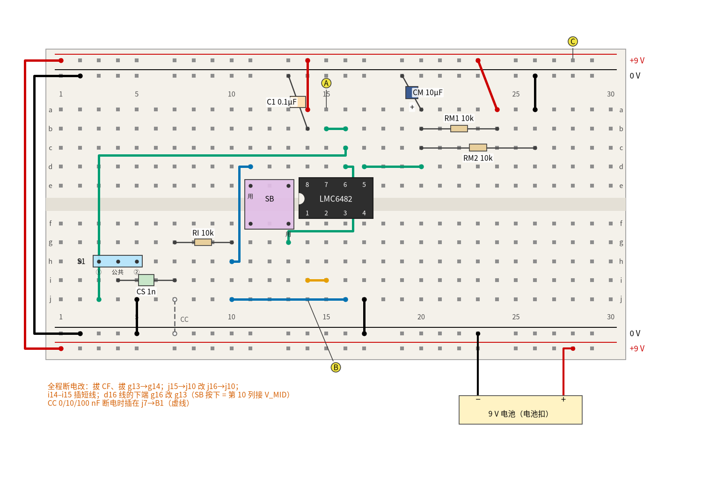
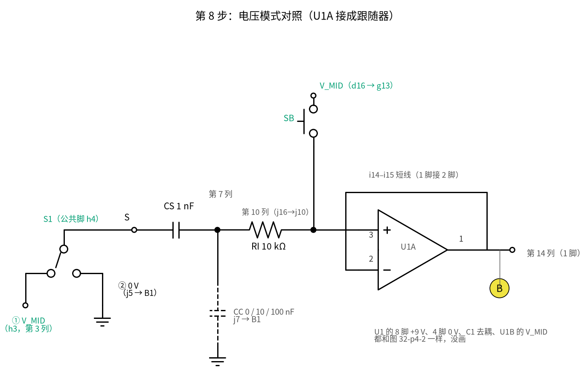
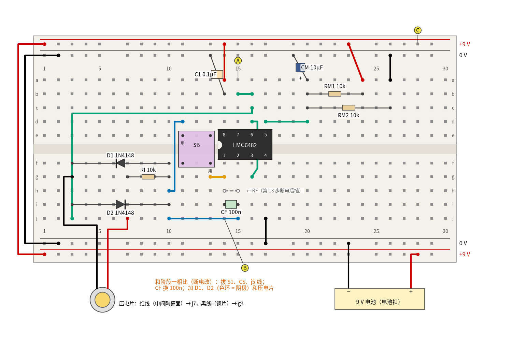
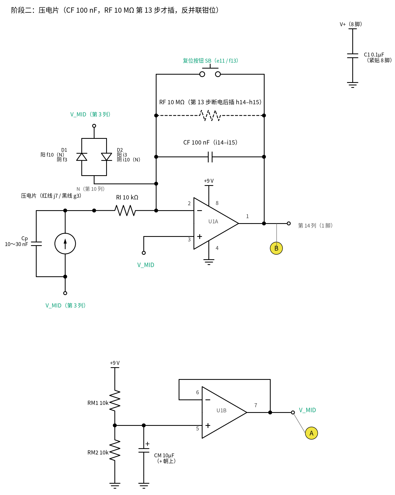
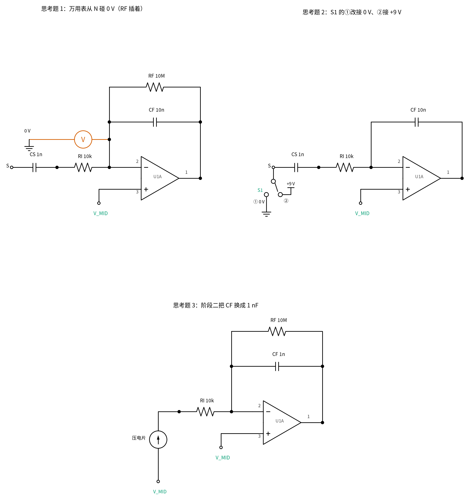

# 32 电荷放大器 · 动手实验篇

[上一页：参数与调试篇](page3.md) · [直觉篇](page1.md) · [原理与实现篇](page2.md) · [参数与调试篇](page3.md) · 本页：动手实验篇 · [下一页：33 带通与 50 Hz 陷波 · 直觉篇](../33-bandpass-notch/page1.md) · 前置节点：[14 积分器 · 动手实验篇](../14-integrator/page4.md)、[31 跨阻放大器（TIA） · 动手实验篇](../31-transimpedance-amp/page4.md)

## 这次实验要验证什么

1. 电荷放大器的输出只看"送进来多少电荷"和 C_F：用一只 1 nF 电容 C_S 当"已知电荷源"，拨一下开关送进 4.5 nC，输出应该移动 0.45 V（[原理与实现篇](page2.md) 第二节）。
2. 电荷模式不怕"电缆电容"：在输入端并上 10 nF、100 nF 的"假电缆" C_C，读数几乎不变；同样的东西放进电压模式，读数掉到原来的约十分之一、百分之一。
3. 不装 R_F 时输出能"保持"很久（漂移由偏置电流决定）；装上 R_F 后电荷按 τ = R_F × C_F 慢慢放掉，这就是频率下限 f_L 的来历。
4. 换上真的压电片：手指按住、松开，看保持模式和带 R_F 时的两种读数。

**两套编号别混**：面包板上的"第 14 列""h3"是孔的位置；芯片的"1 脚""8 脚"是引脚编号。下表把每个测点在哪个孔、是哪只引脚都写清楚。

| 测点（图中黄色字母） | 孔位 | 是什么 | 原理与实现篇里的名字 |
|---|---|---|---|
| A | a15 | U1 的 7 脚（U1B 跟随器输出），电池电压的一半，约 4.5 V | V_MID |
| B | j14 | U1 的 1 脚（U1A 输出） | V_out |
| C | T1 第 28 列 | 电池正极，约 9 V | V+ |

还有一个点**不是测点**：U1 的 2 脚（反相输入端）所在的第 15 列下半区，以及用蓝线延长出去的第 10 列下半区，合起来就是 [原理与实现篇](page2.md) 里的 N 点。N 点电压跟着 V_MID 走，约 4.5 V，它**不是虚地**：虚地是"等于 0 V 的地"，这里 N 点只是靠负反馈被拉到和同相端（V_MID）一样高。N 点阻抗极高，表笔一碰就往里灌电流，所以本页从不量它（原因见思考题 1）。

输出 B 也只和 A 比：电荷放大器的输出是"V_MID 上下移动多少"，所以表格里大多数读数写成 **B − A**（红表笔 B、黑表笔 A），这样电池电压从 9.5 V 降到 8.5 V 也不影响读数。

## ⚠️ 安全须知

- 只用一节 **9 V 电池**（经电池扣）供电，不接任何市电适配器。本实验全部电压不超过 9 V 直流（≤ 12 V）。
- **插、拔、挪任何元件或导线之前，先把电池扣从电池上取下**。通电时只做三件事：拨 S1、按复位按钮 SB、用手指按压电片。所有"换电容""插 R_F""改接"都写成"断电后"这一步。
- LMC6482 是 CMOS 输入，怕静电：拿芯片前先摸一下金属水管或机箱外壳，尽量拿芯片两头，别摸引脚。
- CM 10 µF 是电解电容，有正负极：长脚（+）插分压点 a20，短脚（−，外壳上有白色条纹那边）插 0 V 轨。插反可能鼓包。
- 表笔只碰 A、B、C 三个测点和 0 V 轨，**绝对不要碰 N 点**（第 10 列、第 15 列下半区）。
- 压电片只用手指按，不要用锤子、桌面猛磕。手指按压时电荷不大，钳位二极管一般不会导通；猛磕的情况交给 R_I 和二极管保护，但没必要去试。
- 输出 B 只接万用表，不接任何其他设备。

## 器材清单

| 元件 | 数量 | 说明 |
|---|---|---|
| LMC6482AIN（8 脚双运放，DIP） | 1 | U1：A 半边做电荷放大器，B 半边做 V_MID 跟随器。CMOS 输入，偏置电流极小 |
| 9 V 电池 + 电池扣 | 1 | 红线 +、黑线 − |
| 面包板（830 孔） | 1 | 上下各两条电源轨，本页叫 T1、T2、B1、B2 |
| 电阻 10 kΩ | 3 | RM1、RM2（V_MID 分压），R_I（输入串联电阻） |
| 电阻 10 MΩ | 1 | R_F（第 9 步和第 13 步才插） |
| 电容 0.1 µF（瓷片，104） | 1 | C1：U1 电源去耦 |
| 电解电容 10 µF / 16 V 以上 | 1 | CM：V_MID 分压点滤波 |
| 薄膜电容 1 nF | 1 | C_S（阶段一"注入电荷"用）。薄膜或 C0G 瓷片都可以 |
| 薄膜电容 10 nF | 2 | 一只做 C_F，一只做 C_C（假电缆） |
| 薄膜电容 100 nF | 3 | C_C（假电缆）、第 10 步的 C_S、阶段二的 C_F |
| 薄膜电容 1 µF（不能用电解） | 1 | 第 10 步慢速演示的 C_F |
| 1N4148 | 2 | D1、D2：阶段二的钳位二极管 |
| 单刀双掷拨动开关（3 脚，先断后通 / 非短路型） | 1 | S1：在"V_MID"和"0 V"之间拨 |
| 4 脚轻触按钮（6 mm） | 1 | SB：复位按钮，并在 C_F 两端 |
| 压电片（20～27 mm 带引线的蜂鸣片，例如 [Murata 7BB-20-6L0](https://www.murata.com/en-us/products/productdetail?partno=7BB-20-6L0)，标称 10 nF ±30 %） | 1 | 阶段二的传感器 |
| 导线 | 16 根 | 阶段一 14 根（红 3、黑 4、其他颜色 7），第 6 步再加 1 根红线、第 8 步 1 根短线；红 +9 V、黑 0 V，其余颜色只为看清楚 |
| 数字万用表 | 1 | 直流电压 200 mV、2 V、20 V 挡；通断挡；有电容挡更好 |
| 秒表（手机即可）、胶带 | — | 第 10 步计时；阶段二固定压电片引线 |

## 最小必要知识：压电片、拨动开关、复位按钮、1N4148

**压电片**：一片圆形黄铜片上贴着一层白色（或银色）陶瓷。陶瓷被压弯时，两面会出现等量异号的电荷，所以它在电路里等于"一个电荷源 Q 并联一只电容 C_p"。C_p 一般是几 nF 到几十 nF（器材清单里的 7BB-20-6L0 标称 10 nF ±30 %，也就是 7～13 nF），有电容挡的话把两根引线夹上去量一下（本页的计算假设 10～30 nF，见 [原理与实现篇](page2.md) 第四节）。实测低于 10 nF 也没关系：C_p 越小，f_H 比 1591.5 Hz 还高，噪声增益更接近 1，不影响读数。红线通常焊在陶瓷面上，黑线焊在黄铜面上。它不是电池：按住不动时不再产生新电荷，所以要靠电荷放大器"记住"刚才那一下。

**拨动开关 S1（单刀双掷）**：三只脚排成一排。中间那只是**公共端**，拨柄拨到一边，公共端就和那一边的脚接通。要买**先断后通（非短路型）**的：拨动途中公共端先离开一边、再碰另一边；短路型会在拨动瞬间把①、②同时接通，第 5 步里就是把 V_MID 短到 0 V 一下。本页规定 S1 的三只脚插在 h3、h4、h5：h4 是公共端，h3 一侧叫**①**（第 3 列 = V_MID），h5 一侧叫**②**（第 5 列，经导线接到电源轨）。插板之前，先把万用表拨到通断挡（蜂鸣挡）：拨柄拨向一边时，中间脚和哪只边脚"嘀"一声，就记下来那一边是①还是②；拨到另一边再确认一次。

**复位按钮 SB（4 脚轻触按钮）**：四只脚两两在内部永久连着，按下时两组才接通。哪两只脚永久连着不好判断，所以本页**只用对角的两只脚**：对角的两只脚一定分别属于两组，不按时断开、按下时接通。SB 跨在面包板中间槽上，四脚插 e11、e13、f11、f13，用的是对角的 **e11 和 f13**（图中标"用"）。插板之前用通断挡试一下：表笔放在对角两脚上，不按不响、按下才响，就对了。SB 并在 C_F 两端：按下就把 C_F 短路，把 C_F 里的电荷放光，输出回到 V_MID，这叫"复位"。

**1N4148**：小玻璃管二极管，有黑色色环的一头是**阴极**（K），另一头是阳极（A）。电流只能从阳极流到阴极，正向导通要约 0.6 V 以上（[Vishay 1N4148 数据手册](https://www.vishay.com/docs/81857/1n4148.pdf)）。阶段二用两只反向并联，接在 N 点和 V_MID 之间：平时 N 点和 V_MID 只差零点几 mV，两只都不导通；只有压电片被猛磕、N 点被推离 0.6 V 以上时才导通，把 N 点"钳"住，保护运放输入。

**LMC6482**：8 脚双运放，缺口朝左插时，下排从左到右是 1～4 脚，上排从右到左是 5～8 脚。1 脚是 A 半边输出，2 脚反相输入，3 脚同相输入，4 脚接 0 V（V−），5、6、7 脚是 B 半边的同相输入、反相输入、输出，8 脚接 +9 V（V+）。它的输入偏置电流典型只有 0.02 pA（20 fA）（[TI LMC6482 数据手册](https://www.ti.com/lit/ds/symlink/lmc6482.pdf)），所以不装 R_F 时也能"保持"很久，见 [参数与调试篇](page3.md) 第一节。

## 搭建步骤

电源轨的叫法：上方两条从上到下是 **T1（+9 V，红线）**、**T2（0 V，蓝线）**；下方两条从上到下是 **B1（0 V）**、**B2（+9 V）**。芯片 LMC6482 **缺口朝左**，跨在中间槽上：**1～4 脚在 f14～f17**，**8～5 脚在 e14～e17**（8 脚在 e14、5 脚在 e17）。

### 阶段一：用电容 C_S 注入已知电荷

**第 1 步：按图 32-p4-1 搭好，电池扣先不接电池，S1 拨到①。**

按下面的顺序逐个插，每插一个就在清单上打个勾：

1. 电源轨跨接：红线 T1-1 → B2-1；黑线 T2-2 → B1-2。
2. 芯片：LMC6482 缺口朝左，1 脚插 f14。
3. 芯片电源：红线 a14 → T1-14（8 脚接 +9 V）；黑线 j17 → B1-17（4 脚接 0 V）。
4. 去耦电容 C1 0.1 µF：一脚 b14（8 脚那一列），一脚 T2-13。
5. V_MID 分压：RM1 10 kΩ 插 b20–b24，红线 a24 → T1-23；RM2 10 kΩ 插 c20–c26，黑线 a26 → T2-26。分压点是第 20 列上半区。
6. CM 10 µF：正极（长脚）a20，负极 T2-19。
7. U1B 跟随器：绿线 d17 → d20（5 脚接分压点）；绿线 b15 → b16（7 脚接 6 脚）。这样 7 脚输出就是 V_MID，测点 A 在 a15。
8. V_MID 延长：绿线 c16 → j3，把 V_MID 送到下半区第 3 列（S1 的①）。
9. V_MID 接 U1A 同相端：绿线 d16 → g16（3 脚在 f16）。
10. 反馈电容 C_F 10 nF：i14–i15（1 脚输出列和 2 脚反相输入列之间）。**h14–h15 先空着**，那是 R_F 的位置，第 9 步才插。
11. N 点延长：蓝线 j15 → j10，把 2 脚引到第 10 列下半区。
12. 复位按钮 SB：四脚插 e11、e13、f11、f13；蓝线 d11 → h10（e11 那只脚接第 10 列 = N）；橙线 g13 → g14（f13 那只脚接第 14 列 = 输出）。
13. R_I 10 kΩ：g7–g10。
14. C_S 1 nF：i4–i7。
15. S1：三脚插 h3（①）、h4（公共端）、h5（②），拨到①。
16. 黑线 j5 → B1-5：②接 0 V。
17. 电池扣：红线插 B2-28，黑线插 B1-23。**先不扣电池**。

图中虚线画的 R_F（h14–h15）和 C_C（j7 → B1-7）现在都不插。



*图 32-p4-1　阶段一面包板（虚线元件此时不插）*



*图 32-p4-2　阶段一原理图（和图 32-p4-1 一一对应）*

> **对照看**：图 32-p4-2 左边的 S1 就是面包板上 h3/h4/h5 那只拨动开关，①接 V_MID（第 3 列，由绿线 c16 → j3 送来），②接 0 V（黑线 j5 → B1-5）。C_S 一头在 S1 公共端（第 4 列），一头在第 7 列；R_I 从第 7 列到第 10 列；第 10 列经蓝线 j15 → j10 连到 2 脚，就是 N 点。原理图里 C_F 和 SB 都跨在 2 脚和 1 脚之间：面包板上 C_F 在 i14–i15，SB 的 e11 经蓝线到第 10 列（N）、f13 经橙线到第 14 列（1 脚输出）。3 脚（f16）经绿线 d16 → g16 接 V_MID。U1B 的 5 脚（e17）经 d17 → d20 接分压点，6、7 脚由 b15 → b16 连成跟随器。

**第 2 步：通电前检查（电池不接）。**

1. 对照图 32-p4-1 逐孔核对一遍，特别是：芯片缺口朝左；CM 长脚在 a20；红线都到 +9 V 轨（T1、B2），黑线都到 0 V 轨（T2、B1）。
2. 万用表拨通断挡：S1 在①时，g4 和 g3 之间应"嘀"；拨到②时，g4 和 g5 之间应"嘀"。确认后拨回①。
3. 电阻挡量 T1 和 T2 之间，读数不能接近 0 Ω（接近 0 就是某处把 +9 V 和 0 V 短路了）。

**第 3 步：扣上电池，量电源和 V_MID。**

1. 20 V 挡，红表笔 C（T1 第 28 列）、黑表笔 0 V 轨：约 9 V（新电池可能 9.5 V 左右）。
2. 红表笔 A（a15）、黑表笔 0 V 轨：应是 C 读数的一半，C = 9.00 V 时 A = 4.50 V。

**第 4 步：复位，看零点和漂移。**

1. S1 保持在①。按住 SB 约 1 秒再松开。
2. 200 mV 挡，红表笔 B（j14）、黑表笔 A（a15）：应约 0（零点几 mV；SPICE 0.29 mV）。
3. 表笔别动，看 10 秒：读数变化不超过 4.5 mV（每秒 0.45 mV）就算合格。LMC6482 按数据手册典型值算只有每秒 0.002 mV，TI 模型给出每秒约 0.13 mV，都远在判据之内。如果读数一直往一个方向跑得很快，多半是芯片不是 LMC6482，或手指、表笔碰到了 N 点附近（[参数与调试篇](page3.md) 第一节）。

**第 5 步：拨 S1 ①→②，送进 4.5 nC。**

1. 2 V 挡，表笔仍是 B − A。拨 S1 到②：C_S 的左端从 V_MID（4.5 V）跳到 0 V，ΔV = −4.5 V，送进 N 点的电荷是 1 nF × 4.5 V = 4.5 nC。
2. 读数应约 **+0.450 V**（−C_S × ΔV / C_F = −1 nF × (−4.5 V) / 10 nF），并且**停住不动**。这时 B 对 0 V 约 4.95 V。
3. 把 S1 拨回①：读数回到约 0（SPICE −0.28 mV）。电荷送进去又拿回来，输出就回到原处。

**第 6 步：把②改接到 +9 V，看负号。**

1. **取下电池扣**。拔掉 j5 → B1-5 那根黑线，换一根红线插 j5 → B2-5（+9 V 轨）。一定换成红线：接 +9 V 的线用黑色，后面很容易当成 0 V 接错（器材清单的 16 根已经算进这根红线）。
2. 扣上电池，S1 在①时按一下 SB 复位。
3. 拨 S1 到②：ΔV = +4.5 V，读数应约 **−0.450 V**，B 对 0 V 约 4.05 V。拨回①。
4. **取下电池扣**，把这根线改回 j5 → B1-5（黑线）。

**第 7 步：并上"假电缆" C_C，读数不变。**

1. **取下电池扣**。把 C_C 10 nF 插在 j7 → B1-7（一脚 j7，一脚 0 V 轨），就是图 32-p4-1 里那条虚线。
2. 扣上电池，S1 在①，按一下 SB 复位，再拨 S1 到②：B − A 仍约 **+0.450 V**（SPICE 0.4500 V）。拨回①。
3. **取下电池扣**，把 C_C 换成 100 nF，重复：仍约 +0.450 V（SPICE 0.4498 V）。
4. 为什么不变：N 点被负反馈钉在 V_MID，C_C 上端一直在 V_MID、两端电压不变，它不截留电荷，4.5 nC 全部跑到 C_F 上（[原理与实现篇](page2.md) 例 2）。C_C 下端接 0 V 轨，就像真电缆的屏蔽层接地。

**第 8 步：对照组——改成电压模式（断电改接）。**

**取下电池扣**，按图 32-p4-3 做四处改动（C_C 100 nF 留在 j7 → B1-7）：

1. 拔掉 C_F（i14–i15），在 i14–i15 插一根短橙线：1 脚和 2 脚直接连通，U1A 变成跟随器。
2. 拔掉橙线 g13 → g14。
3. 蓝线 j15 → j10 改成 j16 → j10：第 10 列不再接 2 脚，改接 3 脚（同相输入，f16），这时第 10 列叫"输入点 x"。
4. 绿线 d16 → g16 的下端改插 g13，走成 d16 → g13：V_MID 送到 SB 的 f13 那只脚。按下 SB，就把 x 接到 V_MID。



*图 32-p4-3　电压模式面包板（第 8 步，断电改接后）*



*图 32-p4-4　电压模式原理图（和图 32-p4-3 一一对应）*

> **对照看**：图 32-p4-4 里 U1A 的 1 脚直接连 2 脚，就是面包板 i14–i15 那根短橙线。C_S（i4–i7）、R_I（g7–g10）没动，只是 R_I 右端（第 10 列）现在经蓝线 j16 → j10 接 3 脚。原理图里 SB 一头接 x、一头接 V_MID：面包板上 e11 经蓝线 d11 → h10 到第 10 列（x），f13 所在的第 13 列下半区经绿线 d16 → g13 接 V_MID（第 16 列上半区是 6 脚、7 脚连出的 V_MID）。C_C 在 j7 → B1-7。

然后扣上电池，每种 C_C 都按"S1 在①、按一下 SB、松开、拨 S1 到②、读 B − A"做一遍，读完拨回①；换 C_C 前都先取下电池扣：

1. C_C = 100 nF：约 **−0.0446 V**（2 V 挡，SPICE −0.0441 V）。
2. C_C = 10 nF：约 **−0.409 V**（SPICE −0.4082 V）。
3. 取下电池扣，拔掉 C_C（0 nF），再扣上电池：按公式应是 −4.4865 V，但输出最低只能到 0 V 轨附近，实际读约 −4.40 V（20 V 挡，SPICE −4.401 V，B 对 0 V 约 0.10 V）。真实 LMC6482 是轨到轨输出，轻载时可能比 SPICE 更贴近 0 V，读到 −4.40～−4.49 V 都正常。

电压模式下 4.5 V 的跳变被 C_S 和 C_C 分压：C_C 越大，读数越小（还有负号——这里没有反相，S1 往下拨，x 就往下走）。和第 7 步对比：同样的电荷、同样的电缆，电荷模式读数不变。x 是高阻点，读数时手别靠近第 7～10 列。

**第 9 步：恢复电荷模式，断电插上 R_F。**

1. **取下电池扣**，把第 8 步的四处改动全部改回（对照图 32-p4-1）：拔掉 i14–i15 短橙线、插回 C_F 10 nF；插回橙线 g13 → g14；蓝线改回 j15 → j10；绿线改回 d16 → g16。拔掉 C_C。
2. 把 R_F 10 MΩ 插在 h14–h15（和 C_F 并联）。
3. 扣上电池，S1 在①，按一下 SB，再拨到②：万用表**几乎看不到变化**，最多闪一下。SPICE 里输出确实跳到 0.4499 V，但 τ = 10 MΩ × 10 nF = 0.1 s，0.1 s 后只剩 0.1656 V，1 秒后按公式只剩 0.02 mV（SPICE 里停在约 0.39 mV，那是宏模型自己的零点偏移，不是没放完的电荷），万用表每秒才更新两三次，赶不上。
4. 这就是 R_F 的代价：它让输出不再"保持"，太慢的信号（这里是一次性的跳变）被放掉了。拨回①。

**第 10 步：慢速演示，用秒表看指数衰减。**

1. **取下电池扣**。C_S 换成 100 nF（仍在 i4–i7），C_F 换成 1 µF 薄膜电容（仍在 i14–i15），R_F 10 MΩ 留着。τ = 10 MΩ × 1 µF = 10 s。
2. 扣上电池，S1 在①，按住 SB 2 秒再松开，等 30 秒让读数稳在 0 附近。
3. 2 V 挡读 B − A。拨 S1 到②，同时按下秒表：峰值是 0.45 V（100 nF × 4.5 V / 1 µF），之后按 τ = 10 s 往 0 回落。
4. 在 5 s、10 s、20 s、30 s 时读数，应约 **0.2729 V、0.1655 V、0.0609 V、0.0224 V**（SPICE 0.2734、0.1659、0.0613、0.0228 V）。读不准 5 s 那一下没关系，后面三点更好读。
5. 拨回①（读数会往负方向跳，再慢慢回到 0，这是同一件事反过来）。

这一步和第 9 步是同一个电路，只是把 C_S、C_F 同时放大 100 倍：输出幅度不变，τ 从 0.1 s 变成 10 s，万用表就跟得上了。R_I × C_S = 10 kΩ × 100 nF = 1 ms，比读数慢得多的秒级变化完全不受影响。

### 阶段二：接上压电片

**第 11 步：断电改成阶段二（图 32-p4-5）。**

1. **取下电池扣**。拔掉 S1、C_S（i4–i7）、j5 的黑线；拔掉 R_F（h14–h15），阶段二先看保持模式。
2. C_F 换成 100 nF（i14–i15）。
3. D1 1N4148：阳极 f10，阴极（色环）f3。
4. D2 1N4148：阳极 i3，阴极（色环）i10。两只方向相反，接在第 10 列（N 一侧）和第 3 列（V_MID）之间。
5. 压电片：先用电容挡量一下两根引线之间的 C_p，记下来。红线（陶瓷面）插 j7，黑线（黄铜面）插 g3（V_MID）。陶瓷面朝上平放在桌上，引线用胶带贴在桌面，免得一碰引线就产生电荷。



*图 32-p4-5　阶段二面包板（R_F 第 13 步才插）*



*图 32-p4-6　阶段二原理图（和图 32-p4-5 一一对应）*

> **对照看**：图 32-p4-6 里压电片画成"电荷源并联 Cp"，热端经 R_I 到 N：面包板上红线在 j7，R_I 仍在 g7–g10，第 10 列经蓝线 j15 → j10 到 2 脚。压电片冷端接 V_MID：黑线在 g3，第 3 列由绿线 c16 → j3 接 V_MID。D1（f10 → f3）和 D2（i3 → i10）在原理图里画成两只头尾相反的二极管：下端从 N 的竖线引出（N = 第 10 列，在 R_I 右端，不在 R_I 中间），上端是 V_MID（第 3 列）。C_F 100 nF 和 SB 仍跨在 1 脚（第 14 列）和 2 脚（第 15 列）之间。

**第 12 步：保持模式——按住压电片。**

1. 扣上电池，按一下 SB 复位，2 V 挡读 B − A：约 0。
2. 用一根手指稳稳按住压电片中心，**按住不放**：读数跳到某个值并停在那里。按 100 nC 举例是 −1.0 V（−100 nC / 100 nF，SPICE −0.9998 V，按住 3 秒后 −0.9978 V），你的读数取决于按得多重和压电片本身，**以实测为准**；正负号取决于压电片哪一面朝上。
3. 松开手指：电荷回去，读数回到约 0。
4. 再轻轻快敲一下：读数跳一下又回来（仿真里 0.1 ms 的快敲峰值 −1.008 V，N 点只偏离 V_MID 0.76 mV，两只 1N4148 都远没导通）。

**第 13 步：断电插上 R_F，看电荷慢慢放掉。**

1. **取下电池扣**，把 R_F 10 MΩ 插回 h14–h15。τ = 10 MΩ × 100 nF = 1 s，f_L = 1/(2π × 1 s) ≈ 0.159 Hz。
2. 扣上电池，按一下 SB。按住压电片不放：读数跳到和第 12 步差不多的值，然后往 0 回落：1 秒后剩约 36.8 %，3 秒后剩约 5.0 %（按 −1 V 举例：−0.368 V、−0.0498 V；SPICE −0.3663 V、−0.04863 V）。
3. 松开手指：读数往反方向跳一下，再回到 0。

这就是真实振动传感器里电荷放大器的样子：比 f_L 慢的"按住不动"被放掉，比 f_L 快的敲击、振动照常放大（[原理与实现篇](page2.md) 第三节）。

### R_I 10 kΩ 为什么一直留着

全程都有 R_I 10 kΩ 串在输入里，它做三件事：

1. **限流**：压电片被猛磕时可能瞬间给出很高的电压，R_I 把冲进 N 点和钳位二极管的电流限住。
2. **隔离、防振**：没有 R_I 时，压电片直接挂在 N 点，运放输出经 C_F 100 nF 串 C_p 推着约 6.5～11.5 nF 的电容（C_p 按器材清单的 7～13 nF 算）（按住 SB 时直接推整只 C_p）。[TI LMC6482 数据手册](https://www.ti.com/lit/ds/symlink/lmc6482.pdf) 第 7.2.1.2.2 节说，它接成单位增益时一般只能直接带约 100 pF，推大电容时输出"慢半拍"，负反馈纠正过头就来回摆。R_I 把这只电容和运放隔开，叫**隔离电阻**。它和 [18 微分电路](../18-differentiator/page1.md) 的 R_1 只是位置相同（都串在输入电容前），振的原因不同：这里的反馈是 C_F，电路是积分器。SPICE 里拿掉 R_I，输出会以约 687 kHz 自激，峰峰值约 533 mV；装上 10 kΩ 就完全不振（[参数与调试篇](page3.md) 第四节）。
3. **决定频率上限**：f_H = 1/(2π × R_I × (C_p + C_c))，本页没有电缆（C_c = 0），C_p 为 10、20、30 nF 时分别是 1591.5、795.8、530.5 Hz，对本页的秒级实验没有任何影响。

## 测量表

万用表都用直流电压挡。"应该读到"按 C = 9.00 V、A = 4.50 V、元件标称值计算（`code/32_sim.py`），括号里是 TI 模型的 SPICE 值。你的电池不是 9.00 V 时，用下一节的检查代码换算。

| 步骤 | 测什么 | 红表笔 | 黑表笔 | 挡位 | 应该读到 | 读不到时先查 |
|---|---|---|---|---|---|---|
| 3 | 电池 | C | 0 V 轨 | 20 V | 约 9 V | 电池扣红线 B2-28、黑线 B1-23；T1-1 → B2-1、T2-2 → B1-2 |
| 3 | V_MID | A | 0 V 轨 | 20 V | C 的一半，4.50 V | RM1、RM2 插错列；CM 插反；d17 → d20、b15 → b16 |
| 4 | 复位后零点 | B | A | 200 mV | 约 0（零点几 mV） | 松开 SB 了吗；d16 → g16；芯片方向 |
| 4 | 10 s 漂移 | B | A | 200 mV | 不超过 4.5 mV | 芯片型号；手、表笔离 N 点远一点 |
| 5 | S1 ①→② | B | A | 2 V | +0.450 V（0.4501 V），停住不动 | 不变：C_S 是否在 i4–i7，S1 是否在 h3/h4/h5；变了又回 0：R_F 误插在 h14–h15 |
| 5 | 同上 | B | 0 V 轨 | 20 V | 4.95 V | 同上 |
| 5 | S1 拨回① | B | A | 2 V | 约 0 | — |
| 6 | ②改接 +9 V 后 ①→② | B | A | 2 V | −0.450 V（−0.450 V），B 对 0 V 4.05 V | j5 那根线是否插在 B2-5 |
| 7 | C_C 10 nF / 100 nF | B | A | 2 V | +0.450 V / +0.450 V（0.4500 / 0.4498 V） | 明显变小：C_C 插到了第 10 列（应在 j7） |
| 8 | 电压模式 C_C 100 nF | B | A | 2 V | −0.0446 V（−0.0441 V） | 约 +0.45 V（正号）：四处改动一处都没做，还是电荷模式；一直漂或贴 0 V / 9 V 轨：C_F 拔了却没插短线（2 脚悬空，开环），或蓝线没挪到 j16（3 脚悬空；这时第 10 列连着 U1A 输出，**先别按 SB**，一按就和 V_MID 对顶） |
| 8 | 同上，读数约 −0.04 V，和正确接法差不多 | B | A | 2 V | — | 只是 C_F 忘了拔、短线也没插：2 脚只经 C_F 接 1 脚，还是第 4～7 步那种只有 C_F 的反馈，不开环，读数基本正常（SPICE −0.0437 V，`spice/32/vmode_cf_left.cir`）。这时 SB 不再短接 C_F，C_F 上原有的一点电荷会留在读数的零点里，所以和正确接法略有差别（SPICE 里只差约 0.4 mV；实物上差多少看 C_F 上留了多少电荷）；先取下电池扣，再照第 8 步第 1 条补做即可 |
| 8 | 同上，读数约 0、芯片发烫 | B | A | 2 V | — | 漏拔 g13 → g14 却已插 d16 → g13：U1A 输出（1 脚）和 U1B 输出（V_MID）顶在一起。**立刻取下电池扣**，重查第 13、14 列 |
| 8 | 同上，读数约 0、芯片不烫 | B | A | 2 V | — | 绿线还在 d16 → g16：x 经 j16 直接接 V_MID，拨 S1 也动不了 |
| 8 | 电压模式 C_C 10 nF | B | A | 2 V | −0.409 V（−0.4082 V） | 同第 8 步 C_C 100 nF 那几行 |
| 8 | 电压模式 C_C 0 | B | A | 20 V | 约 −4.40 V（公式 −4.4865 V，输出贴近 0 V 轨；−4.40～−4.49 V 都正常） | 同第 8 步 C_C 100 nF 那几行 |
| 9 | 插 R_F 后 ①→② | B | A | 2 V | 几乎看不到（0.1 s 后 0.1656 V；1 s 后公式 0.02 mV，SPICE 零点残余 0.39 mV） | 一直停在 0.45 V：R_F 没插好 |
| 10 | 5 / 10 / 20 / 30 s | B | A | 2 V | 0.2729 / 0.1655 / 0.0609 / 0.0224 V | 峰值不是 0.45 V：C_S、C_F 是否都换了；衰减太快：R_F 值 |
| 12 | 按住压电片 | B | A | 2 V | 以实测为准（100 nC 时 −1.0 V），按住不变 | 没反应：压电片红线 j7、黑线 g3；引线断 |
| 13 | 插 R_F 后按住 1 s / 3 s | B | A | 2 V | 跳变值的 36.8 % / 5.0 % | 不回落：R_F 没插好 |

## 没有示波器怎么办

本页只靠万用表和秒表就能做完，示波器只是"锦上添花"：

- **"电荷进来、按 τ 放掉"用第 10 步看**：电荷放大器真正的工作速度是 τ = R_F × C_F。第 9 步的 τ 只有 0.1 s，万用表赶不上；第 10 步把 C_S、C_F 同时放大 100 倍，τ 变成 10 s，用秒表在 5、10、20、30 s 读数，就能看到 0.2729、0.1655、0.0609、0.0224 V 这条指数曲线。用 10 s、20 s 两个读数还能反推 τ（下一节的检查代码会算）。
- **"读数和电缆无关"用第 7、8 步看**：这两步都是"拨一下开关、读一个停住的数"，保持模式下读数不跑，万用表完全够用。
- **压电片用第 12 步的保持模式看**：不装 R_F 时，按住压电片的那份电荷一直存在 C_F 里，读数停住不动，万用表可以慢慢读。快敲的峰值万用表跟不上，只能看到"跳一下又回来"。
- **约 687 kHz 的自激只有示波器看得到**：拔掉 R_I 时的振荡一秒钟来回几十万次，万用表只能显示一个"不太稳、有点奇怪"的平均数（[参数与调试篇](page3.md) 排错表），看不出是在振。波形请看 [参数与调试篇](page3.md) 第四节的仿真波形图；本页始终保留 R_I，不用去做这个实验。

## 用 Python 检查你的读数

把下面代码复制到本机的 Python 里，只改两条 `# =====` 中间的数，以及 `mine` 那几行。它按你量到的电池电压和电容值重新算出每一步"应该读到"的数，和你的读数比较；偏差超过 10 % 会打出提示。

```python
import math

# ===== 把这里改成你量到的数（电压在第 3 步量；电容有电容挡就实测，没有就用标称值）=====
C = 9.00             # ← 测点 C 对 0 V 轨（电池电压），单位 V
A = 4.50             # ← 测点 A 对 0 V 轨（V_MID），单位 V
CS = 1e-9            # ← 阶段一 C_S，单位 F
CF = 10e-9           # ← 阶段一 C_F，单位 F
C_IN = 3e-12         # LMC6482 输入电容（不用改）
CS_SLOW = 100e-9     # ← 第 10 步的 C_S，单位 F
CF_SLOW = 1e-6       # ← 第 10 步的 C_F，单位 F
RF = 10e6            # ← R_F 实测（20 MΩ 挡），单位 Ω
CF2 = 100e-9         # ← 阶段二 C_F，单位 F
HOLD2 = -0.62        # ← 第 12 步保持模式按住时的 B − A，单位 V（示例数，换成你的）
# ===== 改到这里为止 =====

q = lambda dv, cf=CF, cs=CS: -cs * dv / cf          # 电荷模式：S 移动 dv，输出移动 −C_S·dv/C_F
vm = lambda dv, cc: dv * CS / (CS + cc + C_IN)      # 电压模式：电荷在 C_S、C_C、C_IN 之间分
expect = {
    "第3步 A 对 0V /V": C / 2,
    "第5步 S→0V B−A /V": q(-A),
    "第5步 B 对 0V /V": A + q(-A),
    "第6步 S→+9V B−A /V": q(C - A),
    "第7步 CC 10nF B−A /V": q(-A),
    "第7步 CC 100nF B−A /V": q(-A),
    "第8步 电压模式 CC 10nF /V": vm(-A, 10e-9),
    "第8步 电压模式 CC 100nF /V": vm(-A, 100e-9),
}
v0, tau = q(-A, CF_SLOW, CS_SLOW), RF * CF_SLOW
for t in (5, 10, 20, 30):                            # 第 10 步：从 v0 按 τ 指数回零
    expect[f"第10步 {t}s B−A /V"] = v0 * math.exp(-t / tau)

mine = dict(expect)                    # ← 换成你的读数，例如 mine["第5步 S→0V B−A /V"] = 0.437
mine["第5步 S→0V B−A /V"] = 0.437      # 示例：偏差约 −2.9 %，不报警
mine["第10步 20s B−A /V"] = 0.052      # 示例：偏差约 −14.6 %，会报警

for k, e in expect.items():
    m = mine[k]
    dev = (m - e) / e * 100
    flag = "  ⚠ 偏差超过 10 %，按测量表最后一栏检查" if abs(dev) > 10 else ""
    print(f"{k:20s} 计算 {e:+8.4f}  你的 {m:+8.4f}  偏差 {dev:+6.1f} %{flag}")

# 由第 5 步反推 C_F（C_S 当准的）：电容标称 ±5～10 % 很常见
print(f"由第 5 步反推 C_F ≈ {CS * A / mine['第5步 S→0V B−A /V'] * 1e9:.2f} nF（标称 {CF*1e9:.0f} nF）")
# 由第 10 步 10 s 和 20 s 两点反推时间常数（与起点读得准不准无关）
t_fit = 10 / math.log(mine["第10步 10s B−A /V"] / mine["第10步 20s B−A /V"])
print(f"由 10 s、20 s 两点反推 τ ≈ {t_fit:.1f} s（R_F × C_F = {tau:.1f} s）")
# 阶段二：保持模式读数换算成电荷，再预告插上 R_F 时的读数
Q = -HOLD2 * CF2
print(f"阶段二：压电片吐出电荷约 {Q*1e9:.0f} nC；插 R_F 时 1 s 后剩 {HOLD2*math.exp(-1/(RF*CF2)):+.3f} V，"
      f"3 s 后剩 {HOLD2*math.exp(-3/(RF*CF2)):+.4f} V")
```

示例里改了两个读数。第 5 步 0.437 V 偏差 −2.9 %，不报警；由它反推 C_F 约 10.30 nF，在电容常见的 ±5 % 以内，说明电路没问题，只是电容不是正好 10 nF。第 10 步 20 s 改成 0.052 V，偏差 −14.6 %，会报警；由 10 s、20 s 两点反推出 τ 约 8.6 s，比 10 s 短，这时先查读秒是否晚了、R_F 和 1 µF 电容的实际值。阶段二那一行把示例读数 −0.62 V 换算成约 62 nC 的电荷，并预告插上 R_F 后 1 s、3 s 的读数（−0.228 V、−0.0309 V），第 13 步可以拿来对照。

## 实验记录表

| 项目 | 计算值 | 你的读数 | 偏差 |
|---|---|---|---|
| 电池 C 对 0 V | — | | |
| V_MID：A 对 0 V | C 的一半（4.50 V） | | |
| 复位后零点 B − A / 10 s 漂移 | 约 0 / ≤ 4.5 mV | | |
| 第 5 步 S1 ①→② B − A / B 对 0 V | +0.450 V / 4.95 V | | |
| 第 6 步 ②接 +9 V，B − A | −0.450 V | | |
| 第 7 步 C_C 10 nF / 100 nF | +0.450 / +0.450 V | | |
| 第 8 步 电压模式 C_C 100 nF / 10 nF / 0 | −0.0446 / −0.409 / −4.4865 V（公式；受 0 V 轨限制实际约 −4.40 V，SPICE −4.401 V） | | |
| 第 9 步 插 R_F 后 | 几乎看不到 | | |
| 第 10 步 5 / 10 / 20 / 30 s | 0.2729 / 0.1655 / 0.0609 / 0.0224 V | | |
| 压电片 C_p（电容挡） | — | | |
| 第 12 步 按住 / 松开 | 以实测为准 / 约 0 | | |
| 第 13 步 按住 1 s / 3 s（占跳变值） | 36.8 % / 5.0 % | | |

## 思考题



*图 32-p4-7　三道思考题的接法（左上：题 1；右上：题 2；下：题 3）*

**1.**（图 32-p4-7 左上）第 9 步插着 R_F 时，小张想"看看 N 点到底是不是 4.5 V"，把万用表（输入电阻 10 MΩ）的红表笔插到第 10 列、黑表笔接 0 V 轨。这时测点 B 对 0 V 会变成多少？为什么本页不让碰 N 点？

<details><summary>答案</summary>

万用表的 10 MΩ 从 N 点接到 0 V，就是从 N 点往 0 V 拉电流：约 4.5 V ÷ 10 MΩ = 0.45 µA。运放要维持 N 点等于 V_MID，只能让这 0.45 µA 从输出经 R_F 流过来，输出要比 V_MID 高 0.45 µA × 10 MΩ = 4.5 V，也就是 9.0 V，已经到了电池电压。实际输出顶到 +9 V 轨附近（SPICE：B 对 0 V 约 8.901 V），运放"认输"，N 点也不再等于 V_MID。不插 R_F 时更糟：这 0.45 µA 一直往 C_F 里充，输出每秒移动 0.45 µA ÷ 10 nF = 45 V，一眨眼就顶轨。表本身显示的 N 点电压也就失去意义了。所以 N 点只能"算"，不能"量"。

</details>

**2.**（图 32-p4-7 右上）小王把 S1 的①改接 0 V、②改接 +9 V（断电改的）。通电后 S1 在①，按一下 SB 复位，再拨到②。B − A 是多少？B 对 0 V 是多少？

<details><summary>答案</summary>

C_S 左端从 0 V 跳到 +9 V，ΔV = +9 V，送进 1 nF × 9 V = 9 nC。B − A = −1 nF × 9 V / 10 nF = −0.90 V，B 对 0 V 约 4.50 − 0.90 = 3.60 V。复位是在 S1 在①时做的，所以起点是 0，只有 ΔV 算数，和①、②各自是多少伏无关（`code/32_sim.py` 第 12 段：ΔV = +9.0 V → B−A = −0.90 V，B 对 0 V = 3.60 V）。

</details>

**3.**（图 32-p4-7 下）有人嫌阶段二的读数太小，把 C_F 从 100 nF 换成 1 nF，R_F 仍是 10 MΩ。灵敏度变成多少倍？f_L 和 τ 变成多少？用第 12 步那样"按住不放"还能读到稳定值吗？

<details><summary>答案</summary>

灵敏度 1/C_F 变成 100 倍：同样 1 pC 的电荷，输出从 10 µV 变成 1 mV。但 τ = 10 MΩ × 1 nF = 10 ms，f_L = 1/(2π × 10 ms) ≈ 15.92 Hz，"按住不放"这种慢动作在几十毫秒内就被放掉了，万用表只会看到一闪。而且输出最多只能移动约 4.4 V，1 nF 时只装得下 4.4 nC；按 100 nC 举例的那一下早就顶轨了。C_F 要按"最大电荷"和"最慢要看多慢"两头来选（[原理与实现篇](page2.md) 第三节）。

</details>

## 自测清单

- [ ] 我能说出测点 A、B、C 各在哪个孔，知道 N 点在哪、为什么只能算不能量，也能解释它约 4.5 V 却不叫虚地。
- [ ] 第 5～8 步：读数和 −C_S × ΔV / C_F 对得上，我能说清正负号，也明白电荷模式不怕电缆电容、电压模式怕。
- [ ] 第 9、10、13 步：我知道 R_F 让输出按 τ = R_F × C_F 回零、f_L 从哪来，会用两个读数反推 τ。
- [ ] 我能说出 R_I 10 kΩ 的三个作用，尤其是它为什么能防止运放推大电容时自激。
- [ ] 我所有改线都是先取下电池扣再做的，通电时只拨开关、按按钮、按压电片；复位按钮只用对角两脚，1N4148 的色环是阴极。

## 参考资料

- [TI LMC6482 数据手册](https://www.ti.com/lit/ds/symlink/lmc6482.pdf)（输入偏置电流、输出摆幅、管脚排列）
- [TI SLOA033A：Signal Conditioning Piezoelectric Sensors](https://www.ti.com/lit/an/sloa033a/sloa033a.pdf)（压电传感器的电荷模式与电压模式）
- [TI SBOA287 电荷放大器电路](https://www.ti.com/lit/an/sboa287/sboa287.pdf)（单电源电荷放大器参考设计，输入串联电阻）
- [Vishay 1N4148 数据手册](https://www.vishay.com/docs/81857/1n4148.pdf)（阴极色环、正向压降、漏电流）
- [Murata 7BB-20-6L0 压电蜂鸣片产品页](https://www.murata.com/en-us/products/productdetail?partno=7BB-20-6L0)（带引线型号，外形与规格）

<sub>给老师 / 进阶：本页"应该读到"的数来自 `code/32_sim.py`（理想模型计算）和 `spice/32/run.py`（TI LMC648x 宏模型，在仓库根目录运行，需要 spice/models 目录），逐项对照见 [review/spice/32.md](../review/spice/32.md)。</sub>

---

[上一页：参数与调试篇](page3.md) · [直觉篇](page1.md) · [原理与实现篇](page2.md) · [参数与调试篇](page3.md) · 本页：动手实验篇 · [下一页：33 带通与 50 Hz 陷波 · 直觉篇](../33-bandpass-notch/page1.md)
