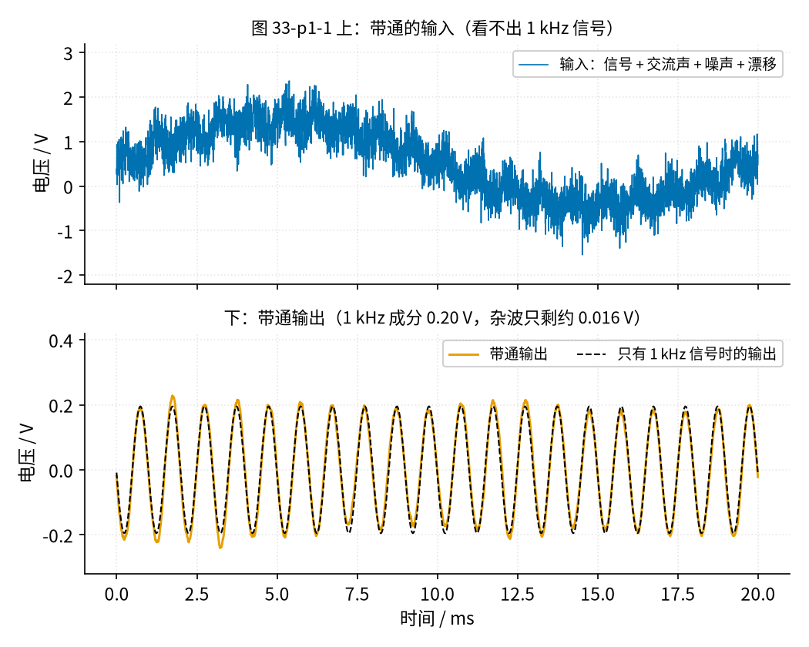
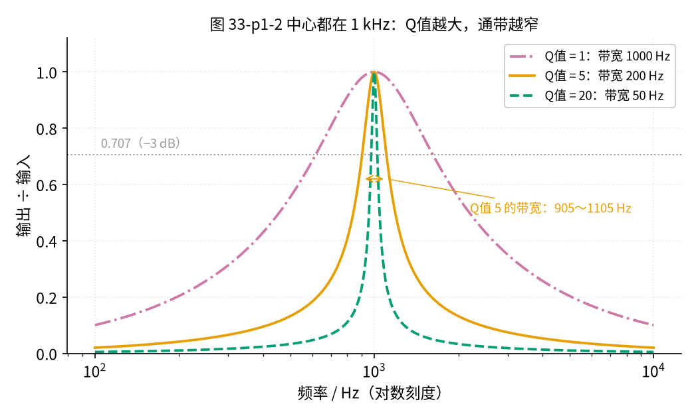
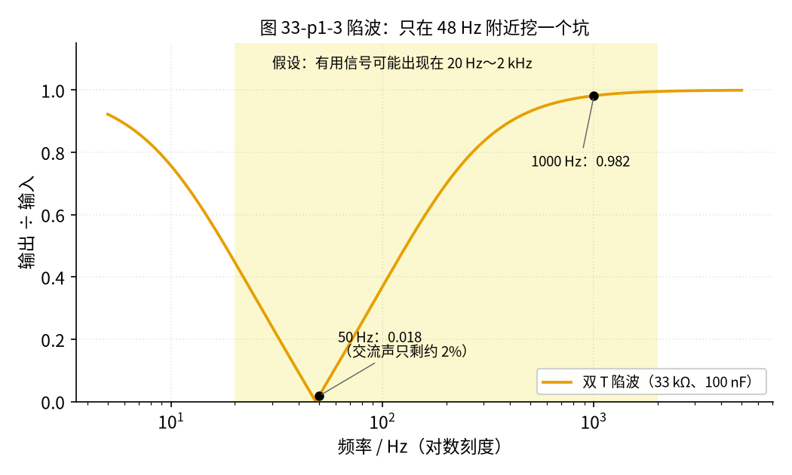
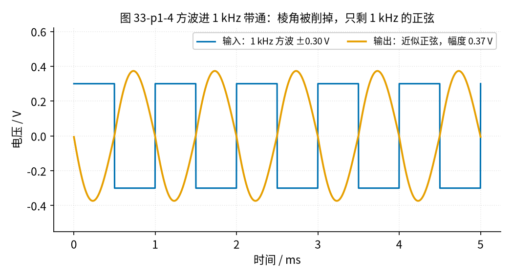
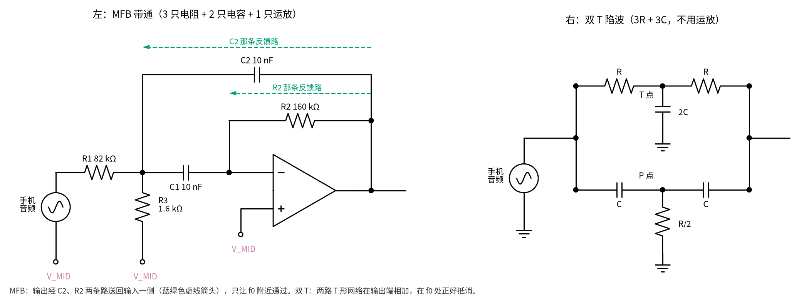

# 33 带通与 50 Hz 陷波 · 直觉篇

上一页：32 节电荷放大器（即将上线） · 本页：直觉篇 · [原理与实现篇](page2.md) · [参数与调试篇](page3.md) · [动手实验篇](page4.md) · [下一页：原理与实现篇](page2.md) · 前置节点：[01 元件速成 · 直觉篇](../01-components-basics/page1.md)、[12 电压跟随器 · 直觉篇](../12-voltage-follower/page1.md)、[20 有源滤波 · 直觉篇](../20-active-filter/page1.md)

## 痛点：有用的信号只占一条窄窄的频率带

流量计里的传感器送出来的往往是一个**有固定频率的交流信号**：比如涡街流量计，信号频率跟着流速变；超声流量计收到的回波也是一串固定频率的振荡。麻烦在于，信号从来不是单独来的，它身上还骑着三样东西：

1. **50 Hz 交流声**：电网的 50 Hz 通过导线、人体耦合进来，常常比信号还大；
2. **宽带噪声**：电阻、运放自己产生的「沙沙声」，什么频率都有一点；
3. **缓慢漂移**：温度变化让直流电平慢慢上下走。

请看图 33-p1-1 的上半张：我们用代码造了一个这样的输入，里面真正有用的是 0.20 V 幅度的 1 kHz 正弦，另外加了 1.0 V 的 50 Hz 交流声、0.6 V 的慢漂移和均方根 0.3 V 的噪声。整个波形峰峰值约 3.91 V，用眼睛根本找不到 1 kHz 在哪。

*图 33-p1-1　带通滤波前后：上为混杂的输入，下为带通输出*

下半张是经过一个中心在 1 kHz 的**带通滤波器**之后的输出（橙色），黑色虚线是「输入里只有 1 kHz 信号」时应得到的输出。两条线几乎重合：输出里 1 kHz 成分幅度 0.195 V，剩下的杂波均方根只有 0.016 V。

为什么不用 [20 有源滤波 · 直觉篇](../20-active-filter/page1.md) 学过的低通？低通能挡住高频噪声，却挡不住 50 Hz 和漂移，因为它们的频率比信号还低；高通正好反过来。带通相当于「高通 + 低通」一起上：**只让中心频率附近的一条窄带通过，两边都挡**。

## 直觉一：带通像收音机调台，Q 值决定「缝」有多窄

收音机调台时，旋钮把一个「频率窗口」移到某个电台上，窗口外的电台就听不见了。带通滤波器就是这个窗口，描述它只要三个数：

- **中心频率** $f_0$ ：窗口的正中间，输出最大的地方；
- **带宽** BW：输出不低于最大值 0.707 倍（也就是 −3 dB）的那段频率宽度；
- **Q 值**：窗口有多「尖」。三者的关系是 BW = $f_0$/Q值。

0.707 和 −3 dB 你见过：[20 有源滤波 · 原理与实现篇](../20-active-filter/page2.md) 的 Sallen-Key 低通取 Q值 = 0.707，正好让通带最平。带通的 Q 值意思不同：它越大，窗口越窄。dB 也是 20 节用过的：−3 dB 就是缩小到约 0.707 倍，−20 dB 是缩小到 1/10。

（这里写「Q 值」而不单写 Q，因为在 [01 元件速成 · 直觉篇](../01-components-basics/page1.md) 里 Q 已经用来表示电荷了。）

先猜：Q 值从 1 加到 20，曲线会变尖还是变平？带宽会变成几分之一？猜好再往下看。

请看图 33-p1-2，三条曲线的中心都在 1 kHz，只是 Q 值不同。Q 值 = 1（红紫色点划线）时，降到 0.707 的两点在 618 Hz 和 1618 Hz，带宽 1000 Hz；Q 值 = 5（橙色实线）时两点在 905 Hz 和 1105 Hz，带宽 200 Hz；Q 值 = 20（蓝绿色虚线）时带宽只剩 50 Hz（975～1025 Hz）。

*图 33-p1-2　中心频率相同、Q 值不同的三条带通曲线*

从图里能读出两件事：第一，Q 值越大，窗口越窄，挡杂波越干净；第二，窗口太窄也有代价，信号频率只要稍微偏一点（比如涡街信号随流量变了），就掉出窗口了。所以 Q 值不是越大越好，本节动手实验选 Q 值 = 5，是一个「够窄又不太娇气」的折中。

## 直觉二：陷波是「反过来的带通」，专门挖掉 50 Hz

有时候我们不想只留一条缝，而是想**整片都留下、只挖掉一个频率**，最典型的就是 50 Hz 交流声。这种滤波器叫**陷波器**（notch）。请看图 33-p1-3：曲线在 48 Hz 附近掉到几乎为零，像地上挖了一个坑；50 Hz 处只剩 0.018 倍（交流声只剩约 2%），而 1 kHz 处还有 0.982 倍。

*图 33-p1-3　双 T 陷波在 48 Hz 附近挖出一个深坑*

这条曲线来自一个只有电阻和电容的无源电路，叫**双 T 网络**：原理上是 3 只电阻 + 3 只电容；动手搭时，其中的「半个电阻」（R/2）和「双倍电容」（2C）各用两只并联，所以实际要 4 只电阻、4 只电容。它的原理是两路信号走不同的路，到出口时正好「一推一拉」抵消（[原理与实现篇](page2.md) 第四节）。注意坑底在 48.23 Hz 而不是正好 50 Hz，因为电阻电容只能从常见的标准值里挑。别小看这 1.8 Hz：坑底很尖，正好 50 Hz 处只衰减到 0.018 倍，而坑底本身几乎是 0。[参数与调试篇](page3.md) 第三节会讲怎么用三只大电阻把坑底挪到 50 Hz 附近。

## 直觉三：方波进带通，出来的是正弦

再看一个有趣的现象。先猜：一个 1 kHz 方波送进中心在 1 kHz 的带通，出来还是方波吗？

把一个 1 kHz、±0.30 V 的方波送进这个带通，会得到图 33-p1-4 的结果：方方正正的波形进去，圆滑的正弦出来。

*图 33-p1-4　1 kHz 方波经过 1 kHz 带通后变成正弦*

原因是：一个方波可以看成「一个同频率的正弦 + 三倍频、五倍频……的小正弦」叠起来，那些尖角就是高倍频成分造成的。这和 [24 振荡器 · 直觉篇](../24-oscillator/page1.md) 说的「方波里有很多谐波」是同一件事。带通只让 1 kHz 附近通过，三倍频的 3 kHz 已经在窗口外面，被大大削弱，于是只剩下 1 kHz 那一份。方波里 1 kHz 成分的幅度是 4/π × 0.30 = 0.382 V，代码算出的输出幅度（峰值）是 0.373 V，两者很接近。

你还会发现图里的正弦和方波正好上下颠倒：MFB 是反相接法，[原理与实现篇](page2.md) 第二节的增益公式里那个负号就是这么来的。

> **注意两件事**：
> - 「方波变正弦」要用示波器才看得见；万用表只能读一个数（有效值，约 0.264 V，见 [动手实验篇](page4.md)），看不出波形是不是正弦。
> - 方波**不能**拿来测陷波器：陷波只挖掉 50 Hz 一个频率，方波里的 150 Hz、250 Hz……照样通过，看起来像「陷波没用」。测陷波一定用正弦。

## 电路长什么样

本节要搭两个电路，都只用前面学过的元件。请看图 33-p1-5：左边那只运放有两条线从输出绕回输入一侧（蓝绿色虚线箭头），这就是「多重反馈」（multiple feedback，MFB）；右边上下两路，一路全是电阻、一路全是电容，各像一个字母 T，这就是「双 T」。

*图 33-p1-5　左：MFB 带通（R1、R2、R3、两只 C、一只运放）；右：双 T 陷波（R、R、R/2 和 C、C、2C）*

- **MFB 带通**：一只运放、三只电阻、两只电容。输出经两条反馈路回到前面：C2 那条反馈路、R2 那条反馈路。频率很低时，电容 C1、C2 几乎不通，信号过不去；频率很高时，电容几乎短路，把输出拉回 V_MID。只有中间一段频率两头都不拦（细节见 [原理与实现篇](page2.md) 第二节）。
- **双 T 陷波**：完全无源。上路的中点叫 T 点，经 2C 接地；下路的中点叫 P 点，经 R/2 接地。两路在输出端汇合（原理见 [原理与实现篇](page2.md) 第四节）。

由于本节只用一节 9 V 电池给运放供电，而信号是有正有负的交流，我们还要先做一个约 4.5 V 的「中点参考」V_MID，让信号绕着它上下摆。V_MID 在 [30 仪表放大器 · 原理与实现篇](../30-instrumentation-amp/page2.md) 第五节第一次出现，做法是「分压 + [12 电压跟随器 · 直觉篇](../12-voltage-follower/page1.md) 里的跟随器」，原理图见 [原理与实现篇](page2.md) 第一节。图 33-p1-5 左边那三个标 V_MID 的空心圆点，接的都是它。右边的双 T 不用运放、不需要中点参考，所以画的是普通接地符号，动手时它的两条接地支路接 GND 轨（B 区不接电池）。

## 一句话总结

**带通只放行中心频率 $f_0$ 附近宽 $f_0$/Q值 的一条窄带，陷波正好相反、只挖掉一个频率（要挖准，坑底得对准 50 Hz）；两者合起来，就能把流量计信号从交流声和噪声里「捞」出来。**
