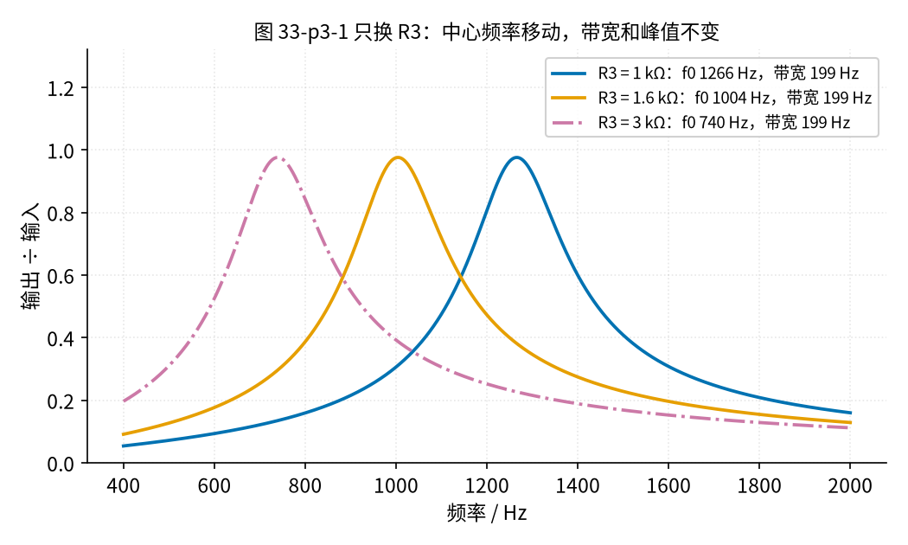
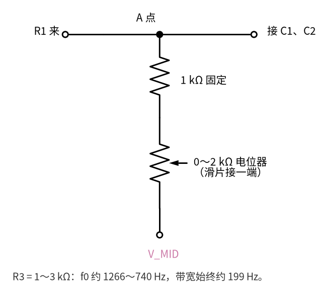
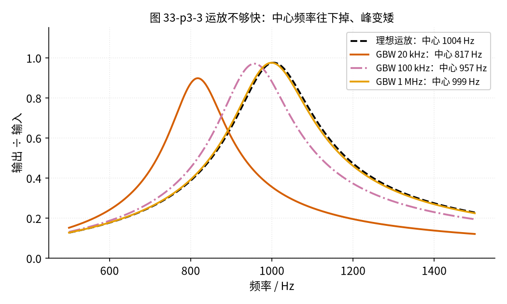
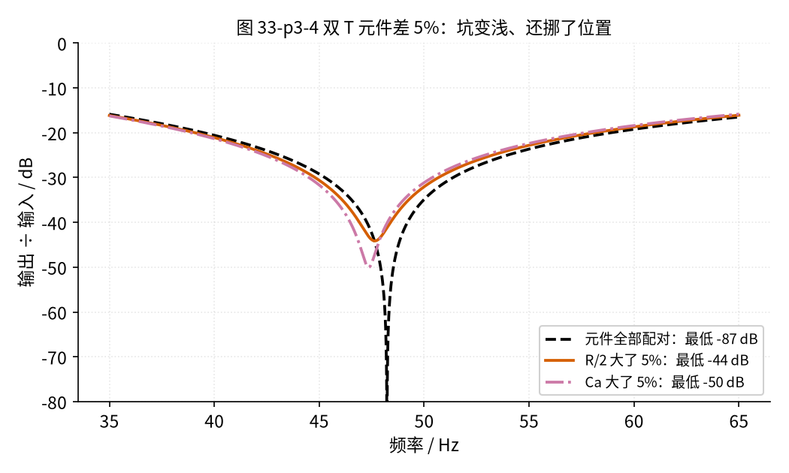
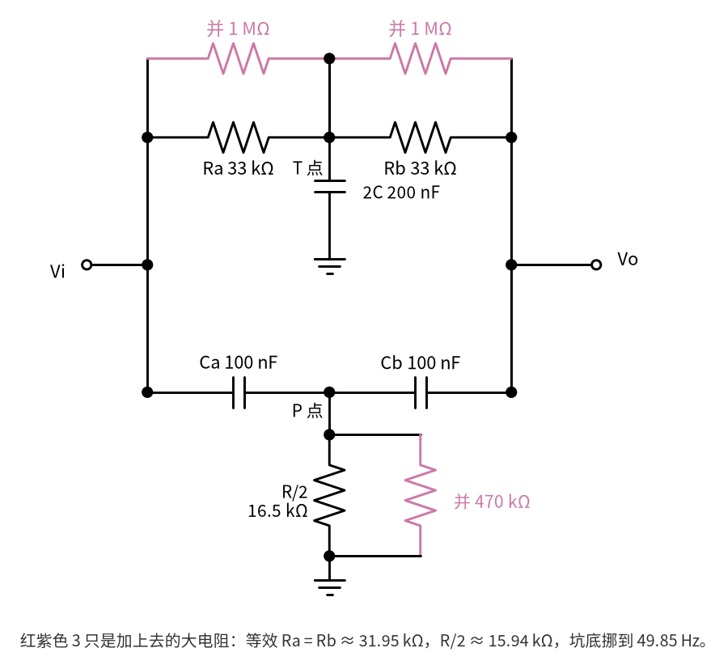

# 33 带通与 50 Hz 陷波 · 参数与调试篇

[上一页：原理与实现篇](page2.md) · [直觉篇](page1.md) · [原理与实现篇](page2.md) · 本页：参数与调试篇 · [动手实验篇](page4.md) · [下一页：动手实验篇](page4.md) · 前置节点：[20 有源滤波 · 参数与调试篇](../20-active-filter/page3.md)、[12 电压跟随器 · 直觉篇](../12-voltage-follower/page1.md)

## 这一页解决什么问题

[原理与实现篇](page2.md) 给出了 MFB 带通和双 T 陷波的公式。真正搭电路时会遇到三件事：中心频率不准想微调、运放不够快、元件有误差。这一页逐个用仿真看清楚，最后给出故障排查表和练习。本页的 $f_0$ 指中心频率（带通）或坑底频率（陷波），BW 指带宽，R1、R2、R3、C 的位置同 [原理与实现篇](page2.md) 第二节的原理图。

## 一、只改 R3：窗口平移，宽度不变

[原理与实现篇](page2.md) 第二节推出带宽 $\mathrm{BW} = 1/(\pi R_2 C)$ ，里面没有 R3。请看图 33-p3-1：R1、R2、C 不动，只把 R3 换成 1 kΩ、1.6 kΩ、3 kΩ 三种。

*图 33-p3-1　只改 R3 时的三条带通曲线*

三条曲线形状一模一样，只是左右挪了位置：R3 = 1 kΩ 时中心 1266 Hz、Q值 6.36；R3 = 1.6 kΩ 时中心 1004 Hz、Q值 5.05；R3 = 3 kΩ 时中心 740 Hz、Q值 3.72。三种情况的带宽都是 198.9 Hz、峰值都是 0.976。注意 Q值 跟着变了，因为 Q值 = $f_0$/BW，而 BW 不变。

**为什么 R3 越小，中心越高？** [原理与实现篇](page2.md) 第二节用戴维南等效看过：从电容一侧看回去，R1 和 R3 是**并联**的，等效电阻是 R1 ∥ R3（实验值约 1569 Ω）。中心频率公式可以写成 $f_0 = 1/(2\pi C\sqrt{R_2 \cdot (R_1 \parallel R_3)})$ ：R3 变小，并联后的等效电阻也变小，根号里的数变小， $f_0$ 就变大。R2 不在这个并联里，所以带宽不变。

**调试用法**：电容的误差常有 ±5%～±10%，搭好后中心频率多半不在正好 1 kHz。这时**只调 R3**：把 R3 换成一只 1 kΩ 固定电阻串一只 0～2 kΩ 电位器（图 33-p3-2），R3 就能在 1～3 kΩ 之间调，中心频率在约 1266 Hz 到 740 Hz 之间移动，而带宽和峰值不变。

*图 33-p3-2　把 R3 换成「1 kΩ + 2 kΩ 电位器」的接法*

**对照看**：图 33-p3-2 只画了 [原理与实现篇](page2.md) 原理图里 R3 那一条支路。上端的「A 点」就是 R1、C1、C2 交汇的节点（动手实验篇的第 7 列），下端是 V_MID 空心圆点（V_MID 轨）。电位器三只脚里，滑片和其中一端接在一起，当作一只 0～2 kΩ 的可变电阻用。电位器先拧到中间（约 1 kΩ，总共约 2 kΩ），再一边看输出读数一边慢慢拧。

> 💡 **通带很宽时别用 MFB**：MFB 带通适合「窄窗口」（Q值 在 1 以上）。如果要的是很宽的通带，比如 300 Hz～3 kHz 的语音，Q值 不到 1，用一只 MFB 不合适。更简单的办法是把 [20 有源滤波](../20-active-filter/page2.md) 的高通和低通串起来：高通定下边，低通定上边，两边各自按 20 节的方法设计。

## 二、运放够不够快：开环增益和 2 × Q值²

[20 有源滤波 · 参数与调试篇](../20-active-filter/page3.md) 用过一条规律：闭环带宽 ≈ GBW ÷ 放大倍数，LM358B 的 GBW（增益带宽积）约 1.2 MHz。把这条规律反过来读：在频率 $f$ 处，运放自己最多还能放大 $\mathrm{GBW}/f$ 倍，这就是它在该频率的**开环增益**。1 kHz 处约 1200 倍。

MFB 带通对运放的要求比普通放大器高。请看图 33-p3-3：同一个 Q值 = 5 的 MFB，分别换成理想运放和 GBW 为 20 kHz、100 kHz、1 MHz 的运放（简化模型）。

*图 33-p3-3　运放 GBW 不同时，MFB 带通的曲线*

| 运放 | 峰值 | 中心 | 带宽 | 1 kHz 处开环增益 |
|---|---|---|---|---|
| 理想 | 0.976 | 1004 Hz | 199 Hz | — |
| GBW 20 kHz | 0.898 | 817 Hz | 143 Hz | 20 |
| GBW 100 kHz | 0.971 | 957 Hz | 182 Hz | 100 |
| GBW 1 MHz | 0.975 | 999 Hz | 197 Hz | 1000 |

这里 2 × Q值² = 51。开环增益只有 20（比 51 还小）时，中心频率被拖低到 817 Hz，误差约 19%；开环增益 100（约 51 的 2 倍）时误差还有约 5%；开环增益 1000（约 51 的 20 倍）时几乎和理想一样。仿真给出的经验是：**中心频率处的开环增益要比 2 × Q值² 大一个数量级以上**，MFB 才「听话」。这只是从本节仿真里观察到的规律，不是严格定理；Q值 越高，要求增长得越快（与 Q值 的平方成正比）。

**为什么是 2 × Q值²？** 一个直觉：在中心频率处，运放输出经 R2、C1、C2 这张反馈网络绕回反相端时，code/33_sim.py 算得只剩约 1/52（实验电路 Q值 = 5.05，2 × Q值² = 51.0，2 × Q值² + 1 = 52.0）。也就是说，运放得先自己放大约 52 倍，才能把绕回来的这一点点信号补回原样。它的开环增益若不比 52 大很多，就补不回来，峰值和中心频率都会往下掉。

## 三、双 T 的元件误差、负载和信号源

双 T 的坑底能那么深，靠的是两路电流**完全**抵消，所以它对元件的匹配非常敏感。下面的名字同 [原理与实现篇](page2.md) 第四节：Ra、Rb 是电阻 T 的两只电阻，中间经 2C 接地；Ca、Cb 是电容 T 的两只电容，中间经 R/2 接地（[动手实验篇](page4.md) 里 2C 由 C3、C4 并联，R/2 由 R4、R5 并联）。请看图 33-p3-4：一条是理想匹配，一条是 R/2 偏大 5%，一条是 Ca 偏大 5%。

*图 33-p3-4　双 T 元件匹配与失配 5% 时的坑底*

复习一下 dB（[20 有源滤波 · 原理与实现篇](../20-active-filter/page2.md) 第一节）：dB 数 = $20\lg(V_o/V_i)$ ，每 −20 dB 就是缩小到 1/10，所以 −44 dB 约是 1/160，−50 dB 约是 1/320，−87 dB 约是 1/22000。

| 情况 | 坑底最低值 | 坑底位置 | 50 Hz 处 |
|---|---|---|---|
| 完全匹配 | 0.0000（−87 dB） | 48.2 Hz | 0.0180 |
| R/2 偏大 5% | 0.0062（−44 dB） | 47.7 Hz | 0.0250 |
| Ca 偏大 5% | 0.0032（−50 dB） | 47.4 Hz | 0.0278 |

只差 5%，坑底就从「几乎为零」变成千分之几，而且坑底的位置也挪开了半赫兹以上。所以双 T 要用误差 1% 的金属膜电阻，电容尽量挑同一批、用表的电容挡配对。不过也不必太悲观：即使失配，50 Hz 处仍只剩 0.025～0.028 倍。

表里「完全匹配」那一行的 −87 dB 不是真实的极限：理论上坑底正好为零，仿真只在一个个离散频率点上算，最低值取决于这些点离 48.23 Hz 有多近，点越密算出来越深。所以只能说「深到看不出」，不要把 −87 dB 当成固定值。下文的 7.6 × 10⁻⁵、8.9 × 10⁻⁵ 也一样。

还要把两件事分开：**元件失配让坑变浅**；而标准值 33 kΩ、100 nF 的坑底本来就在 48.23 Hz，不在 50 Hz，所以即使元件完全匹配，50 Hz 处也只能衰减到 0.0180 倍（−34.9 dB）。想在 50 Hz 处更深，靠的是下面的「挪坑底」。

**负载与信号源**：ngspice 仿真里，在输出端接 10 MΩ 负载（相当于万用表），50 Hz 处 0.01801、1 kHz 处 0.9818，与空载几乎一样；接到 100 kΩ 负载，坑底依然深（最低 7.6 × 10⁻⁵），只是 1 kHz 处降到 0.977。这印证了 [原理与实现篇](page2.md) 第五节的结论：**坑底深度与负载无关**，负载只影响坑外的高度。信号源内阻 100 Ω 时坑底也不变（最低 8.9 × 10⁻⁵）。

**坑底不在 50 Hz 怎么办**：坑底频率与电阻成反比，电阻同比例变小，坑底就往高处挪。电阻只能并联才能变小，所以在 Ra、Rb 两侧各并一只 1 MΩ（33 kΩ ∥ 1 MΩ ≈ 31.95 kΩ），R/2 两端并一只 470 kΩ（16.5 kΩ ∥ 470 kΩ ≈ 15.94 kΩ），见图 33-p3-5。三处都按约 3% 的同一比例减小，比例关系不变，坑依然很深。code/33_sim.py 算得坑底移到 49.85 Hz，50 Hz 处只剩 0.00157 倍，1 kHz 处仍有 0.981 倍。

*图 33-p3-5　用并联大电阻把双 T 的坑底挪到约 49.85 Hz*

**对照看**：图 33-p3-5 的黑色部分就是 [原理与实现篇](page2.md) 第四节的双 T：上面一行是电阻 T（Ra、Rb，中点 T 点经 2C 接地），下面一行是电容 T（Ca、Cb，中点 P 点经 R/2 接地）。红紫色的 3 只是新加的：两只 1 MΩ 分别跨在 Ra、Rb 两端，一只 470 kΩ 跨在 R/2 两端。在面包板上（[动手实验篇](page4.md) 的 B 区），就是第 4–10 列、第 10–16 列各多插一只 1 MΩ，第 10 列下半到 GND 轨多插一只 470 kΩ。动手实验篇先按标准值做，测到坑底在 48 Hz 附近后，再按这里加并联电阻。

## 四、故障排查表

| 现象 | 原因 | 怎么查 | 怎么改 |
|---|---|---|---|
| MFB 输出一直贴着 0 V 或 9 V，没有交流 | 同相端或 R3 没接 V_MID，误接到了电池负极 | 直流挡量运放 1 脚对 GND，应约 4.5 V；量 3 脚对 GND 也应约 4.5 V | 把 3 脚和 R3 的下端都改接 V_MID 轨 |
| V_MID 不是 4.5 V，或一接负载就变 | 跟随器 6、7 脚没短接，或 CM 极性反 | 直流挡量 7 脚对 GND；看 CM 的「−」条纹是否朝 GND | 补上 6–7 脚短线；CM 正极朝分压点 |
| 中心频率偏离 1 kHz 超过 10% | 电容误差大，或 R3 取错 | 用表的电容挡量 C1、C2；用欧姆挡量 R3 | 换 R3 微调（R3 小则中心高） |
| 窗口比预期宽，峰值也不到 0.9 | R2 取小了，或用了很慢的运放 | 量 R2；查运放型号的 GBW | 换回 160 kΩ；换 GBW 更高的运放 |
| 峰值处输出波形削顶 | 输入太大，输出摆到了电源边上 | 降低手机音量，看是否恢复正弦 | 输入控制在 0.30 V 左右 |
| 双 T 在 50 Hz 只衰减到一半左右 | 某只电容或电阻值差很多，或中点接地线没接 | 断电后逐只量 Ra、Rb、R4、R5、Ca、Cb、C3、C4 | 换掉偏差大的元件；补上接地线 |
| 双 T 坑底读数不够小（比如还有 10 mV 以上） | 元件失配几个百分点 | 在 45～52 Hz 之间细扫，看最低读数在哪 | 挑配对的元件；或按第三节微调 |
| 双 T 在 50 Hz 只到 0.018 倍左右，最深处却在 48 Hz | 不是故障：标准值的坑底就在 48.23 Hz | 45～52 Hz 细扫 | 按第三节并联 1 MΩ、470 kΩ |
| 坑底读数忽大忽小，手一靠近就变大 | 人体和导线从周围电线上拾取了 50 Hz | 手机暂停，看输出还剩多少（动手实验篇第 ⑬ 步） | 导线剪短、手离开电路；手机不要边充电边测 |
| 中心频率随时间、温度漂，或换一批电容就变 | 用了 X7R、Y5V 这类高介电常数瓷片电容 | 看电容型号 | 换 C0G 瓷片或薄膜电容 |
| 1 kHz 以上的读数普遍偏小，曲线右边掉得比算的快 | 万用表交流挡在高频读小 | 动手实验篇第 ⓪ 步校表 | 用比值法；高频段改用耳机听 |
| 输出有一个几十 kHz 以上的「怪」交流，或碰一下芯片读数就变 | 没有电源去耦，运放自激 | 看 8 脚和 4 脚之间有没有 100 nF | 在 +9 V 轨和 GND 轨之间紧贴芯片插 100 nF |
| 用方波测双 T，输出几乎没变小 | 方波里有 150 Hz、250 Hz 等成分，它们不在坑里 | 换成正弦再测 | 测陷波器只用正弦 |

**还有两个常见误区**：

- **MFB 输出直接接 Arduino 引脚**：输出以 4.5 V 的 V_MID 为中心上下摆，摆幅一大，最高点就会超过 5 V。以后要接单片机，先分压或电平移位，把电压限制在 0～5 V 之间。
- **把 V_MID 和 GND 当成一回事**：V_MID 轨对 GND 有 4.5 V，用导线把两者短接，等于把分压的下半截短路，带通的工作点全乱了。量交流时黑表笔插 V_MID 轨，但**不要**把 V_MID 轨接到 GND 轨上。

**电阻误差会让中心频率偏多少？** code/33_sim.py 让三只电阻各偏大 1% 试了一遍：R2 或 R3 偏 1%，中心频率偏约 0.5%（电阻误差的一半）；R1 偏 1%，中心几乎不动（只偏约 0.01%），但中心增益 R2/(2R1) 会变 1%。这个「一半」和 Q值 几乎无关，Q值 = 2、5、10、20 时都在 0.43%～0.50% 之间。Q值 影响的是「偏移占带宽多少」：带宽 = 中心频率 ÷ Q值，所以 Q值 = 5 时 0.5% 的偏移只占带宽的 2.5%，Q值 = 20 时已占约 10%，窗口边上的信号就会明显变小。所以 Q值 越高，越要用 1% 的电阻。

## 五、练习

**练习 1**：把本节 MFB 的中心频率挪到约 **1200 Hz**，带宽不变，只换一只元件。换哪只？用 [原理与实现篇](page2.md) 第二节的 $f_0$ 公式倒推出它的值，取最近的标准值，再算实际中心频率和 Q值。

答案

只换 R3（第一节：只有 R3 不在带宽公式里）。把 $f_0$ 公式改写成 $1/R_3 = R_2 (2\pi C f_0)^2 - 1/R_1$ ，代入 R1 = 82 kΩ、R2 = 160 kΩ、C = 10 nF、 $f_0$ = 1200 Hz，得 R3 ≈ 1114 Ω，取标准值 1.1 kΩ。code/33_sim.py 算得实际中心 1208 Hz，Q值 6.07，带宽仍是 198.9 Hz，峰值仍是 0.976。

**练习 2**：C 仍取 10 nF，想要带宽 100 Hz，R2 应取多大？

答案

由 $\mathrm{BW} = 1/(\pi R_2 C)$ 得 $R_2 = 1/(\pi \times 100 \times 10\times 10^{-9}) \approx 318$ kΩ。

**练习 3**：如果双 T 的**所有**电阻、电容都偏大 5%（同一批货，一起偏），坑底挪到哪里？坑还深不深？50 Hz 处还剩多少？和第三节表里「只有 Ca 偏大 5%」比，说明为什么「配对」比「准」更要紧。

答案

坑底频率与 R × C 成反比，R、C 都变成 1.05 倍，坑底变成 $48.23/1.05^2 \approx 43.74$ Hz（code/33_sim.py 扫频得 43.75 Hz）。坑依然很深（最低约 9.5 × 10⁻⁷，同样受扫频网格限制），因为各元件之间的比例没变，两路电流照样能完全抵消，只是整体挪了位置。但 50 Hz 已经离坑底较远，还剩约 0.067 倍。

对比「只有 Ca 偏大 5%」：坑底只到 0.0032，坑被「填浅」了。所以：**比例决定坑有多深，绝对值决定坑在哪里**。挑配对的元件保证坑深；位置偏了还能用第三节的并联电阻挪回来。

**练习 4（变式）**：如果要做 1 kHz、Q值 = 10 的 MFB 带通，按第二节的经验，中心频率处运放开环增益至少要多大？用 LM358 合适吗？

答案

2 × Q值² = 2 × 100 = 200，按「大一个数量级以上」的经验，1 kHz 处开环增益要在 2000 以上，也就是 GBW 要在 2 MHz 以上。LM358B 在 1 kHz 处只有约 1200（只比 200 大 6 倍），按经验还不够。不过偏得并不多：code/33_sim.py 用同一个运放模型算得峰值在 991.8 Hz（偏约 1%），带宽 98.5 Hz（理想 100 Hz），勉强可用。真正「明显拖偏」的例子是把中心挪到 10 kHz：同样 Q值 = 10，LM358B 的峰值掉到 9258 Hz，偏 7.4%。要更准，就换 GBW 更高的运放，或者把 Q值 降下来、用两级串联代替。

**练习 5（迁移）**：后面的 37 节要从超声换能器的信号里挑出 40 kHz 附近的成分。如果用本节的 MFB 做一个 40 kHz、Q值 = 5、峰值 1 倍的带通，LM358B（GBW 约 1.2 MHz）在 40 kHz 处的开环增益约多少？够不够第二节的经验要求？

答案

开环增益约 1.2 MHz ÷ 40 kHz = 30，而 2 × Q值² = 50，开环增益连 50 都不到，更谈不上「大一个数量级」。code/33_sim.py 用单极点运放模型算得：峰值掉到 0.959、出现在 34.6 kHz，带宽 6.25 kHz（理想是 1.000、40.0 kHz、8.00 kHz），中心偏了约 14%。用 TI 官方的 LM358B 模型在 ngspice 里仿真，结果更离谱：峰值反而冒到约 1.20 倍、出现在约 35.3 kHz（运放额外的相位滞后把 Q值 抬高了），结论一样是不能用。换成 GBW 约 10 MHz 的运放（40 kHz 处开环增益约 250）时，峰值 0.999、在 39.2 kHz，带宽 7.70 kHz，就接近理想了。所以 40 kHz 的带通要换更快的运放，或者把 Q值 拆到两级里，具体做法在 37 节（预告）。

## 本页小结

- 只改 R3 能平移 MFB 带通的窗口，带宽 $1/(\pi R_2 C)$ 和峰值不变；
- 运放在中心频率处的开环增益要远大于 2 × Q值²（本节仿真：大 20 倍时几乎无误差，只大 2 倍时偏约 5%）；
- 双 T 的坑底深度取决于元件**匹配**，与负载无关；标准值让坑底落在 48.23 Hz，实验时先扫频找坑底，再用并联大电阻把它挪到约 49.85 Hz；
- 测量时先校表、用比值法，用正弦不用方波，留意 50 Hz 拾取。
