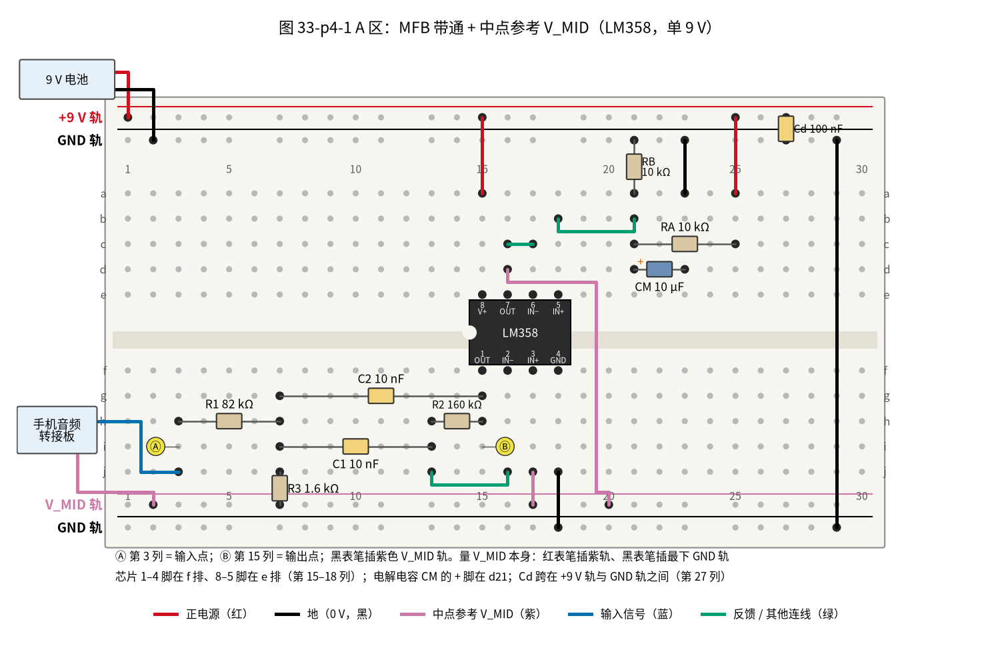
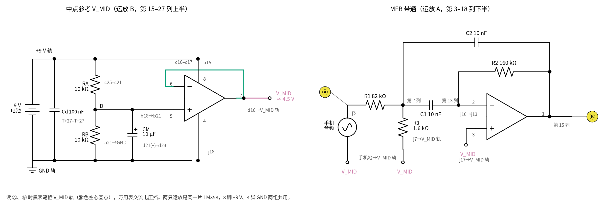
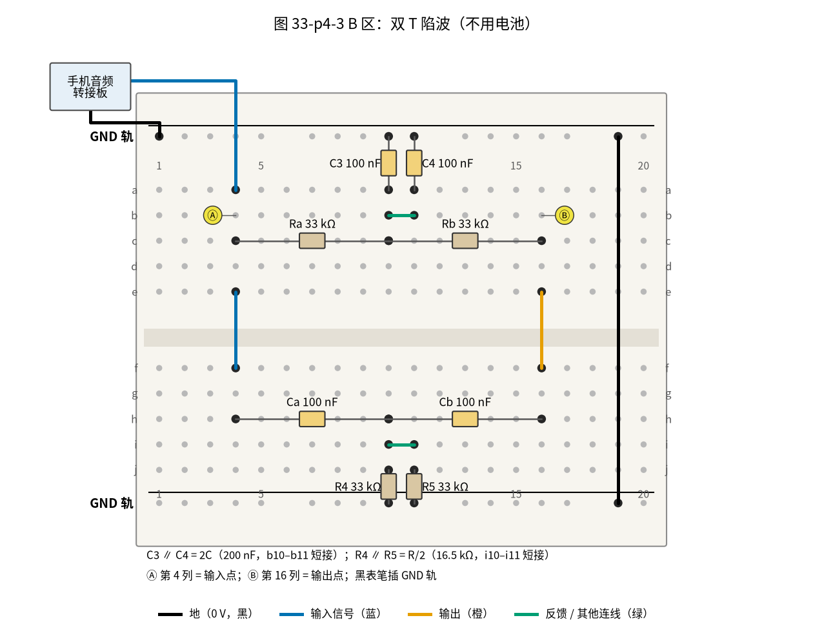
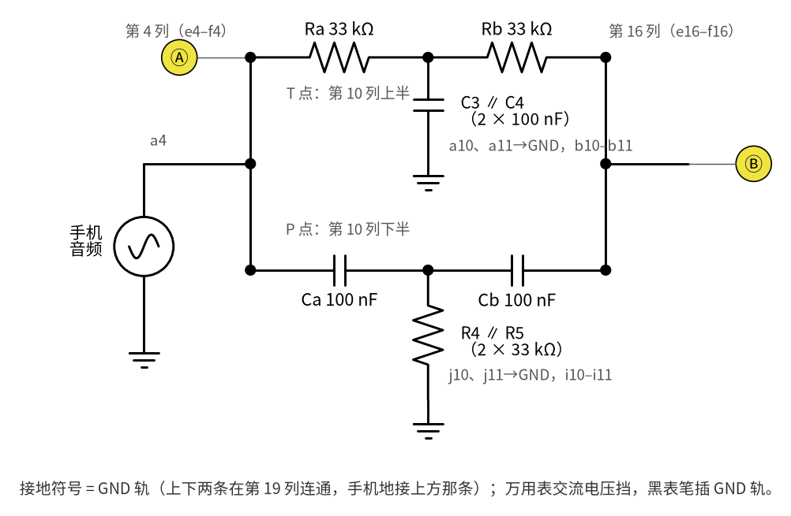
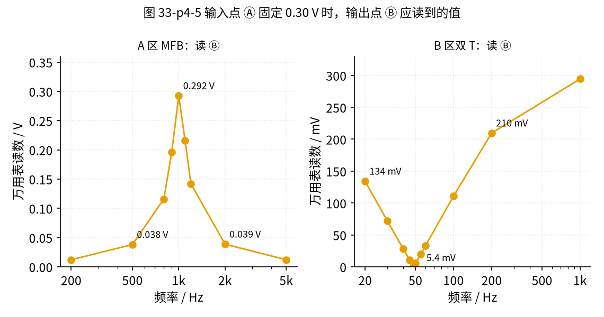

# 33 带通与 50 Hz 陷波 · 动手实验篇

[上一页：参数与调试篇](page3.md) · [直觉篇](page1.md) · [原理与实现篇](page2.md) · [参数与调试篇](page3.md) · 本页：动手实验篇 · [下一页：34 开关电容滤波与跟踪滤波 · 直觉篇](../34-switched-cap-filter/page1.md) · 前置节点：[12 电压跟随器 · 动手实验篇](../12-voltage-follower/page4.md)、[20 有源滤波 · 动手实验篇](../20-active-filter/page4.md)

## 这次实验要验证什么

本实验分 A、B 两个区，验证 [原理与实现篇](page2.md) 的三个结论：

1. **中点参考 V_MID**：用分压 + 跟随器做出的 V_MID 应该约 4.5 V，而且接上滤波器后不变（[原理与实现篇](page2.md) 第一节）；
2. **MFB 带通**（A 区）：中心频率约 1 kHz，中心处输出约为输入的 0.976 倍，离开中心 100 Hz 左右就降到约 0.7 倍，离得更远掉得很快（[原理与实现篇](page2.md) 第二、三节）；
3. **双 T 陷波**（B 区）：在 48 Hz 左右输出几乎为零，50 Hz 处约为输入的 0.018 倍，1 kHz 处几乎不衰减（[原理与实现篇](page2.md) 第四、五节）。

信号源用手机上的「信号发生器 / 音频频率发生器」类应用（能输出指定频率正弦的都行），经 3.5 mm 音频转接板接到面包板。测量只用万用表的交流电压挡和直流电压挡。

本页有两套记号，别混：**Ⓐ、Ⓑ（圆圈字母）是表笔位置**，Ⓐ 是输入点、Ⓑ 是输出点；**①②③（圆圈数字）是测量表的步骤号**；搭建步骤用普通数字 1、2、3。

## ⚠️ 安全须知

- 只用一节 **9 V 电池**供电，全程不超过 12 V 直流；不要用任何插墙的电源。
- **手机不要边充电边做实验**：充电时手机的地会经充电器连到电网，可能和电路形成干扰回路。
- 电解电容 CM 有正负极，正极（长脚、无条纹那一侧）接分压点，接反会发热甚至鼓包。
- 手机音量从小往大调，**只调到输入点 Ⓐ 读数为 0.30 V 左右**（测量表第 ③ 步），更大的音量会让运放输出削顶，也可能损坏转接板。
- 插、拔、挪任何元件或跳线之前，先拔掉电池扣。测量过程中只需要换手机频率、挪表笔，不用动面包板上的线。B 区不接电池，但手机仍在输出信号，改线前先暂停手机应用。

## 器材清单

| 元件 | 型号或数值 | 数量 | 说明 |
|---|---|---|---|
| 运放 | LM358（DIP-8） | 1 | 一片里有两只运放：A 做带通，B 做中点参考 V_MID |
| 电阻 | 82 kΩ | 1 | R1 |
| 电阻 | 160 kΩ | 1 | R2；没有 160 kΩ 可用 150 kΩ + 10 kΩ 串联 |
| 电阻 | 1.6 kΩ | 1 | R3；没有可用 1.5 kΩ + 100 Ω 串联 |
| 电阻 | 10 kΩ | 2 | RA、RB，做 4.5 V 分压 |
| 电阻 | 33 kΩ（1% 金属膜） | 4 | 双 T 的 Ra、Rb、R4、R5 |
| 电容 | 10 nF（C0G 瓷片或薄膜，代码 103） | 2 | C1、C2；不要用 X7R、Y5V 这类高介电常数瓷片，容量会随电压、温度漂 |
| 电容 | 100 nF（薄膜，代码 104） | 4 | 双 T 的 Ca、Cb、C3、C4，最好用表的电容挡挑接近的 |
| 电容 | 100 nF（普通瓷片即可） | 1 | Cd，LM358 的电源去耦，紧贴芯片 |
| 电解电容 | 10 µF / 16 V 以上 | 1 | CM，稳住分压点 D |
| 9 V 电池 + 电池扣 | — | 1 | 只给 A 区供电 |
| 3.5 mm 音频转接板 + 音频线 | — | 1 | 把手机耳机口的信号和地引到面包板；手机没有耳机孔时加 USB-C 转 3.5 mm 转接头（同 [20 有源滤波 · 动手实验篇](../20-active-filter/page4.md)） |
| 手机 | 装有正弦信号发生器应用 | 1 | 关掉音效增强、均衡器 |
| 万用表 | 带交流电压 2 V / 200 mV 挡、直流 20 V 挡 | 1 | 有电容挡更好；没有交流 200 mV 挡就用 2 V 挡：它最小读到 0.001 V，坑底附近只有几个字，只能看出「读数最小」在哪个频率 |
| 面包板、跳线 | — | 若干 | 两块小板或一块大板分 A、B 区 |

## 搭建步骤

### A 区：中点参考 V_MID + MFB 带通

面包板上方两条长轨是 **+9 V 轨**和 **GND 轨**，下方两条是 **V_MID 轨**（紫色）和 **GND 轨**，两条 GND 轨在第 29 列用长线连通。

1. 把 LM358 跨在中间凹槽上，占第 15–18 列：1–4 脚在 f 排，8–5 脚在 e 排（缺口朝左）。
2. 先搭中点参考：a15（8 脚）接 +9 V 轨；c16–c17 短接（7 脚接 6 脚，跟随器）；b18（5 脚）用短线连到 b21；RA 10 kΩ 插 c21–c25，a25 接 +9 V 轨；RB 10 kΩ 从 a21 接到上方 GND 轨；CM 正极插 d21、负极插 d23，a23 接 GND 轨；d16（7 脚，V_MID 输出）连到面包板下方的 V_MID 轨（紫色，经第 20 列）。第 21 列就是原理图里的分压点 D。
3. 插去耦电容：Cd 100 nF 在第 27 列附近跨接 +9 V 轨和上方 GND 轨，尽量靠近芯片。
4. 再搭带通：R1 82 kΩ 插 h3–h7；R3 1.6 kΩ 从 j7 接到 V_MID 轨；C1 10 nF 插 i7–i13；C2 10 nF 插 g7–g15（第 15 列就是 1 脚，输出）；R2 160 kΩ 插 h13–h15；j16（2 脚）连到 j13；j17（3 脚）接 V_MID 轨；j18（4 脚）接 GND 轨。
5. 手机转接板的信号端接 j3，**手机的地接 V_MID 轨**（不是 GND）。
6. 最后接电池：红线接 +9 V 轨，黑线接上方 GND 轨；第 29 列的长线把上下两条 GND 轨连通。

请看图 33-p4-1，它是 A 区的面包板接法。



*图 33-p4-1　A 区：中点参考与 MFB 带通的面包板接法；Ⓐ 输入点、Ⓑ 输出点*

图里每个元件都标了名字和数值，紫色线是接 V_MID 的线，黄色 Ⓐ、Ⓑ 是表笔位置。与它一一对应的原理图是图 33-p4-2，元件名与 [原理与实现篇](page2.md) 的原理图相同，灰色小字是孔位。



*图 33-p4-2　与 A 区面包板一一对应的原理图*

**对照看**：

- **轨道名**：原理图里的「+9 V 轨」「GND 轨」「V_MID 轨」就是面包板上同名的长轨；Cd 旁的灰字「T+27–T−27」意思是 Cd 两脚插在上方（Top）+9 V 轨和上方 GND 轨的第 27 孔附近。
- **左半（中点参考）**：运放 B 的 5 脚在面包板上是 b18，经 b18→b21 短线到第 21 列，那里正是 RA、RB 和 CM 的交汇点，也就是原理图的 D 点。6、7 两脚在面包板上就是 c16–c17 这根短线，7 脚再从 d16 引到紫色 V_MID 轨。原理图里 V_MID 画成空心圆点，不画接地符号。
- **右半（带通）**：原理图里的节点 A 在面包板上是第 7 列，R1、R3、C1、C2 四个元件都有一只脚插在这一列；节点 N 是第 13 列，C1 和 R2 在这里相遇，再由 j16→j13 这根线接到 2 脚；输出（1 脚）是第 15 列，C2 和 R2 的另一端都插在这里，也就是 Ⓑ。Ⓐ 是第 3 列，R1 的左端和手机信号都在这里。

只要第 7、13、15 三列分别对上，电路就对了。

### B 区：双 T 陷波（不用电池）

1. 电阻 T：Ra 33 kΩ 插 c4–c10，Rb 33 kΩ 插 c10–c16；C3、C4 两只 100 nF 分别从 a10、a11 接上方 GND 轨，b10–b11 短接让它们并联成 2C。
2. 电容 T：Ca 100 nF 插 h4–h10，Cb 100 nF 插 h10–h16；R4、R5 两只 33 kΩ 分别从 j10、j11 接下方 GND 轨，i10–i11 短接让它们并联成 R/2。
3. e4–f4、e16–f16 两根短线把上下两半的输入、输出连起来；第 19 列连通上下两条 GND 轨。
4. 手机信号接 a4，手机地接上方 GND 轨。B 区没有运放，不需要 V_MID，接地支路直接接 GND。

请看图 33-p4-3，它是 B 区的面包板接法。



*图 33-p4-3　B 区：双 T 陷波的面包板接法；Ⓐ 输入点、Ⓑ 输出点*

上半排是电阻 T，下半排是电容 T，第 10 列的上下两半分别是两个 T 的中点。对应的原理图是图 33-p4-4。



*图 33-p4-4　与 B 区面包板一一对应的原理图*

**对照看**：原理图上面那条横线是 Ra–Rb，对应面包板 c 排的两只电阻，中点 **T 点**就是第 10 列上半，往下接地的「C3 ∥ C4」就是 a10、a11 两只电容加 b10–b11 短线。下面那条横线是 Ca–Cb，对应 h 排两只电容，中点 **P 点**是第 10 列下半，往下接地的「R4 ∥ R5」就是 j10、j11 两只电阻加 i10–i11 短线。原理图左右两端把上下两条线合在一起，在面包板上就是 e4–f4 和 e16–f16 两根短线。原理图的接地符号都是 GND 轨（上下两条在第 19 列连通）。

## 测量表

[20 有源滤波 · 动手实验篇](../20-active-filter/page4.md) 提醒过「1 kHz 以上别信万用表」：很多普通万用表的交流挡只为几百 Hz 以内设计，频率再高读数会偏小。本节改用**比值法**：每个频率都先读输入点 Ⓐ、再读输出点 Ⓑ，算 Ⓑ ÷ Ⓐ。只要表在这个频率「读小的比例」对 Ⓐ、Ⓑ 一样，比值就仍然可信。这个前提要先用第 ⓪ 步检查。

**第 ⓪ 步：校表**。A 区上电后，手机音量**保持不变**，依次放 100 Hz、1 kHz、5 kHz，各在 Ⓐ（第 3 列，黑表笔插 V_MID 轨，交流 2 V 挡）读一次。手机在这几个频率输出的幅度基本一样，所以：

- 三次读数相差不到 10%：你的表到 5 kHz 都能用比值法；
- 100 Hz 和 1 kHz 接近、5 kHz 明显偏小：2 kHz 以内照常测，第 ⑦ 步的 5000 Hz 改用耳机听（同 20 节）；
- 1 kHz 已经比 100 Hz 小 10% 以上：A 区改用耳机听「哪个频率最响」，只用万用表测 B 区（B 区频率都在 1 kHz 以内，坑底在 50 Hz 附近）。这时第 ⑨ 步改用 500 Hz，比值约 0.93（`code/33_sim.py` 用 [原理与实现篇](page2.md) 的双 T 公式算出 0.932）。

各型号万用表交流挡的频率上限不一样，以你那只表的说明书为准。

先用直流挡检查 A 区，再按表测交流。A 区所有交流读数**黑表笔插 V_MID 轨**；B 区黑表笔插 GND 轨。每换一次频率，等读数稳定 2～3 秒，先读 Ⓐ、再读 Ⓑ。下表「应该读到」一栏给的是比值 Ⓑ/Ⓐ，括号里是 Ⓐ = 0.30 V 时 Ⓑ 的读数，仅供参考。

**挡位规则：Ⓐ 始终用交流 2 V 挡；Ⓑ 在 2 V 挡上读数不到 0.020 V 时，才换到 200 mV 挡。** 原因：Ⓐ 已经调到 0.30 V，超过 200 mV 挡的量程（最多 199.9 mV），用 200 mV 挡量 Ⓐ，表会显示「1」或「OL」（溢出），这不是你搭错了。表里只有第 ⑦、⑪、⑫、⑬ 步的 Ⓑ 是十几 mV 或更小：在 2 V 挡上只显示「0.012」「0.005」这样几个到十几个字，最后一位跳一下就差很多，所以换到 200 mV 挡（能读到 0.1 mV）。其余步骤的 Ⓑ 在 20 mV 以上，留在 2 V 挡；尤其第 ⑤ 步 1100 Hz 约 0.215 V，在 200 mV 挡上会溢出。

| 步骤 | 测什么 | 红表笔 | 黑表笔 | 挡位 | 应该读到 | 读不到时先查 |
|---|---|---|---|---|---|---|
| ① | V_MID（上电等 1 秒） | V_MID 轨 | GND 轨 | 直流 20 V | 约 4.5 V | CM 极性、c16–c17 短线、RA/RB |
| ② | 带通输出的直流电平 | Ⓑ 第 15 列 | GND 轨 | 直流 20 V | 约 4.5 V | 3 脚、R3 是否接 V_MID 轨 |
| ③ | 输入幅度（手机 1000 Hz） | Ⓐ 第 3 列 | V_MID 轨 | 交流 2 V | 调音量到 0.30 V | 转接板的地是否接 V_MID 轨 |
| ④ | 带通，1000 Hz | Ⓐ、Ⓑ 各读一次 | V_MID 轨 | 交流 2 V | 比值约 0.975（约 0.29 V） | R2、C1、C2 的位置 |
| ⑤ | 带通，900 Hz / 1100 Hz | Ⓐ、Ⓑ | V_MID 轨 | 交流 2 V | 比值约 0.65 / 0.72（约 0.196 / 0.215 V） | 中心偏了就看 R3 |
| ⑥ | 带通，500 Hz / 2000 Hz | Ⓐ、Ⓑ | V_MID 轨 | 交流 2 V | 比值约 0.13 / 0.13（约 0.038 / 0.039 V） | 比值大得多：R2 或 C 接错 |
| ⑦ | 带通，200 Hz / 5000 Hz | Ⓐ、Ⓑ | V_MID 轨 | Ⓐ 交流 2 V；Ⓑ 交流 200 mV | 比值约 0.04 / 0.04（约 12 mV） | 5000 Hz 看第 ⓪ 步结论 |
| ⑧ | 双 T 输入（手机 1000 Hz） | Ⓐ 第 4 列 | GND 轨 | 交流 2 V | 调音量到 0.30 V | 手机地是否接 GND 轨 |
| ⑨ | 双 T，1000 Hz | Ⓐ、Ⓑ 第 16 列 | GND 轨 | 交流 2 V | 比值约 0.98（约 0.295 V） | e16–f16 短线 |
| ⑩ | 双 T，100 Hz / 200 Hz | Ⓐ、Ⓑ | GND 轨 | 交流 2 V | 比值约 0.37 / 0.70（约 0.111 / 0.210 V） | Ca、Cb 是否 100 nF |
| ⑪ | 双 T，50 Hz | Ⓐ、Ⓑ | GND 轨 | Ⓐ 交流 2 V；Ⓑ 交流 200 mV | 比值约 0.018（约 5.4 mV） | b10–b11、i10–i11 短线 |
| ⑫ | 双 T 坑底：45～52 Hz 每 1 Hz 读一次 Ⓑ | Ⓑ | GND 轨 | 交流 200 mV | 最低点在 48 Hz 左右，只有 1 mV 上下 | 元件匹配（见 [参数与调试篇](page3.md) 第三节） |
| ⑬ | 本底：手机暂停，读 Ⓑ | Ⓑ | GND 轨 | 交流 200 mV | 越小越好，记下来 | 手靠近读数变大＝在拾取 50 Hz |

**读数最大的频率在哪里？** 公式给的是 1004 Hz；用 TI 的 LM358B 模型做 ngspice 仿真，峰值落在约 1000 Hz（运放不是理想的，把中心略往下拖）。手机每 10 Hz 扫一次，读数最大的点落在 990～1010 Hz 都算对。电容的误差常有 ±5%，所以偏到 950～1050 Hz 也常见，这时按 [参数与调试篇](page3.md) 第一节用电位器调 R3。

**第 ⑬ 步为什么要测本底？** 人体、导线都会从周围的电线上「拾取」50 Hz（见 [参数与调试篇](page3.md) 第四节）。坑底读数本来就只有 1 mV 上下，第 ⑫ 步读到的数里可能有一部分是这个拾取。手机暂停后 Ⓑ 上还剩多少，就是你的测量能看清的最低值；第 ⑫ 步的最低点比它大很多，才说明真是坑底。

## 没有示波器怎么办

本实验本来就只用万用表。把各频率的比值画成曲线，就是一张手工测出的幅频曲线。先测完第 ④～⑫ 步，再打开下面的图，把你的点描上去对比。

<details><summary>量完再看：图 33-p4-5 应读值曲线</summary>



*图 33-p4-5　输入点 Ⓐ 为 0.30 V 时，输出点 Ⓑ 各频率应读值：左为带通，右为双 T*

左图的峰在 1000 Hz（0.292 V），500 Hz 和 2000 Hz 都只有约 0.04 V；右图在 48 Hz 处只有 0.7 mV，50 Hz 处 5.4 mV，20 Hz 处回升到 134.0 mV、1000 Hz 处 294.5 mV。你测出的点（用比值 × 0.30 V 换算）如果大体落在这两条曲线附近，三个结论就都验证了。

</details>

另外两个不需要示波器的小检查：

- **扫频**：把手机切到「扫频」模式，从 200 Hz 慢慢扫到 2 kHz，同时盯着 Ⓑ 的读数，读数只在 1 kHz 附近明显变大；
- **方波（只用于 A 区带通）**：手机若能输出 1 kHz、±0.30 V 的方波，[33 带通与 50 Hz 陷波 · 直觉篇](page1.md) 的「直觉三」说过带通输出应该是正弦，幅度（峰值）约 0.373 V。万用表交流挡读的是**有效值**，正弦的有效值是幅度 ÷ √2，所以 Ⓑ 应读约 0.264 V；不要拿 0.373 V 去比。万用表看不出波形是不是正弦，这一条只能核对读数大小。**方波不能用来测 B 区双 T**：方波里的 150 Hz、250 Hz 等成分照样穿过陷波器。

## 用 Python 核对你的读数

把你量到的元件值和读数填进下面的代码，它会用 [原理与实现篇](page2.md) 的公式算出应读值，偏差超过 10% 时打印提醒。

```python
import math  # 要用 pi 和 sqrt

# ===== 把下面换成你自己的实测值（这里是一组示例） =====
R1, R2, R3 = 81.6e3, 159.0e3, 1.61e3  # 欧姆挡量到的 R1、R2、R3
C = 10.2e-9  # 电容挡量到的 C1、C2（取平均），法拉
R, Ct = 33.1e3, 99.0e-9  # 双 T 的电阻和电容（各取平均）
vin = 0.300  # 输入点 Ⓐ 的读数（测量表第 ③ / ⑧ 步），伏
mfb = {900: 0.208, 1000: 0.287, 1100: 0.201, 2000: 0.040}  # 带通各频率的输出读数，伏
twt = {50: 0.0068, 100: 0.112, 1000: 0.291}  # 双 T 各频率的输出读数，伏
null_f = 48  # 测量表第 ⑫ 步读数最小的频率，Hz
# ======================================================

f0 = 1 / (2 * math.pi * C) * math.sqrt((R1 + R3) / (R1 * R2 * R3))  # 带通中心频率
Q = math.pi * f0 * R2 * C  # Q 值
A0 = R2 / (2 * R1)  # 中心增益大小
ft = 1 / (2 * math.pi * R * Ct)  # 双 T 坑底频率
print(f"按实测元件：带通 f0 = {f0:.0f} Hz，Q值 = {Q:.2f}，峰值 {A0:.3f}；双 T 坑底 {ft:.1f} Hz")


def check(name, meas, calc):  # 打印一行并判断偏差
    dev = (meas - calc) / calc * 100  # 偏差百分比
    flag = "  ⚠️ 偏差超过 10%，先查测量表最后一列" if abs(dev) > 10 else ""  # 超过 10% 就提醒
    print(f"{name}: 实测 {meas:.4f} V，计算 {calc:.4f} V，偏差 {dev:+.1f}%{flag}")


for f, v in mfb.items():  # 逐个核对带通
    check(f"带通 {f} Hz", v, vin * A0 / math.sqrt(1 + Q**2 * (f / f0 - f0 / f) ** 2))
for f, v in twt.items():  # 逐个核对双 T
    x = f / ft  # 频率相对坑底的比值
    check(f"双 T {f} Hz", v, vin * abs(1 - x**2) / math.sqrt((1 - x**2) ** 2 + 16 * x**2))
print(f"坑底：实测 {null_f} Hz，计算 {ft:.1f} Hz，偏差 {(null_f - ft) / ft * 100:+.1f}%")
```


示例数据里只有双 T 在 50 Hz 那一行会出现提醒：这个频率靠近坑底，读数只有几 mV，元件误差一点点、或者一点点 50 Hz 拾取（第 ⑬ 步），就会让它变化很多，所以坑边上的大偏差是正常现象，要看的是第 ⑫ 步的坑底位置是否接近计算值。如果你自己的数据在别的行也出现提醒，先查测量表最后一列。

## 实验记录表

| 项目 | 实测值 | 计算值 | 偏差 |
|---|---|---|---|
| V_MID（直流） | | 4.5 V | |
| 带通输出直流电平 | | 4.5 V | |
| 带通 1000 Hz 输出 / 输入 | | 0.975 | |
| 带通 900 Hz 输出 / 输入 | | 0.653 | |
| 带通 1100 Hz 输出 / 输入 | | 0.718 | |
| 带通 2000 Hz 输出 / 输入 | | 0.129 | |
| 读数最大的频率 | | 约 1000 Hz（公式 1004 Hz） | |
| 双 T 1000 Hz 输出 / 输入 | | 0.982 | |
| 双 T 50 Hz 输出 / 输入 | | 0.018 | |
| 双 T 坑底频率 | | 48.2 Hz | |
| 本底（手机暂停） | | 越小越好 | |

**思考题 1**：搭建步骤第 5 步为什么要把手机的地接 V_MID 轨，而不是 GND 轨？

<details><summary>答案</summary>

带通电路以 V_MID 为「零点」：R3 的下端和运放同相端都接 V_MID，节点 A 的直流电压也在 4.5 V 附近。如果手机的地接 GND，手机信号端平均在 0 V，而 R1 另一端在 4.5 V 附近，就会有一股直流电流经 R1 一直灌进手机的耳机口，既让 A 点偏离设计，也对手机不友好。手机的地接 V_MID 后，信号端平均也在 V_MID，R1 两端没有直流压差，只剩我们想要的交流信号，和 [原理与实现篇](page2.md) 第一节的设想一致。

</details>

**思考题 2**：把 R3 从 1.6 kΩ 换成 2.2 kΩ，第 ④ 步读数最大的频率会变成多少？最大读数会变吗？

<details><summary>答案</summary>

用 [原理与实现篇](page2.md) 第二节的第 1 条公式，中心频率降到约 860 Hz，Q 值变成 4.32；带宽仍 198.9 Hz，峰值仍 0.976，所以最大读数还是约 0.29 V，只是出现在 860 Hz 附近。这正是 [参数与调试篇](page3.md) 第一节说的「只改 R3，窗口平移，宽度不变」。

</details>

**思考题 3**：用万用表直接测双 T 输出，表的输入电阻约 10 MΩ，会不会把坑底「填浅」？

<details><summary>答案</summary>

不会。ngspice 仿真接 10 MΩ 负载时 50 Hz 处 0.01801、1 kHz 处 0.9818，与空载几乎一样；即使接 100 kΩ，坑底仍然很深。原因见 [原理与实现篇](page2.md) 第五节：坑底处两路电流在输出端正好抵消，没有电流送给负载，负载接什么都一样。

</details>

## 自测清单

- 我能用分压、电解电容和跟随器搭出 4.5 V 的中点参考 V_MID，并用直流挡确认它；我知道它不是 GND，也不是 05 节的「虚地」；
- 我能说出 MFB 带通的中心频率、Q 值、带宽各由哪几个元件决定，并知道只改 R3 可以平移窗口；
- 我会先校表，再用比值法测出一条带通曲线，找到读数最大的频率；
- 我能解释双 T 为什么在某个频率输出为零，并在 45～52 Hz 之间找到实际坑底；
- 我能在偏差超过 10% 时，按测量表最后一列逐项排查。
