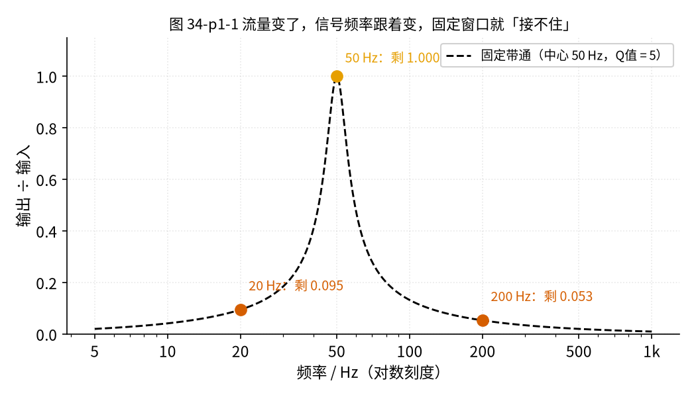
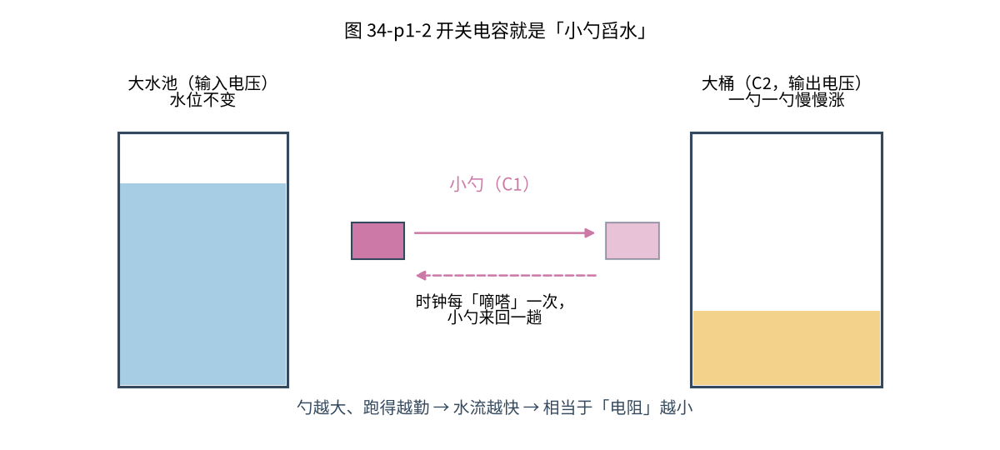
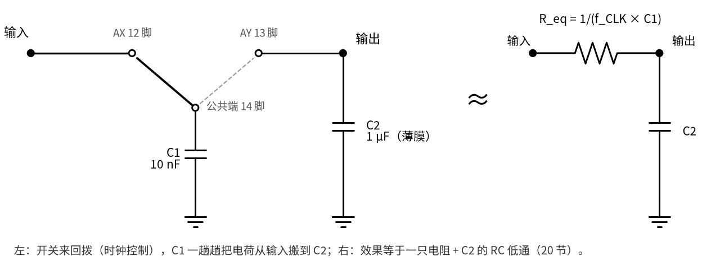
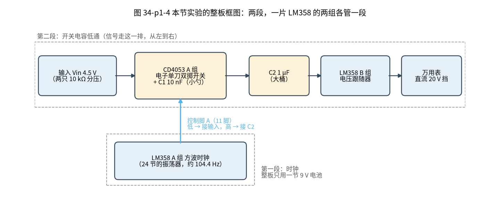

# 34 开关电容滤波与跟踪滤波 · 直觉篇

[上一页：33 带通与 50 Hz 陷波 · 动手实验篇](../33-bandpass-notch/page4.md) · 本页：直觉篇 · [原理与实现篇](page2.md) · [参数与调试篇](page3.md) · [动手实验篇](page4.md) · [下一页：原理与实现篇](page2.md) · 前置节点：[01 元件速成 · 直觉篇](../01-components-basics/page1.md)、[20 有源滤波 · 直觉篇](../20-active-filter/page1.md)、[24 振荡器 · 直觉篇](../24-oscillator/page1.md)、[33 带通与 50 Hz 陷波 · 直觉篇](../33-bandpass-notch/page1.md)

## 痛点：信号的频率会跑，固定的窗口追不上

[33 带通与 50 Hz 陷波 · 直觉篇](../33-bandpass-notch/page1.md) 里，我们用电阻和电容搭了一个「频率窗口」：只让中心频率附近的一条窄带通过。窗口的位置由 R 和 C 的数值决定，元件一焊上，窗口就钉死了。

可是流量计的信号偏偏会跑。以涡街流量计为例，水流得越快，旋涡脱落得越快，传感器送出的信号频率也越高：流量小时可能只有 20 Hz，流量大时可能到 200 Hz。请看图 34-p1-1，它用代码算了一个中心固定在 50 Hz 的带通，分别输入三个频率的信号。

*图 34-p1-1　中心固定在 50 Hz 的带通（Q = 5），对 20、50、200 Hz 三个信号的输出*

图 34-p1-1 里的带通取 Q = 5（Q 越大窗口越窄，见 [33 带通与 50 Hz 陷波](../33-bandpass-notch/page1.md)）。信号正好是 50 Hz 时，输出是输入的 1.000 倍；信号跑到 20 Hz，只剩 0.095 倍；跑到 200 Hz，只剩 0.053 倍（图上标的也是这三个数）。也就是说，流量一变，有用的信号自己就被窗口挡掉了。

我们想要的是一个**窗口位置可以用旋钮去拧**的滤波器，而且最好这个旋钮不是一排电阻，而是一个**频率**：信号频率是多少，我们就把旋钮拧到多少，窗口跟着信号走。工业上把这种做法叫**跟踪滤波**。这一节要讲的「开关电容」，就是能做出这种旋钮的基础电路。先说清楚本节做到哪一步：动手做的是一个**时间常数 τ 可以用时钟来调的低通**；用同样的原理做成的「跟着信号走的带通」，只在 [参数与调试篇](page3.md) 第五节作为预告介绍。

## 直觉一：用小勺来回舀水，就等于一根「细水管」

回忆 [01 元件速成 · 直觉篇](../01-components-basics/page1.md) 的比喻：电容像一只水桶，电压像水位，电荷像水量。电阻像一根细水管，两边水位差越大，流过的水越多。

现在换一种「运水」的办法：不用水管，用一把小勺子。请看图 34-p1-2。

*图 34-p1-2　小勺 C1 在左边水池和右边大桶 C2 之间来回舀水*

图 34-p1-2 的规则只有两条（下面把「小勺」说成小量杯，意思一样）：

1. 把一只小量杯按进左边的水池（输入），让杯里的水位和水池一样高；
2. 再把量杯按进右边的大桶（输出），杯里的水和桶里的水连在一起，直到两边一样高。注意不是把杯子倒空，而是「两边水位相平」，这正对应电容 C1 和 C2 并在一起、电压变得相等。

来回一趟算一次。每一趟搬过去的水量，正比于**两边的水位差**乘以**勺子的大小**。如果每秒来回很多趟，平均下来就形成一股稳定的「水流」，水位差越大，水流越大。这和一根水管的规律完全一样！

所以，**一把来回舀水的小勺，看起来就像一根水管**。而且这根「水管」有多粗，是可以调的：

- 勺子越大，每趟搬得越多，水管越粗（电阻越小）；
- 每秒来回的趟数越多，水流越大，水管也越粗（电阻越小）。

后一条最关键：**不用换任何元件，只要改变来回的快慢，「电阻」就变了**。来回的快慢由一个方波控制，这个方波叫**时钟**，它每秒的周期数叫**时钟频率** $f_{CLK}$ 。

## 直觉二：开关 + 小电容，等于一个电阻

把比喻换回电路：小勺是一只小电容 C1，「伸进左边」「伸进右边」由一只单刀双掷开关完成，开关由时钟来回扳动。请看图 34-p1-3。

*图 34-p1-3　开关加小电容 C1 等效于一个电阻，再和大电容 C2 组成低通*

图 34-p1-3 左边是真正的电路：开关先把 C1 接到输入，再接到输出，周而复始；右边是它的「等效」：一只电阻 $R_{eq}$ 。[原理与实现篇](page2.md) 会只用「电荷 = 电容 × 电压」推出它的大小：

$$R_{eq} = \frac{1}{f_{CLK} C_1}$$

中文意思：时钟越快、小电容越大，等效电阻越小。

**先猜一猜**：假如把时钟调快一倍，开关每秒来回扳的次数加倍，这个滤波器会

- A. 反应更快（输出更快追上输入）
- B. 反应更慢
- C. 不变

很多人会选 B，理由是「开关扳得越勤，越像在路上设卡，水被拦住了」。先写下你的选择和理由，再往下读。

答案

选 A。时钟加倍，每秒舀的趟数加倍，「水管」变粗，等效电阻减半，下面马上要讲的时间常数 τ 也减半。按本节的参数，τ 从约 0.958 s 变成约 0.479 s。反过来，时钟减半，τ 加倍，这就是 [动手实验篇](page4.md) 第 6 步要用秒表验证的事。

等效电阻再和大电容 C2 连起来，就是 [20 有源滤波 · 直觉篇](../20-active-filter/page1.md) 学过的 RC 低通，它的时间常数是 $\tau = R_{eq} C_2$ 。把上式代进去：

$$\tau = \frac{C_2}{f_{CLK} C_1}$$

中文意思：**τ 和时钟频率成反比**。这就是那个旋钮：拧时钟，τ 就跟着变，低通的截止频率 $f_c = 1/(2\pi\tau)$ 也跟着变，电阻电容一个都不用换。本节的参数下，时钟 104.4 Hz 时截止频率约 0.166 Hz。这个截止频率很低，所以本节的低通适合把慢慢变化的直流电压「抹平」，不是用来分出几十赫兹的信号。

本节的实验会用 C1 = 10 nF、C2 = 1 µF，时钟用 [24 振荡器 · 直觉篇](../24-oscillator/page1.md) 里那个 LM358 方波振荡器，频率约 104.4 Hz。代入算得 τ 约 0.96 s，慢到可以用万用表和手机秒表直接看着它变。

**再算一算**：时钟减半到约 52.44 Hz 时，电压升到终值的 63% 要多长时间？先写下你的数字，[动手实验篇](page4.md) 会用秒表来检验。

答案

时钟减半，τ 加倍，约 1.92 s，截止频率降到约 0.083 Hz。ngspice 仿真给出的 63% 时间分别是 0.962 s（104.4 Hz）和 1.905 s（52.44 Hz），比值约 1.98。

## 直觉三：便宜是有代价的

开关电容不是免费的午餐，有两个代价要先记住，[原理与实现篇](page2.md) 和 [参数与调试篇](page3.md) 会详细讲：

1. **输出是一级一级的台阶**：小勺每趟才倒一次，大桶的水位是一跳一跳上升的，不是平滑上升。C2 比 C1 大得越多，每一级台阶越小。
2. **混叠**：开关只在时钟节拍上「看」输入。凡是比时钟频率的一半还快的成分，都会被看错，冒充成慢信号；不只是比时钟快的才会出错，95 Hz 比 100 Hz 的时钟慢，也会被看成 5 Hz。所以前面要加一个普通的 RC 低通，把这些成分先挡掉。

## 电路长什么样

本节动手实验分两段搭，请看图 34-p1-4：

*图 34-p1-4　整板框图：LM358 A 组当时钟，去扳 CD4053 的开关；信号从 Vin 经开关和 C1、C2、LM358 B 组跟随器到万用表*

- **第一段**（图 34-p1-4 下方的虚线框）：一片 LM358 的 A 组接成 [24 振荡器](../24-oscillator/page1.md) 的方波振荡器，当时钟；
- **第二段**（图 34-p1-4 上方一排，从左到右）：一片 CD4053 模拟开关当「小勺的手」，C1 = 10 nF 当小勺，C2 = 1 µF 当大桶，LM358 的 B 组接成 [12 电压跟随器](../12-voltage-follower/page1.md)，把 C2 的电压原样送给万用表，不让表去「喝」桶里的水。

图 34-p1-4 里天蓝色的竖箭头就是时钟线：它接到 CD4053 的 11 脚（控制脚 A），低电平时开关接输入，高电平时开关接 C2。整板只用一节 9 V 电池。CD4053 是第一次出现的芯片，[原理与实现篇](page2.md) 第二节会先给它的引脚图。

## 一句话总结

开关加小电容，按时钟来回搬电荷，就等效于一个阻值 $1/(f_{CLK} C_1)$ 的电阻；和大电容组成的低通，τ 与时钟频率成反比，拧时钟就能移动滤波器，这是跟踪滤波的基础。
