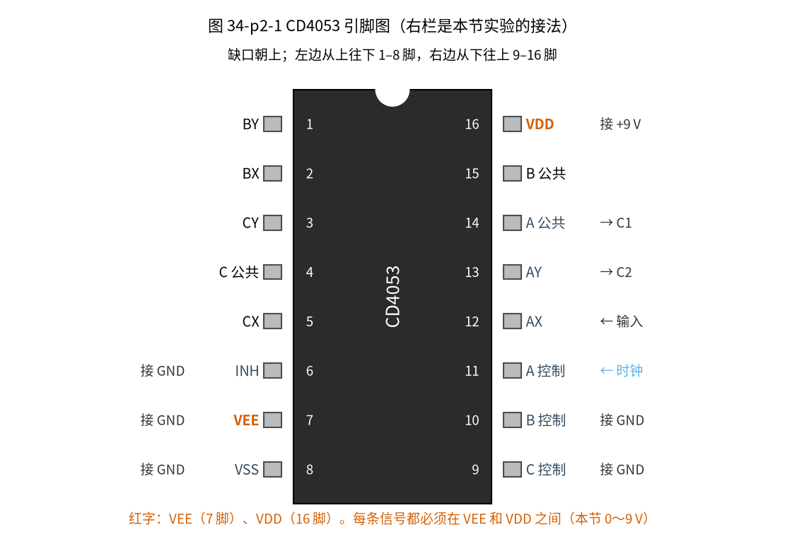
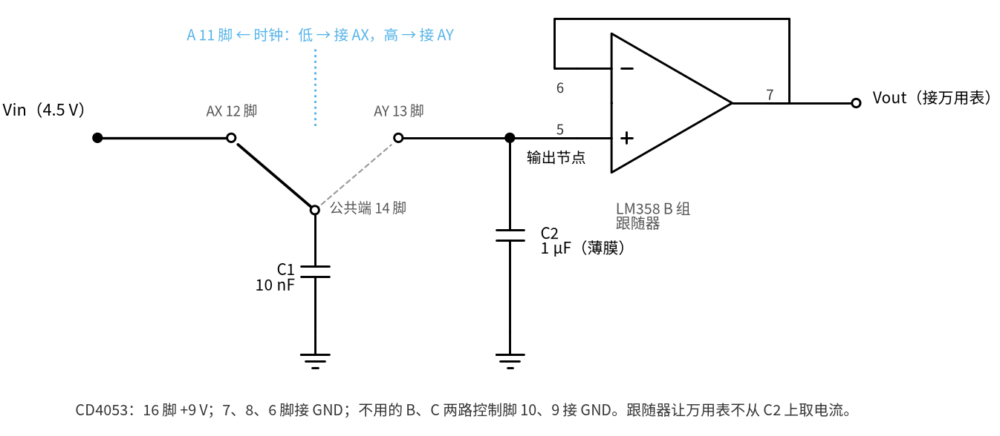
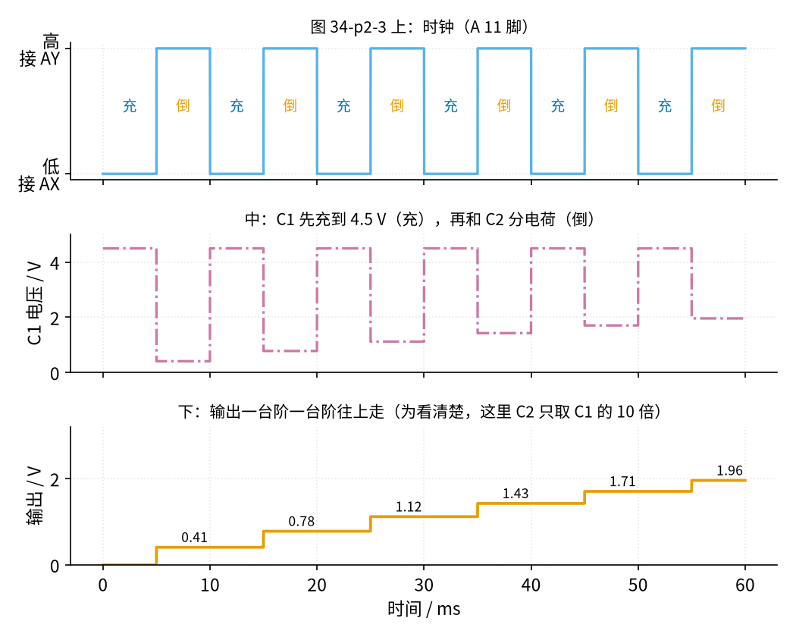
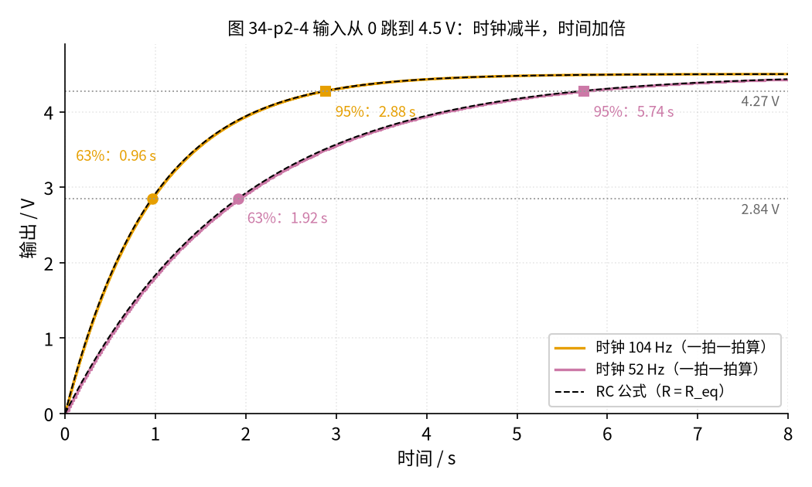
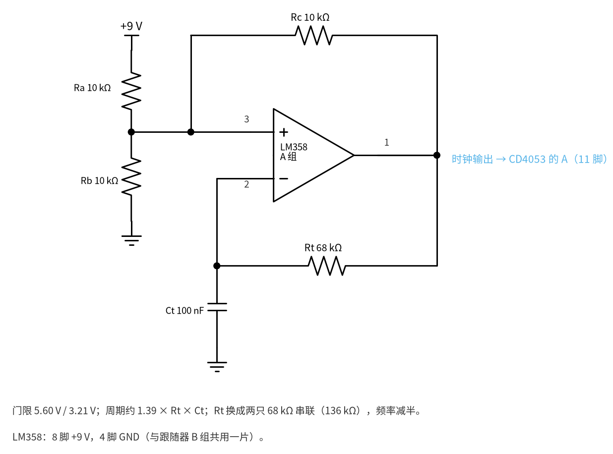
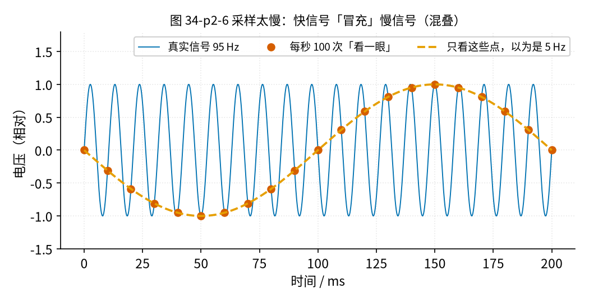

# 34 开关电容滤波与跟踪滤波 · 原理与实现篇

[上一页：直觉篇](page1.md) · [直觉篇](page1.md) · 本页：原理与实现篇 · [参数与调试篇](page3.md) · [动手实验篇](page4.md) · [下一页：参数与调试篇](page3.md) · 前置节点：[01 元件速成 · 原理与实现篇](../01-components-basics/page2.md)、[20 有源滤波 · 原理与实现篇](../20-active-filter/page2.md)、[24 振荡器 · 原理与实现篇](../24-oscillator/page2.md)

## 这一页要解决的问题

[直觉篇](page1.md) 用「小勺舀水」说明了：开关来回扳动一只小电容，看起来就像一只电阻。这一页按「一次只加一个新东西」的顺序把它做成真电路：

1. 只用「电荷 = 电容 × 电压」推出等效电阻 $R_{eq}$ ；
2. 认识新芯片 CD4053（模拟开关）；
3. 把开关、C1、C2 拼成低通，一拍一拍地算输出；
4. 给开关配一个时钟（回顾 [24 振荡器](../24-oscillator/page2.md) 的方波振荡器）；
5. 认识开关电容的「看错」问题：混叠。

本页的主线把开关当成**理想开关**：接通时电阻为零，断开时电阻无穷大。真实开关的导通电阻放到 [参数与调试篇](page3.md) 第三节再算。

## 一、等效电阻：只用「电荷 = 电容 × 电压」

[01 元件速成 · 原理与实现篇](../01-components-basics/page2.md) 讲过电容的定义 $q = C V$ ：电容 $C$ 两端电压为 $V$ 时，里面存着电荷 $q$ 。本节一律用小写 $q$ 表示电荷，大写 Q 留给 [33 节](../33-bandpass-notch/page2.md) 的「Q值」。

设开关左边的输入端电压是 $V_1$ ，右边的输出端（C2 上）电压是 $V_2$ 。C1 一端接地，另一端接开关的刀片，开关按时钟把它在左右两端之间来回切换（接法见下文图 34-p2-2）。一步一步看：

1. 开关拨到左边：C1 充到 $V_1$ ，存电荷 $C_1 V_1$ ；
2. 开关拨到右边：C1 变成 $V_2$ ，存电荷 $C_1 V_2$ ；
3. 一来一回，从左边搬到右边的电荷是两者之差： $\Delta q = C_1 (V_1 - V_2)$ ；
4. 每秒来回 $f_{CLK}$ 次，每秒搬过去的电荷就是 $f_{CLK} C_1 (V_1 - V_2)$ 。「每秒流过的电荷」正是电流的定义，所以平均电流 $I = f_{CLK} C_1 (V_1 - V_2)$ ；
5. 欧姆定律说电阻 = 电压差 ÷ 电流，于是

$$R_{eq} = \frac{V_1 - V_2}{I} = \frac{1}{f_{CLK} C_1}$$

中文意思：时钟越快、小电容越大，「电阻」越小。

两个例子，注意它们用的 C1 不同：

- C1 = 1 nF、 $f_{CLK}$ = 10 kHz： $R_{eq} = 1/(10^{4} \times 10^{-9})$ = 100 kΩ；
- 本节实验用的 C1 = 10 nF、 $f_{CLK}$ = 104.4 Hz： $R_{eq} = 1/(104.4 \times 10^{-8}) \approx$ 957.9 kΩ，接近 1 MΩ。

## 二、最小补充：CD4053 模拟开关

上面的「开关」要每秒扳一百次，手扳不动，要用芯片。**CD4053** 是一片 16 脚的 CMOS 芯片，里面有三只「电子单刀双掷开关」（A、B、C 三组），每只开关的扳向由一个控制脚的电平决定。本节只用 A 组。请看图 34-p2-1。



*图 34-p2-1　CD4053 的引脚：本节只用 A 组，其余控制脚接地*

按图 34-p2-1，要记住的只有这几只脚（TI 数据手册见文末参考资料）：

| 脚号 | 名字 | 本节怎么接 |
|---|---|---|
| 16 | VDD（正电源） | +9 V，并就近接一只 100 nF 到地（电源旁路） |
| 8 | VSS（地） | GND |
| 7 | VEE（模拟负电源） | 单电源时接 GND，**不能悬空** |
| 6 | INH（禁止） | GND；接高电平会把三组开关全部断开 |
| 11 | A（A 组控制） | 接时钟 |
| 14 | A 组公共端 | 接 C1 |
| 12 | AX | A 为低电平时，14 脚接到这里 |
| 13 | AY | A 为高电平时，14 脚接到这里 |
| 10、9 | B、C 控制 | 不用，接 GND，**不能悬空** |

三条使用规则：

1. **信号不能超出电源**：开关上任何一只脚的电压都要在 VEE（这里是 0 V）和 VDD（这里是 9 V）之间。本节的信号在 0～4.5 V，满足。
2. **CMOS 输入不能悬空**：控制脚和 INH 悬空时，手一靠近就会乱跳，开关乱切。
3. **控制脚的「高」要够高**：手册规定 VDD = 10 V 时，控制脚至少 7 V 才保证被认作高电平（VDD = 5 V 时至少 3.5 V）。第五节会核对我们的时钟够不够。

## 三、拼成低通：每拍「差距乘 100/101」

现在把开关、C1、C2 拼起来。请看图 34-p2-2。



*图 34-p2-2　开关电容低通：AX 接输入，14 脚接 C1，AY 接 C2，C2 后接跟随器*

图 34-p2-2 的接法：输入 $V_{in}$ 接 AX（12 脚）；公共端（14 脚）接 C1 到地；AY（13 脚）接 C2 到地，C2 的电压就是输出 $V_{out}$ ，再经 LM358 的 B 组跟随器送给万用表。跟随器的作用见 [12 电压跟随器](../12-voltage-follower/page2.md)：它几乎不从 C2 取电流，表就不会「喝掉」桶里的水。

时钟每个周期分两拍：

- **时钟低（A = 0）**：14 脚接 AX，C1 充到 $V_{in}$ ；
- **时钟高（A = 1）**：14 脚接 AY，C1 和 C2 并在一起，电荷重新分配。

第二拍是关键。并联前 C1 有 $C_1 V_{in}$ ，C2 有 $C_2 V_{out}$ ；并联后两只电容电压相同，设为 $V_{out}'$ 。电荷不会凭空消失，总电荷不变：

$$V_{out}' = \frac{C_1 V_{in} + C_2 V_{out}}{C_1 + C_2}$$

中文意思：新电压是 $V_{in}$ 和旧 $V_{out}$ 的「加权平均」，C2 越大，旧电压的分量越重。

两边同时用 $V_{in}$ 去减。把左边的 $V_{in}$ 写成 $(C_1 + C_2)V_{in}/(C_1 + C_2)$ ，和右边通分相减， $C_1 V_{in}$ 正好抵消，剩下 $C_2 V_{in} - C_2 V_{out}$ ，得到

$$V_{in} - V_{out}' = \frac{C_2}{C_1 + C_2}(V_{in} - V_{out})$$

中文意思：每过一拍，输出离终点的差距都乘以同一个数 $C_2/(C_1 + C_2)$ ，**差距按固定比例缩小**。C1 = 10 nF、C2 = 1 µF 时这个数是 100/101。

为了看清楚，先用一组夸张的数：C2 只有 C1 的 10 倍，每拍差距乘 10/11。请看图 34-p2-3。



*图 34-p2-3　两拍时钟与输出台阶：C2 取 C1 的 10 倍时，每拍输出跳一级*

图 34-p2-3 里输入是 4.5 V，输出从 0 开始：第一拍后，差距从 4.5 V 缩小到 4.5 × 10/11 ≈ 4.09 V，所以输出 = 4.5 − 4.09 ≈ 0.41 V；之后依次是 0.78、1.12、1.43、1.71、1.96 V。台阶越来越矮，因为差距越来越小。

换回 100/101：

- 第一拍只抬高 4.5 V × 1/101 ≈ 44.6 mV；
- 差距剩下 37%（也就是升到 63%）要 100.5 拍；
- 差距剩下 5%（升到 95%）要 301.1 拍。

拍数是这样算的：差距每拍乘 100/101，乘 $n$ 拍后剩 $(100/101)^n$ 。要它等于 0.368，两边取自然对数（计算器上的 ln 键，24 节用过）：

$$n = \frac{\ln 0.368}{\ln(100/101)} \approx 100.5$$

中文意思：剩下的比例取对数，除以每拍比例的对数，就是要走的拍数；把 0.368 换成 0.05，就得到 301.1 拍。代码里用 `math.log` 算的就是 ln。

你可以用计算器验证：100/101 连乘 101 次约等于 0.366，差距只剩 37% 左右。如果把开关电容直接看成电阻 $R_{eq}$ ，RC 低通给出的估计是 100 拍和 300 拍，只差 0.5%，所以在 C2 远大于 C1 时，**「开关 + C1 等效于电阻」这个说法非常准**。

拍数除以时钟频率就是时间。请看图 34-p2-4。



*图 34-p2-4　输入从 0 跳到 4.5 V 后的输出：两种时钟频率*

图 34-p2-4 中，时钟 104.4 Hz 时，63%（2.84 V）在 0.962 s、95%（4.27 V）在 2.884 s，按 $\tau = C_2/(f_{CLK} C_1)$ 估算 τ 是 0.958 s。图里另一条线是时钟减半到 52.44 Hz。**先预测**：这条线到 63% 和 95% 各要多少秒？写下来再打开答案。

<details><summary>答案</summary>

拍数不变（100.5 拍和 301.1 拍），每拍变长一倍，所以两个时刻变成 100.5/52.44 ≈ 1.916 s 和 301.1/52.44 ≈ 5.741 s，几乎正好加倍；τ 估算 1.907 s。

</details>

```python
# 一拍一拍地算开关电容低通（C1 = 10 nF、C2 = 1 µF、输入 4.5 V）
C1, C2, VIN = 10e-9, 1e-6, 4.5
for f in (104.4, 52.44):  # 两种时钟频率
    v, n = 0.0, 0  # 输出从 0 开始，n 数拍数
    while v < 0.632 * VIN:  # 一直算到 63%
        v = (C1 * VIN + C2 * v) / (C1 + C2)  # 电荷守恒：加权平均
        n += 1
    print(f"时钟 {f} Hz：第 {n} 拍到 63%，约 {n / f:.3f} s；RC 估算 τ = {C2 / (f * C1):.3f} s")
```

运行结果：两种时钟都在第 101 拍越过 63%（因为每拍比例只由 C2/C1 决定，和时钟无关），对应 0.967 s 和 1.926 s（整拍数比 100.5 拍略多一点点）。

## 四、给开关配时钟：回顾 24 节的方波振荡器

控制脚 A 需要一个方波。不用新芯片，直接用 [24 振荡器 · 原理与实现篇](../24-oscillator/page2.md) 第五节的弛张振荡器，用同一片 LM358 的 A 组。请看图 34-p2-5。



*图 34-p2-5　LM358 A 组接成的弛张振荡器，输出接 CD4053 的 11 脚*

图 34-p2-5 的工作过程和 24 节一样：输出经 Rt 给 Ct 充放电，Ct 电压接反相端；Ra、Rb、Rc 三只 10 kΩ 在同相端设出上下两个门限。Ct 充到上门限，输出翻低；放到下门限，输出翻高，周而复始。

和 24 节相比有一处不同：LM358 的输出到不了电源两端。ngspice 用 TI 的 LM358B 模型仿真，9 V 供电时高电平 7.79 V、低电平 0.64 V。门限要按这两个值重算：同相端的电压 = 分压点 4.5 V 经 Ra、Rb 并联（5 kΩ）和 Rc（10 kΩ）与输出加权（这是 [01 元件基础](../01-components-basics/page2.md) 第七节的戴维南等效），

- 上门限 = 4.5 V × 10/15 + 7.79 V × 5/15 ≈ 5.597 V；
- 下门限 = 4.5 V × 10/15 + 0.64 V × 5/15 ≈ 3.213 V。

还有一个更好记的算法：Ra 接 +9 V、Rb 接 0 V、Rc 接输出，三只电阻一样大，同相端就是三个电压的平均值。上门限 = (9 + 0 + 7.79)/3 ≈ 5.597 V，下门限 = (9 + 0 + 0.64)/3 ≈ 3.213 V，和上面一样。

接下来按 24 节「差距缩小几倍」的办法逐段算。这里的 Rt、Ct 就是 24 节弛张振荡器里的 R、C。

- 高电平段：输出 7.79 V 往上拉 Ct，从下门限 3.213 V 出发，差距 7.79 − 3.213 = 4.577 V；到上门限时差距剩 7.79 − 5.597 = 2.193 V。用时 $t_H = R_t C_t \ln(4.577/2.193) \approx 0.736 R_t C_t$ 。
- 低电平段：输出 0.64 V 往下拉，差距从 5.597 − 0.64 = 4.957 V 缩到 3.213 − 0.64 = 2.573 V，用时 $t_L = R_t C_t \ln(4.957/2.573) \approx 0.656 R_t C_t$ 。

两段相加，周期 $T \approx 1.391 R_t C_t$ ，高电平占 0.736/1.391 ≈ 52.9%。高电平离 9 V 远、低电平离 0 V 近，所以两段不一样长。Rt = 68 kΩ、Ct = 100 nF 时脚本算出 105.7 Hz，ngspice 仿真 104.4 Hz，低约 1.2%（24 节满幅的理想值是 106.1 Hz）。原因和 [24 振荡器](../24-oscillator/page4.md) 动手实验篇说的一样：公式没算 LM358 输出翻转所需的时间（压摆率）。Rt 换成两只 68 kΩ 串联，周期加倍，ngspice 给出 52.44 Hz，比 104.4 Hz 的一半 52.2 Hz 略高：翻转用的那一小段时间是固定的，周期变长后它占的比例变小，所以频率比只有 1.991，不到 2。本节的计算一律用 ngspice 的两个频率。

**高电平够不够高？** CD4053 在 VDD = 10 V 时要求控制脚至少 7 V，我们的高电平 7.79 V，多出 0.79 V；按「VDD 的 70%」估算 9 V 时的要求是 6.30 V，余量更大。低电平也要查：数据手册给的低电平上限约为 VDD 的 30%（[TI CD4053B 数据手册](https://www.ti.com/lit/ds/symlink/cd4053b.pdf)），9 V 时约 2.7 V，我们的 0.64 V 远低于它。顺便说一句：如果整板改用 5 V，LM358 高电平只有约 3.79 V，而 5 V 时要求 3.5 V，余量只剩 0.29 V，很容易乱切。这就是本节用 9 V 电池而不用 5 V 的原因。

**万用表怎么检查时钟？** 直流挡读到的是方波的平均值。高电平约占周期的 52.9%，平均约 4.42 V（ngspice 4.47 V）。读到 4.4 V 左右就说明在振；读到接近 7.8 V 或 0.6 V，说明停在一边不动了。

## 五、最小补充：混叠——采样太慢，快信号会冒充慢信号

开关电容只在每个时钟周期「看」一次输入，这叫**采样**，时钟频率就是**采样频率**。只在固定时刻看一眼，会有一个陷阱。

先想电影里的马车轮子：摄像机每秒拍 24 张，如果轮子每秒正好转 23 圈，相邻两张照片之间轮子转了 23/24 圈，看上去像是**倒退**了 1/24 圈，于是你在银幕上看到轮子每秒倒转 1 圈。这就是「车轮倒转」。

电路里也一样。请看图 34-p2-6。



*图 34-p2-6　用 100 Hz 采样 95 Hz 正弦：采样点连起来像 5 Hz*

图 34-p2-6 中，蓝色细线是真正的 95 Hz 正弦，朱红色圆点是每 1/100 秒采一次的点。只看这些圆点，它们连成了橙色虚线那条慢慢变化的 5 Hz 曲线：快信号冒充成了慢信号。这就叫**混叠**。规律是：**找离信号最近的那个采样频率整数倍（0 倍、1 倍、2 倍……），信号和它差多少赫兹，就冒充成多少赫兹**。低于采样频率一半的成分，离它最近的是 0 倍，所以看到的还是它自己，不会被看错；高于一半的都会被「折」到低频。脚本算出：100 Hz 采样时，95 Hz 和 105 Hz 都像 5 Hz，98 Hz 像 2 Hz，60 Hz 像 40 Hz，200 Hz 正好是 2 倍，像 0 Hz（一条不动的直线），而 40 Hz 还是 40 Hz；换成 20 Hz 采样，50 Hz 离 2 倍的 40 Hz 最近，像 10 Hz。

注意这里的「采样」是「每隔一段时间看一眼」，和 [22 过载保护](../22-overload-protection/page2.md) 里串在电路里测电流的「采样电阻」不是一回事，只是用了同一个词。

混叠一旦发生，后面的电路分不出真假 5 Hz，只能在采样之前就把靠近时钟的成分挡掉。[参数与调试篇](page3.md) 第四节会在开关前加一个普通 RC 低通来做这件事。

## 六、例题（逐步放手）

**例 1（完整示范）**：C1 = 10 nF、C2 = 1 µF、时钟 104.4 Hz，输入从 0 跳到 4.5 V，万用表多久读到 2.84 V？

1. 每拍差距乘 $C_2/(C_1 + C_2)$ = 100/101；
2. 2.84 V 是 4.5 V 的 63%，差距剩 37%，要 ln 0.368 ÷ ln(100/101) ≈ 100.47 拍（约 100.5 拍）；
3. 每拍 1/104.4 s，所以时间 = 100.47 ÷ 104.4 ≈ 0.962 s。

**例 2（你来做最后一步）**：时钟仍是 104.4 Hz，C1 仍是 10 nF，C2 换成 2.2 µF，其他不变。前两步替你做好：每拍差距乘 $C_2/(C_1 + C_2)$ = 220/221；到 63% 要 ln 0.368 ÷ ln(220/221) 拍。请算出拍数和时间。

<details><summary>答案</summary>

拍数 ≈ 220.4 拍，时间 = 220.4 ÷ 104.4 ≈ 2.11 s。C2 变成 2.2 倍，拍数和时间也差不多变成 2.2 倍（220.4 ÷ 100.47 ≈ 2.19），和 $\tau = C_2/(f_{CLK} C_1)$ 的预测一致。

</details>

**例 3（全部自己来）**：C1 = 4.7 nF、时钟 1 kHz、C2 = 1 µF，输入仍从 0 跳到 4.5 V。求 $R_{eq}$ 、τ 和第一级台阶的高度，并说说台阶比**例 1** 的大还是小。

<details><summary>答案</summary>

$R_{eq} = 1/(1000 \times 4.7 \times 10^{-9}) \approx$ 212.8 kΩ， $\tau = R_{eq} C_2 \approx$ 0.213 s。第一级台阶 = 4.5 V × 4.7/(4.7 + 1000) ≈ 21 mV（脚本 21.1 mV），比**例 1** 的 44.6 mV 小一半多，因为 C1 小了；可 τ 反而更短，因为时钟快了将近 10 倍。

</details>

## 本页小结

- 开关电容的等效电阻 $R_{eq} = 1/(f_{CLK} C_1)$ ，只用「 $q = CV$ 」和「电流 = 每秒流过的电荷」推出；
- CD4053 的 A 组是一只电子单刀双掷开关：A 低接 AX（12 脚），A 高接 AY（13 脚）；VEE、INH、不用的控制脚都接地，信号不超出电源；
- 开关电容低通每拍差距乘 $C_2/(C_1 + C_2)$ ，C2 远大于 C1 时就是 τ = $C_2/(f_{CLK} C_1)$ 的 RC 低通，时钟减半 τ 加倍；
- 时钟用 24 节的 LM358 弛张振荡器，9 V 供电时 104.4 Hz，高电平 7.79 V 足以驱动 CD4053；
- 采样会混叠：靠近时钟频率的成分会冒充成低频，必须在采样前挡掉。

## 参考资料

- TI CD4053B 数据手册（引脚、导通电阻、控制端电平）：https://www.ti.com/lit/ds/symlink/cd4053b.pdf
- TI LM358B 数据手册（输出摆幅）：https://www.ti.com/lit/ds/symlink/lm358b.pdf
