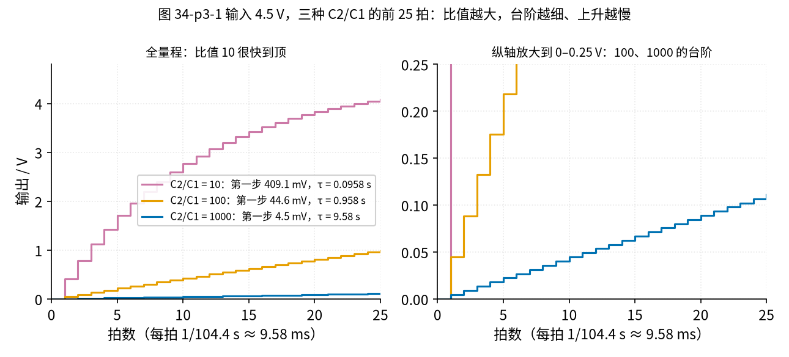
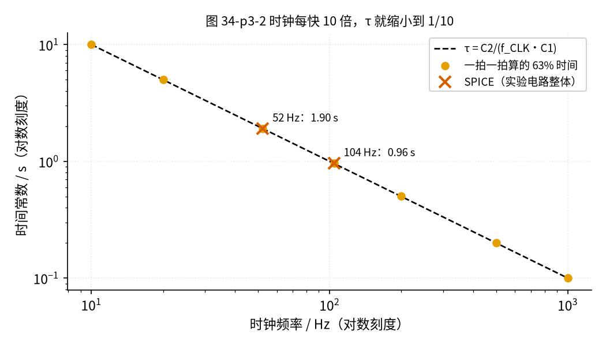
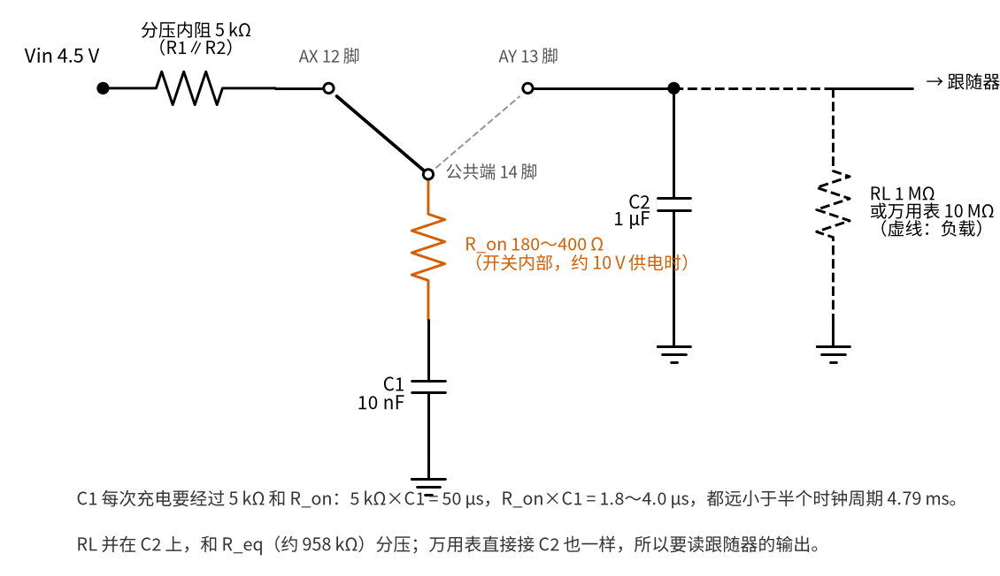
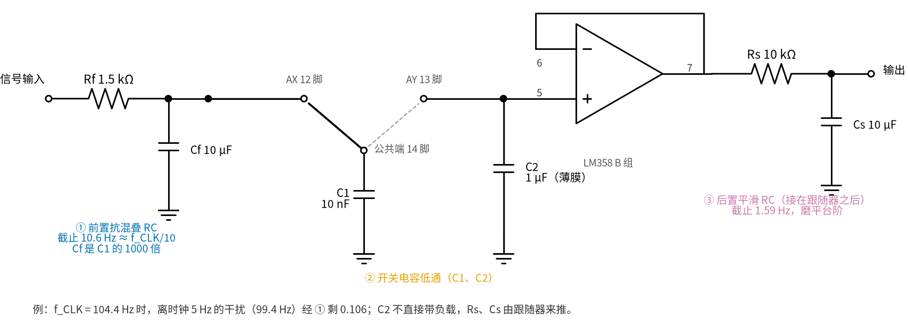
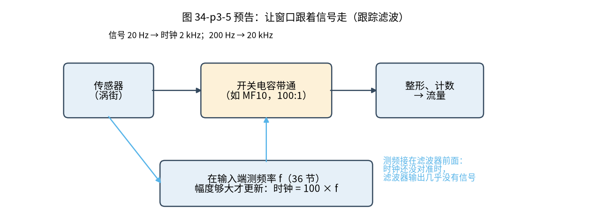

# 34 开关电容滤波与跟踪滤波 · 参数与调试篇

[上一页：原理与实现篇](page2.md) · [直觉篇](page1.md) · [原理与实现篇](page2.md) · 本页：参数与调试篇 · [动手实验篇](page4.md) · [下一页：动手实验篇](page4.md) · 前置节点：[20 有源滤波 · 参数与调试篇](../20-active-filter/page3.md)、[24 振荡器 · 参数与调试篇](../24-oscillator/page3.md)

## 这一页解决什么问题

[原理与实现篇](page2.md) 把开关当成理想开关，得到 τ = $C_2/(f_{CLK} C_1)$ 。这一页回答四个实际问题：台阶有多大、时钟能调多宽、真实开关的电阻碍不碍事、混叠怎么防；最后预告「跟踪滤波」在工业上怎么做。

## 一、台阶：C2 和 C1 的比值是一对矛盾

[原理与实现篇](page2.md) 第三节说过，输出是一级一级跳上去的，第一级台阶 = 输入 × $C_1/(C_1 + C_2)$ 。请看图 34-p3-1。

*图 34-p3-1　输入 4.5 V 时三种 C2/C1 比值的前 25 拍：横轴是拍数，左图全量程，右图把纵轴放大*

图 34-p3-1 的三条线用的是同一个时钟（104.4 Hz，每拍约 9.58 ms）、同一只 C1 = 10 nF。左图里红紫色（比值 10）的台阶又高又陡，25 拍就升到约 4 V；橙色（100）25 拍才到 1 V 左右，蓝色（1000）几乎贴在底上。右图把纵轴放大到 0～0.25 V，才看得清橙色每拍跳几十毫伏，蓝色每拍只跳几毫伏。三种比值的数字如下（脚本 code/34_sim.py 算出）：

| C2/C1 | 第一级台阶 | 到 63% 要几拍 | 104.4 Hz 时钟下的 τ |
|---|---|---|---|
| 10 | 409.1 mV | 10.5 | 0.096 s |
| 100 | 44.6 mV | 100.5 | 0.958 s |
| 1000 | 4.5 mV | 1000.2 | 9.58 s |

矛盾在于：比值越大，台阶越细、输出越平滑，但同一个时钟下 τ 也越长（表的最后一列，比值每大 10 倍，τ 就长 10 倍）。想要「又平滑又快」，只能提高时钟，让每拍更短。本节实验取 100。表中 44.6 mV 只是**第一拍**的台阶：之后每拍的台阶 = 当时剩下的差距 ÷ 101，越来越矮，升到 95% 附近时只剩 225 mV ÷ 101 ≈ 2.2 mV。而且时钟每秒走 104 拍，万用表每秒只刷新 2～3 次，一次刷新之间已经走了几十拍，所以表上看到的是平滑上升的读数，看不出台阶；台阶要用示波器才能看见。

## 二、时钟能调多宽：τ 与时钟成反比

请看图 34-p3-2。

*图 34-p3-2　τ 随时钟频率变化：直线是公式，叉号是 ngspice 仿真*

图 34-p3-2 的两根轴都按「每格乘 10」画，τ 与 $f_{CLK}$ 成反比，所以是一条往下斜的直线：时钟 10 Hz 时 τ = 10 s，100 Hz 时 1 s，1000 Hz 时 0.1 s。叉号是 ngspice 对 104.4 Hz 和 52.44 Hz 两个实验点的仿真，正好落在线上。

这条线往两头延长都有边界：

- **时钟太慢**：每拍间隔变长，C2 在两拍之间会经过负载慢慢漏电（见第三节的负载）；每一级台阶持续得更久，看起来更明显，但台阶的**高度不变**（高度只由 C1/(C1 + C2) 和当时的差距决定）；
- **时钟太快**：每半个周期里，C1 必须来得及充满。这取决于开关自己的电阻，见第三节。

## 三、真实开关的导通电阻与负载

真实电路里，C1 充电的路上串着两只「看不见的电阻」，C2 上还可能并着负载。请看图 34-p3-3。

*图 34-p3-3　实际电路：输入分压的 5 kΩ 内阻、开关内部的 R_on 串在 C1 的路上；RL 或万用表的 10 MΩ 并在 C2 上*

对照看：图 34-p3-3 左边，Vin 先经过「分压内阻 5 kΩ」（两只 10 kΩ 并联）到 AX；开关拨到 AX 时，电流再经过朱红色的 R_on 才进入 C1。右边的虚线电阻 RL 接在 C2 和地之间，和 C2 并联；万用表的表笔如果直接夹在 C2 上，也等于在这个位置并了一只 10 MΩ。

**导通电阻 R_on**。CD4053 的开关接通时并不是零电阻。TI 数据手册给出的典型 / 最大值随电源电压变化：

| 电源 VDD | 典型 | 最大 |
|---|---|---|
| 5 V | 470 Ω | 1050 Ω |
| 10 V | 180 Ω | 400 Ω |
| 15 V | 125 Ω | 240 Ω |

注意，常被引用的「125 Ω」只是 15 V 时的典型值。我们用 9 V，按 10 V 那一行估算。

C1 经过 R_on 充电（图 34-p3-3 中间那一竖），本身也是一个小 RC，时间常数 R_on × C1。代入：180 Ω 时 1.8 µs，400 Ω 时 4.0 µs，就算按 5 V 最坏的 1050 Ω 也只有 10.5 µs。而时钟 104.4 Hz 的半个周期是 4.79 ms，是 R_on × C1 的 456～2661 倍。[01 元件基础](../01-components-basics/page2.md) 第二节学过，过 5 个时间常数就基本充满了，所以 **R_on 对本实验没有影响**。ngspice 把 R_on 分别设为 470 Ω 和 1050 Ω，63% 时间都是 0.9619 s，与理想开关相同。

输入分压的内阻（图 34-p3-3 左上，两只 10 kΩ 并联，5 kΩ）同理：5 kΩ × C1 = 50 µs，半周期里有 96 个这样的时间常数，也来得及。

只有把时钟提高到几十 kHz 以上、半周期缩短到几个 µs 时，R_on 才会让 C1 充不满，τ 不再按 $1/f_{CLK}$ 缩短。

**负载**。我们的 $R_{eq}$ 约 957.9 kΩ，是个「很大的电阻」。如果像图 34-p3-3 右边那样在 C2 上直接接一个负载 RL，稳态时就成了 $R_{eq}$ 和 RL 的分压：RL 分到的电压 = 4.5 V × RL/(RL + $R_{eq}$ )。

**先预测**：接 RL = 1 MΩ，时钟 104.4 Hz 时跟随器读多少？时钟减半到 52.44 Hz 时，读数变大还是变小？[动手实验篇](page4.md) 第 7 步要实测这两个数，先写下你的预测。

答案

- 时钟 104.4 Hz：4.5 V × 1/(1 + 0.9579) ≈ 2.298 V（ngspice 2.304 V）；
- 时钟 52.44 Hz： $R_{eq}$ 加倍到 1906.9 kΩ，RL 分到的比例更小，读数降到 1.548 V（ngspice 1.555 V）。

普通数字万用表直流挡的输入电阻约 10 MΩ，直接接在 C2 上也会把读数拉低，并让 τ 变短。所以实验里万用表一律读**跟随器的输出**，跟随器的输入几乎不取电流，C2 的电压原样送出（[12 电压跟随器](../12-voltage-follower/page2.md)）。[动手实验篇](page4.md) 第 7 步会故意接一只 1 MΩ，让你亲眼看到这个效应。

**C2 不要用电解电容**。电解电容有漏电流，相当于在 C2 上并了一个负载，终值达不到输入值，而且时钟越慢误差越大。1 µF 用薄膜电容（代码 105）。

## 四、混叠怎么防：前面挡一挡，后面磨一磨

[原理与实现篇](page2.md) 第五节说过，高于时钟一半的输入成分会冒充成低频。实用电路在开关电容前后各加一个普通 RC 低通。请看图 34-p3-4。

*图 34-p3-4　前置抗混叠 RC、开关电容、后置平滑 RC 三段串联*

图 34-p3-4 的三段分工：

- **① 前置抗混叠 RC（Rf、Cf）**：截止频率取时钟的 1/10 左右。时钟 104.4 Hz 时，理想值是 10.4 Hz，离时钟 5.0 Hz 的干扰（99.4 Hz）被压到原来的 0.104。实际取常见值 Rf = 1.5 kΩ、Cf = 10 µF，截止约 10.6 Hz，99.4 Hz 剩 0.106。Cf 要远大于 C1（这里是 1000 倍）：C1 每拍从 Cf 上取一次电荷，Cf 大，它的电压几乎不被拉动；
- **② 开关电容低通**：做真正的滤波，截止频率随时钟走，104.4 Hz 时钟下约 0.166 Hz；
- **③ 后置平滑 RC（Rs、Cs）**：把时钟引起的小台阶磨平。它必须接在**跟随器后面**：如果直接挂在 C2 上，Rs、Cs 会像上一节的 RL 一样从 C2 分走电荷。取 Rs = 10 kΩ、Cs = 10 µF，截止约 1.59 Hz，104.4 Hz 的台阶只剩约 0.015。

算一笔整体账（脚本算出）：前面说「1 Hz 的有用信号保留 0.995」，那只是第一段前置 RC 的结果；1 Hz 还要过 ② 的 0.166 Hz 低通，整体约 0.16（主要是 ② 的 0.164）。本节的低通本来就是给接近直流的慢信号用的。那个 99.4 Hz 干扰经 ① 剩 0.104，被采样后冒充成 5 Hz，再经 ② 又被压到 0.033，两段相乘约 0.0035。

为什么前置 RC 不能直接代替开关电容？因为它的截止频率是钉死的，而开关电容的截止频率能用时钟拧。前置 RC 只要「远高于有用信号、远低于时钟」就行，要求很宽松。

## 五、预告：跟踪滤波

有了「拧时钟就能移动滤波器」，跟踪滤波就很自然了。请看图 34-p3-5。

*图 34-p3-5　跟踪滤波框图：在滤波器输入端测频率，再把时钟设成信号频率的 100 倍*

图 34-p3-5 的流程是：

1. 在**滤波器的输入端**测出信号的频率 f（频率怎么测见 36 节施密特整形与频率/脉冲计数（即将上线），用施密特整形后数脉冲）；
2. 单片机把时钟设成 100f；
3. 集成开关电容带通滤波器的中心频率 = 时钟 ÷ 100，正好落在 f 上；
4. 流量变了，f 变了，时钟跟着变，窗口一直罩着信号。

为什么要在输入端测，而不在滤波器输出端测？刚上电时时钟还没对准，窗口不在信号上，滤波器的输出几乎没有信号，从那里测不出 f，时钟就永远对不上。从输入端测就没有这个问题。

为什么中心频率正好是「时钟 ÷ 100」？芯片里的带通是用积分器搭的（就是 [14 积分器](../14-integrator/page1.md) 那种电路），每个积分器里的电阻都是开关电容，等效电阻 $R = 1/(f_{CLK} C)$ ，和本节的一样。电阻跟着时钟变小，RC 跟着变短，中心频率 $f_0$ 就和时钟成正比；芯片设计时把片内电容的比值定好，让比例正好是 1/100。

脚本算出：信号 20 Hz 时时钟 2000 Hz，50 Hz 时 5000 Hz，200 Hz 时 20000 Hz。

真正用的芯片是集成开关电容滤波器，以 **MF10**（TI 数据手册见文末参考资料）为例：一片里有两个通用二阶滤波器，可接成带通；第 12 脚接 V+ 时中心频率 = 时钟 ÷ 50，接地（±5 V 供电时的 0 V；单电源供电时接电源中点）时 = 时钟 ÷ 100；这个比值典型误差 ±0.2%、最大 ±0.6%（这是 MF10A 的数字；MF10C 最大 ±1.5%）；供电（V+ 到 V− 的总电压）9～14 V；输出上带着约 10 mV 的时钟残留，要靠后置 RC 磨掉。MF10 的数据手册专门有一节「SAMPLED DATA SYSTEM CONSIDERATIONS」（采样系统的注意事项），讲的就是本页第一节的台阶和第四节的混叠，可以对照阅读。

另一种常见芯片 **MAX7400** 是 8 阶椭圆**低通**（阶数越高，通带外掉得越陡；「椭圆」是一种掉得特别陡、但通带里有小波纹的设计），时钟 ÷ 100 = 截止频率。它不能当跟踪的带通，只能在跟踪电路里做抗混叠或平滑的低通。

跟踪还有一个陷阱：流量为零、信号消失时，测频电路只能测到噪声，时钟跟着噪声乱跑，窗口「追噪声」。所以要加一个条件：**信号幅度超过门限才更新时钟**，门限的做法正是带回差的施密特比较器（[10 电压比较器](../10-voltage-comparator/page1.md) 讲过回差，36 节会用它整形）。这一节先不进实验。

## 六、故障排查表

| 现象 | 原因 | 怎么查 | 怎么改 |
|---|---|---|---|
| 跟随器输出一上电就等于输入，没有慢慢升 | 14 脚直接连到了 12 或 13 脚；或 C1、C2 插错位置 | 断电后用通断挡查第 30、31、32 列之间有没有直接短路 | 按动手实验篇第二阶段的面包板图重插 C1（a30）、C2（a31） |
| 输出一直是 0 V，换跳线也不动 | INH（6 脚）或 VEE（7 脚）悬空；VDD（16 脚）没接 | 直流挡测 6、7、8 脚应为 0 V，16 脚应为 9 V | 第 33、34、35 列下半各接 GND，a28 接 +9 V |
| 输出乱跳，手一靠近就变 | 控制脚 9、10 或 11 悬空；时钟线没插牢 | 测 9、10 脚应为 0 V，11 脚直流挡约 4.4 V | a34、a35 接 GND，重插 j11→a33 |
| 时钟点读数接近 7.8 V 或 0.6 V 不变 | 振荡器没振：Ct 没接、Rt 位置错 | 断电，拔掉时钟线 j11→a33，再接回电池测第 11 列 | 对照动手实验篇第一阶段的面包板图检查 Rt h11–h15、Ct j15、Rc i11–i16 |
| τ 变化的方向和预期相反（时钟加快，反而变慢） | 把 $R_{eq} = 1/(f_{CLK} C_1)$ 记成了 $f_{CLK} C_1$ ，以为时钟越快电阻越大 | 看秒表：时钟减半后，63% 的时间应约加倍 | 回到 [原理与实现篇](page2.md) 第一节，用「每秒搬几次电荷」重推一遍 |
| 时钟减半后 τ 没有加倍 | Rt 没换成两只 68 kΩ 串联：第二只应插 g13–g15，第一只改插 h11–h13 | 秒表重测，同时看时钟点平均值是否仍约 4.4 V | 按测量表第 6 步重插 Rt |
| 终值明显低于 4.5 V | 万用表直接接在 C2 上；C2 是电解电容；RL 忘了拔 | 表笔是否在第 15 列（跟随器输出）；看 C2 的型号 | 改读跟随器；换薄膜电容；断电后拔掉 a21 的 RL |
| τ 和计算值差 10%～20%，但时钟减半仍是两倍关系 | 电容误差：C1、C2 常见 ±10% | 用电容挡测 C1、C2 | 把实测电容填进 [动手实验篇](page4.md) 的 Python 核对 |
| τ 偶尔突然变长，按一下面包板又恢复 | C1 引脚细或弯了，接触时好时坏；C1 一断开，电荷就搬不过去，输出停在原地 | 读数停住时用笔帽轻压 C1（只按，不拔插），看读数是否马上继续走 | C1、C2 引脚剪短、插到底，换一排没被撑大的插孔 |
| 把 C1 换成 100 pF 之后，τ 比算的短，换一排插孔又变 | 开关芯片自己的引脚电容（数据手册：公共端约 9 pF、通道端约 5 pF）加上面包板排间电容，和 C1 并联一起搬电荷；C1 = 10 nF 时可以忽略，100 pF 时就占到约一成 | 断电拔掉 C1，再接回电池，看输出是否仍在慢慢上升（那就是寄生电容在搬） | C1 不要小于 1 nF |
| 输出上有随时钟跳的小毛刺，挪一下导线大小就变 | 时钟线和 C1、C2 的线并排走，相邻导线间的小电容把时钟的跳变「耦合」过去 | 断电，把天蓝色时钟线挪开 1 cm，再接回电池看 | 时钟线从芯片另一侧绕，和信号线交叉时垂直交叉，不要并排 |

表中「τ 和计算值差 10%～20%，但时钟减半仍是两倍关系」那一行说明了开关电容的一个优点：τ 只取决于 **C2 与 C1 的比值**和时钟。集成芯片里两只电容做在同一块硅片上，比值能做得很准，所以集成开关电容滤波器的频率比分立 RC 准得多。

## 七、练习

下面的数字都和正文不同，请自己算，不要回翻。

**练习 1**：C1 = 10 nF、C2 = 0.47 µF，时钟 500 Hz，τ 是多少？

答案

$R_{eq} = 1/(500 \times 10^{-8})$ = 200 kΩ，τ = 200 kΩ × 0.47 µF = 94 ms。

**练习 2**：时钟 104.4 Hz，在 C2 上接一只 2.2 MΩ 负载，跟随器输出的稳态读数是多少？时钟减半到 52.44 Hz 呢？为什么时钟减半后读数更低？

答案

$R_{eq}$ ≈ 957.9 kΩ，与 2.2 MΩ 分压：4.5 V × 2.2/(2.2 + 0.958) ≈ 3.13 V。时钟减半， $R_{eq}$ 加倍到 1906.9 kΩ：4.5 V × 2.2/(2.2 + 1.907) ≈ 2.41 V。 $R_{eq}$ 变大，分到 RL 上的比例更小，所以读数更低。负载电阻比 1 MΩ 大，两种时钟下的读数都比正文的 1 MΩ 高。

**练习 3**：时钟换成 208.8 Hz，输入里混进了一个 200 Hz 的干扰。不加前置 RC 时它会冒充成多少赫兹？前置 RC 的截止频率按「时钟的 1/10」取 20.88 Hz，200 Hz 的干扰还剩多少？

答案

离 200 Hz 最近的时钟整数倍是 1 倍的 208.8 Hz，差 8.8 Hz，所以冒充成约 8.8 Hz。前置 RC 对 200 Hz 的保留比例 = $1/\sqrt{1 + (200/20.88)^2} \approx$ 0.104。和正文 99.4 Hz 的结果几乎一样，这不是巧合：两次都按「时钟的 1/10」取截止，干扰又都紧挨着时钟，干扰频率约是截止频率的 9.5 倍（脚本算出 9.52 和 9.58），所以剩下的比例几乎不随时钟变。

**练习 4（变式）**：跟踪滤波改用 MF10 的 **50:1** 模式（第 12 脚接 V+）。流量增大，信号从 50 Hz 变到 200 Hz，时钟要从多少变到多少？和 100:1 模式比，时钟是高了还是低了？如果这时信号突然消失，会发生什么？

答案

时钟从 2500 Hz 变到 10000 Hz（都是信号频率的 50 倍），只有 100:1 模式的一半，所以时钟低了。信号消失后测频电路只能测到噪声，时钟乱跑，窗口去「追噪声」；要加幅度门限，只有信号够大才更新时钟。

**练习 5（迁移）**：把 [14 积分器](../14-integrator/page1.md) 的输入电阻 R 换成本节的「开关 + C1」。C1 = 10 nF、积分电容 0.1 µF，时钟 104.4 Hz 时积分时间常数 RC 是多少？时钟加倍呢？这样做有什么好处？

答案

$R_{eq} = 1/(104.4 \times 10^{-8}) \approx$ 957.9 kΩ，RC ≈ 957.9 kΩ × 0.1 µF ≈ 95.8 ms。时钟加倍， $R_{eq}$ 减半，RC 减半到约 47.9 ms，积分变快一倍。好处是积分快慢只由时钟和两只电容的比值决定：集成电路里做不出准确的大电阻，却能做出准确的电容比，时钟又可以用晶振做得很准。MF10 这类芯片里的积分器就是这样做的。

## 本页小结

- C2/C1 越大，台阶越细，但同一时钟下 τ 越长；本实验取 100，台阶 44.6 mV；
- τ 与时钟成反比，时钟太快时要考虑 R_on，CD4053 的 R_on 在 5 V 时典型 470 Ω、10 V 时 180 Ω，本实验的时钟下影响可以忽略；
- $R_{eq}$ 接近 1 MΩ，负载会和它分压，所以要用跟随器读数，C2 用薄膜电容；
- 开关电容前加抗混叠 RC、后加平滑 RC；
- 跟踪滤波：测频（见 36 节）→ 时钟 = 100f → MF10 带通跟着信号走；MAX7400 是低通，不是带通。

## 参考资料

- TI CD4053B 数据手册（导通电阻随电源电压的表格）：https://www.ti.com/lit/ds/symlink/cd4053b.pdf
- TI MF10-N 数据手册（50:1 / 100:1、时钟残留、SAMPLED DATA SYSTEM CONSIDERATIONS）：https://www.ti.com/lit/ds/symlink/mf10-n.pdf
- ADI MAX7400 产品页（8 阶椭圆低通，100:1，1 Hz～10 kHz）：https://www.analog.com/en/products/max7400.html
