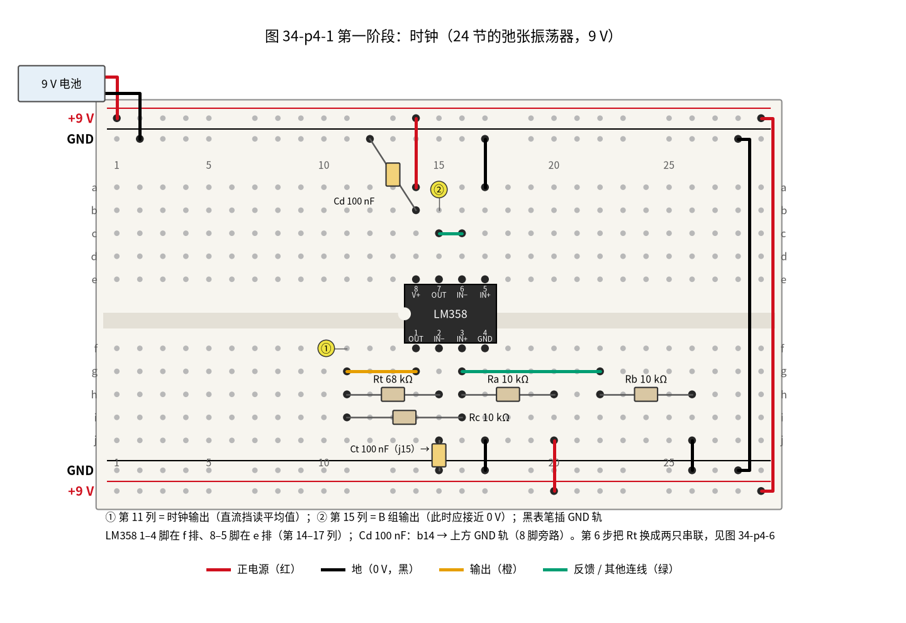
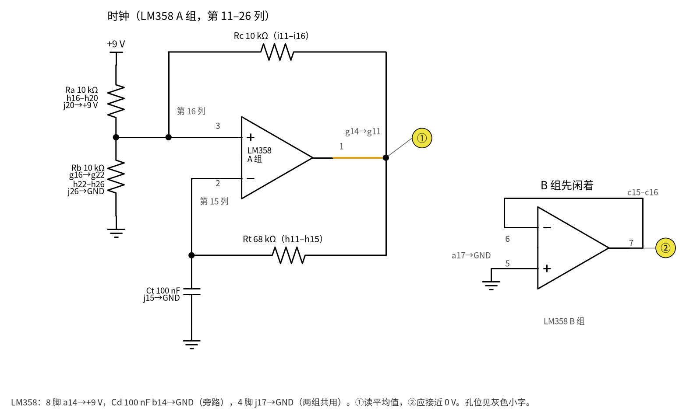
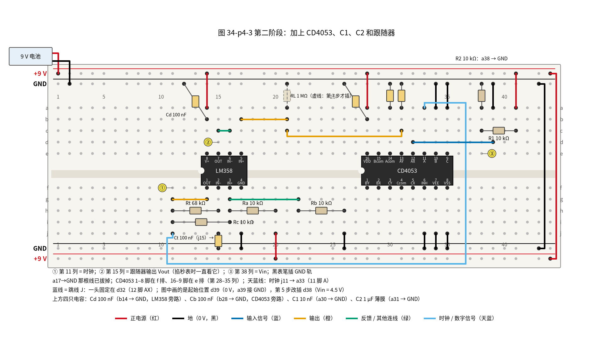
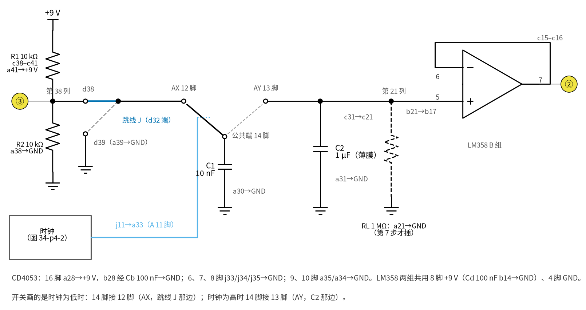
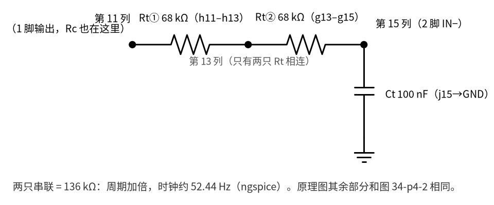
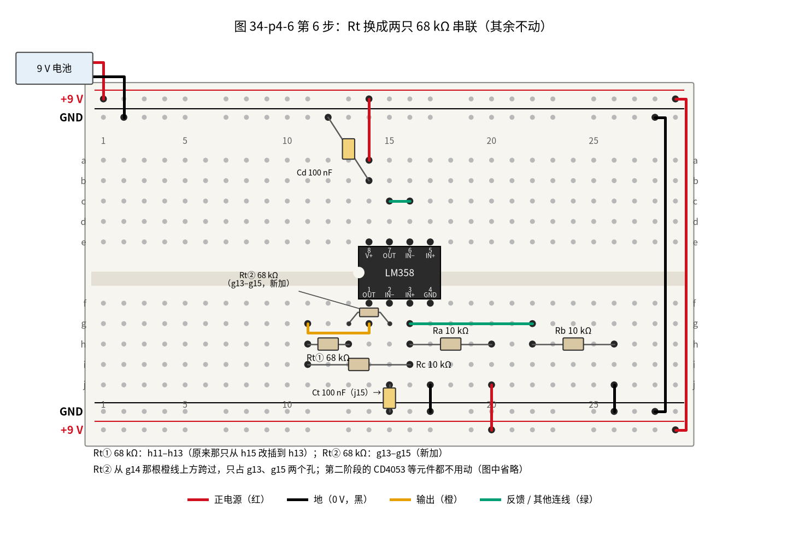
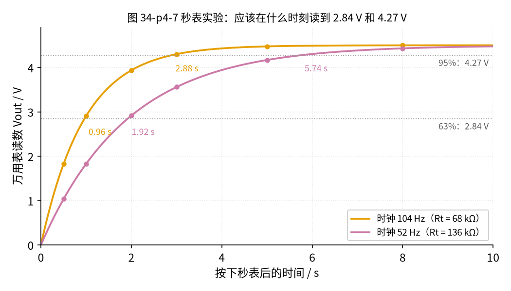

# 34 开关电容滤波与跟踪滤波 · 动手实验篇

[上一页：参数与调试篇](page3.md) · [直觉篇](page1.md) · [原理与实现篇](page2.md) · [参数与调试篇](page3.md) · 本页：动手实验篇 · [下一页：35 程控增益与 AGC · 直觉篇](../35-pga-agc/page1.md) · 前置节点：[12 电压跟随器 · 动手实验篇](../12-voltage-follower/page4.md)、[24 振荡器 · 动手实验篇](../24-oscillator/page4.md)

## 这次实验要验证什么

本实验只用一块万用表和手机秒表，验证 [原理与实现篇](page2.md) 的三个结论：

1. **开关 + 小电容 = 电阻**：输入从 0 跳到 4.5 V 后，输出像 RC 低通一样慢慢升上去，约 0.96 s 升到 63%（2.84 V），约 2.9 s 升到 95%（4.27 V）；
2. **拧时钟就能拧 τ**：把时钟减半（换一只定时电阻），这两个时间都约变成 2 倍，元件 C1、C2 一个没动；
3. **它真的是一个约 1 MΩ 的电阻**：在输出上接一只 1 MΩ，读数约降到一半（2.30 V）；时钟减半后降得更多（1.55 V）。

秒在这里就够用：τ 约 1 s，人眼看表、手按秒表就能测。实验分两个阶段：先搭时钟并确认它在振，再加开关电容。每个阶段都有一张面包板图和一张与之一一对应的原理图。

## ⚠️ 安全须知

- 只用一节 **9 V 电池**供电，全程不超过 12 V 直流；不要用任何插墙的电源。
- **插拔芯片、换元件、改线之前先拔掉电池扣**。唯一的例外是跳线 J（第 5 步，以及每次重测前把 J 插回 d39，都要带电换插，这是计时实验的需要）：它只在 0 V（d39）和 4.5 V（d38）之间换，两个电压都在 0～9 V 电源范围之内，而且只拔插 J 在 d38/d39 那一头，d32 那头一直插着不动。除 J 以外的线和元件一律断电再动，测量表里凡是要动元件的步骤都写了「断电」和「接回电池」。CD4053 是 CMOS 芯片，怕静电：拿芯片前先摸一下金属水龙头或桌腿，尽量只捏芯片两端。
- CD4053 的规则：任何一只脚的电压都不能高于 16 脚（+9 V）、低于 7、8 脚（GND）。所以**先接好芯片的电源线和地线，再接信号线**。
- 1 µF 电容用**薄膜电容**（无极性）。如果手头只有电解电容，会因漏电让终值偏低（见 [参数与调试篇](page3.md) 第三节），而且必须正极朝 13 脚、负极接地。

## 器材清单

| 元件 | 型号或数值 | 数量 | 说明 |
|---|---|---|---|
| 运放 | LM358（DIP-8） | 1 | A 组做时钟，B 组做跟随器 |
| 模拟开关 | CD4053（DIP-16，常见型号 CD4053BE） | 1 | 只用 A 组 |
| 电阻 | 68 kΩ | 2 | Rt；时钟减半时两只串联 |
| 电阻 | 10 kΩ | 5 | Ra、Rb、Rc（时钟门限），R1、R2（4.5 V 分压） |
| 电阻 | 1 MΩ | 1 | RL，第 7 步才插 |
| 电容 | 100 nF（代码 104） | 3 | Ct，时钟定时电容；Cd，LM358 的电源旁路；Cb，CD4053 的电源旁路 |
| 电容 | 10 nF（瓷片或薄膜，代码 103） | 1 | C1，搬运电荷的「小勺」 |
| 电容 | 1 µF 薄膜（代码 105） | 1 | C2，存电荷的「水桶」 |
| 9 V 电池 + 电池扣 | — | 1 | 唯一电源 |
| 万用表 | 直流 20 V 挡 | 1 | 有电容挡更好；有频率（Hz）挡可直接读时钟 |
| 手机 | 秒表应用；最好还能录像 | 1 | 录像用来回放读数 |
| 面包板、跳线 | — | 若干 | 一块 830 孔板够用 |

## 第一阶段：时钟

1. 断电。把 LM358 跨在中间凹槽上，占第 14–17 列：1–4 脚在 f 排，8–5 脚在 e 排（缺口朝左）。如果你看的引脚图是缺口朝上画的，把它逆时针转 90°，1 脚就在左下角，和面包板上一样。
2. 电源：a14（8 脚）接上方 +9 V 轨；Cd 100 nF 从 b14 接上方 GND 轨，紧挨着 8 脚做电源旁路；j17（4 脚）接下方 GND 轨。
3. 时钟：g14 接到 g11（1 脚输出引到第 11 列）；Rt 68 kΩ 插 h11–h15；Ct 100 nF 从 j15 接下方 GND 轨；Rc 10 kΩ 插 i11–i16；Ra 10 kΩ 插 h16–h20，j20 接下方 +9 V 轨；g16 接到 g22；Rb 10 kΩ 插 h22–h26，j26 接下方 GND 轨。
4. B 组先闲着：c15–c16 短接（7 脚接 6 脚），a17（5 脚）先接上方 GND 轨。
5. 接电池：红线接上方 +9 V 轨，黑线接上方 GND 轨；右端两根线把上下两组电源轨连通。

请看图 34-p4-1，它是第一阶段的面包板接法。



*图 34-p4-1　第一阶段：LM358 A 组接成时钟，B 组暂时闲置*

图 34-p4-1 中两个圆圈是表笔位置：标「①」的是第 11 列（时钟输出），标「②」的是第 15 列（B 组输出）。为了不和测量表的步骤编号混淆，下文把表笔位置写成「表笔点①」「表笔点②」。与面包板一一对应的原理图是图 34-p4-2，元件名与 [原理与实现篇](page2.md) 第四节的时钟原理图相同，灰色小字是孔位。



*图 34-p4-2　与图 34-p4-1 一一对应的原理图*

**对照看**：图 34-p4-2 左边的运放是 A 组。它的输出（1 脚）在面包板上经 g14→g11 引到第 11 列，Rt 和 Rc 都有一只脚插在这一列，所以第 11 列就是原理图里的「输出」节点。Rt 的另一端在第 15 列，那里也插着 Ct，并且第 15 列的下半正是 2 脚（反相端），对应原理图里 Rt、Ct 和反相端的交点。同相端（3 脚）在第 16 列，Rc、Ra 插在这里，再经 g16–g22 到 Rb，对应原理图里三只 10 kΩ 汇在一起的那个点。右边的 B 组在面包板上只占 c15–c16 一根短线和 a17 一根接地线，对应原理图里接成跟随器、输入接地的小三角形。

## 第二阶段：加上开关电容

1. **断电**。拔掉 a17→GND 那根线。
2. 把 CD4053 跨在凹槽上，占第 28–35 列：1–8 脚在 f 排，16–9 脚在 e 排（缺口朝左）。
3. 先接芯片电源：a28（16 脚 VDD）接上方 +9 V 轨；Cb 100 nF 从 b28 接上方 GND 轨，紧挨着 16 脚，滤掉开关切换时的电源毛刺；j33（6 脚 INH）、j34（7 脚 VEE）、j35（8 脚 VSS）各接下方 GND 轨；a34（10 脚 B）、a35（9 脚 C）各接上方 GND 轨。
4. 电容：C1 10 nF 从 a30（14 脚 A 公共端）接上方 GND 轨；C2 1 µF 从 a31（13 脚 AY）接上方 GND 轨。
5. 输出送跟随器：c31 连到 c21，b21 连到 b17（5 脚，跟随器输入）。RL 先不插。
6. 时钟送开关：j11 连到 a33（11 脚 A）。
7. 输入分压：R1 10 kΩ 插 c38–c41，a41 接上方 +9 V 轨；R2 10 kΩ 从 a38 接上方 GND 轨；a39 接上方 GND 轨。
8. 跳线 J：一头插 d32（12 脚 AX），另一头先插 **d39**（0 V）。图 34-p4-3 画的就是这个起始位置。
9. 对照图 34-p4-3 检查一遍，确认无误后再接回电池扣（红线 +9 V 轨、黑线 GND 轨），开始按测量表测量。

请看图 34-p4-3，它是第二阶段的面包板接法。



*图 34-p4-3　第二阶段：CD4053、C1、C2 和跟随器*

图 34-p4-3 多了一个「表笔点③」（第 38 列，输入 Vin）；表笔点② 改在 d15，仍是第 15 列，现在它是跟随器输出 Vout。对应的原理图是图 34-p4-4。



*图 34-p4-4　与图 34-p4-3 一一对应的原理图*

**对照看①（左边：输入分压和跳线 J）**：图 34-p4-4 左边是输入分压，R1、R2 的交点就是面包板的第 38 列。跳线 J 在原理图里画成一根可以拨动的线：一头固定在 d32，也就是 CD4053 的 12 脚 AX；另一头插 d38 时接 4.5 V，插 d39 时经 a39 接地。

**对照看②（中间和右边：开关、C1、C2、RL、跟随器）**：中间的开关就是 CD4053 的 A 组：刀片在 14 脚（第 30 列，C1 插在 a30），两个触点分别是 12 脚 AX（第 32 列）和 13 脚 AY（第 31 列，C2 插在 a31）。刀片的控制线从时钟方框引出，在面包板上就是 j11→a33 这根天蓝色长线。C2 的电压经 c31→c21 到第 21 列（RL 的位置，两张图里都画成虚线，表示第 7 步才插），再经 b21→b17 进入 B 组跟随器的 5 脚；跟随器输出在第 15 列，就是表笔点②。

**对照看③（下方文字：电源脚和不用的脚）**：CD4053 的电源和 6、7、8、9、10 脚写在原理图下方的文字里，面包板上是 a28 那根红线、b28 那只斜插的 Cb 和五根接地线。B、C 两组的信号脚（1、2、3、4、5、15 脚）不用，它们的控制脚已经接地，本实验让它们空着；做成长期使用的电路时，工程上建议把这些脚也接地。

## 测量表

全部用**直流 20 V 挡**，黑表笔一直插 GND 轨。

| 步骤 | 测什么 | 红表笔 | 黑表笔 | 挡位 | 应该读到 | 读不到时先查 |
|---|---|---|---|---|---|---|
| 1 | 电池电压（第一阶段） | +9 V 轨 | GND 轨 | 直流 20 V | 约 9 V（新电池可到 9.5 V） | 电池扣、右端连通线 |
| 2 | 时钟平均值 | 表笔点①（第 11 列） | GND 轨 | 直流 20 V | 约 4.4 V（ngspice 4.47 V），有 Hz 挡读约 104 Hz | 读到约 7.8 V 或 0.6 V 不变：Ct、Rt、Rc 位置 |
| 3 | 输入 Vin（第二阶段起） | 表笔点③（第 38 列） | GND 轨 | 直流 20 V | 约 4.5 V | R1、R2、a41 |
| 4 | 跳线 J 插 d39，等 15 s | 表笔点②（第 15 列） | GND 轨 | 直流 20 V | 接近 0 V | 6、7、9、10 脚接地；c31→c21、b21→b17 |
| 5 | J 从 d39 换到 d38，同时按秒表 | 表笔点② | GND 轨 | 直流 20 V | **实测预期**：约 0.96 s 读到 2.84 V，约 2.9 s 读到 4.27 V，最后约 4.50 V；**仿真值**（ngspice，见 [SPICE 核对](../review/spice/34.md)）：0.962 s 到 2.84 V、2.84 s 到 4.27 V | 一下就到 4.5 V：C1、C2 插错；终值偏低：见 [参数与调试篇](page3.md) 第六节 |
| 6 | 断电，Rt 改两只 68 kΩ 串联（h11–h13、g13–g15，见图 34-p4-5、34-p4-6），接回电池，重做 4、5 | 表笔点② | GND 轨 | 直流 20 V | **实测预期**：约 1.92 s 到 2.84 V，约 5.7 s 到 4.27 V，时钟平均仍约 4.4 V；**仿真值**（ngspice）：1.905 s、5.60 s | 时间没加倍：两只 Rt 的位置 |
| 7 | 断电，接 RL 1 MΩ（a21→上方 GND 轨），J 插 d38，接回电池等 15 s；读完再断电，Rt 换回一只 68 kΩ（h11–h15），接回电池等 15 s 再读 | 表笔点② | GND 轨 | 直流 20 V | 52 Hz 时约 1.55 V；Rt 换回一只 68 kΩ 后约 2.30 V | RL 插错列；读数仍约 4.5 V：RL 没接地 |

表里的步骤号用阿拉伯数字，图上的表笔点用圆圈数字，两者不是一回事。

### 第 6 步：两只 Rt 怎么串

第 6 步要把 Rt 从一只 68 kΩ 换成两只串联（136 kΩ），让时钟减半。请看图 34-p4-5，它只画了时钟里改动的那一小段。



*图 34-p4-5　第 6 步的局部原理图：两只 68 kΩ 串联，接在第 11 列（1 脚输出）和第 15 列（2 脚、Ct）之间*

面包板上的插法见图 34-p4-6。



*图 34-p4-6　第 6 步的面包板：Rt① 改插 h11–h13，Rt② 新插 g13–g15；第二阶段的元件不动，图里省略*

**对照看**：断电后，把原来插在 h11–h15 的那只 68 kΩ（Rt①）拔出 h15 那一脚，改插到 h13，现在它连着第 11 列和第 13 列。第二只 68 kΩ（Rt②）插 g13–g15，跨过 g14 那根橙线的上方，只占 g13、g15 两个孔，和 g14 不冲突。第 13 列上只有这两只电阻的脚，就是图 34-p4-5 中间那个点；第 15 列还是 Ct 和 2 脚所在的那一列。插好后接回电池，表笔点① 的平均值仍应约 4.4 V（占空比几乎不变），有 Hz 挡的应读到约 52 Hz。

**秒表怎么掐才准**：

- 万用表每秒只刷新 2～3 次，人的反应也有零点几秒，所以 1 s 左右的时间每次可能差 0.2～0.3 s。**每个时间测 3 次取平均**。
- 更可靠的是 95% 那个时间（约 2.9 s 和 5.7 s），误差占的比例小；要验证的结论是「时钟减半，时间加倍」，看**两次的比值**是否接近 2。
- 最好的办法是录像：把手机秒表和万用表摆在一起录下来，回放时一帧一帧找读数越过 2.84 V 和 4.27 V 的时刻。
- 每次重测前，先把 J 插回 d39 等 15 s，让 C2 放完电。脚本算出：52.44 Hz 时钟下τ约 1.9 s，等 10 s 还剩约 24 mV，等 15 s 只剩约 1.7 mV。
- 第 6 步的 95% 时间，计算值 5.741 s，ngspice 5.60 s，差约 2.4%，远小于手按秒表的误差，测量时不必管它。

## 没有示波器怎么办

本实验本来就只用万用表。除了掐两个时刻，还可以在按下秒表后每隔一段时间读一次，画一条手工曲线。请看图 34-p4-7。



*图 34-p4-7　跳线换到 4.5 V 后各时刻的应读值：两种时钟*

图 34-p4-7 中，时钟约 104 Hz 时，0.5、1、2、3、5、8 s 应分别读到约 1.82、2.91、3.94、4.30、4.48、4.50 V；时钟约 52 Hz 时是 1.03、1.83、2.92、3.56、4.17、4.43 V。同一个读数，下面那条曲线总是要多花一倍的时间，这就是「τ 加倍」。用录像回放读这些点最方便。

如果你的万用表有 Hz 挡，把它放在表笔点① 上可以直接读到时钟频率，约 104 Hz 或 52 Hz（ngspice 104.4 Hz、52.44 Hz）。

## 用 Python 核对你的读数

把你量到的元件值和读数填进下面的代码，它会用 [原理与实现篇](page2.md) 的公式算出应读值，偏差超过 10% 时打印提醒。没有 Hz 挡就保留示例里的 ngspice 频率。

```python
import math  # 要用 log

# ===== 把下面换成你自己的实测值（这里是一组示例） =====
C1, C2 = 10.3e-9, 0.98e-6  # 电容挡量到的 C1、C2，法拉
f1, f2 = 104.4, 52.44  # 两种时钟频率，Hz（有 Hz 挡就填实测值）
vin = 4.49  # 第 3 步读到的 Vin，伏
t63 = {f1: 0.95, f2: 1.88}  # 第 5、6 步读到 63% 的时间（3 次平均），秒
t95 = {f1: 2.80, f2: 5.62}  # 第 5、6 步读到 95% 的时间（3 次平均），秒
v_rl = {f1: 2.27, f2: 1.53}  # 第 7 步接 1 MΩ 后的读数，伏
RL = 1.0e6  # 欧姆挡量到的 RL
# ======================================================

keep = C2 / (C1 + C2)  # 每拍差距乘的数
print(f"每拍差距乘 {keep:.5f}；63% 读 {0.632 * vin:.2f} V，95% 读 {0.95 * vin:.2f} V")


def check(name, meas, calc, unit):  # 打印一行并判断偏差
    dev = (meas - calc) / calc * 100  # 偏差百分比
    flag = "  ⚠️ 偏差超过 10%，先查测量表最后一列" if abs(dev) > 10 else ""  # 超过 10% 就提醒
    print(f"{name}: 实测 {meas:.3f} {unit}，计算 {calc:.3f} {unit}，偏差 {dev:+.1f}%{flag}")


for f in (f1, f2):  # 两种时钟逐个核对
    n63 = math.log(1 - 0.632) / math.log(keep)  # 到 63% 要几拍
    n95 = math.log(1 - 0.95) / math.log(keep)  # 到 95% 要几拍
    req = 1 / (f * C1)  # 等效电阻
    check(f"{f} Hz 的 63% 时间", t63[f], n63 / f, "s")
    check(f"{f} Hz 的 95% 时间", t95[f], n95 / f, "s")
    check(f"{f} Hz 接 RL 的读数", v_rl[f], vin * RL / (RL + req), "V")
print(f"时钟减半后时间之比：63% 为 {t63[f2] / t63[f1]:.2f}，95% 为 {t95[f2] / t95[f1]:.2f}（应接近 {f1 / f2:.2f}）")
```

示例数据全部在 10% 以内。如果你的 τ 整体偏大或偏小 10%～20%，但两次的比值仍接近 2，多半是电容误差，把电容挡的实测值填进去再算一遍就会对上。

## 实验记录表

| 项目 | 实测值 | 计算值 | 偏差 |
|---|---|---|---|
| 电池电压 | | 9 V | |
| 时钟平均值（表笔点①） | | 4.42 V（ngspice 4.47 V） | |
| Vin（表笔点③） | | 4.5 V | |
| 104.4 Hz：到 2.84 V 的时间 | | 0.962 s | |
| 104.4 Hz：到 4.27 V 的时间 | | 2.884 s | |
| 最终读数 | | 4.50 V | |
| 52.44 Hz：到 2.84 V 的时间 | | 1.916 s | |
| 52.44 Hz：到 4.27 V 的时间 | | 5.741 s | |
| 95% 时间之比 | | 约 2 | |
| 104.4 Hz 接 1 MΩ | | 2.298 V | |
| 52.44 Hz 接 1 MΩ | | 1.548 V | |

**思考题 1**：第 5 步里，为什么一定要读跟随器的输出（第 15 列），而不能把表笔直接接在 C2 上（第 31 列）？

<details><summary>答案</summary>

我们的开关电容等效于约 957.9 kΩ 的电阻。万用表直流挡的输入电阻约 10 MΩ，接在 C2 上就相当于第 7 步的 RL，只是大了 10 倍：终值会被分压拉低，τ 也会变短。跟随器的输入几乎不取电流，C2 上的电压原样送到第 15 列，读数才是 C2 真正的电压（[12 电压跟随器](../12-voltage-follower/page2.md)）。

</details>

**思考题 2**：第 7 步里，为什么时钟减半后读数从 2.30 V 降到 1.55 V？如果时钟加倍呢？

<details><summary>答案</summary>

稳态时开关电容的 $R_{eq}$ 和 RL 分压。时钟减半， $R_{eq} = 1/(f_{CLK} C_1)$ 从 957.9 kΩ 加倍到 1906.9 kΩ，RL 分到的比例变小，读数变低。时钟加倍到 208.8 Hz，则 $R_{eq}$ 减半到约 478.9 kΩ，读数升到约 3.04 V，更接近 4.5 V。这一步直接说明了「开关 + 小电容」在电路里的表现和一只电阻一样，而且这只电阻能用时钟拧。

</details>

**思考题 3**：如果把 C1 换成 1 nF、其余不变，第 5 步的两个时间会变成多少？台阶会怎样？

<details><summary>答案</summary>

C1 缩小 10 倍， $R_{eq}$ 和 τ 都放大约 10 倍：C2/C1 = 1000，到 63% 要 1000.2 拍，104.4 Hz 下约 9.58 s，到 95% 约 28.7 s；每拍台阶从 44.6 mV 降到 4.5 mV，读数更平滑。代价是 C1 小了以后，开关的引脚电容和面包板的排间电容（几 pF）占的比例变大，τ 会偏离计算值，见 [参数与调试篇](page3.md) 第六节故障排查表「C1 换成 100 pF」那一行；第一节也讲过「又平滑又快」不能兼得。

</details>

## 自测清单

- 我能用「 $q = CV$ 」推出开关电容的等效电阻 $R_{eq} = 1/(f_{CLK} C_1)$ ；
- 我能正确接 CD4053：VDD、VSS、VEE、INH 和不用的控制脚各接哪里，信号为什么不能超出电源；
- 我能用 24 节的 LM358 振荡器给 CD4053 提供时钟，并用直流挡确认它在振；
- 我能用万用表和秒表测出开关电容低通的 63% 和 95% 时间，并验证「时钟减半，时间加倍」；
- 我能解释为什么接 1 MΩ 负载后读数会下降，以及为什么要用跟随器读数；
- 我能说出跟踪滤波的思路：在滤波器输入端测频率（36 节），再把时钟设成信号频率的 100 倍。
