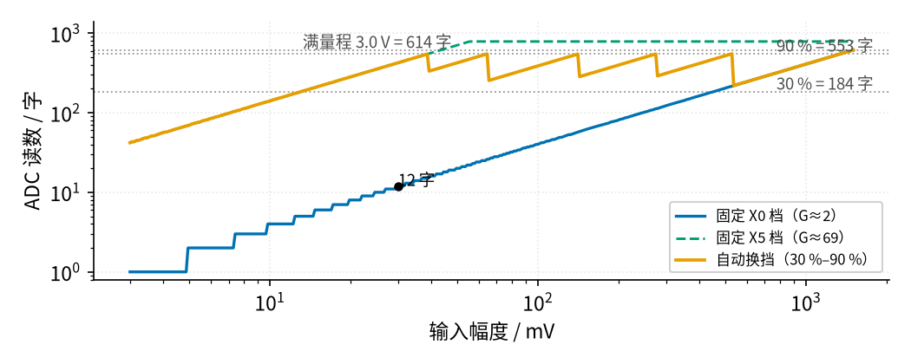
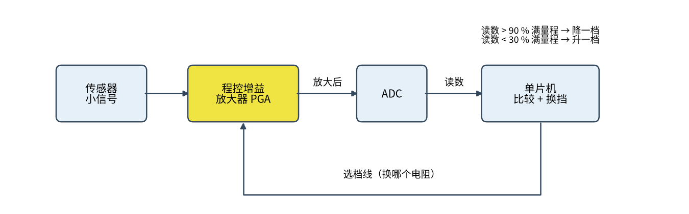
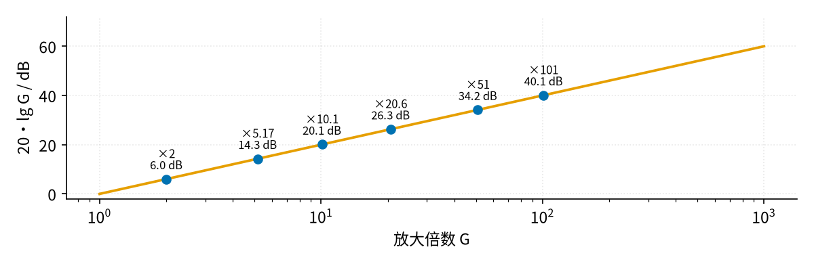

# 35 程控增益与 AGC · 直觉篇

上一页：34 节开关电容滤波与跟踪滤波（即将上线） · 本页：直觉篇 · [原理与实现篇](page2.md) · [参数与调试篇](page3.md) · [动手实验篇](page4.md) · [下一页：原理与实现篇](page2.md) · 前置节点：[08 同相放大 · 直觉篇](../08-noninverting-amp/page1.md)、[13 桥式整流 · 直觉篇](../13-bridge-rectifier/page1.md)、[09 精密整流 · 直觉篇](../09-precision-rectifier/page1.md)、[14 积分电路 · 直觉篇](../14-integrator/page1.md)

## 为什么一个固定的放大倍数不够用

前面几节做的放大器，放大倍数都是焊死的：[08 同相放大 · 直觉篇](../08-noninverting-amp/page1.md) 里换一只电阻，倍数就变，但电路一旦搭好，倍数就固定了。流量测量里偏偏有很多信号，大小会变好几十倍甚至上百倍。

- **涡街流量计**：横河的技术报告指出，旋涡打在压电片上产生的电荷和 $\rho v^2$ 成正比（ $\rho$ 是流体密度， $v$ 是流速）。流速变 10 倍，信号就变 100 倍。（预告：后面的 32 节会讲电荷放大器，它把这份电荷变成电压，但这个 100 倍的范围会原封不动地留下来。）
- **超声波流量计**：回波的大小随水质、气泡、管壁结垢变化很大，同一台表今天和明天收到的回波可能差好几倍（37 节会用到）。
- **任何接 ADC 的传感器**：单片机的 ADC 只认 0 到参考电压之间的一段。

固定倍数的两难很直观：倍数选小了，小信号只占 ADC 的一点点，读数很粗；倍数选大了，大信号一来就顶到电源轨，波形被削平，读数完全错。

请看图 35-p1-1 里蓝色线左下角那一段台阶。横轴是输入幅度（从 3 mV 到 1.5 V，对数刻度），纵轴是 Arduino 10 位 ADC 的读数（也是对数刻度）。

*图 35-p1-1　固定增益与自动换档时 ADC 读数随输入幅度的变化*

先说图上的几个“字”数是怎么来的。Arduino 的 ADC 是 10 位，参考 5 V，1 个字 = 5 V ÷ 1024 ≈ 4.883 mV。LM358 用 5 V 供电时输出最高只到约 3.83 V，所以本节把 3.0 V 当作“满量程”，留一点余量：3.0 V 对应 614 个字（图上最上面那条线），它的 90 % 是 553 个字，30 % 是 184 个字（原理与实现篇「五」还会细讲）。

固定在约 2 倍时，30 mV 的输入放大后只有 59.9 mV，ADC 只给出 12 个字，一个字就相当于读数的 8.3 %，这就是左下角那些台阶。固定在最高档时（按公式应是 101 倍，实际只有约 69 倍，原因留到原理与实现篇揭晓，先记住这个“少了三成”），小信号很好看，可输入超过约 55 mV（3.83 V ÷ 69）以后，LM358 顶到约 3.83 V 的上限，蓝绿色虚线变成一条水平线，再大的输入读数也一样。

橙色线是本节要做的自动换档：输入变大就降一档，变小就升一档。只要输入在约 13 mV 到 1.35 V 之间（0.9 V ÷ 69.03 ≈ 13 mV，2.7 V ÷ 1.995 ≈ 1.35 V），读数就一直待在 30 % 到 90 % 满量程之间，也就是 184 到 553 个字；比 13 mV 还小时，最高档也拉不到 30 %，读数就会掉到 184 字以下（图左端）。30 mV 时它停在最高档，读数 424 个字，一个字只占 0.24 %。

## 生活里的例子：自动量程和自动曝光

你用过的数字万用表，有的要自己转挡（200 mV、2 V、20 V……），有的会自己跳挡，表上写着 AUTO。自己跳挡的表里面就是一个程控增益放大器：先用一个挡量一下，读数太大就换小倍数，太小就换大倍数，最后选一个让显示位数最多的挡。

手机相机的自动曝光也是一样：从暗处转到窗户，画面先白一下，然后慢慢恢复。相机根据画面亮度调整感光度，让画面不过曝也不太暗。那“白一下”的时间就是调节速度，太快画面会闪，太慢会白很久。这件事在 [35 程控增益与 AGC · 参数与调试篇](page3.md) 里会变成一个正经的设计问题。

收音机里也有这样一个电路，叫 **AGC**（Automatic Gain Control，自动增益控制）：近处的电台信号强，远处的弱，AGC 让喇叭里的音量差不多。它的做法是检测输出有多大，太大就把放大倍数往下拧，太小就往上拧。

## 程控增益放大器长什么样

在图 35-p1-2 里，请先找到中间那个黄色的方块，再顺着下面那根回来的线看。

*图 35-p1-2　数字 AGC：单片机读 ADC，再通过选档线改放大倍数*

信号从左往右走：传感器的小信号进程控增益放大器（PGA，Programmable Gain Amplifier），放大后进 ADC，单片机拿到读数。单片机做的事情很简单：读数超过满量程的 90 % 就降一档，低于 30 % 就升一档，然后通过下面那根选档线告诉 PGA 换哪个电阻。这样一圈就是一个反馈环，和运放的负反馈道理一样，只不过它是用程序一步一步走的，所以叫**数字 AGC**。

程控增益有三种常见做法：

1. **模拟开关换电阻**：同相放大器的放大倍数是 $1 + R_f/R_g$ ，用一个 8 选 1 的模拟开关（CD4051）从六只 $R_g$ 里挑一只，倍数就跟着变。这就是本节动手实验搭的电路，便宜、好懂，但开关本身有几百欧电阻，会带来误差，[35 程控增益与 AGC · 原理与实现篇](page2.md) 专门讲它（电路图见那一页「二、最直接的接法」）。模拟开关在 34 节开关电容滤波与跟踪滤波（即将上线） 用过：它是一只由数字脚控制通断的“电子开关”，接通时不是导线，而是几百欧的电阻，而且被开关的信号电压不能超出它自己的电源。
2. **集成 PGA**：例如 PGA113，用 SPI 串口写一个数就选好增益，开关误差在芯片里已经处理好了。
3. **线性分贝的可变增益放大器（VGA）**：例如 ADI 的 AD8331，增益不是一档一档的，而是由一个控制电压连续调节，每伏 50 dB（dB 是分贝，下面「回顾：分贝」再复习一次），在低增益模式下从 −4.5 dB 调到 43.5 dB。它是超声接收链里的常客。

用 VGA 时，控制电压可以由一个模拟电路自动产生：先做一个**峰值检测**：[13 桥式整流 · 直觉篇](../13-bridge-rectifier/page1.md) 里那只滤波电容在峰值附近被充满、之后慢慢放电，它“记住”的正是峰值；再用 [09 精密整流 · 直觉篇](../09-precision-rectifier/page1.md) 的办法把二极管的压降补掉，量出输出有多大，再和目标值比较，差值送进 [14 积分电路 · 直觉篇](../14-integrator/page1.md) 那样的积分器，积分器的输出就是控制电压。这是**模拟 AGC**。

请在图 35-p1-3 里顺着箭头走一圈，找到信号从哪里回到 VGA。

*图 35-p1-3　模拟 AGC 环：VGA → 峰值检波 → 和目标比较 → 积分 → 回到 VGA*

输出一变大，检波值跟着变大，减法的结果变负，积分器把 $V_{GAIN}$ 往下拧，增益就降了。这和运放的负反馈是同一个思路，只不过“反馈回去的”是放大倍数。原理篇和参数篇会把它和数字 AGC 放在一起比。

## 回顾：分贝（见 16 第二页）

分贝第一次出现在 [16 差分放大 · 原理与实现篇](../16-differential-amp/page2.md) 「一、推导：三步」的共模抑制比那里：分贝 = 20 lg 倍数。这里只复习一下，再用到本节的六个档上。电压放大倍数 $G$ 换成分贝的公式是

$$G_{dB} = 20 \lg G$$

意思是：先取以 10 为底的对数，再乘 20。几个要背下来的值：放大 2 倍约 6 dB，10 倍是 20 dB，100 倍是 40 dB；缩小一半是约 −6 dB。分贝好用在两点：两级放大串起来，倍数相乘，分贝相加；倍数从 2 到 100 横跨 50 倍，分贝只是从 6 到 40。

换一个 16 里没有的例子：本节最高档的名义倍数 G = 101，后面再接一级 G = 2 的缓冲，总倍数 202，分贝是 40.09 + 6.02 = 46.11 dB，直接算 20 lg 202 也是 46.11 dB，两种算法一致。如果用实测的 69.03 倍，最高档是 20 lg 69.03 ≈ 36.78 dB；本页图里一律用名义倍数，后面几页算误差时才用实际倍数。

请看图 35-p1-4 上那六个蓝点，它们是后面实验要用的六个档的**名义倍数**（按公式算，不考虑开关电阻）。

*图 35-p1-4　放大倍数与分贝：对数横轴上它是一条直线*

横轴用对数刻度时，倍数和分贝是一条直线：倍数每乘 10，分贝加 20。六个档从 6.02 dB 到 40.09 dB，相邻两档差约 6～8 dB（依次是 8.24、5.81、6.20、7.87、5.94 dB），也就是每档约 2～2.6 倍。这种“每档两倍多一点”的安排和示波器的 1-2-5 档一样，TI 的 PGA113 芯片就提供 1、2、5、10、20、50、100、200 八个增益。

## 小结

- 信号大小变化很大时，固定倍数要么让小信号读得很粗，要么让大信号削顶；程控增益放大器按信号大小换档。
- 分贝 $G_{dB} = 20 \lg G$ ：2 倍约 6 dB，10 倍 20 dB，100 倍 40 dB；串联时分贝相加。
- 数字 AGC：读 ADC → 超过 90 %（553 字）降档、低于 30 %（184 字）升档 → 改选档线。模拟 AGC：峰值检测 → 和目标比较 → 积分 → 控制电压调增益。
- 本节实验用 LM358 + CD4051 + Arduino 搭一个六档 PGA。倍数按公式从 2 倍到 101 倍，实测最高档只有约 69 倍，差出来的部分是下一页的主角。

## 参考资料

- 横河 YEWFLO 涡街流量计技术报告（压电信号与 $\rho v^2$ 成正比）：https://web-material3.yokogawa.com/rd-tr-r00027-004.pdf
- TI PGA113 数据手册（1、2、5、10、20、50、100、200 增益）：https://www.ti.com/lit/ds/symlink/pga113.pdf
- ADI AD8331 / AD8332 / AD8334 数据手册（线性分贝 VGA，50 dB/V）：https://www.analog.com/media/en/technical-documentation/data-sheets/AD8331_8332_8334.pdf
- TI CD4051B 数据手册（8 选 1 模拟开关）：https://www.ti.com/lit/ds/symlink/cd4051b.pdf
