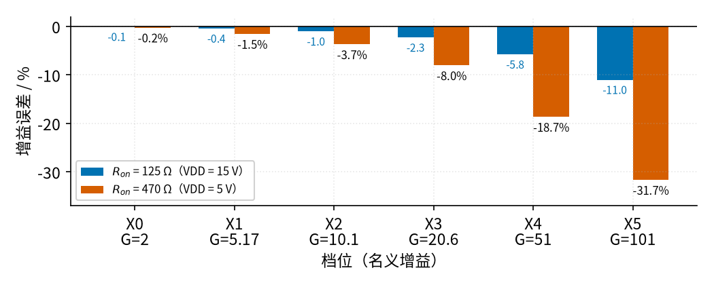
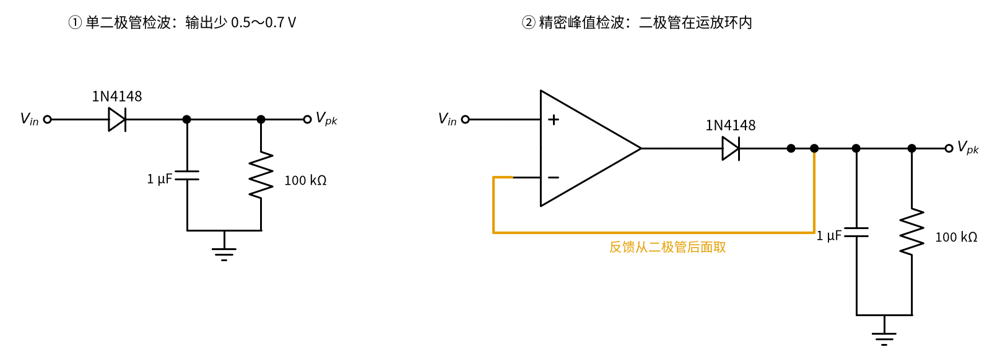
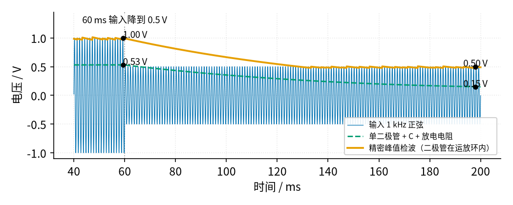
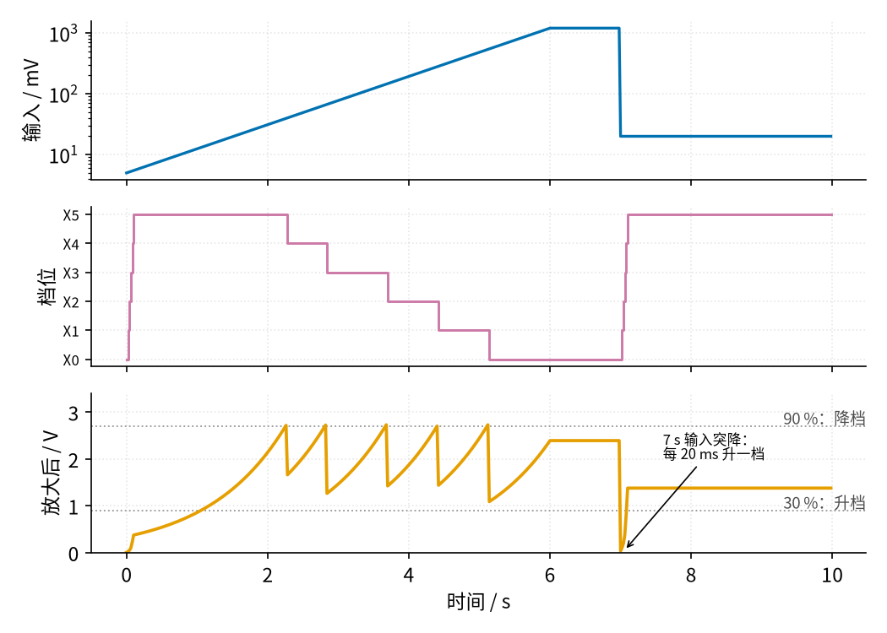

# 35 程控增益与 AGC · 原理与实现篇

[上一页：直觉篇](page1.md) · [直觉篇](page1.md) · 本页：原理与实现篇 · [参数与调试篇](page3.md) · [动手实验篇](page4.md) · [下一页：参数与调试篇](page3.md) · 前置节点：[08 同相放大 · 原理与实现篇](../08-noninverting-amp/page2.md)、[13 桥式整流 · 直觉篇](../13-bridge-rectifier/page1.md)、[09 精密整流 · 原理与实现篇](../09-precision-rectifier/page2.md)、[14 积分电路 · 原理与实现篇](../14-integrator/page2.md)

## 一、回顾与差异：同相放大和模拟开关 CD4051

**同相放大**（复习 [08 同相放大 · 原理与实现篇](../08-noninverting-amp/page2.md)）：信号接运放的同相端，输出经 $R_f$ 回到反相端，反相端再经 $R_g$ 接地（就是后面图 35-p2-2 的上半部分，先把 CD4051 那一排看成一只 $R_g$ ）。运放让反相端电压等于同相端，于是

$$G = \frac{V_{out}}{V_{in}} = 1 + \frac{R_f}{R_g}$$

意思是：输出电压按 $R_f$ 和 $R_g$ 分压后正好等于输入，所以倍数由两只电阻的比值决定。代一组数： $R_f$ = 100 kΩ， $R_g$ = 1 kΩ 时 $G = 1 + 100 = 101$ 。只要换 $R_g$ ，倍数就换了。

**CD4051** 是一只**模拟开关**：几个由数字脚控制通断的“电子开关”装在一颗芯片里。[34 开关电容滤波与跟踪滤波 · 原理与实现篇](../34-switched-cap-filter/page2.md) 用过它的兄弟 CD4053，先把那里的两条要点复述一遍，没读过 34 也够用：第一，开关接通时不是一根导线，而是一只几百欧的**导通电阻** $R_{on}$ ，电源电压越低它越大；第二，开关内部是接在 VDD 和 VEE 之间的 MOS 管，被开关的模拟信号电压必须在这两者之间，超出去信号就会被削掉，严重时还会损坏芯片。CD4051 和 CD4053 是同一个系列，这两条完全一样；区别在于 CD4053 是三个独立的 2 选 1 开关，CD4051 是一个 8 选 1 的模拟开关：8 个通道脚 X0～X7 和一个公共脚 COM，由 A、B、C 三根选择线决定哪一路和 COM 接通。三根线组成一个二进制数，C 是最高位：C、B、A 为 0、0、0 时接通 X0，为 1、0、1（十进制 5）时接通 X5。INH 脚接高电平时所有通道断开。它的电源脚是 VDD（16 脚）、VSS（8 脚）和 VEE（7 脚），**模拟信号的电压必须在 VEE 和 VDD 之间**。本节全部接单 5 V：VDD 接 5 V，VSS 和 VEE 接地。CD4051 和 LM358 在本节都是 5 V 器件，不要接到 9～12 V 上；VDD 抬高以后，Arduino 的 5 V 高电平也够不着它的选择脚门槛（手册：VDD = 10 V 时高电平最小要 7 V）。

图 35-p2-1 是它的引脚，请先找 COM 和 X5 在哪两个脚。


*图 35-p2-1　CD4051 引脚（DIP-16 俯视）和本节的接法*

通道脚的编号不按顺序排（X0 是 13 脚、X4 是 1 脚、X5 是 5 脚），接线时一定要对照这张图。

开关接通时并不是一根导线，而是一只电阻，叫导通电阻 $R_{on}$ 。TI 的 CD4051B 手册给出：VDD = 5 V 时典型 470 Ω、最大 1050 Ω；10 V 时典型 180 Ω；15 V 时典型 125 Ω。电源电压越低，开关越“不通”。不同通道之间的差别典型只有 15 Ω（5 V 时），这一点后面做校准时有用。

## 二、最直接的接法：开关串在 R_g 里

> **先猜一猜**：按 08 节的公式，X5 档 $R_f$ = 100 kΩ、 $R_g$ = 1 kΩ，倍数应该是多少？如果实测只有 69 倍，你觉得少掉的那部分去了哪里？先写下你的答案，再往下看。

请看图 35-p2-2 下面的 CD4051 方框，橙色那一路是当前接通的 X5。


*图 35-p2-2　CD4051 切换 R_g：开关和被选中的 R_g 串联*

六只 $R_g$ 都一头接地、一头接到 CD4051 的通道脚，COM 接运放的反相端。哪一路闭合，哪一只 $R_g$ 就接进电路。问题在于：流过 $R_g$ 的电流也流过开关，开关的 $R_{on}$ 和 $R_g$ 串在一起，倍数变成

$$G = 1 + \frac{R_f}{R_g + R_{on}}$$

意思是：接地的那一臂实际是 $R_g + R_{on}$ ， $R_g$ 越小， $R_{on}$ 占的比例越大。代数：X5 档 $R_g$ = 1 kΩ，串 470 Ω 后 $G = 1 + 100/1.47 = 69.03$ ，比设计的 101 小了 31.7 %。X0 档 $R_g$ = 100 kΩ， $G = 1 + 100/100.47 = 1.995$ ，只差 0.23 %。

六档算下来（ $R_f$ = 100 kΩ），用 TI LM358 模型做 ngspice 仿真，四种开关电阻的结果和公式相差都在 0.11 % 以内。表里 125 Ω 那一列是 VDD = 15 V 的数据，只用来对比；本节 5 V 供电，正文一律用 470 Ω 那一列（X5 = 69.03）：

| 档 | $R_g$ | 理想开关 | 串 125 Ω（仅作对比：VDD 15 V 典型） | 串 470 Ω（VDD 5 V 典型） | 470 Ω 时误差 | 串 1050 Ω（VDD 5 V 最大） | 1050 Ω 时误差 |
|---|---|---|---|---|---|---|---|
| X0 | 100 kΩ | 2.000 | 1.999 | 1.995 | −0.23 % | 1.990 | −0.52 % |
| X1 | 24 kΩ | 5.167 | 5.145 | 5.087 | −1.55 % | 4.992 | −3.38 % |
| X2 | 11 kΩ | 10.09 | 9.989 | 9.718 | −3.69 % | 9.299 | −7.85 % |
| X3 | 5.1 kΩ | 20.61 | 20.14 | 18.95 | −8.03 % | 17.26 | −16.24 % |
| X4 | 2 kΩ | 51.00 | 48.06 | 41.49 | −18.66 % | 33.79 | −33.75 % |
| X5 | 1 kΩ | 101.0 | 89.89 | 69.03 | −31.66 % | 49.78 | −50.71 % |

图 35-p2-3 把 125 Ω 和 470 Ω 两列误差画成了柱子，请比较左右两端柱子的高度。



*图 35-p2-3　开关串在 R_g 里时，增益越高误差越大*

高增益档的误差最大，这正好和我们的需要相反：最需要放大的小信号，倍数偏得最多。把 VDD 提到 15 V， $R_{on}$ 降到 125 Ω，X5 档还是差 11 %；本节只用 5 V（这样 Arduino 的 5 V 逻辑电平能直接驱动 CD4051 的选择脚），典型误差约 32 %；手册给的是典型值，碰上导通电阻偏大的芯片（5 V 时最大 1050 Ω），X5 只剩 49.78 倍，差 50.7 %（SPICE −50.74 %），而 X0 只差 0.52 %。想靠“只用大电阻”躲开它也行不通：把每只 $R_g$ 都取到 47 kΩ 以上，最坏 1050 Ω 时误差确实压到了 1.49 %，可配 100 kΩ 的 $R_f$ ，最高倍数只剩 1 + 100/47 = 3.13 倍，程控增益就失去意义了。补救办法有两个：一是**校准**，先量出每一档的实际倍数存成表，程序里用实际值换算（ $R_{on}$ 会随温度、电源和芯片变，通道之间却只差十几欧，所以一次校准大体管用）；二是换一种接法，让 $R_{on}$ 根本不进公式。

## 三、更好的接法：开关放在不流电流的地方（抽头接法）

图 35-p2-4 换了一个思路，请注意 COM 那根线接到了哪里。


*图 35-p2-4　抽头接法：开关只接到运放的高阻输入端*

这里只用一串固定电阻（总共 101.1 kΩ）从输出接到地，开关去选“反相端接在第几个抽头上”。运放让反相端等于输入，于是

$$G = \frac{R_{总}}{R_{抽头以下}}$$

意思是：输出被这串电阻分压，哪个抽头的电压等于输入，倍数就是总电阻除以抽头以下的电阻。代数：接最底的 X5 抽头，下面只有 1 kΩ， $G = 101.1/1 = 101.1$ ；接 X0，下面是 50.1 kΩ， $G = 101.1/50.1 = 2.018$ 。

开关这一回串在**反相端**的引线里，而运放输入端几乎不取电流（LM358 的偏置电流，也就是运放输入脚本身要吸进或流出的那一点点电流，只有几十纳安），开关上就几乎没有压降，所以 $R_{on}$ 从倍数公式里消失了。SPICE 里给开关串 470 Ω，开关两端只差 −8.4 µV，由此反推流过开关的偏置电流约 8.4 µV ÷ 470 Ω ≈ 18 nA；把开关换成最坏的 1050 Ω，输出只变 −0.05 %。SPICE 量到的最底抽头倍数是 101.0，比公式的 101.1 小 0.08 %，原因不在开关：那约 18 nA 的偏置电流流进了最底那只 1 kΩ，而链上的电流本身只有 20 mV ÷ 1 kΩ = 20 µA，18 nA 占 0.09 %，把抽头电压抬高了这么多，倍数就少了这么多。和串联接法动辄 30～50 % 的误差相比，这完全可以忽略。一句话：大电流（链电流）走电阻链，开关只负责“看”抽头的电压，几乎没有电流从它身上过，它的电阻也就无所谓了。

代价是：一串电阻挂在输出上，运放多一份负载；每档倍数由整串电阻一起决定，改一档要动好几只电阻；还有，如果开关切换的一瞬间所有通道都断开，反相端悬空，运放会开环冲向电源轨，这在原理上对两种接法都存在，但在抽头接法里它就是全部反馈，影响更直接。另外，CD4051 的 COM 端自带约 30 pF 电容（手册典型值，10 V 时），它现在直接挂在运放的反相端上，低倍数档可能出现过冲；做交流信号时，通常在反馈电阻两端并一只 22～33 pF 的小电容压住它。本节只做直流，可以不加。集成 PGA（例如 PGA113）内部用的就是这一类不让开关电阻进入增益的结构。

## 四、峰值检测：AGC 要先知道信号有多大

自动调增益，先得量出输出有多大。交流信号要取它的峰值，最简单的是一只二极管加一只电容和一只放电电阻：正半周把电容充到峰值，其余时间电容慢慢放电。这和 [13 桥式整流 · 直觉篇](../13-bridge-rectifier/page1.md) 「三、加一只大电容」里滤波电容的“灌满—慢慢取水”是同一回事，只是这里放电电阻换成了我们自己选的 100 kΩ。[09 精密整流 · 原理与实现篇](../09-precision-rectifier/page2.md) 说过，单只二极管要先吃掉 0.5～0.7 V 才导通；把二极管放进运放的反馈环里，运放会把这点压降补回来。

先看两种接法的区别：图 35-p2-5 右图把同一只二极管放进了运放的反馈环里，反馈从二极管**后面**取。



*图 35-p2-5　两种峰值检波：单二极管（左）与精密峰值检波（右）*

左图里二极管的 0.5～0.7 V 压降直接扣在输出上；右图里运放比较的是 $V_{pk}$ 和 $V_{in}$ ，差一点就把输出抬高，二极管的压降被补了回来。下面图 35-p2-6 是这两种接法的仿真波形，请看两条曲线在 60 ms 前的高度。



*图 35-p2-6　单二极管检波与精密峰值检波（1N4148 + 1 µF + 100 kΩ，SPICE）*

输入峰值 1 V 时，蓝绿色虚线（单二极管检波）只保持在 0.53 V，丢了约 0.47 V；输入降到 0.5 V 以后，它在 198 ms 时只有 0.15 V，而且还在往下走（最后约 0.12 V），对 0.5 V 的信号几乎失明。橙色的精密峰值检波保持在 1.00 V（两个峰之间放电下垂到 0.97 V），输入变小后按 $\tau = RC$ = 100 kΩ × 1 µF = 0.1 s 指数下降，最后停在 0.50 V。从 1.0 V 降到 0.52 V 要 $t = \tau \ln(1.0/0.52) = 0.1 \times 0.654 \approx 65$ ms，SPICE 量出 64.7 ms。这个时间常数决定了 AGC 发现“信号变小了”要多久，参数篇还会用到它。（这张图的仿真为了看清原理用了 ±5 V 供电；实验里我们只用 5 V 单电源，输入也是直流，不需要检波。）

## 五、数字 AGC：一条规则加一点回差

数字 AGC 的规则只有一句：**读数超过满量程的 90 % 就降一档，低于 30 % 就升一档，每次最多换一档。**

先把“满量程”定下来。Arduino Uno 的 ADC 是 10 位，参考 5 V，1 个字 = 5 V / 1024 = 4.883 mV。LM358 用 5 V 供电时输出最高只到约 3.83 V（SPICE），所以把 3.0 V 当作满量程，留一点余量：3.0 V 对应 614 个字，30 % 对应 184 个字。90 % 对应 553 个字。只要读数不低于 184 个字，量化误差（ADC 只能给整数个字，最多差 1 个字带来的误差）就不超过 1/184 ≈ 0.54 %。

为什么是 90 % 和 30 %，不是 90 % 和 80 %？升一档后读数会乘以相邻两档的倍数比。按串 470 Ω 后的实际倍数，最大的档比是 X0→X1 的 2.549 倍：读数 29.9 % 时升档，升完最多到 2.549 × 30 % = 76.5 %，还在 90 % 以下，不会马上又被降回来。写成一般条件就是：档比 $r$ 必须小于 DOWN ÷ UP = 90 % ÷ 30 % = 3。本节最坏档比 2.549 < 3，满足；参数与调试篇「二」会看违反它时会怎样。两条门槛之间的这段空隙叫**回差**，和 [10 电压比较器 · 直觉篇](../10-voltage-comparator/page1.md) 「解决办法：上、下用两条线」里比较器的回差是同一个思想：只差一点点时不动作，免得来回抖。下一节（36）还会再用到它。

下面是一段最小的数字 AGC 仿真，每一行都有注释。它让输入从 5 mV 慢慢升到 1.2 V，看程序怎样一档一档地换。

```python
import numpy as np                               # 任意目录都能运行

RF = 100e3                                       # 反馈电阻 R_f
RG = [100e3, 24e3, 11e3, 5.1e3, 2e3, 1e3]        # 六档 R_g：X0…X5
RON = 470.0                                      # CD4051 在 5 V 下的导通电阻（典型）
G = [1 + RF / (r + RON) for r in RG]             # 开关串在 R_g 里时的实际倍数（校准表）
FS, DOWN, UP = 3.0, 0.90, 0.30                   # 满量程 3.0 V；> 90 % 降档，< 30 % 升档
LSB = 5.0 / 1024                                 # LSB：1 个字代表的电压（10 位 ADC、参考 5 V）

k = 0                                            # 从最低档 X0 开始
for vin in np.geomspace(5e-3, 1.2, 12):          # 输入从 5 mV 按对数升到 1.2 V，取 12 个点
    for _ in range(6):                           # 每个输入值最多给 6 次循环，让它换到位
        vout = min(G[k] * vin, 3.83)             # 放大，LM358 输出最多到约 3.83 V
        n = int(vout / LSB)                      # ADC 读数（向下取整）
        if n * LSB > DOWN * FS and k > 0:        # 太大：降一档
            k -= 1
        elif n * LSB < UP * FS and k < 5:        # 太小：升一档
            k += 1
        else:                                    # 在 30 %～90 % 之间：不动，这次读数可用
            break
    est = n * LSB / G[k]                         # 用校准表里的实际倍数换算回输入
    print(f"输入 {vin*1e3:7.1f} mV → X{k} 档，读数 {n:4d} 字，换算 {est*1e3:7.2f} mV，误差 {100*(est/vin-1):+.2f} %")
```

运行后，5 mV 和 8.2 mV 两点停在 X5，读数只有 70 字和 116 字（69 倍也到不了 30 %），误差 −0.97 % 和 −0.29 %，一个字占的比例偏大；从 13.5 mV 起，每个点的读数都落在 184～553 字之间（191～535 字），误差都在 ±0.54 % 以内，最大 −0.32 %；输入越大，档位越低，到 1.2 V 时回到 X0。注意换算用的是 `G` 这张**实际倍数表**，如果误用名义倍数 101，X5 档的读数会差 31.7 %。

`code/35_sim.py` 用同样的规则跑了一段 10 s 的输入（前 6 s 从 5 mV 升到 1.2 V，7 s 时突然掉到 20 mV，每 20 ms 一个循环）。请看图 35-p2-7 中间那条红紫色台阶和下面的橙色锯齿。



*图 35-p2-7　数字 AGC 的一次完整过程（35_sim.py）*

500 个循环里一共换档 15 次，没有一次削顶。每次放大后的电压升到 90 % 降档线，就往下掉一截，然后随输入继续爬升，所以下层是一串锯齿，并且都在两条灰线之间。7 s 输入突降以后，读数掉到几乎为 0，程序每 20 ms 升一档，5 个循环（100 ms）回到 X5。（这段仿真没有丢读数；动手实验篇的 Arduino 程序换档后会丢掉下一次读数，所以实际要约 10 个循环、约 200 ms。）在“量程内（输入 ≥ 13.0 mV）、而且这一循环没有换档”的读数里，换算误差最大 0.46 %，在 0.54 % 的上限之内；那些判定要换档的读数本身落在窗口外（太小时只有十几个字），误差可达 5.7 %，而且真实电路换档后还要等放大器稳定，所以**换档那一次和换档后的第一次读数都要丢掉**。

## 六、模拟 AGC：控制电压连续调增益

数字 AGC 一档一档跳，适合直流或慢变的读数。超声回波这类交流信号，常用一只增益可由电压连续控制的放大器（VGA）。AD8331 的增益（低增益模式）是

$$G_{dB} = 50 \cdot V_{GAIN} - 6.5$$

意思是：控制电压每升高 1 V，增益加 50 dB。代数： $V_{GAIN}$ = 0.5 V 时 $50 \times 0.5 - 6.5 = 18.5$ dB，约 8.4 倍；手册给出的范围是 −4.5 到 43.5 dB。它的 MODE 脚可以把斜率反过来，变成控制电压越高增益越低，手册说这正适合 AGC：输出越大 → 检测到的峰值越大 → 积分器输出越高 → 增益越低。

一个模拟 AGC 环就是：VGA → 精密峰值检波（第四节）→ 和目标比较 → [14 积分电路 · 原理与实现篇](../14-integrator/page2.md) 那样的积分器 → 控制电压回到 VGA。请在图 35-p2-8 里顺着箭头走一圈，找出信号从哪里回到 VGA。


*图 35-p2-8　模拟 AGC 环*

把图 35-p2-8 的每个方框换成真实元件，就是图 35-p2-9。


*图 35-p2-9　模拟 AGC 的简化原理图：精密峰值检波 + 积分器（标引脚号）*

**对照看**：图 35-p2-9 里的 $C_d$ 和 $R_d$ 就是第四节峰值检波的保持电容和放电电阻（ $\tau_d$ = 1 µF × 20 kΩ = 20 ms）；U1A 把 D1 包在反馈环里，所以 $V_{pk}$ 不少 0.6 V。U1B 的 5 脚接 $R_a$ 40 kΩ、 $R_b$ 10 kΩ 从 5 V 分出的 1 V 目标，6 脚经 $R_i$ 进 $V_{pk}$ ， $C_i$ 跨在 6、7 脚之间， $R_i$ 和 $C_i$ 组成积分器（ $\tau_i$ = 5 ms）。积分器的 7 脚输出就是 $V_{GAIN}$ ，沿橙色线回到 VGA 的 GAIN 脚：这正是图 35-p2-8 里那根回到 VGA 的点划线。

输出越大，检波值越高，减法的结果越负，积分器把 $V_{GAIN}$ 往下拧，增益就降了，这是负反馈。积分器只有在误差为零时才停，所以稳态下峰值正好等于目标。（用 AD8331 的 MODE 反斜率接法时，只是把减法两端和积分方向一起反过来，绕一圈仍是负反馈。）积分快慢怎么选，留到 [35 程控增益与 AGC · 参数与调试篇](page3.md)。

## 七、例题

**例 1（完整示例）**：X3 档 $R_g$ = 5.1 kΩ，开关串在 $R_g$ 里， $R_{on}$ = 470 Ω。求实际倍数和误差。

第一步，接地臂 = 5.1 + 0.47 = 5.57 kΩ。第二步， $G = 1 + 100/5.57 = 18.95$ 。第三步，名义倍数 $1 + 100/5.1 = 20.61$ ，误差 $18.95/20.61 - 1 = -8.03$ %。和上表一致。

**例 2（关键步骤留空）**：想用空着的 X6 通道再加一档， $R_g$ = 3.3 kΩ，VDD = 5 V， $R_{on}$ = 470 Ω。接地臂 = ____ kΩ， $G$ = ____ ，名义 $1 + 100/3.3$ = 31.3，误差 = ____ %。

<details><summary>答案</summary>

接地臂 3.3 + 0.47 = 3.77 kΩ； $G = 1 + 100/3.77 = 27.5$ ；误差 $27.5/31.3 - 1 = -12.1$ %。它正好落在表里 X3（−8.0 %）和 X4（−18.7 %）之间： $R_g$ 越小，470 Ω 占的比例越大。

</details>

**例 3（变体迁移）**：仍用开关串 $R_g$ 的接法、 $R_{on}$ = 470 Ω，想做一个名义 101 倍、误差不超过 1 % 的档，保持 $R_f = 100 R_g$ ， $R_g$ 至少要多大？这样做现实吗？

<details><summary>答案</summary>

要求 $1 + 100 R_g/(R_g + 470) \ge 99.99$ ，即 $100 R_g/(R_g + 470) \ge 98.99$ ，解得 $R_g \ge 98.99 \times 470 / 1.01 \approx 46.1$ kΩ，于是 $R_f \approx 4.6$ MΩ。几兆欧的反馈电阻会让偏置电流、漏电和噪声都变大，还和运放输入电容组成低通，不现实。所以高增益档要么用校准表，要么用第三节的抽头接法。

</details>

下面三道题练换档规则。都按 470 Ω 下的实际倍数算：X0～X5 依次是 1.995、5.087、9.718、18.95、41.49、69.03；满量程 3.0 V，UP = 30 %，DOWN = 90 %，每次最多换一档。

**例 4（完整示例）：输入 0.15 V，程序从 X0 起步。**

- X0：0.15 × 1.995 = 0.299 V，是 3.0 V 的 10.0 %，低于 30 %，升一档；
- X1：0.15 × 5.087 = 0.763 V，25.4 %，仍低于 30 %，再升一档；
- X2：0.15 × 9.718 = 1.458 V，48.6 %，落在 30 %～90 % 之间，停下。

换算：1.458 ÷ 9.718 = 0.150 V。前两次读数都在换档，要丢掉。

**例 5（填表）：输入 50 mV，从 X0 起步。** 请填下表，直到停下为止。

| 档 | 放大后（V） | 占满量程 | 判定 |
|---|---|---|---|
| X0 | ____ | ____ | ____ |
| X1 | ____ | ____ | ____ |
| X2 | ____ | ____ | ____ |
| X3 | ____ | ____ | ____ |

<details><summary>答案</summary>

| 档 | 放大后（V） | 占满量程 | 判定 |
|---|---|---|---|
| X0 | 0.100 | 3.3 % | 升 |
| X1 | 0.254 | 8.5 % | 升 |
| X2 | 0.486 | 16.2 % | 升 |
| X3 | 0.948 | 31.6 % | 停 |

</details>

**例 6（变体）：输入 0.5 V，但程序刚从 X5 起步（上一次信号很小）。** 提示：X5 下放大后理论上是 34.5 V，实际输出顶在约 3.83 V，读数超过 90 %。每次只降一档，几次以后停在哪一档？

<details><summary>答案</summary>

X4（20.7 V）、X3（9.47 V）、X2（4.86 V）理论上也都超过 3.83 V，实际都会削顶，读数超过 90 %，继续降；到 X1 是 0.5 × 5.087 = 2.54 V，占 84.8 %，停下。削顶的读数只用来判定降档，不能拿来换算输入。

</details>

## 小结

- 开关串在 $R_g$ 里： $G = 1 + R_f/(R_g + R_{on})$ ，增益越高误差越大；5 V 下 X5 档从 101 变成 69.03（−31.7 %）。
- 抽头接法把开关放到运放高阻输入端，开关上没有电流， $R_{on}$ 不进增益（SPICE：101.0，开关取最坏 1050 Ω 也只变 0.05 %）。
- CD4051 的通道脚不按顺序排（X0 = 13 脚，X5 = 5 脚），接线前对照引脚图。
- 精密峰值检波把二极管放进运放的环里，不丢 0.47 V；保持时间常数 $\tau = RC$ 决定它跟随信号变小的速度。
- 数字 AGC：90 % 降档、30 % 升档，最大档比 2.549 × 30 % = 76.5 %，小于 90 %，不来回跳；换算要用实际倍数表，换档的读数要丢掉。
- 模拟 AGC：VGA + 峰值检波 + 和目标比较 + 积分器，绕一圈是负反馈；AD8331 每伏 50 dB。

## 参考资料

- TI CD4051B 数据手册（导通电阻、通道间差、引脚）：https://www.ti.com/lit/ds/symlink/cd4051b.pdf
- TI LM358 数据手册（失调、偏置电流、增益带宽）：https://www.ti.com/lit/ds/symlink/lm358.pdf
- TI PGA113 数据手册：https://www.ti.com/lit/ds/symlink/pga113.pdf
- ADI AD8331 / AD8332 / AD8334 数据手册（GAIN = 50·V_GAIN − 6.5，MODE 脚）：https://www.analog.com/media/en/technical-documentation/data-sheets/AD8331_8332_8334.pdf
- Arduino analogRead() 参考（10 位 ADC）：https://docs.arduino.cc/language-reference/en/functions/analog-io/analogRead/
