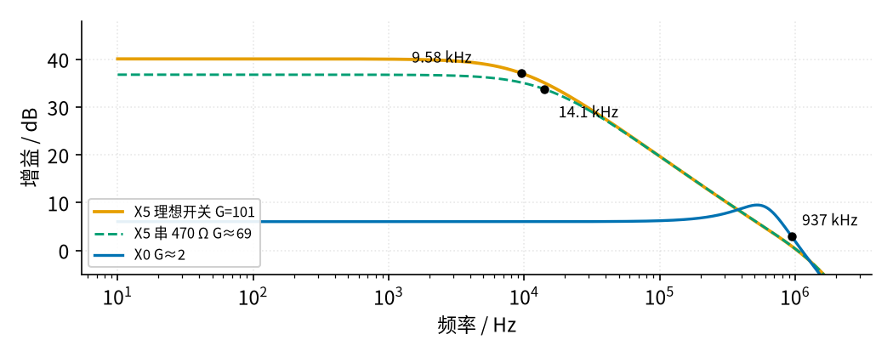
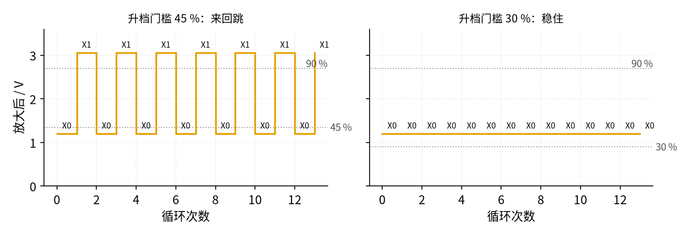
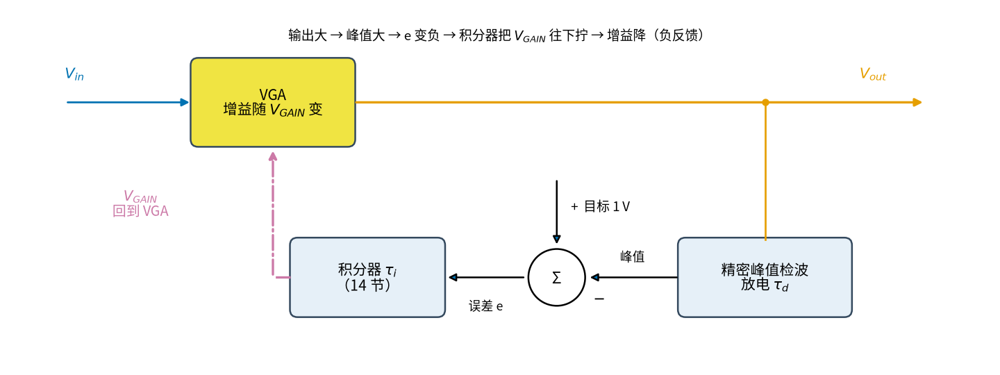

# 35 程控增益与 AGC · 参数与调试篇

[上一页：原理与实现篇](page2.md) · [直觉篇](page1.md) · [原理与实现篇](page2.md) · 本页：参数与调试篇 · [动手实验篇](page4.md) · [下一页：动手实验篇](page4.md) · 前置节点：[08 同相放大 · 参数与调试篇](../08-noninverting-amp/page3.md)、[09 精密整流 · 原理与实现篇](../09-precision-rectifier/page2.md)、[14 积分电路 · 原理与实现篇](../14-integrator/page2.md)

这一页挨个看程控增益和 AGC 里那几个“随手定的数”：运放带宽、换档门槛、满量程、AGC 的积分快慢、运放失调，以及换档后要等多久。每一项都说清它的物理含义、常用范围和改了以后会怎样。

## 一、运放带宽：倍数越高，带宽越窄

运放的**增益带宽积**（GBW）可以粗略理解为：放大倍数 × 能放大的最高频率 ≈ 一个常数。TI 手册给 LM358 的典型值是 0.7 MHz，新版 LM358B 是 1.2 MHz；本节用的 TI 模型仿真出来约 0.97 MHz。所以同样接成 101 倍，经典 LM358 的带宽约 0.7 MHz ÷ 101 ≈ 6.9 kHz，LM358B 约 1.2 MHz ÷ 101 ≈ 11.9 kHz，仿真模型在两者之间；网上常见的“LM358 百倍时约 12 kHz”只对 LM358B 成立。买到的芯片是哪一版，要看丝印和手册。

请看图 35-p3-1 三条曲线往右弯下去的位置。

*图 35-p3-1　LM358 三个档的频率响应（5 V 单电源，SPICE）*

G = 101 时 −3 dB 带宽是 9.58 kHz，G≈69 时 14.1 kHz，G≈2 时 937 kHz。前两档的“倍数 × 带宽”都约 0.97 MHz，高频部分三条线合成同一条每十倍频降 20 dB 的斜线，这就是增益带宽积。低倍数档在约 500 kHz 附近还有一个小峰（约 3.5 dB），说明 LM358 接成低倍数时相位余量变小（相位余量可以理解为负反馈离“变成振荡”还有多远，余量小了频响就会冒出一个峰）。也正因为这个峰，937 kHz 比“GBW ÷ 2 ≈ 0.48 MHz”的估算大了近一倍；按手册估，经典 LM358 在 2 倍时约 0.7 MHz ÷ 2 = 0.35 MHz，LM358B 约 0.6 MHz，所以这个数只能看成模型结果，不要当真实芯片的保证值。

对设计的意义：**换档不仅换倍数，也换带宽**。本节实验是直流，没有影响；可如果要放大超声测距里常见的 40 kHz 回波、并且要 100 倍，就需要 40 kHz × 101 ≈ 4.04 MHz 以上的增益带宽积，LM358 只有它的四分之一左右，必须换高速运放或分两级放大。

## 二、换档门槛和回差：差一点就会来回跳

降档门槛 DOWN 的意思是“读数大到这里就有削顶危险”，常取 80～95 %；升档门槛 UP 的意思是“读数小到这里分辨率就不够了”。两者之间必须留够空隙：升一档读数会乘以档比 $r$ ，所以要满足

$$UP \times r_{max} \lt DOWN$$

意思是：在升档门槛附近升一档，最坏的情况也不能一步跳过降档门槛。代数：本节最大档比 $r_{max}$ = 2.549，DOWN = 90 %，UP 的上限就是 90 % / 2.549 = 35.3 %。我们取 30 %，留了 5 个百分点。反过来看，UP 和 DOWN 定为 30 % 和 90 % 以后，档比就必须满足 $r \lt 3$ （3 = 90 % ÷ 30 %）；本节 2.549 满足。

> **先猜**：UP 从 30 % 提到 45 %，0.6 V 输入会停在哪一档？（提示：0.6 V 在 X0 是 39.9 %，在 X1 是 101.7 %。）先写下答案再往下看。

图 35-p3-2 把 UP 改成 45 %，输入固定 0.6 V，请看左边那条方波。

*图 35-p3-2　升档门槛太高时档位来回跳（输入恒定 0.6 V）*

左图：0.6 V 在 X0 档放大到 1.197 V，是满量程的 39.9 %，低于 45 %，于是升档；到了 X1 变成 3.05 V，超过 90 %（2.7 V），又被降回 X0；如此每个循环翻一次，读数永远是一半在换档，按上一页的规矩全都得丢掉。右图 UP = 30 %，39.9 % 在窗口内，档位一动不动。这种来回跳的现象叫“振荡换档”（hunting），和比较器没有回差时在门限附近乱跳是一回事。

## 三、满量程和 ADC 分辨率

满量程 FS 是你认为“放大后最高可以到多少”。它不能超过运放的输出上限：LM358 用 5 V 单电源时，输出最高只到约 3.83 V（SPICE），因为它的输出级到正电源之间要留一截压降。本节取 3.0 V，给失调和元件误差留余量。

FS 定了，分辨率也就定了：10 位 ADC、参考 5 V 时一个字 4.883 mV，3.0 V 是 614 个字，30 % 处是 184 个字，最坏量化误差 1/184 ≈ 0.54 %。想更细，可以把 UP 提高（受上一节的回差限制），或者把档分得更密（档比变小，UP 的上限随之变大），或者用 Arduino 的内部参考把 ADC 量程缩小。代价分别是更频繁换档、更多电阻、更麻烦的参考校准。

## 四、模拟 AGC 的快慢：积分时间常数

请先在图 35-p3-3 里找到两个时间常数各在哪个方框里，再往下读。

*图 35-p3-3　模拟 AGC 环：τ_d 在检波框里，τ_i 在积分框里*

模拟 AGC 里有两个时间常数：峰值检波的放电时间常数 $\tau_d$ （决定“发现信号变小”有多快），积分器的时间常数 $\tau_i$ （决定增益改得有多快）。`code/35_sim.py` 模拟了一个 AD8331 式的环：增益 = 40 dB − 50 dB/V × 控制电压（控制电压限在 0～1 V，所以增益在 −10～40 dB 之间），检波 $\tau_d$ = 20 ms，目标输出峰值 1 V；输入是 1 kHz 正弦，0.1 s 时从 50 mV 跳到 0.5 V（×10），0.3 s 时跳回 50 mV（÷10）。仿真用的是 MODE 反过来的接法（控制电压越高增益越低），所以程序里的误差写成“峰值 − 目标”，积分器输出升高时增益降低；方向和图 35-p3-3 一样，仍是负反馈。

> **先猜**：积分越慢（ $\tau_i$ 越大），输入突然 ×10 时，第一个周期的输出会冲得更高还是更低？先写下答案再看图 35-p3-4。

请看图 35-p3-4 上图里 100 ms 处那三个尖峰，以及下图增益曲线的形状。

*图 35-p3-4　模拟 AGC 积分时间常数 τ_i 的影响（35_sim.py）*

先说一个和本节讨论无关的地方：0 ms 处那个很高的冲高，是仿真起步时增益从 40 dB 开始造成的（检波器里还什么都没有）：第一个周期输出冲到 2.2～4.7 V（ $\tau_i$ 越大越高），随后增益被拧到 −10 dB 的下限，输出跌到约 0.016～0.032 V，再慢慢回升。只看 100 ms 和 300 ms 两处。

| $\tau_i$ | 输入 ×10 后第一个周期的峰值 | 回到目标 ±1 dB 用时 | 稳态增益起伏（峰峰值） |
|---|---|---|---|
| 1 ms | 3.00 V | 28 ms | 0.96 dB |
| 5 ms | 5.25 V | 42 ms | 0.01 dB |
| 50 ms | 8.47 V | 85 ms | 0.00 dB |

三件事要看懂：

1. **慢的环冲得高。** 输入突然变大，增益来不及往下拧，第一个周期的输出就冲到 8.47 V（ $\tau_i$ = 50 ms）。真实电路里 5 V 供电的放大器早已削顶，ADC 也可能被过压。快的环只冲到 3.00 V。
2. **快的环把信号本身也“调”了。** $\tau_i$ = 1 ms 只比信号周期（1 ms）大一点，增益在每个周期里跟着检波器的纹波上下晃，稳态起伏 0.96 dB。增益在一个周期里变来变去，正弦波就被扭曲了，这就是“AGC 太快会把信号的幅度变化抹掉、甚至产生失真”。经验上 $\tau_i$ 至少要比信号周期大几倍到几十倍。
3. **回升被检波器卡住。** 输入变大后，增益一口气被拧到下限 −10 dB，输出跌到约 0.16 V，要等检波器按 $\tau_d$ = 20 ms 放电、承认“信号其实没那么大了”，增益才往回走。所以无论 $\tau_i$ 多小，回到 ±1 dB 都要 28 ms 以上。想让 AGC 回得快，要同时缩短 $\tau_d$ ，可 $\tau_d$ 太短，检波纹波又变大。这就是收音机里所说的“快攻慢放”（attack 快、release 慢）为什么要分开设计。

图里这组数中， $\tau_i$ = 5 ms 是一个比较好的折中：冲得不算太高，42 ms 稳住，稳态几乎不晃。

## 五、运放失调：小信号档的隐形杀手

LM358 手册给的最大输入失调电压是 ±7 mV（LM358B ±3 mV）。失调相当于在输入端串了一只小电池，它也被放大。SPICE 里模型的失调约 1.9 mV，输入接 0 V 时 G≈69 档的输出就有 0.133 V，正好是 1.93 mV × 69。最坏的 7 mV 会给出约 0.48 V，占 3.0 V 满量程的 16 %。

对策：在每一档都做一次**零点校准**（输入短接到地，记下读数，以后减掉）；或者高增益档换失调更小的运放。注意：动手实验篇用①÷②算倍数，只是为了让**校准出来的倍数**不被失调带偏；真正读数时，失调仍然在，还是要靠零点校准扣掉。另外 LM358 是单电源运放，单电源下输入为 0 时输出可能就停在几毫伏到几十毫伏之上，读数到不了 0；如果你那只芯片的失调恰好是负的，输出会贴在 0 V 附近，零点读不出来，这时零点校准要改用一个小的已知输入（例如 10 mV）来做。

## 六、换档后要等多久

换档的一瞬间，模拟开关会把一点电荷注入反相端，运放也要重新稳定。只算运放：G = 101 时 −3 dB 带宽 9.58 kHz，对应时间常数 $1/(2\pi \times 9580)$ ≈ 16.6 µs，稳定到 0.1 % 约要 $\ln 1000 \approx 6.9$ 个时间常数，约 0.115 ms。Arduino 程序每 20 ms 循环一次，远远够了。但信号链里如果有隔直电容（交流耦合）或滤波器，等待时间要按那些更大的时间常数算，这也是为什么程序里干脆规定“换档后的第一次读数丢掉”。

**电荷注入到底是什么。** CD4051 的每个通道其实是一对 MOS 管，栅极由选档线 A/B/C 经芯片内部的逻辑驱动。MOS 管的栅极和沟道之间有一点寄生电容；选档的一瞬间，栅极电压在 0 V 和 5 V 之间跳变，这点电容就把一小团电荷“推”进信号线，这就叫电荷注入。本电路的开关接在运放反相端，这团电荷只能经 $R_f$ 流走，于是输出①上出现一个很短的尖峰（毛刺），等运放重新稳定后自己消失。TI 的 CD4051B 数据手册没有给出电荷注入的数值，所以本节不估算尖峰有多高，只讲怎么躲开它。

**对策。** ① 换档后丢掉第一次读数，这是本节程序的做法，最简单也最可靠；② 不要在改选档线的同时读 ADC，改完线后至少等几倍于信号链里最大的时间常数再读；③ 程序里用 `digitalWrite` 依次改 A、B、C 三根线时，中间会短暂经过别的档位（例如从 X3 = 011 到 X4 = 100，可能先经过 X2 = 010、X0 = 000，或者 X7 = 111），所以中间状态也会产生毛刺，这又是第一次读数必须丢掉的一个理由；④ 对精度要求更高的场合，可以在 ADC 前加一级 RC 低通把尖峰抹平，或者选数据手册里明确标出低电荷注入的模拟开关。

## 故障排查表

| 现象 | 原因 | 怎么查 | 怎么改 |
|---|---|---|---|
| 高增益档读数比算的小 20～30 % | 开关 $R_{on}$ 串在 $R_g$ 里，5 V 下约 470 Ω | 量反相端②和通道脚③的电压差，除以 $R_g$ 上的电流，反算 $R_{on}$ | 换算用实测倍数表；或改成抽头接法；或把 CD4051 的 VDD 提高 |
| 档位每个循环都在两档之间跳 | 升档门槛乘以最大档比超过了降档门槛 | 打印每次的档位和读数，看是否交替 | 降低 UP，使 $UP \times r_{max} \lt DOWN$ |
| 输入为 0，高增益档却读到零点几伏 | 运放失调被放大（G≈69 时约 0.13 V，最坏约 0.48 V） | 输入短接到地，量输出① | 每档做零点校准；换低失调运放 |
| 大信号时读数停在约 780 字不再变 | 运放输出顶到约 3.83 V（5 V 供电的上限） | 万用表量①，看是不是 3.8 V 左右 | 降低满量程 FS，或确认程序会降档 |
| 不管怎么选，倍数都是同一个 | 选择线 A/B/C 没接好，或 INH 悬空/接高 | 量 CD4051 第 9、10、11 脚和 6 脚的电压 | A/B/C 接到 Arduino 输出脚，INH 接地 |
| 输出直接顶到最高、跟输入无关 | 反相端没接到任何 $R_g$ （COM 断开或所有通道断开），运放开环 | 量②，看是否远离④ | 检查 COM 到运放 2 脚的连线、INH 是否为低 |
| 选档线接好了，可档位乱跳或总停在一档 | CD4051 的 VDD 接了 9～12 V，Arduino 的 5 V 高电平够不着它的高电平门槛（手册：VDD = 5 V 时最小 3.5 V，10 V 时 7 V） | 量第 16 脚和第 9、10、11 脚 | CD4051 只接 5 V；它和 LM358 都是本节的 5 V 器件，别接到 9～12 V 上 |
| 某一档倍数忽然等于 1，像跟随器 | 程序选到了空通道 X6/X7，或 INH 悬空，反相端只剩 $R_f$ | 串口打印档号；量第 6 脚是不是 0 V | 档号限制在 0～5；INH 直接接地 |
| 换档后第一次读数有个尖峰，接着又换回去 | 换档瞬间的开关毛刺被高倍数放大 | 打印换档前后的读数 | 换档后的第一次读数丢掉 |
| 加了交流信号、把输入偏到中点参考 $V_{MID}$ （约 2.5 V）后，输出一直顶在最高 | 本电路 $R_g$ 下端接地，直流偏置也被放大几十倍 | 断开信号，量①的直流 | 输入只垫几十 mV 直流；或把 $R_g$ 的下端也接到 $V_{MID}$ |
| 低倍数档方波有过冲、振铃 | CD4051 COM 端约 30 pF 挂在反相端（抽头接法更明显） | 有示波器时看 X0 档的方波边沿 | 在 $R_f$ 两端并 22～33 pF |
| 高增益档交流倍数比算的低 | 手里是经典 LM358（增益带宽 0.7 MHz），不是 LM358B（1.2 MHz） | 看芯片丝印 | 信号频率留在 1 kHz 以下，或换更快的运放 |
| 输出上有毛刺，手碰电源线时变化 | 两颗芯片没有就近去耦 | 对照接线图检查两只 100 nF 是否插在 8 脚、16 脚旁 | 每颗芯片电源脚各一只 100 nF 到地 |
| 模拟 AGC 输出声音发闷、波形变形 | 积分太快，增益在一个周期内变化 | 看增益控制电压上有没有和信号同频的纹波 | 加大 $\tau_i$ ，或加大检波电容 |
| AGC 大信号来时削顶很久 | 积分太慢 | 看输入跳变后输出多久回到目标 | 减小 $\tau_i$ ，或加一个“快攻”支路 |

## 练习

**1.** 输入 0.35 V，程序当前在 X0 档（实际倍数 1.995，X1 为 5.087），满量程 3.0 V，UP = 30 %、DOWN = 90 %。这一次读数占满量程的百分之多少？会不会换档？换完以后会不会再换？

答案

0.35 × 1.995 = 0.698 V，0.698 / 3.0 = 23.3 %，低于 30 %，升到 X1；X1 是 0.35 × 5.087 = 1.780 V，59.3 %，落在 30 %～90 % 之间，停下，不会来回跳。即使把 UP 改成 45 %，59.3 % 也高于它，照样停下。

**2.** 有人把六档改成 X0 的倍数 2、X1 的倍数 10（中间那几档拿掉了），降档门槛仍是 90 %。升档门槛最高能取多少？此时最坏的量化误差是多少（用 614 字满量程算）？

答案

档比 10/2 = 5，UP 上限 90 % / 5 = 18 %。18 % × 614 ≈ 110 字，最坏量化误差约 1/110 ≈ 0.9 %，比原来的 0.54 % 差。档分得越粗，回差窗口必须越宽，最差分辨率越差。

**3.** 一台 LM358（失调最坏 7 mV）接在 X5 档（实际 69 倍）。输入 30 mV 时，仅失调就可能让读数偏多少？若改用 LM358B（3 mV）呢？

答案

失调相当于输入多了 7 mV，相对 30 mV 是 7/30 ≈ 23 %；LM358B 是 3/30 = 10 %。所以高增益档必须做零点校准；动手实验篇用②当分母，只是让测出的倍数本身准确。

**4.（变体迁移）** 要给 40 kHz 的超声回波做 AGC，信号周期 25 µs，回波串持续约 0.5 ms。按本页第四节的思路，检波时间常数和积分时间常数大致应选在什么范围？为什么不能照搬图 35-p3-4 里的 5 ms？

答案

积分时间常数要比信号周期大几倍到几十倍，约 0.1～0.2 ms 起步（信号周期 25 µs 的 4～8 倍）；同时它必须明显短于约 0.5 ms 的回波串，否则一个回波还没来得及调增益就结束了。检波放电时间常数也要比一个周期长、比两次发射的间隔短。图 35-p3-4 的 5 ms 是给 1 kHz 信号选的，用在 40 kHz、0.5 ms 长的回波上根本来不及动作。实际超声表常常不在单个回波里调增益，而是按上一次回波的幅度给下一次设增益，这其实就是数字 AGC。

## 小结

- 增益带宽积约 0.97 MHz（LM358 模型）：G = 101 时带宽 9.58 kHz，换档也换带宽。
- 门槛要满足 $UP \times r_{max} \lt DOWN$ ，本节上限 35.3 %，取 30 %；否则来回跳。
- 满量程不能超过运放输出上限（5 V 下约 3.83 V）；30 % 处 184 个字决定了最坏 0.54 % 的量化误差。
- 模拟 AGC：积分太快会扭曲信号（1 ms：0.96 dB 起伏），太慢会冲高（50 ms：8.47 V）；回升速度受检波 $\tau_d$ 限制。
- 高增益档要做零点校准；换档后的第一次读数丢掉。

## 参考资料

- TI LM358 数据手册（失调 ±7 mV、增益带宽 0.7 MHz）：https://www.ti.com/lit/ds/symlink/lm358.pdf
- TI LM358B 数据手册（失调 ±3 mV、增益带宽 1.2 MHz；与上一条是同一份 SLOS068 文档，两个链接都能打开）：https://www.ti.com/lit/ds/symlink/lm358b.pdf
- TI CD4051B 数据手册：https://www.ti.com/lit/ds/symlink/cd4051b.pdf
- ADI AD8331 / AD8332 / AD8334 数据手册（MODE 脚与 AGC 应用）：https://www.analog.com/media/en/technical-documentation/data-sheets/AD8331_8332_8334.pdf
- TI TDC1000 数据手册（超声前端内置 PGA）：https://www.ti.com/lit/ds/symlink/tdc1000.pdf
