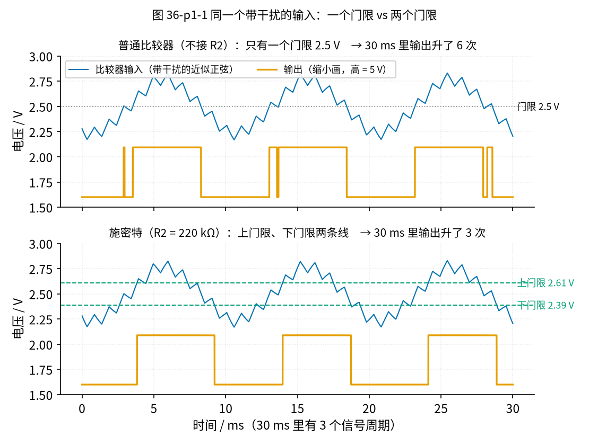
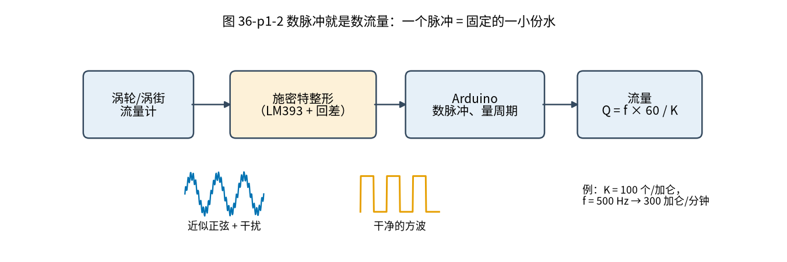

# 36 施密特整形与频率/脉冲计数 · 直觉篇

[上一页：35 程控增益与 AGC · 动手实验篇](../35-pga-agc/page4.md) · 本页：直觉篇 · [原理与实现篇](page2.md) · [参数与调试篇](page3.md) · [动手实验篇](page4.md) · [下一页：原理与实现篇](page2.md) · 前置节点：[10 电压比较器 · 直觉篇](../10-voltage-comparator/page1.md)、[29 上拉/下拉电阻与电平转换 · 直觉篇](../29-pullup-level-shift/page1.md)、[33 带通与 50 Hz 陷波 · 直觉篇](../33-bandpass-notch/page1.md)

## 开始之前：三个小问题

先用三道题回忆一下前面学过的东西，答不上来就点链接回去看一眼。

1. [10 节](../10-voltage-comparator/page1.md) 的比较器：同相端比反相端高时，输出是高还是低？
2. [29 节](../29-pullup-level-shift/page1.md) 的开集电极输出：芯片自己能把输出拉高吗？高电平由谁决定？
3. [33 节](../33-bandpass-notch/page1.md) 的带通：它能把所有干扰都滤得干干净净吗？

揭晓

1. 输出高（对 LM393 来说，是输出管子断开，由上拉电阻拉高）。
2. 不能。开集电极输出只会「拉低」或「松手」，松手时的高电平等于上拉电阻接的那个电压。所以本节的上拉电阻接 Arduino 的 5 V，送进 Arduino 的高电平就不超过 5 V。
3. 不能。带通只是把通带外的干扰压小很多，总会剩一点，这一点剩下的干扰正是本节要对付的。

## 痛点：数脉冲，却数多了

很多流量计不直接告诉你「每分钟流过多少水」，而是吐出一串脉冲：

- **涡轮流量计**：管子里有一只小叶轮，水推着它转，每转过一片叶片，旁边的线圈或霍尔元件就给出一个脉冲；
- **涡街流量计**：水绕过一根柱子，后面交替甩出旋涡，压电片感到一下就是一个脉冲；
- **风扇测速**：扇叶每挡一次红外光，就是一个脉冲。

道理都一样：**流过的水越多，脉冲越多；流得越快，脉冲越密**。所以「数脉冲」就等于「量水」。

可是传感器吐出来的不是干净的方波，而是一条歪歪扭扭的「近似正弦」，上面还叠着别的东西窜进来的小锯齿。前面 [33 节](../33-bandpass-notch/page1.md) 的带通能滤掉一大部分，但总会剩一点。把这样的信号直接送进 Arduino 去数，会发生什么？

## 先预测一下

假设信号每 10 ms 一个周期，30 ms 里一共 3 个周期。我们把它接到 [10 节](../10-voltage-comparator/page1.md) 那种**只有一个门限**的比较器上：信号高于 2.5 V 输出高，低于 2.5 V 输出低。信号上还叠着一层细小的锯齿干扰。

**问题**：30 ms 里，比较器输出「由低变高」会有几次？

- A. 3 次，一个周期一次；
- B. 比 3 次多；
- C. 0 次，干扰把信号盖住了。

先自己想一想，写下你的选择，再点开揭晓看图 36-p1-1。

揭晓：答案是 B

*图 36-p1-1　同一个带干扰的输入，分别送进「一个门限」和「两个门限」的比较器*

图 36-p1-1 上一行，普通比较器在 30 ms 里升了 **6 次**，是正确次数的 2 倍。原因在信号**穿过门限的那一小段**：信号本身在慢慢往上走，叠在上面的锯齿却在快速地上下抖。合起来的电压在门限附近会「过线—退回—再过线」好几次，比较器老老实实地每过一次就翻一次。

C 错在：干扰只有大约 0.13 V 峰峰值，信号有约 0.54 V，信号并没有被盖住，只是在门限附近被「搅」乱了。

后面第二页的仿真把时间拉长到 1 秒：信号其实是 100.16 Hz（每秒 100.16 个周期），普通比较器却数出了 **175 个**。用这个数去算流量，就会把每分钟 60 加仑说成每分钟 105 加仑左右（60.10 × 1.75），完全不能用。

## 解决办法：两条线，加一点「记性」

[10 节](../10-voltage-comparator/page1.md) 已经见过办法：**施密特比较器**。它有两条门限：

- 输出为低的时候，输入要升过**上门限**才翻高；
- 输出为高的时候，输入要降过**下门限**才翻低；
- 夹在两条线之间时，输出**保持上一次的状态**，就像有了一点「记性」。

10 节用 LM393 做的施密特比较器由 5 V 供电，门限是 2.75 V 和 2.26 V。本节实验的 LM393 改用 9 V 电池供电（为什么要换，[参数与调试篇第三节「共模范围」](page3.md#三为什么-lm393-要用-9-v共模范围)会讲），上拉电阻仍接 5 V，门限是 **2.61 V 和 2.39 V**，两条线之间相差约 0.22 V，这个差叫**回差**。

回到揭晓里的图 36-p1-1 下一行：信号升过 2.61 V 时，输出翻高；锯齿让电压往回退一点点，但退不到 2.39 V 以下，输出就不动。干扰「跨不过」回差，于是一个周期只翻一次，30 ms 里正好 3 次。

### 类比：门口数人

商场门口有个人拿着计数器数进店的人。

- **一条线的数法**：脚尖一过门槛就按一下。有人站在门槛上犹豫，前后晃了三下，就被数成了三个人。
- **两条线的数法**：门外一条线、门里一条线。必须先从门外线走过门里线才算「进店」一次；只要还没退回门外线，在中间晃多少下都不算。

门里线和门外线之间那段距离就是回差。距离太近，晃得厉害的人还是会被多数；距离太远，有人只是探头看一眼没真正进来，就一个也数不到。**回差到底取多宽**，正是[第三页「回差要多宽」](page3.md#一回差要多宽比干扰大比信号小)要回答的问题。

## 再往前一步：脉冲怎么变成流量

把整形后的方波送进 Arduino，就能数脉冲、量频率。整条链见图 36-p1-2。

*图 36-p1-2　数脉冲就是数流量：一个脉冲 = 固定的一小份水*

流量计的说明书会给一个 **K 系数**：每流过 1 加仑（或 1 升）的水，它吐出多少个脉冲。比如 K = 100 个/加仑：

- **数总数**：数到 1000 个脉冲，就是流过了 1000 ÷ 100 = 10 加仑；
- **量频率**：每秒 500 个脉冲，就是每秒 5 加仑，每分钟 300 加仑。GPM 就是「加仑/分钟」。

所以 Arduino 只做两件事：**数脉冲**（得到总量）和**量频率**（得到瞬时流量）。这两件事都要求一个周期只给一个干净的边沿，这就是施密特比较器在这里的作用。

## 本节实验长什么样

手边多半没有真的涡轮流量计，所以[第四页](page4.md)用 Arduino 自己「冒充」一个：

- **信号**：D7 脚输出 100.16 Hz 方波，经过两级 RC 磨成近似正弦，像传感器的输出；
- **干扰**：D5 脚输出约 977 Hz 的 PWM，经一只 2.2 kΩ 电阻叠到信号上，像窜进来的噪声；
- **整形**：LM393 接成施密特比较器，由 9 V 电池供电，输出经上拉电阻接到 Arduino 的 5 V（为什么上拉只能接 5 V，见 [29 节上拉电阻](../29-pullup-level-shift/page1.md) 和[第四页](page4.md)的安全须知）；
- **计数**：输出回到 Arduino 的 D8 脚，用定时器量周期，再假装 K = 100，算出「流量」约 60.10 GPM。

实验里你会亲手做三次对比：不加干扰、加干扰但没有回差、加干扰也加上回差。数一数每种情况下 Arduino 每秒读到多少个脉冲。

## 一句话总结

带干扰的信号在门限附近会被数成好几个脉冲；施密特比较器用两条门限加一点「记性」，让一个周期只翻一次。整形之后，数脉冲得到总量，量频率得到流量，Q = f × 60 / K。

> **预告**：真实的流量计信号常常先经过带通（33 节）、可变增益（35 节），再来到这里整形计数，42 节会把它们串成完整的流量计信号链。下一节（37 节）的超声波流量计要量的是几十纳秒的时间差，那里会把施密特比较器升级成「先用门限确认，再在过零点触发」。
