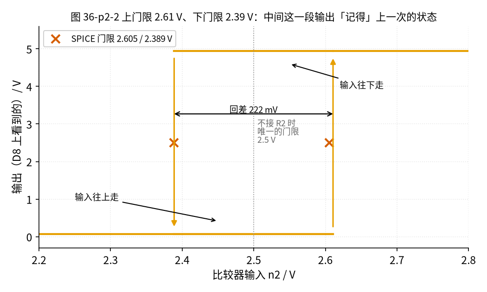
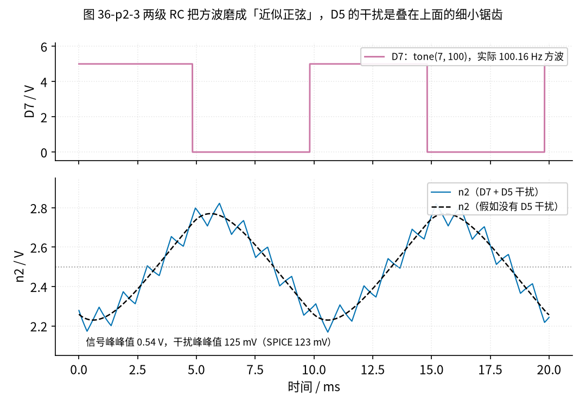
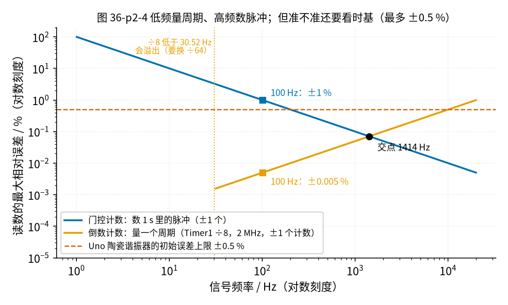
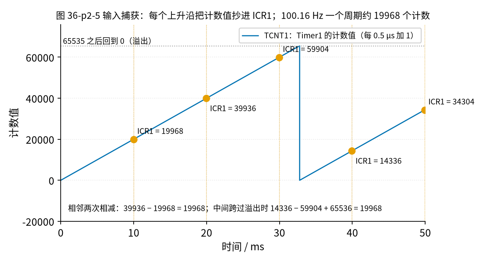

# 36 施密特整形与频率/脉冲计数 · 原理与实现篇

[上一页：直觉篇](page1.md) · [直觉篇](page1.md) · 本页：原理与实现篇 · [参数与调试篇](page3.md) · [动手实验篇](page4.md) · [下一页：参数与调试篇](page3.md) · 前置节点：[10 电压比较器 · 原理与实现篇](../10-voltage-comparator/page2.md)、[29 上拉/下拉电阻与电平转换 · 原理与实现篇](../29-pullup-level-shift/page2.md)

## 这一页要解决的问题

1. 本节的施密特比较器，两条门限各是多少？怎么从电阻值算出来？
2. 信号和干扰在比较器入口长什么样？
3. Arduino 怎么把方波变成「频率」：每秒数个数，还是量一个周期有多长？哪种更准？
4. 有了频率，怎么换算成流量？

## 一、电路：信号、干扰、比较器、Arduino


*图 36-p2-1　本节电路原理图（①②③ 是第四页的测量点）*

**对照看**图 36-p2-1，从左往右分四段：

- **信号源**（左上）：D7 输出 0/5 V 方波。Rs1、C1 和 Rs2、C2 是两级 RC 低通，把方波的棱角磨圆，到 n2 点就成了中心约 2.5 V 的近似正弦，像一只传感器的输出。
- **干扰源**（左下）：D5 输出约 977 Hz 的 PWM，经 Rn 叠到 n2 上。Rn 越小，干扰越强。
- **比较器**（中间）：n2 经 R1 进 3 脚（同相端），R2 从 1 脚（输出）接回 3 脚，这就是 [10 节](../10-voltage-comparator/page2.md) 的施密特接法。2 脚（反相端）接 Ra、Rb 分出的 $V_{ref}$ = 2.5 V，Cref 让它更稳。
- **输出与计数**（右边）：LM393 是**开集电极输出**，自己只会「拉低」，不会「推高」，高电平全靠 R3 上拉（[29 节](../29-pullup-level-shift/page2.md)）。R3 接的是 Arduino 的 5 V，所以输出在 0～5 V 之间，可以直接进 D8。

LM393 的电源（8 脚）接 9 V 电池，而不是 Arduino 的 5 V。原因在[第三页「共模范围」一节](../36-schmitt-pulse-shaping/page3.md#三为什么-lm393-要用-9-v共模范围)：输入电压最高约 2.92 V，5 V 供电时允许的上限只有 3.0 V，余量太小；9 V 供电时上限是 7.0 V，宽裕得多。电池和 Arduino 的 GND 必须连在一起。

## 二、两条门限：沿用 10 节的推法

10 节推出的结论是：输出为低时求上门限，输出为高时把 $V_o$ 当作上拉电压，同样列方程求下门限。本节唯一的不同是：**输出高电平由上拉电阻决定**，所以公式里的「输出高」用的是 Arduino 的 5 V，记作 $V_A$ ，而不是 LM393 的电源 9 V。

先用简化式（忽略 R3 和输出低电平）：

$$V_H = V_{ref} \cdot \frac{R_1 + R_2}{R_2}$$

$$V_L = \frac{V_{ref} (R_1 + R_2) - V_A R_1}{R_2}$$

$$\Delta V = V_H - V_L = V_A \cdot \frac{R_1}{R_2}$$

中文意思：回差等于「输出摆幅 × R1/R2」。

**代数**：取 $V_{ref}$ = 2.5 V， $V_A$ = 5 V， $R_1$ = 10 kΩ， $R_2$ = 220 kΩ：

- $V_H$ = 2.5 × 230 / 220 ≈ 2.6136 V；
- $V_L$ = (2.5 × 230 − 5 × 10) / 220 ≈ 2.3864 V；
- 回差 = 5 × 10 / 220 ≈ 227.3 mV。

**更精确一点**：输出低时，LM393 的输出管要吸收 R3 的电流（约 1 mA），输出不是 0，而是约 0.065 V；输出高时，R2 和 R3 分压，输出约 4.948 V，不是整 5 V。把这两个数代进去，`code/36_sim.py` 算出 $V_H$ = 2.6107 V、 $V_L$ = 2.3887 V，回差 221.9 mV，两条门限的中点 2.4997 V，几乎正好在信号中心 2.5 V 上。简化式误差只有约 3 mV，手算用简化式就够了。



*图 36-p2-2　回差曲线：输入慢慢升、慢慢降，输出在哪里跳（SPICE 扫出 2.605 V / 2.389 V）*

**对照看**图 36-p2-2：向右的箭头是输入上升，必须到 2.61 V 才翻高；向左的箭头是输入下降，必须到 2.39 V 才翻低。夹在中间那 0.22 V 宽的一段里，输出有两种可能，取决于输入是从哪边来的，这就是直觉篇说的「记性」。SPICE（`spice/36/thresh.cir`）扫出来的门限是 2.605 V 和 2.389 V，与手算相差不到 0.3%。

为什么不能用「虚短」去算？10 节讲过：R2 是**正反馈**，输出一翻，同相端被推得离反相端更远，两端根本不「短」。

和 [24 节的弛张振荡器](../24-oscillator/page1.md) 比一比：那里电容电压送进**反相端**，正反馈电阻分出的门限接在同相端，是「反相」施密特，输入升过上门限时输出翻**低**；本节信号经 R1 进**同相端**，参考电压接反相端，是「同相」施密特，输入升过上门限时输出翻**高**。两种接法都有两条门限，只是输出方向相反、门限公式不同，不要把 24 节的公式直接搬过来。

**为什么用比较器 LM393，而不用运放 LM358？** LM393 数据手册给出的响应时间典型值约 1.3 µs，输出是开集电极，上拉到几伏就输出几伏，正好接 Arduino。LM358 是运放，数据手册给出的压摆率典型值只有约 0.3 V/µs，从低翻到约 5 V 要约 16 µs，而且输出高电平跟着它自己的 9 V 电源走，不能直接进 Arduino。

## 三、比较器入口的信号长什么样



*图 36-p2-3　两级 RC 把方波磨成「近似正弦」，D5 的干扰是叠在上面的细小锯齿*

图 36-p2-3 给出 n2 点的仿真波形：

- **信号**：峰峰值约 0.541 V，周期 9.984 ms（100.16 Hz）；
- **干扰**（Rn = 2.2 kΩ）：峰峰值约 125.3 mV，周期约 1 ms；
- **两者叠加**：峰峰值约 0.663 V。

为什么 D7 发 0～5 V 的方波，到 n2 只剩约 0.54 V？每一级 RC 的转折频率约 33.9 Hz（1 kΩ、4.7 µF），比 100 Hz 还低，方波里的高次谐波几乎全被滤掉，基波也只剩一小部分。D5 的干扰频率更高（约 977 Hz），被 C2 衰减得更厉害，所以比信号小得多，但仍足以在过门限时「搅」一下。

下面这段代码用最简单的方式重现直觉篇的结论：同样的输入，一个门限和两个门限各数出多少个上升沿。它只用 Python 自带的 `math`，不写任何文件，可以直接运行。

```python
import math

F_SIG, F_NOISE = 100.16, 976.5625      # 信号和干扰的频率（Hz）
A_SIG, A_NOISE = 0.541 / 2, 0.1253 / 2  # 半峰峰值（V），取自 36_sim 的 n2 数据
DT = 1e-6                               # 1 µs 一步

def vin(t):
    # 近似：正弦信号 + 三角形干扰（PWM 经 RC 后接近三角波）
    tri = 4 * abs((t * F_NOISE) % 1 - 0.5) - 1
    return 2.5 + A_SIG * math.sin(2 * math.pi * F_SIG * t) + A_NOISE * tri

def count_rises(vh, vl, t_end=0.2):
    out, n, t = 0, 0, 0.0
    while t < t_end:
        v = vin(t)
        if out == 0 and v > vh:
            out, n = 1, n + 1
        elif out == 1 and v < vl:
            out = 0
        t += DT
    return n

single = count_rises(2.5, 2.5)          # 一个门限
schmitt = count_rises(2.6107, 2.3887)   # 本节的两个门限
print("0.2 s 内应有约", round(F_SIG * 0.2), "个周期")
print("一个门限：", single, "个上升沿")
print("施密特：  ", schmitt, "个上升沿")
assert schmitt == round(F_SIG * 0.2)
assert single > schmitt
```

这段代码里的干扰是理想三角波，数出来的「一个门限」的个数会和第四页、SPICE 的 175 个/秒不完全一样，因为多翻几次取决于干扰和信号的相对相位。结论是一样的：一个门限会多数，施密特刚好。

## 四、最小补充：Arduino 怎么量频率

整形以后的方波进到 D8。Arduino 有两种量法。

### 1. 门控计数：数 1 秒里有几个边沿

最直白的办法：开一扇 1 秒的「门」，数门里有几个上升沿，个数就是频率。

问题是**边沿不一定正好落在门的边上**。100.16 Hz 时，1 秒里有 100.16 个周期，但边沿只能数整数个：有时数到 100，有时数到 101。按 `36_sim.py` 的统计，读到 100 的概率是 84%，读到 101 的概率是 16%。这就是门控计数的 **±1 误差**：

$$\text{相对误差} \approx \frac{1}{f \cdot T_g}$$

中文意思：门开 $T_g$ 秒，数到 $f \cdot T_g$ 个，多一个或少一个就差 $1/(f \cdot T_g)$ 。门开 1 秒时：1 Hz 差 ±100%，10 Hz 差 ±10%，100 Hz 差 ±1%，1 kHz 差 ±0.1%。**频率越低，门控计数越不准**，而涡轮流量计低流量时恰恰只有几赫兹。

### 2. 倒数计数：量一个周期有多长

反过来：用一个很快的「秒表」量一个周期占多少个滴答，再取倒数得到频率。Arduino Uno 的 16 MHz 时钟经 Timer1 ÷8 后是 2 MHz，一个滴答 0.5 µs。100 Hz 一个周期约有 20000 个滴答，多一个少一个只差：

$$\text{相对误差} \approx \frac{f}{f_{clk}} = \frac{100}{2000000}$$

即 0.005%。中文意思：被测频率越**低**，一个周期里滴答越多，倒数计数越**准**，正好和门控计数相反。



*图 36-p2-4　低频量周期、高频数脉冲；但准不准还要看时基（最多 ±0.5 %）。÷8 的那条线只画到 30.52 Hz，再低就会溢出*

**对照看**图 36-p2-4：两条线在约 1414 Hz 相交，此时两种方法误差都约 0.071%。低于这个频率用倒数计数，高于它用门控计数。倒数计数那条线在左边 30.52 Hz 处截断：÷8 时更低的频率一个周期超过 65536 个滴答，要换更大的分频（见下面的分频表）。

图里那条水平虚线很重要。Arduino Uno 的 16 MHz 来自一只陶瓷谐振器（Murata CSTCE16M0V53-R0），它的初始频率误差最多 **±0.5%**。秒表本身走得快了或慢了，量出来的频率也跟着偏。所以要分清两个词：

- **分辨率**：能分辨的最小变化。倒数计数在 100 Hz 时是 0.005%；
- **准确度**：和真值差多少。受时基限制，最多可能差 ±0.5%。

0.005% 的分辨率不等于 0.005% 的准确度。按 `36_sim.py`：倒数计数在 10000 Hz 以下，±1 滴答的误差都小于时基的 ±0.5%；门控计数要到 200 Hz 以上才小于 ±0.5%。想更准，就得换晶振或拿标准频率校准。

### 3. Timer1 输入捕获：让硬件替你按秒表

倒数计数要在边沿到来的那一瞬间读一下计时器。如果靠程序去读，中断响应有几微秒的延迟，还会抖。ATmega328P 的 Timer1 有一个硬件功能叫**输入捕获**（ICP1），Uno 上就是 **D8 脚**：



*图 36-p2-5　输入捕获：每个上升沿把计数值抄进 ICR1；100.16 Hz 一个周期约 19968 个计数*

**对照看**图 36-p2-5：

- Timer1 是一个 16 位计数器，按 2 MHz 不停地从 0 数到 65535，然后回到 0 重新数（锯齿线）；
- D8 上每来一个上升沿，硬件在同一瞬间把当时的计数值抄进寄存器 ICR1（竖线），然后触发一次中断让程序来取；
- 相邻两次的差就是一个周期的滴答数：39936 − 19968 = 19968。

第四个捕获值 14336 比上一个 59904 小，是因为计数器中间回了一次零。用 16 位**无符号**减法，14336 − 59904 会自动「借位」，结果是 14336 − 59904 + 65536 = 19968，照样对。前提是一个周期不能超过 65536 个滴答：

| Timer1 分频 | 一个滴答 | 100 Hz 一个周期的计数 | 不溢出的最低频率 |
|---|---|---|---|
| ÷1 | 0.0625 µs | 160000（超过 65535，不行） | 244.14 Hz |
| ÷8 | 0.5 µs | 20000 | 30.52 Hz |
| ÷64 | 4 µs | 2500 | 3.81 Hz |
| ÷256 | 16 µs | 625 | 0.954 Hz |
| ÷1024 | 64 µs | 156.25（不是整数，分辨率变粗） | 0.238 Hz |

本节信号 100.16 Hz，取 ÷8：19968 个滴答，频率 = 2000000 / 19968 ≈ 100.160 Hz。

## 五、从频率到流量

流量计的 K 系数是「每单位体积的脉冲数」。按 Omega 的涡轮流量计资料（见文末），以加仑为单位时：

$$Q_{GPM} = \frac{f \times 60}{K}$$

中文意思：每秒 $f$ 个脉冲，乘 60 是每分钟的脉冲数，再除以「每加仑多少个脉冲」，就是每分钟多少加仑。累计体积更简单：总脉冲数 ÷ K。

## 六、例题：先预测，再揭晓

### 例 1：换一只 R2

把 R2 从 220 kΩ 换成 150 kΩ，其余不变。

**先预测**：回差变大还是变小？大约多少？

<details>
<summary>揭晓</summary>

R2 变小，正反馈变强，回差变大。简化式：

- $V_H$ = 2.5 × 160 / 150 ≈ 2.6667 V；
- $V_L$ = (2.5 × 160 − 5 × 10) / 150 ≈ 2.3333 V；
- 回差 ≈ 333.3 mV。

`36_sim.py` 的精确值是 2.6623 V / 2.3384 V，回差 323.9 mV；SPICE 是 2.655 V / 2.338 V。

</details>

**变体**：如果要把回差做到约 0.5 V，R2 大约取多少？（提示：用 $\Delta V = V_A R_1 / R_2$ 反解。）

<details>
<summary>揭晓</summary>

$R_2$ = 5 × 10 / 0.5 = 100 kΩ。`36_sim.py` 的精确值是 482.3 mV，比简化式小一点，原因同上：输出高只有约 4.95 V、输出低不是 0。

</details>

### 例 2：K 系数换算

一只 K = 100 个/加仑的涡轮流量计，Arduino 量到 500 Hz。

**先预测**：每分钟多少加仑？

<details>
<summary>揭晓</summary>

$Q$ = 500 × 60 / 100 = 300 GPM。换成升：1 加仑约 3.785 升，约 1135.5 L/min。本节实验的 100.16 Hz 如果当成 K = 100 的流量计，就是 60.10 GPM。

</details>

**变体**：有的流量计 K 按「个/升」给。K = 450 个/升，量到 60 Hz，每分钟多少升？1 分钟里一共数到多少个脉冲？

<details>
<summary>揭晓</summary>

60 × 60 / 450 = 8.0 L/min；1 分钟数到 60 × 60 = 3600 个。公式不变，只是单位跟着 K 走。

</details>

### 例 3：低流量换方法

流量降到只有 10 Hz。

**先预测**：用 1 s 门控计数，误差约多少？改用 Timer1 ÷8 的输入捕获，行不行？

<details>
<summary>揭晓</summary>

- 1 s 门控：±1 / 10 = ±10%，太差；
- ÷8 输入捕获：10 Hz 一个周期是 200000 个滴答，超过 65535，会溢出不止一次，简单减法就错了；
- 改用 ÷64：一个周期 25000 个滴答，不溢出，±1 个滴答只差 0.0040%（准确度仍受时基 ±0.5% 限制）。

</details>

## 本页小结

- 门限公式沿用 10 节，输出高电平取上拉电压 $V_A$ ：回差 = $V_A R_1 / R_2$ ，本节约 0.22 V，中心约 2.5 V；
- n2 上信号峰峰值约 0.541 V，干扰约 125 mV；
- 门控计数误差约 $1/(f T_g)$ ，低频差；倒数计数误差约 $f / f_{clk}$ ，低频好；两线交于约 1414 Hz；
- 分辨率不等于准确度，Uno 的时基最多差 ±0.5%；
- Timer1 输入捕获在 D8，无符号减法自动处理回零，但一个周期不能超过 65536 个滴答；
- $Q_{GPM} = f \times 60 / K$ 。

## 参考资料

- Omega《Turbine & Paddle Wheel Flowmeter Reference》（K 系数、GPM = f·60/K）：https://br.omega.com/omegaFiles/Green/pdf/TURBINE_PADDLE_REF.pdf
- TI LM393 数据手册（开集电极输出、共模范围、响应时间）：https://www.ti.com/lit/ds/symlink/lm393.pdf
- TI LM358 数据手册（压摆率）：https://www.ti.com/lit/ds/symlink/lm358.pdf
- Microchip ATmega328P 数据手册（16 位 Timer1、输入捕获单元）：https://ww1.microchip.com/downloads/aemDocuments/documents/MCU08/ProductDocuments/DataSheets/ATmega48A-PA-88A-PA-168A-PA-328-P-DS-DS40002061B.pdf
- Arduino Uno Rev3 原理图（16 MHz 陶瓷谐振器 CSTCE16M0V53-R0；D8 = PB0 = ICP1）：https://docs.arduino.cc/resources/schematics/A000066-schematics.pdf
- Murata 陶瓷谐振器与晶振对比（初始误差最大 ±0.5%）：https://www.murata.com/~/media/webrenewal/products/timingdevice/ceralock/nem/comparison/dr-e17-0030.ashx?la=en
- Arduino `tone()` 参考：https://docs.arduino.cc/language-reference/en/functions/advanced-io/tone/
- Arduino `analogWrite()` 参考：https://docs.arduino.cc/language-reference/en/functions/analog-io/analogWrite/
