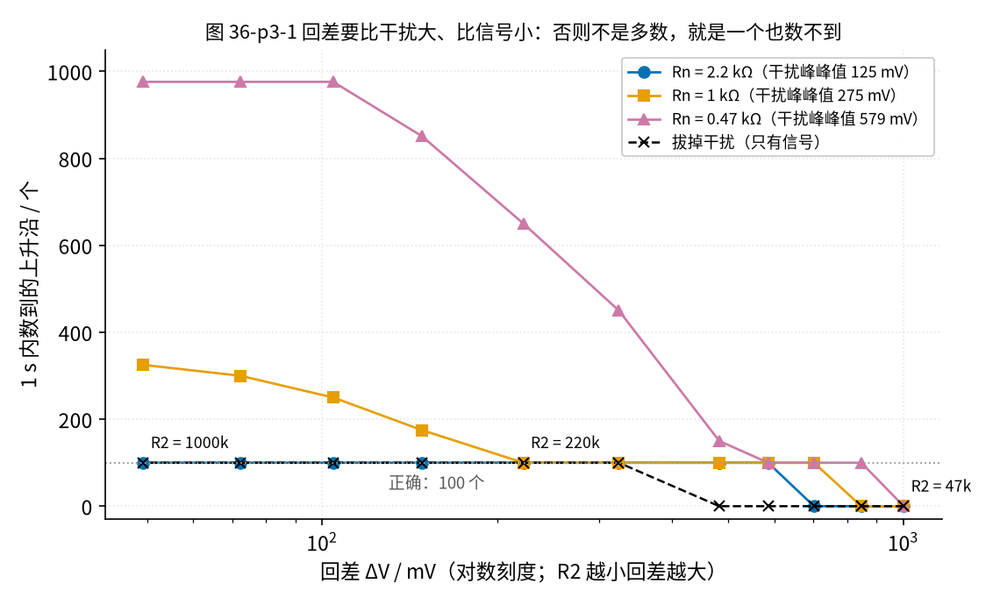
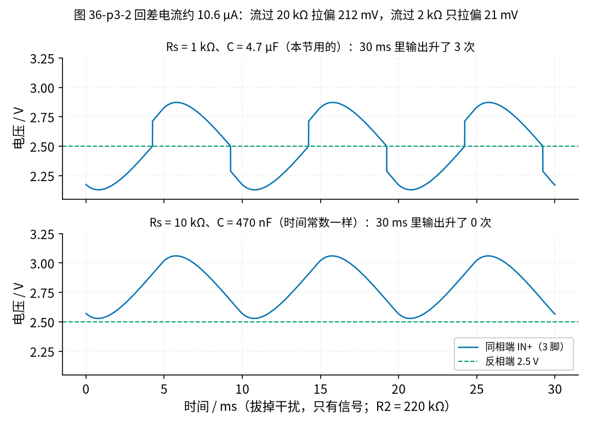
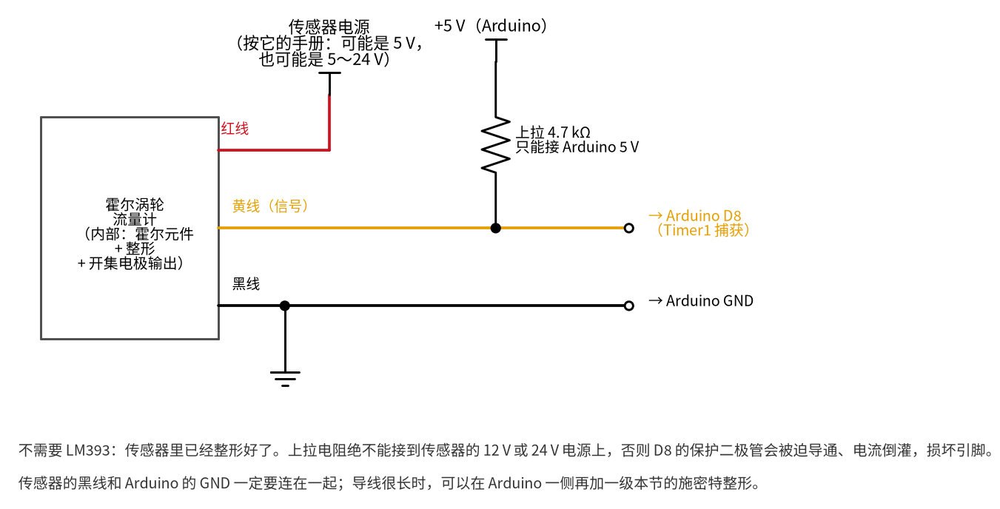

# 36 施密特整形与频率/脉冲计数 · 参数与调试篇

[上一页：原理与实现篇](page2.md) · [直觉篇](page1.md) · [原理与实现篇](page2.md) · 本页：参数与调试篇 · [动手实验篇](page4.md) · [下一页：动手实验篇](page4.md) · 前置节点：[10 电压比较器 · 参数与调试篇](../10-voltage-comparator/page3.md)、[29 上拉/下拉电阻与电平转换 · 参数与调试篇](../29-pullup-level-shift/page3.md)

## 本页要解决的问题

上一页把电路和计数方法讲清楚了。真正搭的时候，最常问的是：

1. 回差到底取多宽？R2 选多大？
2. 为什么回差算得好好的，却一个脉冲也数不到？
3. LM393 为什么要用 9 V 供电？上拉为什么只能接 5 V？
4. 程序读数是真值的 2 倍、流量差了 3.8 倍，多半是哪里错了？

## 一、回差要多宽：比干扰大，比信号小

### 先预测

[10 节第三页](../10-voltage-comparator/page3.md) 说过「回差至少要比噪声宽」。本节 n2 上的干扰峰峰值约 125 mV，信号加干扰一共约 663 mV。把 R2 从 47 kΩ 扫到 1000 kΩ（回差从约 1 V 降到约 49 mV），每一档数 1 秒。

**先预测**：哪一头会出错？错成什么样？

*图 36-p3-1　回差要比干扰大、比信号小：否则不是多数，就是一个也数不到*

揭晓

图 36-p3-1 里 Rn = 2.2 kΩ 那一组：

- **回差太大**：R2 = 47k、56k、68k，回差 1002、847、702 mV，比信号加干扰的峰峰值 663 mV 还大。输入根本够不着两条门限，1 秒计 **0 个**；
- **刚好**：R2 = 82k 到 1000k，回差 585～49 mV，都计 **100 个**；
- 不接 R2（回差为 0）时，计 175 个，多数了。

意外的是：这组里 49 mV 的回差比 125 mV 的干扰还小，却也数对了。原因是在门限附近，信号自己还在快速上升，抵消了干扰往下拽的大半；合起来只往回退一点点，没有退过回差。可这只是「运气」，干扰一变强就不灵了：

- **Rn = 1 kΩ**（干扰约 275 mV）：R2 = 220k（回差 222 mV）计 100；R2 = 330k（回差 148.5 mV）就多数，`36_sim.py` 数出 175 个，SPICE 数出 200 个，两者都远多于 100；
- **Rn = 470 Ω**（干扰约 579 mV）：R2 = 220k 计 650 个；100k（回差 482 mV）也还多数，计 150 个，因为 482 mV 比 579 mV 的干扰还小；要换到 82k、68k 或 56k（回差 585、702、847 mV，都比干扰大）才数对 100 个，47k（1002 mV）又一个也数不到了。

还要看「拔掉干扰」那种情况：只有信号时，n2 的峰峰值约 0.557 V（第二页写的 0.541 V 是 Rn 插着时的值：Rn 经 D5 接到地或 5 V，会分走一点信号，所以略小）。R2 = 100k 时，按第二页的公式回差只有 482 mV，比 557 mV 小，看起来应该能数对，可仿真却计 **0 个**。差别出在**源内阻**：拔掉 Rn 后，n2 前面还串着两级 RC 的 1 kΩ + 1 kΩ = 2 kΩ，回差电流要先流过它，相当于 R1 从 10 kΩ 变成了 12 kΩ。有效回差 ≈ 4.88 × 12 / 100 ≈ 0.59 V（4.88 V 是输出高、低之差），反而比信号峰峰值大了约 29 mV（约 5%），输入够不着，于是一个也数不到。换成 150k，有效回差约 0.39 V，就数对了；150k 以上都数对。0.59 V 只比 0.557 V 大约 5%，实物元件有误差，100k 也可能偶尔数到几个，以 150k 以上为准。

也就是说，**回差的上限跟着信号幅度走**，而且**回差要按 R1 + 源内阻 来算**。流量小时传感器信号也小，回差留得太宽，低流量就数不到了。

**经验做法**：回差取干扰峰峰值的 1.5～2 倍，同时不超过最小信号峰峰值的一半。估算回差时用 $\Delta V \approx V_A (R_1 + R_s) / R_2$ ， $R_s$ 是信号源内阻。本节取 R2 = 220 kΩ，回差 222 mV，是干扰（125 mV）的 1.77 倍、只有信号时峰峰值的 0.40 倍。

## 二、一个也数不到：信号源内阻太大

### 先预测

有人把两级 RC 换成 10 kΩ / 470 nF（转折频率和 1 kΩ / 4.7 µF 一样），信号幅度几乎不变，R1、R2、R3 和参考电压都没动。为了只看信号，这一题**先把 Rn 拔掉**（不加干扰）。图 36-p3-2 把两种网络并排画了出来：上图是原来的网络，下图是新网络。

**先预测**：计数会变吗？

*图 36-p3-2　回差电流约 10.6 µA：流过 20 kΩ 拉偏 212 mV，流过 2 kΩ 只拉偏 21 mV*

揭晓

会，从 100 个变成 **0 个**。原因在 R2 里流的那一点电流：输出为高时，约 10.6 µA 从输出经 R2、R1 流进 n2，这个电流还要流过信号源的内阻（两级 RC 的电阻），把 n2 往上抬：

- 1 kΩ + 1 kΩ = 2 kΩ：抬 10.6 µA × 2 kΩ ≈ 21 mV，可以忽略；
- 10 kΩ + 10 kΩ = 20 kΩ：抬约 212 mV，接近整条回差那么宽。

n2 被「推着走」：输出一高，输入就被抬上去，更难降到下门限，于是卡在高电平不动了。

用第一节的有效回差也能算出来：1 kΩ 网络 $R_s$ = 2 kΩ，有效回差 ≈ 4.88 × 12 / 220 ≈ 0.27 V，比信号 0.557 V 小，数得到；10 kΩ 网络 $R_s$ = 20 kΩ，有效回差 ≈ 4.88 × 30 / 220 ≈ 0.67 V，比信号还大，数不到。

如果这时把 Rn 插回去会怎样？10 kΩ 网络对 977 Hz 干扰的衰减比 1 kΩ 网络弱得多（Rn 2.2 kΩ 和 10 kΩ 级的分压不一样），n2 上干扰峰峰值约 1.21 V，比信号还大，1 秒反而数出约 976 个，几乎是干扰的频率。所以这道题一定要在拔掉 Rn 的条件下做。**施密特比较器的输入端不是「只看不碰」**，前面的源内阻要远小于 R1 + R2。内阻大的传感器，先接一级 [12 节](../12-voltage-follower/page1.md) 的跟随器。

## 三、为什么 LM393 要用 9 V：共模范围

LM393 的两个输入端，电压不能太接近它自己的电源。TI 数据手册给的共模范围是 0 到 VCC − 1.5 V（25 °C），在全温度范围内是 0 到 VCC − 2 V。

| LM393 电源 | 25 °C 上限 | 全温度上限 | 本电路输入最高（约 2.92 V）的余量 |
|---|---|---|---|
| 5 V | 3.5 V | 3.0 V | 只有 0.08 V |
| 9 V | 7.5 V | 7.0 V | 4.1 V |

输入端最高约 2.92 V（信号顶上再叠干扰，加上输出翻高时 R2 往上推的那一点）。用 5 V 供电只剩 0.08 V 余量，参考电压或信号中心稍一变动就会出界；所以本节用 9 V 电池给 LM393 供电。

**一个容易误会的地方**：SPICE 模型里，5 V 供电、反相端放 3.8 V（已超出 3.5 V），比较器照样在 3.8 V 翻转。这不说明芯片也可以，模型只是没有把这条限制做进去。**以数据手册为准**，超出共模范围时真实芯片可能翻转方向错乱或者不翻。

## 四、典型错误与故障排查

**每改一处线或元件，都先断电**：拔掉 9 V 电池扣，再拔掉 Arduino 的 USB 线；改完检查一遍，先接 USB、再接回电池。

| 现象 | 可能原因 | 怎么查、怎么改 |
|---|---|---|
| 计数是 0，② 一直是低 | R3 没接或没接到 5 V 轨，开集电极输出没人拉高 | 断电，检查 R3 是否一端在输出列、一端在 +5 V 轨；接回电池后量 ② 应能到约 4.95 V |
| 计数是 0，② 一直是高或一直是低 | 回差太大（R2 太小），或信号源内阻太大 | 用万用表直流挡量 ③ 应约 2.5 V、① 中心约 2.5 V；断电后核对 R2 色环，应为 220 kΩ |
| 计数明显多于 100 | 回差太小或没接 R2；干扰太强（Rn 太小） | 断电，核对 R2 和 Rn；Rn 应为 2.2 kΩ |
| 读数正好是 2 倍（约 200） | 程序用 `attachInterrupt(..., CHANGE)`，上升和下降各中断一次 | 改成只数上升沿（RISING），或者把结果除以 2 |
| 流量差了约 3.8 倍 | K 的单位是「个/升」，公式却当「个/加仑」算 | 先看说明书 K 的单位，1 加仑约 3.785 升 |
| 读数时有时无、乱跳 | 电池 GND 和 Arduino GND 没连 | 断电，检查两条 GND 轨之间的跳线 |
| Arduino 复位或 D8 坏了 | R3 错接到 9 V 电池正极 | 立即断电；见第四页安全须知 |

### 关于「读数是 2 倍」

用 `attachInterrupt` 的 CHANGE 模式，每个周期有上升、下降两次中断，1 秒读到约 200.3，正好是 100.16 的 2 倍。这类「正好整数倍」的错，先查计数的是什么边沿。

### 关于零流量

倒数计数要等下一个边沿才能算出新的周期。水一停，就再也等不到边沿，屏幕会一直停在最后一个读数上。所以程序要加**超时**：超过一段时间没边沿，就报 0。超时取 2 秒，意味着低于 0.5 Hz 的流量会被当成 0。

## 五、变体

- **霍尔传感器的涡轮流量计**：很多小型水流传感器内部已经有霍尔元件和整形电路，输出本身就是开集电极方波。这时候不需要本节的 LM393，但**上拉电阻仍然要接，而且只能接到 MCU 的电源**；导线很长时，仍可以在 MCU 一侧加一级施密特整形。接法见图 36-p3-3。

*图 36-p3-3　霍尔流量计直接接 Arduino：上拉只接 Arduino 5 V*

  **对照看**图 36-p3-3：红线只给传感器自己供电，电压按传感器手册来（有的 5 V，有的 5～24 V）；黄线是开集电极输出，经 4.7 kΩ 上拉到 **Arduino 的 5 V** 后进 D8，绝不能上拉到传感器的 12 V 或 24 V；黑线是地，必须和 Arduino 的 GND 连在一起。改接线时同样先断电，接好再接回电源。
- **MCU 内部比较器**：ATmega328P 自带一个模拟比较器，可以省掉 LM393；但它本身不带回差，要靠外部电阻或软件去补，入口电压也只能在 MCU 的电源以内。它的接法和图 36-p3-3 不同：信号要经 R1、R2 这样的电阻网络接到 AIN0、AIN1 两个比较器引脚，本节不展开，只作了解。
- **数字回差**：信号已经是方波、只是边沿有毛刺时，可以在程序里规定「一次边沿后 x 微秒内的边沿都不算」，这叫软件消抖。它不能代替模拟回差去处理慢慢变化的正弦。

## 六、练习：先预测，再揭晓

**练习 1**　干扰变强：Rn 从 2.2 kΩ 换成 680 Ω，n2 上干扰峰峰值约 403 mV。现在 R2 = 220 kΩ（回差约 222 mV）还能用吗？如果不能，在 100k 和 330k 里该选哪个？

揭晓

不能。回差 222 mV 比干扰 403 mV 小，会多数：`36_sim.py` 数出 275 个。应选 100k（回差 482 mV，约为干扰的 1.2 倍），仿真数 100 个。330k 的回差更小（148 mV），数出 387 个，只会更糟。

但要注意：第一节算过，拔掉干扰时 100k 的有效回差约 0.59 V，比信号 0.557 V 还大，会一个也数不到。干扰强到这个地步，回差已经找不到「两头都顾得上」的值，该先滤干扰了。

**变体 1**：反过来，干扰变弱：Rn = 1.5 kΩ，n2 上干扰峰峰值约 184 mV。按「回差为干扰的 1.5～2 倍、不超过只有信号时峰峰值 0.557 V 的一半」，回差该取多大？R2 大约选哪一档？能用的 R2 范围比 Rn = 2.2 kΩ 时宽还是窄？

揭晓

回差约 0.28～0.37 V，而且不超过 0.557 / 2 ≈ 0.28 V，两条一起，取约 0.28 V 左右；150k（回差 324 mV）或 220k（222 mV）都在附近。`36_sim.py` 扫一遍：82k～470k 都数对 100 个，68k 及以下数 0，680k 已经多数（150 个）。Rn = 2.2 kΩ 时 82k～1000k 都数对，所以干扰一变强，能用的范围就变窄了。

**练习 2**　有人图省事，LM393 也接 Arduino 的 5 V，反相端用的参考电压是 3.8 V。能不能用？

揭晓

不能保证。5 V 供电时共模上限是 3.5 V（全温度 3.0 V），3.8 V 已经出界。SPICE 模型照样翻转，但模型没有做这条限制，以数据手册为准。

**练习 3**　水流很小，只有 1 Hz。Timer1 用 ÷64 能不能量？要用哪一档？

揭晓

÷64 时一个周期 250000 个滴答，超过 65535，溢出。要用 ÷256：62500 个滴答，不溢出（÷256 最低能量到约 0.954 Hz），±1 个滴答只差 0.0016%。

**练习 4**　有人把 Timer1 改成 ÷64，程序里换算频率的那一行却还是 `2000000.0 / p`。信号仍是 100.16 Hz，串口会打印多少赫兹？

揭晓

÷64 时一个滴答 4 µs，一个周期 16000000 / 64 / 100.16 ≈ 2496 个滴答。按 2 MHz 换算：2000000 / 2496 ≈ 801.3 Hz，正好是真值的 8 倍。改分频时，换算用的时钟要跟着改成 16000000 / 64 = 250000。

**练习 5（迁移）**　一台风扇有 7 片扇叶，用红外对管测速，整形后量到 350 Hz。风扇每分钟多少转？这里的「K 系数」是什么？

揭晓

每转 7 个脉冲，所以 K = 7 个/转。转速 = 350 / 7 × 60 = 3000 转/分。和流量公式一模一样，只是把「每加仑多少个脉冲」换成了「每转多少个脉冲」。

## 小结与下一步

- 回差要比干扰大（约 1.5～2 倍）、比最小信号小（不超过一半）；本节 R2 = 220 kΩ，回差 222 mV；
- 信号源内阻要远小于 R1 + R2，否则回差电流把输入拉偏，一个也数不到；
- LM393 输入不能超过 VCC − 1.5 V（全温度 VCC − 2 V），所以本节用 9 V 供电；
- 上拉只能接 MCU 的电源（5 V）；
- 读数正好 2 倍查边沿，差 3.8 倍查 K 的单位，零流量要有超时；
- 下一页把这些搭到面包板上，一项一项验证。

## 参考资料

- TI LM393 数据手册（共模范围 0～VCC − 1.5 V，全温度 VCC − 2 V；开集电极输出）：https://www.ti.com/lit/ds/symlink/lm393.pdf
- Flomec《Turbine flow meter frequency and K-factor》：https://www.flomecmeters.com/blogs/did-you-know/turbine-flow-meter-frequency-and-k-factor
- Arduino `attachInterrupt()` 参考（RISING / FALLING / CHANGE）：https://docs.arduino.cc/language-reference/en/functions/external-interrupts/attachInterrupt/
