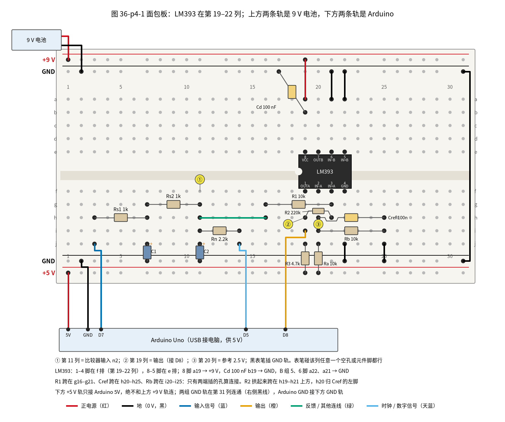
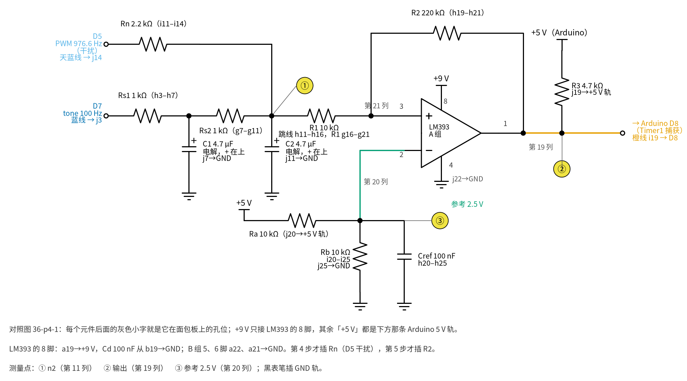

# 36 施密特整形与频率/脉冲计数 · 动手实验篇

[上一页：参数与调试篇](page3.md) · [直觉篇](page1.md) · [原理与实现篇](page2.md) · [参数与调试篇](page3.md) · 本页：动手实验篇 · [下一页：37 过零检测与超声波时差 · 直觉篇](../37-zero-crossing-tof/page1.md) · 前置节点：[10 电压比较器 · 动手实验篇](../10-voltage-comparator/page4.md)、[29 上拉/下拉电阻与电平转换 · 动手实验篇](../29-pullup-level-shift/page4.md)

## 这次实验要验证什么

用一块 Arduino Uno「冒充」一只 K = 100 个/加仑的涡轮流量计，再用 LM393 施密特比较器把它的信号整形、送回 Arduino 计数。要验证 [原理与实现篇](page2.md) 和 [参数与调试篇](page3.md) 的四个结论：

1. **干扰会让普通比较器多数**：不接 R2 时，加上干扰前每秒数 100 个，加上干扰后每秒数出远多于 100 个（仿真约 175 个）；
2. **回差把它救回来**：插上 R2 = 220 kΩ，干扰还在，计数回到每秒 100 或 101 个；
3. **倒数计数更细**：Timer1 输入捕获量一个周期的滴答数，1 秒里所有周期取平均，约 19968 个滴答，换算 100.16 Hz，冒充的流量 60.10 GPM；
4. **回差太大会一个也数不到**：把 R2 换成 47 kΩ（回差约 1 V），计数变成 0。

只需要万用表和电脑上的串口监视器，没有示波器也能做完。

## ⚠️ 安全须知

- **上拉电阻 R3 只能接 Arduino 的 5 V**（面包板下方那条 +5 V 轨），**绝不能接 9 V 电池的 +9 V，更不能接 12 V**。LM393 的输出是开集电极，输出高电平就等于上拉电压。ATmega328P 数据手册规定，除 RESET 外任何引脚的电压不能超过 VCC + 0.5 V，也就是 5.5 V；如果错把 R3 上拉到 9 V，D8 想被拉到 9 V，芯片内部的保护二极管就会导通，把 D8 硬钳在约 5.5 V，约 0.74 mA 的电流从 D8 倒灌进 5 V 轨（上拉到 12 V 更多）。手册不允许这样用，长期这样会损坏引脚甚至整片芯片。
- **下方 +5 V 轨和上方 +9 V 轨永远不要连在一起**。两条 GND 轨要连在一起（第 31 列那根黑线）。
- **LM393 的输入电压要低于 VCC − 1.5 V**（全温度范围 VCC − 2 V）。本电路输入最高约 2.92 V，9 V 供电时上限 7.0 V，余量充足；这也是 LM393 不用 5 V 供电的原因（见参数与调试篇第三节）。
- 全程只用 9 V 电池和电脑 USB 供电，不超过 12 V 直流；不要用插墙的电源。
- **每一步改线、插拔元件之前都要断电**：先拔 9 V 电池扣，再拔 USB 线。改完先对照图检查，**先接 USB、再接回电池**。本实验没有任何「带电改线」的步骤。
- C1、C2 是 4.7 µF **电解电容**，有正负极：长脚（+）插在信号那一列（j7、j11），短脚（−，外壳上有白色条纹那一侧）接 GND 轨。接反会发热、鼓包。

## 器材清单

| 元件 | 型号或数值 | 数量 | 说明 |
|---|---|---|---|
| 比较器 | LM393（DIP-8） | 1 | 只用 A 组；B 组输入接地 |
| 微控制器 | Arduino Uno（Rev3） | 1 | 产生信号和干扰，同时计数 |
| 电阻 | 1 kΩ | 2 | Rs1、Rs2，两级 RC |
| 电阻 | 2.2 kΩ | 1 | Rn，把干扰叠上来；第 4 步才插 |
| 电阻 | 10 kΩ | 3 | R1；Ra、Rb（2.5 V 参考） |
| 电阻 | 220 kΩ | 1 | R2，回差；第 5 步才插 |
| 电阻 | 47 kΩ | 1 | 第 7 步替换 R2 用 |
| 电阻 | 4.7 kΩ | 1 | R3，上拉到 Arduino 5 V |
| 电解电容 | 4.7 µF，耐压 16 V 以上 | 2 | C1、C2 |
| 电容 | 100 nF（代码 104） | 2 | Cd，LM393 电源旁路；Cref，参考电压滤波 |
| 9 V 电池 + 电池扣 | — | 1 | 只给 LM393 供电 |
| 万用表 | 直流 20 V 挡 | 1 | 有频率挡更好 |
| 电脑 + USB 线 | 装好 Arduino IDE | 1 | 给 Arduino 供电、上传程序、看串口 |
| 面包板、跳线 | — | 若干 | 一块 830 孔板够用 |

## 最小必要知识：读懂这段 Arduino 程序

第一次上传程序、打开串口监视器的步骤，见 [35 节动手实验篇的「最小必要知识：Arduino 上手」](../35-pga-agc/page4.md)。下面的程序比 35 节多用了四样东西，先认识一下：

- **中断和 ISR**：`ISR(TIMER1_CAPT_vect) { … }` 是一段「被硬件叫醒才运行」的函数。D8 上每来一个上升沿，Timer1 把当时的计数值抄进 ICR1，然后打断 `loop()`，先跑这段函数，跑完再回到 `loop()` 刚才停下的地方。
- **`volatile`**：`lastCap`、`period`、`edges` 这几个变量会在 ISR 里被改。加上 `volatile`，是告诉编译器「这个变量随时可能被别人改，每次都要重新去内存里读」，否则 `loop()` 可能一直用着旧值。
- **寄存器**：`TCCR1A`、`TCCR1B`、`TIMSK1` 这些全大写的名字是芯片里的「开关面板」，每一位管一件事。`TCCR1B = (1 << ICES1) | (1 << CS11);` 的意思是把 ICES1（上升沿捕获）和 CS11（÷8 分频）这两位置 1，其余位清 0。`1 << CS11` 就是「把 1 左移到 CS11 那一位」。
- **`noInterrupts()` / `interrupts()`**：`edges` 是 32 位数，芯片一次只能读 8 位，要分 4 次读。如果读到一半，ISR 突然把它改了，就会读到一个拼起来的错数。所以在 `loop()` 里读这些变量之前先关中断，读完马上再开。
- **16 位回零**：Timer1 数到 65535 后回到 0。`uint16_t` 的减法会自动「借位」，例如 100 − 65000 在 16 位里等于 636，正好是真实经过的滴答数。

**串口监视器的波特率选 9600**（和 35 节一样，程序里是 `Serial.begin(9600)`）。

## 先上传程序

在接任何线之前，先只用 USB 把 Arduino 接到电脑，上传下面的程序，然后拔掉 USB。

> ⚠️ 下面的程序**未经运行验证**：我们没有在真实的 Arduino 上跑过它，只核对过寄存器名称和计算（见本页「用 Python 核对你的读数」）。上传后如果串口没有输出或是乱码，先检查串口监视器右下角的波特率是否设为 9600。

```cpp
// 未经运行验证
// 36 施密特整形：D7 发 100 Hz 信号，D5 发 976.6 Hz 干扰，D8（ICP1）计数
// 每秒打印：1 s 门控计数、最近一个周期、1 s 内的平均周期（0.5 µs 为单位）、频率、K = 100 时的流量

volatile uint16_t lastCap = 0;
volatile uint16_t period = 0;
volatile uint32_t edges = 0;
volatile uint32_t sumP = 0;     // 1 s 内所有周期之和
volatile uint16_t nP = 0;       // 1 s 内的周期个数

ISR(TIMER1_CAPT_vect) {
  uint16_t now = ICR1;          // 硬件在上升沿那一刻抄下的计数值
  period = now - lastCap;       // 16 位无符号减法：计数器回零也能算对
  lastCap = now;
  if (edges > 0) { sumP += period; nP++; }   // 第一个边沿之前没有「上一个」，不算
  edges++;
}

void setup() {
  Serial.begin(9600);
  pinMode(8, INPUT);            // D8 = PB0 = ICP1，由 R3 上拉
  tone(7, 100);                 // Timer2：实际 100.160 Hz
  analogWrite(5, 128);          // Timer0：976.5625 Hz，占空比 50 %
  noInterrupts();
  TCCR1A = 0;                   // Timer1 普通模式（覆盖 Arduino 默认的 PWM 设置）
  TCCR1B = (1 << ICES1) | (1 << CS11);  // 上升沿捕获，÷8 → 2 MHz
  TIFR1 = (1 << ICF1);          // 清掉旧的捕获标志
  TIMSK1 = (1 << ICIE1);        // 打开捕获中断
  interrupts();
}

uint32_t lastGate = 0, lastEdges = 0, lastSeen = 0;

void loop() {
  uint32_t ms = millis();
  if (ms - lastGate < 1000) return;   // 1 s 的「门」
  lastGate += 1000;
  noInterrupts();
  uint32_t e = edges;
  uint16_t p = period;
  uint32_t s = sumP;
  uint16_t k = nP;
  sumP = 0; nP = 0;
  interrupts();
  float avg = (k > 0) ? (float)s / k : 0;   // 平均周期：多周期平均，抖动互相抵消
  uint32_t n = e - lastEdges;
  lastEdges = e;
  if (n > 0) lastSeen = ms;
  float f = 0;
  if (ms - lastSeen < 2000 && avg > 0) f = 2000000.0 / avg;  // 用平均周期；2 s 没边沿就报 0
  Serial.print("gate=");    Serial.print(n);
  Serial.print("  period="); Serial.print(p);
  Serial.print("  avg=");    Serial.print(avg, 1);
  Serial.print("  f=");     Serial.print(f, 3);
  Serial.print(" Hz  GPM(K=100)="); Serial.println(f * 60.0 / 100.0, 2);
}
```

程序每秒打印一行：`gate` 是 1 秒门控计数，`period` 是最近一个周期，`avg` 是这 1 秒里所有周期的平均值，`f` 和 `GPM` 用 `avg` 算。三个定时器各管各的：`tone()` 用 Timer2，`analogWrite(5, …)` 和 `millis()` 用 Timer0，输入捕获用 Timer1，互不冲突。

## 搭建步骤

请先看图 36-p4-1 的整板接法，再看图 36-p4-2 与它一一对应的原理图。



*图 36-p4-1　面包板：LM393 在第 19–22 列；上方两条轨是 9 V 电池，下方两条轨是 Arduino*



*图 36-p4-2　与图 36-p4-1 一一对应的原理图（第 4 步才插 Rn，第 5 步才插 R2）*

**对照看**：

① **比较器入口**：图 36-p4-2 里 n2 节点（表笔点 ①）在面包板上是第 11 列。Rs2 的右脚、C2 的正极、Rn 的左脚都插在这一列；绿色长跳线 h11–h16 把它引到第 16 列，再经 R1（g16–g21）进第 21 列，第 21 列下半正好是 LM393 的 3 脚（IN+A）。

② **反馈与输出**：原理图里 R2 从输出接回同相端，在面包板上就是 h19–h21：第 19 列是 1 脚（OUTA，表笔点 ②），第 21 列是 3 脚。R3 从 j19 接到下方 +5 V 轨，橙线从 i19 接到 Arduino 的 D8。

③ **参考电压**：第 20 列是 2 脚（IN−A，表笔点 ③）。Ra 从 j20 接 +5 V 轨，Rb（i20–i25）和 Cref（h20–h25）并在第 20、25 列之间，j25 接 GND，所以第 20 列就是原理图里 Ra、Rb、Cref 的交点。

④ **两套电源**：LM393 的 8 脚在上半 e19，经 a19 接上方 +9 V 轨；除此以外，原理图里所有「+5 V」都是下方的 Arduino 5 V 轨。

### 第 1 步：放芯片、接电源（断电）

确认 USB 和电池都没接。LM393 跨在中间凹槽上，占第 19–22 列：1–4 脚在 f 排（缺口朝左，1 脚在左下角），8–5 脚在 e 排。

- a19（8 脚）接上方 +9 V 轨；Cd 100 nF 从 b19 接上方 GND 轨，紧挨着 8 脚；
- j22（4 脚）接下方 GND 轨；
- B 组不用，但输入不能悬空：a21（6 脚）、a22（5 脚）都接上方 GND 轨；
- 第 31 列用一根黑线把上下两条 GND 轨连通；
- 9 V 电池扣的红线插上方 +9 V 轨（第 1 列附近），黑线插上方 GND 轨（第 2 列附近）。**这时先不要把电池扣到电池上**，等第 3 步检查完再扣。

### 第 2 步：参考电压、比较器输入和上拉（断电）

- Ra 10 kΩ：j20 → 下方 +5 V 轨；Rb 10 kΩ：i20–i25；Cref 100 nF：h20–h25；j25 → 下方 GND 轨。**Cref 左脚插 h20**（第 20 列，接 2 脚 IN−），不要和 R2 一起插进 h21；
- R1 10 kΩ：g16–g21；绿色跳线 h11–h16；
- R3 4.7 kΩ：j19 → **下方 +5 V 轨**（再看一眼，不是上方 +9 V 轨）；
- 橙线 i19 → Arduino D8。

**R2 先不插。**第 5 步插 R2 时，它的两脚插 h19、h21，身子拱起来跨过 h20，像图 36-p4-1 那样。

### 第 3 步：信号网络，不带干扰（断电）

- 蓝线 Arduino D7 → j3；Rs1 1 kΩ：h3–h7；C1 4.7 µF：正极 j7、负极下方 GND 轨；
- Rs2 1 kΩ：g7–g11；C2 4.7 µF：正极 j11、负极下方 GND 轨；
- Arduino 5V → 下方 +5 V 轨，Arduino GND → 下方 GND 轨。

**Rn 先不插。**接电前用万用表电阻挡量一下上方 +9 V 轨和下方 +5 V 轨之间：不应是 0 Ω（没有短接）。然后先接 USB，再把电池扣扣到 9 V 电池上，打开串口监视器（9600），按测量表第 1～3 项读数。这一步没有 R2、也没有干扰，`gate` 应是 100 或 101；如果偶尔多出一两个，是输入慢慢穿过 2.5 V 时比较器自己抖了一下，正好说明后面为什么要加回差，不必理会。

### 第 4 步：加上干扰（断电后插 Rn）

**先预测**：加上干扰、还没有回差，`gate` 会怎样变？`period` 呢？写下来再动手。

先拔电池、再拔 USB。Rn 2.2 kΩ 插 i11–i14，天蓝线 Arduino D5 → j14。先接 USB、再接回电池，读测量表第 4 项。此时还没有 R2，是普通比较器。

### 第 5 步：加上回差（断电后插 R2）

先拔电池、再拔 USB。先预测：插上 R2 之后，`gate` 会回到 100 吗？`period` 还会跳吗？

R2 220 kΩ 插 h19–h21。先接 USB、再接回电池，读测量表第 5～7 项。

注意 `period`（单个周期）这时会在约 19018 和 20296 之间来回跳，这不是坏了：干扰和信号来自同一个 16 MHz 时钟，频率比正好是 9.75，每 4 个信号周期图样重复一次，干扰把每个边沿往前或往后推一点，4 个一组加起来又正好是 4 个周期。所以要看 `avg`（1 秒平均）。

### 第 6 步：拔掉干扰（断电后拔 Rn）

**先预测**：拔掉干扰后，`gate` 和 `period` 会变吗？

先拔电池、再拔 USB。拔掉 Rn（i11–i14）。先接 USB、再接回电池，读测量表第 8 项。没有干扰推边沿，`period` 也稳下来了，这一步读周期、频率和流量。

### 第 7 步：回差太大（断电后换 R2）

**先预测**：R2 换成 47 kΩ 后回差约 1 V，比信号加干扰的峰峰值还大，`gate` 会是多少？

先拔电池、再拔 USB。把 Rn 插回 i11–i14，把 R2 从 220 kΩ 换成 47 kΩ（仍在 h19–h21）。先接 USB、再接回电池，读测量表第 9 项。做完后断电，把 R2 换回 220 kΩ。

## 测量表

万用表黑表笔一直插在 GND 轨。下表的「预期」来自 `code/36_sim.py` 和 `spice/36`；万用表直流挡读到的是平均值。

| 项 | 步骤 | 测什么 | 怎么测 | 预期 |
|---|---|---|---|---|
| 1 | 3 | 电池电压 | 红表笔上方 +9 V 轨 | 约 9 V（新电池可能略高） |
| 2 | 3 | 参考电压 ③ | 红表笔第 20 列 | 约 2.5 V（Arduino 5 V 的一半） |
| 3 | 3 | ① 平均值；串口读数 | 红表笔第 11 列；看串口 | ① 约 2.5 V；gate 100 或 101，period 约 19968 |
| 4 | 4 | 串口 gate | 看串口 | 远多于 100（仿真约 175），period 乱跳 |
| 5 | 5 | 串口 gate | 看串口 | 100 或 101（约 84% 的秒是 100） |
| 6 | 5 | 串口 period、avg | 看串口 | period 在约 19018～20296 之间跳；avg 约 19965，每秒基本不变 |
| 7 | 5 | ② 平均值 | 红表笔第 19 列 | 约 2.5 V（SPICE 2.56 V），因为一半时间是 4.95 V、一半是 0.07 V |
| 8 | 6 | 串口 gate、period、avg、f、GPM | 看串口 | gate 100 或 101；period 约 19964～19972；avg 约 19968，f 约 100.16 Hz，GPM 约 60.10 |
| 9 | 7 | 串口 gate、f | 看串口 | 0；约 2 s 后 f 报 0 |

第 8 项的 avg 应非常接近 19968（为什么这么接近，见想一想第 3 题）。要紧的是它**每秒基本不变**，只在最后一位跳动。第 6 项单个 period 跳得很厉害，但 avg 只比 19968 少约 3，多周期平均把干扰造成的抖动抵消了。

## 没有示波器怎么办

- **用万用表的频率挡**：如果万用表有 Hz 挡，红表笔放第 19 列，第 5 步应读到约 100 Hz；第 4 步读数通常会偏高或跳动。
- **用串口看「乱」**：第 4 步 gate 远多于 100、avg 明显变小，就是多数的证据；第 5 步 gate 回到 100 或 101，avg 稳定在 19965 附近；第 6 步拔掉干扰，连单个 period 都稳在 19968 附近。
- **用 Arduino IDE 的串口绘图器**：把程序里的打印改成只打印 `n`，就能看到计数随步骤变化的曲线。

## 用 Python 核对你的读数

把你量到的数填进下面的变量（现在填的是仿真的预期值），运行后它会算出门限、频率和流量，并检查你的读数是否合理。门限用的是第二页的简化式（忽略 R3 和输出低电平），比精确值差约 3 mV，核对读数足够了。代码只做计算和打印，不写任何文件。

```python
# 1. 填入你的实测值
V5 = 5.00          # Arduino 5 V 轨的实测电压（V）
VREF = 2.50        # 第 20 列（③）的实测电压（V）
R1, R2 = 10e3, 220e3   # 用万用表量到的电阻值（Ω）
GATE_STEP4 = 175   # 第 4 步每秒计数（取几秒的平均）
GATE_STEP5 = 100   # 第 5 步每秒计数
AVG6 = 19968       # 第 6 步串口 avg（拔掉干扰后 1 s 平均周期）
AVG5 = 19965       # 第 5 步串口 avg（插着干扰，1 s 平均周期）
K = 100            # 假装的 K 系数（个/加仑）

# 2. 计算
vh = VREF * (R1 + R2) / R2
vl = (VREF * (R1 + R2) - V5 * R1) / R2
f = 2_000_000 / AVG6
gpm = f * 60 / K
print(f"上门限 {vh:.3f} V，下门限 {vl:.3f} V，回差 {(vh - vl) * 1000:.0f} mV")
print(f"频率 {f:.3f} Hz，流量 {gpm:.2f} GPM")
print(f"第 4 步多数了 {GATE_STEP4 / GATE_STEP5:.2f} 倍")

# 3. 检查
assert 0.15 < vh - vl < 0.30, "回差不在 150–300 mV：检查 R2 的色环和 5 V 轨"
assert 2.3 < VREF < 2.7, "③ 不在 2.5 V 附近：检查 Ra、Rb 和 Cref 是否插在第 20 列"
assert abs(VREF - V5 / 2) < 0.05, "③ 应约为 5 V 轨的一半：检查 Ra、Rb 是否都是 10 kΩ"
assert abs(f - 100.16) / 100.16 < 0.005, "频率偏差超过 ±0.5 %：检查第 6 步的 avg 读数"
assert abs(AVG5 - AVG6) / AVG6 < 0.005, "第 5 步的 avg 应和第 6 步差不多：检查 gate 是否是 100 或 101"
assert GATE_STEP5 in (100, 101), "第 5 步应数 100 或 101：检查 R2 是否插好"
assert GATE_STEP4 > GATE_STEP5 + 10, "第 4 步应明显多数：检查 Rn 和 D5 的线"
print("读数合理 ✓")
```

如果某一条 `assert` 报错，按它的提示和参数与调试篇的故障排查表去查。

## 实验记录表

| 项 | 预期 | 实测 | 是否一致 / 原因 |
|---|---|---|---|
| 1 电池电压 | 约 9 V | | |
| 2 ③ 参考电压 | 约 2.5 V | | |
| 3 ① 平均值 / gate | 约 2.5 V / 100～101 | | |
| 4 加干扰、无 R2 的 gate | 远多于 100 | | |
| 5 加 R2 的 gate | 100～101 | | |
| 6 插着干扰的 period / avg | 19018～20296 跳 / 约 19965 | | |
| 7 ② 平均值 | 约 2.5 V | | |
| 8 拔掉干扰的 gate / avg / f / GPM | 100～101 / 约 19968 / 100.16 Hz / 60.10 | | |
| 9 R2 = 47k 的 gate | 0 | | |

## 想一想（先写下你的预测，再动手或看答案）

1. 第 4 步每秒数出的个数，为什么每次重新上电都不完全一样？

<details>
<summary>揭晓</summary>

多翻几次取决于干扰和信号的相对相位。干扰和信号的频率比正好是 9.75，所以每 4 个信号周期，两者的相对位置重复一次；但 `tone()` 和 `analogWrite()` 用的是不同的定时器，上电那一刻两者从哪个相位开始并不固定，「4 个一组」的图样每次可能不一样，多数的个数也就跟着变。

追问一句：为什么 `36_sim.py` 和 SPICE 在参数与调试篇 Rn = 1k、R2 = 330k 那一档数出的不一样（175 和 200）？同样是起始相位不同，加上 SPICE 只数了 0.2 s 再乘 5，多一个就多 5。不变的是「远多于 100」。

</details>

2. 第 5 步如果把 R3 换成 47 kΩ，门限会变吗？往哪边变？

<details>
<summary>揭晓</summary>

会。输出高时，R3 和 R2（经 R1 到 n2）分压，R3 越大，输出高电平越低（47 kΩ 和 220 kΩ 相比已不能忽略）。按 $V_L$ 的公式，输出高变低，下门限往上移，回差变小。所以上拉电阻要远小于 R2，本实验 4.7 kΩ 对 220 kΩ。

</details>

3. 有人说：「第 8 项 avg 能精确到 0.005%，所以这块 Arduino 可以当频率标准。」对吗？

<details>
<summary>揭晓</summary>

不对。0.005% 是分辨率，准确度受陶瓷谐振器限制，最多可能差 ±0.5%。这次读到 19968，是因为 `tone()` 和 Timer1 用的是同一个时钟，时钟偏了两边一起偏，误差被抵消了；换成真正的外部流量计，就看不出这个抵消了。

</details>

## 自测清单

- [ ] 我能说出 R3 为什么只能接 Arduino 的 5 V，接 9 V 或 12 V 会怎样；
- [ ] 我能按 $\Delta V = V_A R_1 / R_2$ 估出回差，知道源内阻要加到 R1 上，并解释为什么回差要比干扰大、比信号小；
- [ ] 我看到了第 4 步（无回差、有干扰）多数，第 5 步（有回差）数对；
- [ ] 我能说出门控计数和倒数计数各自适合高频还是低频，以及为什么插着干扰时要看多周期平均；
- [ ] 我能用 $Q_{GPM} = f \times 60 / K$ 把频率换成流量；
- [ ] 每次改线前我都先拔电池、再拔 USB，改完先接 USB、再接电池。

> **预告**：下一节（37 节）的超声波流量计要量的是几十纳秒的时间差。那里还会用到本节的比较器和 Timer1 输入捕获，但触发方式要升级：先用门限确认「回波来了」，再在下一个过零点触发。

## 参考资料

- Microchip ATmega328P 数据手册（29.1 绝对最大额定值：除 RESET 外引脚电压 −0.5 V 到 VCC + 0.5 V；每个 I/O 脚直流电流 40 mA；Timer1 输入捕获）：https://ww1.microchip.com/downloads/aemDocuments/documents/MCU08/ProductDocuments/DataSheets/ATmega48A-PA-88A-PA-168A-PA-328-P-DS-DS40002061B.pdf
- TI LM393 数据手册：https://www.ti.com/lit/ds/symlink/lm393.pdf
- Arduino Uno Rev3 原理图（D8 = PB0 = ICP1；16 MHz 陶瓷谐振器）：https://docs.arduino.cc/resources/schematics/A000066-schematics.pdf
- Murata CSTCE16M0V53-R0 产品页：https://www.murata.com/en-us/products/productdetail?partno=CSTCE16M0V53-R0
- ArduinoCore-avr `Tone.cpp`（`tone()` 使用 Timer2）：https://github.com/arduino/ArduinoCore-avr/blob/master/cores/arduino/Tone.cpp
- Arduino `tone()` 参考：https://docs.arduino.cc/language-reference/en/functions/advanced-io/tone/
