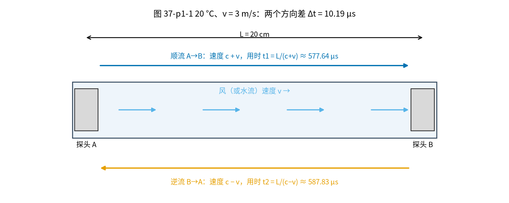
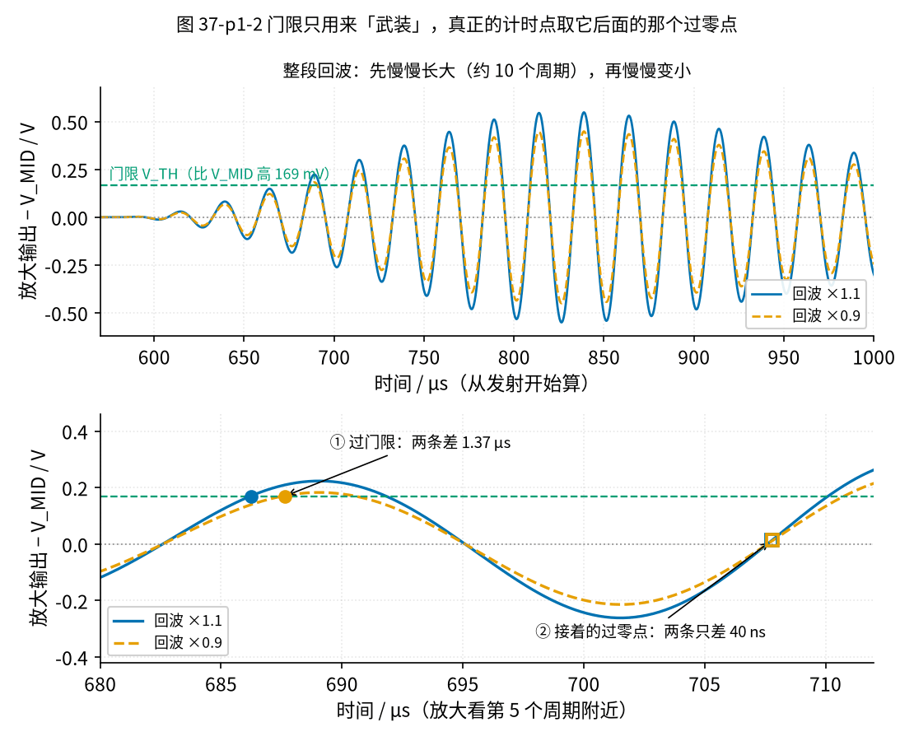

# 37 过零检测与超声波时差 · 直觉篇

[上一页：36 施密特整形与频率/脉冲计数 · 动手实验篇](../36-schmitt-pulse-shaping/page4.md) · 本页：直觉篇 · [原理与实现篇](page2.md) · [参数与调试篇](page3.md) · [动手实验篇](page4.md) · [下一页：原理与实现篇](page2.md) · 前置节点：[10 电压比较器 · 直觉篇](../10-voltage-comparator/page1.md)、[36 施密特整形与频率/脉冲计数 · 直觉篇](../36-schmitt-pulse-shaping/page1.md)

## 开始之前：三个小问题

先凭记忆回答，再点开揭晓。这三问正好对应本节要用的三样东西：放大前的滤波、过零比较器，和「过零」这个词。

1. [33 节](../33-bandpass-notch/page1.md)：带通滤波器为什么能让 40 kHz 通过、却挡住 50 Hz？
2. [36 节](../36-schmitt-pulse-shaping/page1.md)：施密特比较器为什么不会在中线附近来回抖？
3. [23 节 · 参数与调试篇](../23-optocoupler/page3.md)：可控硅调光、固态继电器里的「过零检测」是检测什么？

揭晓

1. 带通只让中心频率附近一窄条通过，离得远的频率（比如 50 Hz 的工频干扰）被大大衰减。本节的接收放大级也在低频端加了高通，作用类似。
2. 它有两个门限：输出翻高以后，门限跟着移开一点（回差），中线附近的小抖动够不着新门限，所以只翻一次。本节的过零比较器也加了一点回差。
3. 检测交流电压「从正变负、从负变正」穿过 0 V 的那一刻，好在那一刻开关，减小冲击和干扰。本节借用同一个词：找回波穿过中线的那一刻。

## 痛点：要量的不是「多久」，而是「差多少」

上一节 [36 节](../36-schmitt-pulse-shaping/page1.md) 的涡轮流量计靠一只小叶轮转圈数脉冲。叶轮会磨损、会被杂物卡住，还会挡住水流。家里新装的智能水表、燃气表，很多改用了**超声波**：管子两头各装一只「小喇叭」（超声波换能器，既能发声也能听声），管子里什么也不放。

道理很简单：声音在流动的水或空气里传播，**顺着流动方向走得快，逆着走得慢**。让两只换能器轮流发声、轮流收听，量出两次传播时间的**差**，就能反算出流速。

难的是这个「差」太小了。看图 37-p1-1：两只探头相距 L = 20 cm，空气 20 °C 时声速 c = 343.24 m/s，风速 v = 3 m/s。

*图 37-p1-1　同一段 20 cm，顺风走 577.64 µs，逆风走 587.83 µs，两者只差 10.19 µs*

### 先算一遍

顺风时声音的速度是 c + v，逆风时是 c − v，所以：

- 顺风 t1 = L / (c + v) = 0.20 / (343.24 + 3) ≈ 577.64 µs；
- 逆风 t2 = L / (c − v) = 0.20 / (343.24 − 3) ≈ 587.83 µs；
- 时间差 Δt = t2 − t1 ≈ 10.19 µs。

风速比声速小得多时，可以用一个近似公式一步算出时间差： $\Delta t \approx 2Lv / c^2$ 。代进去：2 × 0.20 × 3 ÷ 343.24² ≈ 10.19 µs，和上面几乎一样。反过来，量到 Δt 就能求风速： $v \approx \Delta t \cdot c^2 / (2L)$ 。[原理与实现篇](page2.md) 会推导这个公式。

图 37-p1-1 里两次传播都要五百多微秒，差却只有 10.19 µs，不到 2 %。如果风速只有 1 m/s，差就只剩 3.40 µs。换成水管，情况更夸张：水里声速约 1481 m/s，探头相距 10 cm、水流 1 m/s 时，时间差只有 91.2 ns（纳秒，1 ns 是 1 µs 的千分之一）。

所以这一节的问题是：**怎样让「声音到了」这一刻，每次都被认得一样准？**

## 先预测一下

接收探头收到的不是一个干净的「咔」，而是一串**慢慢长大、再慢慢变小**的 40 kHz 振动（见图 37-p1-2 上半）。最直接的办法，是拿 [10 节](../10-voltage-comparator/page1.md) 学过的电压比较器设一条门限：放大后的回波一超过门限，就算「声音到了」。

现在开一下风扇，或者探头稍微偏一点，回波的**大小**变了 ±10 %，而**到达时间**一点没变。

> 先写下你的预测：用「超过门限」来计时，读数会变吗？变多少？和 3 m/s 风造成的变化比，哪个大？

揭晓

会变，而且不小。按本节的回波模型（`code/37_sim.py`），回波 ×1.1 时 686.25 µs 就超过门限，×0.9 时要到 687.62 µs，相差 1.37 µs。而 3 m/s 的风让单程时间只变 5.09 µs。也就是说，回波大小晃一晃，读数就被冤枉地挪了四分之一的「风」。

更糟的是，回波大小一直在变：温度、湿度、探头老化、灰尘都会改它。用门限直接计时，等于拿一把会伸缩的尺子去量。

## 揭晓背后：门限只用来「武装」，计时交给过零点

图 37-p1-2 下半把第 5 个周期附近放大了。圆点是两条回波超过门限的时刻，离得明显；方块是紧接着的那个「从下往上穿过中线」的时刻，也就是**过零点**，两只方块几乎重合，只差 40 ns。这个「过零」和 [23 节参数与调试篇](../23-optocoupler/page3.md) 里市电过零检测说的是同一件事：找信号穿过中线的那一刻。

*图 37-p1-2　门限只用来「武装」，真正的计时点取它后面的那个过零点*

为什么过零点不怕回波变大变小？把一条正弦波整体放大 1.1 倍，波峰变高了，但它穿过中线的位置**一点也不动**：0 乘以 1.1 还是 0。过零的时刻只由「声音什么时候到」决定，和「声音多响」无关。

但只看过零也不行：回波前面还有噪声，噪声也会穿过中线。所以要分两步，就像短跑比赛：

1. **武装**（裁判举枪）：回波超过门限，说明「真的回波来了」，只是还不计时；
2. **过零触发**（扣扳机）：武装之后的**下一个**向上过零点，才是计时的那一刻。

图 37-p1-2 里，门限负责第 1 步，过零点负责第 2 步。武装早一点、晚一点都没关系，只要还落在同一个周期里，扳机就扣在同一个过零点上。

## 门限放错地方：整整差一个周期

两步法也有自己的「坑」。门限要是贴着某个波峰，回波稍微小一点，这个峰就够不着门限，武装推迟到下一个周期，过零点也跟着晚**整整一个周期**。40 kHz 的一个周期是 25 µs，比 3 m/s 风造成的 10.19 µs 时间差还大一倍多。这叫**跳周期**，[参数与调试篇](page3.md) 专门讲怎样把门限放在两个峰的正中间，让回波在 ×0.83 到 ×1.25 之间变化都不跳。

## 还有一个敌人：温度

声速随温度变：空气每升高 1 °C，20 cm 的传播时间少约 0.994 µs。只开一次风扇、量一个方向，温度变 5 °C 就能把 3 m/s 的信号吃掉。办法是**两个方向都量，用两个时间一起算**：温度让两个方向同时变快或变慢，相减或者按 [原理与实现篇](page2.md) 的公式一算，大部分就抵消了。

## 精度从哪里来

本节的 [动手实验篇](page4.md) 用 Arduino 的 Timer1 当秒表，每一格 62.5 ns。在空气里量 10 µs 级的时间差绰绰有余。水表要分辨 1 cm/s 的水流，时间差不到 1 ns，就得用 TI TDC7200 这种专门的计时芯片，分辨率 55 ps（皮秒，1 ps 是 1 ns 的千分之一），比 Arduino 细 1136 倍。但「先武装、再过零」的思路是一样的。

## 练习（先预测，再揭晓）

**练习 1**　探头相距 15 cm，风速 2.5 m/s，温度 20 °C。顺风、逆风的时间差大约多少？

揭晓

约 6.37 µs。用上面「先算一遍」的近似公式：Δt ≈ 2Lv / c² = 2 × 0.15 × 2.5 ÷ 343.24² ≈ 6.37 µs。间距和风速都比正文小，差也就比 10.19 µs 小。

**练习 2**　水管里探头相距 5 cm，水流 0.5 m/s。时间差大约多少？Arduino 的 62.5 ns 一格够用吗？

揭晓

约 22.8 ns，还不到 Arduino 一格的一半，不够用。所以真正的水表要用 TDC7200 这类皮秒级计时芯片。

**练习 3**　探头相距 20 cm，没有风。如果顺风方向那次测量跳了一个周期（晚了 25 µs），而逆风方向没跳，算出来的「风速」是多少？

揭晓

按正文的定义 Δt = t逆 − t顺，这次 Δt = −25 µs。用近似公式 v ≈ Δt·c²/(2L) 算出约 −7.36 m/s，也就是**一阵 7.36 m/s 的逆风**：明明没风，仪器却以为风是反着吹的，而且比正文的 3 m/s 还大。

25 µs 已经不算「很小」，近似公式有点偏差；用原理与实现篇的两时间法算是约 −7.06 m/s。不论哪种算法，结论一样：跳一次周期就冒出一阵几 m/s 的假风。这就是为什么跳周期是超声波流量计最怕的错误，也是动手实验篇要盯着串口 `min`、`max` 的原因。

## 本页小结

- 超声波流量计量的是**顺流、逆流两次传播时间的差**，空气里 20 cm、3 m/s 只差 10.19 µs，水里更是纳秒级。
- 用门限直接计时，读数会随回波大小漂移；过零点的时刻不随大小变。
- 两步法：门限负责「武装」，武装后的下一个过零点负责「计时」。
- 门限要放在两个峰的中间，否则会跳周期，一跳就是 25 µs。

## 参考资料

- TI SNIA020《Ultrasonic Sensing for Water Flow Meters and Heat Meters》（顺流、逆流时间差；Figure 2 里接收信号先过「qualifying threshold」再取 STOP）：https://www.ti.com/lit/an/snia020/snia020.pdf
- TI SLAAES9《Ultrasonic Sensing Solution (USS) Guide》（式 1–4：t12 = L/(c + v)，t21 = L/(c − v)）：https://www.ti.com/lit/an/slaaes9/slaaes9.pdf
- TI TDC7200 数据手册（分辨率 55 ps）：https://www.ti.com/lit/ds/symlink/tdc7200.pdf
- Wikipedia《Speed of sound》（空气声速随温度的公式；20 °C 淡水约 1481 m/s）：https://en.wikipedia.org/wiki/Speed_of_sound
