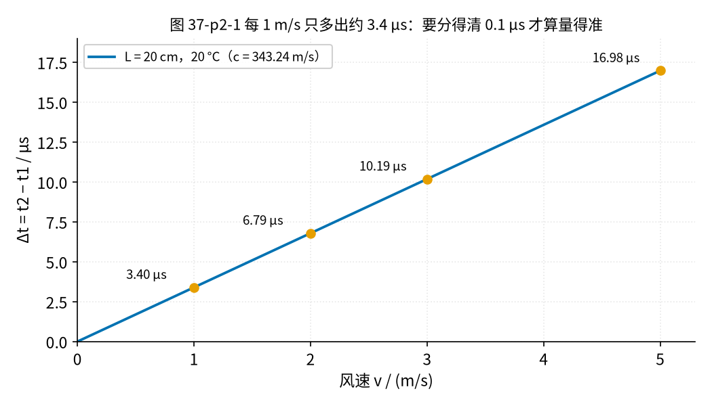
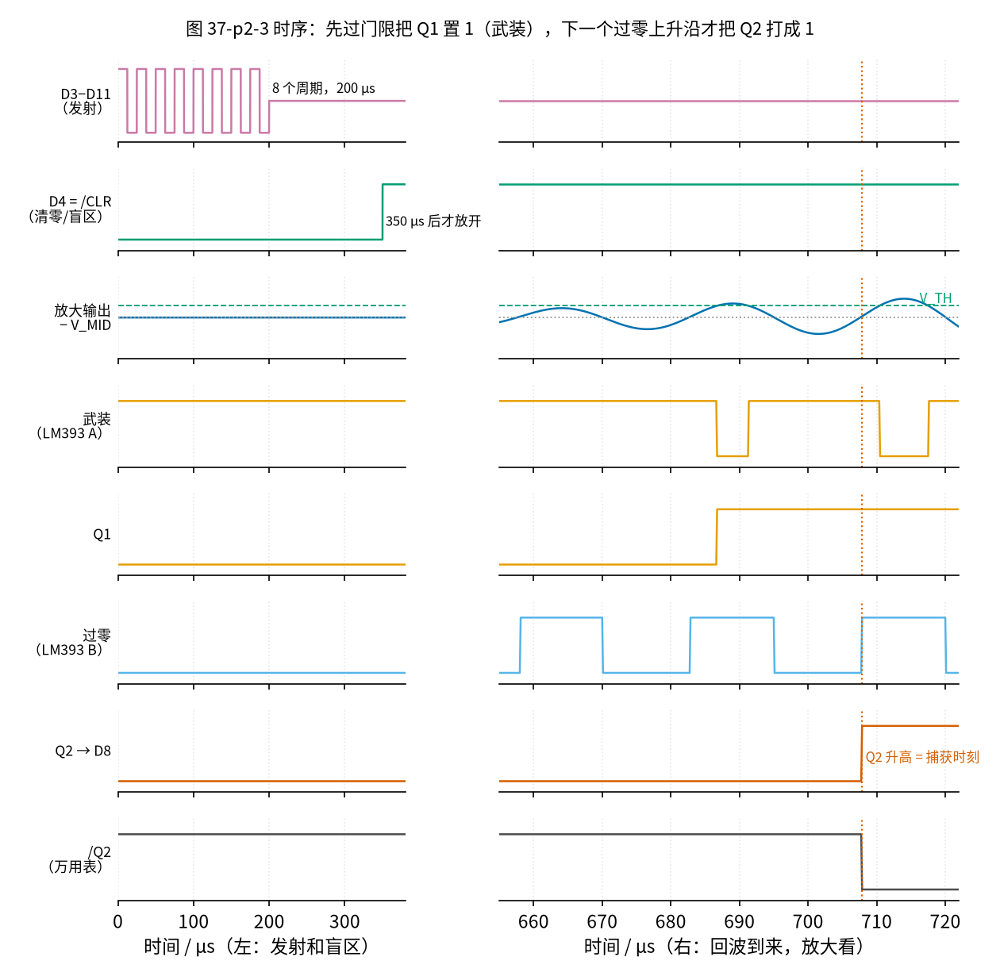
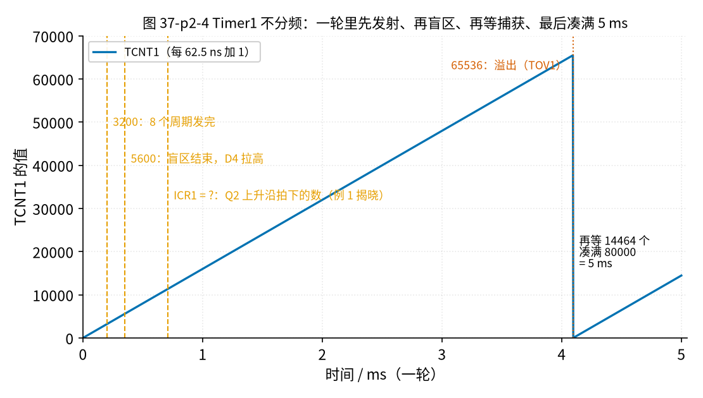

# 37 过零检测与超声波时差 · 原理与实现篇

[上一页：直觉篇](page1.md) · [直觉篇](page1.md) · 本页：原理与实现篇 · [参数与调试篇](page3.md) · [动手实验篇](page4.md) · [下一页：参数与调试篇](page3.md) · 前置节点：[10 电压比较器 · 原理与实现篇](../10-voltage-comparator/page2.md)、[12 电压跟随器 · 原理与实现篇](../12-voltage-follower/page2.md)、[29 上拉/下拉电阻与电平转换 · 原理与实现篇](../29-pullup-level-shift/page2.md)、[36 施密特整形与频率/脉冲计数 · 原理与实现篇](../36-schmitt-pulse-shaping/page2.md)

## 这一页要解决的问题

[直觉篇](page1.md) 说了思路：门限负责「武装」，下一个过零点负责「计时」。这一页把它变成一块能搭的电路：Arduino 发一串 40 kHz 超声波，接收端放大、两只比较器、两个 D 触发器，最后用 Timer1 输入捕获记下那个过零点的时刻。

## 一、从两个时间算出风速

设两只探头相距 L，声速 c，风速 v（顺着 A→B 为正）。顺风、逆风两次的传播时间是（TI SLAAES9 式 1、2）：

$$t_1 = \frac{L}{c+v},\qquad t_2 = \frac{L}{c-v}$$

两者相减：

$$\Delta t = t_2 - t_1 = \frac{2Lv}{c^2 - v^2} \approx \frac{2Lv}{c^2}$$

最后一步用了 $v \ll c$ ：3 m/s 的风只是声速的百分之一左右， $v^2$ 可以忽略。图 37-p2-1 画的就是这条近似直线：L = 20 cm、20 °C 时，风速每增加 1 m/s，Δt 只多约 3.40 µs。



*图 37-p2-1　L = 20 cm、20 °C：每 1 m/s 只多出约 3.4 µs*

$\Delta t \approx 2Lv/c^2$ 里有 $c^2$ ，声速错 1 %，算出的风速就错约 2 %。更好的办法是把 $t_1$ 、 $t_2$ 各自取倒数再相减（SLAAES9 式 4）：

$$\frac{1}{t_1} - \frac{1}{t_2} = \frac{(c+v) - (c-v)}{L} = \frac{2v}{L} \quad\Rightarrow\quad v = \frac{L}{2}\left(\frac{1}{t_1} - \frac{1}{t_2}\right)$$

c 被整个消掉了，温度怎么变都不影响。代价是 $t_1$ 、 $t_2$ 必须是**真正的**传播时间，电路里多出来的固定延迟要先减掉（见 [参数与调试篇](page3.md) 第三节）。

### 例 0：两种算法各算一遍（先预测，再揭晓）

L = 20 cm、20 °C（c = 343.24 m/s）。量到顺风 t1 = 579.6 µs、逆风 t2 = 586.4 µs，Δt = 6.8 µs。分别用近似式和两时间法算风速，两者差多少？

<details>
<summary>揭晓</summary>

- 近似式：v ≈ Δt·c²/(2L) = 6.8 µs × 343.24² ÷ 0.40 ≈ 2.00 m/s；
- 两时间法：v = 0.10 × (1/579.6 µs − 1/586.4 µs) ≈ 2.00 m/s。

两者几乎一样，因为风速只有声速的 0.6 %。区别在于：近似式要用到 c（温度变了就得重新算 c），两时间法不用。风越大、Δt 越大，两者的差也越明显，[直觉篇](page1.md) 练习 3 里 25 µs 的情形就差了约 0.3 m/s。

</details>

## 二、电路总图

图 37-p2-2 是完整原理图，从左上到右下分四块：


*图 37-p2-2　原理图：发射、接收放大、两只比较器、两个触发器*

### 1. 发射：两只引脚反相翻转

MA40S4S 本身像一只 2550 pF 的电容。Arduino 的 D3、D11 各串 150 Ω 接它的两脚，程序让两脚**反相**翻转：一个高、另一个就低。探头两端的电压在 +5 V 和 −5 V 之间来回，也就是 10 Vp-p，比只用一只引脚多一倍，又低于 Murata 手册的最大 20 Vp-p。150 Ω 限住每次翻转的充电电流，峰值约 33.3 mA，在 ATmega328P 每脚 40 mA 的**绝对最大值**以内。手册建议长期工作每脚不超过 20 mA；这里的 33.3 mA 只出现在每次翻转后约 0.4 µs 的瞬间，一轮平均只有约 2.04 mA，所以可以接受。想更保守，可以换成 220 Ω：峰值降到 22.7 mA，回波只小约 2 %（为什么不能用 100 Ω，见 [参数与调试篇](page3.md) 第四节）。

### 2. 中点参考 V_MID

接收这一侧只用一路 12 V 供电，信号却有正有负。办法和 [12 节](../12-voltage-follower/page2.md) 一样：12 V 经两只 10 kΩ 分压得 6.0 V，TL072 A 接成跟随器，输出就是**中点参考 V_MID**。图 37-p2-2 里所有标 V_MID 的空心点都接在这一点上：接收探头的一脚、放大器的 Cg、两只比较器的参考端。

### 3. 接收放大：只放大 40 kHz 附近

MA40S4R 另一脚接 TL072 B 的同相端，100 kΩ 的 Rb 把直流电平拉在 V_MID。放大倍数 $1 + R_f/R_g = 1 + 100\text{k}/10\text{k} = 11$ 。

两个地方让它对低频「不感兴趣」，这和 [33 节](../33-bandpass-notch/page2.md) 带通的思路一样：

- Rg 串了 Cg 100 nF，频率低到约 159 Hz 以下时，Cg 的容抗变大，放大倍数回落到 1；
- 探头的 2550 pF 和 Rb 100 kΩ 构成一个高通，转角约 624 Hz。

合起来，50 Hz 的工频干扰只被放大 0.2741 倍，40 kHz 被放大约 11 倍，相差约 40 倍。TL072 的增益带宽积约 3 MHz，40 kHz 时实际增益约 10.88 倍，SPICE 算得 10.92 倍。

### 4. 两只比较器

**武装比较器（LM393 A）**：反相端接放大输出，同相端接门限 V_TH。V_TH 由「12 V—100 kΩ—10 kΩ 电位器—V_MID」分出来，可以在比 V_MID 高 0～0.545 V 之间调。放大输出一旦高过 V_TH，LM393 A 输出变**低**。

**过零比较器（LM393 B）**：同相端经 10 kΩ 接放大输出，反相端经 10 kΩ 接 V_MID，输出到同相端接了 4.7 MΩ 的回差电阻。这就是 [36 节](../36-schmitt-pulse-shaping/page2.md) 的施密特比较器，只是回差小得多。按 36 节的推法，同相端电压正好等于 V_MID 时翻转，所以

$$V_{\text{翻}} - V_{MID} = (V_{MID} - V_{out}) \cdot \frac{R_{IN}}{R_{HY}}$$

输出低（约 0.1 V）时，信号要比 V_MID 高 +12.6 mV 才翻高；输出高（约 5 V）时，降到 +2.1 mV 才翻低。回差只有 10.4 mV，相对于几百毫伏的回波，翻转点几乎就在中线上，但足够挡住中线附近的小噪声来回抖。

两只 LM393 都是开集电极输出，各用 2.2 kΩ **上拉到 Arduino 的 5 V**（[29 节](../29-pullup-level-shift/page2.md)），高电平正好是 74HC74 能认的 5 V 逻辑电平。

### 5. 两个触发器：把「武装」和「过零」串起来

74HC74 里有两个 D 触发器，都带低电平有效的置位端 /PRE 和清零端 /CLR：

- **FF1**：D1、CLK1 接地，只用 /PRE1。武装比较器输出变低的那一刻，/PRE1 被拉低，Q1 被**置成 1**，之后一直保持。CLK1 接地就永远没有上升沿，FF1 不会自己「拍照」，Q1 只听 /PRE1（置 1）和 /CLR1（清 0）两个强制按钮；D1 用不上，但 CMOS 输入不能悬空（悬空会乱翻、还费电），所以也接地；
- **FF2**：D2 接 Q1，CLK2 接过零比较器输出。每个上升沿，FF2 都把 Q1 的值抄到 Q2。武装之前 Q1 = 0，抄过去还是 0；武装之后的**第一个**上升沿，Q2 才变成 1；
- 两个 /CLR 都接 Arduino D4。D4 拉低时两个触发器都被清零，也不理会输入。

> **D 触发器是什么**（第一次见可以先读这个框）：把它想成一台**只在按快门那一瞬间拍照的相机**。D 是镜头对着的东西，CLK 的上升沿是按快门，Q 是洗出来的照片。快门之外 D 怎么变，照片都不变；下一次按快门才换新照片。/PRE 和 /CLR 是两个「强制按钮」，低电平有效，按下去就不管快门了：/PRE 把照片强制改成 1，/CLR 强制改成 0。每个触发器还有一个输出 **/Q**，它总是 Q 的反相（Q = 1 时 /Q = 0），只有下表第三行例外。本节万用表测点 ④ 接的就是 FF2 的 /Q2：④ 约 5 V 表示 Q2 = 0（还没捕获），约 0 V 表示 Q2 = 1。
>
> | /PRE | /CLR | CLK | D | Q 之后 |
> |---|---|---|---|---|
> | 0 | 1 | 任意 | 任意 | 1（强制置位） |
> | 1 | 0 | 任意 | 任意 | 0（强制清零） |
> | 0 | 0 | 任意 | 任意 | Q 和 /Q 都是 1（手册说这不是正常状态，松开后结果不确定） |
> | 1 | 1 | 上升沿 | 0 或 1 | 等于 D |
> | 1 | 1 | 不是上升沿 | 任意 | 不变 |
>
> 本电路里 /PRE1 和 /CLR1 可能同时为低：盲区里 D4 = 0，如果这时干扰让武装比较器输出变低，FF1 就处在第三行。不要紧：D4 一放开，/CLR 回到 1，而武装输出此时多半已回到高；即使 Q1 被留成 1，D4 下一轮仍会清零，最多让那一轮早捕获一次，`min` 会把它暴露出来。
>
> 一个最小的时序例子（FF2，D2 = Q1）：
>
> | 时刻 | 发生了什么 | Q1 | CLK2 | Q2 |
> |---|---|---|---|---|
> | ① | D4 = 0，清零 | 0 | — | 0 |
> | ② | D4 = 1，放开 | 0 | — | 0 |
> | ③ | 过零上升沿（还没武装） | 0 | ↑ | 0（抄到 0） |
> | ④ | 回波越过 V_TH，/PRE1 被拉低 | 1 | — | 0（没按快门，不变） |
> | ⑤ | 下一个过零上升沿 | 1 | ↑ | **1（抄到 1：捕获）** |
> | ⑥ | 之后的上升沿 | 1 | ↑ | 1（一直是 1） |
>
> 动手实验篇第 6 步有一个不用示波器的手动检验：用一根跳线碰一下，就能亲眼看到 /Q2 的电压从约 5 V 变成约 0 V。

图 37-p2-3 把这一串事情按时间排开。左半是发射和盲区：D3、D11 翻转 8 个周期（200 µs），D4 一直低到 350 µs 才放开，发射时窜过来的干扰全被挡在门外。右半是回波：放大输出在第 5 个峰越过 V_TH，武装输出变低、Q1 变成 1；接着过零比较器的下一个上升沿一到，Q2 升高，这一刻就是要捕获的时刻（具体是多少微秒，留给第四节例 1）。



*图 37-p2-3　时序：先过门限把 Q1 置 1（武装），下一个过零上升沿才把 Q2 打成 1*

注意图 37-p2-3 里 Q1 在一个正峰**之前一点点**变 1：回波一路长大，在第 5 个峰的上坡越过 V_TH，武装约在峰前 2.3 µs。过零的上升沿在峰之前四分之一周期（6.25 µs），所以武装之后，要先过完这个峰、下坡、负半周，再等到下一个上升沿，大约四分之三周期（18.75 µs）再加那 2.3 µs，共约 21 µs。这段间隔里 FF2 需要的建立时间（SN74HC74 手册 4.5 V 时 20 ns）绰绰有余，不会出现「同时到」的争抢。

## 三、Timer1：秒表和节拍器

> **定时器捕获**：Q2 接 D8，也就是 ATmega328P 的 ICP1 脚。Timer1 的计数器 TCNT1 每 62.5 ns 加 1；ICP1 一出现上升沿，**硬件**立刻把 TCNT1 当时的值抄进 ICR1 寄存器，并竖起标志 ICF1。程序什么时候去读都行，读到的都是上升沿那一刻的值，不受程序快慢影响。这正是 [36 节原理与实现篇](../36-schmitt-pulse-shaping/page2.md) 第四节第 3 小节用过的「让硬件替你按秒表」，只是这里 Timer1 不分频，一格从 0.5 µs 变成 62.5 ns。

同一个 Timer1 还兼做发射的节拍器。每一轮程序这样走（图 37-p2-4）：

1. D4 拉低（清零），TCNT1 清 0；
2. 每当 TCNT1 走过 200 的倍数（12.5 µs，半个 40 kHz 周期），把 D3、D11 同时翻转一次，翻 16 次就是 8 个周期，到 3200 结束；
3. 等 TCNT1 到 5600（350 µs），清掉 ICF1，D4 放开；
4. 回波来了，Q2 上升，硬件把 TCNT1 抄进 ICR1（抄到多少？先别看，第四节例 1 再算）；
5. TCNT1 走到 65536 溢出（4.096 ms），程序读 ICR1，再等 14464 格，凑满 80000 格，也就是一轮 5 ms。



*图 37-p2-4　Timer1 不分频：一轮里先发射、再盲区、再等捕获、最后凑满 5 ms*

为什么发射也交给 Timer1，而不是用 Timer2 的硬件翻转输出？D3、D11 恰好是 Timer2 的两个比较输出脚，OCR2A = 199 的 CTC 模式也能翻出 40 kHz。但硬件翻转停下来以后，两只脚停在什么电平取决于翻转次数的奇偶，处理不好下一轮两脚会变成**同相**，探头两端一点电压也没有。用 Timer1 的计数值按节拍翻转，起点和终点每轮都一样，而且发射和捕获用的是**同一把尺子**：ICR1 直接就是「从开始发射算起」的时间。

程序的核心就是下面这几行（完整程序在 [动手实验篇](page4.md)）：

```cpp
// 未经运行验证（片段，完整程序见动手实验篇）
PORTD &= ~(1 << 4);            // D4 = 0：两个触发器清零
TCNT1 = 0;
PORTD |= (1 << 3);             // D3 = 1、D11 = 0：第一个半周期
for (uint8_t k = 1; k < 16; k++) {
  while (TCNT1 < k * 200) {}   // 等到下一个 12.5 µs
  PIND = (1 << 3);             // 往 PINx 写 1 = 翻转：D3
  PINB = (1 << 3);             // D11 = PB3
}
```

这几行直接写寄存器，[36 节](../36-schmitt-pulse-shaping/page2.md) 只用过 ICR1 和 TCCR1B，这里多了三个，看一眼就懂：`PORTD |= (1 << 3)` 就是 `digitalWrite(3, HIGH)` 的快速写法，`PORTD &= ~(1 << 4)` 就是 `digitalWrite(4, LOW)`；往 PIND、PINB 这类 PINx 寄存器的某一位写 1，会把那只脚**翻转**一次（ATmega328P 数据手册「I/O 端口」一章）。为什么不用 digitalWrite？它每调用一次要几微秒，而半个周期只有 12.5 µs，会把方波拖歪。

## 四、例题：先预测，再揭晓

### 例 1：ICR1 应该读多少

探头相距 20 cm，20 °C，没风。声音单程 582.69 µs。ICR1 是不是 582.69 × 16 ≈ 9323？

<details>
<summary>揭晓</summary>

不是。按本节回波模型，ICR1 约 11325，也就是 707.79 µs，比首达时间多出约 125.1 µs。多出来的是：回波要「长」到第 5 个周期才超过门限，再等到下一个过零点，大约 5 个周期，每个周期 25 µs。这段固定偏移每次都一样，量 Δt 时会被减掉；但用两时间法算 v 之前要先扣掉它（见 [参数与调试篇](page3.md) 第三节）。注意：回波模型里探头的 Q 值是假设的，你实测的偏移可能不是 125 µs，但「多出整数个周期左右」这一点不变。

</details>

### 例 2：回差电阻换成 1 MΩ

过零比较器的 R_HY 从 4.7 MΩ 换成 1 MΩ，翻转点离中线多远？

<details>
<summary>揭晓</summary>

上升门限 +59.0 mV，下降 +10.0 mV。上升翻转点离中线远了约 5 倍，「过零」其实变成了「过 59 mV」，又开始随回波大小移动。所以这里的回差要小，本节取 4.7 MΩ。

</details>

## 五、练习（先预测，再揭晓）

**练习 1**　间距改成 25 cm，20 °C，首达时间和 ICR1 大约是多少（固定偏移仍按约 125.1 µs 算）？

<details>
<summary>揭晓</summary>

首达 728.36 µs；加上固定偏移，ICR1 约 13655。比 20 cm 时多约 2330 格。

</details>

**练习 2**　R_HY 改成 2.2 MΩ，过零比较器的上升、下降翻转点各比 V_MID 高多少？

<details>
<summary>揭晓</summary>

+26.8 mV 和 +4.5 mV。按 $(V_{MID} - V_{out}) \cdot R_{IN}/R_{HY}$ 算：R_HY 变小一半多，翻转点就远离中线一倍多。

</details>

**练习 3**　门限网络里的 100 kΩ 换成 47 kΩ，V_TH 能调的范围变成多少？

<details>
<summary>揭晓</summary>

比 V_MID 高 0～1.053 V。电位器上分到的电压变大，调节变粗，同样转一点角度，V_TH 变化更大。

</details>

**练习 4**　一轮从 5 ms 改成 10 ms，一轮要多少个 62.5 ns？

<details>
<summary>揭晓</summary>

160000 格。超过 65536，所以要等计数器溢出两次再凑余数。动手实验篇里万用表读 /Q2 的换算也会变成每 1 µs 0.5 mV。

</details>

## 本页小结

- $\Delta t \approx 2Lv/c^2$ ；两时间法 $v = \frac{L}{2}(1/t_1 - 1/t_2)$ 能消掉声速。
- 发射：D3、D11 反相翻转，150 Ω 限流，10 Vp-p。
- 接收：V_MID = 6.0 V，TL072 放大约 11 倍，50 Hz 只放大 0.27 倍。
- LM393 A 武装（门限 V_TH），LM393 B 过零（4.7 MΩ 回差，+12.6 / +2.1 mV）。
- 74HC74：FF1 记住「武装过了」，FF2 在下一个过零上升沿把 Q2 打成 1；D4 清零兼盲区。
- Timer1 不分频，既打节拍又捕获，ICR1 约 11325。

## 参考资料

- TI SLAAES9《Ultrasonic Sensing Solution (USS) Guide》（式 1–4）：https://www.ti.com/lit/an/slaaes9/slaaes9.pdf
- Murata MA40S4S / MA40S4R 数据手册（40 kHz，2550 pF，最大 20 Vp-p）：https://www.murata.com/~/media/webrenewal/products/sensor/ultrasonic/open/datasheet_maopn.ashx?la=en
- TI TL072 数据手册：https://www.ti.com/lit/ds/symlink/tl072.pdf
- TI LM393 数据手册：https://www.ti.com/lit/ds/symlink/lm393.pdf
- TI SN74HC74 数据手册（SCLS094）：https://www.ti.com/lit/ds/symlink/sn74hc74.pdf
- Microchip ATmega328P 数据手册（Timer1 输入捕获；引脚 40 mA）：https://ww1.microchip.com/downloads/en/DeviceDoc/ATmega48A-PA-88A-PA-168A-PA-328-P-DS-DS40002061B.pdf
