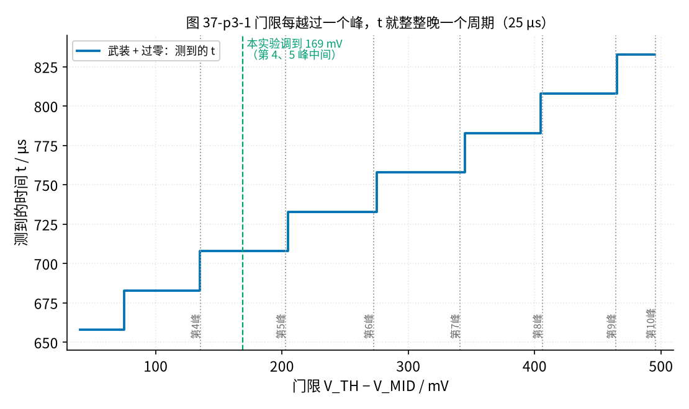
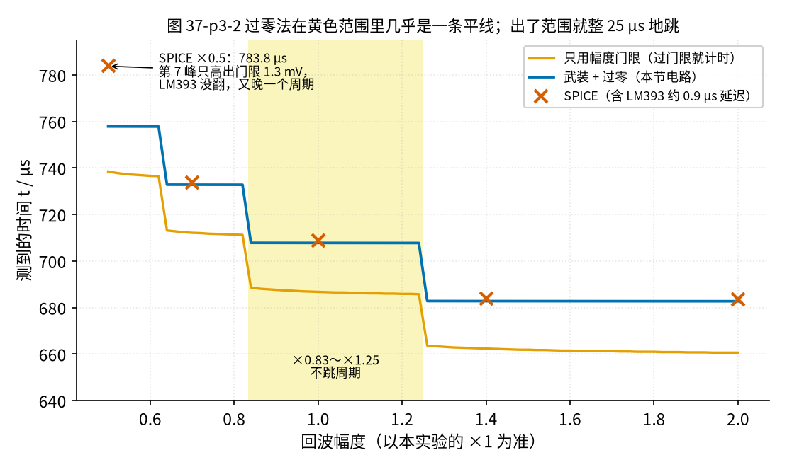
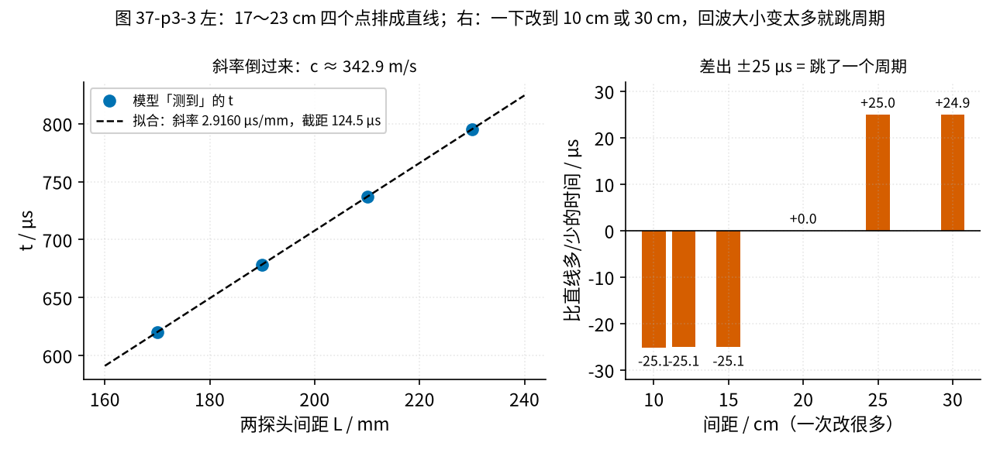
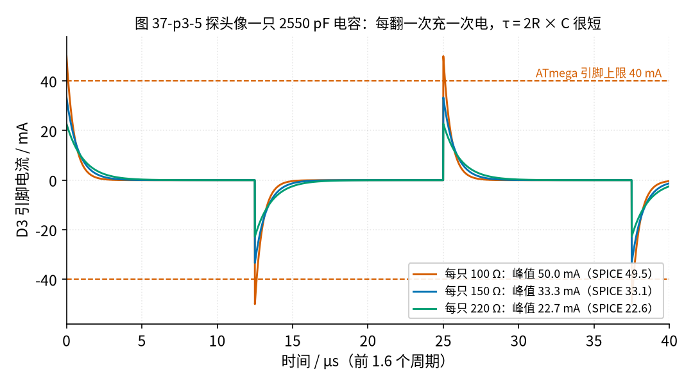

# 37 过零检测与超声波时差 · 参数与调试篇

[上一页：原理与实现篇](page2.md) · [直觉篇](page1.md) · [原理与实现篇](page2.md) · 本页：参数与调试篇 · [动手实验篇](page4.md) · [下一页：动手实验篇](page4.md) · 前置节点：[10 电压比较器 · 参数与调试篇](../10-voltage-comparator/page3.md)、[35 程控增益与 AGC · 参数与调试篇](../35-pga-agc/page3.md)、[36 施密特整形与频率/脉冲计数 · 参数与调试篇](../36-schmitt-pulse-shaping/page3.md)

这一页回答「零件值怎么定、哪里最容易出错」。所有数字来自 `code/37_sim.py`（带 assert）和 ngspice 仿真（仿真网表在仓库的 spice/37 文件夹，核对记录在 review/spice/37.md）。回波形状用的是一个假设 Q = 15 的示意模型，具体的微秒数你实测会不一样，但台阶、斜率、比值这些规律不变。

## 一、门限放在哪里：两个峰的正中间

[原理与实现篇](page2.md) 的电路里，V_TH 决定在第几个周期「武装」。把 V_TH 从 0.04 V 慢慢调到 0.50 V（都是比 V_MID 高多少），过零时刻不是平滑变化，而是**一级一级的台阶**，见图 37-p3-1。

*图 37-p3-1　门限每越过一个峰，t 就整整晚一个周期（25 µs）*

图 37-p3-1 的每一级台阶都正好 25 µs，因为门限每高过一个峰，武装就推迟一个周期，过零点也跟着推迟一个周期。台阶的边就是各个峰的高度。

把门限放在台阶边上最危险：回波稍微一变，就在两级之间跳来跳去。所以本节把 V_TH 放在第 4、5 个峰高度的**中点**，169 mV，落在 0.14～0.20 V 这一级正中，两边都留了余地。

169 mV 只是模型里的数。按 Murata 手册粗算：10 Vp-p 方波的 40 kHz 基波约 4.5 V 有效值，20 cm 处声压约 13.5 Pa，接收探头输出约 95.6 mV 有效值，放大 11 倍后稳态峰值约 1.49 V；8 个周期还长不到稳态，再加上两只探头各有约 ±3 dB 的个体差异，**你的回波峰值可能在 0.5～1.5 V 之间**，比模型的 0.5 V 大两三倍。那样的话，169 mV 很可能正好贴着某一级台阶的边。

所以动手时要自己找门限，就照图 37-p3-1 的办法：从 0.05 V 开始慢慢转电位器，一直转到最大（约 0.545 V），看读数什么时候跳 25 µs，记下两次跳变时的 V_TH，取中间。如果转到最大还只看到一两级台阶，说明回波很大，可以按 [原理与实现篇](page2.md) 练习 3 把门限网络的 100 kΩ 换成 47 kΩ，V_TH 能调到约 1.053 V。[动手实验篇](page4.md) 第 7 步就是这么做的，而且排在量间距、量风**之前**：先确认不跳周期，再读数。

## 二、回波变大变小：多大范围不跳

图 37-p3-2 把回波幅度从 ×0.5 变到 ×2.0，比较两种计时法。

*图 37-p3-2　过零法在黄色范围里几乎是一条平线；出了范围就整 25 µs 地跳*

图 37-p3-2 里有两件事：

1. **黄色范围里**，幅度从 ×0.9 变到 ×1.1，过零法只移动 40 ns，门限法移动 1.37 µs，差了 30 多倍；
2. **黄色范围外**，过零法也会跳，但每一跳都是整 25 µs。这种错误「很整齐」，容易认出来：[动手实验篇](page4.md) 的程序打印每 100 次里的最小值、最大值，两者差 400 格（25 µs）就说明在跳。

ngspice 用真实的 TL072、LM393 模型复核了 ×0.7、×1、×1.4、×2 四个点，时刻分别是 733.77、708.73、683.71、683.63 µs，比 Python 模型统一晚约 0.9 µs，这是 LM393 本身的翻转延迟（仿真约 933 ns），对量时间差没有影响。×0.9 到 ×1.1，ngspice 里过零时刻只移动 54 ns。

**×0.5 是个例外**：Python 说 757.87 µs，ngspice 却给出 783.78 µs，多跳了一个周期。原因是这时第 7 个峰只比门限高 1.3 mV，Python 模型把比较器当成理想的，一过就翻；真实 LM393 需要一点「过驱动」才翻得过来，于是错过了这个峰，等到下一个。这恰好说明：**回波太小、贴着门限时，连跳几格也不奇怪**，要么重新把门限放到中间，要么提高增益。在回波大小变化很大的场合，常用 [35 节](../35-pga-agc/page3.md) 的自动增益控制先把幅度稳住。

## 三、间距、斜率和固定偏移

改变探头间距，过零时刻应该随之线性变化，见图 37-p3-3 左。

*图 37-p3-3　左：17～23 cm 四个点排成直线；右：一下改到 10 cm 或 30 cm，回波大小变太多就跳周期*

图 37-p3-3 左的斜率 2.9160 µs/mm，倒过来就是声速 342.9 m/s，和 20 °C 的 343.24 m/s 只差约 0.1 %。**斜率只和声速有关**，和回波模型无关，所以它是这一节最可靠的结论，用万用表就能验证。

截距 124.5 µs 是「声音首达之外多出来的时间」，主要是回波要长几个周期才过门限。它就是 [原理与实现篇](page2.md) 例 1 里那段固定偏移。两时间法 $v = \frac{L}{2}(1/t_1 - 1/t_2)$ 要求用真实传播时间，所以先把截距从两个读数里减掉，再代进去。

图 37-p3-3 右提醒：间距只能在小范围里改。探头靠近到 15 cm 以内，回波变大到超出黄色范围，提前一个周期武装，读数比直线少 25.1 µs；拉远到 25 cm 以上又多 25 µs。所以实验里间距只在 17～23 cm 之间改，每次 2 cm。

## 四、发射电阻：150 Ω 从哪来

第四、五、七节说到的发射电阻、供电和测量点都在图 37-p3-4 这张原理图里。先在图上找到两只 Rtx 和 D8。

*图 37-p3-4　参数篇对照用的原理图：发射电阻、12 V 与 5 V 的分界、测量点①～④*

**对照看**：左上角就是本节要算的发射回路：D3 → Rtx1 150 Ω → 探头 → Rtx2 150 Ω → D11。两只脚反相翻转，探头两端在 −5 V 和 +5 V 之间跳，所以充电电流峰值是 10 V ÷（150 + 150）Ω ≈ 33.3 mA。第五节的供电表对照图上的 +12 V：它只接 TL072 的 8 脚、LM393 的 8 脚和 V_TH 那串分压；R1、R2 两只 10 kΩ 把 12 V 分成 V_MID = 6.0 V（测量点③），TL072 的输入都在 6 V 附近。右边两只 2.2 kΩ 上拉和 74HC74 都接 Arduino 的 5 V，Q2 直接进 D8，所以上拉绝不能改接 12 V。第七节排错表里的①②③④就是图上四个黄色圆圈，D4 是图下方那根接到两个 /CLR 的绿线。

探头像一只 2550 pF 的电容。D3、D11 每翻转一次，探头两端的电压从 −5 V 跳到 +5 V，充电电流的峰值是 10 V 除以两只电阻之和，见图 37-p3-5。

*图 37-p3-5　探头像一只 2550 pF 电容：每翻一次充一次电，τ = 2R × C 很短*

- 100 Ω：峰值 50 mA，超过 ATmega328P 每脚 40 mA 的绝对最大值，**不能用**；
- 手册对长期工作的建议是每脚 20 mA 以内。下面 150 Ω 的 33.3 mA 只是每次翻转后不到 1 µs 的尖峰，平均电流很小（见下文），所以可以用；想更保守就用 220 Ω；
- 150 Ω：峰值 33.3 mA，时间常数 0.77 µs，比 12.5 µs 的半周期短得多，40 kHz 基波保留 0.982；
- 220 Ω：峰值 22.7 mA，更安全；基波保留 0.962，回波只比 150 Ω 小约 2 %。

ngspice 算得这三种的峰值是 49.51、33.12、22.63 mA，和图 37-p3-5 一致。平均电流很小：发射期间平均 2.04 mA，按每 5 ms 一轮平均只有 0.082 mA。

为什么不用 12 V 加一个 H 桥驱动，把声音推得更响？12 V 反相驱动是 24 Vp-p，超过 MA40S4S 手册的最大 20 Vp-p。而 5 V 反相驱动的 10 Vp-p 在空气里 20 cm 已经够用。

## 五、供电电压和共模范围

| 器件 | 要求 | 本节 | 结论 |
|---|---|---|---|
| TL072 | 输入不能低于负电源 + 4 V | 12 V 时 V_MID = 6.0 V，余量 2.0 V | 可以 |
| TL072 用 9 V | 同上 | V_MID = 4.5 V，余量只剩 0.5 V | 不推荐，所以要 12 V 电源适配器 |
| LM393（VCC = 12 V） | 输入低于 VCC − 1.5 V，即 10.5 V（全温度范围按 10.0 V） | 输入在 6 V 上下几百毫伏 | 可以 |
| 74HC74（5 V） | 高电平至少 3.15 V | 上拉到 Arduino 5 V，高电平约 5 V | 可以 |
| LM358 代替 TL072 | 压摆率限制：40 kHz 时最大峰值约 1.19 V | 回波放大后约 0.5 V 峰值 | 余量太小，不推荐 |

ngspice 里 9 V 供电也能算出 V_MID 4.50 V、增益 10.92，但那是因为仿真模型没有共模限制。真实 TL072 在 9 V 下余量只有 0.5 V，换一只就可能失灵，所以本节规定 TL072 至少 10 V，用 12 V 适配器。

两只 LM393 的输出**只能上拉到 Arduino 的 5 V**，绝不能上拉到 +12 V：Q2 直接接 D8，ATmega328P 引脚最高只能承受 VCC + 0.5 V。

## 六、温度：两个方向一起量

20 cm 声程，温度每升高 1 °C，传播时间少约 0.994 µs。只量一个方向，一次风扇开关之间温度变 5 °C，就能制造约 5 µs 的假信号，和 3 m/s 风的单向变化 5.09 µs 一样大。

两个方向**几乎同时**量，温度对两者的影响相同。按 $\Delta t \approx 2Lv/c^2$ 算，声速错 1 °C 也只让结果从 3.000 变成 3.010 m/s；两时间法更是不需要知道 c。按本节模型，风扇 3 m/s 时：

- 顺风 702.67 µs，逆风 712.92 µs，Δt = 10.25 µs，用斜率求出的 c 算得 v = 3.014 m/s；
- 两个读数各减去 125.1 µs 的固定偏移，用两时间法算得 v = 3.019 m/s。

还有一个比温度更隐蔽的敌人：**探头的位置**。每 1 mm 声程是 2.913 µs，而 1 m/s 的风只带来 3.40 µs，所以 1 mm 的放置误差就相当于约 0.86 m/s 的风。如果为了测逆风把两只探头拆下来对调，重新贴的时候差 1～2 mm 很平常，误差就和要测的信号一样大了。[动手实验篇](page4.md) 的做法是：探头贴好以后再也不动，测逆风时把**整根木条转 180°**；每个方向都读「关 → 开 → 关」，只用「开减关」。按本节模型，顺风方向开减关约 −5.12 µs，逆风方向约 +5.13 µs，两者相减就是 10.25 µs。（直接用公式算是 −5.05 µs 和 +5.14 µs：逆风比顺风略大，因为 1/(c−v) 和 1/(c+v) 不对称。模型里的过零时刻落在 125 ns 的台阶上，两边都成了 5.125 µs；页面用两位小数的读数 702.67、707.79、712.92 相减，才写成 −5.12 和 +5.13。）间距、固定偏移、探头的个体差异都在每一对「开减关」里抵消了。

## 七、排错表

| 现象 | 最可能的原因 | 先查 |
|---|---|---|
| /Q2 平均值一直是 5.00 V，程序打印 miss = 100 | 一次也没捕获到 | V_TH 太高；探头没对正；D4 没接到两个 /CLR |
| /Q2 读数约 0.1 V 不动 | 刚放开 D4 就被置位，捕获的是干扰 | 盲区太短；Q1 被提前置 1（武装比较器输出接错） |
| min、max 相差 400 格 | 跳周期 | 按第一节重新把门限放到台阶中间 |
| 读数随手靠近而乱跳 | 50 Hz 干扰或接收线太长 | 接收线短一点；Cg、Rg 是否接对 |
| 增益不对，① 点直流不是 6.0 V | V_MID 没接好或 TL072 供电不够 | ③ 点应为 6.0 V；电源是否 12 V |
| Arduino 反复复位、串口断开，或闻到焦味 | 发射电阻太小、接错，或 12 V 碰到了 5 V 一侧 | **立刻拔掉 12 V 适配器和 USB，不要用手去摸芯片**（可能很烫）；查两只 Rtx 都是 150 Ω、上拉和 74HC74 VCC 都在 +5 V 轨 |

## 八、练习（先预测，再揭晓）

**练习 1**　发射电阻改成 120 Ω 或 180 Ω，峰值电流各多少？哪个能用？

揭晓

120 Ω：41.7 mA，超过 40 mA，不能用。180 Ω：27.8 mA，可以用。

**练习 2**　门限不动，回波变成 ×1.3（比如探头换了一对灵敏一点的），过零时刻是多少？

揭晓

682.80 µs，比正常早整 25 µs。×1.3 已经在 ×0.83～×1.25 的黄色范围外面，第 4 个峰就越过了门限，提前一个周期武装。

如果你从图 37-p3-2 的平台上读到 682.78，也没算错：那是 ×1.4 的值。同一个台阶里，幅度越大，正弦上坡越陡，越过过零比较器 +12.6 mV 回差上门限就越早，所以 ×1.3 比 ×1.4 晚约 0.02 µs。这比 Timer1 一格 62.5 ns 还小，计数器分不出来。

**练习 3**　回波一直只有 ×0.5。把门限也减半到 84.6 mV，过零时刻变成多少？

揭晓

707.99 µs，回到正常值附近（正常是 707.79 µs）。门限跟着回波一起缩小，相对位置不变，又落在第 4、5 峰中间。这就是自动增益控制的思路反过来用。

**练习 4**　门限不动，探头间距一下改到 13 cm，按直线外推（首达 + 固定偏移 125.1 µs）应该是多少？模型给出的过零时刻是多少？

揭晓

直线外推约 503.85 µs；模型给出 478.76 µs，少了约 25.1 µs，提前了一个周期。间距变小，回波变大，出了黄色范围。图 37-p3-3 右图 10～15 cm 的残差都是 −25.1 µs，13 cm 也一样。

**练习 5**　没有风，温度从 20 °C 升到 30 °C，声音首达时间变成多少？动手实验篇的 /Q2 读数会变多少？

揭晓

首达 573.00 µs，比 20 °C 少约 9.7 µs；/Q2 读数约少 9.69 mV。比风扇单向的 5.09 mV 还大，所以只量一个方向时一定要快。

**变式 6**（选做）　真正的水表常把两只探头斜着装在管壁上，声音沿和水流成 θ 角的方向走，只有 v·cosθ 这一部分帮忙或添乱，近似公式变成 $\Delta t \approx 2Lv\cos\theta / c^2$ 。水里声速约 1481 m/s，L = 5 cm、θ = 45°、水流 1 m/s，Δt 大约多少？

揭晓

约 32.2 ns，只有 Arduino 一格（62.5 ns）的一半左右。水里声速比空气大四倍多，c² 在分母上，时间差一下小了很多；斜装又打了个 cos45° ≈ 0.71 的折扣。所以水表都用 TDC7200 这类专用计时芯片（55 ps 一格，32.2 ns 约 586 格）。

## 本页小结

- V_TH 决定在第几个周期武装，要放在两级台阶正中。
- 过零法在 ×0.83～×1.25 内几乎不动；出了范围就整 25 µs 地跳，min/max 能看出来。
- 斜率 2.9160 µs/mm → c ≈ 342.9 m/s，是最可靠的结论；截距是固定偏移。
- 发射电阻 150 Ω，峰值 33.3 mA；100 Ω 超标。
- TL072 至少 10 V，用 12 V；比较器输出只上拉到 5 V。
- 两个方向一起量，温度大部分抵消。

## 参考资料

- TI SLAAES9《Ultrasonic Sensing Solution (USS) Guide》（第 2.2 节：TDC 方案就是在过零点附近取时刻；第 2.1 节用包络过门限的 absTOF 先定「差几个整周期」，Figure 2-5、2-6 演示把波形平移 1 个、5 个周期再比较）：https://www.ti.com/lit/an/slaaes9/slaaes9.pdf
- TI TL072 数据手册（共模输入范围）：https://www.ti.com/lit/ds/symlink/tl072.pdf
- TI LM393 数据手册（共模输入低于 VCC − 1.5 V）：https://www.ti.com/lit/ds/symlink/lm393.pdf
- TI SN74HC74 数据手册（SCLS094，VIH 3.15 V @ 4.5 V）：https://www.ti.com/lit/ds/symlink/sn74hc74.pdf
- Murata MA40S4S / MA40S4R 数据手册：https://www.murata.com/~/media/webrenewal/products/sensor/ultrasonic/open/datasheet_maopn.ashx?la=en
