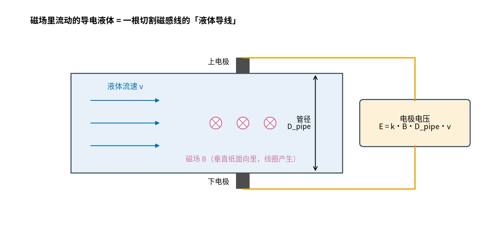
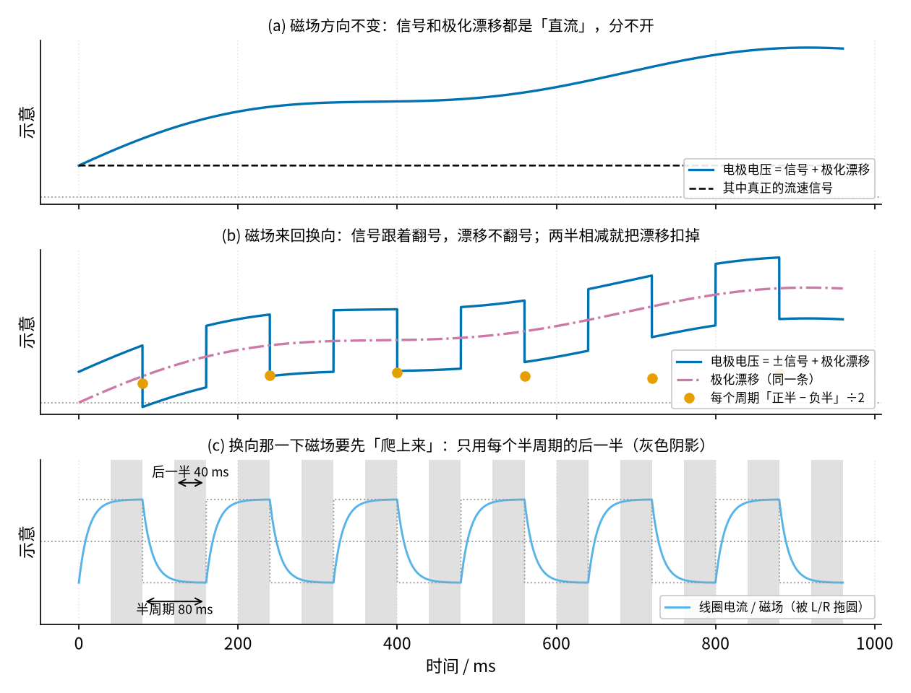
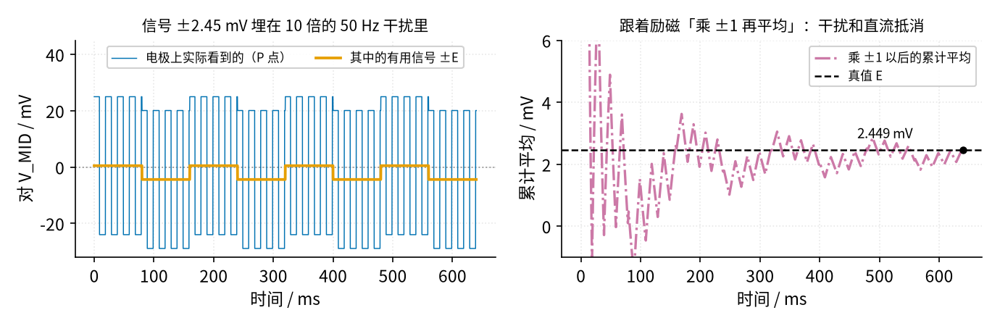

# 38 同步检波 · 直觉篇

[上一页：37 过零检测与时差法 · 动手实验篇](../37-zero-crossing-tof/page4.md) · 本页：直觉篇 · [原理与实现篇](page2.md) · [参数与调试篇](page3.md) · [动手实验篇](page4.md) · [下一页：原理与实现篇](page2.md) · 前置节点：[30 仪表放大器与电桥](../30-instrumentation-amp/page1.md)、[09 精密整流](../09-precision-rectifier/page1.md)、[34 开关电容滤波与跟踪滤波](../34-switched-cap-filter/page1.md)

> **开头三问**（先猜，读完本节再回来对答案）
>
> 1. 一个只有 2.45 mV 的信号，旁边站着比它大 10 倍的 50 Hz 干扰和几十毫伏的直流，用普通的滤波器能把它挑出来吗？
> 2. 电磁流量计为什么不用一块永久磁铁，非要让线圈的电流来回换方向？
> 3. 把一个方波"乘 +1、乘 −1"轮流做，再求平均，直流会变成什么？

## 痛点：信号是直流，干扰也是直流

[30 仪表放大器与电桥 · 直觉篇](../30-instrumentation-amp/page1.md) 已经说过：电磁流量计两个电极之间的有用电压，每 1 m/s 流速只有 150～200 µV；电极对地却带着几百毫伏到 ±2 V 的**极化电压**，外加 50 Hz 干扰（ADI 的文章 https://www.analog.com/en/resources/analog-dialogue/articles/electromagnetic-flow-meters.html ）。30 节用仪表放大器把"两根线上一样的部分"扔掉了，这一节要解决剩下的难题：**两根线之间不一样的部分里，也混着很大的直流**。

先看原理，见图 38-p1-1。导电的液体流过磁场，就像一根切割磁感线的导线，在上下两个电极之间感应出电压 E，大小正比于磁场 B、管径和流速 v。

*图 38-p1-1　电磁流量计：流动的导电液体在磁场里感应出电极电压*

图 38-p1-1 里如果磁场一直朝一个方向，E 就是一个**直流**。麻烦在于：金属电极泡在液体里，表面会慢慢积起一层电荷，电极之间出现几十到几百毫伏、还在缓慢爬动的直流（每只电极对地的极化可以大到 ±2 V，但两只电极的极化大部分相同，被仪放当共模扔掉，相减后剩下的差值小得多），这就是**电极极化**。它也是直流，和 E 混在一起，用什么滤波器都分不开——低通会把两者一起留下，高通会把两者一起扔掉。

## 一、换个思路：让信号"动起来"，干扰不动

既然分不开，就让信号换个样子。办法是让线圈电流**来回换方向**：磁场一会儿朝里、一会儿朝外，E 就跟着一会儿为正、一会儿为负，变成一个方波。而极化电压是电极自己的事，不管磁场朝哪边，它都慢慢地朝同一个方向爬。

图 38-p1-2 是一个示意（单位任意）：

*图 38-p1-2　磁场换向的作用：(a) 不换向时分不开；(b) 换向后两半相减；(c) 线圈电流要先爬上来*

- 图 38-p1-2 (a)：磁场不换向，电极电压 = 信号 + 漂移，从一条曲线上根本看不出哪部分是流速。
- 图 38-p1-2 (b)：磁场换向，信号跟着翻号，漂移不翻号。把每个周期"正半周的读数减负半周的读数"再除以 2，漂移就被扣掉了。
- 图 38-p1-2 (c)：线圈是电感，电流不能突变，每次换向后要过一会儿磁场才稳定。所以只用每个半周期的**后一半**（灰色阴影）来读数。

这个"换向、相减"的动作，就是本节的主角**同步检波**：手里有一个和信号同步的参考（谁在控制磁场方向，谁就知道此刻信号该是正还是负），每一刻按参考把读数乘 +1 或 −1，再求平均。

## 二、为什么它连 50 Hz 也能挡住

再看图 38-p1-3。上半图是本节实验里"模拟电极"P 点上的真实样子（ `code/38_sim.py` 第 1 节算出来的）：有用信号 ±2.45 mV，叠着 −1.98 mV 的直流和 ±24.49 mV 的 50 Hz 干扰（Arduino 的 tone() 发出的是方波，所以还带着 150 Hz、250 Hz……奇数倍谐波），干扰是信号的 10 倍，用肉眼在上半图里找信号几乎不可能。

*图 38-p1-3　信号埋在 10 倍的干扰里；按励磁乘 ±1 再平均，平均值逐渐靠近真值*

图 38-p1-3 的下半图是"跟着励磁乘 ±1、再累计平均"的结果，平均几个周期以后就回到真值 2.449 mV。道理很朴素：

- 直流在正半周被加上一次，在负半周被减掉一次，抵消了；
- 本节的励磁频率选 6.25 Hz，半个周期 80 ms，里面正好装下 4 个完整的 50 Hz 周期。50 Hz 在一个半周期里的平均是 0，乘 +1 还是 −1 都是 0；
- 只有和参考同步翻号的信号，乘了 ±1 以后每一半都变成正的，越平均越清楚。

## 三、它和精密整流是亲戚

[09 精密整流 · 直觉篇](../09-precision-rectifier/page1.md) 的全波整流也是"负的翻成正的再平均"。区别只有一个：整流器看**信号自己的正负**来决定翻不翻，同步检波看**参考的正负**来决定翻不翻。所以同步检波常被叫作"有参考的整流"。这个区别非常关键：

- 整流器碰到干扰也照翻不误，干扰被翻成正的，平均后变成一个假读数；
- 同步检波只认参考，和参考不同步的干扰在平均里抵消，所以它能从比自己大 10 倍、100 倍的干扰里挑出信号。

正弦信号经过精密整流再平均，得到幅度的 0.637 倍（2/π）；正弦信号乘一个同步的方波参考再平均，也得到 0.637 倍。这是同一件事的两种说法， [原理与实现篇](page2.md) 会算给你看。

## 四、电路上怎么做"乘 ±1"

"乘 +1"是一只跟随器，"乘 −1"是一只反相放大器（ [05 反相放大 · 直觉篇](../05-inverting-amp/page1.md) ）。用一个模拟开关 CD4053（ [34 开关电容滤波与跟踪滤波](../34-switched-cap-filter/page1.md) 用过）在两者之间来回切，切换的命令就是励磁的参考方波。后面再接一个 RC 低通求平均，万用表就能读出一个稳定的直流。本节实验用 Arduino 同时产生"励磁"和"参考"两根方波，还能故意把参考错开 45°、90°、180°，看读数怎么变。

Arduino 的 5 V 方波推不动接在 9 V 上的 CD4053（VDD = 9 V 时，选择脚要高于约 6.3 V 才保证认作高电平，这个数按数据手册 5 V、10 V 两档的门限估算，见 [参数与调试篇](page3.md) 第五节），中间要用比较器 LM393 做一次**电平转换**。这件事 [29 上拉/下拉电阻与电平转换](../29-pullup-level-shift/page1.md) 讲过原理，这里会具体接一次。

这一节说的"跟随器 / 反相放大器 + CD4053 + RC 低通 + LM393 电平转换"合起来就是图 38-p1-4。

*图 38-p1-4　"乘 ±1"再求平均的原理图（U3B、U5B 标引脚号，CD4053 标 11、12、13、14 脚）*

**对照看**：先看 CD4053 的开关停在哪。D10 高时，U5B 的 5 脚高于 6 脚的 2.5 V，LM393 输出管断开，RU 把 11 脚拉到 9 V，开关接 13 脚 AY。这时 U3B 的同相端和 R11 左端都是信号，R11 里没有电流，7 脚输出就等于信号，相当于一只跟随器（×+1）。D10 低时，输出管导通，11 脚被拉到约 0 V，开关接 12 脚 AX（虚线）。同相端变成 V_MID，U3B 成了增益 −R12/R11 = −1 的反相放大器。LM393 输出级是集电极开路，高电平靠 RU 接到 9 V，所以 Arduino 的 5 V 方波就被"抬"成了 0/9 V，这就是电平转换。最右边 RF、CF 的 τ = 100 kΩ × 10 µF = 1 s，J 对 K 的直流就是"乘 ±1"之后的平均值。

## 预告：39 节怎么把磁场做稳

本节的实验用 Arduino 的方波通过一只 1 MΩ 电阻"假装"成电极信号，磁场换向是瞬间完成的。真的流量计里，线圈有电感和电阻，换向时电流按 L/R 的时间常数慢慢爬上来（图 38-p1-2 (c)），电池电压一变，磁场强度也跟着变。 [39 恒流励磁 · 直觉篇](../39-constant-current-excitation/page1.md) 会用恒流源驱动线圈，让每个半周期的磁场都一样大。本节"只采后半段"的理由，看图 38-p1-2 (c) 里电流爬升的那一小段就够了。

## 新手常见误解

- **"信号小就多放大几倍"**：极化电压是信号的几十到几百倍，先放大会先把放大器撑到电源边上（ [原理与实现篇](page2.md) 算过：9 V 单电源、增益 21 倍时，仪放输出对 V_MID 只剩约 +3 V 的空间，差模直流超过 3.0 V ÷ 21 ≈ 143 mV 就会顶到头）。先想办法把直流去掉，再放大。
- **"加一个低通就能滤掉 50 Hz"**：低通能削弱 50 Hz，但扔不掉直流漂移；同步检波两样一起处理。
- **"参考随便接一个同频方波就行"**：参考和信号差 90° 时，模拟检波器的读数是 0，频率对但相位错照样读不到（ [原理与实现篇](page2.md) 的相位定律）。
- **"换向频率越高越好"**：励磁频率要让每个半周期装下整数个 50 Hz 周期，而且要给线圈留出电流爬升的时间，所以工业表常用 50 Hz 的几分之一。
- **"翻转相减能消掉一切"**：它消掉的是在两个半周期里一样的东西。漂移本身在变的时候，相减后还会剩一点：图 38-p1-2 (b) 里真值是 1，漂移爬得最快的第一个周期只得到 0.62，后面几个周期在 0.79～0.98 之间（数字由 `code/figs/38_figs.py` 画这张图时算出）。

## 一句话总结

信号和干扰都是直流时，让信号跟着参考来回翻号，再按参考乘 ±1 求平均：同步的留下，不同步的抵消。
