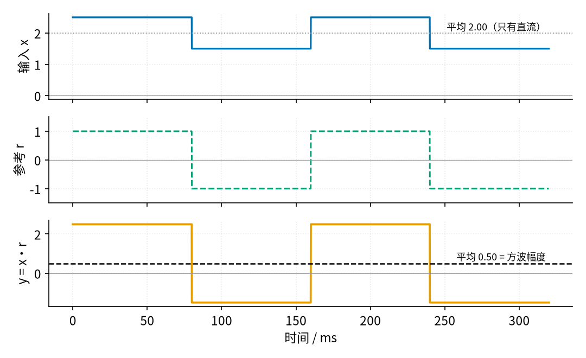
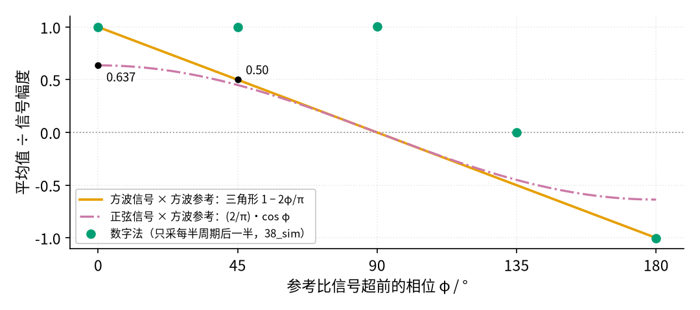
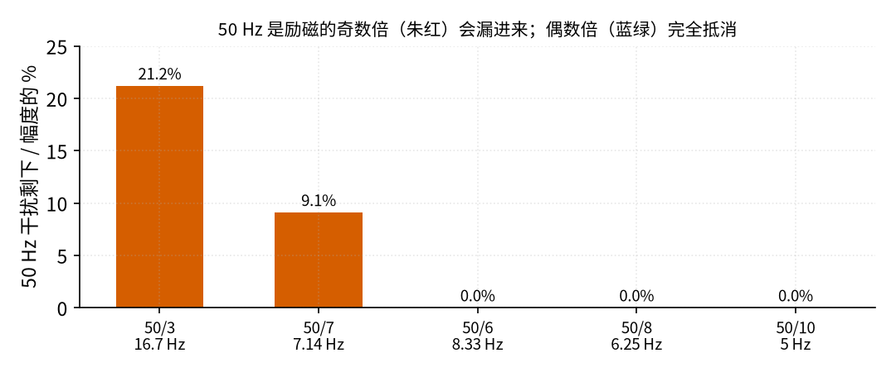
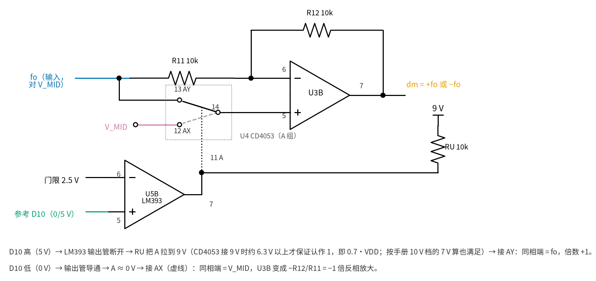

# 38 同步检波 · 原理与实现篇

[上一页：直觉篇](page1.md) · [直觉篇](page1.md) · 本页：原理与实现篇 · [参数与调试篇](page3.md) · [动手实验篇](page4.md) · [下一页：参数与调试篇](page3.md) · 前置节点：[30 仪表放大器与电桥](../30-instrumentation-amp/page2.md)、[09 精密整流](../09-precision-rectifier/page2.md)、[20 有源滤波](../20-active-filter/page1.md)

## 这一页要解决的问题

[直觉篇](page1.md) 说了同步检波的想法：按参考的正负把读数乘 +1 或 −1，再求平均。这一页把四件事算清楚：

1. 为什么"乘 ±1 再平均"能把直流消掉、把信号留下；
2. 参考和信号的相位差了一点，读数会少多少（相位定律）；
3. 为什么励磁频率选 6.25 Hz，而不是 7.14 Hz 或 16.7 Hz；
4. 电路里的"乘 ±1"怎么用一只运放、一只模拟开关和一只比较器做出来，整条信号链每一级的数是多少。

## 一、乘 ±1 再平均

设输入 x 是一个直流 2 加上一个幅度 0.5、和参考同步翻号的方波（单位任意），参考 r 在 +1 和 −1 之间翻。见图 38-p2-1：



*图 38-p2-1　输入 x、参考 r 和乘积 y = x·r*

图 38-p2-1 第一行，x 的平均是 2.00，里面只有直流，方波的正负两半互相抵消了。第三行，y = x·r：参考为 +1 时 y = 2 + 0.5 = 2.5，参考为 −1 时 y = −(2 − 0.5) = −1.5，两者平均 (2.5 − 1.5)/2 = 0.50，正好是方波的幅度，直流 2 不见了。

写成式子：信号 $x = D + A \cdot r$ ，其中 D 是直流， A 是幅度，参考 r 只取 ±1，所以 $r^2 = 1$ ：

$$\overline{x \cdot r} = D \cdot \overline{r} + A \cdot \overline{r^2} = D \cdot 0 + A = A$$

只要参考在一段时间里 +1 和 −1 各占一半（ $\overline{r} = 0$ ），直流 D 有多大都没关系。这就是同步检波不怕极化电压的原因。注意前提是"各占一半"：占空比偏一点点，直流就会漏进来， [参数与调试篇](page3.md) 会算漏多少。

## 二、相位定律：参考错开了会怎样

实际电路里，参考不一定和信号完全对齐。设参考比信号超前 φ。两个都是方波时，一个周期（2π）里有两段、每段长 φ 的时间两者异号，合起来占周期的 φ/π（乘积为 −1）；其余 1 − φ/π 的时间同号（乘积为 +1），平均值是 (1 − φ/π) − φ/π，即

$$\overline{s \cdot r} = 1 - \frac{2\varphi}{\pi} \qquad (0 \le \varphi \le \pi)$$

例：φ = 45° 时异号占周期的 1/4，平均 3/4 − 1/4 = 1/2。用角度说就是 $1 - \varphi/90^\circ$ ：45° 剩一半，90° 剩 0，180° 变成 −1。图 38-p2-2 把这条"三角形定律"和正弦信号的情况画在一起：



*图 38-p2-2　相位定律：方波 × 方波是三角形，正弦 × 方波是余弦*

- 正弦信号 × 方波参考，平均是 $(2/\pi) \cdot \cos\varphi$ 。 $\varphi = 0$ 时是 0.637，和 [09 精密整流 · 原理与实现篇](../09-precision-rectifier/page2.md) 里全波整流的平均值是同一个数：参考完全对齐时，同步检波和精密整流做的是同一件事。
- 图 38-p2-2 里的五个圆点是 Arduino 的**数字法**（ `code/38_sim.py` 第 6 节）：它每个半周期只采后一半。0°～90° 之间圆点一直贴在 1 附近，到 135° 才掉到 0。原因是参考错开不到 90° 时，参考的"后一半"仍然整段落在信号的同一个半周期里——这正是 [直觉篇](page1.md) 说的"只用后半段"的另一个好处。真的线圈换向要花几毫秒（预告： [39 恒流励磁](../39-constant-current-excitation/page1.md) 会算这段时间），只采后半段正好躲开它。模拟电路做不到"只用后一半"，它老老实实走三角形。

## 三、为什么选 6.25 Hz

参考方波可以拆成一串正弦：基波 f，再加 3f、5f、7f…（只有奇次谐波，幅度是基波的 1/3、1/5、1/7…）。

> **最少知识：方波 = 一串正弦**（本节只用这一个结论）
>
> 一个在 +1 和 −1 之间跳的方波（频率 f，ω = 2πf）可以写成 $r(t) = \frac{4}{\pi}(\sin\omega t + \frac{1}{3}\sin 3\omega t + \frac{1}{5}\sin 5\omega t + \dots)$ 。项取得越多，叠出来越接近方方正正的方波。[33 带通与陷波 · 直觉篇](../33-bandpass-notch/page1.md) 里画方波穿过带通的那张图，正好是反过来的过程：带通把三倍频以上的项滤掉，方波只剩下基波这一项，就成了正弦。
>
> 第 n 项的幅度是 4/(nπ)。一个幅度为 A、频率正好是 nf 的正弦，和这一项相位对齐时相乘再平均，得到 A × 4/(nπ) × 1/2 = 2A/(nπ)（两个同频正弦相乘，平均值是两个幅度乘积的一半）。下面的 $2/(n\pi)$ 就是这么来的。乘法 + 平均只会留下"频率和参考里某个成分相同"的东西。所以：

- 50 Hz 如果正好是励磁频率的**奇数倍**，就撞上了参考的某个谐波，会漏进读数。算一下：50 Hz 是第 n 次谐波时，最多漏进 $2/(n\pi)$ 倍的干扰幅度。n = 3 时是 21.2%，n = 7 时是 9.09%。
- 50 Hz 是**偶数倍**时，参考里根本没有这个成分，长时间平均后完全抵消。从时间上看也一样：一个半周期里装下整数个 50 Hz 周期。

图 38-p2-3 是 `code/38_sim.py` 第 5 节对五个候选频率的数值结果：



*图 38-p2-3　五个候选励磁频率下，50 Hz 干扰残留多少*

图 38-p2-3 里 16.7 Hz（50 Hz 是第 3 次）剩 21.20%，7.14 Hz（第 7 次）剩 9.10%（数值积分结果，和公式的 9.09% 相差在积分误差内）；8.33 Hz、6.25 Hz、5 Hz 都是偶数倍，剩 0.00%。本节选 6.25 Hz，有三个原因：50 Hz 是它的第 8 次谐波；半周期 80 ms 恰好是 4 个 50 Hz 周期，所以 P、N 两个采样窗相隔整数个干扰周期、干扰相减抵消（这是主要原因），后一半 40 ms 又恰好是 2 个 50 Hz 周期，单窗平均本身也接近 0，算是锦上添花；Arduino 的 Timer1 用整数分频就能精确做出来（下面第五节）。

## 四、电路怎么"乘 ±1"

图 38-p2-4 是本节的核心一级：



*图 38-p2-4　±1 级：U3B + CD4053 + LM393 电平转换*

U3B 的反相端经 R11 接输入 fo，R12 接在输出和反相端之间，R11 = R12 = 10 kΩ。同相端经 CD4053 的一个 2 选 1 开关，接 fo 或 V_MID：

- **选 AY（同相端 = fo）**：同相端和反相端都是 fo，R11 上没有电流，R12 上也没有电流，输出 = fo，倍数 +1。
- **选 AX（同相端 = V_MID）**：同相端是 V_MID，就是 [05 反相放大 · 原理与实现篇](../05-inverting-amp/page2.md) 的反相放大器，只不过"地"换成了 V_MID。输出对 V_MID 是 $-(R_{12}/R_{11}) \cdot (f_o - V_{MID})$ ，倍数 −1。

两种状态下输入 fo 都直接接 R11，不经过开关；开关只串在同相端，同相端几乎不取电流，CD4053 几百欧的导通电阻（ [34 开关电容滤波与跟踪滤波 · 原理与实现篇](../34-switched-cap-filter/page2.md) 讲过）上没有压降，不影响倍数。

**为什么要电平转换**：CD4053 接 9 V 电源时，选择脚要接近 9 V 的七成才认作 1（TI 数据手册 https://www.ti.com/lit/ds/symlink/cd4053b.pdf 给的是：VDD = 5 V 时 3.5 V，VDD = 10 V 时 7 V），Arduino 的高电平只有 5 V，够不着。图 38-p2-4 里用 LM393 比较器（ [10 电压比较器](../10-voltage-comparator/page1.md) ）来转：同相端接 Arduino 的 D10，反相端接 2.5 V 门限；LM393 的输出是"开集电极"，只会往下拉，往上靠一只上拉电阻 RU 拉到 9 V（ [29 上拉/下拉电阻与电平转换](../29-pullup-level-shift/page2.md) 讲的就是这种接法）。D10 高时输出管断开，选择脚被拉到 9 V；D10 低时输出管导通，选择脚接近 0 V。LM393 的数据手册见 https://www.ti.com/lit/ds/symlink/lm393.pdf 。

另外两种做法：

- **CD40109B**：专门的"低压到高压"电平转换芯片，一边接 5 V、一边接 9 V，四路（数据手册 https://www.ti.com/lit/ds/symlink/cd40109b.pdf ）。效果一样，只是多一种芯片。
- **74HCT 系列**：它的输入能认 5 V 单片机的电平，但它自己只能接 5 V 电源，输出最高 5 V，**仍然推不动 9 V 的 CD4053**，不能用。

## 五、整条信号链和每一级的数

把直觉篇的流量计换成实验用的"模拟电极"，整条链如下（数字都来自 `code/38_sim.py`）：

1. **模拟电极**：Arduino D9 输出 0/5 V、6.25 Hz 方波，经 RS1 = 1 MΩ 接 P 点；P 点经 RS2 = 1 kΩ 接 V_MID。P 点对 V_MID 的方波幅度 E = 2.4492 mV（第 1 节）。D5 经 CN、RN = 100 kΩ 加 50 Hz 干扰，±24.49 mV；电位器 RP 经 RD = 100 kΩ 加一个可调的直流，相当于"极化电压"，范围 −46.49～+42.53 mV。
2. **仪表放大器**：沿用 [30 仪表放大器与电桥 · 原理与实现篇](../30-instrumentation-amp/page2.md) 的三运放电路，RG = 1 kΩ，倍数 21，REF 接 V_MID。最坏情况下输出离 V_MID 1.542 V，离 9 V 单电源 LM358 的 3.0 V 余量还有一半（第 2 节）。反过来说，仪放输入的差模直流超过 3.0 V ÷ 21 ≈ 143 mV 就会顶到头。
3. **交流耦合**：CH = 10 µF、RH = 100 kΩ，转折频率 0.159 Hz，把仪放输出里的直流（包括极化电压 × 21 和仪放自己的失调 × 21）隔掉；80 ms 半周期内方波下垂 7.7%（第 7 节）。
4. **跟随器 U3A**：给 ±1 级一个低内阻的输入，后面的 R11 不会拖累 RH。
5. **±1 级 U3B**：上一节。
6. **RC 低通求平均**：RF = 100 kΩ、CF = 10 µF，τ = 1 s。读数接在 J、K 之间（J 是 RC 的输出，K 是 V_MID），稳定后理论上是 G·E = 21 × 2.4492 = 51.43 mV；算上 RF 和万用表 10 MΩ 内阻的分压（0.9901 倍）和交流耦合的下垂，模拟结果是 50.89 mV（第 7 节）。RC 低通的原理见 [20 有源滤波 · 直觉篇](../20-active-filter/page1.md) 。
7. **数字法**：仪放输出另经 10 kΩ/10 kΩ 分压接 A0（0～9 V 变成 0～4.5 V，不超过 Arduino 的 5 V），Arduino 每 1 ms 读一次，按 D10 的状态加或减，只用每个半周期的后 40 ms。A0 上的信号只有 25.72 mV，合 5.27 个最小刻度（1 LSB = 4.88 mV，第 6 节）。

**Timer1 怎么做出 6.25 Hz**：16 MHz 时钟 256 分频，每计 5000 个数（TOP = 4999）D9 翻一次，半周期 = 5000 × 256 ÷ 16 MHz = 80.0 ms。D10 用同一个定时器的另一个比较通道，所以和 D9 严格同步；把它提前 k 个计数，就是超前 k × 0.036°，45° 对应 1250 个计数（第 3 节）。代价是 D9、D10 不能再用 analogWrite（这两个脚的 PWM 本来就靠 Timer1）；D5 的 tone() 占用 Timer2（Arduino 核心源码 https://github.com/arduino/ArduinoCore-avr/blob/master/cores/arduino/Tone.cpp ），官方参考写明它会干扰 D3、D11 的 PWM 输出（ https://github.com/arduino/reference-en/blob/master/Language/Functions/Advanced%20IO/tone.adoc ）。 [动手实验篇](page4.md) 的程序注释里也写了这两条。

## 用 Python 算一遍

```python
import math

# 1. 模拟电极：P 点对 V_MID 的方波幅度
VIO, RS1, RS2, RN, RD, RW = 5.0, 1e6, 1e3, 100e3, 100e3, 2.5e3   # RW：电位器居中时的内阻
rp = 1 / (1 / RS2 + 1 / RN + 1 / (RD + RW))          # P 点到"交流地"的并联电阻
E = VIO / 2 * rp / (RS1 + rp)
print(f"并联电阻 {rp:.2f} Ω，E = {E*1e3:.4f} mV；只算 RS1、RS2：{VIO/2*RS2/(RS1+RS2)*1e3:.4f} mV")
print(f"仪放 ×21 后：{21*E*1e3:.2f} mV")

# 2. 相位定律（方波 × 方波）
for phi in (0, 45, 90, 135, 180):
    print(f"φ = {phi:3d}°：平均 = {1 - phi/90:+.3f}")
print(f"正弦 × 方波，φ = 0：{2/math.pi:.3f}")

# 3. 50 Hz 是第 n 次谐波时最多漏多少
for fe in (50/3, 50/7, 50/6, 6.25, 5.0):
    n = 50 / fe
    left = 2 / (round(n) * math.pi) if round(n) % 2 == 1 else 0.0
    print(f"励磁 {fe:6.3f} Hz：n = {n:.0f}，最多漏 {left*100:.2f}%")

# 4. Timer1：256 分频、TOP = 4999
half = (4999 + 1) * 256 / 16e6
print(f"半周期 {half*1e3:.1f} ms，励磁 {1/(2*half):.2f} Hz，1 个计数 = {180/5000:.3f}°，45° = {45/(180/5000):.0f} 个计数")
```

运行结果：E = 2.4492 mV（只算 RS1、RS2 是 2.4975 mV），仪放后 51.43 mV；相位定律 +1、+0.5、0、−0.5、−1；16.67 Hz 漏 21.22%，7.14 Hz 漏 9.09%，其余 0；半周期 80.0 ms，45° = 1250 个计数。和 `code/38_sim.py` 一致（第 5 节的 21.199% 和 9.104% 是数值积分，与公式差在小数点后两位）。

## 例题

**例1（完整）**：求本节夹具 P 点上的信号幅度 E。

1. D9 在 0 V 和 5 V 之间翻，平均 2.5 V，交流部分是 ±2.5 V。
2. 对交流来说，V_MID、电位器滑动端、D5（经 CN）都相当于"不动的点"，所以 RS2、RN、RD + 电位器内阻三者并联：1 kΩ ∥ 100 kΩ ∥ 102.5 kΩ = 980.63 Ω。电位器居中时滑动端的内阻是 10 kΩ × 0.5 × 0.5 = 2.5 kΩ。
3. 分压：E = 2.5 V × 980.63 ÷ (1 000 000 + 980.63) = 2.4492 mV。
4. 如果用 SPICE 的直流工作点（.op）分别算 D9 = 5 V 和 0 V 两种情况再相减，CN 对直流是断开的，RN 不并进来，并联电阻是 990.34 Ω，E = 2.4734 mV，比瞬态大约 1%。[动手实验篇](page4.md) 第 3 步用串口命令让 D9 停住时，量到的就是这个"静态"值。

**例2（留空）**：RS1 换成 2.2 MΩ，其他不变，E 和仪放输出各是多少？

```python
# 不运行：先把每个 ____ 换成算式，再删掉这一行
rp = 980.63
E = 2.5 * ____ / (____ + rp)
print(E * 1e3, 21 * E * 1e3)
```

<details><summary>答案</summary>

E = 2.5 × 980.63 ÷ (2 200 000 + 980.63) = 1.1139 mV，仪放输出 23.39 mV。静态（CN 断开）时是 1.1249 mV。

</details>

**例3（变体迁移）**：想把励磁改成 5 Hz，Timer1 仍用 256 分频，TOP 取多少？1 个计数对应多少度？程序里还有哪些数要跟着改？50 Hz 干扰会漏进来吗？

<details><summary>答案</summary>

半周期 100 ms = 0.1 s × 16 MHz ÷ 256 = 6250 个计数，TOP = 6249；1 个计数 = 180° ÷ 6250 = 0.0288°。跟着改的数：OCR1B = TOP − leadCounts（不能还是 4999 − leadCounts，否则 D10 比 D9 早 1250 个计数 = 36°，模拟检波那一路读数只剩 1 − 2 × 36°/180° = 60%）；BLANK_US 改成半周期的一半 50 ms；45°、90° 的计数改成 1562、3125。 [动手实验篇](page4.md) 的程序已经把这些都写成由 `TOP` 算出，只改 `TOP` 一行即可（数字见 `code/38_sim.py` 第 8 节末尾）。50 Hz 是 5 Hz 的第 10 次谐波，偶数，不漏；一个半周期装下 5 个 50 Hz 周期。代价是读数更新变慢一些。

</details>

## 本页小结

- 参考 r 只取 ±1 且两半各占一半时， $\overline{x \cdot r}$ 只留下和参考同步翻号的幅度，直流被消掉。
- 方波 × 方波的相位定律是三角形 $1 - \varphi/90^\circ$ ；正弦 × 方波是 $(2/\pi) \cdot \cos\varphi$ ，φ = 0 时 0.637，和全波整流相同。
- 50 Hz 要落在励磁的偶数倍上；6.25 Hz 半周期 80 ms 装 4 个 50 Hz 周期。
- ±1 级：同相端经 CD4053 切 fo 或 V_MID，倍数 +1 或 −1；Arduino 的 5 V 要经 LM393 + 9 V 上拉转成 9 V 才推得动 CD4053。
- 夹具 E = 2.4492 mV，仪放后 51.43 mV，RC 平均后万用表读 50.89 mV。
