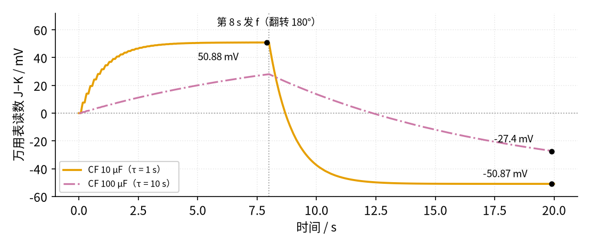
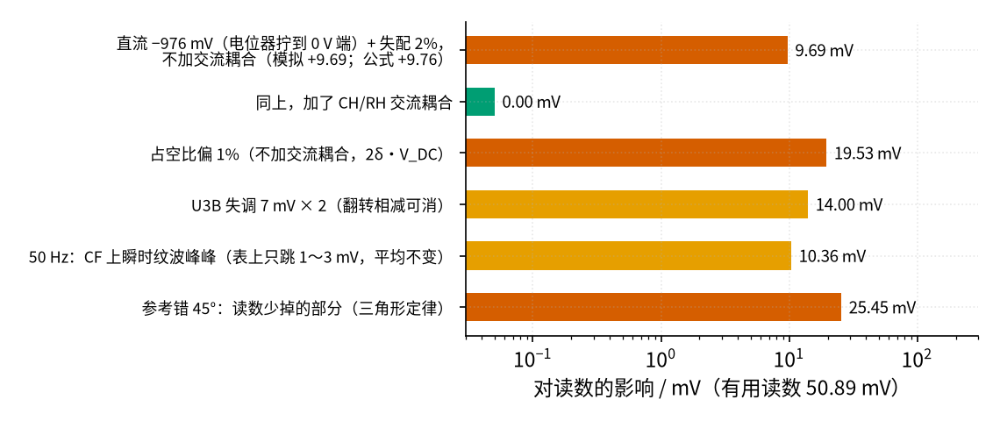
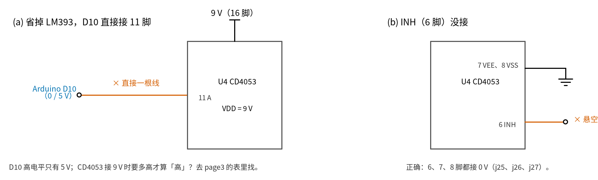

# 38 同步检波 · 参数与调试篇

[上一页：原理与实现篇](page2.md) · [直觉篇](page1.md) · [原理与实现篇](page2.md) · 本页：参数与调试篇 · [动手实验篇](page4.md) · [下一页：动手实验篇](page4.md) · 前置节点：[30 仪表放大器与电桥](../30-instrumentation-amp/page3.md)、[34 开关电容滤波与跟踪滤波](../34-switched-cap-filter/page3.md)

## 这一页要解决的问题

[原理与实现篇](page2.md) 算出了理想情况：夹具信号 2.4492 mV，仪放后 51.43 mV，万用表读 50.89 mV。这一页回答实际搭电路时最常碰到的问题：平均要多久、哪些误差会混进读数、怎么判断是哪一级出了毛病，以及几种最容易犯的接线错误。本页所有数字来自 `code/38_sim.py` 第 6、7 节。

## 一、RC 时间常数：稳和快只能选一个

RC 低通（RF = 100 kΩ、CF = 10 µF）的时间常数 τ = RF × CF = 1 s。图 38-p3-1 模拟了"第 8 s 把参考翻转 180°"以后万用表读数的变化：

*图 38-p3-1　参考翻转后，读数要等几个时间常数才稳定*

从图 38-p3-1 读出三件事：

- 翻转前读数稳定在 50.88 mV（和第 7 节的 50.89 mV 只差显示位数）。
- τ = 1 s 时，从 +50.89 跳到 −50.89 mV，要约 5.2 s 才稳定到 ±1%；理论值是 τ·ln200 = 5.3 s（总变化是 2 倍读数，要剩下不到 1% 的读数，就是 1/200）。
- CF 换成 100 µF（τ = 10 s），纹波从 0.04 mV 降到 0.010 mV，但稳定要 50 s，20 s 时还只到 −27.38 mV。

没有干扰时纹波本来就比万用表的末位还小，换大电容只换来 10 倍的等待时间，所以实验用 10 µF。工业流量计的"阻尼时间"旋钮调的就是这个。

## 二、误差预算：哪些东西会混进读数

图 38-p3-2 把几种误差放在同一把尺子上（有用读数 50.89 mV）：

*图 38-p3-2　误差预算：每种误差对万用表读数的影响*

图 38-p3-2 里各条的来历：

1. **直流泄漏**：±1 级的 −1 倍其实是 −R12/R11。两只电阻差 ε 时，−1 状态是 −(1 + ε)，+1 状态还是 +1，直流 V_DC 乘上去平均下来剩 $-V_{DC} \cdot \varepsilon / 2$ （V_DC 带符号，比 V_MID 高为正）。电位器从中间拧到 0 V 端时，P 点直流下降约 44.5 mV，仪放输出上多出约 −935 mV 直流；ε = 2% 就漏 −(−935 mV) × 0.02 ÷ 2 = +9.35 mV，算上万用表的 0.9901 倍是 +9.25 mV（模拟 +9.27 mV），和 [动手实验篇](page4.md) 第 9 步一致。电位器拧到头的最坏情况：P 点直流是 −46.49 mV（0 V 端）或 +42.53 mV（9 V 端），两头不对称，乘 21 后仪放输出直流 −976 mV 或 +893 mV，泄漏 +9.76 mV 或 −8.93 mV。**加了交流耦合 CH/RH 以后变成 0.00 mV**：直流根本到不了 ±1 级。这就是 [原理与实现篇](page2.md) 第五节第 3 级存在的理由。
2. **占空比不准**：参考高电平占 50% + δ 时，直流漏进来 2δ·V_DC。δ = 1% 就是 19.53 mV（同样只在没有交流耦合时发生）。Arduino 的 Timer1 两个半周期都是 5000 个计数，δ = 0；换成软件 delay() 翻转就不一定了。
3. **运放失调**：U3B 的失调最大 7 mV（LM358 数据手册 https://www.ti.com/lit/ds/symlink/lm358.pdf ），两种状态下都被放大 1 + R12/R11 = 2 倍，变成最多 14 mV 的固定偏移。它不随参考翻号，所以用"翻转相减"消掉：参考 0° 读一次 V0，180° 读一次 V180，(V0 − V180)/2 是信号，(V0 + V180)/2 是偏移。U3A 的失调在交流耦合之后，也会被 ±1 平均掉。
4. **50 Hz 纹波**：50 Hz 方波被 ±1 乘过以后，平均值是 0（偶数倍），所以平均读数不变（约 50.9 mV）。但乘积里有 6.25 Hz 和它的奇数倍分量，它们平均为 0、却不是每时每刻为 0；τ = 1 s 的 RC 对 6.25 Hz 只衰减约 39 倍，CF 上还剩约 9～10 mV 峰峰的快纹波。**就算干扰恰好是 50.00 Hz 也一样**（模拟 9.11 mV 峰峰）。万用表每次读数本身就平均了 0.1～0.2 s，看到的是末几位约 1～3 mV 的快速跳动（模拟 0.8～3.9 mV，3.9 mV 是 51.06 Hz、0.1 s 窗口的情况），不是十几秒一个来回的慢晃。Arduino 的 tone(50) 实际是 50.08 Hz（Tone.cpp 的整数分频），偏离 8 倍只多出约 0.4 mV 峰峰（±0.2 mV）的慢漂，和快跳比可以忽略；tone(51) 的 51.06 Hz 离 8 倍远一些，慢漂约 2 mV 峰峰。
5. **参考错相**：按 [原理与实现篇](page2.md) 第二节的三角形定律，错 45° 时读数只剩一半左右，少掉约 25.45 mV，比其他误差都大（实测和定律略有出入，原因留到 [动手实验篇](page4.md) 第 6 步的答案框）。参考的相位必须对。

另外 CD4053 的导通电阻（VDD = 10 V 时典型 180 Ω、最大 400 Ω）只串在 U3B 同相端，同相端几乎没有电流，对读数的影响可以忽略。

## 三、干扰频率不整齐时，数字法的每次读数会跳

数字法（Arduino 每个周期出一个读数）和模拟法的弱点不一样。 `code/38_sim.py` 第 6 节：

| 情况 | 每周期读数平均 | 最小～最大 |
|---|---|---|
| 无干扰，噪声 0.5 LSB | +2.452 mV | +2.401～+2.494 |
| tone(50)，实际 50.08 Hz | +2.457 mV | +2.430～+2.500 |
| tone(51)，实际 51.06 Hz | +2.402 mV | +1.825～+3.063 |
| 相位 180° | −2.452 mV | −2.494～−2.401 |

50 Hz 偏一点点（50.08 Hz）时，P、N 两窗仍然几乎相隔整数个干扰周期（抵消主要靠这一点；每个 40 ms 窗本身也几乎装下整数个周期，只是锦上添花），读数最多偏开 0.04 mV；偏到 51 Hz，每个周期就跳 ±0.6 mV，多个周期平均以后（程序里的 avg8）才回到 2.40 mV 附近。工业表遇到电网频率漂移，会让励磁频率跟着电网走，这叫"电源同步"。

## 四、量化：信号只有 5 个最小刻度

A0 上的信号只有 25.72 mV，Arduino 的 10 位模数转换器 1 LSB = 4.88 mV，信号只有 5.27 LSB。如果输入完全没有噪声，每次读到的数都一样，平均也消除不了"取整"的误差：模拟结果是 2.558 mV，比真值 2.449 mV 大 4.4%。有 0.5 LSB 左右的随机噪声时，取整误差被平均掉，结果 2.452 mV。少量噪声反而帮忙，这个技巧叫**抖动**（dither）。面包板上的电路自带这么多噪声，所以实验里不用另加。

## 五、两种最容易犯的接线错误

图 38-p3-3 是两种"看起来能省事"的错接：

*图 38-p3-3　两种错接：(a) 省掉电平转换；(b) INH 脚悬空*

- **图 38-p3-3 (a) 省掉 LM393**：CD4053 接 9 V 时，选择脚的高电平门限按手册 5 V 时 3.5 V、10 V 时 7 V 的比例估计约 6.3 V，Arduino 的 5 V 落在"不保证"的区域。有的芯片能认，有的认不了，温度一变又不一样；最糟的是它认作 0 的时候比你想的多，读数忽大忽小。
- **图 38-p3-3 (b) INH（6 脚）悬空**：INH 是"全部断开"脚，悬空时它在 0 和 1 之间飘，手一靠近就可能把三个开关全部断开。U3B 的同相端随之悬空，输出乱跳。**正确接法是 6 脚 INH、7 脚 VEE、8 脚 VSS 都接 0 V**，没用到的 B、C 两组选择脚（10、9 脚）也接 0 V，不能悬空。CMOS 芯片的输入脚一律不许悬空。

## 故障排查表

下表里的测点字母（C～M）、元件名和脚号都对照这两张原理图找：图 38-p3-4 是板 A，图 38-p3-5 是板 B。

![板 A 原理图（U1、U2 都是 LM358，9 V 电池）。左边是模拟电极：Arduino D9 经 RS1 1M 接 P 点（测点 A），P 点经 RS2 1k 接 V_MID（测点 B）；Arduino D5 经 CN 10µ 和 RN 100k 接 P 点（50 Hz 干扰）；9 V 和 0 V 之间的电位器 RP 10k 滑动端经 RD 100k 接 P 点（可调直流）。中间是三运放仪表放大器：U1B 的 A1（5 脚 + 接 V_MID，6 脚 −，7 脚出）和 U1A 的 A2（3 脚 + 接 P 点，2 脚 −，1 脚出），两只反相端之间接 RG 1k，R5、R6 各 10k 是反馈；右边 U2A 的 A3 是差分级：R7 10k 到 2 脚（−），R8 10k 从 1 脚接回 2 脚；R9 10k 到 3 脚（+），R10 10k 从 3 脚接 V_MID；1 脚输出 Vo（测点 C）送板 B。右下是 RM1、RM2 两只 10k 分压加 U2B 跟随器（5 脚 +，6、7 脚相连）做出 V_MID ≈ 4.5 V。C1、C2 各 0.1 µF 给 U1、U2 的 8 脚去耦；灰色小字是面包板孔位](img/38_p3_4_schem_a.png)

*图 38-p3-4　板 A 原理图（查表时对照：P 点、V_MID、仪放各脚、去耦 C1、C2）*

![板 B 原理图（U3 = LM358，U4 = CD4053，U5 = LM393，都接 9 V 和 0 V）。左边板 A 来的 Vo（测点 C）一路经 RA1 10k、RA2 10k 分压到 Arduino A0（测点 L），一路经 CH 10µ 无极性电容到测点 E，E 经 RH 100k 接 V_MID；E 进 U3A 的 3 脚（+），2 脚和 1 脚相连成跟随器，1 脚输出是测点 F。F 经 R11 10k 到 U3B 的 6 脚（−），同时到 CD4053 的 13 脚 AY；12 脚 AX 接 V_MID；14 脚接 U3B 的 5 脚（+）；R12 10k 从 7 脚（测点 G）接回 6 脚。G 经 RF 100k 到测点 J，J 经 CF 10µ 无极性电容到测点 K（V_MID），万用表红笔 J、黑笔 K。下方 U5B（LM393）的 5 脚接 Arduino D10，6 脚接 RT1 10k、RT2 10k 从 Arduino 5 V 分出的 2.5 V（测点 M），7 脚经 RU 10k 上拉到 9 V，就是 CD4053 11 脚 A 的选择电压（测点 H）。C3、C4、C5 各 0.1 µF 给 U3、U4、U5 去耦。右侧文字列出没画成线的脚：U4 的 16 脚接 9 V，6 脚 INH、7 脚 VEE、8 脚 VSS、9 脚 C、10 脚 B 接 0 V，U5 的 8 脚接 9 V、4 脚接 0 V](img/38_p3_5_schem_b.png)

*图 38-p3-5　板 B 原理图（查表时对照：测点 H、J、K、L，CD4053 的 6～10 脚和 16 脚，RU、RA1、RA2，去耦 C3～C5）*

**对照看**：第一行"选择脚 H 不翻转"，H 在图 38-p3-5 里就是 U5B 7 脚、RU 下端和 CD4053 11 脚连在一起的那个点；查 CD4053 有没有电，看右侧文字里的"16 脚 VDD → 9 V"。"INH 脚悬空"那一行，对照同一处文字：6、7、8、9、10 脚都应接 0 V。"读数是负的"那一行要对调的 P 和 V_MID，在图 38-p3-4 左边：P 进 U1A 的 3 脚，V_MID 进 U1B 的 5 脚。"串口读数是 0 或满刻度"那一行的 L 点，是图 38-p3-5 左上 RA1、RA2 的中点，正常约 2.25 V（板 A 的 Vo ≈ 4.5 V 的一半）。去耦那一行的 C1、C2 在图 38-p3-4 左下，C3、C4、C5 在图 38-p3-5 下方。

| 现象 | 原因 | 怎么查 | 怎么改 |
|---|---|---|---|
| J−K 一直在 0 附近，发 0、f 都不变 | 选择脚 H 不翻转，或 CD4053 没电 | 发 h 和 l，量 H 对 0 V 是否在约 9 V 和接近 0 V 之间变 | 查 LM393 的 RU、D10 那根线、CD4053 的 16 脚 |
| 读数时有时无、忽大忽小 | D10 直接接到了 11 脚，没有电平转换（图 38-p3-3 (a)） | 量 H：高电平只有 5 V | 按 [动手实验篇](page4.md) 第 4 步第 10 小步接回 LM393 |
| 手一靠近读数就乱跳 | CD4053 的 6 脚 INH 或 9、10 脚悬空（图 38-p3-3 (b)） | 断电，量 6、7、8 脚到 0 V 轨的电阻 | 6、7、8、9、10 脚全部接 0 V |
| 读数只有正常的一半左右 | 参考比信号错开约 45° | 看串口：是否误发了 4 | 发 0 回到相位 0 |
| 读数是负的 | 参考反相（180°），或仪放两根输入接反 | 发 f 看是否变正 | 发 0；或对调 P 和 V_MID 两根线 |
| 拧电位器读数跟着变 | 交流耦合 CH 被短路，同时 R11、R12 不相等 | 量 R11、R12；看 CH 两端（C、E）的直流是否不同 | 拆掉短路线；R11、R12 选相差不到 0.1% 的一对 |
| 读数快速跳动 1～3 mV | D5 的 tone 开着，±1 后的 6.25 Hz 分量没被 RC 滤干净 | 发 n 关掉干扰，看是否停 | 正常现象；看平均，或加大 CF |
| 拔掉 RS1 后还有几毫伏 | U3B 失调 × 2 | 发 0、f 各读一次，算 (V0 + V180)/2 | 用翻转相减 (V0 − V180)/2 |
| 翻转后要等很久才稳定 | CF 用了 100 µF 或更大 | 看电容上的字 | 实验用 10 µF，等 6 s |
| 串口读数是 0 或满刻度 | A0 没有经过 10k/10k 分压，或分压的接地端没接 | 量 L 对 0 V，应约 2.25 V | 按动手实验篇第 4 步第 5 小步接好 RA1、RA2 |
| 示波器上输出发毛，读数偏 | 某片芯片没有去耦电容，运放自激 | 看 C3、C4、C5 是否都在 | 每片芯片电源脚就近一只 0.1 µF |

## 常见误区

- **"LM393 的上拉接 9 V，那它的输出也能接 Arduino"**：不行。本节的 9 V 上拉只因为它的输出只进 CD4053；凡是要进 Arduino 引脚的比较器输出，上拉一律接 Arduino 的 5 V。
- **"74HCT 能把 3.3 V 转成 5 V，也能把 5 V 转成 9 V"**：74HCT 的电源只能是 5 V，输出最高 5 V，做不了这件事。要么 LM393 + 上拉，要么 CD40109B。
- **"交流耦合会把信号也隔掉"**：转折频率 0.159 Hz，比 6.25 Hz 低得多，半周期里方波只下垂 7.7%；它隔掉的是直流和极慢的漂移。
- **"数字法采得越多越准"**：采到换向后的前半段（线圈电流还没稳、开关刚切换）会把误差采进去。本节的程序只采后半段（预告：[39 恒流励磁](../39-constant-current-excitation/page1.md) 讲线圈电流怎样换向，从那里能看出前半段为什么不能用）。

## 练习

**练习 1**：参考比信号超前 30°，按三角形定律估算万用表读数（相位 0 时 50.89 mV）。

答案

50.89 × (1 − 30/90) = 33.93 mV。实际会稍大一点：交流耦合让方波每半周期往下"垂"，后半段的值本来就小，错开的那一小段对读数的削减就少一些，所以实测会比三角形定律略高几个百分点。

**练习 2**：励磁改成 10 Hz，50 Hz 是它的第几次谐波？干扰最多漏进多少？

答案

第 5 次，奇数，最多漏 2/(5π) = 12.73% 的干扰幅度。10 Hz 半周期 50 ms，装 2.5 个 50 Hz 周期，不是整数。

**练习 3**：没有交流耦合，仪放输出上有 500 mV 直流，R12 比 R11 大 1%，直流漏进读数多少？

答案

$-V_{DC} \cdot \varepsilon / 2$ = −500 mV × 0.01 ÷ 2 = −2.5 mV。

**练习 4（渐隐：从例题到变体）**：先看完整例题，再做留空题，最后自己做变体。

*完整例题*：RF = 100 kΩ、CF = 10 µF，参考翻转 180° 后，万用表读数要多久才能稳定到最终值的 ±1% 以内？

1. τ = RF × CF = 100 kΩ × 10 µF = 1.0 s。
2. 读数从 +V 变到 −V，总变化 2V；要剩下不到 1% 的 V，即剩下总变化的 1/200。
3. 指数衰减 $e^{-t/\tau} = 1/200$ ， t = τ·ln200 = 1.0 × 5.30 = 5.3 s。模拟得到 5.2 s。

*留空题*：CF 换成 47 µF，τ = ____ s，稳定时间 = ____ s。

答案

τ = 100 kΩ × 47 µF = 4.7 s；稳定时间 4.7 × 5.30 = 24.9 s。

*变体*：数字法里 Arduino 每个励磁周期（160 ms）出一个读数 E_mV，程序再算 avg8：前 8 个读数取累计平均，之后每来一个新读数就做 avg8 += (新读数 − avg8)/8（α = 1/8 的指数平均）。(a) 如果只是外部信号突然变号、程序没有清零，avg8 里旧值的影响要多少个周期才降到 1% 以下？要多少秒？(b) 发 `f` 的时候程序会调用 startTimer1()，看看它对 avg8 做了什么，这时要多久出第一个全新的读数？(c) 稳定时 avg8 的噪声比单个 E_mV 小几倍？

答案

(a) 每来一个新读数，旧值的影响乘 7/8。8 个周期后还剩 (7/8)^8 ≈ 34%；降到 1% 以下要 ln0.01 / ln(7/8) ≈ 34.5，即第 35 个读数，35 × 0.16 s = 5.6 s，和模拟法的 5.3 s 差不多。

(b) startTimer1() 把 avg8 和 nAvg 都清零，所以发 `f` 以后出的第一个读数就全是新数据；程序要等 D10 的上升沿、而且正负两半都采到样才出数，大约 0.16～0.24 s。这比模拟法快得多，靠的是"知道什么时候翻转、主动清零"。

(c) α = 1/8 的指数平均，噪声缩小 $\sqrt{(2 - \alpha)/\alpha} = \sqrt{15}$ ≈ 3.9 倍，不是 √8 ≈ 2.8 倍（模拟 3.89 倍，见 `code/38_sim.py` 第 8 节）。

**练习 5（举一反三：换个电网）**：你在 60 Hz 市电地区。6.25 Hz 励磁还能抵消 60 Hz 吗？如果频率只靠 Timer1 的 TOP 来调（分频仍是 256），励磁选多少 Hz 合适、TOP 填几？程序里还有哪些数要跟着变？为什么 [原理与实现篇](page2.md) 例3 的 5 Hz 对 50 Hz 和 60 Hz 都管用？

答案

60/6.25 = 9.6，不是偶数倍，不能完全抵消。条件是"工频是励磁频率的偶数倍"，也就是励磁取 60 Hz 的偶数分之一：60/8 = 7.5 Hz、60/10 = 6 Hz、60/12 = 5 Hz 都行，离 6.25 Hz 最近的是 7.5 Hz 和 6 Hz。取 7.5 Hz：TOP = 16 MHz ÷ 256 ÷ 2 ÷ 7.5 − 1 ≈ 4166，实际 7.4994 Hz（不是严格的 7.5 Hz），半周期 66.67 ms ≈ 4 个 60 Hz 周期。

**程序里跟 TOP 挂钩的数都要一起变**：OCR1A = TOP；OCR1B = TOP − leadCounts；BLANK_US 是半周期的一半，66.67 ms 的一半约 33.3 ms（不改的话还是 40 ms，采样窗只剩 26.67 ms，只是少采几个点；P、N 两个窗仍然相隔一个半周期 = 4 个 60 Hz 周期，两窗里的干扰一样，相减照样抵消。改成半周期的一半，只是为了保持「只用后一半」的设计）；45°、90° 的计数变成 1041、2083（每个计数 0.0432°）。 [动手实验篇](page4.md) 的程序已经把这些都写成由常量 `TOP` 算出来（OCR1B = TOP − leadCounts，BLANK_US = (TOP+1)×8 µs = 33 336 µs，45° = (TOP+1)/4，90° = (TOP+1)/2），所以那份程序真的只改 `TOP` 一行就行。如果你用的是把 4999 写死的老写法，OCR1B = 4999 比 TOP = 4166 还大，CTC 模式计到 TOP 就清零，OCR1B 永远比较不到，**D10 根本不翻转**，没有参考，检波没有输出。但 50/7.5 = 6.67，7.5 Hz 在 50 Hz 电网又不行。5 Hz 时 50 Hz 是 10 倍、60 Hz 是 12 倍，两个都是偶数，所以一套参数两种电网都能用（数字见 `code/38_sim.py` 第 8 节）。

## 本页小结

- τ = RF·CF：τ 大纹波小、等得久；实验用 1 s，翻转后等约 5.3 s。
- 直流泄漏 $-V_{DC} \cdot \varepsilon / 2$ 和占空比泄漏 2δ·V_DC 都靠交流耦合消除；运放失调靠翻转相减消除；参考相位必须对。
- 数字法：信号只有 5 个 LSB，靠电路自带的噪声抖动平均；干扰频率偏离 50 Hz 时单次读数会跳。
- CD4053 选择脚要电平转换；INH、VEE、VSS 和不用的选择脚都接 0 V。
