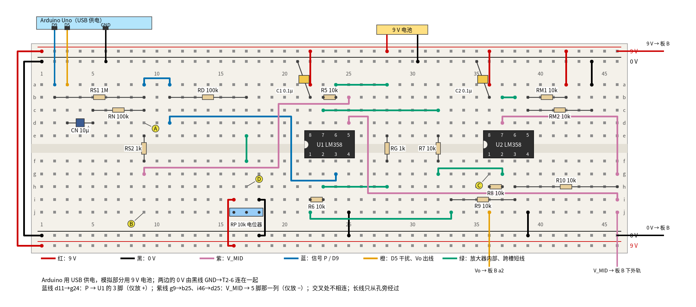
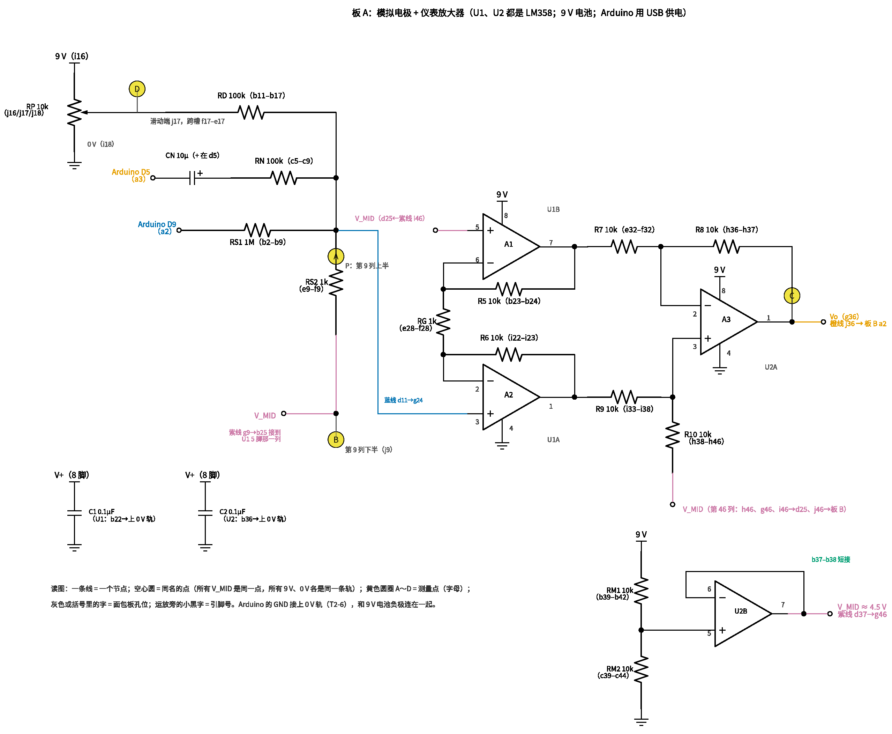
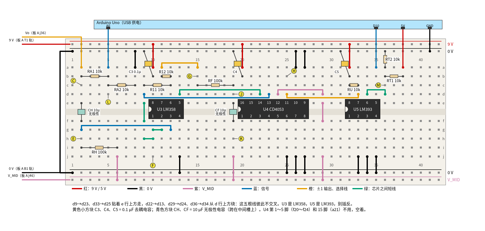
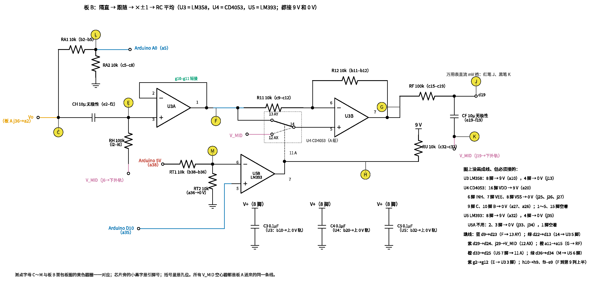
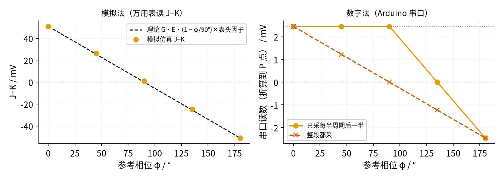
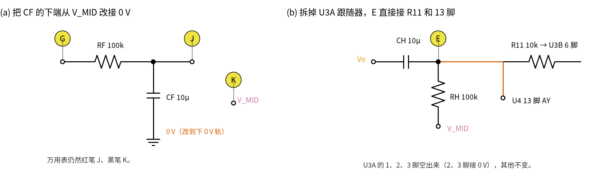

# 38 同步检波 · 动手实验篇

[上一页：参数与调试篇](page3.md) · [直觉篇](page1.md) · [原理与实现篇](page2.md) · [参数与调试篇](page3.md) · 本页：动手实验篇 · [下一页：39 恒流励磁 · 直觉篇](../39-constant-current-excitation/page1.md) · 前置节点：[30 仪表放大器与电桥 · 动手实验篇](../30-instrumentation-amp/page4.md)、[35 程控增益与 AGC · 动手实验篇](../35-pga-agc/page4.md)（第一次上传 Arduino 程序）

## 这次实验要验证什么

用一块 Arduino Uno 同时当"励磁源"和"参考"，用一只 1 MΩ 电阻把它的方波缩小成 2.45 mV 的"电极信号"，再叠上可调的直流（模拟极化电压）和 10 倍大的 50 Hz 干扰，看同步检波能不能把信号挑出来。分三个阶段：

1. **阶段一（板 A）**：沿用 [30 仪表放大器与电桥 · 动手实验篇](../30-instrumentation-amp/page4.md) 的仪表放大器和 V_MID，把电桥换成"模拟电极"。静态检查夹具和倍数 21。
2. **阶段二（板 B）**：交流耦合、跟随器、±1 级（LM358 + CD4053 + LM393 电平转换）、RC 平均。相位 0 时万用表读到约 50.89 mV；改变参考相位，读数按 [原理与实现篇](page2.md) 第二节的相位定律变化；翻转 180° 读数反号。
3. **阶段三（干扰与误差）**：打开 50 Hz 干扰，读数的平均几乎不变；拔掉信号，看零点；（选做）故意让 R11、R12 不配对，验证交流耦合挡住了直流泄漏。

同时 Arduino 用"只采后半段"的数字法在串口上给出另一个读数，和万用表对照。

所有"应该读到"的数都来自 `code/38_sim.py` 的计算和 `spice/38/run.py` 的仿真（在仓库根目录运行，需要 spice/models 目录）。

**两套编号别混**：测量点用**字母** A～M（图上黄色圆圈里的字母），芯片引脚用"几脚"（图上芯片旁的小数字），面包板孔位用"行字母 + 列号"（如 d19）。对应关系：

| 测点 | 孔位 | 是什么 | 原理与实现篇里的名字 |
|---|---|---|---|
| A | 板 A d9 | 模拟电极的输出（仪放 + 输入，U1 的 3 脚） | P 点 |
| B | 板 A j9 | 夹具旁的 V_MID（仪放 − 输入，U1 的 5 脚） | V_MID |
| C | 板 A g36，板 B c2 | 仪放输出（U2 的 1 脚） | Vo |
| D | 板 A h17 | 电位器滑动端 | 模拟极化电压的来源 |
| E | 板 B h2 | 交流耦合之后 | — |
| F | 板 B j10 | 跟随器 U3A 输出（U3 的 1 脚） | fo |
| G | 板 B b15 | ±1 级输出（U3 的 7 脚） | dm |
| H | 板 B b25 | CD4053 选择脚 A（11 脚） | A |
| J | 板 B d19 | RC 平均的输出 | 读数正端 |
| K | 板 B h19 | 板 B 的 V_MID 轨 | 读数负端 |
| L | 板 B d5 | A0 分压点 | A0 |
| M | 板 B c36 | LM393 门限（6 脚） | 2.5 V 门限 |

## ⚠️ 安全须知

- **只用一节 9 V 叠层电池**给模拟部分供电，Arduino 用电脑 USB 供电，全电路最高 9 V。电池扣没插进面包板的一头先用胶带包好。
- **上电顺序：先插 USB，再接电池；断电顺序：先拔电池，再拔 USB。** A0 和 LM393 的输入都连着 9 V 那边的电路，Arduino 没上电时不要让 9 V 先上。
- **改任何接线之前，先拔电池、再拔 USB。** 第 8、9 步要拔插元件，同样先断电，接好后按上面的顺序重新上电。重新插 USB 会让 Arduino 复位，相位回到 0°。
- **Arduino 的引脚只接本页写明的地方**：D9 只经 1 MΩ 进夹具，D5 只经电容 CN 和 100 kΩ，A0 只经 10 kΩ/10 kΩ 分压（最高 4.5 V），D10 只进 LM393 的 5 脚。**LM393 的输出（第 33 列，上拉到 9 V）绝不能接到任何 Arduino 引脚上。**
- **V_MID 不是 0 V**：板 A 的第 46 列、板 B 的下外轨 B2 都是 V_MID，任何时候都不能和 0 V 连在一起。注意板 B 的 B2 轨和板 A 的 B2 轨（9 V）不是一回事，两块板之间只连本页写的四根线。
- 芯片缺口一律朝左。接反时芯片会发烫，**不要用手去摸**，立刻拔电池。CD4053 是 CMOS 芯片，拿之前先摸一下金属外壳的东西放掉静电；它每个开关脚的电流不超过 10 mA，本电路里只有微安级。

## 器材清单

| 元件 | 型号或数值 | 数量 | 说明 |
|---|---|---|---|
| Arduino | Uno（ATmega328P） + USB 线 | 1 | 产生励磁 D9、参考 D10、干扰 D5，读 A0 |
| 运放 | LM358（DIP-8） | 3 | 板 A 的 U1、U2（30 节原样）；板 B 的 U3 |
| 模拟开关 | CD4053B（DIP-16） | 1 | U4，只用 A 组 |
| 比较器 | LM393（DIP-8） | 1 | U5，只用 B 半边做电平转换 |
| 9 V 电池 | 6F22 叠层电池 + 电池扣 | 1 | 模拟部分唯一的电源 |
| 电阻 | 1 MΩ | 1 | RS1 |
| 电阻 | 1 kΩ | 2 | RS2；RG |
| 电阻 | 100 kΩ | 4 | RN、RD、RH、RF |
| 电阻 | 10 kΩ，1% 金属膜 | 15 | R5～R10、RM1、RM2（30 节）；R11、R12；RU、RT1、RT2、RA1、RA2 |
| 电阻 | 200 Ω | 1 | 第 8 步（选做）用 |
| 电位器 | 10 kΩ | 1 | RP，模拟极化电压 |
| 电解电容 | 10 µF / 16 V 以上 | 1 | CN，长脚（+）朝 P 点 |
| 无极性电容 | 10 µF（无极性电解或薄膜） | 2 | CH、CF |
| 陶瓷电容 | 0.1 µF（104） | 5 | C1～C5：每片芯片一只去耦 |
| 面包板 | 830 孔 | 2 | 板 A、板 B |
| 跳线 | 红、黑、紫、蓝、绿、橙 | 若干 | 颜色约定见图下方图例 |
| 万用表 | 数字式，有直流 200 mV、2 V、20 V 挡 | 1 | 读数只有几十毫伏 |

> **最小补充：去耦电容**　每片芯片的电源脚旁边就近接一只 0.1 µF 陶瓷电容到 0 V，给它一个"贴身的小水池"，电流突变时不至于把电源脚的电压拉得抖起来，运放也不容易自己振荡。本页 5 片芯片各一只：C1（U1）、C2（U2）、C3（U3）、C4（U4 CD4053）、C5（U5 LM393），一只都不能省。

R11、R12 最好先用万用表挑出阻值最接近的一对（相差 0.1% 以内最好）： [参数与调试篇](page3.md) 第二节说过，它们不配对时直流会漏进读数，虽然交流耦合会挡住大部分。

**程序**：先按 [35 程控增益与 AGC · 动手实验篇](../35-pga-agc/page4.md) 的「最小必要知识：Arduino 上手」把下面的程序上传（文件在 `code/38_lockin/38_lockin.ino`）。上传前用万用表量 Arduino 的 5V 脚对 GND，把实测值填进 `VREF`。

```cpp
// 38 同步检波：Arduino Uno 既当「励磁源」又当「数字锁相」
// D9  = 励磁方波（Timer1 OC1A，6.25 Hz），经 RS1 1 MΩ 进夹具
// D10 = 参考方波（Timer1 OC1B，同频，相位可调），送 LM393 比较器 → CD4053，也给本程序当「加/减」依据
// D5  = tone() 发 50 Hz 干扰（Timer2；所以 D3、D11 的 PWM 这时不能用）
// A0  = INA 输出经 10k/10k 分压后的电压（0～9 V → 0～4.5 V）
// 串口 115200：0 = 相位 0°，4 = 45°，9 = 90°，f = 180°（翻转），t = 干扰 50 Hz，u = 干扰 51 Hz，n = 关干扰
// h / l = 停表，D9、D10 一起停在高 / 低电平（用万用表做静态检查）；再发 0 恢复
// 注意：Timer1 被占用，D9、D10 不能再用 analogWrite

const float VREF = 5.00;     // 用万用表量 Arduino 的 5V 脚，把实测值填在这里
const float GAIN = 21.0;     // 30 节仪表放大器：1 + 2×10k/1k
const float DIVIDER = 2.0;   // A0 前面的 10k/10k
const unsigned int TOP = 4999;          // 半周期 = (TOP+1) 个计数 × 16 µs = 80 ms（6.25 Hz）；改励磁频率只改这一行
const unsigned long BLANK_US = (TOP + 1UL) * 8UL;  // 每次换向后先等半个半周期（TOP = 4999 时 40 ms），前一半不用

long sumP = 0, sumN = 0;
unsigned int nP = 0, nN = 0;
bool lastRef = false;
unsigned long tEdge = 0, tSample = 0;
float avg8 = 0;
int nAvg = 0;

void startTimer1(unsigned int leadCounts, bool invert) {
  TCCR1B = 0;                                   // 先停表
  TCCR1A = _BV(COM1A0) | _BV(COM1B0);           // 比较匹配时翻转 OC1A（D9）、OC1B（D10）
  TCNT1 = 0;
  OCR1A = TOP;                                  // CTC 的 TOP：TOP+1 个计数 = 半周期（预分频 256）
  OCR1B = TOP - leadCounts;                     // D10 比 D9 早 leadCounts 个计数翻转，1 个计数 = 180°/(TOP+1)
  if (PINB & _BV(PB1)) TCCR1C = _BV(FOC1A);     // 强制把两路都放到低电平再起跑
  if (PINB & _BV(PB2)) TCCR1C = _BV(FOC1B);
  if (invert) TCCR1C = _BV(FOC1B);              // 180°：D10 再翻一次，和 D9 正好相反
  TCCR1B = _BV(WGM12) | _BV(CS12);              // CTC 模式 4，预分频 256，开始计数
  sumP = sumN = 0; nP = nN = 0; nAvg = 0; avg8 = 0;
}

void setup() {
  pinMode(9, OUTPUT);
  pinMode(10, OUTPUT);
  Serial.begin(115200);
  startTimer1(0, false);
  Serial.println(F("38 lock-in: 0/4/9/f = phase 0/45/90/180, t/u/n = 50 Hz/51 Hz/off, h/l = hold"));
}

void loop() {
  if (Serial.available()) {
    char c = Serial.read();
    if (c == '0') { startTimer1(0, false);    Serial.println(F("# phase 0")); }
    if (c == '4') { startTimer1((TOP + 1) / 4, false); Serial.println(F("# phase 45")); }
    if (c == '9') { startTimer1((TOP + 1) / 2, false); Serial.println(F("# phase 90")); }
    if (c == 'f') { startTimer1(0, true);     Serial.println(F("# phase 180")); }
    if (c == 't') { tone(5, 50);  Serial.println(F("# tone 50 Hz")); }
    if (c == 'u') { tone(5, 51);  Serial.println(F("# tone 51 Hz")); }
    if (c == 'n') { noTone(5);    Serial.println(F("# tone off")); }
    if (c == 'h' || c == 'l') {                 // 静态检查：停掉 Timer1，两只脚一起停在高或低
      TCCR1B = 0; TCCR1A = 0;                   // 断开 OC1A/OC1B，脚交还给 digitalWrite
      digitalWrite(9, c == 'h'); digitalWrite(10, c == 'h');
      Serial.println(c == 'h' ? F("# hold HIGH") : F("# hold LOW"));
    }
  }

  bool ref = PINB & _BV(PB2);                   // 直接读 D10 的引脚状态
  unsigned long now = micros();
  if (ref != lastRef) {                         // 参考换向
    tEdge = now;
    if (ref && nP > 0 && nN > 0) {              // 上升沿 = 一个完整周期结束，出一个结果
      float diffCounts = ((float)sumP / nP - (float)sumN / nN) / 2.0;
      float eP = diffCounts * VREF / 1024.0 * DIVIDER / GAIN * 1000.0;   // 折算回夹具 P 点，单位 mV
      nAvg = (nAvg < 8) ? nAvg + 1 : 8;
      avg8 += (eP - avg8) / nAvg;               // 前 8 个是累计平均，之后是 α = 1/8 的指数平均（发 0/4/9/f 时清零）
      Serial.print(F("E_mV=")); Serial.print(eP, 3);
      Serial.print(F("  avg8=")); Serial.println(avg8, 3);
      sumP = sumN = 0; nP = nN = 0;
    }
    lastRef = ref;
  }
  if (now - tSample >= 1000UL) {                // 每 1 ms 采一次
    tSample += 1000UL;
    if (now - tEdge >= BLANK_US) {              // 只要每个半周期的后一半
      int a = analogRead(A0);
      if (ref) { sumP += a; nP++; } else { sumN += a; nN++; }
    }
  }
}
```

串口监视器设成 115200，发一个字符就是一条命令：`0`、`4`、`9`、`f` 选相位 0°、45°、90°、180°；`t`、`u`、`n` 是 50 Hz 干扰、51 Hz 干扰、关干扰；`h`、`l` 让 D9、D10 一起停在高或低，发 `0` 恢复。

## 搭建步骤

**两块板的电源轨不一样，先记住：**

- **板 A**：和 30 节一样，最上面 T1 和最下面 B2 是 9 V，中间 T2、B1 是 0 V。
- **板 B**：T1 是 9 V，T2、B1 是 0 V，**最下面 B2 是 V_MID**（从板 A 引过来）。

"T1-22"就是 T1 轨上第 22 列旁边的孔。所有芯片缺口朝左，1 脚在左下（f 行），8 脚（或 16 脚）在左上（e 行）。

### 阶段一：板 A（仪表放大器 + 模拟电极）

如果 30 节的板子还在，U1、U2、V_MID 部分原样保留，只拆掉电桥（R1～R4、RP1、RX、J1、J2、RC、RL），再按第 1 步核对一遍；没有的话按第 1 步从头搭。

**第 1 步：仪表放大器和 V_MID**（全程不接电池）

1. 黑线 T2-1→B1-1，红线 T1-1→B2-1，把两组电源轨连起来。
2. U1（LM358）插在第 22～25 列，跨中间槽。红线 a22→T1-22（8 脚接 9 V），黑线 j25→B1-25（4 脚接 0 V），C1 一脚插 b22、一脚插 T2-21。
3. R5 插 b23–b24；绿线 a24→a28；RG（1 kΩ）插 e28–f28；绿线 h23→h28；R6 插 i22–i23。
4. 绿线 c23→c32；R7 插 e32–f32；绿线 g32→g37（从上方绕过，不插中间的孔）；绿线 j22→j33（从下方绕）；R9 插 i33–i38；R8 插 h36–h37；R10 插 h38–h46。
5. U2（LM358）插在第 36～39 列。红线 a36→T1-36，黑线 j39→B1-39，C2 一脚插 b36、一脚插 T2-35。
6. V_MID 跟随器（U2 的 B 半边）：绿线 b37–b38（7 脚接 6 脚）；RM1 插 b39–b42，红线 a42→T1-42；RM2 插 c39–c44，黑线 a44→T2-44；紫线 d37→g46（V_MID 送到第 46 列）。
7. 紫线 i46→d25（V_MID 送到第 25 列上半，也就是 U1 的 5 脚，仪放的 − 输入）；紫线 g9→b25（再从第 25 列送到第 9 列下半，夹具旁的测点 B）。
8. 接上电池：红线进 T1（约第 28 列），黑线进 T2（约第 30 列）。量 B 对 0 V 轨，应约为电池电压的一半（4.5 V）。量完拔掉电池。

**第 2 步：模拟电极（夹具）和 Arduino**

1. RS1（1 MΩ）插 b2–b9。
2. CN（10 µF 电解）长脚（+）插 d5，短脚（−）插 d3；RN（100 kΩ）插 c5–c9。
3. 蓝线 a9→a11（把 P 点延长到第 11 列）；RS2（1 kΩ）插 e9–f9（P 点跨槽接到第 9 列下半的 V_MID）。
4. 电位器 RP 三只脚插 j16、j17、j18（中间 j17 是滑动端）；红线 i16→B2-16（9 V），黑线 i18→B1-18（0 V）；绿线 f17–e17 把滑动端接到上半；RD（100 kΩ）插 b11–b17。
5. 蓝线 d11→g24（P 点送到第 24 列下半，也就是 U1 的 3 脚，仪放的 + 输入）。这根线要跨过中间槽，和第 1 步的紫线 g9→b25 交叉，交叉处两根线只是叠着，不相连。
6. Arduino：D9→a2，D5→a3，GND→T2-6（两边的 0 V 连在一起）。Arduino 先不插 USB。

现在对照图 38-p4-1 和图 38-p4-2 检查一遍。



*图 38-p4-1　板 A 面包板：模拟电极 + 30 节的仪表放大器*



*图 38-p4-2　板 A 原理图（元件名、孔位、测点字母与图 38-p4-1 一一对应）*

> **对照看**：图 38-p4-2 里 P 点汇集了四个元件——RS1（从 D9 来）、RN（从 D5 经 CN 来）、RD（从电位器滑动端来）、RS2（到 V_MID）；在图 38-p4-1 上它们分别是 b2–b9、c5–c9、b11–b17（经蓝线 a9→a11 连到第 9 列）、e9–f9，第 9 列上半就是 P 点，测点 A 在 d9。P 点经蓝线 d11→g24 进 U1 的 3 脚（图里下面那只运放 A2 的 + 输入）。原理图里"V_MID"的几个出处——U2 的 7 脚、仪放的 5 脚（A1 的 + 输入）、R10 的右端、夹具旁的测点 B——在面包板上就是紫线 d37→g46、i46→d25、R10 的 h46 和紫线 g9→b25。原理图里每只芯片旁画的 0.1 µF 就是面包板上的 C1（b22）、C2（b36）。

**第 3 步：上电和静态检查**

1. 先插 USB，上传程序（VREF 填实测值），再接电池。
2. 量 D 对 B，转电位器让它在 0 附近（±10 mV 以内），这时滑动端正好在 V_MID，"极化电压"最小。
3. 串口发 `h`，等 5 s（让 CN 充好电），用 200 mV 挡量 A 对 B（红表笔 A、黑表笔 B），记下；发 `l`，等 5 s 再量。
4. 同样在 `h`、`l` 两种状态下量 C 对 B（2 V 挡），记下。单次读数是 +10.39 mV（`h`）、−93.49 mV（`l`）再各加同一个失调；本节的仪放没有调零，这个失调可能有几十甚至两三百毫伏（ [30 节动手实验篇](../30-instrumentation-amp/page4.md) 算过最坏约 0.294 V），所以**单次读数是正是负说明不了什么**。**判断接没接反要看差值：`h` 的读数减 `l` 的读数应该约 +104 mV（失调在两次里一样，相减就消掉了）；如果约 −104 mV，说明 P 和 V_MID 两根线接反了**，**先拔电池、再拔 USB**，再回去核对第 1 步第 7 小步和第 2 步第 5 小步。两次之差除以第 3 小步两次之差，就是仪放的倍数。顺便体会一下：「`h` 的读数减 `l` 的读数再除以 2」就是你亲手做了一次「乘 ±1 再平均」，后面的 CD4053 和程序做的是同一件事，只是每秒做 6 次多。
5. 发 `0` 恢复。

### 阶段二：板 B（交流耦合 + ±1 级 + RC 平均）

**先拔电池、再拔 USB。** 板 B 全部接好、核对完图 38-p4-3 和图 38-p4-4 之后再上电。

**第 4 步：搭板 B**

1. 电源：黑线 T2-1→B1-1。从板 A 引四根线到板 B：红线 板 A T1→板 B T1-1（9 V）；黑线 板 A B1→板 B B1-1（0 V）；紫线 板 A j46→板 B B2-1（V_MID）；橙线 板 A j36→板 B a2（仪放输出 Vo）。
2. U3（LM358）插第 10～13 列：红线 a10→T1-10，黑线 j13→B1-13，C3 一脚插 b10、一脚插 T2-9。
3. U4（CD4053，16 脚）插第 20～27 列：红线 a20→T1-20（16 脚 VDD），C4 一脚插 b20、一脚插 T2-19；黑线 a26→T2-26、a27→T2-27（10 脚 B、9 脚 C 两个不用的选择脚接 0 V）；黑线 j25→B1-25、j26→B1-26、j27→B1-27（6 脚 INH、7 脚 VEE、8 脚 VSS 接 0 V）。1～5 脚（f20～f24）和 15 脚（a21，B 组公共端）不用，空着。
4. U5（LM393）插第 32～35 列：红线 a32→T1-32（8 脚），C5 一脚插 b32、一脚插 T2-31；黑线 j33→B1-33、j34→B1-34（不用的 A 比较器的 2、3 脚接 0 V），黑线 j35→B1-35（4 脚 GND）。
5. 输入和 A0 分压：RA1 插 b2–b5；RA2 插 c5–c8；黑线 a8→T2-8。交流耦合：CH 插 e2–f2（跨中间槽）；RH 插 i2–i6；紫线 j6→B2-6。
6. 跟随器 U3A：蓝线 g2→g12（交流耦合后的信号进 3 脚）；绿线 g10–g11（1 脚接 2 脚）。
7. ±1 级 U3B：绿线 h10→h9、绿线 f9–e9（把 1 脚的 fo 送到第 9 列上半）；R11 插 c9–c12（fo 到 6 脚）；R12 插 b11–b12（7 脚到 6 脚）。
8. CD4053 的 A 组：蓝线 d9→d23（fo 进 13 脚 AY）；绿线 d22→d13（14 脚公共端 A 接 U3 的 5 脚）；紫线 j29→B2-29、紫线 f29–e29、紫线 d29→d24（V_MID 进 12 脚 AX）。
9. RC 平均：橙线 a11→a15（U3 的 7 脚输出引到第 15 列）；RF 插 c15–c19；CF 插 e19–f19（跨中间槽）；紫线 j19→B2-19。
10. 电平转换 U5B：RU 插 c32–c33（7 脚上拉到 9 V）；橙线 d33→d25（7 脚接 CD4053 的 11 脚）；RT1 插 b38–b36、RT2 一脚插 a36、一脚插 T2-36（把 Arduino 5 V 分成 2.5 V）；绿线 d36→d34（门限进 6 脚）。
11. Arduino：A0→a5，D10→a35（进 LM393 的 5 脚），5V→a38，GND→T2-41。



*图 38-p4-3　板 B 面包板：交流耦合、跟随、±1 级、RC 平均和电平转换*



*图 38-p4-4　板 B 原理图（元件名、孔位、测点字母与图 38-p4-3 一一对应）*

> **对照看**：图 38-p4-4 的信号从左往右走：C（c2）→ CH（e2–f2）→ E（h2）→ U3A 跟随 → F（j10）→ 一路经 R11（c9–c12）进 U3B 反相端，一路经蓝线 d9→d23 进 CD4053 的 13 脚 AY。CD4053 的 14 脚经绿线 d22→d13 接 U3B 同相端，12 脚 AX 经紫线接 V_MID。U3B 输出 G（b15）经 RF（c15–c19）到 J（d19），CF（e19–f19）另一端接 K（h19）= V_MID 轨。选择脚 11（第 25 列上半）由 LM393 的 7 脚经橙线 d33→d25 驱动，H 在 b25。图 38-p4-4 右侧的方框列出了每片芯片的电源脚和不用的脚怎么接，和第 4 步第 2～4 小步逐条对应。

**第 5 步：上电，相位 0**

1. 先插 USB，再接电池。
2. 量 M 对 0 V 轨，应是 Arduino 5 V 的一半。发 `h`，量 H 对 0 V 轨，应接近电池电压；发 `l`，应接近 0 V。这一步确认电平转换和选择脚都对。
3. 发 `0`。量 F 对 K（2 V 挡），应接近 0（只有 U3A 的失调，几毫伏）。量 L 对 0 V 轨，应约 2.25 V。
4. 万用表 200 mV 挡，红表笔 J、黑表笔 K，等 6 s 读数稳定后记下 V0。同时记下串口最近的 avg8。

**第 6 步：改变参考相位**

1. 先在记录表里写下你的预测：发 `4`（45°）、`9`（90°）、`f`（180°）以后，万用表读数分别是多少？串口的 avg8 呢？
2. 依次发 `4`、`9`、`f`，每次等 6 s 再读 J 对 K，并记下 avg8。180° 的读数记为 V180。
3. 算 (V0 − V180)/2（去掉偏移的信号）和 (V0 + V180)/2（偏移）。
4. 发 `0` 回到相位 0。

<details><summary>做完第 6 步再展开：理论值</summary>

万用表（`code/38_sim.py` 第 7 节）：45° 约 +26.21 mV，90° 约 +1.02 mV，180° 约 −50.89 mV；(V0 − V180)/2 = 50.89 mV，(V0 + V180)/2 在几毫伏以内（U3B 失调 × 2）。45° 比三角形定律的 25.45 mV 略大，是因为交流耦合让方波每半周期往下"垂"，错开的那一小段本来就小。串口 avg8 的规律见图 38-p4-5 右边。

</details>

### 阶段三：干扰与误差

**第 7 步：加 50 Hz 干扰**

1. 发 `t`（50 Hz，实际 50.08 Hz）。看万用表：平均值几乎不变，但读数比发 `n` 时跳得明显，末几位快速跳动约 1～3 mV。记下跳动的最大值和最小值。
2. 发 `u`（51 Hz）。除了快跳，还会多出约 2 mV 的慢漂，因为 51 Hz 在 80 ms 里不是整数个周期，抵消得不干净；记下最大值、最小值，以及串口每行 E_mV 的跳动范围。
3. 发 `n` 关掉干扰。

**第 8 步：拔掉信号看零点**

1. 先拔电池、再拔 USB。拔掉 RS1（b2–b9）。按顺序重新上电，发 `0`。
2. 等 6 s 读 J 对 K，这是零点。和第 6 步算的 (V0 + V180)/2 比一比。
3. 断电，把 RS1 插回 b2–b9。

**第 9 步（选做）：直流泄漏**

1. 断电（先拔电池、再拔 USB）。拔掉 R12，换成 10 kΩ 插 b11–b14 加 200 Ω 插 c14–d12（第 14 列上半是两只电阻的串联点），合起来 10.2 kΩ，比 R11 大 2%。用一根跳线 d2→j2 把 CH 短路。
2. 先插 USB、再接电池，发 `0`，电位器先回到第 3 步的位置（D 对 B 约 0），等 6 s 读 J 对 K。
3. 把电位器拧到 0 V 那一头（D 对 0 V 轨读 0），等 6 s 再读 J 对 K。算两次的差。
4. 断电（先拔电池、再拔 USB），拔掉跳线 d2→j2（CH 恢复），重复 2、3 两小步，再算一次差。
5. 断电，把 R12 换回 10 kΩ（b11–b12），拆掉 200 Ω，电位器拧回中间。

## 测量表

| 步骤 | 测什么 | 红表笔 | 黑表笔 | 挡位 | 应该读到 | 读不到时先查 |
|---|---|---|---|---|---|---|
| 1-8 | 夹具旁 V_MID | B | 0 V 轨 | 20 V | 电池电压的一半，约 4.5 V | U2 的 7 脚、RM1/RM2、紫线 i46→d25、g9→b25 |
| 3-3 | 夹具静态，`h` | A | B | 200 mV | +0.4947 mV（参考，受电位器残差影响） | RS1、RS2 是否插在第 9 列 |
| 3-3 | 夹具静态，`l` | A | B | 200 mV | −4.4521 mV（参考）；两次差 4.9468 mV 才是判断依据 | 电位器是否调到 D 对 B ≈ 0 |
| 3-4 | 仪放静态，`h` / `l` | C | B | 2 V | +10.39 / −93.49 mV，再各加同一个失调；两次差 103.88 mV | 差值（h − l）为负、约 −104 mV：P、V_MID 接反；差值大小不对：查 RG、R5、R6，见 30 节排查表 |
| 5-2 | LM393 门限 | M | 0 V 轨 | 20 V | Arduino 5V 的一半，约 2.50 V | RT1、RT2、Arduino 5V 线 |
| 5-2 | 选择脚，`h` / `l` | H | 0 V 轨 | 20 V | 约 9 V / 0.06 V | RU、LM393 的 8 脚和 4 脚、D10 线 |
| 5-3 | 跟随器输出直流 | F | K | 2 V | 0 附近（几毫伏） | RH、紫线 j6→B2-6 |
| 5-3 | A0 分压 | L | 0 V 轨 | 20 V | 约 2.25 V | RA1、RA2、黑线 a8→T2-8 |
| 5-4 | 相位 0 读数 V0 | J | K | 200 mV | +50.89 mV | 见 [参数与调试篇](page3.md) 故障排查表 |
| 6-2 | 45° / 90° / 180° | J | K | 200 mV | 见第 6 步后的答案框 | 串口是否回显 `# phase …` |
| 7-1 | `t`：平均和跳动 | J | K | 200 mV | 平均约 50.9 mV，跳动约 1～3 mV（CF 上瞬时纹波约 10 mV 峰峰，表看不到这么大） | D5 线、CN 极性 |
| 8-2 | 零点 | J | K | 200 mV | 几毫伏以内，和 (V0 + V180)/2 接近 | U3B 失调；R11、R12 |
| 9-3 | ε = 2%、CH 短路 | J | K | 200 mV | 拧电位器前后差约 +9.25 mV | 跳线 d2→j2、200 Ω 的位置 |
| 9-4 | ε = 2%、CH 恢复 | J | K | 200 mV | 前后差约 0 | 跳线是否拔掉 |

第 3 步的静态值比动态的 E 大约 1%：D9 停住几秒后 CN 充满电，相当于断开，RN 不再并在 RS2 上（ [原理与实现篇](page2.md) 例1 第 4 小步）。万用表读数 50.89 mV 比 21 × 2.4492 = 51.43 mV 小 1.05%，来自 RF 和万用表 10 MΩ 内阻的分压（0.9901 倍）以及交流耦合的下垂。

<details><summary>做完第 6 步再展开：SPICE 的结果为什么和上面差一点</summary>

SPICE 结果见 `review/spice/38.md`：相位 0 为 51.26 mV，翻转相减 50.86 mV，45° 为 26.06 mV，90° 为 1.41 mV（90° 附近读数很小，看绝对值），ε 测试 9.20 mV。它和 Python 的 50.89 mV、1.02 mV 差零点几毫伏，因为 SPICE 里的 LM358 用的是 TI 的器件模型（有失调、有限增益；只有 45° 和两个干扰工况，U3B 和仪放换成了理想运放，因为 TI 模型在这几种情况下不收敛），CD4053 按 180 Ω 导通电阻建模，Python 把这些都当成理想的。你的实测值和两者差同样的量级，都算正常。

</details>

## 没有示波器怎么办

本节的励磁只有 6.25 Hz，一切都慢得能用万用表和串口看清：

- 用 `h`、`l` 把方波"冻住"，每个点都能当直流量，这就是第 3 步和第 5 步第 2 小步的做法。
- Arduino IDE 的"串口绘图器"（工具菜单里）能把 E_mV 和 avg8 画成曲线：发 `t`、`u` 时能直接看到每个周期读数的跳动。
- 万用表接 H 对 0 V 轨、放在 20 V 挡，相位 0 时读数会在 0 和 9 V 之间来回跳（每秒 6 次多，大多数表只能显示一个中间值或乱跳），只要在跳就说明选择脚在翻。

## 用 Python 检查你的读数

做完第 6 步以后，把量到的数填进去运行。程序按你实测的电阻和电压重算"应该读到"的值，偏差超过 10% 的项会标出来。

```python
# ===== 把这里改成你量到的数（电压单位 V，电阻单位 Ω）=====
VIO  = 5.00      # Arduino 5V 脚对 GND
VBAT = 9.00      # 电池电压
RS1, RS2 = 1.000e6, 1.000e3
RN, RD   = 100e3, 100e3
RG       = 1.000e3
R5 = R6  = 10.0e3
# ===== 改到这里为止 =====

VMID = VBAT / 2
G = 1 + (R5 + R6) / RG
RW = 2.5e3                                   # 电位器居中时的内阻（10k × 0.5 × 0.5）
gdc = 1 / RS1 + 1 / RS2 + 1 / (RD + RW)      # 静态：CN 断开
A_h = (VIO - VMID) / RS1 / gdc * 1e3         # 电位器滑动端 = V_MID 时，P 对 V_MID，mV
A_l = (0 - VMID) / RS1 / gdc * 1e3
rp = 1 / (1 / RS2 + 1 / RN + 1 / (RD + RW))  # 动态：CN 接通
E = VIO / 2 * rp / (RS1 + rp) * 1e3
K0 = 50.89 / 51.43                           # code/38_sim.py 第 7 节：万用表分压 + 交流耦合下垂
expect = {
    "A_h  夹具静态高 / mV": A_h,
    "A_l  夹具静态低 / mV": A_l,
    "Cd   仪放静态高低之差 / mV": G * (A_h - A_l),
    "V0   相位 0 / mV": G * E * K0,
    "V45  相位 45° / mV": G * E * K0 * 26.21 / 50.89,
    "V90  相位 90° / mV": G * E * K0 * 1.02 / 50.89,
    "V180 相位 180° / mV": -G * E * K0,
    "avg8 串口相位 0 / mV": E,
}
mine = dict(expect)          # 先原样复制，程序能直接跑；量完后把下一行的 {} 换成你的读数
mine.update({})              # 例：mine.update({"A_h  夹具静态高 / mV": 0.51, "V0   相位 0 / mV": 49.8})

ref = abs(expect["V0   相位 0 / mV"])
for k, e in expect.items():
    m = mine[k]
    if k.startswith("A_"):                                             # A_h、A_l 本身很小，按两次之差判断
        base = abs(expect["A_h  夹具静态高 / mV"] - expect["A_l  夹具静态低 / mV"])
    else:
        base = abs(e) if abs(e) > 0.2 * ref or k.startswith("avg") else ref   # 接近 0 的项按 V0 的 10% 判断
    dev = (m - e) / base * 100
    flag = "  <-- 超过 10%" if abs(dev) > 10 else ""
    print(f"{k:<22} 应该 {e:+9.3f}  实测 {m:+9.3f}  偏差 {dev:+6.1f}%{flag}")
print(f"倍数 G = {G:.2f}；动态 E = {E:.4f} mV；V_MID = {VMID:.2f} V")
```

运行结果（没改任何数时）：A_h +0.4947、A_l −4.4521、Cd 103.88、V0 50.89、V45 26.21、V90 1.02、V180 −50.89、avg8 2.4492，偏差全是 0%；倍数 21.00，V_MID 4.50 V。填进你的读数后，偏差超过 10% 的那一行就是该先查的地方。A_h、A_l 本身只有零点几到几毫伏，按两次之差 4.95 mV 的 10% 判断。

**做完第 6 步、填好记录表以后**再看图 38-p4-5，把你的预测和读数一起对照：



*图 38-p4-5　参考相位对两种读数的影响：左为万用表（模拟法），右为串口（数字法）*

图 38-p4-5 左边的虚线是三角形定律，圆点是 `code/38_sim.py` 第 7 节的模拟结果；右边比较了"只采后半段"和"整段都采"两种数字法（第 6 节）。如果你的串口读数在某个相位和左边的万用表读数规律明显不同，回到 [原理与实现篇](page2.md) 第二节找原因。

## 实验记录表

| 步骤 | 条件 | 实测值 | 计算值 | 偏差 |
|---|---|---|---|---|
| 1-8 | B 对 0 V | | VBAT/2 | |
| 3-3 | A 对 B，`h` | | +0.4947 mV | |
| 3-3 | A 对 B，`l` | | −4.4521 mV | |
| 3-4 | C 对 B，`h` − `l` | | 103.88 mV | |
| 5-2 | M 对 0 V | | 2.50 V | |
| 5-2 | H 对 0 V，`h` / `l` | | 约 9 V / 0.06 V | |
| 5-4 | J 对 K，相位 0（V0） | | 50.89 mV | |
| 5-4 | 串口 avg8，相位 0 | | 2.449 mV | |
| 6-1 | 我的预测：45° / 90° / 180°（万用表、串口） | | — | — |
| 6-2 | J 对 K，45° / 90° / 180° | | 见第 6 步后的答案框（做完再展开） | |
| 6-2 | 串口 avg8，45° / 90° / 180° | | 见图 38-p4-5 | |
| 6-3 | (V0 − V180)/2 | | 见第 6 步后的答案框（做完再展开） | |
| 6-3 | (V0 + V180)/2 | | 几毫伏以内 | — |
| 7-1 | `t`：J 对 K 最大 / 最小 | | 平均约 50.9 mV（与 V0 几乎相同） | |
| 7-2 | `u`：串口 E_mV 跳动范围 | | 1.825～3.063 mV | |
| 8-2 | 拔 RS1：J 对 K | | 与 6-3 偏移接近 | — |
| 9-3 | ε = 2%、CH 短路：读数差 | | +9.25 mV | |
| 9-4 | ε = 2%、CH 恢复：读数差 | | 约 0 | — |

## 思考题

图 38-p4-6 是两种"改一改"的接法，先看图想一想再展开答案：



*图 38-p4-6　思考题用图：(a) CF 接 0 V；(b) 去掉跟随器 U3A*

**1.** 图 38-p4-6 (a) 把 CF 的下端从 V_MID 改接到 0 V，万用表仍然接 J 和 K。稳定以后读数变不变？刚上电时有什么不同？

<details><summary>答案</summary>

稳定以后不变：RC 低通对直流的输出等于输入，CF 下端接哪里只决定电容上存着多少电压，不改变 J 的稳态值。不同在上电：CF 下端接 0 V 时，电容要从 0 充到约 4.5 V 才稳定，τ = RF·CF = 1.00 s，要等到偏差小于 0.5 mV 需要 τ·ln(4.5 V / 0.5 mV) = 9.1 s；接 V_MID 时电容两端一开始就差不多同电位，只需等信号本身建立。另外 V_MID 上的波动会直接出现在 J 对 K 之间，所以 CF 接 V_MID 更好。

</details>

**2.** 图 38-p4-6 (b) 去掉跟随器 U3A，交流耦合的输出 E 直接接 R11 和 CD4053 的 13 脚。会出什么问题？

<details><summary>答案</summary>

×+1 状态时 U3B 的同相端和反相端都等于 E，R11 上没有电流，E 只看到 RH，交流耦合的时间常数是 CH·RH = 1 s。×−1 状态时 U3B 的反相端被钳在 V_MID，R11 的一端接 E、另一端相当于接 V_MID，和 RH 并联：RH ∥ R11 = 9.09 kΩ，时间常数变成 90.9 ms，和 80 ms 的半周期差不多，方波在这半周期里大幅下垂。两种状态下 E 点的负载不一样，"+1"和"−1"就不再对称，读数变小而且受相位影响。跟随器的作用就是让 R11 的负载落在 U3A 的低内阻输出上（ [12 电压跟随器 · 直觉篇](../12-voltage-follower/page1.md) ）。

</details>

**3.** 为什么串口程序要等 BLANK_US = 40 ms 以后才开始采？把它改成 0，在本实验里读数会变吗？在真的电磁流量计里呢？

<details><summary>答案</summary>

本实验的"磁场"是 D9 的方波，瞬间换向，改成 0 以后相位 0 的读数基本不变，但参考错相时读数会按三角形定律下降（图 38-p4-5 右边"整段都采"那组）。真的流量计里线圈电流按 L/R 慢慢爬升，换向后的前一段磁场还没稳定，同时电极上有换向引起的尖峰，采进去就是误差。预告： [39 恒流励磁](../39-constant-current-excitation/page1.md) 会讲线圈电流怎样换向、怎样用恒流源让磁场稳下来。

</details>

## 自测清单

- [ ] 我能说出板 A 和板 B 的四条电源轨各是什么，知道板 B 的 B2 是 V_MID。
- [ ] CD4053 的 6、7、8、9、10 脚全接了 0 V，5 片芯片都有去耦电容。
- [ ] `h`、`l` 静态检查：A 对 B 两次之差约 4.95 mV，C 对 B 的 `h` 减 `l` 约 **+104 mV**（正号；约 −104 mV 说明接反），倍数约 21。
- [ ] 相位 0 时 J 对 K 约 50.9 mV，180° 时反号，(V0 − V180)/2 和 V0 差不多。
- [ ] 我先写下了 45°、90° 的预测，再和读数、图 38-p4-5 对照，并能解释串口读数和万用表读数为什么不同。
- [ ] 打开 50 Hz 干扰后平均值几乎不变；我能说出 6.25 Hz 为什么能挡住 50 Hz。
- [ ] 我知道翻转相减消掉的是什么，交流耦合消掉的又是什么。
