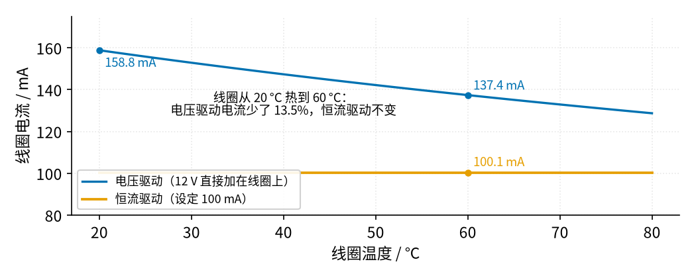
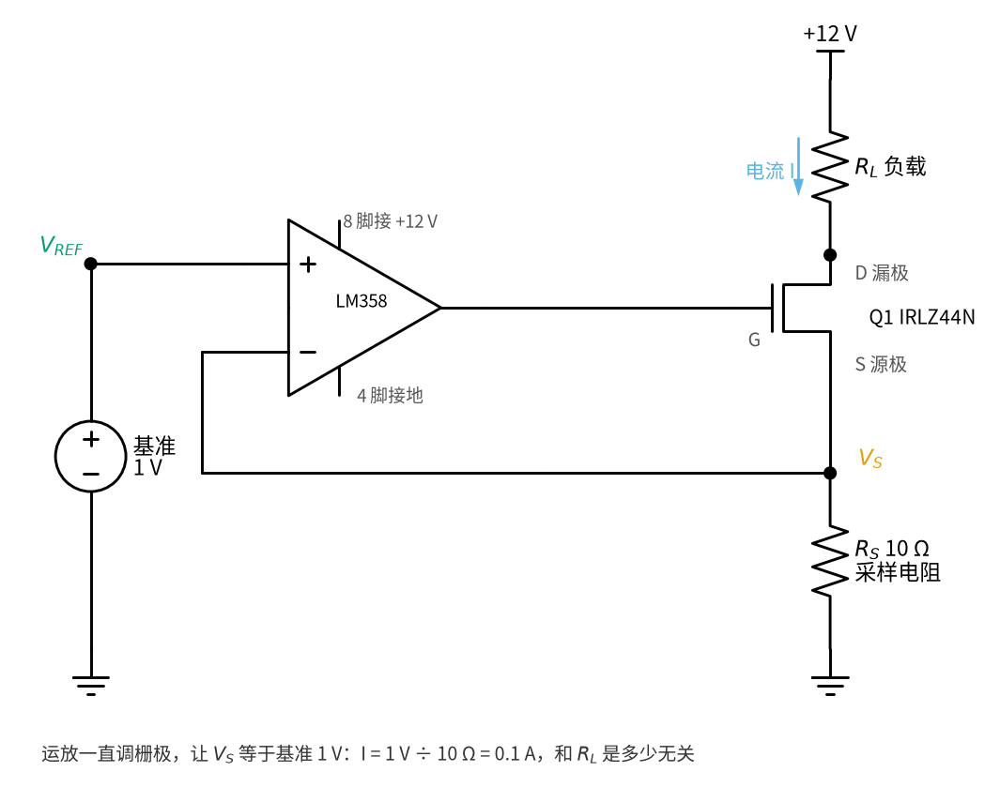
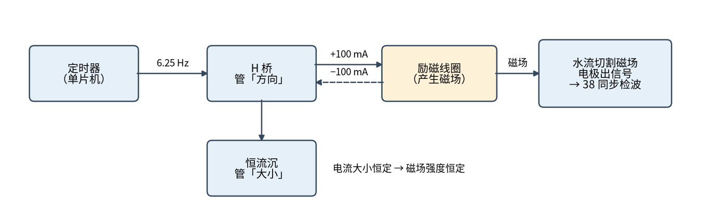

# 39 恒流源与线圈励磁驱动 · 直觉篇

上一页：38 节同步检波（电磁流量计）（即将上线） · 本页：直觉篇 · [原理与实现篇](page2.md) · [参数与调试篇](page3.md) · [动手实验篇](page4.md) · [下一页：原理与实现篇](page2.md) · 前置节点：[02 运放入门 · 直觉篇](../02-opamp-basics/page1.md)、[12 电压跟随器 · 直觉篇](../12-voltage-follower/page1.md)、[06 MOS 管开关 · 直觉篇](../06-mosfet-switch/page1.md)、[21 线性稳压 · 直觉篇](../21-linear-regulator/page1.md)、[26 H 桥电机驱动 · 直觉篇](../26-h-bridge/page1.md)

## 开头三问（先回忆，再往下读）

1. [26 H 桥电机驱动](../26-h-bridge/page1.md) 里，四个开关怎么闭合能让电机反转？哪一种闭合方式会把电源短路？
2. [06 MOS 管开关](../06-mosfet-switch/page1.md) 里，栅极电压比源极高多少，N 沟道 MOS 管才开始导通？
3. [01 元件速成](../01-components-basics/page1.md) 说「电感保电流」。电感上的电流能不能一下子反向？

答案

1. 对角的两个开关一起闭合，换另一对对角就反转；同一侧上下两个开关同时闭合会把电源直接短路。
2. 超过阈值电压（IRLZ44N 是 1～2 V）才开始导通，栅压越高导通越充分。
3. 不能，电流只能逐渐变化。本节会算出线圈电流换向要用几毫秒。

## 痛点：线圈一热，磁场就变弱

38 节同步检波（电磁流量计）（即将上线） 里讲过电磁流量计的原理：管子外面绕一对线圈，通电后在管道里产生磁场；导电的水流过磁场，管壁两侧的电极上就出现一个很小的电压，水流得越快，电压越大。这个电压同时和**磁场强弱**成正比，而磁场强弱又和**线圈电流**成正比。所以电流只要变了 1%，读数就跟着错 1%。

> **38 节一句话回顾（还没读 38 节也能往下看）**：① 导电的液体在磁场里流动，管壁两侧的电极之间会出现电压，这个电压 ∝ 流速 × 磁场；② 金属电极泡在液体里，表面会慢慢积起一层电荷，电极之间出现一个缓慢爬动的直流电压，叫**电极极化**；它是电极自己的事，不管磁场朝哪边都在；③ 磁场如果一直朝一个方向，流量信号也是直流，和极化电压混在一起分不开，所以磁场要正负来回翻，再把「磁场为正时的读数」减去「磁场为负时的读数」，流量信号跟着翻、被加倍，漂移不跟着翻、被减掉。这一步叫**同步检波**。

线圈是几百圈铜线绕成的。铜线有个毛病：温度越高，电阻越大。退火铜每升高 1 °C，电阻大约增加 0.393%。假设一只线圈 20 °C 时是 75 Ω，夏天机柜里热到 60 °C，电阻就变成 86.79 Ω。

如果像 [26 H 桥电机驱动](../26-h-bridge/page1.md) 那样，直接把 12 V 经 H 桥加到线圈上（这叫**电压驱动**），电流就是 12 V 除以总电阻。下面的图 39-p1-1 把这件事算了一遍。

*图 39-p1-1　线圈变热以后：电压驱动的电流一路下降，恒流驱动的电流纹丝不动*

图 39-p1-1 里的蓝色线就是电压驱动：20 °C 时 158.8 mA（12 V 除以线圈 75 Ω 再加上 H 桥两只管子约 0.565 Ω），到 60 °C 只剩 137.4 mA，少了 13.5%。磁场跟着弱了 13.5%，流量计就会把同样的水流读小 13.5%，这对一台要求误差 0.5% 以内的仪表来说是灾难。橙色线是今天要做的**恒流驱动**：不管线圈电阻怎么变，电流都稳稳地是 100.1 mA。

## 类比：盯着流量表拧阀门的人

想象你负责给一个花园浇水，要求每分钟正好 10 升。水管有时被踩扁、有时被拉长，阻力一直在变。最笨的办法是把阀门拧到某个位置就不管了，那水量一定跟着阻力变。聪明的办法是：在管子上装一只流量表，你一直盯着它，少了就把阀门拧开一点，多了就拧小一点。不管水管怎么变，流量都被你「按」在 10 升。

恒流源就是这个人。下面的图 39-p1-2 是它的电路。

*图 39-p1-2　最简单的恒流沉：运放看着采样电阻上的电压，拧 MOS 管这只「阀门」*

对照图 39-p1-2 和浇水的比喻：

- **10 Ω 采样电阻 $R_S$ 是流量表**。电流流过它，两端就有电压 $V_S$ ，电流 0.1 A 时正好 1 V。
- **MOS 管是阀门**。[06 MOS 管开关](../06-mosfet-switch/page1.md) 里它只会全开、全关；这里运放让它停在「半开」，栅极电压高一点，阀门就开大一点。
- **运放是盯表的人**。它比较 $V_S$ 和 1 V 基准： $V_S$ 小了就抬高栅极，大了就降低栅极。这和 [12 电压跟随器](../12-voltage-follower/page1.md) 里「运放让输出跟着输入走、两个输入端电压相等」是同一件事，只是反馈的不是输出电压，而是电流变成的电压。
- **负载 $R_L$ 就是那根被踩来踩去的水管**。它变大，运放就把 MOS 管开大一点，把多出来的阻力「补」回来。

这个结构叫**恒流沉**（电流从负载「沉」进它、流到地）。你会发现它和 [21 线性稳压](../21-linear-regulator/page1.md) 几乎一模一样：那里是采样输出电压去调管子，这里是采样电流去调管子。

## 电磁流量计里的分工

线圈电流不但要稳，还要每隔一段时间**换一次方向**。原因在 38 节讲过：金属电极泡在液体里，表面会慢慢积起一层电荷（电极极化），电极之间出现一个缓慢漂移的直流电压，不管磁场朝哪边它都朝同一个方向爬。如果磁场一直朝一个方向，流量信号也是直流，两者混在一起，用什么滤波器都分不开。磁场正反交替，流量信号跟着正负翻转，极化电压却不翻转，同步检波（就是上面回顾里的「正半周读数减负半周读数」）就能把它们分开。

所以励磁电路分成两半，见下面的图 39-p1-3。

*图 39-p1-3　励磁电路的分工：H 桥决定电流朝哪边流，恒流沉决定电流有多大*

图 39-p1-3 里，**H 桥管「方向」**：单片机每 80 ms 让它翻转一次，一秒翻 12.5 次，也就是 6.25 Hz 的方波。为什么偏偏是 6.25 Hz？半周期 80 ms 正好装下 4 个完整的 50 Hz 工频周期（每个 20 ms），一整个正弦周期的平均值是 0，所以在每个半周期里取平均，50 Hz 干扰就抵消了（60 Hz 电网的地区 80 ms 里装 4.8 个周期，抵消不干净，要另选频率）；图最右边「转 38 同步检波」指的就是回顾里那一步。ADI 的参考设计就是在 6.25 Hz 下测得 ±0.2% 的误差。**恒流沉管「大小」**：它串在 H 桥下面，无论电流朝哪边穿过线圈，最后都要从它这里流到地，所以两个方向的电流都是 100 mA。这样一来，磁场就是一个高度恒定、正负交替的方波。

线圈是个大电感，电流不能突变（[26 H 桥电机驱动](../26-h-bridge/page1.md) 里电机线圈也是这样）。每次换向，电流要花几毫秒才能从 −100 mA 爬到 +100 mA；恒流沉能不能让它爬得又快又稳，原理与实现篇会用仿真回答。

## 一句话

**用采样电阻把电流变成电压，再让运放拧 MOS 管把这个电压按在基准上，电流就只由「基准 ÷ 采样电阻」决定，线圈热了、电阻变了都不怕；H 桥只管换方向，恒流沉只管大小**。

## 参考资料

- 电磁流量计线圈：几十到几百毫亨、50～100 Ω，由恒流源加 H 桥驱动；参考设计 6.25 Hz 励磁、±0.2% 误差（ADI《Electromagnetic Flow Meters: Design Considerations and Solutions》）：<https://www.analog.com/en/resources/analog-dialogue/articles/electromagnetic-flow-meters.html>
- 方波励磁：恒流电路的电流经开关正负交替送进线圈，开关节拍与电网频率同步（Azbil 电磁流量计原理）：<https://aa-industrial.azbil.com/en/products/knowledge/magflowmeter/genri>
- 退火铜电阻温度系数 3.93×10⁻³ /K：<https://en.wikipedia.org/wiki/Electrical_resistivity_and_conductivity>
- 电磁流量计励磁设计概述（Embien）：<https://www.embien.com/blog/electromagnetic-flow-meters-design-development>
- IRLZ44N 数据手册（Infineon）：<https://www.infineon.com/dgdl/irlz44npbf.pdf?fileId=5546d462533600a40153567217c32725>
