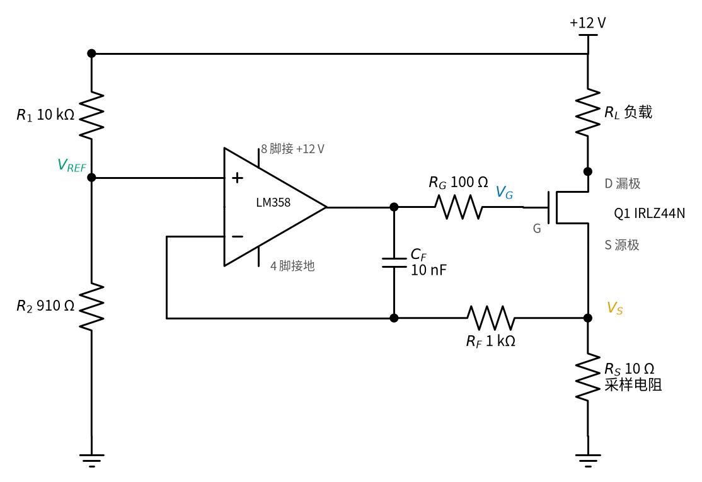
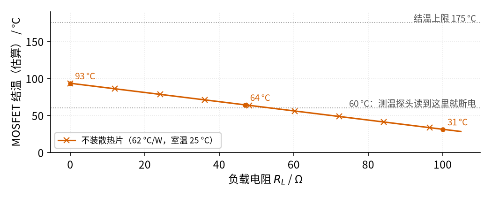
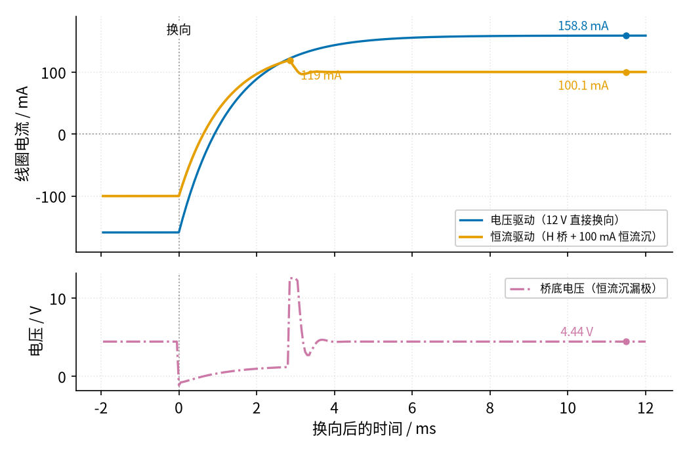

# 39 恒流源与线圈励磁驱动 · 原理与实现篇

[上一页：直觉篇](page1.md) · [直觉篇](page1.md) · 本页：原理与实现篇 · [参数与调试篇](page3.md) · [动手实验篇](page4.md) · [下一页：参数与调试篇](page3.md) · 前置节点：[02 运放入门 · 直觉篇](../02-opamp-basics/page1.md)、[12 电压跟随器 · 直觉篇](../12-voltage-follower/page1.md)、[06 MOS 管开关 · 直觉篇](../06-mosfet-switch/page1.md)、[21 线性稳压 · 直觉篇](../21-linear-regulator/page1.md)、[26 H 桥电机驱动 · 直觉篇](../26-h-bridge/page1.md)

## 最小知识

读这一页只需要下面五件事，都在前面学过：

1. **欧姆定律**：电阻两端电压 = 电流 × 电阻，即 $V = I \cdot R$ （[01 元件速成](../01-components-basics/page1.md)）。
2. **运放的负反馈规则**：输出经过某条路径接回反相输入端时，运放会不停调整输出，直到两个输入端电压相等（[02 运放入门](../02-opamp-basics/page1.md)、[12 电压跟随器](../12-voltage-follower/page1.md)）。本节反馈路径中间隔了一只 MOS 管，它仍然是负反馈：栅压升高 → 电流变大 → 源极电压升高，三者同方向，反相端「看到」的电压跟着运放输出一起涨，运放就会往回收。
3. **MOS 管的栅极控制**：栅极和源极之间的电压 $V_{GS}$ 越大，管子越「开」。[06 MOS 管开关](../06-mosfet-switch/page1.md) 里我们只用它全开、全关；这里让它停在中间。IRLZ44N 的开启电压（阈值）是 1～2 V。
4. **管子上的功率**：管子两端电压 × 流过的电流，这部分功率全部变成热（[21 线性稳压](../21-linear-regulator/page1.md) 里调整管发热也是这个道理）。
5. **电感电流不能突变**：给线圈加上电压，电流按「时间常数 $\tau = L/R$ 」慢慢爬，过 $\tau$ 爬完差距的 63%，过 $5\tau$ 基本到位。[01 元件速成 · 原理篇](../01-components-basics/page2.md) 里 RC 充电的那张「1τ～5τ」表照样能用，只要把 $\tau = RC$ 换成 $\tau = L/R$ ，把「电容电压」换成「电感电流」。

## 一、完整电路，逐个元件看

直觉篇的简化图里，基准是一个理想的 1 V 电源。真正搭的时候，1 V 从 12 V 分压得到，运放和 MOS 管之间还要加两三个小元件。完整电路见下面的图 39-p2-1。



*图 39-p2-1　完整的恒流沉：分压基准、LM358、IRLZ44N 和 10 Ω 采样电阻，外加三个稳定用的小元件*

对照图 39-p2-1，每个元件的作用：

| 元件 | 数值 | 作用 |
|---|---|---|
| $R_1$ 、 $R_2$ | 10 kΩ、910 Ω | 把 12 V 分成约 1 V 的基准 $V_{REF}$ |
| LM358 | 单电源运放 | 比较 $V_{REF}$ 和采样电压，调栅极；输入可以低到 0 V，适合单电源 |
| IRLZ44N | 逻辑电平 MOS 管 | 「阀门」，电流从漏极 D 流到源极 S |
| $R_S$ | 10 Ω | 采样电阻，把电流变成电压 $V_S = I \cdot R_S$ |
| $R_G$ | 100 Ω | 栅极电阻，把运放和 MOS 管的大栅极电容隔开一点，防振荡 |
| $R_F$ 、 $C_F$ | 1 kΩ、10 nF | 补偿网络，防振荡：电压突然变化时 $C_F$ 来不及充电，相当于一根导线，运放输出直接接回反相端，先「自己稳住自己」；电压慢慢变化时 $C_F$ 相当于断开，反馈才走 $R_F$ 从 $R_S$ 上取 |
| $R_L$ | 0～105 Ω | 负载；在流量计里就是线圈加 H 桥 |

$R_G$ 、 $R_F$ 、 $C_F$ 不加行不行？直流时它们没有电流流过（运放输入端几乎不取电流，电容隔直），所以**不影响电流大小**，只影响稳不稳。参数与调试篇会用仿真对比加和不加的区别。

## 二、推导：电流为什么只由基准和采样电阻决定

**第一步：基准电压。** $R_1$ 、 $R_2$ 串联分压：

$$V_{REF} = 12\ \text{V} \times \frac{910}{10000 + 910} = 1.0009\ \text{V}$$

**第二步：电流。** 运放负反馈让反相端等于同相端。反相端经 $R_F$ 接到 $V_S$ ， $R_F$ 上没有直流电流，所以 $V_S = V_{REF}$ 。运放和 $R_F$ 都几乎不取电流，MOS 管栅极也不取直流电流，于是流过 $R_L$ 的电流就是流过 $R_S$ 的电流：

$$I = \frac{V_S}{R_S} = \frac{V_{REF}}{R_S} = \frac{1.0009\ \text{V}}{10\ \Omega} = 100.09\ \text{mA}$$

这个式子里**没有 $R_L$**：负载怎么变，电流都不变。这就是恒流。

> **和老朋友对一对**：把 $R_S$ 两端的电压 $V_S$ 看成「输出」，这个电路就是 [08 同相放大 · 直觉篇](../08-noninverting-amp/page1.md) 的同相放大器，只是没有反馈分压、增益为 1（ $V_S = V_{REF}$ ）；MOS 管则像 [19 射极跟随器](../19-emitter-follower/page1.md) 里的三极管，源极跟着栅极走，只是两者之差不是 0.7 V 而是 $V_{GS}$ ，运放会自动把这个差补上。
>
> **自测**：如果在 $V_S$ 和反相端之间改接 08 节那样的分压（ $R_f = 1\ \text{k}\Omega$ 、 $R_1 = 1\ \text{k}\Omega$ ），电流变成多少？
>
> <details><summary>答案</summary>
>
> 反相端只拿到 $V_S / 2$ ，运放要让它等于 $V_{REF}$ ，于是 $V_S = 2 V_{REF} = 2.0018\ \text{V}$ ，电流翻倍为 200.2 mA。负载上限也跟着降到 $(12 - 2.0018 - 0.5) / 0.20018 \approx 47.4\ \Omega$ ，MOS 管发热也更大，只做纸面练习，别真去搭。
>
> </details>

**第三步：多出来的电压去哪了。** 从 +12 V 到地，电压被三样东西分掉：负载、MOS 管、采样电阻。

$$V_{DS} = 12\ \text{V} - I \cdot (R_L + R_S)$$

负载小，留给 MOS 管的电压就多，管子必须「关小」一些把它吃掉；负载大，管子就「开大」。比如 $R_L = 47\ \Omega$ 时， $V_{DS} = 12 - 0.10009 \times 57 = 6.29\ \text{V}$ ； $R_L = 100\ \Omega$ 时只剩 $0.99\ \text{V}$ 。

**第四步：负载最大能多大。** MOS 管再开也有个尽头，运放输出也顶不过 12 V。给 MOS 管至少留 0.5 V（这是工程上留的余量，不是精确界限），负载上限就是

$$R_{L,\max} = \frac{12 - 1.0009 - 0.5}{0.10009} \approx 104.9\ \Omega$$

超过这个值，管子已经全开，电流只能由 $12\ \text{V} / (R_L + R_S)$ 决定，恒流就失效了。恒流源还能保持恒流时，负载两端允许的最高电压叫**顺从电压**（compliance voltage），这里约 $12 - 1.0 - 0.5 = 10.5\ \text{V}$ 。

> **最小补充：MOS 管的「恒流区」和「开到底」**
>
> 在 [06 MOS 管开关](../06-mosfet-switch/page1.md) 里，我们只用了 MOS 管的「开到底」状态：栅压足够高，漏源之间像一只很小的电阻（ $R_{DS(on)}$ ），教科书把这一段叫**欧姆区**（也叫可变电阻区、线性区）。恒流沉用的是另一段：栅压只比门限高一点，管子「半开」，这时漏极电流几乎只由 $V_{GS}$ 决定， $V_{DS}$ 再大电流也基本不变，这一段叫**饱和区**，本节叫它**恒流区**。条件是 $V_{DS} \ge V_{GS} - V_{th}$ （漏源电压不能太小）。注意两个名字容易弄反：MOS 管的「饱和区」是恒流的那一段，「线性区」反而是开到底的那一段。本节说「掉出恒流区」，就是 $V_{DS}$ 太小，管子被迫进了开到底的欧姆区，电流不再受运放控制。上面给 $V_{DS}$ 留 0.5 V 余量，就是为了离开这条边界远一点（0.5 V 是工程余量，见第四步）。

下面的程序把四步算一遍，再顺便算 MOS 管的发热（第三节要用）。

```python
VCC, R1, R2, RS = 12.0, 10e3, 910.0, 10.0          # 电源、基准分压电阻、采样电阻
V_REF = VCC * R2 / (R1 + R2)                       # 第一步：分压得到基准电压
I_SET = V_REF / RS                                 # 第二步：设定电流 = 基准 ÷ 采样电阻
RL_MAX = (VCC - V_REF - 0.5) / I_SET               # 第四步：给 MOS 管留 0.5 V 时的最大负载
print(f"V_REF = {V_REF:.4f} V，I_SET = {I_SET*1e3:.2f} mA，R_L 上限 = {RL_MAX:.1f} Ω")  # 打印三个关键数
for RL in (0, 47, 100, 120, 150):                  # 挑几个负载电阻试一试
    I = min(I_SET, VCC / (RL + RS))                # 恒流区取 I_SET；掉出后管子全开，只剩电阻限流
    VDS = VCC - I * (RL + RS)                      # 第三步：剩给 MOS 管的电压
    P = VDS * I                                    # 管子发热功率 = 管压降 × 电流
    TJ = 25 + 62 * P                               # 不装散热片时的结温估算（62 °C/W，室温 25 °C）
    print(f"R_L = {RL:3d} Ω：I = {I*1e3:5.1f} mA，V_DS = {VDS:5.2f} V，P = {P:.3f} W，结温约 {TJ:.0f} °C")  # 打印一行
```

你应该看到：0～100 Ω 时电流都是 100.1 mA；120 Ω 时降到 92.3 mA，150 Ω 时 75.0 mA，这两个已经掉出恒流区。用 SPICE（TI 的 LM358B 模型加 Infineon 的 IRLZ44N 模型）扫一遍负载，结果画在下面的图 39-p2-2。


*图 39-p2-2　扫描负载电阻：左边电流，右边 MOS 管两端电压*

读图 39-p2-2：

- 左图里，从 0 到 105 Ω，SPICE 的橙色点和黑色虚线重合在 100.1 mA，**负载变了一百多欧，电流一点没动**。
- 右图解释了它是怎么做到的：负载每增加 10 Ω，MOS 管就少分 1 V，少的那部分正好让给了负载。
- 过了 105 Ω， $V_{DS}$ 已经挤到 0.5 V 以下，没东西可让了，左图的电流就开始往下掉（朱红色点）。

## 三、代价：多出来的电压变成热

第三步里那段 $V_{DS}$ 不是凭空消失的，它和电流相乘，变成 MOS 管上的热：

$$P = V_{DS} \cdot I = \left[12 - I \cdot (R_L + R_S)\right] \cdot I$$

数据手册给出 IRLZ44N 不装散热片时「结到空气」的热阻是 62 °C/W，意思是管子每发 1 W 热，内部（结）就比周围空气热 62 °C。于是结温约为

$$T_J \approx 25\ ^\circ\text{C} + 62\ ^\circ\text{C/W} \times P$$

结果见下面的图 39-p2-3。



*图 39-p2-3　负载越小，MOS 管越热：不装散热片时的结温估算*

图 39-p2-3 告诉我们一件反直觉的事：**负载越小（越接近短路），恒流源越热**。负载短路时（ $R_L = 0$ ）管子要吃掉将近 11 V，发热 1.101 W，结温约 93 °C；47 Ω 时 0.630 W、约 64 °C；100 Ω 时只有 0.099 W、约 31 °C。93 °C 离 175 °C 的上限还远，管子不会坏，但已经远超 60 °C，碰到会烫伤。所以动手实验篇要求**必须装散热片**，而且只用测温探头或 NTC 量温度，不用手去试。

这和 [21 线性稳压](../21-linear-regulator/page1.md) 的调整管是同一回事：线性电路靠「吃掉多余电压」来稳定输出，吃掉的电压就变成热。真实的电磁流量计会尽量让电源电压只比线圈需要的高一点点，减少这份浪费。

## 四、接上 H 桥：给线圈换向

现在把负载 $R_L$ 换成「H 桥 + 线圈」。H 桥的四个开关在 [26 H 桥电机驱动](../26-h-bridge/page1.md) 里学过；这里把它的底部（两只下管的公共端，叫「桥底」）接到恒流沉的漏极，见下面的图 39-p2-4。


*图 39-p2-4　分立 H 桥管方向、恒流沉管大小：桥底接图 39-p2-1 的恒流沉*

看图 39-p2-4：阶段 A 时 S1、S4 闭合，电流从 +12 V 经 S1、线圈（OUT1 → OUT2）、S4 到桥底，再进恒流沉；阶段 B 时 S2、S3 闭合，电流反过来穿过线圈，但最后还是从桥底进恒流沉。**无论哪个方向，电流都要经过同一个恒流沉，所以正、负两个方向的大小一样**。线圈下面的 RC 吸收支路（1 kΩ + 100 nF）防止换向后振荡，参数与调试篇再讲。

仿真里 S1～S4 的导通电阻按 26 节用过的 DRV8871 取值：上管约 0.307 Ω、下管约 0.258 Ω，合计 0.565 Ω。但要注意，DRV8871 两只下管的源极在芯片内部就接到了地脚，桥底引不出来，所以**这张图不能直接用一块 DRV8871 搭**。真要在桥底串恒流沉，得像图 39-p2-4 那样用四只分立 MOS 管搭桥；另一条路是把稳流的那一级放到电源一侧（先稳流、再进 H 桥顶部），这时 H 桥可以是集成芯片，但要用「高边恒流源」，电路不同于图 39-p2-1。（这条「高边」路线本节不展开。）

还要注意：DRV8871 自带的限流（ILIM 脚）**不能**代替这个 100 mA 恒流沉，原因有两条。

- **它管不到这么小的电流。** 手册把门槛写成 $I_{TRIP} = V_{ILIM} / R_{ILIM}$ ，其中 $V_{ILIM}$ 只是一个换算系数（典型 64 kV，单位凑成 kV 是为了让 $R_{ILIM}$ 用 kΩ 填进去直接得到安培，芯片里并没有几万伏的电压）。100 mA 要配 640 kΩ，但手册只在 1 A 下标定这个系数（59～69 kV），并且只举了 32 kΩ → 2 A 这样的例子。
- **它是「斩波」不是「恒流」。** 电流一超过门槛，芯片就把两只下管同时打开（刹车，和 [26 H 桥电机驱动](../26-h-bridge/page1.md) 里的「制动」是同一个状态）25 µs，让电流慢慢衰减，然后重新接通。电流是一串锯齿，不是平稳的恒流。

动手实验篇因此把「恒流」和「换向」分成两个实验来验证。

**稳态时各点电压**：线圈 75 Ω 加两只管子 0.565 Ω，流过 100.09 mA，压降约 7.56 V，所以桥底电压是 $12 - 7.56 = 4.44\ \text{V}$ ，MOS 管两端 $V_{DS} = 4.44 - 1.00 = 3.44\ \text{V}$ ，还在恒流区里。

**换向的过程**：线圈是电感，电流不能从 −100 mA 一下跳到 +100 mA。我们分两种驱动方式算一算。

- **电压驱动**（没有恒流沉，桥底直接接地）：回路电阻 $75.565\ \Omega$ ，时间常数 $\tau = 0.1\ \text{H} / 75.565\ \Omega = 1.3234\ \text{ms}$ 。电流从 −158.8 mA 往 +158.8 mA 爬，在 $\tau \ln 2 = 0.917\ \text{ms}$ 时过零（ $\ln$ 是自然对数，计算器上的 ln 键；指数曲线走完差距的一半要 $\tau \ln 2$ ，走完 99.5% 要 $\tau \ln 200$ ，这里从 −158.8 到 +158.8 的「差距」是 317.6 mA，过零正好是走完一半），在 $\tau \ln 200 = 7.01\ \text{ms}$ 时到达终值的 99%。
- **恒流驱动**：换向一开始，电流还是负的，离 +100 mA 差得远，运放把栅极推到顶，MOS 管全开。这时回路里是线圈 75 Ω、桥 0.565 Ω、采样 10 Ω，共 85.565 Ω，电流朝 $12 / 85.565 = 140.2\ \text{mA}$ 爬，时间常数 $0.1 / 85.565 = 1.169\ \text{ms}$ 。爬到 100 mA 时运放重新接管，把电流按住。所以恒流驱动**过零更早、到位更快**：它是朝着一个比目标更高的值冲过去的。

下面的程序算出这几个时间，并画出两种驱动的理想换向曲线。图里有中文，所以开头借用教程的 figstyle 设置中文字体；请在仓库根目录运行。图存到系统临时目录（程序会打印路径），不会在仓库里多出文件。

```python
import sys, pathlib, tempfile                       # 路径工具、临时目录
sys.path.insert(0, str(pathlib.Path("code/figs").resolve()))  # 在仓库根目录运行
import figstyle                                     # 只借用它设置中文字体
import numpy as np                                  # 数值计算
import matplotlib                                   # 画图库
matplotlib.use("Agg")                               # 不弹窗口，直接存图
import matplotlib.pyplot as plt                     # 画图接口
L, RC, RON, RS, VCC = 0.1, 75.0, 0.565, 10.0, 12.0  # 线圈 100 mH / 75 Ω，桥导通电阻，采样电阻，电源
I_SET = 0.10009                                     # 恒流沉设定的电流（第二步）
tau_v = L / (RC + RON)                              # 电压驱动的时间常数
I_v = VCC / (RC + RON)                              # 电压驱动的稳态电流
print(f"电压驱动：τ = {tau_v*1e3:.4f} ms，稳态 {I_v*1e3:.1f} mA")       # 打印
print(f"  过零 {tau_v*np.log(2)*1e3:.3f} ms，到 99% 用 {tau_v*np.log(200)*1e3:.2f} ms")  # 打印
R_sat = RC + RON + RS                               # 恒流沉全开时的回路总电阻
tau_c, I_inf = L / R_sat, VCC / R_sat               # 全开时的时间常数和「想去的」电流
t_zero = tau_c * np.log((I_inf + I_SET) / I_inf)    # 从 -I_SET 出发，过零的时刻
t_set = tau_c * np.log((I_inf + I_SET) / (I_inf - 0.99 * I_SET))  # 到 99% 设定值的时刻
print(f"恒流驱动：全开时 τ' = {tau_c*1e3:.3f} ms，朝 {I_inf*1e3:.1f} mA 爬")  # 打印
print(f"  过零 {t_zero*1e3:.2f} ms，到 99% 用 {t_set*1e3:.2f} ms")           # 打印
t = np.linspace(-2e-3, 12e-3, 1401)                 # 换向前 2 ms 到换向后 12 ms
tp = np.clip(t, 0, None)                            # 换向前时间按 0 算
iv = np.where(t < 0, -I_v, I_v * (1 - 2 * np.exp(-tp / tau_v)))  # 电压驱动的指数曲线
ic = np.where(t < 0, -I_SET, np.minimum(I_inf - (I_inf + I_SET) * np.exp(-tp / tau_c), I_SET))  # 恒流驱动：爬到设定值就被按住
fig, ax = plt.subplots(figsize=(6, 3))              # 新建一张图
ax.plot(t * 1e3, iv * 1e3, label="电压驱动")         # 画电压驱动
ax.plot(t * 1e3, ic * 1e3, label="恒流驱动（理想）")  # 画恒流驱动
ax.set_xlabel("换向后的时间 / ms"); ax.set_ylabel("线圈电流 / mA"); ax.legend()  # 坐标轴和图例
fig.tight_layout()                                  # 排版
out = pathlib.Path(tempfile.gettempdir()) / "coil_reversal.png"  # 存到系统临时目录，不在仓库里留文件
fig.savefig(out, dpi=100)                           # 存图
print("已保存", out)                                 # 提示存到哪里
```

程序应打印：电压驱动 τ = 1.3234 ms、过零 0.917 ms、到 99% 用 7.01 ms；恒流驱动 τ′ = 1.169 ms，过零 0.63 ms，到 99% 用 2.06 ms。这里假设运放「一过 100 mA 就立刻接管」。真实情况如何？下面的图 39-p2-5 是 SPICE 仿真（H 桥用开关模型，恒流沉用 IRLZ44N 模型，运放用简化的单极点模型）的结果。



*图 39-p2-5　换向波形的 SPICE 仿真：上为线圈电流，下为桥底电压*

读图 39-p2-5：

- 上层的橙色曲线前半段和我们的推导一样：比蓝色更早过零（SPICE 0.63 ms，和计算一致），2.06 ms 第一次爬到 100 mA 的 99%，也和理想计算一致。
- 但它**没有立刻停在 100 mA**，而是继续冲到 119.1 mA（2.84 ms），再掉回来，3.36 ms 起稳定在 100 mA ±1 mA 以内。原因是：爬坡的那 2 ms 里电流一直不够，运放输出顶在上限，它内部还在不停地「往上使劲」。打个比方，运放内部像一只水桶，误差一直往里灌水；输出管子已经顶到头了，水桶还在灌。电流过了 100 mA 以后，得先把多灌的水放掉，才能把栅极往回拉，于是多冲了一段。这叫**积分饱和**（英文 windup）。所以「2.06 ms」是第一次到达的时间，「3.36 ms」是真正稳住的时间，两个都比电压驱动的 7.01 ms 快得多。
- 冲过头时运放把 MOS 管迅速关小，可线圈里的电流不能突变（最小知识第 5 条），它要找路继续流：桥底电压被一路推高，直到电流能经过还开着的那只下管、再穿过上管自带的二极管流回电源，把桥底钳在「电源 + 一个二极管压降」≈ 12.5 V。这就是下层那个比 12 V 电源还高的尖峰，不是画错了。
- 119 mA 这个数用的是简化运放模型，我们给模型内部节点加了限幅（真 LM358 内部电压被电源轨钳住，不会无限积累），所以量级可信；但精确数值会随具体芯片变，不要把它当成实物上一定读到的数。
- 好消息是：6.25 Hz 换向，每个半周期 80 ms，就算按电压驱动的 7 ms 才稳定，后面还有 73 ms 平稳的磁场。电磁流量计通常等电流稳定后、只在每个半周期的**后段**采样（见直觉篇参考资料里的 Azbil 说明），前面这段过渡本来就会被丢掉。蓝色的电压驱动虽然没有过冲，但稳态值 158.8 mA 会随温度漂，这才是更要命的问题。

## 五、小结：这套电路的三个零件各管什么

- **运放 + MOS 管 + 采样电阻**：把电流「按」在 $V_{REF} / R_S$ ，负载和温度怎么变都不管（只要不超过负载上限）。
- **H 桥**：只负责换方向，电流大小由桥底下的恒流沉决定。
- **补偿网络和 RC 吸收**：让闭环不振荡、换向后不振荡，它们的取值在参数与调试篇里用仿真波形说明。

负载一端必须接地时还有另一种恒流源（Howland 电流泵），它放在参数与调试篇的「变体」一节。

## 例题

**例 1（完整示范）**：沿用图 39-p2-1 的电路（ $R_1 = 10\ \text{k}\Omega$ ， $R_S = 10\ \Omega$ ），想把电流改成约 50 mA。 $R_2$ 该取多少？取标准阻值后实际电流和负载上限各是多少？

<details open><summary>解答（完整示范，已展开）</summary>

1. 需要 $V_{REF} = 0.05 \times 10 = 0.5\ \text{V}$ 。
2. 分压比 $R_2 / (R_1 + R_2) = 0.5 / 12$ ，解出 $R_2 = 10000 \times 0.5 / 11.5 \approx 434.8\ \Omega$ 。
3. 434.8 Ω 买不到。电阻厂家只常备几组「标准阻值」，最常用的 E24 系列把每十倍分成 24 档（…、390、430、470、510…），所以取最近的 430 Ω： $V_{REF} = 12 \times 430 / 10430 = 0.4947\ \text{V}$ ，电流 49.47 mA。
4. 负载上限 $(12 - 0.4947 - 0.5) / 0.04947 \approx 222.5\ \Omega$ ：电流减半，能带的负载差不多翻倍。

</details>

**例 2（留空练习）**：图 39-p2-4 的线圈热到 60 °C，电阻变成 86.79 Ω。电流仍是 ____ mA（因为 86.79 Ω 加 0.565 Ω 仍小于负载上限 ____ Ω）；桥底电压 = 12 − 0.10009 × ____ = ____ V； $V_{DS}$ = ____ V；MOS 管发热 ____ W。

<details><summary>答案</summary>

100.09 mA；104.9 Ω；桥底电压 $12 - 0.10009 \times 87.355 = 3.26\ \text{V}$ ； $V_{DS} = 3.26 - 1.00 = 2.26\ \text{V}$ ；发热 $2.26 \times 0.10009 \approx 0.226\ \text{W}$ 。线圈热了，电流不变，只是 MOS 管少吃了一点电压，反而凉快些。

</details>

**例 3（变体迁移）**：换一只 150 Ω 的线圈，仍要 100 mA。12 V 电源够不够？如果只能用 12 V，采样电阻仍为 10 Ω，最大能设多大电流？

<details><summary>答案</summary>

需要的电源至少是 $0.10009 \times (150 + 0.565 + 10) + 0.5 \approx 16.57\ \text{V}$ ，12 V 不够。只用 12 V 时，要满足 $12 - I \times 160.565 \ge 0.5$ ，所以 $I \le 11.5 / 160.565 \approx 71.6\ \text{mA}$ ，对应 $V_{REF} \le 0.716\ \text{V}$ 。磁场会弱一些，流量信号也按比例变小。

</details>

## 参考资料

- LM358B 数据手册（TI，输入共模范围含 0 V）：<https://www.ti.com/lit/ds/symlink/lm358b.pdf>
- IRLZ44N 数据手册（Infineon，阈值 1～2 V、无散热片热阻 62 °C/W、最高结温 175 °C）：<https://www.infineon.com/dgdl/irlz44npbf.pdf?fileId=5546d462533600a40153567217c32725>
- DRV8871 数据手册（TI，上下管导通电阻）：<https://www.ti.com/lit/ds/symlink/drv8871.pdf>
- 电压—电流转换电路（TI SBOA046）：<https://www.ti.com/lit/an/sboa046/sboa046.pdf>
- 电磁流量计励磁设计（ADI）：<https://www.analog.com/en/resources/analog-dialogue/articles/electromagnetic-flow-meters.html>
