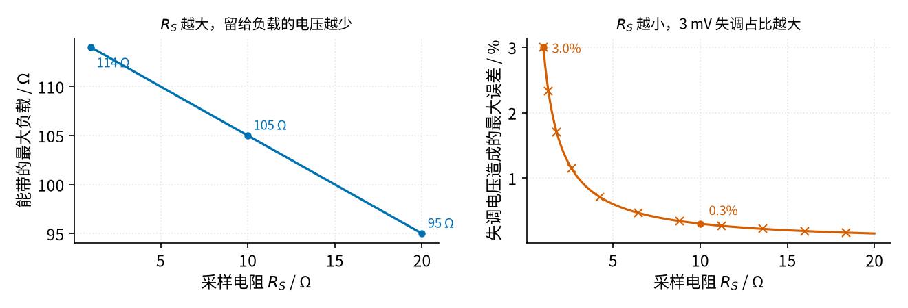
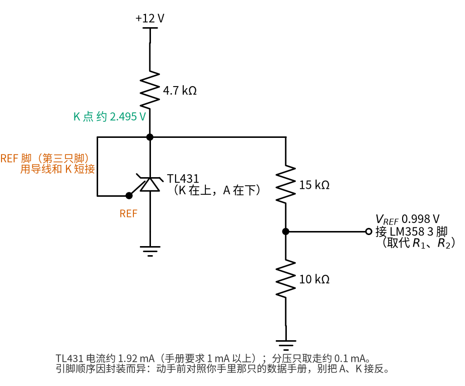
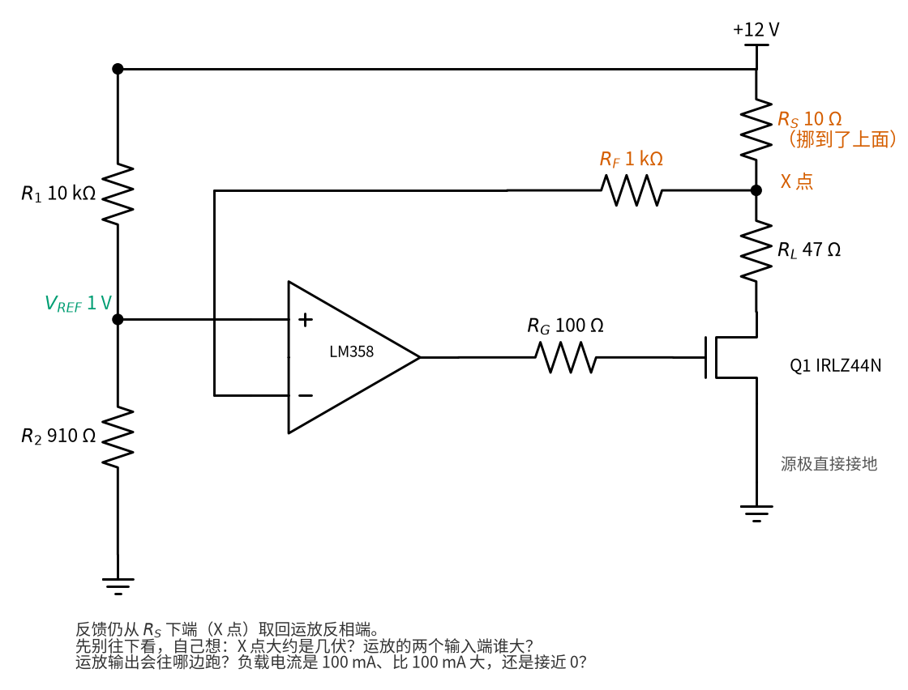
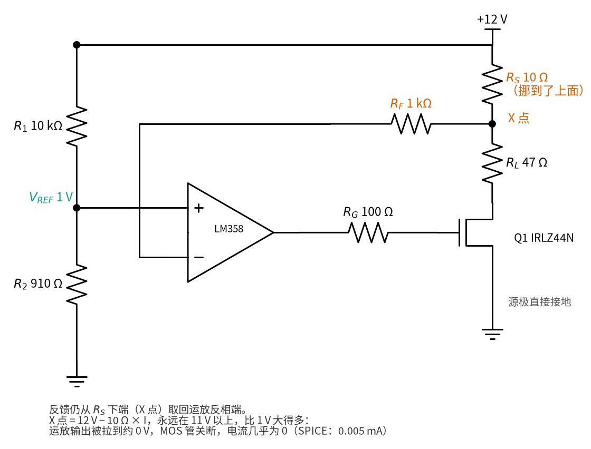
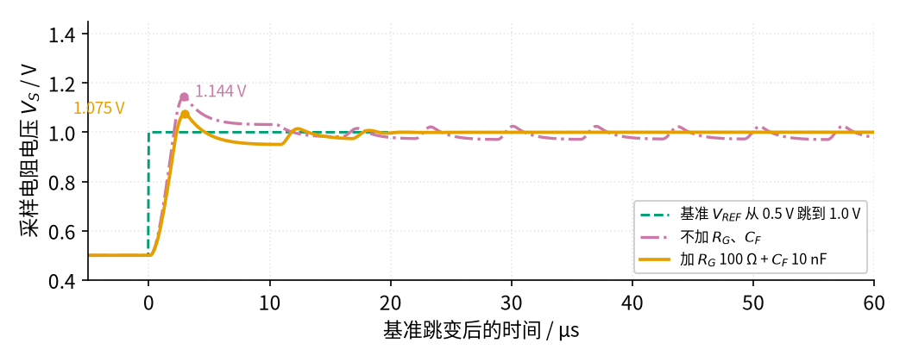
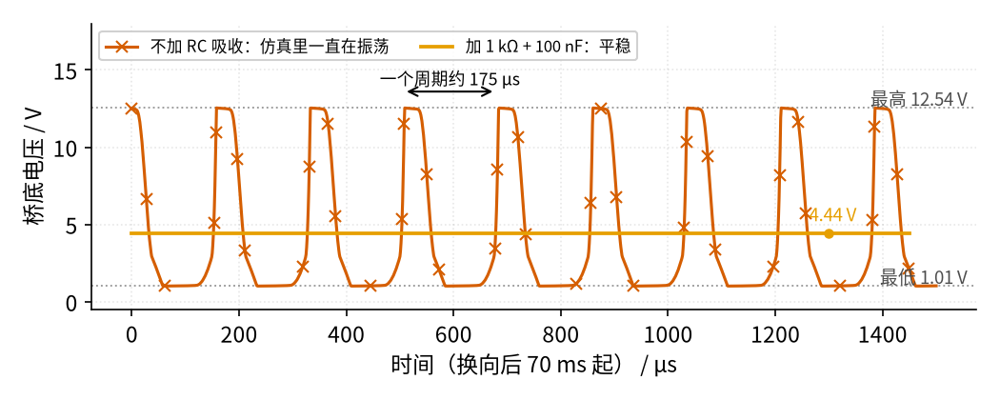
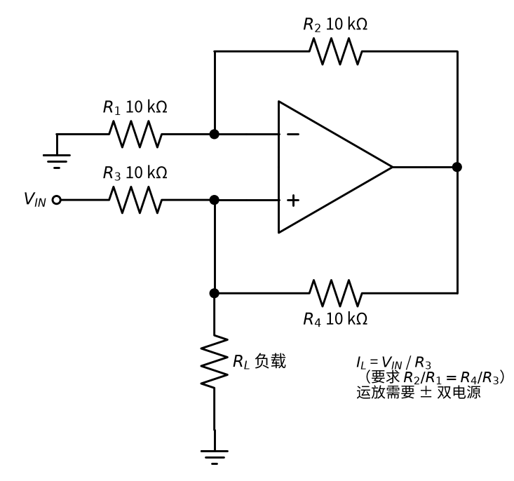

# 39 恒流源与线圈励磁驱动 · 参数与调试篇

[上一页：原理与实现篇](page2.md) · [直觉篇](page1.md) · [原理与实现篇](page2.md) · 本页：参数与调试篇 · [动手实验篇](page4.md) · [下一页：动手实验篇](page4.md) · 前置节点：[02 运放入门 · 直觉篇](../02-opamp-basics/page1.md)、[06 MOS 管开关 · 参数与调试篇](../06-mosfet-switch/page3.md)、[21 线性稳压 · 直觉篇](../21-linear-regulator/page1.md)、[26 H 桥电机驱动 · 直觉篇](../26-h-bridge/page1.md)

## 参数一览

原理与实现篇推出了 $I = V_{REF} / R_S$ 。下表列出电路里每个可调的数，它们改大或改小分别会怎样。

| 参数 | 本节取值 | 改大会怎样 | 改小会怎样 | 怎么选 |
|---|---|---|---|---|
| 电源 $V_{CC}$ | 12 V | 能带的负载变大，但 MOS 管更热；基准也跟着变大（见练习 2） | 负载上限变小，**设定电流也跟着按比例变小**（基准是从电源分压来的） | 刚好够「线圈 + 采样 + 0.5 V」再留一点；要电流不随电源变，换 TL431 基准（见下文「可选升级」） |
| 基准 $V_{REF}$ | 1.0009 V | 电流变大 | 电流变小，运放失调占比变大 | 先定电流，再定 $V_{REF} = I \cdot R_S$ |
| 采样电阻 $R_S$ | 10 Ω | 吃掉更多电压，负载上限变小 | 采样电压变小，失调误差变大 | 让 $V_{REF}$ 在 0.1～1 V 之间（见图 39-p3-1） |
| $R_S$ 额定功率 | ≥ 0.5 W | — | 发热超标，阻值漂移 | 实际功率 $0.1^2 \times 10 = 0.1\ \text{W}$ ，取 4～5 倍余量 |
| 栅极电阻 $R_G$ | 100 Ω | 响应变慢 | 运放直接推大电容，容易振 | 47～220 Ω |
| 补偿 $R_F$ 、 $C_F$ | 1 kΩ、10 nF | 更稳但更慢 | 更快但过冲变大 | 先按本节取值，用示波器看阶跃再微调 |
| RC 吸收 | 1 kΩ + 100 nF | 电容大，换向时多耗一点能量 | 太小压不住振荡 | 经验法则：电阻和 $\sqrt{L/C}$ 同一数量级（C 是振荡反推出的等效电容 7.8 nF，算得 3.6 kΩ），吸收电容比 C 大好几倍（下文解释） |
| MOS 管散热 | 必须装 | — | 不装时最坏结温约 93 °C | 见本页练习 3 |

## 采样电阻选多大

$R_S$ 两头为难：太大，它吃掉的电压多，留给负载的少；太小，采样电压只有几十毫伏，运放自身的**失调电压**（两输入端本来该相等，实际差的那一点，LM358B 最坏约 3 mV）占比就大了。两个效应画在下面的图 39-p3-1。

*图 39-p3-1　采样电阻的取舍：左边看能带多大负载，右边看失调带来的误差*

从图 39-p3-1 读数：

- 左图：最大负载 $= (12 - 0.5 - 0.1 \cdot R_S) / 0.1$ 。 $R_S$ 从 1 Ω 换到 20 Ω，负载上限从 114 Ω 降到 95 Ω，只少了 19 Ω。
- 右图：误差 $= 3\ \text{mV} / (0.1\ \text{A} \times R_S)$ 。1 Ω 时采样电压只有 0.1 V，3 mV 就是 3.0%；10 Ω 时采样电压 1 V，误差降到 0.3%。

所以 10 Ω 是个好折中：误差小，负载上限只比 1 Ω 少 9 Ω。另外，失调是个固定的偏差，可以靠校准扣掉；它随温度的漂移扣不掉，这才是真正限制精度的东西。采样电阻本身也要选温度系数小的（比如金属膜，±50 ppm/°C；ppm 是「百万分之一」，50 ppm/°C 就是温度每升 1 °C 阻值变 0.005%，升 20 °C 才变 0.1%），否则它一热，电流跟着变，恒流源就白做了。

> **可选升级：用 TL431 做基准（主线不必做）**
>
> 本节的 1 V 基准是从 12 V 直接分压来的，电源变 4%，电流也变 4%（练习 2）。想让电流和电源无关，可以先用一只 TL431 稳出 2.495 V，再分压，接法见下面的图 39-p3-7：12 V 经 4.7 kΩ 接 TL431 的阴极 K，K 和参考脚 REF 短接、阳极 A 接地，K 点就稳在约 2.495 V（流过 TL431 的电流约 $(12 - 2.495)/4.7\ \text{k}\Omega - 0.1\ \text{mA} \approx 1.9\ \text{mA}$ ，在手册要求的 1 mA 以上）。K 点再经 15 kΩ、10 kΩ 分压，得到 $2.495 \times 10 / 25 = 0.998\ \text{V}$ ，接运放同相端，取代原来的 $R_1$ 、 $R_2$ 。TL431 是一种三只脚的「精密稳压管」，第一次见到它最容易把 A、K 接反，所以搭之前先对着图 39-p3-7 和手册的引脚图认一遍脚。TL431C 的基准在 2.440～2.550 V 之间，所以设定电流在 97.6～102.0 mA 之间，但**不再随电源变**。资料：TL431 数据手册 <https://www.ti.com/lit/ds/symlink/tl431.pdf>。

*图 39-p3-7　可选升级：用 TL431 稳出基准再分压（只换基准那一块，其余照旧）*

## 先预测：采样电阻挪到上面行不行？

很多同学会想：「采样电阻放在电源和负载之间，MOS 管的源极就能直接接地，看起来更整齐。」反馈线还是接在采样电阻的下端，如下面的图 39-p3-4。**先别往下看，自己预测一下：电流会是多少？** 三个选项：

- A：还是约 100 mA，采样电阻放哪都一样；
- B：接近 0；
- C：约 210 mA，MOS 管全开，只剩电阻限流。

*图 39-p3-4　先预测：采样电阻挪到高边，反馈仍取自它的下端（答案在下面折叠里）*

对着图 39-p3-4 想好了再展开：先算 X 点电压，再比较运放两个输入端。

答案（选 B）

*图 39-p3-6　答案：X 点永远在 11 V 以上，运放把 MOS 管关断*

电流几乎为 0，见图 39-p3-6。运放要让反相端等于同相端的 1 V，可是图 39-p3-4 里 X 点电压是 $12 - 10 \times I$ ：电流为 0 时是 12 V，就算电流有 100 mA 也还有 11 V，**永远不可能降到 1 V**。运放只能拼命把输出往下拉，拉到约 0 V，MOS 管关断，电流就是 0。SPICE 给出：X 点 12.00 V，运放输出 0.024 V，电流 0.005 mA。

选 C 的同学想到的其实是另一种错法：如果再把运放两个输入端对调「救一下」，就更糟：运放输出顶满，MOS 管全开，电流变成 $12 / (47 + 10) \approx 0.21\ \text{A}$ ，完全不受控，47 Ω 电阻发热约 2.1 W。

真正想在高边测电流，要量的是采样电阻**两端之差**（两头都在 11～12 V），这需要 [30 仪表放大器与电桥](../30-instrumentation-amp/page1.md) 那样的差分放大，或者专用的高边电流检测芯片。所以本节把采样电阻放在低边：它的一端接地，运放直接拿到 $V_S$ 。这个错误接法的电流是 0，万一搭错也不会烧东西；动手实验篇按正确的低边接法搭，另外给了一个可选步骤 A7，让你亲手搭一次图 39-p3-6 的接法验证这个答案。高边电流检测的具体电路本节不展开。

## 稳不稳：补偿网络的作用

运放、 $R_G$ 、MOS 管的栅极电容、采样电阻组成了一个闭环。环路里每多一个「慢」的环节，信号就多一点延迟；延迟太多，负反馈会变成「刚纠正过头又反向纠正」，也就是振荡。为了看清楚，我们在 SPICE 里让基准从 0.5 V 突然跳到 1.0 V（一次**阶跃**），看采样电压 $V_S$ 怎么跟上去，见下面的图 39-p3-2。

*图 39-p3-2　基准阶跃时采样电压的反应：有补偿和没补偿的对比*

图 39-p3-2 的读法：

- **有补偿**（橙色）：2.1 µs 到达 0.95 V，2.96 µs 冲到最高 1.075 V。过冲按「冲过终点的部分 ÷ 跳变的高度」算： $(1.075 - 1.0) / 0.5 = 0.150$ ，即 15.0%。之后再也没有持续振荡。
- **没补偿**（红紫色）：冲到 1.144 V，过冲 28.7%；更糟的是它一直在抖，峰峰值 54.5 mV，频率约 147 kHz。用万用表量，读数看起来正常（平均值还是 1 V 左右），但 MOS 管在 147 kHz 下反复充放栅极，会额外发热，还会把干扰串进旁边的微弱信号电路，对电磁流量计来说是大忌。

## 换向后的振荡：RC 吸收

恒流沉对线圈来说是一个「很硬」的电流源，几乎不消耗振荡的能量。SPICE 里，线圈电感和恒流沉的反馈环路凑在一起，换向后会出现一个持续的振荡，表现得就像一个 LC 回路：没有东西把能量吃掉，它就一直振下去。注意这里的「C」不是哪一颗真实的电容（MOS 管、H 桥的**寄生电容**，即挨着的金属之间那一点电容，比它小得多；仿真里的 H 桥用的是理想开关，也没有画寄生电容），而是从振荡周期反推出来的「等效电容」，下面马上算。在线圈两端并一条 1 kΩ + 100 nF 的支路就能把它压住，SPICE 结果见下面的图 39-p3-3。

打个比方：电感像一根弹簧，电容像挂在上面的小球，碰一下就会来回弹。RC 支路就是给小球加了一块「阻尼海绵」。海绵（电阻）太软压不住，太硬又等于把小球焊死。先求「小球」有多重：图 39-p3-3 里振荡周期约 175 µs，由 $T = 2\pi\sqrt{LC}$ 反推， $C = (T / 2\pi)^2 / L = (175\ \mu\text{s} / 2\pi)^2 / 0.1\ \text{H} \approx 7.8\ \text{nF}$ 。经验法则是：海绵电阻取 $R \approx \sqrt{L/C}$ 这个数量级，这里 $\sqrt{0.1\ \text{H} / 7.8\ \text{nF}} \approx 3.6\ \text{k}\Omega$ ；和电阻串联的吸收电容要比这个等效电容大好几倍，电阻才能在振荡频率上真正「接」上去。本节取 1 kΩ + 100 nF：100 nF 约是 7.8 nF 的 13 倍，1 kΩ 和 3.6 kΩ 同一数量级、阻尼偏重一些，图 39-p3-3 的 SPICE 结果说明它压得住。这只是经验法则，实际电路的最佳值还要用示波器看波形微调。

*图 39-p3-3　换向 70 ms 后的桥底电压：没有 RC 吸收时一直振荡，有 RC 吸收时平稳*

看图 39-p3-3：没有吸收支路时，即使已经换向 70 ms，桥底电压还在 1.01 V 和 12.54 V 之间来回跳，线圈电流也在 98.8～102.2 mA 之间抖（±1.7%）。加上 1 kΩ + 100 nF 以后，桥底电压稳稳停在 4.44 V，正是原理与实现篇算出的稳态值。直流时电容相当于断开（电容隔直），所以这条支路**不分走线圈的直流电流**。要注意，「一直在振」是仿真模型给出的结论：真实电路里还有很多模型没画进去的寄生电容和损耗，振荡的频率和幅度会不一样，但「没有吸收就容易振」这个趋势是可信的，所以实验里 RC 吸收必须装。

**负载换了，补偿要不要重新选？** 线圈电感、负载电阻变了，环路的「慢」也会变，本节的 $R_F$ 、 $C_F$ 不一定还最合适。有示波器时：看 $V_S$ 的阶跃反应或换向后的波形，有持续抖动就把 $C_F$ 加大一档（如 10 nF → 22 nF）。没有示波器时：万用表读数应该稳定不跳，MOS 管的散热片温度应该和 $P = V_{DS} \times I$ 算出的发热相符；读数乱跳或者管子比计算的热得多，就怀疑在振荡。

## 变体：Howland 电流泵（了解即可）

原理与实现篇的恒流沉要求负载「悬空」接在电源和 MOS 管之间。如果负载一端必须接地，可以用 **Howland 电流泵**，见下面的图 39-p3-5。

*图 39-p3-5　Howland 电流泵：负载一端接地，四只电阻必须严格配对*

图 39-p3-5 里四只电阻满足 $R_2 / R_1 = R_4 / R_3$ 时，负载电流 $I_L = V_{IN} / R_3$ ，与 $R_L$ 无关，而且电流可正可负，不需要 H 桥。代价有三个：要正负双电源；输出电流受运放本身限制（普通运放只有几十毫安）；最麻烦的是**电阻必须配得很准**。它的输出阻抗（越大越像理想恒流源）是

$$Z_{OUT} = \frac{1}{\dfrac{1}{R_3} - \dfrac{R_2}{R_1 R_4}}$$

四只都是 10 kΩ 时分母为 0，阻抗无穷大。若 $R_4$ 偏大 1%，阻抗只剩 1.01 MΩ；偏小 1%，阻抗变成 −0.99 MΩ，负号表示负载越大电流反而越大，接上电容性负载还可能振荡。更糟的是四只 1% 电阻同时朝最坏方向偏：按上式算，阻抗最低只剩约 248 kΩ；TI 的应用笔记 SNOA474A 的原话是 1% 电阻时最坏「可能低到 250 kΩ」，换 0.1% 电阻约 2.5 MΩ。负阻抗意味着电路有自激振荡的风险：负载电压一升，电流反而更大，电压又升得更多，像越推越快的秋千。所以对 100 mA 级的线圈励磁，本节主线选「运放 + MOS 管 + 采样电阻」的恒流沉加 H 桥。

## 排错表

| 现象 | 原因 | 怎么查 | 怎么改 |
|---|---|---|---|
| 电流比 100 mA 小，而且随负载变 | 负载太大，掉出恒流区 | 量 $V_{DS}$ ：小于 0.5 V 就是；运放 1 脚顶在 10.83 V 附近 | 减小负载，或降低设定电流 |
| 电流稳定，但不是 100 mA，差几个百分点 | $R_1$ 、 $R_2$ 、 $R_S$ 的误差，或运放失调 | 量 $V_{REF}$ 和 $V_S$ ：两者相等则问题在 $R_S$ 或基准 | 换 1% 精度电阻；用 1 V 左右的采样电压 |
| 万用表读数正常，MOS 管却异常发热、附近电路受干扰 | 没装 $R_G$ 、 $C_F$ ，环路在 100 kHz 量级振荡 | 示波器看 $V_S$ ，有几十毫伏的周期抖动 | 按图 39-p3-2 加上 $R_G$ 100 Ω、 $C_F$ 10 nF |
| 测温探头读到散热片超过 60 °C | 负载小，管子吃掉大部分电压 | 算 $P = V_{DS} \times I$ ，超过 0.5 W 必须散热 | 装散热片；降低电源电压；或在负载上串一只功率电阻分担 |
| 换向后电流先冲到 100 mA 以上（SPICE 最高约 119 mA），约 1 ms 后回落，换向后 3～4 ms 内稳定 | 运放积分饱和：爬坡时输出顶到头 | 示波器看 $V_S$ 和运放 1 脚，1 脚在换向后一段时间顶在上限 | 在后段采样即可；要求高时给运放加限幅，或换饱和恢复快的运放 |
| 电流几乎为 0，X 点（负载上端）约 12 V | 采样电阻放到了高边，反馈仍取自它下端（图 39-p3-6 的错法） | 量 $R_S$ 两端：都在 12 V 附近，几乎没压降 | 按原理篇的标准接法把 $R_S$ 放回 MOS 管源极和地之间 |
| 电流约 210 mA，47 Ω 电阻很快发烫 | 运放两输入端接反（或高边错法再对调输入端） | 量运放 1 脚：顶在 10.8 V 左右，且 $V_S$ 远大于 $V_{REF}$ | 立即断电；同相端 3 脚接 $V_{REF}$ ，反相端 2 脚接 $R_F$ |
| 电源从 12 V 掉到 11.5 V，电流也小了约 4% | 基准由电源分压，跟着电源变 | 量 $V_{REF}$ ：从 1.00 V 变成约 0.96 V | 用稳压好的 12 V 电源；或换 TL431 基准 |
| 换向后桥底电压一直在跳 | 线圈两端没有 RC 吸收 | 示波器看桥底电压 | 线圈两端并 1 kΩ + 100 nF |
| 电流始终为 0 | MOS 管脚接错（G、D、S 顺序），或 $R_S$ 没接到地 | 量 $V_S$ ：为 0 且 1 脚顶在上限，说明 MOS 管没导通或源极没接地 | 对照数据手册：IRLZ44N 正面朝自己，从左到右是 G、D、S |

## 常见误区

下面几条是初学者搭这类电路最常踩的坑，挑出来单独说：

- **把 LM358 换成 TL072「升级」。** 采样电压只有 0～1 V，紧贴地。LM358 的输入范围包含 0 V，TL072 不包含，它的输出也降不到地附近，而 IRLZ44N 的门限只有 1～2 V，结果是 MOS 管关不断，甚至出现输出反相。低边恒流沉只能用「输入范围含负电源」的运放。
- **把电流表串进回路去量电流。** 电流表内部有分流电阻，会吃掉一点电压（叫「负担电压」）；100 Ω 负载时本来只剩约 1 V 余量，再被吃掉一部分，电流就会比不串表时小。本节一律量 $R_S$ 两端电压再除以 10 Ω。
- **示波器地夹或 Arduino 的 A0 接到实验 B 的 $R_{SEN}$ 上。** $R_{SEN}$ 两端都跟着 H 桥在 0 和 12 V 之间跳，示波器地夹一夹就把输出对地短路；Arduino 引脚碰到 12 V 会损坏。正确做法见动手实验篇「有示波器时」：两个地夹都夹 GND 轨，用 CH1 − CH2。
- **大电流的地线和运放的地混在一起。** 若 100 mA 的回流要经过面包板地轨、长线再回电源，地线上 0.3 Ω 就会产生 $0.3 \times 0.1 = 30\ \text{mV}$ 的压降，叠加到采样电压上，电流就差 3%。 $R_S$ 下端、 $R_2$ 下端和运放 4 脚最好就近接在同一点。
- **只算了中间的负载，没算最坏情况。** MOS 管发热在负载最小时最大（本节 22 Ω 时约 0.88 W），散热要按最小负载来定。运放 8 脚就近并一只 0.1 µF 去耦电容也能减少毛刺。

## 练习

**练习 1**：用 1 Ω 采样电阻、0.1 V 基准做 100 mA 恒流，LM358B 失调最坏 3 mV。电流最坏偏多少？换成 10 Ω、1 V 呢？各自采样电阻发多少热？

答案

1 Ω 时偏 $3\ \text{mV} / 1\ \Omega = 3\ \text{mA}$ ，即 3.0%；发热 $0.1^2 \times 1 = 0.01\ \text{W}$ 。10 Ω 时偏 $3\ \text{mV} / 10\ \Omega = 0.3\ \text{mA}$ ，即 0.3%；发热 $0.1^2 \times 10 = 0.1\ \text{W}$ 。精度换来的是 10 倍的发热和多吃掉 0.9 V 电压。

**练习 2**：电源从 12 V 掉到 11.5 V，负载是 110 Ω。电流还能保持 100 mA 吗？如果不能，大约是多少？

答案

容易漏掉的一点：基准是从电源分压来的，电源一降，基准也降。 $V_{REF} = 11.5 \times 910 / 10910 = 0.959\ \text{V}$ ，设定电流变成 $0.959 / 10 = 95.9\ \text{mA}$ 。负载上限 $(11.5 - 0.959 - 0.5) / 0.0959 \approx 104.7\ \Omega$ ，110 Ω 略超出，MOS 管全开，电流约 $11.5 / (110 + 10) \approx 95.8\ \text{mA}$ ；SPICE 给出 95.8 mA。所以不管 110 Ω 掉没掉出恒流区，电流都已经比 100 mA 少了约 4%，主要原因是基准跟着电源变了。要避免，就用上文「可选升级」里的 TL431 基准。

**练习 3**：实验中负载用 22 Ω，求 MOS 管发热和不装散热片时的结温。若装一只热阻 20 °C/W 的小散热片（IRLZ44N 结到外壳 1.4 °C/W，外壳到散热片涂导热硅脂约 0.5 °C/W），结温变成多少？

答案

$V_{DS} = 12 - 0.10009 \times 32 = 8.80\ \text{V}$ ，发热 $8.80 \times 0.10009 \approx 0.88\ \text{W}$ 。不装散热片： $25 + 62 \times 0.88 \approx 80\ ^\circ\text{C}$ ，碰到会烫伤（只用测温探头量）。装散热片后总热阻 $1.4 + 0.5 + 20 = 21.9\ ^\circ\text{C/W}$ ，结温 $25 + 21.9 \times 0.88 \approx 44\ ^\circ\text{C}$ ，散热片表面约 $25 + 20 \times 0.88 \approx 43\ ^\circ\text{C}$ ，温热但安全。

**练习 4**：有同学说「电磁流量计用电压驱动也行，只要单片机测出线圈电流，再在软件里按比例修正读数」。这个办法有什么道理？又有什么代价？

答案

有道理：流量信号正比于磁场，磁场正比于电流，测出电流就能修正，一些仪表确实这样做（「比率测量」）。代价是：电流测量本身也要采样电阻和放大电路，精度要求一样高；而且电压驱动下电流随温度变，换向后的稳定时间也更长（原理与实现篇算过：到 99% 要 7.01 ms，恒流驱动理想情况 2.06 ms）。恒流源把问题在硬件里一次解决。

**练习 5**：同样的电路拿来给 PT100 测温电阻（0 °C 时 100 Ω）供 1 mA 的恒流。 $R_1$ 、 $R_2$ 不变（基准仍约 1 V）， $R_S$ 该换成多少？负载上限是多少？PT100 为 100 Ω 时 MOS 管发热多少？

答案

$R_S = 1.0009\ \text{V} / 1\ \text{mA} \approx 1\ \text{k}\Omega$ ，电流 1.0009 mA。负载上限 $(12 - 1.0009 - 0.5) / 0.0010009 \approx 10.5\ \text{k}\Omega$ ，PT100 远在范围内。MOS 管两端 $12 - 0.0010009 \times 1100 \approx 10.9\ \text{V}$ ，发热约 $10.9 \times 1.0\ \text{mA} \approx 11\ \text{mW}$ ，不用散热片；PT100 自身只发热 $0.001^2 \times 100 = 0.1\ \text{mW}$ ，几乎不会自己把自己加热。

## 参考资料

- LM358B 数据手册（TI，失调电压与输出摆幅）：<https://www.ti.com/lit/ds/symlink/lm358b.pdf>
- IRLZ44N 数据手册（Infineon，热阻 RθJC、RθCS、RθJA）：<https://www.infineon.com/dgdl/irlz44npbf.pdf?fileId=5546d462533600a40153567217c32725>
- 电压—电流转换与运放驱动 MOS 管的稳定性（TI SBOA046）：<https://www.ti.com/lit/an/sboa046/sboa046.pdf>
- TL431 数据手册（TI，基准 2.495 V 及 C 档容差）：<https://www.ti.com/lit/ds/symlink/tl431.pdf>
- Howland 电流泵与电阻失配（TI AN-1515 / SNOA474A）：<https://www.ti.com/lit/an/snoa474a/snoa474a.pdf>
- 电磁流量计线圈驱动与励磁稳定时间（ADI）：<https://www.analog.com/en/resources/analog-dialogue/articles/electromagnetic-flow-meters.html>
