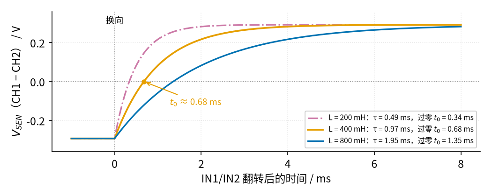

# 39 恒流源与线圈励磁驱动 · 动手实验篇

[上一页：参数与调试篇](page3.md) · [直觉篇](page1.md) · [原理与实现篇](page2.md) · [参数与调试篇](page3.md) · 本页：动手实验篇 · [下一页：40 热式流量与 RTD 恒温差 · 直觉篇](../40-thermal-flow/page1.md) · 前置节点：[06 MOS 管开关 · 动手实验篇](../06-mosfet-switch/page4.md)、[26 H 桥电机驱动 · 动手实验篇](../26-h-bridge/page4.md)

## 这次实验要验证什么

本次分两个小实验，各搭一块面包板：

- **实验 A：恒流沉。** 用 LM358、IRLZ44N 和 10 Ω 采样电阻做一个 100 mA 恒流沉，依次换 22 Ω、47 Ω、68 Ω、100 Ω、120 Ω 五只负载电阻。验证三件事：前四只负载上电流都是约 100.1 mA；多出来的电压落在 MOS 管上（ $V_{DS}$ 随负载变小而变大）；120 Ω 超过负载上限（104.9 Ω），电流掉到约 92.3 mA。
- **实验 B：H 桥换向。** 用 DRV8871 模块给一只 12 V 继电器的线圈加电，用两根跳线切换方向。验证：调换 IN1、IN2 后，线圈电流大小不变、方向反过来。

为什么分开搭？DRV8871 是一整块芯片，它两只下管的公共端在芯片内部直接接到 GND 脚，引不出来，没法像原理与实现篇那张「H 桥 + 恒流沉」电路那样在桥底串一个恒流沉。真正的电磁流量计要用分立 MOS 管搭桥，或者用桥底单独引出的驱动芯片；面包板上我们分两步验证「大小」和「方向」两个功能，两者合在一起的波形已经在原理与实现篇用 SPICE 看过。

## ⚠️ 安全须知

- **只用 12 V 直流电源适配器**（输出 ≥ 0.5 A）。本节所有电压都不超过 12 V，不要接市电，也不要换更高电压的电源。
- **MOS 管必须装散热片。** 负载 22 Ω 时 MOS 管发热约 0.88 W，不装散热片结温约 80 °C（参数与调试篇练习 3）。装上 20 °C/W 左右的小散热片后约 44 °C。**只用测温探头量温度**：万用表的温度挡配热电偶探头、红外测温枪，或者一只 NTC 热敏电阻贴在散热片上，都可以；**不要用手去摸、去碰**。**读数超过 60 °C 就立刻断电**，等它凉下来再检查接线。用 NTC 时，「60 °C」要换算成电阻读数：10 kΩ NTC（25 °C 时 10 kΩ）的阻值按 R = 10 kΩ × e^[B × (1/333.15 K − 1/298.15 K)] 计算，B 值印在 NTC 的规格书或包装上。B = 3950 时 60 °C 约 2.49 kΩ，B = 3435 时约 2.98 kΩ。把 NTC 用导热胶或胶带贴紧散热片：只让 NTC 的**头部**贴在散热片上，两只引脚套上热缩管或用胶带包好，不能碰到散热片；万用表表笔只夹 NTC 的两只脚，不接电路里的任何一点。万用表打到电阻挡一直接着，**读数降到你那只 NTC 的 60 °C 阻值（上面两种约 2.5～3 kΩ）以下就断电**。温度越高阻值越小，所以是「低于」这个值才危险。用红外测温枪时要注意：光亮的铝散热片反射多、发射率低，枪上读数会比真实温度**偏低**。先在测量点贴一小块黑色电工胶带，等一两分钟再对着胶带测；或者干脆改用热电偶探头、NTC。
- **IRLZ44N 的金属背板（散热片装在上面）在电气上就是漏极 D**，带着几伏到 12 V 的电压。散热片不能碰到任何导线、元件脚或别的金属（唯一贴在上面的是 NTC 的头部，它的两只引脚要按上一条套好热缩管、不碰散热片）；要把散热片固定到金属外壳上时，必须垫绝缘垫片、套绝缘粒。
- **负载电阻用 2 W 的金属膜或水泥电阻**。100 Ω、120 Ω 时电阻上约 1 W，会明显发热，测完就断电，不要用手捏。1/4 W 的小电阻在这里会冒烟，千万别用。
- **改线、换电阻前先拔掉 12 V 适配器。** 带电插拔可能让 MOS 管瞬间全开。
- **实验 B 里 OUT1、OUT2 不能互相短接，也不能接到 GND 或 +12 V。** 模块板上的 30 kΩ 限流电阻把电流限制在约 2 A，但短路时芯片会发烫并反复保护关断，没有必要去试。注意这个限流只是保护：它是「超了就让两只下管同时导通（刹车）一小会儿」的斩波，门槛约 2 A，比线圈电流大二十倍，**不能**拿来代替实验 A 的 100 mA 恒流沉。
- 继电器线圈是电感，断电瞬间会产生反向电压；DRV8871 内部的管子自带续流二极管，所以本实验不用另加二极管。若你改用自己搭的晶体管驱动，必须加续流二极管（见 [26 H 桥电机驱动](../26-h-bridge/page3.md)）。

## 器材清单

| 元件 | 型号或数值 | 数量 | 说明 |
|---|---|---|---|
| 运放 | LM358（或 LM358B） | 1 | 单电源，输入范围含 0 V |
| MOS 管 | IRLZ44N | 1 | 逻辑电平 N 沟道，TO-220 封装 |
| 散热片 | TO-220 小散热片，约 20 °C/W | 1 | 必装，可涂一点导热硅脂 |
| 电阻 $R_1$ | 10 kΩ，1% | 1 | 基准分压上臂 |
| 电阻 $R_2$ | 910 Ω，1% | 1 | 基准分压下臂， $V_{REF}$ 约 1.0009 V |
| 采样电阻 $R_S$ | 10 Ω，1%，≥ 0.5 W | 1 | 实际发热 0.1 W |
| 栅极电阻 $R_G$ | 100 Ω | 1 | 补偿网络 |
| 反馈电阻 $R_F$ | 1 kΩ | 1 | 补偿网络 |
| 补偿电容 $C_F$ | 10 nF 瓷片（标 103） | 1 | 补偿网络 |
| 负载 $R_L$ | 22 Ω、47 Ω、68 Ω、100 Ω、120 Ω，2 W | 各 1 | 实验 A 换着插 |
| H 桥模块 | DRV8871 模块（Adafruit 3190 或同类） | 1 | 实验 B |
| 继电器 | SRD-12VDC-SL-C（单只继电器，**不要买带三极管的继电器模块**） | 1 | 只用两个线圈脚，线圈约 400 Ω；继电器脚粗、间距不标准，用杜邦母头线接出来 |
| 测温工具 | 万用表温度挡 + 热电偶探头，或红外测温枪（配一小块黑色电工胶带），或 10 kΩ NTC（记下 B 值，两只引脚配热缩管或胶带） | 1 | 量散热片温度，代替用手摸 |
| 采样电阻 $R_{SEN}$ | 10 Ω，1% | 1 | 实验 B，见下面说明 |
| Arduino UNO | — | 1 | 实验 B 只当 5 V 电源（可选：用程序自动换向，接线见图 39-p4-5） |
| 电解电容 | 100 µF / 25 V | 1 | 实验 B，并在模块 VM 与 GND 之间，长脚（+）接 VM |
| 12 V 直流电源适配器 | ≥ 0.5 A，稳压输出 | 1 | 两个实验共用 |
| 面包板、跳线、万用表 | — | — | 万用表要有 200 mV／2 V／20 V 直流电压挡 |

实验 B 的采样电阻为什么是 10 Ω？继电器线圈只有约 30 mA，1 Ω 采样电阻上只有 30 mV，万用表最后一位就会跳得厉害；用 10 Ω 得到约 0.29 V，读起来稳得多，而它只占线圈 400 Ω 的 2.5%，对电流影响很小。

## 搭建步骤

### 实验 A：恒流沉

1. 断电状态下，把 LM358 跨在面包板中间的凹槽上，缺口（1 脚标记）朝左，占第 8～11 列；IRLZ44N 立着插在第 20、21、22 列（从左到右 G、D、S），装好散热片。
2. 插基准分压： $R_1$ 在 g3–g5，**红线 j3 → 下方 +12 V 轨**（给 $R_1$ 上端供电，漏了这根 $V_{REF}$ 就是 0）， $R_2$ 从 j5 到下方 GND 轨；绿线 h5 → h10 把 $V_{REF}$ 送到运放 3 脚。
3. 插补偿网络： $C_F$ 在 g8–g9（运放 1、2 脚之间）， $R_F$ 在 i9–i14， $R_G$ 在 j8–j13。
4. 蓝线 h13 → h20 送栅极；橙线 g14 → g22 把源极电压送回 $R_F$ 。
5. $R_S$ 从 j22 到 GND 轨；橙线 i21 → i24 把漏极接到负载 $R_L$ （g24–g28），负载另一端 j28 接 +12 V 轨。
6. 电源：运放 8 脚 a8 接 +12 V 轨，4 脚 j11 接 GND 轨（这根黑线在图上从 $R_G$ 下面穿过，实际插的时候让它贴着面包板走）；另一半运放的 7、6 脚用 c9–c10 短线连起来，5 脚 a11 接地。
7. 把上下两条电源轨在第 29、30 列连起来，最后接 12 V 适配器。先用万用表确认 +12 V 轨和 GND 轨之间不是短路（电阻挡读数应大于几百欧），再上电。


*图 39-p4-1　实验 A 面包板接线：黄圈是测量点*


*图 39-p4-2　实验 A 对照原理图：灰字是面包板位置，黄圈编号与图 39-p4-1 相同*

**对照看**：图 39-p4-1 和图 39-p4-2 的黄圈编号一一对应。原理图左上角 $R_1$ 接 +12 V 的那根线，就是面包板第 3 列 j3 到 +12 V 轨的红线。① 是第 5 列，即 $R_1$ 、 $R_2$ 的连接点 $V_{REF}$ ；绿线把它送到第 10 列（运放 3 脚，同相端）。④ 是第 8 列，运放 1 脚输出，它一边经 $C_F$ 接第 9 列（2 脚，反相端），一边经 $R_G$ 走到第 13 列，再由蓝线送到第 20 列（栅极）。② 是第 22 列，MOS 管源极，也就是 $R_S$ 的上端 $V_S$ ；橙线 g14 → g22 把它经 $R_F$ 送回第 9 列。③ 测的是第 21 列（漏极）和第 22 列（源极）之间的 $V_{DS}$ 。负载 $R_L$ 在原理图里画在 +12 V 和漏极之间，面包板上就是 g24–g28 加上 i21 → i24 那根橙线。原理图右下的虚线框是 LM358 里没用的另一半运放（B 运放），对应面包板上半区 c9–c10 短线和 a11 接地。

**可选步骤 A7：亲手验证「采样电阻挪到高边」的预测。** 参数与调试篇的预测题让你猜过这种接法，这里真搭一次。断电后按下面的图 39-p4-6 改三处：

1. 拔掉 $R_S$ （j22–GND 轨），改用一根黑线把第 22 列（源极）直接接 GND 轨；
2. 拔掉第 28 列接 +12 V 轨的红线，把 $R_S$ 插在 +12 V 轨和 j28 之间（ $R_S$ 下端就是 X 点）；
3. 把反馈橙线的一头从 g22 挪到 h28， $R_F$ 、 $C_F$ 、 $R_G$ 都不动，负载用 47 Ω。


*图 39-p4-6　可选步骤 A7 的接法：灰字是面包板上要改的三处*

**对照看**：图 39-p4-6 里朱红色的 $R_S$ 就是面包板上插在 +12 V 轨和 j28 之间的那只电阻；X 点（黄圈 A7-1）就是第 28 列；黄圈 A7-2 仍是第 8 列（运放 1 脚）；源极接地的那根线就是第 22 列到 GND 轨的黑线。上电后按测量表 A7 那一行读：X 点约 12.0 V，1 脚约 0.024 V， $R_S$ 两端几乎是 0 mV，电流几乎为 0，和参数与调试篇预测题的答案一致。**千万不要再把运放的 2、3 脚对调去「救」它**：那样运放输出顶满、MOS 管全开，47 Ω 电阻上约 2.1 W，超过额定功率。验证完断电，把三处改回原样。

### 实验 B：H 桥换向

1. 断电状态下，把 Arduino 的 5V、GND 接到面包板下方的 +5 V 轨和 GND 轨（只当电源用，不用写程序）。
2. 第 4 列一根橙色短线接 +5 V 轨，第 8 列一根黑色短线接 GND 轨；蓝线从第 4 列接模块 IN1，从第 8 列接模块 IN2。这样 IN1 = 1、IN2 = 0，正向。
3. 模块 GND 接面包板 GND 轨；模块 OUT1 接 j14，OUT2 接 j22。
4. 继电器只用两个线圈脚。先用万用表电阻挡在继电器的 5 个脚里两两试，读数约 400 Ω 的那一对就是线圈脚（其余几对读 0 或开路，是触点）。用两根杜邦母头线套在这两个脚上，另一头分别插 g14 和 g18（线圈没有正负之分）。 $R_{SEN}$ 10 Ω 插 h18–h22。
5. 在模块 VM 和 GND 之间并一只 100 µF / 25 V 电解电容，长脚（+）接 VM。换向时线圈里储存的能量会经管子自带的二极管倒灌回 VM，这只电容把它吸收掉，免得 VM 被抬高。
6. 最后把 12 V 适配器接模块的 VM 和 GND。


*图 39-p4-3　实验 B 面包板接线：红边黄圈插红表笔，黑边黄圈插黑表笔*


*图 39-p4-4　实验 B 对照原理图：列号与图 39-p4-3 相同*

**对照看**：图 39-p4-3 里电流的路径是 OUT1 → 第 14 列 → 绿线 → 继电器线圈 → 绿线 → 第 18 列 → $R_{SEN}$ → 第 22 列 → OUT2，和图 39-p4-4 右边那一圈完全一样。图 39-p4-4 左边的「+5 V（1）」就是面包板第 4 列那根接 +5 V 轨的短线，「GND（0）」就是第 8 列接 GND 轨的短线。两张图的 ① 都跨在线圈两端，② 都跨在 $R_{SEN}$ 两端。

## 测量表

实验 A 每换一只负载电阻都要先断电。下表的「应该读到」来自原理与实现篇的计算和 SPICE 仿真（spice/39/run.py）。

| 步骤 | 测什么 | 红表笔 | 黑表笔 | 挡位 | 应该读到 | 读不到时先查 |
|---|---|---|---|---|---|---|
| A1 | 基准 $V_{REF}$ （①） | i5 | GND 轨 | 直流 2 V | 1.001 V | 第 3 列红线（j3 → +12 V 轨）是否插好；读到 0 多半是漏了它；读到约 11 V 是 $R_1$ 、 $R_2$ 插反 |
| A2 | $R_L$ = 47 Ω：采样电压 $V_S$ （②） | h22 | GND 轨 | 直流 2 V | 1.001 V（电流 100.1 mA） | 反馈橙线 g14 → g22 是否插好 |
| A3 | $R_L$ = 47 Ω： $V_{DS}$ （③） | j21 | h22 | 直流 20 V | 6.29 V | MOS 管 G、D、S 顺序 |
| A4 | $R_L$ = 47 Ω：运放 1 脚（④） | h8 | GND 轨 | 直流 20 V | 约 3.1 V（= $V_S$ 1.0 V + 让 MOS 管通 100 mA 所需的 $V_{GS}$ 约 2.1 V） | 8 脚、4 脚的电源线 |
| A5 | 依次换 22 Ω、68 Ω、100 Ω，重复 A2、A3 | 同上 | 同上 | 同上 | $V_S$ 都是 1.001 V； $V_{DS}$ 依次 8.80 V、4.19 V、0.99 V | 负载电阻阻值是否标错 |
| A6 | $R_L$ = 120 Ω： $V_S$ 、 $V_{DS}$ 、1 脚 | 同上 | 同上 | 同上 | $V_S$ 约 0.923 V（92.3 mA）； $V_{DS}$ 几乎为 0；1 脚约 10.8 V（顶到上限） | 这一步读数「不达标」才是对的 |
| A7（可选） | 按图 39-p4-6 把 $R_S$ 挪到高边：X 点（第 28 列）、1 脚、 $R_S$ 两端 | 第 28 列 / h8 / +12 V 轨 | GND 轨 / GND 轨 / 第 28 列 | 直流 20 V / 20 V / 200 mV | 约 12.0 V、约 0.024 V、约 0 mV（电流几乎为 0） | 这一步「什么都不发生」才是对的 |
| B1 | IN1 = 1、IN2 = 0：线圈电压（①） | 第 14 列 | 第 18 列 | 直流 20 V | 约 11.7 V | VM 是否接上 12 V；模块 GND 是否和 Arduino GND 连通 |
| B2 | IN1 = 1、IN2 = 0：采样电压（②） | 第 18 列 | 第 22 列 | 直流 2 V | 约 0.292 V（线圈阻值 ±10% 时 0.266～0.324 V） | 继电器是否插在线圈脚上（应听到「咔哒」吸合） |
| B3 | 断电，对调 IN1、IN2 跳线后再上电，重复 B1、B2 | 同上 | 同上 | 同上 | 约 −11.7 V、约 −0.292 V | 两根跳线是否真的对调了 |

注意：本实验的 $V_{REF}$ 直接从 12 V 分压得到，适配器电压变化 1%，设定电流也跟着变 1%（11 V 时约 91.8 mA，13 V 时约 108.4 mA）。所以要用稳压适配器，并在 A1 先确认 $V_{REF}$ 。产品里会用 TL431 这类电压基准代替分压，电源波动就不影响电流了。

对照 A2、A5：只要负载不超过上限， $V_S$ 不变，电流就不变；负载上少分到的电压全部落到 $V_{DS}$ 上。对照 B2、B3：数值相同、符号相反，H 桥只改方向不改大小。

## 没有示波器怎么办

本节的稳态读数全部用万用表直流挡就能完成。换向的瞬间过程（几毫秒）万用表看不到，可以这样做：

- **放慢换向**：用下面的 Arduino 程序（可选）每 1 秒换一次方向，看万用表在 ② 上的读数在 +0.29 V 和 −0.29 V 之间来回跳，同时听继电器每次换向都「咔哒」一声（线圈电流经过零点时继电器释放，再吸合）。
- **6.25 Hz 的真实换向频率**：把程序里的 `HALF_MS` 改成 80（别用 `tone()` 函数，它最低只能到 31 Hz）。万用表此时显示的是正负抵消后的平均值，应接近 0 V；这正说明正、负两个半周期的电流大小相等。

用程序换向时，面包板只改两根线，见下面的图 39-p4-5。


*图 39-p4-5　用 Arduino 自动换向：只改第 4、8 列两根线*

**对照看**：图 39-p4-5 左边的 D2、D3 两根线，在面包板上就是把图 39-p4-3 里第 4 列的橙色短线、第 8 列的黑色短线拔掉，换成从 Arduino D2、D3 引来的跳线；第 4、8 列到模块 IN1、IN2 的两根蓝线不动。GND 那根线就是 Arduino GND 到面包板 GND 轨的线，原来就有。

```cpp
// 未经运行验证
// 可选：用 Arduino 自动换向。把面包板第 4、8 列的两根短线拔掉，
// 改为第 4 列接 Arduino D2，第 8 列接 Arduino D3（GND 仍连在一起）。
const int IN1 = 2;            // 接模块 IN1
const int IN2 = 3;            // 接模块 IN2
const unsigned long HALF_MS = 1000;  // 半周期：1000 ms 给万用表看；改 80 就是 6.25 Hz

void setup() {
  pinMode(IN1, OUTPUT);       // 两个引脚设为输出
  pinMode(IN2, OUTPUT);
}

void loop() {
  digitalWrite(IN1, HIGH);    // 正向：IN1=1、IN2=0
  digitalWrite(IN2, LOW);
  delay(HALF_MS);
  digitalWrite(IN1, LOW);     // 反向：IN1=0、IN2=1
  digitalWrite(IN2, HIGH);
  delay(HALF_MS);
}
```

注意：DRV8871 的真值表是 00 滑行、01 反向、10 正向、11 刹车。四种组合都不会把电源短路，所以程序写错了也不会烧桥，这是集成 H 桥比分立搭桥安全的地方。程序换向时两条 `digitalWrite` 之间会有几微秒的 00（滑行），远短于手册里「00 持续超过约 1 ms 才进入睡眠」的门槛，不影响换向。

## 有示波器时：看换向过程（可选）

示波器能看到万用表看不到的那几毫秒。接法：**CH1 探头接第 18 列，CH2 探头接第 22 列，两只探头的地夹都夹在面包板 GND 轨上**，再打开示波器的 Math 功能显示 CH1 − CH2，就是 $R_{SEN}$ 两端的电压，除以 10 Ω 就是线圈电流。**地夹绝对不能夹在第 14、18、22 列或模块 OUT1、OUT2 上**：台式示波器的地夹连着大地，夹在 H 桥输出上就等于把输出对地短路。触发源选 CH1，或者用第三个通道接 Arduino D2，设成上升沿触发；程序里 `HALF_MS` 用 1000 或 80 都可以。



*图 39-p4-7　示波器上应看到的换向波形：电感不同，过零时间 t0 不同*

图 39-p4-7 是按「电压驱动 + 一阶指数」算出来的理想波形。回路总电阻 $R = R_{coil} + R_{SEN} + R_{on} = 400 + 10 + 0.565 = 410.6\ \Omega$ 。继电器手册不给线圈电感，网上查到的 SRD 系列约 0.4 H 只是参考值 [待核实]，所以图 39-p4-7 画了三种电感。读出过零时间 $t_0$ 后，就能反算你这只继电器的电感：

$$L \approx \frac{t_0 \cdot (R_{coil} + R_{SEN} + R_{on})}{\ln 2}$$

例如读到 $t_0 = 0.68\ \text{ms}$ ，就是 $L \approx 0.68 \times 410.6 / 0.693 \approx 0.40\ \text{H}$ 。要注意：电流过零时继电器会先释放、再反向吸合，衔铁一动，线圈电感也跟着变，所以实测曲线不会像图 39-p4-7 那样光滑，算出的 $L$ 只是一个粗略值。

## 用 Python 核对你的读数

把你的读数填进 `mine`，再把你**实测**的电源电压和电阻值填进第一行（用万用表量，比标称值准），运行后会和预期值比较，偏差超过 10% 的会被标出来。程序不读写任何文件，在哪个目录运行都行。

```python
VCC, R1, R2, RS = 12.0, 10e3, 910.0, 10.0           # ← 换成你实测的电源电压和三只电阻
R_RELAY, R_SEN, R_ON = 400.0, 10.0, 0.565           # ← 继电器线圈、R_SEN 实测值；R_ON 为模块两管导通电阻
V_REF = VCC * R2 / (R1 + R2)                        # 基准电压（随实测 VCC 变）
I_SET = V_REF / RS                                  # 设定电流
def expect_A(rl):                                   # 实验 A：给定负载时的预期 V_S 和 V_DS
    i = min(I_SET, VCC / (rl + RS))                 # 掉出恒流区后电流由电源和电阻决定
    vds = max(VCC - i * (rl + RS), 0.0)             # 管子上剩下的电压
    return i * RS, vds                              # 返回 (V_S, V_DS)
I_B = VCC / (R_RELAY + R_SEN + R_ON)                # 实验 B：电压驱动下的线圈电流
exp = {"V_REF": V_REF, "B_V_SEN": I_B * R_SEN}      # 预期值字典
for rl in (22, 47, 68, 100, 120):                   # 五只负载
    vs, vds = expect_A(rl)                          # 算预期
    exp[f"V_S@{rl}"], exp[f"V_DS@{rl}"] = vs, vds   # 存进字典
mine = {"V_REF": 1.003, "V_S@47": 0.998, "V_DS@47": 6.31,   # ← 换成你的读数
        "V_S@120": 0.925, "B_V_SEN": 0.301}         # ← 没测的项可以删掉
def check(name, got):                               # 比较一项
    want = exp[name]                                # 取预期值
    if abs(want) < 0.05:                            # 预期接近 0 的项（如 120 Ω 时的 V_DS）
        flag = "OK" if abs(got) < 0.1 else "偏差大"  # 只看是否接近 0
    else:
        flag = "OK" if abs(got - want) / abs(want) <= 0.10 else "偏差超过 10%"  # 相对偏差
    print(f"{name:8s} 计算 {want:7.3f} V，你读到 {got:7.3f} V → {flag}")  # 打印结果
for k, v in mine.items():                           # 逐项检查
    check(k, v)                                     # 调用比较函数
```

示例读数运行后应全部显示 OK。若 $V_S$ 偏差超过 10%，先回测量表 A2 的「读不到时先查」。

## 实验记录表

| 负载 $R_L$ | $V_S$ / V | 电流 = $V_S$ ÷ 10 Ω / mA | 计算电流 / mA | 偏差 / % | $V_{DS}$ / V | MOS 管功率 $V_{DS} \times I$ / W | 散热片温度 / °C（测温探头） |
|---|---|---|---|---|---|---|---|
| 22 Ω | | | | | | | |
| 47 Ω | | | | | | | |
| 68 Ω | | | | | | | |
| 100 Ω | | | | | | | |
| 120 Ω | | | | | | | |

| 实验 B 状态 | 线圈电压 ① / V | 采样电压 ② / V | 电流 = ② ÷ 10 Ω / mA | 计算电流 / mA | 偏差 / % | 继电器是否吸合 |
|---|---|---|---|---|---|---|
| IN1 = 1、IN2 = 0 | | | | | | |
| IN1 = 0、IN2 = 1 | | | | | | |

| 可选记录 | 读数 | 计算 / 预期 | 偏差 / % |
|---|---|---|---|
| A7：X 点电压 / V | | 约 12.0 | |
| A7：运放 1 脚 / V | | 约 0.024 | |
| 示波器：过零时间 $t_0$ / ms | | 由 $t_0$ 反算 $L$ = ____ H | — |

预期参考（SPICE）：22 Ω、47 Ω、68 Ω、100 Ω 时 $V_{DS}$ 依次为 8.80 V、6.29 V、4.19 V、0.99 V，MOS 管功率依次约 0.88 W、0.63 W、0.42 W、0.10 W；120 Ω 时电流 92.3 mA、 $V_{DS}$ 约 0.002 V。

## 思考题

**1.** 实验 A 中负载从 22 Ω 换到 100 Ω，电流几乎不变，但散热片的温度明显下降。为什么？

<details><summary>答案</summary>

电流不变，但 MOS 管两端电压从 8.80 V 降到 0.99 V，它的发热 $V_{DS} \times I$ 从约 0.88 W 降到约 0.10 W。多出来的电压原来都在 MOS 管上变成热，换成大电阻后电压移到了负载上。这和 [21 线性稳压](../21-linear-regulator/page1.md) 里调整管的发热道理一样。

</details>

**2.** 有同学把实验 A 的 $R_2$ 错插成 9.1 kΩ。 $V_{REF}$ 变成多少？电流会怎样？

<details><summary>答案</summary>

$V_{REF} = 12 \times 9.1 / 19.1 \approx 5.72\ \text{V}$ ，设定电流变成 572 mA。但 12 V 电源配 47 Ω + 10 Ω 最多只能给 $12 / 57 \approx 0.21\ \text{A}$ ，所以电路掉出恒流区：运放输出顶满，MOS 管全开，电流约 210 mA，47 Ω 电阻上约 2.1 W，超过了 2 W 额定，很快会过热。所以上电后第一件事是测 ① 的 $V_{REF}$ ，确认约 1 V 再接着测。

</details>

**3.** 实验 B 用的是电压驱动。若继电器线圈从室温热到 60 °C（铜线电阻增加约 15.7%），采样电压会变成多少？如果改用恒流驱动呢？

<details><summary>答案</summary>

线圈电阻约 $400 \times 1.157 = 462.8\ \Omega$ ，电流约 $11.98 / 472.8 \approx 25.3\ \text{mA}$ ，采样电压约 0.253 V，比室温的 0.292 V 少了约 13%。改用恒流驱动（只要负载没超上限），电流和采样电压都不变。这正是电磁流量计要用恒流励磁的原因。

</details>

## 自测清单

- [ ] 我能说出恒流沉里运放、MOS 管、采样电阻各自的作用，并算出 $I = V_{REF} / R_S$ 。
- [ ] 我能根据电源电压和设定电流算出负载上限，并解释超过上限后电流为什么会下降。
- [ ] 我能算出 MOS 管的发热，并判断要不要装散热片。
- [ ] 我能用万用表测出 $V_S$ 、 $V_{DS}$ ，并用它们求出电流和 MOS 管功率。
- [ ] 我能说清 H 桥管方向、恒流沉管大小，以及线圈电流换向为什么要几毫秒。
