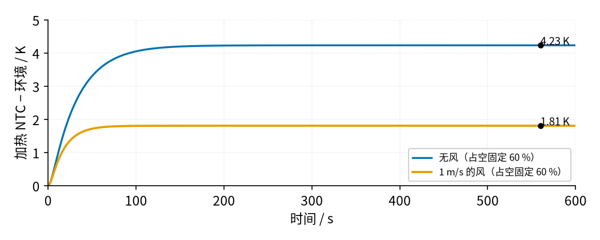
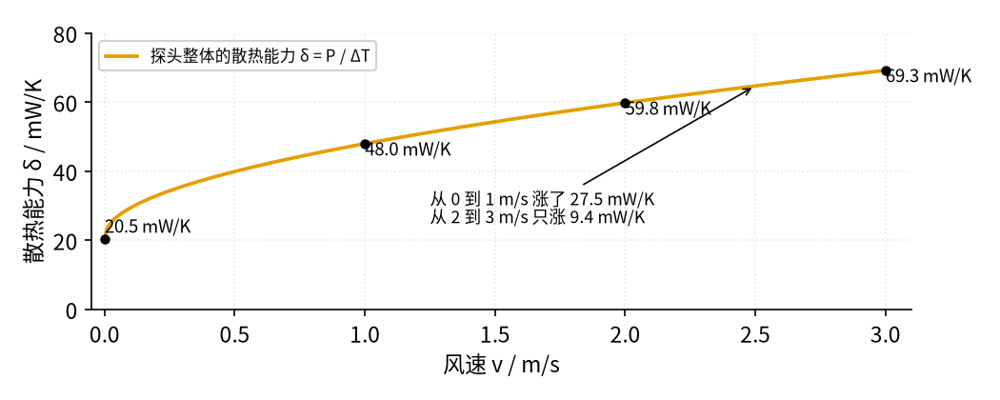
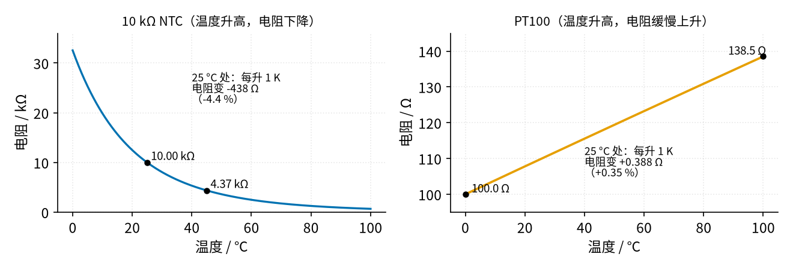
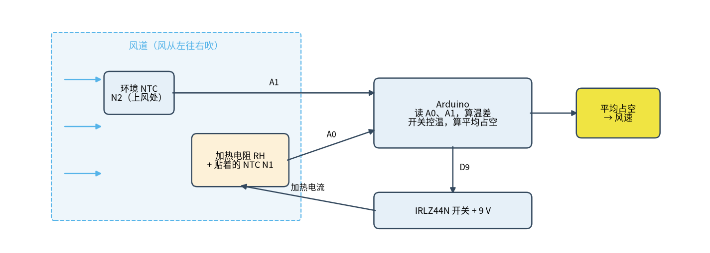

# 40 热式流量与 RTD 恒温差 · 直觉篇

上一页：39 节恒流源与线圈励磁驱动（即将上线） · 本页：直觉篇 · [原理与实现篇](page2.md) · [参数与调试篇](page3.md) · [动手实验篇](page4.md) · [下一页：原理与实现篇](page2.md) · 前置节点：[01 元件速成 · 直觉篇](../01-components-basics/page1.md)、[06 MOS 管开关 · 直觉篇](../06-mosfet-switch/page1.md)、[10 电压比较器 · 直觉篇](../10-voltage-comparator/page1.md)、[30 仪表放大器与电桥 · 直觉篇](../30-instrumentation-amp/page1.md)、39 节恒流源与线圈励磁驱动（即将上线）

## 先回顾三问

本节要用到前面三节的三个结论。先自己回答，再展开答案对一下。

**1.** [01 元件速成](../01-components-basics/page1.md)里 RC 充电，过 1 个时间常数 τ，电容电压到了终值的多少？

答案

约 63 %。本节加热电阻和 NTC 的温升曲线也是同一个形状：热容就像电容，热阻就像电阻。

**2.** [10 电压比较器](../10-voltage-comparator/page1.md)里的回差（迟滞）有什么用？

答案

防止输入在门限附近来回抖时，输出跟着来回翻转。本节开关控温的 1.8 K / 2.2 K 两个门限就是回差。

**3.** [30 仪表放大器与电桥](../30-instrumentation-amp/page1.md)里，电桥输出为什么要接仪表放大器，而不是直接接 ADC？

答案

电桥的差压只有几毫伏，而且两端都不接地，要用仪表放大器把两点之差放大、同时抑制两端共有的电压。本节工业上的 PT100 电桥也是这样接。

## 先做一个小动作：对着热的东西吹气

喝热茶时，人会对着杯子吹一口气。吹得越用力，茶凉得越快。原因很简单：流过的空气会把热量带走，流得越快，带走得越多。

热式流量计就是把这件事反过来用：**故意把一个小元件加热，再看气流从它身上带走了多少热**，就能反推出气流有多快。

在本节[动手实验篇](page4.md)的实验里，你会先做一件更直接的事：把一颗 10 kΩ 的 NTC 热敏电阻接到 Arduino 上，用一个小电阻把它稍微烘热，然后拿一张硬纸片对着它扇风。串口上的温差读数马上往下掉，停下来后又慢慢回升。（不用嘴吹：呼出的气有 30 多摄氏度，本身就会把 NTC 吹热。）这一个现象，就是整节课的出发点。

## 有风和没风，差别有多大

下图是本节 Python 热模型的结果（示意参数，见[动手实验篇](page4.md)用的元件）：加热电阻一直以 60 % 的占空比通电，贴在它上面的 NTC 比环境热多少。请看图 40-p1-1。

*图 40-p1-1　无风与 1 m/s 风下加热 NTC 的温升（示意参数）*

- 没风时，温差最后稳定在 4.23 K，升到最终值的 63 % 要 34 s。
- 有 1 m/s 的风时，温差只剩 1.81 K，到 63 % 只要 19 s。

两个结论：**风越大，温差越小**；**风越大，升温也越快到头**。第二点可以用 [01 元件速成](../01-components-basics/page1.md) 里的 RC 电路来理解。

| 电路 | 热 |
|---|---|
| 电流 I | 热功率 P（每秒送进去多少热） |
| 电压 U | 温差 Δϑ（比环境高多少） |
| 电容 C | 热容 $C_{th}$ （升高 1 K 要多少焦耳） |
| 电导 1/R | 散热能力 δ（每高 1 K 每秒散掉多少热） |
| 时间常数 τ = RC | 热时间常数 $\tau_{th} = C_{th} / \delta$ |

风一吹，散热能力 δ 变大，就像把 RC 里的电阻换小了：同样的电容，充电更快到头，最终电压也更低。

> **最小补充：散热能力 δ（耗散系数）**
> 一个东西比周围热 1 K 时，每秒向周围散掉多少热，就叫它的散热能力，单位 mW/K。热敏电阻数据手册里叫“耗散系数”。稳态时送进去的功率全部散掉，所以 $\Delta\vartheta = P / \delta$ 。
> 例：[动手实验篇](page4.md)的 NTC 在 25 °C 时通 0.25 mA，自己发热 0.625 mW；Vishay NTCLE100E3 手册给的耗散系数约 7 mW/K，于是它自己把自己烘热 0.625 ÷ 7 ≈ 0.089 K。这叫**自热**，是测温时的误差来源之一。

本节用希腊字母 ϑ 表示摄氏温度，Δϑ 表示温差；T 在前面几节已经用来表示周期，这里不再用 T 表示温度。

## 风速和散热能力：先快后慢

把上面的模型在不同风速下跑稳态，求出“探头整体的散热能力” $\delta = P / \Delta\vartheta$ （图 40-p1-2）：

*图 40-p1-2　King 定律：散热能力 δ 随风速先快后慢地增大*

| 风速 v（m/s） | 0 | 1 | 2 | 3 |
|---|---|---|---|---|
| δ（mW/K） | 20.5 | 48.0 | 59.8 | 69.3 |

这条曲线前陡后缓。早在 1914 年，King 就总结出热线（几微米粗的金属细丝，通电后同时当加热器和温度计；把金属做成镀在陶瓷片上的一层薄膜，就叫热膜）在气流里的散热规律，常写成

$$P = (a + b \cdot v^{n}) \cdot \Delta\vartheta$$

- a：没风时也有的散热（空气自己的对流、导线导热）；
- b·vⁿ：风带走的那部分；
- n 通常取 0.45 或 0.5（土耳其中东技术大学 METU 的热线风速仪讲义），a、b、n 都要靠实测**标定**，不能从手册直接抄。

这里故意用小写 a、b，因为[原理与实现篇](page2.md) PT100 的公式里大写 A、B 另有含义。

n 小于 1，意味着风速越高，再加 1 m/s 带来的变化越小：0→1 m/s 时 δ 涨了 27.5 mW/K，2→3 m/s 时只涨约 9.4 mW/K（表里的数取整后相减是 9.5）。所以**加热功率不是风速的直线函数**，高速段灵敏度下降，读数一定要按标定曲线换算（[参数与调试篇](page3.md)「二、标定」会做）。

## 用什么当“温度计”：RTD 和 NTC

测温的元件有两大类，下图是它们的电阻随温度的变化（图 40-p1-3）：

*图 40-p1-3　RTD（PT100）与 NTC 的阻值随温度变化对比*

- **RTD（铂电阻）**，比如 PT100：0 °C 时 100 Ω，100 °C 时 138.5 Ω，几乎是一条直线，很准、很稳，工业热式流量计用它。但每度只变 0.354 %，信号很小，要用 [30 仪表放大器与电桥](../30-instrumentation-amp/page1.md) 才读得出来。
- **NTC 热敏电阻**：温度升高，电阻反而下降，每度变 −4.38 %，比 PT100 灵敏 12 倍，便宜，一个分压电阻就能接 Arduino。缺点是曲线弯、精度和长期稳定性不如铂电阻。

> **最小补充：NTC 是什么**
> NTC 是“负温度系数”（Negative Temperature Coefficient）的缩写：**温度升高，电阻下降**。它的电阻和温度之间是一条指数曲线，本书不要求会推指数公式：[原理与实现篇](page2.md)给你一张“ADC 读数 ↔ 温度”的对照表，Arduino 查表、两点之间按直线插值就行。

工业产品用 RTD，[动手实验篇](page4.md)的实验用 NTC。**两者原理完全一样**：一个元件加热，一个元件测环境，看加热元件比环境热多少，只是把传感器换成更灵敏、更便宜的 NTC。

## 测风速，就能算流量

在一根截面积为 A 的风道里，每秒流过的气体体积（体积流量）是

$$Q_V = v \cdot A$$

例：20 mm × 20 mm 的风道，A = 4 cm²。

| 风速 v | 0.5 m/s | 1.0 m/s | 2.0 m/s |
|---|---|---|---|
| Q_V | 200 cm³/s = 12.0 L/min | 400 cm³/s = 24.0 L/min | 800 cm³/s = 48.0 L/min |

这里用 $Q_V$ 表示体积流量，是为了和前面用过的 Q（品质因数）、q（电荷）分开。被带走的热量取决于每秒流过多少**质量**的气体和它的比热，所以热式流量计天生更接近测“质量流量”，不需要另外测压力和温度来换算密度，这是它在燃气表、发动机进气测量中受欢迎的原因。严格说，探头感受到的是“每秒吹过来多少千克空气”，标定时按室温、一个大气压换成 m/s；气温或气压变化很大时，读到的风速要按密度修正。

## 两种测法：恒功率和恒温差

请看图 40-p1-4。

*图 40-p1-4　热式风速计的方框图*

1. **恒功率（CP，constant power）**：加热功率固定，看温差。风大温差小，风小温差大。电路最简单，缺点是每次风速变化，探头都得重新“充放热”，慢（详见[原理与实现篇](page2.md)）。
2. **恒温差（CTA）**：用控制回路调节加热功率，让温差永远保持一个设定值（比如 2 K）。风大就多加热，风小就少加热，**加热功率本身就是流量信号**。CTA 原本是热线风速仪“constant temperature anemometer”的缩写，在热式流量计里也叫恒温差法（详见[参数与调试篇](page3.md)）。

恒温差更快：温度被钉住，热容不需要来回充放热。但前提是测温元件本身够快。[动手实验篇](page4.md)的 NTC 热时间常数约 15 s，所以在面包板上，恒温差法的速度会被 NTC 拖住，优势没有工业热膜那么明显。

## 小结

- 热式流量计：加热一个元件，看气流带走多少热；风越大，温差越小、热时间常数越短。
- 散热能力 δ = P / Δϑ，单位 mW/K；热时间常数 $\tau_{th} = C_{th}/\delta$ ，和 RC 一样。
- King 定律 $P = (a + b\cdot v^n)\Delta\vartheta$ ，n ≈ 0.45～0.5：高速段灵敏度下降，必须标定。
- PT100 准而信号小，NTC 灵敏而曲线弯；本节实验用 NTC，原理和 RTD 相同。
- 恒功率测温差，简单但慢；恒温差测功率，快，但受测温元件速度限制。

## 参考资料

- METU AE547 热线风速仪讲义（King 定律 I²R = (T_w − T_a)(A + B·Uⁿ)，n = 0.45 或 0.5，须逐支标定）：https://ocw.metu.edu.tr/pluginfile.php/1871/mod_resource/content/0/AE547/AE547_9_Hotwire-son.pdf
- Vishay NTCLE100E3 数据手册（10 kΩ、B25/85 = 3977 K、耗散系数、热时间常数）：https://www.vishay.com/docs/29049/ntcle100.pdf
- TI 应用笔记 SBAA275A（RTD 测温电路、PT100 的 Callendar–Van Dusen 公式）：https://www.ti.com/lit/an/sbaa275a/sbaa275a.pdf
