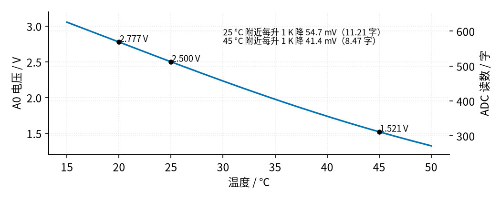
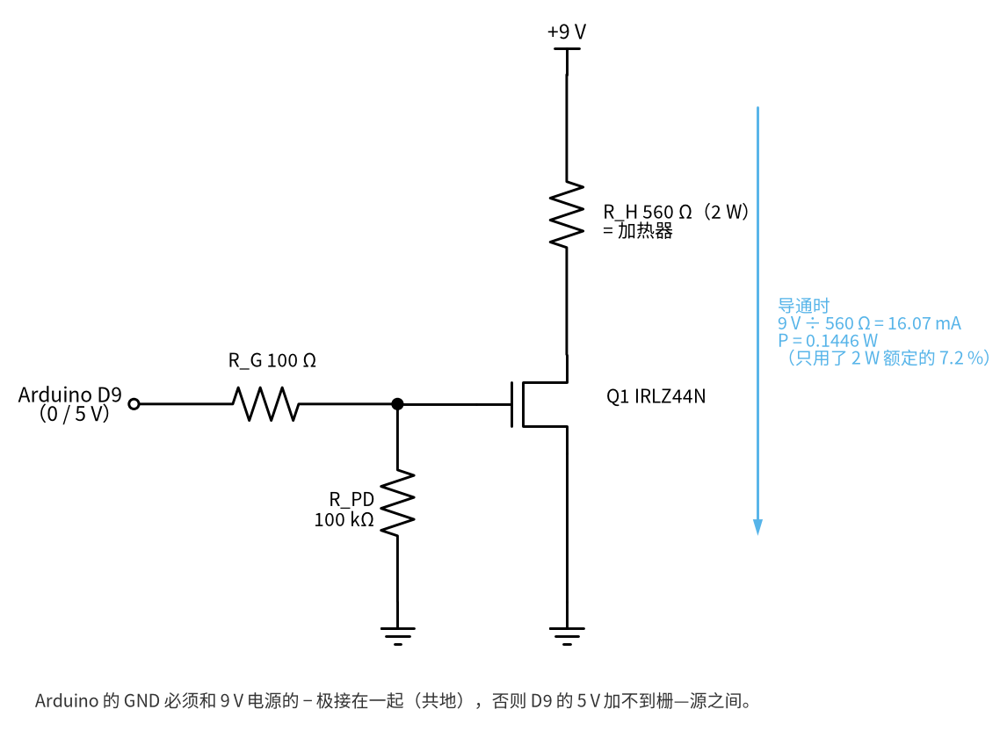
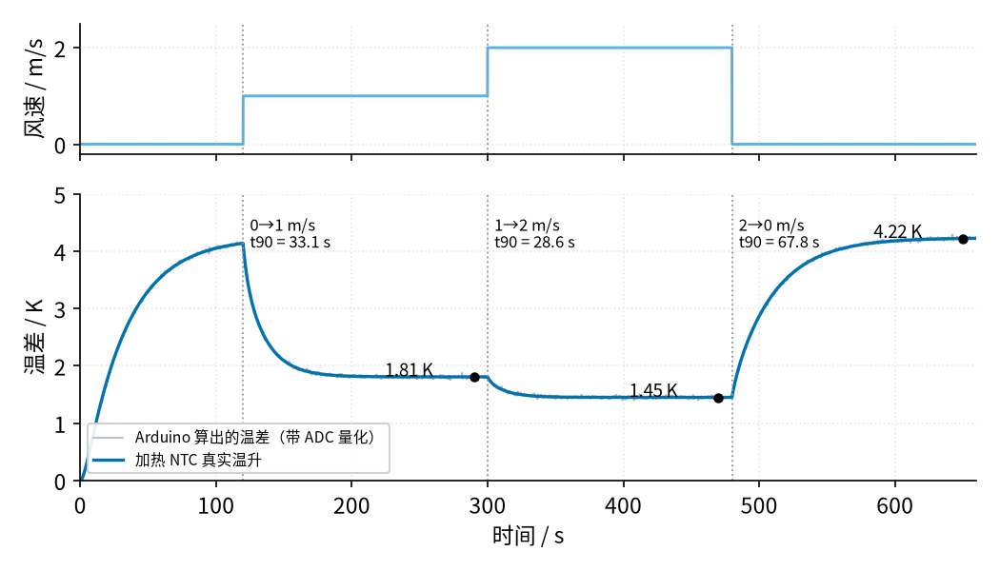

# 40 热式流量与 RTD 恒温差 · 原理与实现篇

[上一页：直觉篇](page1.md) · [直觉篇](page1.md) · 本页：原理与实现篇 · [参数与调试篇](page3.md) · [动手实验篇](page4.md) · [下一页：参数与调试篇](page3.md) · 前置节点：[06 MOS 管开关 · 原理与实现篇](../06-mosfet-switch/page2.md)、[30 仪表放大器与电桥 · 原理与实现篇](../30-instrumentation-amp/page2.md)、[39 恒流源与线圈励磁驱动 · 原理与实现篇](../39-constant-current-excitation/page2.md)

这一页把直觉篇的方框图拆成四块电路：**测温（NTC 分压）**、**加热（MOS 管开关）**、**恒功率测量**、**工业上的 PT100 电桥**。恒温差控制放到[参数与调试篇](page3.md)。

## 一、NTC 分压：把温度变成 ADC 读数

请看图 40-p2-1。


*图 40-p2-1　NTC 分压电路*

NTC 和一只 10 kΩ 固定电阻 $R_S$ 串在 5 V 上，中点电压

$$V = 5\ \text{V} \times \frac{R_{NTC}}{R_S + R_{NTC}}$$

温度升高 → NTC 电阻下降 → 中点电压下降。Arduino Uno 的 ADC 以 5 V 为满量程、分 1024 份，读数 = 1024 × V / 5 V。请看图 40-p2-2。



*图 40-p2-2　NTC 分压点电压与 ADC 读数随温度的变化*

| 温度 | 20 °C | 25 °C | 30 °C | 35 °C | 40 °C | 45 °C |
|---|---|---|---|---|---|---|
| R_NTC | 12488 Ω | 10000 Ω | 8059 Ω | 6535 Ω | 5330 Ω | 4372 Ω |
| A0 电压 | 2.777 V | 2.500 V | 2.231 V | 1.976 V | 1.738 V | 1.521 V |
| ADC 读数 | 568.6 | 512.0 | 457.0 | 404.7 | 356.0 | 311.5 |

- 25 °C 附近每升 1 K，电压降 54.73 mV，相当于 11.21 个 ADC 字（“字”是 ADC 读数最小的一格：Arduino 的 10 位 ADC 把 0～5 V 分成 1024 格，一格约 4.88 mV），**1 个字 ≈ 0.089 K**；
- 45 °C 附近每升 1 K 降 41.36 mV（8.47 字），曲线变缓。

选 $R_S$ = 10 kΩ 等于 NTC 在 25 °C 的阻值，是为了让室温附近的斜率最大、中点正好在 2.5 V。

**查表法**：NTC 的电阻和温度是指数关系 $R = R_{25}\cdot e^{B(1/T_K - 1/298.15)}$ （ $T_K$ 是开尔文温度；B 值是 NTC 材料的常数，描述电阻随温度变化有多快，B 越大越灵敏，Vishay 10 kΩ 型 B = 3977 K）。不必在 Arduino 上算指数：把上表的“ADC 读数 → 温度”抄进程序，读到 430 字时，它落在 457.0（30 °C）和 404.7（35 °C）之间，按直线插值：

$$\vartheta \approx 30 + 5 \times \frac{457.0 - 430}{457.0 - 404.7} = 32.58\ ^\circ\text{C}$$

用公式精确反算是 32.54 °C，插值误差约 0.04 K，比 1 个 ADC 字（0.089 K）还小。上表用的是 Vishay 手册给出的扩展公式（指数里多了 1/T²、1/T³ 两项），比只用 B 值的简化公式更准：35 °C 时扩展公式给 6535 Ω，简化公式给 6486 Ω，差 0.7 %。下面的 Python 生成这张表，并核对插值误差：

```python
import numpy as np
R25, RS = 10e3, 10e3
# Vishay NTCLE100E3 手册里 B25/85 = 3977 K 那一行的扩展公式系数：R/R25 = exp(A + B/T + C/T² + D/T³)
A, B, C, D = -14.6337, 4791.842, -115334.0, -3.730535e6

def r_ntc(t):          # t: °C
    T = t + 273.15
    return R25 * np.exp(A + B / T + C / T**2 + D / T**3)

def adc(t):
    r = r_ntc(t)
    return 1024 * r / (RS + r)

temps = np.arange(20, 50, 5)
table = adc(temps)
for t, c in zip(temps, table):
    print(f"{t:2d} °C : R = {r_ntc(t):6.0f} Ω, V = {5*c/1024:.3f} V, ADC = {c:6.1f}")

# 查表 + 直线插值（np.interp 要求横轴递增，所以把表倒过来）
cnt = 430
t_lut = np.interp(cnt, table[::-1], temps[::-1])
# 精确反算：二分法求 adc(t) = cnt
lo, hi = 0.0, 80.0
for _ in range(60):
    mid = (lo + hi) / 2
    lo, hi = (mid, hi) if adc(mid) > cnt else (lo, mid)
print(f"ADC {cnt}：查表 {t_lut:.2f} °C，精确 {lo:.2f} °C，差 {t_lut - lo:+.3f} K")
i = 5 / (RS + R25)
print(f"NTC 自热：电流 {i*1e3:.3f} mA，功耗 {i**2*R25*1e3:.3f} mW，按 7 mW/K 自热 {i**2*R25/7e-3:.3f} K")
# 只用 B 值的简化公式，和手册扩展公式差多少
rb = R25 * np.exp(3977 * (1 / 308.15 - 1 / 298.15))
print(f"35 °C：扩展公式 {r_ntc(35):.0f} Ω，B 值简化公式 {rb:.0f} Ω")
```

自热：25 °C 时 NTC 上流 0.250 mA，耗 0.625 mW，自热 0.089 K。它对两颗 NTC 几乎一样，算温差时大部分会抵消。

## 二、加热器：一只电阻 + 一只 MOS 管开关

请看图 40-p2-3。



*图 40-p2-3　IRLZ44N 低边开关驱动 560 Ω 加热器*

这就是 [06 MOS 管开关](../06-mosfet-switch/page2.md) 的低边开关：D9 输出 5 V 时 IRLZ44N 完全导通，工作在电阻很小的导通区（欧姆区），像一根导线；输出 0 V 时关断。IRLZ44N 是“逻辑电平”MOS 管，手册给出 $V_{GS}$ = 5 V 时导通电阻不超过 0.025 Ω，所以 Arduino 的 5 V 就能把它开透。

- $R_G$ = 100 Ω：限制给栅极电容充电的瞬间电流，保护 D9；
- $R_{PD}$ = 100 kΩ：Arduino 复位、D9 还没设成输出时，把栅极拉到 0 V，加热器不会乱开。

导通时：

$$I = \frac{9\ \text{V}}{560\ \Omega} = 16.07\ \text{mA},\quad P = \frac{(9\ \text{V})^2}{560\ \Omega} = 0.1446\ \text{W}$$

SPICE 复核：电流 16.07 mA，MOS 管两端只剩 0.3364 mV，管子自己只耗约 0.0054 mW。

**为什么不用 47 Ω？** 网上很多例子拿 47 Ω 电阻当加热器。算一下功率和温升（PR02 金属膜电阻手册：2 W 额定，焊在板上的热阻 75～115 K/W）：

| 电源 | 加热电阻 | 电流 | 功率 | 按 75～115 K/W 的温升 | 结论 |
|---|---|---|---|---|---|
| 5 V | 47 Ω | 106.4 mA | 0.532 W | 40～61 K | 表面 65～86 °C，会烫伤，不用 |
| 9 V | 47 Ω | 191.5 mA | 1.723 W | 129～198 K | 接近额定，危险 |
| 12 V | 47 Ω | 255.3 mA | 3.064 W | 230～352 K | **超过 2 W 额定**，禁止 |
| 12 V | 560 Ω | 21.4 mA | 0.257 W | 19～30 K | 表面可到 55 °C，不推荐 |
| **9 V** | **560 Ω** | **16.07 mA** | **0.1446 W** | **10.8～16.6 K** | **本节采用** |

一句话：**47 Ω 一律不用。**

- 12 V 接 47 Ω 是 3.06 W，超过 2 W 额定，冒烟、熔化面包板；
- 9 V 接 47 Ω 是 1.72 W，温升 129～198 K；
- 就连 5 V 接 47 Ω 也有 0.532 W，表面 65～86 °C，会烫伤。

本书用 560 Ω、9 V：最坏情况（25 °C 室温、热阻 115 K/W、100 % 一直开着）表面也只有 41.6 °C，而且程序还会在 NTC 超过 45 °C 时强制关断（见[动手实验篇](page4.md)的安全须知）。手上没有 560 Ω 时，用 680 Ω～1 kΩ 之间任何一只 2 W 电阻接 9 V（先按 $P = V^2/R$ 算，最坏表面温度不超过 45 °C）。怎么算，见第五节例 2。

**PWM 的平均功率**：如果用 `analogWrite()` 让 D9 输出占空比为 D 的方波（Arduino Uno 的 D9 默认约 490 Hz），加热器一会儿全开、一会儿全关，平均功率是

$$\overline{P} = D \cdot \frac{V^2}{R}$$

D = 50 % 时 0.5 × 0.1446 W = 72.32 mW；SPICE 用真实开关波形算出 72.39 mW，MOS 管连开关过程在内平均只耗 0.04355 mW。热时间常数是几十秒，远远长于 490 Hz 的周期（约 2 ms），所以电阻感受到的只有平均功率，这就是 [26 H 桥](../26-h-bridge/page1.md) 里 PWM 调速的同一个道理。

## 三、恒功率（CP）：功率固定，看温差

最简单的测法：占空比固定在 60 %，一直读两颗 NTC 的温差 Δϑ = ϑ(N1) − ϑ(N2)。请看图 40-p2-4。



*图 40-p2-4　恒功率（CP）法对风速台阶的响应（示意参数）*

图注：Python 热模型，示意参数（加热电阻热容 0.4 J/K、静止空气 100 K/W、导热胶带耦合 20 mW/K；NTC 的热容由手册 τ × δ 得到）。

| 风速变化 | 温差 | 到 90 % 变化的时间 t90 |
|---|---|---|
| 0 → 1 m/s | 降到 1.81 K | 33.1 s |
| 1 → 2 m/s | 降到 1.45 K | 28.6 s |
| 2 → 0 m/s | 回升到 4.22 K | 67.8 s |

两个问题一眼可见：

1. **慢**：每次风速变化，温度都要像 RC 充放电那样重新走到新平衡点，t90 是 30～70 s。风停时最慢，因为没风时散热能力 δ 最小，热时间常数 $C_{th}/\delta$ 最长。
2. **高速段灵敏度低**：1→2 m/s 温差只从 1.81 K 降到 1.45 K，差 0.36 K，只有 4 个 ADC 字。这正是直觉篇 King 定律“先快后慢”的结果。

恒温差法（[参数与调试篇](page3.md)）用控制回路一并解决这两个问题。

## 四、工业做法：PT100 电桥 + 仪表放大器

工业热式流量计常用两支铂电阻：一支加热，一支测气体温度。PT100 的电阻按 Callendar–Van Dusen 公式（0 °C 以上）

$$R(\vartheta) = R_0 (1 + A\vartheta + B\vartheta^2),\quad R_0 = 100\ \Omega,\ A = 3.9083\times10^{-3},\ B = -5.775\times10^{-7}$$

这里的 A、B 就是直觉篇说要和 King 定律的 a、b 分开的那两个系数。**这个公式只适用于铂电阻**：[动手实验篇](page4.md)用的 NTC 电阻随温度下降、曲线是指数形，套这个公式会完全算错，NTC 一律用本页第一节的对照表（由 Vishay 手册公式生成）。25 / 50 / 100 °C 时分别是 109.735 / 119.397 / 138.505 Ω。请看图 40-p2-5。


*图 40-p2-5　PT100 电桥与仪表放大*

这是 [30 仪表放大器与电桥](../30-instrumentation-amp/page2.md) 的电路，只是把应变片换成 PT100：

- 2.4 kΩ 远大于 100 Ω，桥臂电流几乎恒定（0 °C 时 1.000 mA，100 °C 时 0.985 mA），作用上接近 [39 恒流源](../39-constant-current-excitation/page2.md) 的恒流激励；
- 差压只有每度约 0.37 mV，要靠 G = 100 的仪表放大器放大：25 °C 9.309 mV → 0.9309 V，100 °C 36.41 mV → 3.641 V；
- 因为桥臂电流随温度略变，加上 PT100 本身的二次项，输出不是严格直线：0～100 °C 两端连直线，50 °C 处偏 0.757 K。

**为什么激励电流不能大？** PT100 自热 = I²R / δ。以 δ = 2.5 mW/K 估算（假设值，代表小薄膜 PT100 在静止空气里的量级）：

| 激励电流 | 功耗 | 自热 | 信号 |
|---|---|---|---|
| 0.5 mA | 0.025 mW | 0.010 K | 0.195 mV/K |
| 1 mA | 0.100 mW | 0.040 K | 0.391 mV/K |
| 5 mA | 2.500 mW | 1.000 K | 1.954 mV/K |

电流加大 5 倍，信号大 5 倍，自热却大 25 倍，所以测温用的 RTD 激励一般不超过 1 mA。热式流量计里**加热用的那一支**反而要故意通大电流把自己烘热，两支元件的角色完全不同。

[动手实验篇](page4.md)没有用 PT100：仪表放大器和精密基准对第一次做实验太贵、太复杂。我们用两颗 NTC 加分压电阻，电阻的相对变化率大约是 PT100 的 12 倍（−4.38 %/K 对 0.354 %/K），直接进 Arduino；测量原理（加热—测环境—看温差或看功率）完全相同。

## 五、例题：给加热器挑电阻

三道题由完整到留空再到变体，都用同一套算法：先算全开功率 $P = V^2/R$ ，再用最坏热阻 115 K/W 算表面温度，最后看平均功率要多大占空。下面的数都由 `code/40_sim.py` 第 8 部分算出。无风时把温差撑到 2 K 需要的平均功率约 41.0 mW（[参数与调试篇](page3.md)的模型）。

**例 1（完整示范）**　9.0 V 接 560 Ω，占空 40 %。求电流、全开功率、平均功率和最坏表面温度。

1. 电流 $I$ = 9.0 V ÷ 560 Ω = 16.07 mA；
2. 全开功率 $P = 9.0^2 / 560$ = 0.1446 W；
3. 平均功率 = 0.40 × 0.1446 W = 57.9 mW；
4. 最坏表面温度：程序出错、100 % 一直开着时，25 + 0.1446 × 115 = 41.6 °C，低于 45 °C 切断线，合格。

注意第 4 步一定按 100 % 算，不能按 40 % 算：占空是程序给的，程序会出错。

**例 2（留空练习）**　改用 1 kΩ 接 9.0 V。照例 1 的四步填空：

1. 电流 $I$ = ___ mA；
2. 全开功率 $P$ = ___ mW；
3. 最坏表面温度 = 25 + ___ × 115 = ___ °C；
4. 无风时要 41.0 mW 平均功率，占空 = 41.0 ÷ ___ = ___ %。

<details><summary>答案</summary>

1. 9.0 ÷ 1000 = 9.0 mA；
2. $9.0^2 / 1000$ = 81 mW；
3. 25 + 0.081 × 115 = 34.3 °C；
4. 41.0 ÷ 81 ≈ 50.6 %。

更安全，但无风就要一半占空，剩给风的余量少了，量程变小。

补充：680 Ω 接 9 V 时全开 $9.0^2/680$ = 0.119 W，最坏 25 + 0.119 × 115 = 38.7 °C，也低于 45 °C，所以 680 Ω～1 kΩ 都能用。

</details>

**例 3（变体）**　假如只有 12 V 电源（≤ 12 V 直流，仍在允许范围；这里只做纸面计算，本节实验仍用 9 V），要求最坏表面温度不超过 45 °C，加热电阻至少要多大？从 E12 系列里挑一只。

<details><summary>答案</summary>

反过来算：允许的温升是 45 − 25 = 20 K，所以 $P$ ≤ 20 ÷ 115 = 0.174 W；再由 $P = V^2/R$ 得 $R \ge 12^2 / 0.174$ ≈ 828 Ω。离 828 Ω 最近的 E12 值是 820 Ω，但它比 828 Ω 小：全开 $12^2/820$ = 0.176 W，最坏 25 + 0.176 × 115 = 45.2 °C，超线，所以只能往大取 1 kΩ：0.144 W，最坏 25 + 0.144 × 115 = 41.6 °C。这正好说明上面表里“12 V 接 560 Ω（最坏 55 °C）不推荐”的原因。

</details>

## 小结

- NTC 分压 + 查表：25 °C 附近 1 个 ADC 字 ≈ 0.089 K，5 °C 一格的查表插值误差约 0.04 K。
- 加热器：9 V、560 Ω、IRLZ44N 低边开关，导通 16.07 mA / 0.1446 W；PWM 平均功率 $D\cdot V^2/R$ 。
- 47 Ω 一律不用：接 12 V 是 3.06 W，超过 2 W 额定；接 5 V 表面也有 65～86 °C。挑加热电阻先算 $P = V^2/R$ ，再按最坏 115 K/W 算温度，不超过 45 °C。
- 恒功率法简单但慢（t90 30～70 s），高速段温差变化小。
- 工业上用 PT100 电桥 + 仪表放大器，激励 ≤ 1 mA，避免自热。

## 参考资料

- Vishay NTCLE100E3 数据手册：https://www.vishay.com/docs/29049/ntcle100.pdf
- Infineon IRLZ44N 数据手册（逻辑电平 MOS 管，V_GS = 5 V 时 R_DS(on) ≤ 0.025 Ω）：https://www.infineon.com/dgdl/irlz44npbf.pdf?fileId=5546d462533600a40153567217c32725
- Vishay PR01/PR02/PR03 功率金属膜电阻数据手册（PR02 2 W，热阻 75 / 115 K/W）：https://www.vishay.com/docs/28729/pr010203.pdf
- Arduino `analogWrite()` 参考（D9 约 490 Hz）：https://raw.githubusercontent.com/arduino/reference-en/master/Language/Functions/Analog%20IO/analogWrite.adoc
- TI 应用笔记 SBAA275A（RTD 测量电路与 Callendar–Van Dusen 公式）：https://www.ti.com/lit/an/sbaa275a/sbaa275a.pdf
