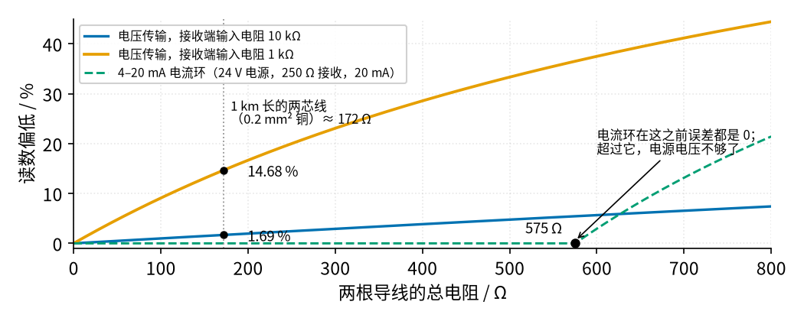
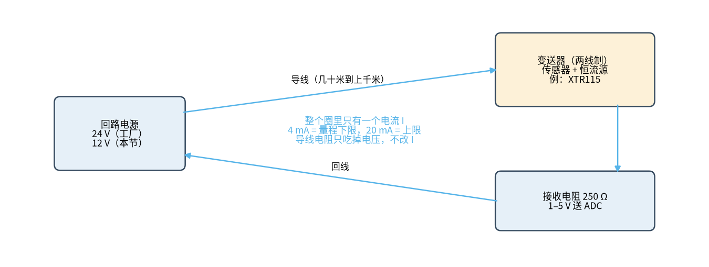
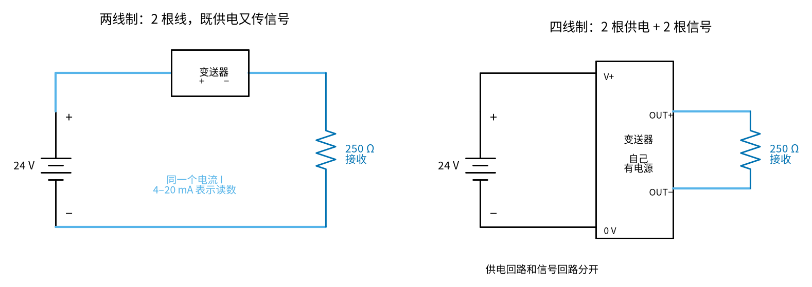

# 41 4–20 mA 电流环 · 直觉篇

[上一页：40 热式流量与 RTD 恒温差 · 动手实验篇](../40-thermal-flow/page4.md) · 本页：直觉篇 · [原理与实现篇](page2.md) · [参数与调试篇](page3.md) · [动手实验篇](page4.md) · [下一页：原理与实现篇](page2.md) · 前置节点：[39 恒流源与线圈励磁驱动 · 直觉篇](../39-constant-current-excitation/page1.md)、[07 三极管开关与继电器驱动 · 直觉篇](../07-bjt-relay-driver/page1.md)、[01 元件速成 · 直觉篇](../01-components-basics/page1.md)

> **前置回顾（一句话版）**
> - [39 恒流源 · 直觉篇](../39-constant-current-excitation/page1.md)：运放盯着采样电阻 $R_S$ 上的电压，拧 MOS 管这只『阀门』，把它按在基准电压上，于是电流 = 基准 ÷ $R_S$ ，负载变一点，电流不变。本节把 MOS 管换成三极管，思路完全相同。
> - [07 三极管](../07-bjt-relay-driver/page1.md)：基极一点点电流控制集电极大电流，集电极电流 ≈ β 倍基极电流，发射极电流 = 集电极电流 + 基极电流。
> - [01 元件速成](../01-components-basics/page1.md)：串联电路里，电流处处相等；电阻上的电压 = 电流 × 电阻。

## 开头三问（先回忆，再往下读）

1. 串联电路里，各处的电流是什么关系？（[01 元件速成 · 直觉篇](../01-components-basics/page1.md)）
2. 39 节的恒流源里，电流由哪两个量决定？
3. 三极管的发射极电流和集电极电流，哪个大？

答案

1. 处处相等。串联电路只有一条路，电流没有地方分岔。
2. 基准电压和采样电阻 $R_S$ ：电流 = 基准 ÷ $R_S$ 。负载电阻不在这个式子里。
3. 发射极电流大一点：发射极电流 = 集电极电流 + 基极电流。本节的回路电流是集电极电流，所以比发射极电流少约 1 %，后面会算到。

## 先想一个问题：传感器离控制室一公里

前面几节，传感器都插在面包板上，离 Arduino 只有几厘米。工厂里不是这样：流量计装在管道上，读数的仪表在控制室，中间隔着几十米到上千米的电缆。

最直接的想法是：传感器输出 0–5 V，用两根线拉到控制室去量。问题出在导线本身也有电阻。0.2 mm² 的铜线每米约 86 mΩ，一公里长的两芯电缆，去一趟、回一趟一共 2 km 导线，大约 172 Ω。

这 172 Ω 和接收端的输入电阻串在一起，构成一个分压器（[01 元件速成](../01-components-basics/page1.md)「一、电阻分压」里学过）。接收端输入电阻越小，分到导线上的电压就越多，读数就越低：

*图 41-p1-1　同一段导线：电压传输会偏低，电流环在 575 Ω 以内不偏*

看图 41-p1-1：

- 一公里电缆、接收端 10 kΩ：读数偏低 1.69 %。听起来不多，但很多传感器本身精度就是 0.5 % 左右，导线一下吃掉了三倍。
- 接收端只有 1 kΩ：偏低 14.68 %，基本没法用。
- 更麻烦的是：导线电阻会随温度变，接头会氧化，偏差每天都不一样，没法一次校准完事。

## 换个思路：不送电压，送电流

[01 元件速成](../01-components-basics/page1.md) 里有一句最朴素的话：**串联电路里，电流处处相等**。

如果传感器那头不输出电压，而是输出一个**被控制住的电流**（这就是 [39 恒流源](../39-constant-current-excitation/page1.md) 干的事），那么：

- 这个电流从电源出来，流过导线，流过传感器，流过接收端的电阻，再流回电源。整圈只有一个电流。
- 导线电阻大一点，只是导线上多“吃掉”一点电压；恒流源会自动多给一点电压把电流顶住。电流本身不变。
- 接收端放一只 250 Ω 电阻，电流流过它产生电压：4 mA → 1 V，12 mA → 3 V，20 mA → 5 V。接收端量这个电压就行。

请看图 41-p1-2，顺着天蓝色箭头走一圈，数一数电流有几条路可走。

*图 41-p1-2　4–20 mA 电流环：电源、变送器、接收电阻、导线串成一圈*

答案是只有一条。图 41-p1-2 是示意图；画成真正的原理图、并把导线的去线和回线都画出来，就是 [原理与实现篇](page2.md)「二」第 3 步“回路电流从哪儿走”里的完整回路原理图：那里用天蓝色粗线描出了这条唯一的电流路径。

图 41-p1-2 里的“变送器”就是把传感器读数变成电流的那个盒子。工业上最常见的是**两线制**：变送器只有两根线，既从这两根线上取电，又用流过这两根线的电流表示读数。还有一种**四线制**：变送器另外有两根电源线，信号走另外两根线。两种接法对照着看图 41-p1-3。

*图 41-p1-3　两线制和四线制*

两线制省两根线，但变送器只能用回路里剩下的那点电压和不到 4 mA 的电流过日子；四线制自己有电源，可以带更耗电的传感器。本节搭的是两线制的思路：发送器和接收电阻串在同一圈里。

当然，电流环也不是无限能扛。电源电压是有限的：电流 × 总电阻不能超过电源能给的电压。图 41-p1-1 里蓝绿色虚线在 575 Ω 拐弯，就是 24 V 电源、250 Ω 接收电阻、TI XTR115 变送器至少要 7.5 V 时，导线最多还能有 575 Ω：

$$
R_{\text{线,max}} = \frac{24\thinspace\text{V} - 250\thinspace\Omega \times 20\thinspace\text{mA} - 7.5\thinspace\text{V}}{20\thinspace\text{mA}} = \frac{(24 - 5 - 7.5)\thinspace\text{V}}{0.02\thinspace\text{A}} = 575\thinspace\Omega
$$

（这笔“电压预算”在 [原理与实现篇](page2.md)「一」细讲。）前面算过一公里电缆来回约 172 Ω，575 ÷ 172 ≈ 3.34，所以 0.2 mm² 电缆大约能拉 3.34 km。

## 为什么是 4 mA 起步，不是 0 mA？

这是电流环最聪明的地方，有两个原因：

1. **能分辨“读数为零”和“线断了”。** 如果 0 mA 表示量程下限，那线断了也是 0 mA，接收端分不清。用 4 mA 当下限（“活零点”），只要读到明显低于 4 mA，就知道出事了。
2. **两线制变送器要吃饭。** 变送器只有两根线，它自己的芯片也要电流才能工作。最低 4 mA 的电流里，有一部分就是给它自己用的。XTR115 手册里，它本身静态只用约 200 µA。

上限 20 mA 是行业惯例：4 到 20 一共 16 mA 的量程，正好分成 4 份，每份 4 mA = 量程的 25 %：4、8、12、16、20 mA 分别对应 0 %、25 %、50 %、75 %、100 %，刻度很好算。

## 超出 4–20 mA 的电流，也有意思

既然低于 4 mA 表示出事，那变送器自己发现故障（比如传感器坏了）时，也可以**故意**送一个超出范围的电流来“喊救命”。德国的 NAMUR 组织把这个做法写成了推荐规范 NE43。按 Beckhoff 的说明：

*图 41-p1-4　NAMUR NE43 的电流分区，以及本节实验会用到的四个设定值*

- **≤ 3.6 mA**：故障（低）。比如断线、变送器没电。
- **3.8–20.5 mA**：测量值。其中 3.8–4 mA 和 20–20.5 mA 是“超量程”：读数超出了量程，但信号本身还可信。
- **≥ 21 mA**：故障（高）。变送器主动报警。
- 中间两条窄缝（3.6–3.8、20.5–21）NE43 没有定义，接收端一般当作“可疑”。

图 41-p1-4 上面的四个三角，是我们在 [动手实验篇](page4.md) 里要用 Arduino 亲手做出来的电流：38 号码模拟“低故障”，255 号码模拟“高故障”。

## 本节要搭什么

本节不买现成的变送器，而是自己搭一个“假变送器”：

- Arduino 的 PWM 经过 RC 滤波变成设定电压；
- LM358 运放 + 2N3904 三极管 + 100 Ω 采样电阻组成恒流源（和 39 节同一个思路）；
- 12 V 电源、模拟导线的电阻 $R_x$ 、250 Ω 接收电阻串成一圈；
- 用万用表量 250 Ω 上的电压，读出回路电流；Arduino 只看低边 100 Ω 采样电阻上的电压。

这四条连接的原理图在[原理与实现篇](page2.md)「二」：先看发送器（PWM、运放、三极管、100 Ω）那张，再看第 3 步用天蓝色粗线画出整圈电流的完整回路图。面包板上的孔位见[动手实验篇](page4.md)。

为什么 Arduino 不直接量 250 Ω？因为在我们的电路里，250 Ω 的下端离地有 7–11 V，会烧坏 Arduino 引脚。这个“坑”放在 [原理与实现篇](page2.md)「四」详细讲。

## 小结

- 长导线会和接收端输入电阻分压，电压传输的读数会偏低，而且偏差随温度、接头变化。图 41-p1-1 里一公里线、1 kΩ 输入就偏低 14.68 %。
- 电流环利用“串联电流处处相等”：导线电阻只吃电压，不改电流。只要总压降不超过电源，读数就不偏。
- 4 mA 当零点，是为了能分辨断线；也给两线制变送器留口饭吃。四线制变送器自带电源，供电和信号分开走（图 41-p1-3）。
- NE43 规定 ≤ 3.6 mA、≥ 21 mA 是故障信号，3.8–20.5 mA 是测量值（图 41-p1-4）。
- 本节自己搭一个 PWM 控制的 V→I 发送器，用万用表验证所有结论。

## 参考资料

- TI XTR115/XTR116 两线制 4–20 mA 电流环发送器数据手册（I_O = 100·I_IN、最低 7.5 V、静态约 200 µA）：https://www.ti.com/lit/ds/symlink/xtr115.pdf
- Beckhoff 关于 NAMUR NE43 电流分区的说明：https://infosys.beckhoff.com/content/1033/ioanalogmanual/3904850187.html
- NAMUR NE43 修订公告：https://www.namur.net/en/publications/news-archive/ne-43-has-been-revised.html
- WAGO 750-492 模块手册（4–20 mA 接收、NE43 诊断）：https://www.wago.com/wagoweb/documentation/750/eng_manu/modules/m07500492_00400001_0en.pdf
