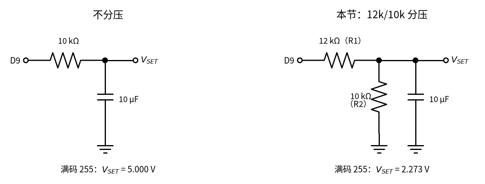

# 41 4–20 mA 电流环 · 原理与实现篇

[上一页：直觉篇](page1.md) · [直觉篇](page1.md) · 本页：原理与实现篇 · [参数与调试篇](page3.md) · [动手实验篇](page4.md) · [下一页：参数与调试篇](page3.md) · 前置节点：39 节恒流源与线圈励磁驱动（即将上线）、[07 三极管开关与继电器驱动 · 原理与实现篇](../07-bjt-relay-driver/page2.md)

> **前置回顾**：39 节恒流源（即将上线） 里，运放把 MOS 管源极电压拉到等于基准电压，于是电流 = 基准 ÷ $R_S$ ，和负载无关（本页换成三极管，源极换成发射极，就是 $I_E = V_{SET}/R_S$ ）；[07 三极管](../07-bjt-relay-driver/page2.md) 里， $I_E = I_C + I_B$ ， $I_C = \beta I_B$ 。本页把这两条接到一起，再加上“电源电压够不够”这一笔账。

## 一、回路电压预算：电流环能扛多少导线

电流环里只有一个电流 $I$ ，但每个元件都要分走一点电压。把它们加起来，不能超过电源电压：

$$V_{\text{电源}} \ge V_{\text{接收}} + V_{\text{变送器,最低}} + I R_{\text{导线}}$$

最难满足的是 $I$ 最大（20 mA）的时候。用 TI XTR115 两线制变送器举例：手册写它两端至少要 7.5 V 才能正常工作。接收电阻 250 Ω 在 20 mA 时分走 5 V。


*图 41-p2-1　20 mA 时回路里的电压预算（黑竖线 = 电源电压）*

从图 41-p2-1 读出几件事：

| 情况 | 回路总电阻上限 $(V - 7.5\ \text{V})/20\ \text{mA}$ | 扣掉接收电阻后留给导线 |
|---|---|---|
| XTR115，24 V，250 Ω 接收 | 825 Ω | 575 Ω（0.2 mm² 电缆约 3.34 km） |
| XTR115，12 V，250 Ω 接收 | 225 Ω | 不够：225 Ω < 250 Ω，**带不动** |
| XTR115，12 V，100 Ω 接收 | 225 Ω | 125 Ω |

0.2 mm² 铜线每米 86.0 mΩ，一公里电缆（去回 2 km 导线）是 172 Ω。这就是为什么工厂用 24 V：同样的变送器，12 V 连一只 250 Ω 都带不动，24 V 却能拉几公里。

本节实验的发送器不是 XTR115，而是自己用三极管搭的（见本页第二节）。它的预算是图 41-p2-1 的第一条：12 V 里 250 Ω 拿 5 V、采样电阻 $R_S$ 拿 2 V，剩 5 V 给三极管。三极管至少要留约 0.3 V 才不饱和，所以还有 4.7 V 可以让给“导线”，也就是我们用来模拟导线的电阻 $R_x$ 最多约 235 Ω。这个数在 [参数与调试篇](page3.md)「一」会用 SPICE 扫一遍。

## 二、本节的发送器：PWM → 设定电压 → 恒流


*图 41-p2-2　本节的 V→I 发送器：PWM 设定、LM358 + 2N3904 恒流、250 Ω 接收，A1 监视运放输出*

按信号顺序看图 41-p2-2：

**1. PWM 变成直流设定电压。** Arduino 的 `analogWrite(code)` 在 D9 输出约 490 Hz 的方波，高电平时间占 `code/255`。方波的平均值 = 5 V × 占空比，这就是 [26 H 桥电机驱动 · 直觉篇](../26-h-bridge/page1.md) 里电机“只感受平均电压”的道理（占空比的定义见 [06 MOS 管开关 · 直觉篇](../06-mosfet-switch/page1.md)）。R1、R2 分压，C1 把方波“抹平”：这就是 [20 有源滤波 · 直觉篇](../20-active-filter/page1.md) 里的一阶低通，截止频率 $f_c = 1/(2\pi\tau) \approx 2.9$ Hz（ $\tau$ = 54.5 ms，见「五」），远低于 490 Hz，所以方波几乎只剩平均值：

$$V_{SET} = V_5 \cdot \frac{code}{255} \cdot \frac{R_2}{R_1 + R_2} = V_5 \cdot \frac{code}{255} \cdot 0.4545$$

$V_5$ 是 Arduino 5 V 引脚的真实电压（理想 5.00 V，实际常常不是，见 [参数与调试篇](page3.md)「六」）。按 5.00 V 算，满码 255 时 $V_{SET}$ = 2.273 V；每加 1 个码， $V_{SET}$ 加 8.91 mV。

**2. 运放 + 三极管把 $V_E$ 钉在 $V_{SET}$ 。** 思路和 39 节相同，只是 39 的 MOS 管源极换成了这里的三极管发射极：运放比较 + 端（ $V_{SET}$ ）和 − 端（发射极电压 $V_E$ ），哪边低就调基极电流，直到两边相等。于是

$$I_E = \frac{V_{SET}}{R_S} = \frac{V_{SET}}{100\ \Omega}$$

1 V 设定 = 10 mA。4/12/20 mA 分别要 0.4/1.2/2.0 V，对应的码：

| 目标 | 码 | 实际 $V_{SET}$ | 实际 $I_E$ | NE43 分区 |
|---|---|---|---|---|
| 低故障 | 38 | 0.339 V | 3.387 mA | 故障（低） |
| 4 mA | 45 | 0.401 V | 4.011 mA | 测量值（下沿） |
| 12 mA | 135 | 1.203 V | 12.032 mA | 测量值 |
| 20 mA | 224 | 1.996 V | 19.964 mA | 测量值 |
| 高故障 | 255 | 2.273 V | 22.727 mA | 故障（高） |

（以上都按 $V_5$ = 5.00 V、β 无穷大算；三极管的影响见「三」。）

**3. 回路电流从哪儿走。** 请看图 41-p2-3 里天蓝色的那一圈：电流从 12 V 正端出发，经 $R_x$ 、250 Ω、集电极、发射极、 $R_S$ ，再沿底下那根线回到 12 V 负端。图 41-p2-2 里的两个接地符号，其实就是这根回线的两端。从 12 V 正端经 $R_x$ 、250 Ω 到集电极，电流处处是同一个 $I$ ；只有在发射极这一点，运放经 $R_B$ 送进基极的一小股 $I_B$ 也并了进来，所以 $R_S$ 上流的是 $I_E = I + I_B$ 。这一小股为什么很小：三极管的 $I_B = I / β$ ，β 约 100 时 $I_B$ 只有 $I$ 的约 1 %（「三」细讲）。 $I_B$ 来自运放，运放的电源也是这只 12 V，但它不经过 250 Ω，所以 250 Ω 上读到的仍是 $I$ 。


*图 41-p2-3　完整回路：12 V 负端用真实导线接回，天蓝色粗线是回路电流的路径*

图 41-p2-3 把导线电阻拆成去线、回线两半，这才是工厂里的真实样子；在面包板上，两半合成一只 $R_x$ 放在 +12 V 和 250 Ω 之间，串联电路里元件的先后顺序不影响电流。250 Ω 上的电压除以 250 就是回路电流：4/12/20 mA 时 1/3/5 V。这一步**只用万用表量**。

**4. 为什么基极要串 R_B 1 kΩ。** 一是限流：断线或负载太大时，运放会把输出一路推高（[参数与调试篇](page3.md)「二」），没有 R_B，运放输出就直接顶在基极–发射极这个二极管上，电流只受运放自己的输出能力限制；二是隔离：运放输出不直接挂在三极管的结电容上，是这类电路常见的防振荡做法。本节 SPICE 阶跃仿真没有振荡（[参数与调试篇](page3.md)「五」）。

## 三、β 误差：A0 看到的电流比回路电流多一点

[07 三极管](../07-bjt-relay-driver/page2.md) 里说过： $I_E = I_C + I_B$ 。运放钉住的是 $I_E$ ，而流过 250 Ω 的是 $I_C$ ：

$$I_C = I_E \cdot \frac{\beta}{\beta + 1}, \qquad 误差 = \frac{1}{\beta + 1}$$

| β | 回路电流比 $I_E$ 少 |
|---|---|
| 60 | 1.64 % |
| 100 | 0.99 % |
| 300 | 0.33 % |

2N3904 手册（MCC）写的 hFE：10 mA 时 100–300，50 mA 时最少 60。所以 20 mA 时误差在 0.3–1.6 % 之间（β 从 300 到 60），典型约 1 %。SPICE 用 2N3904 模型算出 20 mA 时 1.009 %，对应 β≈98。

具体到数字：如果按整 0.4/1.2/2.0 V 设定，简化模型（β = 100）算出回路电流 3.96/11.88/19.80 mA；按实际的码 45/135/224 算是 3.97/11.91/19.77 mA（「六」的代码会打印这组数），SPICE 是 3.988/11.92/19.82 mA。而 A0 那一侧（发射极）是 4.00/12.00/20.00 mA。

还有一个小误差：LM358 的输入失调电压，手册给的全温度范围最大 7 mV。7 mV ÷ 100 Ω = 70 µA，占 16 mA 量程的 0.44 %。

想消灭 β 误差，可以把 2N3904 换成 N 沟道 MOS 管（比如 2N7000）：MOS 管栅极不取电流， $I_D = I_S$ 。SPICE 里 20 mA 时回路电流 20.02 mA，和发射极电流完全一样。代价和取舍在 [参数与调试篇](page3.md)「一」。

**练一练：从码到 250 Ω 上的电压。** 回路怎么走、β 误差怎么算都讲过了，下面三道例题从“全给你算”到“你自己算”，照着同一个套路走：电流 → $V_{SET}$ → 码 → 回路电流 → 250 Ω 上的电压。

**例 1（完整示范）**：要输出 12 mA，码是多少？250 Ω 上读多少？

1. $V_{SET} = 12\thinspace\text{mA} \times 100\thinspace\Omega = 1.2\thinspace\text{V}$ ；
2. 码 = 1.2 ÷ (5 × 0.4545) × 255 = 134.6，取 135；
3. 实际 $V_{SET}$ = 5 × 135/255 × 0.4545 = 1.203 V， $I_E$ = 12.03 mA；
4. 回路电流 ≈ 12.03 × 100/101 = 11.91 mA（β = 100，用上面「三」的 100/101），250 Ω 上 ≈ 11.91 mA × 250 Ω = 2.98 V。

**例 2（留空）**：要输出 16 mA（量程的 75 %）。 $V_{SET}$ = ____ V；码 = ____；250 Ω 上约 ____ V。

<details><summary>答案</summary>

$V_{SET}$ = 16 mA × 100 Ω = 1.60 V；码 = 1.6 ÷ 2.2727 × 255 = 179.5，取 180（实际 $I_E$ = 16.04 mA）；回路电流 16.04 × 100/101 = 15.88 mA，250 Ω 上约 3.97 V。

</details>

**例 3（迁移）**：你的 5 V 引脚实测 4.83 V。要输出 8 mA，码应写多少？如果万用表在 250 Ω 上读到 3.00 V，变送器在报量程的百分之几？

<details><summary>答案</summary>

$V_{SET}$ = 0.8 V，码 = 0.8 ÷ (4.83 × 0.4545) × 255 = 92.9，取 93（实际 8.01 mA）。注意 5 V 变低以后，同样的码给出的电流也变小，所以码要比 5.00 V 时（码 90）大一点。3.00 V ÷ 250 Ω = 12 mA，(12 − 4) ÷ 16 = 50 %。

</details>

## 四、Arduino 该接哪一点：低边 100 Ω，不是 250 Ω

直觉上，“接收端”就是 250 Ω，Arduino 去量它就行。但看看图 41-p2-2：250 Ω 的上端接 12 V（经过 $R_x$ ），下端接集电极。250 Ω 下端对地的电压是：

$$12\thinspace\text{V} - I \times 250\thinspace\Omega = 11 / 9 / 7\thinspace\text{V}\quad(4/12/20\thinspace\text{mA})$$

ATmega328P 引脚的绝对最大值是 $V_{CC}$ + 0.5 V = 5.5 V。7–11 V 直接接上去，引脚就坏了。所以：

- **250 Ω 只用万用表量**：万用表两根表笔跨在 250 Ω 两端，量的是两端电压差，安全。
- **Arduino A0 量低边的 100 Ω 采样电阻**：它一端接地，另一端（发射极）只有 0.4–2.0 V。即使三极管 C–E 击穿短路，按模型算发射极最高也只有 3.43 V。
- **A0 前面串一只 10 kΩ**：万一插错线，让 A0 碰到 12 V，流进引脚内部钳位二极管的电流 ≤ (12 − 5 − 0.5) V / 10 kΩ = 0.65 mA，在 Arduino 论坛上常见的“≤ 1 mA”建议之内。10 kΩ + 100 Ω 的源阻抗也正好在 ATmega 手册建议的 ADC 输入阻抗（约 10 kΩ 以下）附近。

A0 的分辨率： $V_5$/1024 = 4.883 mV 一格，除以 100 Ω 就是 48.8 µA 一格。20 mA 对应 409.6 格左右（码 224 实际 19.96 mA，约 408.9 格；ADC 向下取整读 408，「六」的代码用四舍五入打印 409）。

**接收电阻能不能读到故障高电流？** NE43 只规定高故障 ≥ 21 mA，具体送多大由变送器自己定；本节按满码 22.73 mA 算。用电阻把电流变成电压送 ADC 时，必须保证这个电流也不超过 ADC 的参考电压：

| 采样电阻 | × 22.73 mA（本节满码） |
|---|---|
| 250 Ω | 5.68 V（超 5 V） |
| 220 Ω | 5.00 V（刚好顶格） |
| 200 Ω | 4.55 V |
| 100 Ω | 2.27 V |

参考电压 5.0 V 时，电阻最大 219 Ω；如果 5 V 引脚实际只有 4.83 V，最大只能 212 Ω。本节 A0 读 100 Ω，满码 2.27 V，留足了余量。这也是“250 Ω 只给万用表，100 Ω 给 Arduino”的第二个理由。

## 五、为什么 PWM 后面要 12k/10k 分压

两种接法画在图 41-p2-4 里：左边不分压，右边是本节的 12k/10k 分压。



*图 41-p2-4　PWM 滤波的两种接法*

最省事的做法是 D9 直接经 10 kΩ + 10 µF 滤波。那样 $V_{SET}$ 能从 0 一直到 5 V。问题是：

- 满码 255 → $V_{SET}$ = 5 V → 要求 $I_E$ = 50 mA。实际上三极管早就饱和了，按模型回路里会有 32.5 mA（SPICE 32.22 mA），250 Ω 上发热 263 mW（SPICE 259.5 mW），超过了 1/4 W 电阻的额定功率。
- 每个码 0.196 mA，比分压后的 89.1 µA 粗了一倍多。

加了 R1 12 kΩ / R2 10 kΩ 分压以后，满码只到 2.273 V = 22.73 mA：正好落在 NE43 的“故障（高）”区（≥ 21 mA），能用来演示报警，又不会烧东西。对电容来说，R1 和 R2 是并联的（戴维南等效：从电容两端往回看，D9 和地对交流都相当于“接地”，R1 和 R2 就并在一起），等效电阻 12k∥10k = 12 × 10 ÷ 22 = 5.45 kΩ，和 10 µF 组成 τ = 54.5 ms，纹波和建立时间在 [参数与调试篇](page3.md)「三」里算。

## 六、用 Python 算一遍：码 → 设定 → 电流 → 电压

```python
# 41 原理与实现篇：码 → V_SET → I_E → 回路电流 → 各点电压（简化模型，β = 100）
V5, R1, R2, RS, RL, VS, beta = 5.00, 12e3, 10e3, 100.0, 250.0, 12.0, 100
k = R2 / (R1 + R2)

def ne43(i_ma):
    if i_ma <= 3.6: return "故障（低）"
    if i_ma >= 21.0: return "故障（高）"
    if 3.8 <= i_ma <= 20.5: return "测量值"
    return "过渡带"

print(f"分压比 {k:.4f}，满码 {V5 * k:.3f} V，步长 {V5 * k / 255 * 1e3:.2f} mV = {V5 * k / 255 / RS * 1e6:.1f} µA")
for code in (38, 45, 135, 224, 255):
    vset = V5 * code / 255 * k
    ie = vset / RS
    ic = ie * beta / (beta + 1)
    v250 = ic * RL
    v_bottom = VS - v250                       # 250 Ω 下端对地（R_x = 0 时）
    a0 = round(vset / V5 * 1024)
    print(f"code {code:3d}: V_SET {vset:.3f} V, I_E {ie * 1e3:6.3f} mA, 回路 {ic * 1e3:6.3f} mA ({ne43(ic * 1e3)}), "
          f"250 Ω 上 {v250:.2f} V, 250 Ω 下端对地 {v_bottom:.2f} V, A0 ≈ {a0}")
```

运行后会看到：250 Ω 下端对地始终在 6 V 以上，而 A0 那一侧最高 2.27 V。这正是「四」的结论。

## 小结

- 回路电压预算： $V_{\text{电源}} \ge V_{\text{接收}} + V_{\text{变送器}} + I R_{\text{导线}}$ 。XTR115 在 24 V、250 Ω 接收时留给导线 575 Ω；在 12 V 连 250 Ω 都带不动，换 100 Ω 接收还剩 125 Ω（图 41-p2-1）。
- 本节发送器：PWM → 12k/10k 分压 + 10 µF → LM358 + 2N3904 + 100 Ω， $I_E = V_{SET}/100\ \Omega$ ；码 45/135/224 对应 4/12/20 mA，38 和 255 是低/高故障（图 41-p2-2）；整圈只有一条电流路径，接地符号只是回线的简写（图 41-p2-3）。
- β 误差：回路电流比 $I_E$ 少 $1/(\beta+1)$ ，20 mA 时约 1 %（SPICE 1.009 %）；换 MOS 管可以消除。
- Arduino 只能量低边 100 Ω（0.4–2.0 V，串 10 kΩ）；250 Ω 下端对地 7–11 V，只能用万用表跨接量。

## 参考资料

- TI XTR115/XTR116 数据手册（7.5–36 V、I_O = 100·I_IN、限流约 32 mA）：https://www.ti.com/lit/ds/symlink/xtr115.pdf
- TI TIDUAO7 两线制 4–20 mA 参考设计：https://www.ti.com/lit/ug/tiduao7/tiduao7.pdf
- TI LM358 数据手册（输入失调、输出摆幅约 V+ − 1.5 V）：https://www.ti.com/lit/ds/symlink/lm358.pdf
- MCC 2N3904 数据手册（hFE 100–300 @10 mA）：https://www.mccsemi.com/pdf/Products/2N3904(TO-92).pdf
- Vishay 2N7000 数据手册：https://www.vishay.com/docs/70226/70226.pdf
- Microchip ATmega328P 数据手册（引脚绝对最大值、ADC 输入阻抗建议）：https://ww1.microchip.com/downloads/aemDocuments/documents/MCU08/ProductDocuments/DataSheets/ATmega48A-PA-88A-PA-168A-PA-328-P-DS-DS40002061B.pdf
- Arduino `analogWrite()` 参考（D9 约 490 Hz）：https://raw.githubusercontent.com/arduino/reference-en/master/Language/Functions/Analog%20IO/analogWrite.adoc
- Arduino 论坛：安全读取故障 4–20 mA 传感器（串联电阻、注入电流）：https://forum.arduino.cc/t/safely-reading-a-malfunctioning-4-20ma-sensor/637220
- NOSHOK：两线制 4–20 mA 回路的最低电源电压：https://www.noshok.com/pdf/reference/The_Minimum_Power_Supply_Voltage_Required_For_A_2_Wire_4%20mA_to_20_mA_Loop.pdf
