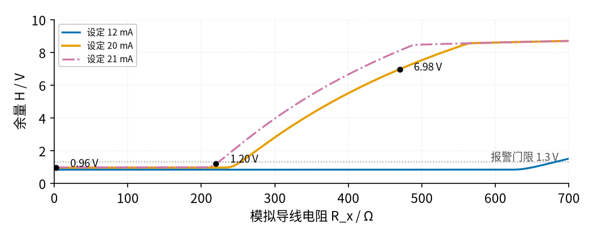
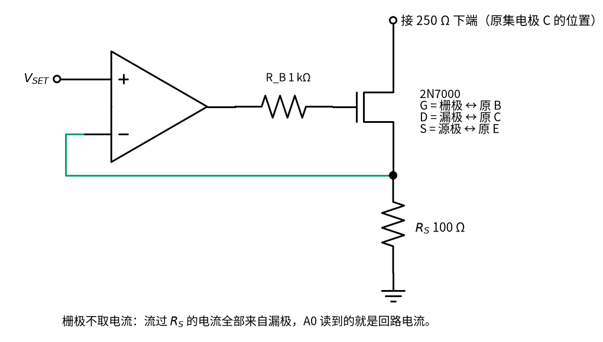
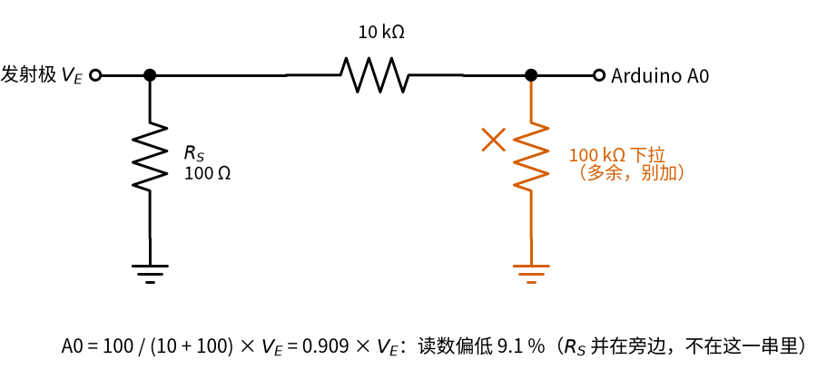
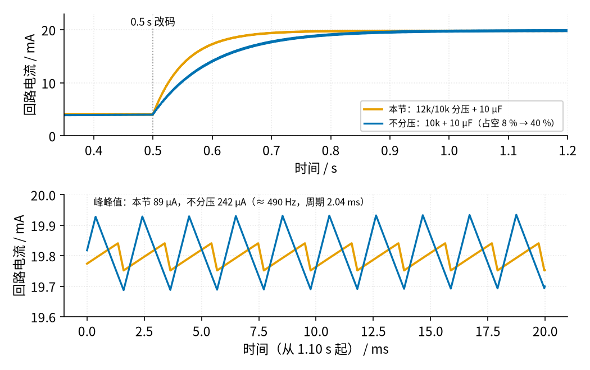

# 41 4–20 mA 电流环 · 参数与调试篇

[上一页：原理与实现篇](page2.md) · [直觉篇](page1.md) · [原理与实现篇](page2.md) · 本页：参数与调试篇 · [动手实验篇](page4.md) · [下一页：动手实验篇](page4.md) · 前置节点：39 节恒流源与线圈励磁驱动（即将上线）、[07 三极管开关与继电器驱动 · 参数与调试篇](../07-bjt-relay-driver/page3.md)

> **前置回顾**：39 节恒流源（即将上线） 第四步讲过“顺从电压”：恒流源只在负载电阻不太大时才恒流，负载一大，管子（39 是 MOS 管，本节是三极管）就没有压降可调了，电流随之下降。本页把这件事放到电流环里，再加上断线、PWM 纹波、功耗、稳定性和 5 V 引脚不准这几笔账。

本页所有数字来自 `code/41_sim.py`（简化模型）和 `spice/41/`（LTspice 兼容网表 + ngspice），两者对照见 `review/spice/41.md`。

## 一、顺从极限：导线电阻多大时电流就掉了

[原理与实现篇](page2.md)「一」算过：12 V 里 250 Ω 拿 5 V、 $R_S$ 拿 2 V，三极管还要留约 0.3 V，所以

$$R_x \le \frac{12\thinspace\text{V} - I(250 + 100)\thinspace\Omega - 0.3\thinspace\text{V}}{I}$$

20 mA 时 $R_x$ ≤ 235 Ω；21 mA 时 ≤ 207 Ω；满码 22.73 mA 时 ≤ 165 Ω。

**先预测**：设定 20 mA，把 $R_x$ 换成 470 Ω（超过 235 Ω 了）。250 Ω 上的回路电流和 A0 读到的发射极电流，哪个会变、哪个不变？

答案

回路电流会掉（SPICE 13.84 mA），A0 读到的发射极电流几乎不变（20.02 mA）。原因见图 41-p3-1 下面的解释。

SPICE 把 $R_x$ 从 0 慢慢扫到 700 Ω：

*图 41-p3-1　回路电流（实线）和 A0 读到的发射极电流（点线）随 R_x 的变化*

图 41-p3-1 最要紧的一点：**$R_x$ = 470 Ω、设定 20 mA 时，回路电流只剩 13.84 mA，但 A0 读到的发射极电流还是 20.02 mA。** 少掉的那 6 mA 去哪了？三极管饱和以后，集电极拉不动了，运放就拼命加大基极电流，这部分电流从基极流进、从发射极流出，经过 $R_S$ ，A0 照样看到“20 mA”。**发送器自己“看起来一切正常”，回路里其实已经错了。**

怎么在 Arduino 这一侧发现它？看运放输出比发射极高多少，叫它“余量” $H = V_O - V_E$ ：

*图 41-p3-2　运放输出比发射极高多少（余量 H）；超过 1.3 V 就报警*

- 正常线性时， $H$ = $V_{BE}$ + 基极电流 × 1 kΩ，0.7–1 V。
- 饱和后，基极电流猛增， $H$ 跟着猛增：470 Ω/20 mA 时 SPICE 逐点算是 6.97 V（图上慢扫曲线是 6.98 V）。
- 程序把门限设在 1.3 V。A1 通过 22k/10k 分压读运放输出（1 格 = 15.6 mV；分压接法见[原理与实现篇](page2.md)「二」第 1 步之后、画着运放输出经 22k/10k 接 A1 的那张原理图），算出 $H$ 。470 Ω 时运放输出 8.97 V，A1 读到约 574 格，算出的 $H$ 远超门限，报警。

**说实话的地方**：220 Ω/21 mA 这种“刚刚过线”的情况，SPICE 里回路电流已经掉到 20.58 mA（少了 2 %），但 $H$ 只有 1.20 V，没到 1.3 V，程序**不会**报警。门限再低就会和正常的 0.96 V 混在一起。所以： $H$ 报警能抓住“明显带不动”，抓不住“差一点点”；后者只能靠万用表量 250 Ω 发现。

**换成 2N7000 MOS 管会怎样？** MOS 管栅极不取电流，没有“基极支路”：SPICE 里 20 mA 时回路电流 20.02 mA，没有 β 误差；470 Ω 时回路电流 14.59 mA，**A0 读到的也是 14.59 mA**。也就是说，A0 直接就能看出电流掉了。代价是 MOS 管栅极阈值电压离散大，本节面包板仍用 2N3904，2N7000 作为思考题。接法见图 41-p3-3：三只脚一一顶替三极管的位置，栅极 G 接原来基极 B 的 $R_B$ ，漏极 D 接 250 Ω 下端（原集电极 C），源极 S 接 $R_S$ 和反馈线（原发射极 E）。

*图 41-p3-3　把 2N3904 换成 2N7000：引脚一一对应*

## 二、断线：A0 还在报“正常”

把 $R_x$ 拔掉（相当于电缆断了），回路电流变成 0。可 A0 看到的是什么？

| 设定 | 回路电流 | A0 侧 $I_E$ （SPICE） | 余量 $H$ （SPICE） | A1 电压（SPICE） |
|---|---|---|---|---|
| 0.4 V（4 mA） | 0 | 4.016 mA | 4.72 V | 1.60 V |
| 1.2 V（12 mA） | 0 | 8.871 mA | 9.64 V | 3.29 V |
| 2.0 V（20 mA） | 0 | 8.871 mA | 9.64 V | 3.29 V |

集电极断了，运放把全部电流从基极灌进去。设定 4 mA 时它还能凑够 4 mA，A0 上一点都看不出来；设定更高时，运放输出顶到上限（12 V 供电时约 10.53 V），基极电流被 $R_B$ 限在约 8.9 mA。这时 A0 显示约 8.9 mA，明显不对劲，但仍在“测量值”范围里。只有 $H$ 报警能可靠地抓住断线。A1 最高 3.29 V，就算运放输出顶到 12 V，A1 也只有 3.75 V，不会伤 Arduino。

真正的接收端（PLC 模块）能直接读到回路电流 ≤ 3.6 mA，按 NE43 判为故障（低）。我们的发送器“看不见”回路，所以要靠 $H$ 。

**要不要给 A0 加下拉电阻？** 有人习惯在模拟输入加 100 kΩ 下拉防悬空。本节**不要加**：A0 经 10 kΩ + 100 Ω 采样电阻接地，本来就不会悬空；再加 100 kΩ 下拉，会和 10 kΩ 组成分压，A0 只看到 0.909 倍，读数偏低 9.1 %（20 mA 显示 18.18 mA）。连接见图 41-p3-4：

*图 41-p3-4　A0 多加 100 kΩ 下拉（坏例）：和 10 kΩ 组成分压*

公式里的电阻都以 kΩ 为单位。 $V_E$ 被运放钉住，10 kΩ 和 100 kΩ 从 $V_E$ 到地串成一串； $R_S$ 也从 $V_E$ 接地，和这一串是**并联**，不影响这一串的分压。所以 A0 只分到 100 ÷ (10 + 100) = 0.909。

## 三、PWM 分辨率、纹波和建立时间

12k/10k 分压后，戴维南电阻 5.45 kΩ，和 10 µF 组成 τ = 54.5 ms。D9 的 PWM 约 490 Hz（周期 2.04 ms），比 τ 短得多，所以纹波是一个小锯齿。锯齿的峰峰值可以这样估：

$$\text{纹波}_{pp} \approx V_{hi} \cdot D(1-D) \cdot \frac{T}{\tau}$$

$V_{hi}$ 是 PWM 高电平经分压后的值（5 V × 0.4545 = 2.27 V）， $D$ 是占空比（码 ÷ 255）， $T$ 是 PWM 周期。例：码 135， $D$ = 0.529， $D(1-D)$ = 0.249， $T/\tau$ = 2.04 ÷ 54.5 = 0.0374，纹波 ≈ 2.27 × 0.249 × 0.0374 ≈ 21.2 mV，除以 $R_S$ 100 Ω 就是 212 µA，和下表一致。

| 码 | 设定 | $V_{SET}$ 纹波 | 回路电流纹波（模型） | SPICE |
|---|---|---|---|---|
| 38 | 3.4 mA | 10.8 mVpp | 108 µApp | — |
| 45 | 4 mA | 12.4 mVpp | 124 µApp | 122.8 µApp |
| 135 | 12 mA | 21.2 mVpp | 212 µApp | 209.4 µApp |
| 224 | 20 mA | 9.1 mVpp | 91 µApp | 89.15 µApp |

纹波在占空比 50 % 附近最大，在两端小。最大 212 µApp 约是 16 mA 量程的 1.3 %（峰峰值），万用表直流挡会把它平均掉，读数不受影响。

对比不分压（D9 → 10 kΩ → 10 µF，τ = 100 ms）：

*图 41-p3-5　改码后的建立过程（上）和稳态纹波（下）：分压版更快、纹波更小*

从图 41-p3-5 读出：

- **建立时间**：从 4 mA 跳到 20 mA，到终值 99 % 要约 0.24–0.25 s（τ·ln100 = 0.25 s，SPICE 0.238 s）；不分压版约 0.46 s。程序改码后至少等 0.5 s 再读。
- **纹波**：20 mA 时分压版 89 µApp，不分压版 242 µApp。
- **分辨率**：分压版每个码 89.1 µA，不分压版 0.196 mA。

## 四、功耗：谁在发热

*图 41-p3-6　晶体管和 250 Ω 电阻的功耗*

- 晶体管功耗 $P = I(12\ \text{V} - I \times 350\ \Omega)$ ，在 $I$ = 12 V/(2 × 350 Ω) = 17.1 mA 处最大 102.9 mW；4 mA 42.4 mW，12 mA 93.6 mW（SPICE 93.25），20 mA 100 mW（SPICE 100.1）。
- 250 Ω 被短接时，晶体管多扛 5 V，20 mA 时 200 mW。
- onsemi 2N3904 手册：TO-92 封装 25 °C 时最大 625 mW，结到环境热阻 200 °C/W，25 °C 以上每升 1 °C 降额 5.0 mW。102.9 mW 时温升约 20.6 °C，200 mW 时约 40 °C。都在额定内，但**别用手摸**测温。
- 250 Ω 电阻：20 mA 100 mW，满码 22.73 mA 129 mW，用 1/4 W 的就够；100 Ω 采样电阻 20 mA 时 40 mW。

## 五、稳定性：会不会振荡

SPICE 里把设定电压从 0.4 V 阶跃到 2.0 V（理想阶跃，不经过 RC），看回路电流：接收端并 1 pF 时过冲 0.89 %，并 100 nF 时 0.08 %，都没有振荡。

要注意：仿真**没有**建模长电缆的分布电容和电感。真正拉长线时，如果万用表读数乱跳、或者示波器看到高频振荡：

- 先确认 $R_B$ 1 kΩ 装了。
- 用双绞线（或屏蔽双绞线）走回路，去线和回线绞在一起。
- 接收端 250 Ω 两端并一只 100 nF（接法见[原理与实现篇](page2.md)「二」第 3 步完整回路图里的灰色点线）：和 250 Ω 组成 τ = 25 µs，滤掉高频干扰，对几百毫秒才变一次的电流没有影响。

这些补偿值**没有经过 SPICE 验证**（因为没有电缆模型），只是通常的做法，以实测为准。

## 六、5 V 引脚不是 5.00 V：比例式陷阱

Arduino 用 USB 供电时，板上 5 V 引脚常见 4.8 V 左右（论坛实测例 4.83 V），**必须实测**。PWM 的高电平是 5 V 引脚的电压，ADC 的参考也是它。如果程序里写死 5.00 V：

| 5 V 引脚 | 码 | 真实 $I_E$ | A0 读数 | 按 5.00 V 显示 | 按实测值显示 |
|---|---|---|---|---|---|
| 5.00 V | 224 | 19.96 mA | 408 | 19.92 mA | 19.92 mA |
| 4.83 V | 45 | 3.87 mA | 82 | 4.00 mA | 3.87 mA |
| 4.83 V | 224 | 19.29 mA | 408 | 19.92 mA | 19.24 mA |
| 4.83 V | 255 | 21.95 mA | 465 | 22.71 mA | 21.93 mA |

表里 A0 读数是 ADC 真实给出的整数：0.1996 V ÷ 4.883 mV = 408.9 格，ADC 向下取整给 408（[原理与实现篇](page2.md)的码表按四舍五入写 409，差 1 格，约 0.05 mA）。

看出问题了吗？**A0 读数不变。** PWM 和 ADC 都按 5 V 引脚成比例，误差互相抵消，Arduino“自检”永远显示 20 mA，真实电流却少了约 3.4 %（19.29 比 19.96 mA）。只有万用表量 250 Ω 才能发现。

解决：用万用表量 5 V 引脚对 GND 的电压，写进程序的 `V5` 常数，程序按它算码。4.83 V 时 20 mA 要码 232，4 mA 要码 46。满码 255 在 4.83 V 时是 21.95 mA，仍 ≥ 21 mA，高故障演示照样有效。

## 七、多接一根地线会怎样

**先预测**：有人觉得“电流环要接地才有回路”，于是把 250 Ω 下端（集电极那一端）也用导线接到 0 V。设定 20 mA、 $R_x$ = 470 Ω，250 Ω 两端会读到多少？改设定到 4 mA，读数会变吗？

答案

回路被这根地线“抄了近路”：12 V → $R_x$ → 250 Ω → 地，变送器被短路在外面。电流 = 12 V ÷ (470 + 250) Ω ≈ 16.7 mA，250 Ω 两端约 4.17 V，**和设定无关**：SPICE 里设定 4、12、20 mA 三种情况读数完全一样。

变送器那边也乱了：集电极被拉到 0 V，运放想把发射极抬到 $V_{SET}$ ，拼命加大基极电流，输出顶到约 10.5 V；基极电流约 9.6 mA，大部分从基极经集电极流进那根地线， $R_B$ 1 kΩ 上约 93 mW。发射极只剩 0.165 V，A0 显示约 1.6 mA，余量 $H$ ≈ 10.3 V，程序会报警。功耗：250 Ω 约 69 mW、 $R_x$ 约 131 mW，都在 1/4 W 内，所以这个坏例可以安全地在面包板上做（[动手实验篇](page4.md)表 5，只在 $R_x$ = 470 Ω 时做）。

*图 41-p3-7　坏例：250 Ω 下端多接一根地线，电流绕开了变送器*

看图 41-p3-7：天蓝色的那段（12 V → $R_x$ → 250 Ω）加上朱红色的地线，自己就组成了一个完整回路，根本不经过三极管和 $R_S$ 。这说明电流环的“回路”不靠接地，而靠那条唯一的路径；多一根线，就多一条路。

## 排错表

| 现象 | 原因 | 怎么查 | 怎么改 |
|---|---|---|---|
| 250 Ω 上电压比预期低约 1 % | β 误差（正常） | 量 $R_S$ 上的电压，算 $I_E$ ；两者差约 1 % 就是基极电流 | 正常；要消除就换 MOS 管 |
| 250 Ω 读数比预期低 3–4 %，A0 显示正常 | 5 V 引脚不是 5.00 V | 量 5 V 引脚 | 把实测值写进 `V5` |
| 设定 20 mA，250 Ω 上只有 3.5 V 左右，A0 显示 20 mA | $R_x$ 太大（470 Ω），三极管饱和 | 量集电极对地电压，接近发射极电压；串口显示 H 报警 | 减小 $R_x$ 到 ≤ 235 Ω，或降低设定 |
| 拔掉 $R_x$ 后 A0 仍显示 4 mA 或约 8.9 mA | 断线时电流从基极走 | 串口看 H 报警；万用表 250 Ω 两端 0 V | 正常现象，靠 H 报警识别 |
| 所有读数偏低约 9 % | A0 上额外加了下拉电阻 | 看 A0 那一点有没有接到地的电阻 | 拆掉下拉 |
| 读数满天乱跳 | 没有公共地，或运放 8 脚没接 12 V | 量 Arduino GND 与 0 V 轨之间电阻应为 0 | Arduino GND 接面包板 0 V 轨 |
| Arduino 引脚发热或坏了 | A0 接到了 250 Ω 下端（高边） | 量 A0 那根线对地电压：应 ≤ 2.3 V | 改接发射极，并串 10 kΩ |
| 运放输出一直顶在 10.5 V | 运放 − 端没接发射极（反馈断了）或三极管 C/E 插反 | 量 ②发射极，应 ≈ ④ $V_{SET}$ | 检查蓝绿色反馈线和三极管引脚 |
| 改码后读数要好一会儿才稳 | RC 建立时间 0.24–0.25 s | — | 改码后等 0.5 s 再读 |
| 250 Ω 上恒为约 4.17 V，改设定不变；A0 显示约 1.6 mA，H 报警 | 250 Ω 下端（集电极）多接了一根线到 0 V | 断电，用电阻挡量集电极对 0 V 轨：读到接近 0 Ω 就是多了这根线 | 拆掉这根多余的地线（「七」） |
| 用万用表电流挡串进回路后电流变小 | 电流挡本身有压降（负担电压），吃掉了顺从余量 | 看万用表说明书里的负担电压 | 改用电压挡量 250 Ω 两端，再 ÷ 250 |

## 练习题

1. **（直接用公式）** 设定 12 mA 时， $R_x$ 最大能到多少？对照图 41-p3-1 的蓝线验证。

答案

(12 − 0.012 × 350 − 0.3) ÷ 0.012 = 625 Ω，和图上蓝色实线在 600 多 Ω 才开始下降一致。

2. **（参数变化推理）** 把 $R_S$ 从 100 Ω 换成 50 Ω，R1/R2 不变。20 mA 要多少码？顺从极限变大还是变小？有什么代价？

答案

要 $V_{SET}$ = 0.02 × 50 = 1.0 V，码 = 1.0 ÷ 2.2727 × 255 ≈ 112。顺从极限 (12 − 0.02 × 300 − 0.3) ÷ 0.02 = 285 Ω，变大了。代价：每个码约 178 µA，分辨率粗了一倍；满码 255 对应 45.5 mA，远超 20 mA，管子饱和后回路约 (12 − 0.3) ÷ 300 ≈ 39 mA（模型 38.7 mA），250 Ω 上约 0.37 W，超过 1/4 W， $R_S$ 上也有约 0.10 W。只算不做。

3. **（与 39 对比）** 39 用 10 Ω 采样 100 mA，本节用 100 Ω 采样 20 mA。如果本节也用 10 Ω，A0 在 20 mA 时有多少格？顺从极限是多少？为什么本节不这样选？

答案

0.2 V ÷ 4.883 mV = 40.96 格，ADC 向下取整读 40 格（100 Ω 时 409.6 格，读 409）。顺从极限 (12 − 5 − 0.2 − 0.3) ÷ 0.02 = 325 Ω。顺从极限只多 90 Ω，A0 分辨率却差了 10 倍，所以选 100 Ω。

4. **（换场景迁移）** 工厂里用 24 V 电源、XTR115 两线制变送器（至少 7.5 V）。控制室 PLC 的 250 Ω 接收电阻和现场数显表的 250 Ω **串在同一个回路**里，电缆是 0.5 mm² 铜线（每根芯每米约 34.4 mΩ）。两块表的读数一样吗？电缆最长能拉多远？

答案

读数一样：两只 250 Ω 串在同一圈里，电流处处相等，每块表都读 20 mA 对应的 5 V。代价是多一块表就多吃 5 V：留给导线 (24 − 7.5 − 2 × 5) ÷ 0.02 = 325 Ω；两根芯每米共 68.8 mΩ，325 ÷ 0.0688 ≈ 4.72 km。只接一块表时是 575 Ω、约 8.36 km，多串一块表，最远距离几乎减半。

## 常见误区

- **“发送器 A0 读数正常，回路就正常。”** 错。三极管饱和或断线时，基极电流顶替了集电极电流，A0 照样显示设定值（「一」「二」）。回路电流以 250 Ω 上的电压为准。
- **“Arduino 直接量 250 Ω 就行。”** 在本节电路里不行：250 Ω 下端对地 7–11 V，超过 5.5 V 的引脚上限（[原理与实现篇](page2.md)「四」）。工业接收端的 250 Ω 一端接地，所以能直接量；我们的 250 Ω 在高边。
- **“12 V 电源配 XTR115 + 250 Ω 没问题。”** 不够：要 5 + 7.5 = 12.5 V。12 V 只能配 100 Ω 接收，还剩 125 Ω 给导线。
- **“电流超过 20 mA 一定是坏了。”** 不一定：20–20.5 mA 是超量程测量值，≥ 21 mA 才是故障报警。如果要用 Arduino 直接量接收电阻，采样电阻 × 最大电流不能超过 ADC 参考电压。本节按满码 22.73 mA 算：5.0 V 参考最多 220 Ω，4.83 V 最多 212 Ω。
- **“电流环要接地才有回路。”** 错。回路靠的是从电源正端出发、绕一圈回到电源负端的那根导线；接地符号只是这根回线的简写。多接一根地线反而会给电流开一条近路，绕开变送器（「七」）。
- **“A0 引脚加个下拉更保险。”** 本节反而会让读数偏低 9.1 %（「二」）。
- **“电源 12 V 就是 12.00 V。”** 适配器的空载电压和带载电压可能不同，回路预算紧时要实测电源电压。
- **“摸一下三极管看热不热。”** 不要用手试温度。按手册热阻算，最坏 200 mW 温升约 40 °C。

## 小结

- 20 mA 时 $R_x$ ≤ 235 Ω 才恒流；超过以后回路电流掉，但 A0 仍显示设定值。用余量 $H$ > 1.3 V 报警，能抓住 470 Ω、断线这类明显故障，抓不住 220 Ω/21 mA 这种“差一点点”（图 41-p3-1、图 41-p3-2）。
- 断线时 A0 显示 4 mA 或约 8.9 mA；A0 不需要、也不能加下拉。
- 12k/10k + 10 µF：每码 89.1 µA，纹波 ≤ 212 µApp，建立约 0.24–0.25 s（图 41-p3-5）。
- 晶体管最大 102.9 mW，短接 250 Ω 时 200 mW，都在 625 mW 额定内（图 41-p3-6）。
- 5 V 引脚的误差 A0 自己看不出来，必须万用表实测并写进 `V5`。
- 250 Ω 下端多接一根地线，电流抄近路绕开变送器：250 Ω 上恒为 4.17 V，和设定无关（图 41-p3-7）。

## 参考资料

- onsemi 2N3904 数据手册（625 mW、RθJA 200 °C/W、降额 5.0 mW/°C）：https://media.digikey.com/pdf/Data%20Sheets/ON%20Semiconductor%20PDFs/2N3904,MMBT3904,PZT3904.pdf
- MCC 2N3904 数据手册（hFE）：https://www.mccsemi.com/pdf/Products/2N3904(TO-92).pdf
- Vishay 2N7000 数据手册：https://www.vishay.com/docs/70226/70226.pdf
- TI LM358 数据手册：https://www.ti.com/lit/ds/symlink/lm358.pdf
- TI XTR115/XTR116 数据手册：https://www.ti.com/lit/ds/symlink/xtr115.pdf
- TI DAC161S997 数据手册（报警电流 3.375 / 21.75 mA 的例子）：https://www.ti.com/lit/ds/symlink/dac161s997.pdf
- Beckhoff NE43 电流分区：https://infosys.beckhoff.com/content/1033/ioanalogmanual/3904850187.html
- Arduino 论坛：analogRead 参考电压实测（5 V 引脚 4.83 V 例子）：https://forum.arduino.cc/t/is-analogread-reference-voltage-actually-4-9v/245802
- Arduino 论坛：安全读取故障 4–20 mA 传感器：https://forum.arduino.cc/t/safely-reading-a-malfunctioning-4-20ma-sensor/637220
- Electronics StackExchange：长排线拾取 50 Hz、容性耦合与屏蔽线（「五」双绞/屏蔽的背景）：https://electronics.stackexchange.com/questions/462446
- Arduino `analogWrite()` 参考：https://raw.githubusercontent.com/arduino/reference-en/master/Language/Functions/Analog%20IO/analogWrite.adoc
