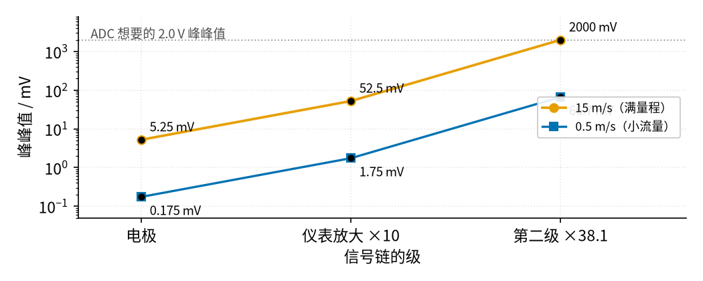
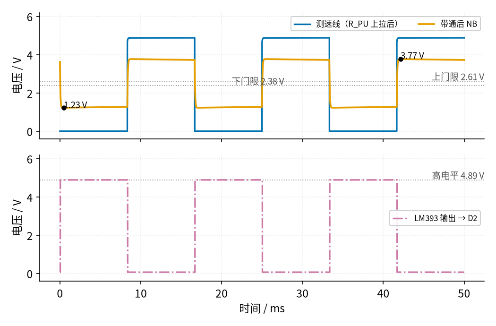

# 42 流量计信号链总览 · 原理与实现篇

[上一页：直觉篇](page1.md) · [直觉篇](page1.md) · 本页：原理与实现篇 · [参数与调试篇](page3.md) · [动手实验篇](page4.md) · [下一页：参数与调试篇](page3.md) · 前置节点：[30 仪表放大器与电桥 · 原理与实现篇](../30-instrumentation-amp/page2.md)、[33 带通与 50 Hz 陷波 · 原理与实现篇](../33-bandpass-notch/page2.md)、[36 施密特整形与频率/脉冲计数 · 原理与实现篇](../36-schmitt-pulse-shaping/page2.md)、[41 4–20 mA 电流环 · 原理与实现篇](../41-current-loop-4-20ma/page2.md)

> **前置回顾**：[36 施密特整形与频率/脉冲计数 · 原理与实现篇](../36-schmitt-pulse-shaping/page2.md) 推过反相施密特的上下门限；[41 4–20 mA 电流环 · 原理与实现篇](../41-current-loop-4-20ma/page2.md) 推过「PWM 码 → 设定电压 → 回路电流」。本页直接用这两个结果。

## 最小必要知识

- **满量程（FS）**：仪表能表示的最大值。「误差 0.1 %FS」指误差是满量程的 0.1 %，不管当前读数多大，误差都一样大。
- **% 读数**：误差除以**当前读数**。读数越小，同样大的误差占的比例越大。
- **峰峰值（pp）**：波形最高点减最低点。
- **K 系数**：频率型流量计「每流过 1 升（或 1 加仑）给多少个脉冲」，由流量实验室标定。
- **符号约定**：本节用 $Q_V$ 表示体积流量（单位时间流过多少体积）。不要和 [33 带通与 50 Hz 陷波](../33-bandpass-notch/page2.md) 里的 $Q$ 混淆，那个 $Q$ 是滤波器的品质因数。
- **中点参考 $V_{MID}$**：单电源电路里人为造出来的一个中间电压（本节用 5 V 经两个 10 kΩ 分压得到 2.5 V），交流信号围绕它上下摆动。它不是「地」，只是一个参考点。

## 一、电磁链：放大倍数要分两级

电磁流量计里，线圈产生磁场，导电的水流过磁场时，管壁两边的电极之间会感应出电压。电压和流速成正比。ADI 的文章给的典型灵敏度是每 1 m/s 流速产生 150–200 µV。本节取中间值 175 µV/(m/s)。

线圈电流每隔一段时间换一次方向（39 节的恒流 H 桥），电极电压也跟着正负翻转，所以峰峰值是单边幅度的 2 倍：

$$V_{pp} = 2 \times S \times v$$

代入数字：

- 0.5 m/s： $2 \times 175\thinspace\mu V \times 0.5 = 0.175\thinspace mV$ ；
- 1 m/s：0.35 mV；
- 15 m/s（满量程）：5.25 mV。

**为什么第一级最多放大 10 倍**？电极和水接触，会产生很大的直流「极化电压」，而且它会慢慢漂。ADI 的文章因此建议第一级仪表放大器的增益不超过 10。放大 10 倍之后，满量程信号是 52.5 mVpp，直流部分也还在运放的摆幅以内。之后用 33 节的带通把直流去掉，再做第二级放大。

**第二级放大多少**？假设 ADC 希望满量程时得到 2.0 Vpp：

$$G_2 = \frac{2000\thinspace mV}{52.5\thinspace mV} = 38.1$$

用同样的倍数，0.5 m/s 时只有 66.7 mVpp，只占 ADC 量程的 3 % 多一点。这就是电磁流量计为什么还要 38 节的同步检波：在小流量时把淹在噪声里的信号「按励磁节拍」挑出来。



*图 42-p2-1　电磁流量计信号在两级放大后的大小*

图 42-p2-1 里两条线平行，因为每一级都是同样的倍数。满量程那条正好放大到 ADC 的上限；小流量那条到最后也只有几十毫伏。如果为了让小流量变大而把第一级放大 1000 倍，极化直流会先把运放顶死，信号就全没了。

## 二、差压链：为什么一定要开方

孔板前后的压力差 $\Delta P$ 和体积流量 $Q_V$ 的关系来自伯努利方程（Rosemount 405 手册里写作「流量与 $\sqrt{DP/\rho}$ 成正比」）。写完整是：

$$Q_V = C_d \cdot A_2 \cdot \sqrt{\frac{2\Delta P}{\rho\thinspace (1-\beta^4)}}$$

各个字母：

- $C_d$ ：流出系数，本节取 0.6；
- $A_2$ ：孔的面积；
- $\rho$ ：水的密度，1000 kg/m³；
- $\beta$ ：孔径 ÷ 管径，本节取 0.5；管径 50 mm。

代入三个差压：

| 差压 | 流量 |
|---|---|
| 100 Pa | 0.136 L/s |
| 2500 Pa | 0.68 L/s |
| 10000 Pa | 1.36 L/s |

差压从 100 Pa 到 10000 Pa 翻了 100 倍，流量只翻了 10 倍。反过来说：**流量 10:1 的范围，对应差压 100:1**。

差压变送器有两种输出方式：Linear（直接输出差压）和 Square Root（变送器里先开方再输出）。Rosemount 3051S 手册特别警告：如果变送器设成 Square Root，控制系统里又设了一次开方，就会「square root function to be performed twice」，开方做了两次。


*图 42-p2-2　差压和流量的关系，以及开方做两次的后果*

图 42-p2-2 左边：如果把差压当直线读，2500 Pa 时会读成约 0.34 L/s，实际是 0.68 L/s，差了一倍。右边：差压 25 % 时，正确显示 50 %，开方两次却显示 70.7 %。两种错误方向相反，但都在中间段错得最多，只在 0 和满量程两端看起来「对」，所以只校两个端点是查不出来的。

## 三、频率链：从频率到流量只差一个 K 系数

**涡街**。水流过一根钝体（比如三角柱），后面会交替甩出漩涡。漩涡频率和流速成正比：

$$f = \frac{St \cdot v}{d}$$

$St$ 叫斯特劳哈尔数，钝体形状选定后，它在很宽的流速范围里几乎不变（Emerson 8800 技术说明）。取 $St = 0.2$ 、 $d = 10\thinspace mm$ ：0.3、1、3 m/s 分别对应 6、20、60 Hz。

**涡轮**。叶轮转得越快，拾取线圈或霍尔元件给的脉冲越密。厂家标定出 K 系数（每单位体积多少个脉冲），流量就是：

$$Q_V = \frac{f \times 60}{K}$$

FLOMEC 的例子：频率 500 Hz，K = 100 脉冲/加仑， $Q_V$ = 500 × 60 ÷ 100 = 300 加仑/分钟。FLOMEC 还提醒：标定报告会给出不同流量下的多个 K 值，K 不是一个常数。

**本节的风扇**。Intel 4 线风扇规范规定测速线每转 2 个脉冲，所以：

$$\text{转速 (rpm)} = \frac{f \times 60}{2}$$

我们再自定义一个「模拟流量」：假装每流过 1 升给 20 个脉冲（K = 20 脉冲/L，纯属示意，风扇当然不是流量计）。于是 50 Hz 对应 1500 rpm、150 L/min。

## 四、风扇测速前端：每个元件在干什么

下面是 [动手实验篇](page4.md) 里测速前端的原理图。先从左往右看一遍，再逐块读后面的推导。


*图 42-p2-3　风扇测速前端原理图：上拉、宽带通、LM393 施密特*

图 42-p2-3 可以分成四块：上拉、宽带通、施密特、输出上拉。下面一块一块算。

### 1. 上拉：让开集电极「有高电平」

测速线是**开集电极**：风扇里的三极管只会把线拉到 0 V，松开时线是悬空的。所以必须外加 R_PU 把它拉到 5 V。**只能拉到 Arduino 的 5 V**，不能拉到 12 V，否则高电平就是 12 V。

### 2. 宽带通：去掉直流，留下脉冲

C_HP 隔直流，C_LP 吃掉高频尖刺。通带里电容相当于导线（C_HP）或断开（C_LP），信号经 R_IN 和「R_HP 加分压器内阻」分压。10k/10k 分压器的内阻是 5 kΩ：

$$\text{通带增益} = \frac{R_{HP} + 5\thinspace k\Omega}{R_{IN} + R_{HP} + 5\thinspace k\Omega} = \frac{105}{205} = 0.512$$

这个 0.512 是**从测速线节点（第 14 列）算起**的增益，[参数与调试篇](page3.md) 的波形图和仿真都按它画。如果从 5 V 电源算起，还要把 R_PU 10 kΩ 串进去： $105 \div 215 = 0.488$ 。两种算法说的是同一个摆幅，只是起点不同；具体数值见本小节末尾。

下限频率由 C_HP 和串联的总电阻决定，上限频率由 C_LP 和并联电阻决定：

$$f_L = \frac{1}{2\pi \cdot 205\thinspace k\Omega \cdot 1\thinspace\mu F} = 0.78\thinspace Hz$$

$$f_H = \frac{1}{2\pi \cdot (100\thinspace k\Omega \parallel 105\thinspace k\Omega) \cdot 1\thinspace nF} = 3108\thinspace Hz$$

风扇测速频率大约 10–100 Hz，完全落在通带中间。通带故意做得很宽，因为风扇转速一变，频率能差 10 倍；窄带通在边缘会把幅度衰减掉，造成丢脉冲。

测速线在 0 V 和约 4.9 V 之间跳，乘 0.512 后约 2.5 Vpp，并且围绕 $V_{MID} = 2.5\thinspace V$ 上下摆。60 Hz 时 NB 在 1.23–3.77 V 之间摆。

### 3. 施密特：两条门限

这是 36 节的反相施密特。门限分压器 10k/10k 的戴维南等效是 2.5 V 串 5 kΩ，再经 R_H 100 kΩ 接到输出。

输出高电平：R_OUT 4.7 kΩ 上拉到 5 V，同时被 R_H 加 5 kΩ 拉向 2.5 V，所以略低于 5 V：

$$V_{OH} = \frac{5/4.7\thinspace k + 2.5/105\thinspace k}{1/4.7\thinspace k + 1/105\thinspace k} = 4.893\thinspace V$$

输出高时，门限被往上推一点；输出低（约 0.065 V）时，被往下拉一点：

$$V_U = 2.5 + (4.893 - 2.5) \times \frac{5}{105} = 2.614\thinspace V$$

$$V_L = 2.384\thinspace V$$

回差 $V_U - V_L = 0.230\thinspace V$ 。NB 的摆幅（约 2.5 Vpp）是回差的 10 倍以上，每个周期一定会穿过两条门限；而面包板上几十毫伏的噪声又小于回差，不会让输出来回抖。

**为什么 LM393 用 12 V 供电**？TI 的 LM393 手册（SLCS005）规定输入共模范围在 25 °C 时到 VCC − 1.5 V，**全温度范围**只到 VCC − 2 V。如果用 5 V 供电，上限只有 3.5 V（全温度 3.0 V），而 NB 最高约 3.77 V，超了。用 12 V 供电，上限 10 V 以上，余量很大。LM393 的输出是开集电极，输出高电平由 R_OUT 决定，所以输出依然只有 5 V，能安全接 Arduino。

### 4. Arduino：测周期 → 流量 → 电流

Arduino 用 D2 的外部中断，每来一个上升沿记一次 `micros()`，相邻两次之差就是周期 $T$ ， $f = 1/T$ 。然后：

$$I = 4 + 16 \times \frac{f}{100\thinspace Hz}\ (\text{mA})$$

再加两条规矩：

- 低于 5 Hz 一律输出 4.00 mA（**低流量切除**）；超过 100 Hz 一律输出 20 mA（限幅）。
- 超过 0.5 s 没有新脉冲，就认为风扇停了，频率记 0。

电流怎么变成 PWM 码，完全照 41 节：

$$\text{码} = \frac{I \times 100\thinspace\Omega}{V_5 \times 10/22} \times 255$$

50 Hz 时 I = 12.00 mA， $V_5 = 5.00\thinspace V$ ，码 = 135。

## 五、用 Python 跑一遍前端

下面这段代码用最简单的「一小步一小步往前算」的方法，模拟 60 Hz 测速方波经过上拉、宽带通、施密特后的样子，数出 1 s 里有多少个上升沿。

```python
import numpy as np                      # 数组运算

# ---- 元件值（和图 42-p2-3 一致）----
V5 = 5.0                                # Arduino 5 V
R_PU, R_IN, C_HP = 10e3, 100e3, 1e-6    # 上拉、输入电阻、隔直电容
R_HP, C_LP = 100e3, 1e-9                # 到中点参考的电阻、滤高频的小电容
R_MID = 5e3                             # 10k/10k 分压的等效内阻
V_MID = V5 / 2                          # 中点参考 2.5 V
VU, VL = 2.614, 2.384                   # 施密特上、下门限（本页第四节第 3 小节算过）

f, dt, t_end = 60.0, 2e-6, 1.2          # 测速频率 60 Hz，步长 2 µs，仿真 1.2 s
n = int(t_end / dt)                     # 总步数
vc, vnb, out_hi = 0.0, V_MID, True      # 电容电压、NB 电压、比较器输出状态
nb_list, rise = [], 0                   # 记录 NB 电压、输出上升沿个数
for k in range(n):
    t = k * dt                          # 当前时刻
    off = (t * f) % 1.0 >= 0.5          # 前半周期三极管导通（拉到 0 V），后半周期关断
    if off:                             # 关断：R_PU 把测速线往 5 V 拉，同时经 R_IN 给电容充电
        vt = (V5 / R_PU + (vc + vnb) / R_IN) / (1 / R_PU + 1 / R_IN)
    else:
        vt = 0.0                        # 导通：测速线 ≈ 0 V
    i_in = (vt - vc - vnb) / R_IN       # 流过 R_IN 的电流
    vc += i_in / C_HP * dt              # 电容电压随电流慢慢变（隔直）
    i_c = i_in - (vnb - V_MID) / (R_HP + R_MID)   # 流进 C_LP 的电流 = 进来的 − 流向中点的
    vnb += i_c / C_LP * dt              # NB 电压
    if out_hi and vnb > VU:             # 反相施密特：超过上门限 → 输出变低
        out_hi = False
    elif (not out_hi) and vnb < VL:     # 低于下门限 → 输出变高（一个上升沿）
        out_hi = True
        if t > 0.2:                     # 0.2 s 以后才计数（等隔直电容充好）
            rise += 1
    if t > 0.2:
        nb_list.append(vnb)
nb = np.array(nb_list)
print(f"NB 摆动 {nb.min():.2f} – {nb.max():.2f} V，平均 {nb.mean():.2f} V")
print(f"1.0 s 内上升沿 {rise} 个，测速频率 {f:.0f} Hz → 转速 {rise * 60 / 2:.0f} rpm")
```

运行结果：NB 在 1.23–3.77 V 之间摆，平均 2.50 V；1 s 内 60 个上升沿，对应 1800 rpm。一个不多、一个不少。

画图脚本用同样的模型画出了前 50 ms 的波形：



*图 42-p2-4　60 Hz 时测速线、带通后 NB 和 LM393 输出的波形*

图 42-p2-4 上图里，NB 的每一次跳变都远远越过两条门限，所以下图输出干净地翻转，没有毛刺。注意输出和测速线是**反相**的：测速线低时输出高。D2 不管数上升沿还是下降沿，一个周期都只数一次，频率是一样的。

## 六、渐隐例题

### 例 1（完整）：风扇测到 50 Hz

1. 转速：50 × 60 ÷ 2 = 1500 rpm。
2. 模拟流量：50 × 60 ÷ 20 = 150 L/min。
3. 电流：50 Hz 高于 5 Hz 切除点，I = 4 + 16 × 50 ÷ 100 = 12.00 mA。
4. PWM 码（ $V_5 = 5.00\thinspace V$ ）：0.012 × 100 ÷ (5.00 × 10/22) × 255 = 134.6 → 135。
5. 250 Ω 上：41 节的三极管基极分走约 1 %，回路电流约 11.91 mA，250 Ω 上约 2.978 V。

### 例 2（留空）：风扇测到 80 Hz

1. 转速：80 × 60 ÷ 2 = ____ rpm。
2. 模拟流量：____ L/min。
3. 电流：4 + 16 × 80 ÷ 100 = ____ mA。
4. 250 Ω 上约 ____ V。

<details><summary>答案</summary>

1. 2400 rpm。
2. 80 × 60 ÷ 20 = 240 L/min。
3. 16.80 mA（PWM 码 188）。
4. 回路约 16.59 mA，250 Ω 上约 4.147 V。

</details>

### 例 3（变体）：涡轮流量计

FLOMEC 的涡轮流量计 K = 100 脉冲/加仑，测到 500 Hz。流量是多少加仑/分钟？和风扇的算法有什么不同？

<details><summary>答案</summary>

$Q_V = 500 \times 60 \div 100 = 300$ 加仑/分钟。算法完全一样，都是「频率 × 60 ÷ 每单位体积的脉冲数」。不同在于：风扇的「每转 2 个脉冲」是规范写死的；涡轮的 K 是标定出来的，而且随流量变化，换一段流量要换一个 K 值。

</details>

## 小结

- 电磁：电极 0.175–5.25 mVpp，第一级 ≤ 10 倍防极化直流，第二级再放大 38.1 倍到 2.0 Vpp。
- 差压：流量和差压的平方根成正比，开方只能做一次。
- 频率型：流量 = 频率 × 60 ÷ K。
- 风扇前端：上拉到 5 V → 通带增益 0.512、0.78–3108 Hz 的宽带通 → 门限 2.614/2.384 V 的施密特 → D2。

## 下一步

[参数与调试篇](page3.md) 会看这些参数改了会怎样：差压误差为什么在小流量时被放大、带通的频率范围怎么选、低流量切除为什么要有，以及一张故障排查表。
