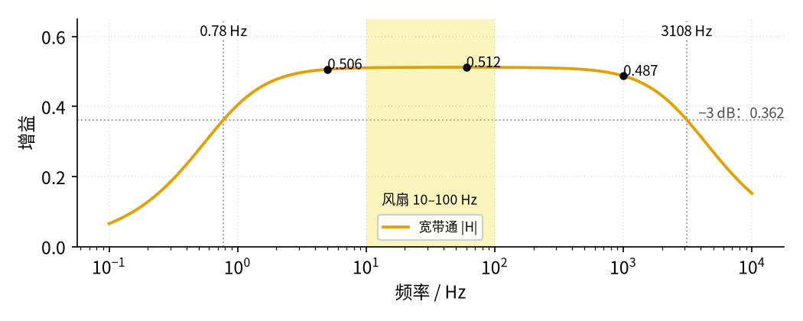
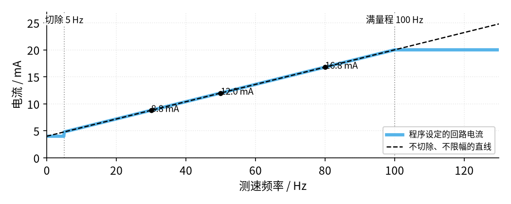

# 42 流量计信号链总览 · 参数与调试篇

[上一页：原理与实现篇](page2.md) · [直觉篇](page1.md) · [原理与实现篇](page2.md) · 本页：参数与调试篇 · [动手实验篇](page4.md) · [下一页：动手实验篇](page4.md) · 前置节点：[33 带通与 50 Hz 陷波 · 参数与调试篇](../33-bandpass-notch/page3.md)、[36 施密特整形与频率/脉冲计数 · 参数与调试篇](../36-schmitt-pulse-shaping/page3.md)、[41 4–20 mA 电流环 · 参数与调试篇](../41-current-loop-4-20ma/page3.md)

> **前置回顾**：[原理与实现篇](page2.md) 推出了差压开方的关系、风扇前端的通带（0.78–3108 Hz，从测速线节点算增益 0.512；从 5 V 电源经 R_PU 算是 0.488）和施密特门限（2.614/2.384 V）。本页看这些数改了会怎样、拼起来以后哪里最容易出错。

## 一、差压：同样的误差，小流量时被放大

差压变送器的误差通常按「满量程的百分之几」给。假设它有 0.1 %FS 的误差，开方以后，流量误差是多少？

开方曲线在零点附近非常陡：差压一点点变化，流量变化很大。所以同样 0.1 %FS 的差压误差，在不同位置换成流量误差，大小完全不同：

| 差压（% 满量程） | 流量误差（%FS） | 流量误差（% 读数） |
|---|---|---|
| 100 | 0.05 | 0.05 |
| 25 | 0.10 | 0.20 |
| 4 | 0.25 | 1.24 |
| 1 | 0.49 | 4.88 |
| 0.8 | 0.54 | 6.07 |

满量程时流量误差只有 0.05 % 读数；差压降到 1 %（流量 10 %）时，变成 4.88 % 读数，差了将近 100 倍。这就是差压流量计「量程比」只有 10:1 左右的原因。

越靠近零点越糟：差压为 0 附近，一点点噪声开方后会变成很大的流量跳动。所以 Rosemount 3051S 在 Square Root 模式下做了「低流量处理」：差压在 0–0.6 % 时，输出不开方，按斜率 1 直接线性输出；0.6–0.8 % 之间用一条直线过渡（手册写斜率 42，我们按端点算出 41.7）；0.8 % 以上才正常开方。

*图 42-p3-1　差压误差在小流量时被放大，以及 3051S 的低流量处理*

图 42-p3-1 左边是一条直线（对数坐标），斜率说明「差压降 100 倍，流量误差 % 读数涨约 100 倍」。右边，纯开方曲线在零点像一堵墙，橙色线把这堵墙「削平」了：零点附近输出几乎是 0，不会被噪声带着乱跳。代价是 0.8 % 差压（约 9 % 流量）以下读数不准，但那一段本来就测不准。

## 二、开方两次：中间段偏大最多

把同一路信号开方两次，等于开四次方。表里是正确值和错误值：

| 差压 | 应显示流量 | 开方两次后显示 |
|---|---|---|
| 1 % | 10 % | 31.6 % |
| 10 % | 31.6 % | 56.2 % |
| 25 % | 50 % | 70.7 % |
| 50 % | 70.7 % | 84.1 % |
| 100 % | 100 % | 100 % |

满量程时两者一样，所以「只看满量程对不对」查不出来。查法很简单：看变送器的输出模式（Linear 还是 Square Root），再看控制系统里的换算设置，两边只能有一处开方。

## 三、风扇前端的参数

下表列出图 42-p3-2 里每个元件的作用，以及改大改小会怎样。这张图和 [原理与实现篇](page2.md) 的前端原理图是同一套电路，这里把风扇电源和 ADC 基准也画上了，第五节故障排查表里的 ①、②、⑦ 和 LM393 8 脚也在图上。

![整机原理图，分三块。左上「① 风扇电源：LM317 可调稳压（直流，不用 PWM）」：+12 V 进 LM317 的 IN（3 脚），对地接 CIN 100 nF；OUT（2 脚）接橙色线「风扇 +V（2 脚）」，测量点①，对地接 CF 100 µF + 100 nF；OUT 经 R_A 240 Ω 到 ADJ（1 脚），ADJ 经 R_ADJ 2 kΩ 电位器接地。右上「③ ADC 基准 2.5 V」：+5 V 经 R_Z 1 kΩ 到 LM4040 的阴极（2 脚），阳极（3 脚）接 0 V，1 脚悬空；阴极用绿线接 Arduino AREF，测量点⑦。下方「② 测速前端：上拉 → 宽带通 → LM393 施密特」：虚线框「风扇内部（看不见）」里是开集电极 NPN（标 B、C、E，霍尔驱动每转 2 次导通，E 接黑线 1 脚到地），C 就是测速线 3 脚，经 R_PU 10 kΩ 上拉到 Arduino 的 +5 V（测量点②）；测速线经 R_IN 100 kΩ、C_HP 1 µF 无极性到节点 NB（测量点③），NB 对地接 C_LP 1 nF，NB 经 R_HP 100 kΩ 接中点参考 V_MID 2.5 V（RM1 10 kΩ 接 +5 V、RM2 10 kΩ 接地，测量点④）；NB 进 LM393 A 组反相端（2 脚），门限 REF（RR1 10 kΩ 接 +5 V、RR2 10 kΩ 接地，测量点⑥）进同相端（3 脚），8 脚 +12 V、4 脚地；输出 1 脚（测量点⑤）经 R_OUT 4.7 kΩ 上拉到 +5 V，橙色线接 Arduino D2，并经 R_H 100 kΩ 接回 REF。图下三行注：参数表里的元件 R_PU、R_IN、C_HP、R_HP、C_LP 在测速前端左半，RM1/RM2 给 V_MID 2.5 V，RR1/RR2 给门限 REF，R_H 是回差电阻；排查表里的点 ① LM317 输出（风扇电压）、② 测速线、⑦ AREF，LM393 的 8 脚接 +12 V、4 脚接 0 V，LM4040 阴极接 R_Z 和 AREF；LM393 的 B 组不用，5、6 脚接 0 V，7 脚空着，测速线不直接接 Arduino](img/42_p3_2_schem.png)

*图 42-p3-2　参数篇对照用的原理图（参数表和故障排查表都按这张图找元件）*

**对照看**：表里每一行都能在图上找到。R_PU 在测速线上方，接 +5 V；R_IN 和 C_HP 串在测速线和 NB 之间，C_HP 决定下限 0.78 Hz；C_LP 从 NB 接地，决定上限 3108 Hz；R_HP 把 NB 拉向 V_MID；R_H 从 LM393 的 1 脚接回 3 脚的 REF，决定回差 0.230 V。低流量切除、超时和满量程是程序里的数，图上没有元件。

| 元件 | 本节取值 | 管什么 | 改大会怎样 | 改小会怎样 |
|---|---|---|---|---|
| R_PU | 10 kΩ | 测速线的高电平 | 上拉变弱，边沿变慢，更容易受干扰 | 风扇里的三极管要吸更多电流；1 kΩ 也可以 |
| R_IN、R_HP | 100 kΩ、100 kΩ | 通带增益 0.512 | 比值不变时增益不变；都加大会更怕干扰 | 都减小会加重测速线负载 |
| C_HP | 1 µF 无极性 | 下限 0.78 Hz | 下限更低，开机后要等更久才稳 | 下限升高；方波摆幅不缩小、不丢脉冲，但平顶塌向 2.5 V，离门限的余量变小（0.1 µF、10 Hz 约 0.32 V，最少约 0.115 V），噪声大时可能多计（见练习 6） |
| C_LP | 1 nF | 上限 3108 Hz | 上限降低，边沿变圆 | 上限升高，更多尖刺进比较器 |
| R_H | 100 kΩ | 回差 0.230 V | 回差变小，噪声大时可能多计 | 回差变大，信号小时可能翻不过去 |
| 低流量切除 | 5 Hz | 低于它一律 4.00 mA | 能测的最低流量变高 | 停转前后读数更容易跳 |
| 超时 | 0.5 s | 多久没脉冲就算停转 | 停转后要等更久才回 4 mA | 低速时会误判成停转 |
| 满量程 | 100 Hz | 对应 20 mA | 同一转速下电流变小 | 更早被限在 20 mA |

### 通带为什么这么宽

下面是宽带通的频率响应，用 Python 按原理图逐点算出来。

*图 42-p3-3　风扇前端宽带通的频率响应*

图 42-p3-3 里，风扇的整个频率范围（浅黄带）都在平台上，10 Hz 时增益 0.511、100 Hz 时 0.512，几乎没有差别。所以转速从低到高，NB 的摆幅基本不变（10 Hz 时 1.10–3.93 V，100 Hz 时 1.24–3.76 V），施密特都能稳稳翻转。10 Hz 的摆幅反而稍大，是因为半个周期 50 ms 已经不算比时间常数 $205\thinspace k\Omega \times 1\thinspace\mu F = 0.205\thinspace s$ 短很多：方波的平顶会往回「塌」一点，每个跳变沿就多冲出去一点。两种摆幅都远大于 0.23 V 的回差。

如果你换成中心在 50 Hz 附近的窄带通（33 节那种 Q 值较高的），10 Hz 和 100 Hz 都会落在衰减区，幅度可能掉到回差以下，造成丢脉冲。频率型信号要的是「一个不丢地数」，不需要把某一个频率挑出来。

### 测周期的分辨率

`micros()` 的分辨率是 4 µs。60 Hz 的周期约 16.7 ms，单个周期最多差 4 µs，误差约 0.024 %；满量程 100 Hz 时周期 10 ms， $4\thinspace\mu s \div 10\thinspace ms \approx 0.04$ %。如果在 0.5 s 窗口里数周期再平均，60 Hz 时误差降到约 0.0008 %。对这个实验来说，测频误差远小于后面 PWM 和电阻的误差。

## 四、低流量切除和限幅

程序里电流和频率的关系画出来是这样：

*图 42-p3-4　低流量切除和满量程限幅*

图 42-p3-4 里，天蓝线在左端有一个小台阶：低于 5 Hz 时输出钉在 4.00 mA，停转和极低速都显示「零流量」，读数不会在 4 mA 上下跳。右端在 100 Hz 封顶，超过满量程也只输出 20 mA，不会超出 41 节回路的能力，也不会误入 NE43 的故障区（≥ 21 mA）。

## 五、故障排查表

| 现象 | 原因 | 怎么查 | 怎么改 |
|---|---|---|---|
| 串口频率一直是 0 | 风扇没转（电压低于启动电压，ADI 文章举例约 7 V）；测速线没上拉；D2 没接；LM393 的 8 脚没有 12 V | 万用表量 ① 风扇电压、② 测速线平均电压、LM393 8 脚 | 先把风扇电压调到 7 V 以上让它起转；补上 R_PU；查 a30 → 上方 +12 V 轨 |
| 频率是实际的 2 倍 | 中断用了 `CHANGE`，上升沿和下降沿都数 | 看程序里 `attachInterrupt` 的最后一个参数 | 改成 `RISING` |
| 转速算出来是实际的 2 倍或一半 | 「每转脉冲数」写错 | 对照 Intel 规范：每转 2 个 | 程序里 `PPR = 2` |
| 调低转速后频率乱跳、偏大 | 用 PWM 斩风扇电源调速，测速电路跟着断电 | 看调速方式 | 只用 LM317 直流调压 |
| 风扇停了，电流还停在上一个值 | 没有超时，没有新脉冲时不更新 | 拔掉风扇电源看串口 | 0.5 s 没脉冲记为 0 Hz |
| 停转附近读数在 4 mA 上下跳 | 没有低流量切除 | 风扇调到最慢，看串口 | 低于 5 Hz 输出 4.00 mA |
| 250 Ω 上的电压比预期低约 3–4 % | 5V 引脚实际约 4.83 V，程序里还写 5.00 | 万用表量 5V 引脚；看串口「A0 读回」是否比设定低 | 把实测值写进 `V5` |
| A0 读回全是 1023 或乱跳 | AREF 没接，或 `analogReference(EXTERNAL)` 不在 `setup()` 第一行 | 量 ⑦ AREF 是否 2.50 V；看程序 | 接好 LM4040；把这行放到 `setup()` 最前面 |
| ⑦ AREF 远低于 2.5 V | LM4040 插反，或 R_Z 没接到 +5 V | 对照手册引脚图 | 阴极接 R_Z 和 AREF，阳极接 0 V |
| 差压流量计中间段读数偏大 | 开方做了两次 | 看变送器输出模式和控制系统设置 | 只留一处开方 |
| 差压流量计零点附近乱跳 | 没有低流量处理 | 关阀门看读数 | 打开小信号切除 |
| 涡轮流量计小流量时偏差大 | 全量程只用一个 K | 看标定报告 | 分段用不同 K 值 |

## 六、举一反三

### 例 1（完整例题）：给磁电式涡轮流量计设计前端

题设：K = 900 脉冲/L，流量 2–30 L/min；线圈输出峰值在 2 L/min 时是 20 mV，并且和频率成正比。施密特用本节同样的回差 0.230 V。LM358 单电源 12 V、中点参考 4.5 V，不削顶的摆幅大约 ±4 V。

1. **频率范围**：2 × 900 ÷ 60 = 30 Hz；30 × 900 ÷ 60 = 450 Hz。
2. **幅度范围**：20 mV × 450 ÷ 30 = 300 mV 峰。
3. **放大倍数**：希望最小信号放大后的峰值至少是半回差（0.115 V）的 4 倍：G ≥ 4 × 0.115 ÷ 0.020 = 23.0。取同相放大 1 + 33k/1k = 34。
4. **会不会削顶**：大流量时 300 mV × 34 = 10.2 V 峰，超过 ±4 V，会削顶。但这是频率型信号，削顶只改变形状，不改变频率，**无害**。
5. **滤波**：高通取最低频率的 1/5，6 Hz，用 1 µF 时 R = 26.5 kΩ；低通取最高频率的 5 倍，2250 Hz，用 10 nF 时 R = 7.07 kΩ。取标准值 27k 和 6.8k，得到 5.89 Hz 和 2341 Hz。
6. **换算**：16 L/min → 240 Hz；把 0–450 Hz 对应 4–20 mA，电流 = 4 + 16 × 240 ÷ 450 = 12.53 mA。

把上面算出来的元件画成电路，就是图 42-p3-5。

![例 1 前端原理图：左边涡轮拾取线圈（信号源，20–300 mV 峰、30–450 Hz）一端接地，另一端经 C_HP 1 µF 到 LM358 A 组的 3 脚（同相输入），3 脚另经 R_HP 27 kΩ 接 V_MID；2 脚（反相输入）经 R_G 1 kΩ 接 V_MID，R_F 33 kΩ 从 1 脚（输出）接回 2 脚；1 脚输出经 R_LP 6.8 kΩ，节点上 C_LP 10 nF 到地，橙色线送到 LM393 的 2 脚（反相输入）。施密特比较器的门限中心取 V_MID：本节门限分压的两只 10 kΩ 两端都改接 V_MID，画成 R_T 5 kΩ（10k∥10k）从 3 脚（同相输入）接 V_MID，R_H 100 kΩ 从 1 脚（输出）接回 3 脚，1 脚经 R_OUT 4.7 kΩ 上拉到 +5 V 并送 Arduino D2；LM393 的 8 脚接 +12 V，4 脚接 GND。下方中点参考：+12 V 经 R1 15 kΩ、R2 9.1 kΩ 分压到地，并 10 µF 电解电容（正极朝分压点），分压点接 LM358 B 组 5 脚，6 脚接 7 脚成跟随器，7 脚输出 V_MID ≈ 4.5 V，送到上面两个 V_MID。灰色小字：8 脚接 +12 V，4 脚接 GND；底部注明增益 34、高通 5.89 Hz、低通 2341 Hz、中点 4.53 V，施密特上门限 4.552 V、下门限 4.318 V、回差 0.234 V，最小信号 3.85–5.21 V 两条门限都越过，照本节 2.614/2.384 V 的门限则永不翻转](img/42_p3_5_ex1_schem.png)

*图 42-p3-5　例 1 的前端：高通 27k/1µF → LM358 同相 ×34 → 低通 6.8k/10nF → 施密特比较器（门限中心取 V_MID，回差约 0.23 V；标引脚号）*

**对照看**：第 5 步的高通就是 C_HP 加 R_HP，R_HP 同时给 3 脚提供 4.5 V 的直流偏置；第 3 步的 34 倍是 R_F、R_G；低通 R_LP、C_LP 放在放大器后面，把放大后的高频毛刺滤掉再送比较器。R_G 的下端接的是 V_MID 而不是地，这样直流增益只作用在「相对 4.5 V」的部分，输出静止时也停在 4.5 V。R1、R2 的阻值是示意取值（12 × 9.1 ÷ 24.1 ≈ 4.53 V），只要分出约 4.5 V 都行。

比较器**不能照抄**本节的接法：本节 LM393 的门限以 2.5 V 为中心（2.614/2.384 V），而这里 LM358 输出静止在 4.53 V，2 L/min 时只在 4.53 ± 0.68 V（约 3.85–5.21 V）之间摆，永远在两条门限上方，比较器不会翻转。所以把门限分压的两只 10 kΩ 两端都改接 V_MID：等效内阻还是 5 kΩ，只是中心从 2.5 V 挪到 V_MID。按本节同一套公式算，上门限 4.552 V、下门限 4.318 V，回差 0.234 V（和本节 0.230 V 几乎一样；中心比 V_MID 低约 0.1 V，因为输出只在 0～5 V 之间跳）；最小信号上下各越过约 0.66 V 和 0.47 V，能稳定翻转。另一种办法是先经隔直电容再送比较器，让信号重新以 2.5 V 为中心，这里不展开。

### 例 2（留空）：差压变送器读到 8 mA

题设：差压变送器 0–2500 Pa，**线性**输出 4–20 mA；孔板同 [原理与实现篇](page2.md)（满量程 2500 Pa 对应 0.680 L/s）。读到 8.0 mA。

1. 差压占满量程：(8.0 − 4) ÷ 16 = ____ %，即 ____ Pa。
2. 流量占满量程：开方，____ %。
3. 流量：____ L/s。

答案

1. 25 %，625 Pa。
2. 0.25 的平方根是 0.5，即 50 %。
3. 0.680 × 0.5 = 0.340 L/s。如果误把它当线性，会读成 25 %、0.170 L/s，只有一半。

### 例 3（变体）：压电涡街

题设：钝体宽 20 mm，St = 0.2，流速 0.5–5 m/s。频率范围是多少？能不能直接用本节风扇实验的程序参数？

答案

f = 0.2 × 0.5 ÷ 0.02 = 5 Hz 到 0.2 × 5 ÷ 0.02 = 50 Hz。

不能直接用。最低流量正好 5 Hz，碰上了本节的低流量切除点，最低流量会被切成零；满量程也应改成 50 Hz。超时 0.5 s 在 5 Hz 时只能等 2.5 个周期，最好放宽。另外压电片给的是电荷，前面要加 32 节的电荷放大器，不能像风扇那样直接上拉。

## 七、练习

1. 风扇测到 30 Hz。求转速、模拟流量（K = 20 脉冲/L）、输出电流和 PWM 码（ $V_5 = 5.00\thinspace V$ ）。
2. 电磁流量计灵敏度 150 µV/(m/s)，流速 0.5 m/s，励磁正负交替（电极电压在正负两个值之间来回跳），第一级放大 10 倍。放大后的峰峰值是多少？
3. 差压变送器误差 0.1 %FS。差压在满量程的 9 % 时（流量约 30 %），流量误差是多少 %FS？折合百分之几读数？
4. （变体）一台差压流量计开方做了两次。实际流量是满量程的 60 %，差压是满量程的百分之几？屏幕显示流量是多少？
5. （回顾 36 节）把施密特的 R_H 从 100 kΩ 换成 47 kΩ。上下门限、回差各是多少？风扇 NB 摆幅约 1.2–3.8 V，还能稳定翻转吗？提示：R_H 变小以后，输出高电平也会被拉低一点。
6. （回顾 33 节）把 C_HP 从 1 µF 换成 0.1 µF。下限频率变成多少？风扇最慢 10 Hz 时通带增益约多少？
7. （回顾 41 节）250 Ω 接收电阻上，4 mA 和 20 mA 时各是多少伏？
8. （幅度链设计）一台线性输出的差压变送器：差压 0–100 % 对应 0–5 V，管道满量程 0–10 m³/h。Arduino（ $V_5 = 5.00\thinspace V$ ）读这个电压、开方一次，再像本节一样输出与流量成正比的 4–20 mA，流量低于 5 % 时切成 4 mA。求：(a) $Q_V = 2.5$ m³/h 时变送器输出几伏、回路电流多少、PWM 码约多少；(b) 5 % 流量的切除点对应差压的百分之几、变送器输出几毫伏；(c) Arduino 10 位 ADC 以 5 V 为基准时，这个切除点大约只有几个 LSB？

答案

1. 30 × 60 ÷ 2 = 900 rpm；30 × 60 ÷ 20 = 90 L/min；4 + 16 × 30 ÷ 100 = 8.80 mA；码 99（250 Ω 上约 2.184 V）。
2. 2 × 150 µV × 0.5 × 10 = 1.50 mVpp。
3. $\sqrt{0.091} - \sqrt{0.09} = 0.00166$ ，即 0.166 %FS；当前流量 30 %，折合 $0.166 \div 30 \approx 0.55$ % 读数。
4. 差压 = 0.6² = 36 %。开方两次显示 $0.36^{0.25} = 0.775$ ，即 77.5 %；正确是 60 %。
5. 输出高电平约 4.79 V（R_H 和 5 kΩ 串联后分走一点 R_OUT 的电流）；上门限约 2.720 V，下门限约 2.266 V，回差约 0.455 V。NB 的 1.2–3.8 V 仍然越过两条门限，每边还有约 1 V 余量，能稳定翻转；回差加倍后抗噪更好。
6. $f_L = 1 \div (2\pi \times 205\thinspace k\Omega \times 0.1\thinspace\mu F) \approx 7.76$ Hz。如果按正弦算，10 Hz 时增益约 0.40（原来 0.511）。但测速线是方波：隔直电容对跳变沿几乎相当于短路，每个沿 NB 照样跳约 2.5 V；时间常数 $205\thinspace k\Omega \times 0.1\thinspace\mu F = 20.5\thinspace ms$ 比半周期 50 ms 短，平顶塌得更多，沿上冲得更远。把 page2 程序里的 C_HP 改成 0.1e-6、f 改成 10.0 运行，NB 在 0.21–4.71 V 之间摆（原来 1 µF 时约 1.10–3.93 V），摆幅反而变大，1 s 内 10 个上升沿一个不丢；5 Hz 时 0.01–4.88 V，在无噪声的仿真里还能翻转。0.01 V 仍在 LM393 的输入共模范围内，低端不是问题；真正的代价是平顶塌向 2.5 V：半周期结束时，NB 离「对面那条门限」只剩约 0.32 V（10 Hz；1 µF 时约 1.2 V），5 Hz 时只剩约 0.13 V（平顶最多塌到 2.5 V，所以不会低于约 0.115 V）。这只比面包板上几十毫伏的噪声大两三倍，噪声稍大就可能多翻一次、多计脉冲。所以换小电容以后，最低转速附近的余量要重新算。「增益 0.40、摆幅缩小」那种算法只适用于正弦型拾取（例如磁电线圈）。
7. 4 mA × 250 Ω = 1.0 V；20 mA × 250 Ω = 5.0 V。
8. (a) 流量 25 %，差压 = 0.25² = 6.25 %，变送器输出 0.3125 V；电流 = 4 + 16 × 0.25 = 8.00 mA；码约 90（同 41 节公式）。(b) 差压 = 0.05² = 0.25 %，即 5 V × 0.0025 = 12.5 mV。(c) 1 LSB = 5 V ÷ 1024 ≈ 4.9 mV，12.5 mV 只有约 2.6 个 LSB。所以差压链的低流量切除离不开好的零点；这也是「差压加开方」在小流量时不准的又一个原因。

## 小结

- 差压误差在小流量时被放大：0.1 %FS 的差压误差，满量程时只有 0.05 % 读数，1 % 差压时变成 4.88 % 读数。
- 开方两次在两端看不出，中间段偏大最多。
- 频率型前端要用宽带通；风扇 10–100 Hz 全在平台上。
- 低流量切除 + 超时 + 满量程限幅，三件事都要写进程序。

## 下一步

[动手实验篇](page4.md) 把风扇、测速前端、Arduino 和 41 节的发送板接成一整条链，用万用表在 250 Ω 上读出「流量」。
