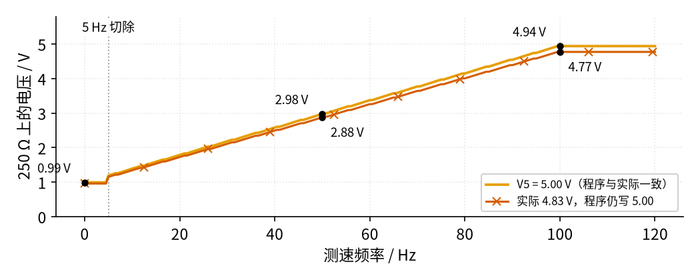

# 42 流量计信号链总览 · 动手实验篇

[上一页：参数与调试篇](page3.md) · [直觉篇](page1.md) · [原理与实现篇](page2.md) · [参数与调试篇](page3.md) · 本页：动手实验篇 · [下一页：43 推挽功放：甲、乙、甲乙类 · 直觉篇](../43-push-pull-power-amp/page1.md) · 前置节点：[41 4–20 mA 电流环 · 动手实验篇](../41-current-loop-4-20ma/page4.md)、[36 施密特整形与频率/脉冲计数 · 动手实验篇](../36-schmitt-pulse-shaping/page4.md)、[35 程控增益与 AGC · 动手实验篇](../35-pga-agc/page4.md)

> **前置回顾**：本页的 2 号板就是 [41 4–20 mA 电流环 · 动手实验篇](../41-current-loop-4-20ma/page4.md) 搭好的发送板，一根线都不改；LM393 施密特在 [36 施密特整形与频率/脉冲计数 · 动手实验篇](../36-schmitt-pulse-shaping/page4.md) 用过；第一次给 Arduino 上传程序，看 [35 程控增益与 AGC · 动手实验篇](../35-pga-agc/page4.md)「最小必要知识：Arduino 上手（第一次上传程序）」。

## 这次实验要验证什么

本页把一台普通的 12 V 三线电脑风扇当作「涡轮流量计」：叶片越转越快，测速线（黄线）给出的脉冲频率越高。我们搭一条完整的频率型信号链——风扇 → 上拉 → 宽带通 → LM393 施密特 → Arduino 测周期 → 换算成流量 → PWM → 41 节的发送板 → 250 Ω 上的 1–5 V。要亲手验证五件事：

1. **频率型前端不多数、不漏数**：转速从慢到快，串口显示的频率和万用表频率挡（如果有）一致；NB 的直流平均约 2.50 V，输出约 2.48 V（[原理与实现篇](page2.md)「四」「五」）。
2. **换算链**：串口输入 `F30`、`F50`、`F80`、`F100` 时，250 Ω 上分别约 2.18、2.98、4.15、4.94 V（[原理与实现篇](page2.md)「三」和 [参数与调试篇](page3.md)「四」）。
3. **停转回零**：风扇停下后约 1 s 内（程序超时 0.5 s，加上每 0.5 s 刷新一次），读数回到 4.00 mA（250 Ω 上约 0.99 V）。
4. **独立基准能抓出 5 V 误差**：A0 用 LM4040 的 2.5 V 作基准，读回的电流和设定值差 2 % 以上就报警（[参数与调试篇](page3.md)「五」）。
5. **风扇本身的特性**：亲手测出你这台风扇的启动电压和停转电压（ADI 的文章举例约 7 V 启动、4 V 停转，每台不同），以及 LM317 在 12 V 输入下实际能给到的最高电压（约 10 V 出头，到不了公式算出的 11.67 V）。

## 每一级来自哪一节

这条链是用前面各节的积木拼出来的。下表列出每一级的来历；搭建步骤的标题也按「第 N 级（第 xx 节）」写。

| 级 | 做什么 | 来自哪一节 | 本页是否真的搭 |
|---|---|---|---|
| 第 1 级　风扇调压 | LM317 + 电位器， $V_{OUT} = 1.25\thinspace V \times (1 + R_{ADJ} / R_A)$ | [21 线性稳压](../21-linear-regulator/page2.md) | 搭（1 号板第 1–12 列） |
| 第 2 级　测速前端 | 开集电极测速线 + R_PU 上拉 | [29 上拉与电平转换](../29-pullup-level-shift/page2.md) | 搭 |
| | 宽带通 0.78–3108 Hz | [33 带通与 50 Hz 陷波](../33-bandpass-notch/page2.md) | 搭，但**简化成无源 RC**，没有用 33 节的有源带通 |
| | LM393 施密特，门限 2.614 / 2.384 V | [36 施密特整形与频率/脉冲计数](../36-schmitt-pulse-shaping/page2.md) | 搭 |
| 第 3 级　Arduino 测周期、换算 | D2 中断、`micros()`、流量 → 码 | [35 程控增益与 AGC](../35-pga-agc/page4.md)（Arduino 上手）、[36](../36-schmitt-pulse-shaping/page2.md)（测周期） | 程序 |
| 第 4 级　PWM-RC + V→I + 250 Ω | 码 → 设定电压 → 4–20 mA → 1–5 V | [41 4–20 mA 电流环](../41-current-loop-4-20ma/page2.md) | 用 41 节的 2 号板，原样 |
| 读回基准 | LM4040 2.5 V 接 AREF | [17 稳压管稳压](../17-zener-regulator/page2.md) | 搭 |
| 幅度型、时间型链 | 仪表放大、跨阻、开关电容、过零与渡越时间、同步解调、恒流激励、热式 | 30、31、34、37、38、39、40 节 | **只在文字里出现**（直觉篇、原理与实现篇），本页不搭 |

说实话：本页真正搭出来的只有 21、29、36、41、17 这几节的电路；33 节的带通在这里被简化成无源 RC；其余各节只在前三页的文字和例题里出现。32 节（电荷放大器）目前还没有发布，[参数与调试篇](page3.md) 里提到它时只是预告。

## ⚠️ 安全须知

- **只用 12 V 直流适配器**（≤ 12 V DC），它接在 2 号板上，像 41 节一样。不要接市电，不要换更高电压。
- **两块板的下方电源轨不一样**：1 号板最下面一条是 **Arduino +5 V**（红线），2 号板最下面一条是 **+12 V**（41 节就是这样）。两者**绝不能**用导线连起来。建议在 1 号板下方轨旁贴一条纸写「+5 V」。
- **上拉电阻只接 Arduino 5 V**：R_PU、R_OUT、RM1、RR1、R_Z 的上端都插 1 号板最下面的 +5 V 轨，绝不接 +12 V。
- **测速线绝不直接接 Arduino**，只经过 LM393 再到 D2。**先做预检**（步骤 3）：不装 R_PU 时让风扇转起来，量黄线对 0 V 的电压。超过约 1 V，说明风扇内部自带上拉（可能拉到 12 V），**换一台风扇**，不要用。这是保守措施：就算风扇内部有上拉，12 V 也只到 LM393 的输入（手册允许到 36 V），到不了 D2；换风扇是为了不让它经 R_PU 往 Arduino 的 5 V 轨灌电流。
- **AREF 的接法有顺序**：必须先上传含 `analogReference(EXTERNAL)` 的程序，**再**接 AREF 线（步骤 7–9）。Arduino 官方文档说明：外部基准接在 AREF 上时，必须在第一次 `analogRead()` 之前设成 EXTERNAL，否则内部 5 V 会和外部基准顶在一起，可能损坏芯片。AREF 只能接 0–5 V。换程序前先拔掉 AREF 线。
- **不要用 PWM 去调风扇的电源**，只用 LM317 的直流电压调速。
- **风扇要装防护网并固定**：先装上和风扇同尺寸的防护网（进风、出风至少一面），再用胶带把风扇框粘在桌上；叶片转动时，手和导线都不伸进防护网以内。改线前先拔电，叶片停稳再动手。
- **LM317 会发热**：风扇标签电流按 0.15 A 估算，风扇电压 7 V 时 LM317 约耗 0.75 W，4 V 时约 1.20 W。LM317 **会烫**：TI 手册里的 23.5 °C/W 是标准测试板上的值，面包板上不加散热片时实际热阻大得多，粗估外壳可能到 85–105 °C 左右（手册没给这种条件下的数，以实测为准）。**不要用手摸**，想知道温度就用测温探头量。可以给它加一个小散热片；4 V 这种低电压档别长时间开着；觉得异常就先拔 12 V。
- **100 µF 电解电容有正负极**：长脚（+）插 c11，短脚（−）插 c10。插反可能鼓包。
- **改线前先拔 12 V，再拔 USB**；上电时**先插 USB，再插 12 V**。

## 器材清单

| 元件 | 型号或数值 | 数量 | 说明 |
|---|---|---|---|
| 41 节发送板（2 号板） | 按 [41 · 动手实验篇](../41-current-loop-4-20ma/page4.md) 搭好 | 1 | LM358 + 2N3904 + 100 Ω + 250 Ω，原样使用，不接 A1 |
| Arduino Uno | USB 供电 | 1 | 测周期、算码、PWM、读 A0 |
| 直流电源 | 12 V 适配器，电流至少比风扇标签大 0.1 A | 1 | 接 2 号板，再引到 1 号板 |
| 风扇 | 12 V 三线（红 +V、黑 GND、黄测速），标签电流 ≤ 0.15 A | 1 | 先做内部上拉预检 |
| 面包板 | 全尺寸（至少 42 列） | 1 | 1 号板 |
| LM317 | TO-220 可调稳压器 | 1 | 调风扇电压 |
| 电位器 | 2 kΩ（可调电阻） | 1 | R_ADJ |
| LM393 | DIP-8 双比较器 | 1 | 施密特，只用 A 组 |
| LM4040 | 2.5 V 并联基准，TO-92 | 1 | AREF |
| 电阻 | 240 Ω（R_A） | 1 | LM317 设定 |
| 电阻 | 10 kΩ（R_PU、RM1、RM2、RR1、RR2） | 5 | 上拉、中点参考、门限 |
| 电阻 | 100 kΩ（R_IN、R_HP、R_H） | 3 | 带通、回差 |
| 电阻 | 4.7 kΩ（R_OUT）、1 kΩ（R_Z） | 各 1 | LM393 输出上拉、LM4040 限流 |
| 电容 | 1 µF **无极性**（C_HP，薄膜或陶瓷） | 1 | 隔直高通 |
| 电容 | 1 nF（C_LP） | 1 | 低通 |
| 电容 | 100 nF | 3 | C_IN、CF2、LM393 去耦 |
| 电解电容 | 100 µF，≥ 16 V（CF） | 1 | 风扇电源 |
| 万用表 | 直流电压挡（有频率挡更好） | 1 | 所有验证 |
| 杜邦线 | 公对公，若干 | — | 风扇插头也用它插进面包板 |
| 风扇防护网 | 与风扇同尺寸（如 80 mm） | 1–2 | 进风、出风侧至少装一面 |

## 搭建步骤

### 先认识面包板和两块板

面包板中间有一条中槽。每一列 a–e 五个孔相通，f–j 五个孔相通，**中槽两边不通**；所以芯片跨在中槽上，每只脚独占一列。上下两边各有两条长电源轨，整条横向相通。1 号板上方：最上面是 +12 V（tp），第二条是 0 V（tn）；下方：上面一条是 0 V（bp），**最下面是 Arduino +5 V（bn）**。注意 tp、tn、bp、bn 只是**位置名**（上方 p 条、n 条，下方 p 条、n 条），不代表正负：1 号板的 bp 是 0 V，bn 反而是 +5 V。图上每条轨的右端都写着它接的电压。

整套接线分三块：1 号板（新搭）、Arduino、2 号板（41 节原样）。先看系统图：


*图 42-p4-3　两块面包板和 Arduino 之间的连接*

图 42-p4-3 里，Arduino 的 5V 只送到 1 号板（给上拉、中点参考和 LM4040），2 号板仍然像 41 节那样**不接** Arduino 5V。三处 0 V 必须连通，否则 PWM 和测速信号都没有共同的参考，读数会乱跳。

下面是 1 号板的面包板接线图：

![1 号板面包板接线图，42 列。上方两条轨是 +12 V（橙，来自 2 号板 tp3）和 0 V（黑，来自 2 号板 tn3）；下方两条轨是 bp：0 V（黑，Arduino GND 接第 1 列）和 bn：+5 V（红，Arduino 5V 接第 1 列）；第 41 列一根黑线连通上下两条 0 V 轨。左边：电位器 RV 2k 在 c1–c3，a2 接 0 V；LM317 在 e5–e7（ADJ、OUT、IN），a7 接 +12 V，100n 在 c7–c9，240 Ω 在 c5–c6，橙线 b6 → b11；风扇插头 1-2-3 脚在 e10–e12，100 µF 和 100n 在第 10、11 列；绿线 b12 → f14。中间：10k 上拉从 j14 下到 +5 V 轨，100k 在 g14–g18，1µ 在 f18–f22，100k 在 g22–g26，两只 10k 从第 26 列分别接 +5 V 和 0 V，1n 从 j22 接 0 V；绿线 h22 → g31。右边：LM393 跨中槽第 30–33 列，100n 去耦在上方，100k 在 h30–h36，4.7k 从 j30 接 +5 V，两只 10k 从第 36 列分别接 +5 V 和 0 V，绿线 g32 → g36；LM4040（TO-92）插 f38–f40，本体画在中槽上，平面朝图下方（朝自己），标有「TO-92 平面朝自己」；1k 从 j39 接 +5 V。g30 引绿线到「Arduino D2」，g39（标有「g39」）引绿线到「Arduino AREF」。粉色圆圈标出 ① 风扇电压 a11、② 测速线 h14、③ NB i22、④ V_MID h26、⑤ 输出 i30、⑥ REF i32、⑦ AREF i39。图上方写明 LM317 字面朝自己时 1 ADJ、2 OUT（散热片）、3 IN，风扇插头以 1-2-3 脚标记为准，C_HP 用无极性电容](img/42_p4_1_breadboard.png)

*图 42-p4-1　1 号板面包板接线图（画图脚本已逐条检查连接）*

图 42-p4-1 从左到右正好是信号的顺序：风扇电源 → 风扇 → 前端 → 比较器 → 基准。粉色圆圈 ①–⑦ 是下面测量表的红表笔位置，黑表笔一律接 0 V 轨。

同一电路画成原理图：

![三部分原理图。①「风扇电源：LM317 可调稳压（直流，不用 PWM）」：+12 V 进 LM317 的 IN（3 脚），C_IN 100 nF（c7–c9）对地；OUT（2 脚）经 R_A 240 Ω（c5–c6）到 ADJ（1 脚），ADJ 经 R_ADJ 2 kΩ 电位器（c3、c2；a2 → 0 V）对地；OUT 送到风扇 +V（2 脚，b6 → b11），旁边 CF 100 µF + 100 nF（c11 正、c10）对地，圆圈①。②「测速前端：上拉 → 宽带通 → LM393 施密特」：虚线框画出风扇内部的霍尔驱动三极管（每转 2 次导通），集电极就是测速线 3 脚（b12 → f14，第 14 列），R_PU 10 kΩ 拉到 +5 V（圆圈②）；经 R_IN 100 kΩ（g14–g18）、C_HP 1 µF 无极性（f18–f22）到第 22 列（圆圈③），C_LP 1 nF 对地，R_HP 100 kΩ（g22–g26）接中点参考 V_MID 2.5 V（RM1、RM2 各 10 kΩ 分压，圆圈④）；第 22 列经 h22 → g31 进 LM393 的 2 脚；3 脚接门限 REF（RR1、RR2 各 10 kΩ 分压，圆圈⑥），R_H 100 kΩ（h30–h36）从输出 1 脚接回 3 脚；输出经 R_OUT 4.7 kΩ 拉到 +5 V（圆圈⑤），g30 → Arduino D2；8 脚接 +12 V，4 脚接 0 V。③「ADC 基准 2.5 V」：+5 V 经 R_Z 1 kΩ（j39）到 LM4040（TO-92 平面朝自己）阴极（2 脚 f39，圆圈⑦），g39 → AREF，阳极 3 脚 f40 经 j40 接 0 V，1 脚 f38 悬空。底部注明：+12 V 只接 LM317 输入（a7）和 LM393 的 8 脚（a30），其余「+5 V」全是下方那条 Arduino 5 V 轨；LM393 的 B 组不用，6、5 脚 a32、a33 接 0 V，7 脚空着；测速线绝不直接接 Arduino](img/42_p4_2_schem_lab.png)

*图 42-p4-2　1 号板原理图（①～⑦ 是万用表红表笔位置）*

图 42-p4-2 的 ② 部分和 [原理与实现篇](page2.md) 的前端原理图完全一样，只是标上了孔位。注意 LM393 用的是反相接法：NB 进 2 脚（反相端），门限进 3 脚，所以输出和测速线方向相反，但频率完全一样。

**对照看**：① 第 1–7 列是风扇电源：电位器在 c1–c3，b3 → b5 把它接到 LM317 的 ADJ（e5）；第 6 列是 OUT，橙线 b6 → b11 把电压送到风扇 +V 所在的第 11 列，也就是圆圈①（a11）。② 第 10–12 列是风扇插头：第 10 列是 GND，第 11 列 +V，第 12 列测速线；绿线 b12 → f14 把测速线从中槽上半引到下半的第 14 列（圆圈②）。③ 第 14–26 列是宽带通：R_IN、C_HP、R_HP 依次横着插，第 22 列就是 NB（圆圈③），第 26 列就是中点参考 V_MID（圆圈④）。④ 第 30–36 列是 LM393 和门限：绿线 h22 → g31 把 NB 送进 2 脚（f31），绿线 g32 → g36 把 3 脚接到门限分压点（第 36 列，圆圈⑥在 i32），第 30 列是输出（圆圈⑤）。⑤ 第 38–40 列是 LM4040，第 39 列是阴极，也就是 AREF（圆圈⑦），AREF 线从 g39 引出。

### 一步一步搭

1. **电源轨**。所有电源都断开。2 号板照 41 节原样搭好、先不通电。橙线：2 号板 tp3 → 1 号板 tp1（+12 V）；黑线：2 号板 tn3 → 1 号板 tn1（0 V）。黑线 1 号板 tn41 → bp41（连通 1 号板上下两条 0 V 轨）。Arduino 的线这一步先不接。
2. **第 1 级（21 节）：LM317 和电位器**。LM317 字面朝自己，1 ADJ、2 OUT、3 IN 插 e5、e6、e7。橙线 a7 → tp7；C_IN 100 nF 插 c7–c9，黑线 a9 → tn9；R_A 240 Ω 插 c5–c6。电位器三只脚插 c1、c2（中间滑动脚）、c3；黑线 a2 → tn2；短线 b3 → b5。橙线 b6 → b11。
3. **中途检查：风扇电压和内部上拉预检**。先给风扇装好防护网。先不插 R_PU，也不插 b12 → f14 那根线。风扇三根线用公对公杜邦线插到 e10（黑 GND）、e11（红 +V）、e12（黄测速），以插头上的 1-2-3 脚标记为准；黑线 a10 → tn10。CF 100 µF 长脚 c11、短脚 c10；CF2 100 nF 插 d11–d10。用胶带固定风扇。插上 12 V（只插 12 V，USB 不插）。黑表笔接 tn，红表笔量 a11（圆圈①）：拧电位器，电压应在约 1.25 V 到你的最高值之间变化。
   - 先拧到最高，**记下最高值**。公式 $1.25 \times (1 + 2000 \div 240) = 11.67\thinspace V$ 在这里做不到：TI 手册推荐输入比输出至少高 3 V，电特性表是按高 5 V 测的；手册图 6-18 给出 25 °C、200 mA 时的压差约 1.6–1.7 V（风扇约 0.15 A，差不多），所以 12 V 输入时最高大约只有 10.3 V，而且这时已经不在稳压状态。9 V 以下才可靠稳压。SPICE 给的 11.5 V 比真片乐观，以你的实测为准。
   - 风扇转起来以后，红表笔改量 c12（测速线）。应低于约 1 V；**超过约 1 V，说明风扇内部有上拉，换一台风扇**。
   - 慢慢往下拧，记下风扇停转时的电压；再慢慢往上拧，记下重新启动的电压。最后停在 7 V 左右。拔 12 V。
4. **第 2 级（29 + 33 节）：上拉和宽带通前端**。绿线 b12 → f14；R_PU 10 kΩ 从 j14 接下方 +5 V 轨（第 14 列）；R_IN 100 kΩ 插 g14–g18；C_HP 1 µF 插 f18–f22；R_HP 100 kΩ 插 g22–g26；RM1 10 kΩ 从 i26 接 +5 V 轨（第 27 列）；RM2 10 kΩ 从 j26 接 0 V 轨（第 25 列）；C_LP 1 nF 从 j22 接 0 V 轨（第 22 列）；绿线 h22 → g31（从 g31 插；h 行第 30–36 列上方跨着 R_H，插 g 行看得更清楚）。
5. **第 2 级（36 节）：LM393 施密特**。LM393 缺口朝左跨在中槽上，1–4 脚在 f30–f33，8–5 脚在 e30–e33。橙线 a30 → tp29（8 脚接 +12 V）；去耦 100 nF 从 b30 接 tn31；黑线 a32 → tn32、a33 → tn33（B 组的 6、5 脚接 0 V，7 脚空着）；黑线 j33 → bp33（4 脚接 0 V）；绿线 g32 → g36。RR1 10 kΩ 从 i36 接 +5 V 轨（第 37 列）；RR2 10 kΩ 从 j36 接 0 V 轨（第 35 列）；R_H 100 kΩ 插 h30–h36；R_OUT 4.7 kΩ 从 j30 接 +5 V 轨（第 31 列）。
6. **读回基准（17 节）：LM4040**。LM4040（TO-92）平面朝自己，三只脚插 f38（1 脚，悬空）、f39（阴极）、f40（阳极），以你买到的器件手册引脚图为准。手册说 1 脚可以悬空或接阳极，不要接别的线。这个引脚顺序只适用于 TO-92；贴片的 SOT-23 封装是 1 = 阴极、2 = 阳极（TI LM4040 手册图 5-3），完全不同。黑线 j40 → bp40；R_Z 1 kΩ 从 j39 接 +5 V 轨（第 39 列）。g30 和 g39 两个孔先**空着**。
7. **第 3 级（35、36 节）：上传程序（AREF 线还没接）**。Arduino 只插 USB，先不接任何线，按下一节上传程序。用万用表量 Arduino 板上 5V 引脚对 GND（表笔碰一下），把读数写进程序里的 `V5`，再上传一次。拔 USB。
8. **接 Arduino 的电源线**。黑线 Arduino GND → 1 号板 bp1；红线 Arduino 5V → 1 号板 bn1；黑线 Arduino GND → 2 号板 bp25（Arduino 有好几个 GND 孔，用哪个都行）。**通电前检查**：USB 和 12 V 都不接，万用表电阻挡，1 号板 tp 对 tn、bn 对 bp、tp 对 bn 都不能接近 0 Ω。然后先插 USB，再插 12 V，量 ⑦ i39 应约 2.50 V，⑤ i30 不超过 5 V。
9. **第 4 级（41 节）：接信号线**。先拔 12 V，再拔 USB。接上：g30 → Arduino D2；g39 → Arduino AREF；Arduino D9 → 2 号板 j1；Arduino A0 → 2 号板 j27。再查一遍：没有任何线插到 2 号板最下面那条 +12 V 轨。先插 USB，再插 12 V。41 节的 A1（余量报警）这次**不接**：41 节程序里 A1 的换算和报警门限都是按 5 V 基准写的，本节把 AREF 改成了 2.5 V，A1 的换算和门限都要重写，本节不做。

画图脚本会逐条检查上面每一处连接，并确认 +12 V 轨、+5 V 轨、0 V 轨之间没有接错；接错一处图就画不出来。

### Arduino 程序

上传方法见 [35 程控增益与 AGC · 动手实验篇](../35-pga-agc/page4.md)「最小必要知识：Arduino 上手（第一次上传程序）」。串口监视器选 9600 波特率、「换行」结尾。输入 `F50` 让程序假装测到 50 Hz（风扇停着也能测换算链），输入 `R` 回到读真实风扇。

> 下面这段 Arduino 程序未经运行验证（换算公式和 41 节相同，已用 Python 逐行核过数），上传后请先按测量表 M1–M3 核对再往下做。

```cpp
// 42 风扇“流量计”：D2 测周期 → 转速、模拟流量 → D9 PWM → 41 节发送板；A0 用 LM4040 2.5 V 基准读回电流
const float V5      = 5.00;          // ← 改成万用表实测的 5V 引脚电压（只用于算 PWM 码）
const float VREF    = 2.500;         // ← 可改成 ⑦ AREF 的实测值
const float R_S     = 100.0;         // 41 节采样电阻（Ω）
const float K_SET   = 10.0 / 22.0;   // 41 节 PWM 分压 10k/(12k+10k)
const float PPR     = 2.0;           // 每转 2 个脉冲（Intel 风扇规范）
const float K_SIM   = 20.0;          // 假设每升 20 个脉冲（示意用的 K 系数）
const float F_FS    = 100.0;         // 100 Hz 对应 20 mA
const float F_CUT   = 5.0;           // 低于 5 Hz 当作零流量
const unsigned long T_OUT_US = 500000UL;   // 0.5 s 没有脉冲就当作停转
const int PIN_SET = 9, PIN_TACH = 2;

volatile unsigned long tLast = 0;    // 上一个上升沿的时刻（µs）
volatile unsigned long period = 0;   // 最近一个周期（µs）
volatile unsigned long nEdge = 0;    // 上升沿个数
float fForce = -1;                   // ≥ 0 时使用串口给的测试频率

void onEdge() {                      // 中断：每个上升沿记一次时间
  unsigned long t = micros();
  if (nEdge > 0) period = t - tLast;
  tLast = t;
  nEdge++;
}

int codeFor(float mA) {              // 目标电流 → PWM 码（同 41 节）
  float c = mA / 1000.0 * R_S / (V5 * K_SET) * 255.0;
  if (c < 0) c = 0;
  if (c > 255) c = 255;
  return (int)(c + 0.5);
}

float readIE() {                     // A0 读回发射极电流（mA），基准是 LM4040
  long s = 0;
  for (int i = 0; i < 16; i++) s += analogRead(A0);
  return s / 16.0 * VREF / 1024.0 / R_S * 1000.0;
}

void setup() {
  analogReference(EXTERNAL);         // 必须是第一行：AREF 接的是 LM4040
  pinMode(PIN_SET, OUTPUT);
  analogWrite(PIN_SET, codeFor(4.0));
  pinMode(PIN_TACH, INPUT);          // 外面已有 4.7 kΩ 上拉
  Serial.begin(9600);
  attachInterrupt(digitalPinToInterrupt(PIN_TACH), onEdge, RISING);
  Serial.println("42 ready. F50 = test 50 Hz, R = real fan");
}

void loop() {
  if (Serial.available()) {
    String s = Serial.readStringUntil('\n');
    s.trim();
    if (s.length() > 0 && (s[0] == 'F' || s[0] == 'f')) fForce = s.substring(1).toFloat();
    if (s.length() > 0 && (s[0] == 'R' || s[0] == 'r')) fForce = -1;
  }
  noInterrupts();
  unsigned long p = period, tl = tLast, n = nEdge;
  interrupts();
  float f = 0;
  if (n >= 2 && p > 0 && (micros() - tl) < T_OUT_US) f = 1e6 / p;
  if (fForce >= 0) f = fForce;
  float mA = (f < F_CUT) ? 4.0 : 4.0 + 16.0 * f / F_FS;
  if (mA > 20.0) mA = 20.0;
  int code = codeFor(mA);
  analogWrite(PIN_SET, code);
  delay(500);                        // 等 41 节的 RC 滤波稳定
  float ie = readIE();
  Serial.print(fForce >= 0 ? "TEST " : "FAN  ");
  Serial.print("f="); Serial.print(f, 1);
  Serial.print(" Hz  rpm="); Serial.print(f * 60.0 / PPR, 0);
  Serial.print("  L/min="); Serial.print(f * 60.0 / K_SIM, 1);
  Serial.print("  set="); Serial.print(mA, 2);
  Serial.print(" mA  code="); Serial.print(code);
  Serial.print("  A0="); Serial.print(ie, 2); Serial.print(" mA");
  if (fabs(ie - mA) / mA > 0.02) Serial.print("  WARN >2%: check V5");
  Serial.println();
}
```

几点说明：中断用 `RISING`，只数上升沿；Timer1 管 D9 的 PWM，Timer0 管 `micros()`，两者不冲突。每 0.5 s 输出一行，所以停转后最多大约 1 s 能看到回零。

## 测量表

黑表笔一律接 0 V 轨（1 号板 bp 或 tn；2 号板的测点照 41 节）。风扇实测那几行要先输入 `R`，测试那几行输入 `F…`。

| 步骤 | 测什么 | 红表笔 | 黑表笔 | 挡位 | 应该读到 | 读不到时先查 |
|---|---|---|---|---|---|---|
| M1 | Arduino 5V 引脚 | 5V 引脚 | GND | 直流 20 V | 4.8–5.0 V，记为 V5 | USB 线、电脑口 |
| M2 | ⑦ AREF | i39 | bp | 直流 20 V | 约 2.50 V | LM4040 方向、R_Z 是否接 +5 V |
| M3 | ④ 中点参考 V_MID | h26 | bp | 直流 20 V | 约 V5 的一半（2.50 V） | RM1、RM2 |
| M4 | ① 风扇电压 | a11 | tn | 直流 20 V | 1.25 V 到最高值，调到约 7 V | LM317 方向、电位器、b3 → b5 |
| M5 | ② 测速线（风扇在转） | h14 | bp | 直流 20 V | 直流平均约 2.44 V | R_PU、b12 → f14、风扇是否在转 |
| M6 | ③ NB（风扇在转） | i22 | bp | 直流 20 V | 直流平均约 2.50 V | C_HP、R_HP |
| M7 | ⑥ REF（风扇在转） | i32 | bp | 直流 20 V | 约 2.5 V（在 2.384 和 2.614 之间来回跳） | RR1、RR2、g32 → g36 |
| M8 | ⑤ 输出（风扇在转） | i30 | bp | 直流 20 V（或频率挡） | 直流平均约 2.48 V；频率挡和串口 f 一致 | LM393 8 脚、4 脚、R_OUT |
| M9 | 250 Ω，输入 `F0` | 2 号板 j29 | 2 号板 j24 | 直流 20 V | 约 0.993 V，串口 code=45 | 41 节的步骤 |
| M10 | 250 Ω，输入 `F30` | j29 | j24 | 直流 20 V | 约 2.184 V，code=99 | D9 线 |
| M11 | 250 Ω，输入 `F50` | j29 | j24 | 直流 20 V | 约 2.978 V，code=135 | V5 是否填了实测值 |
| M12 | 250 Ω，输入 `F80` | j29 | j24 | 直流 20 V | 约 4.147 V，code=188 | 同上 |
| M13 | 250 Ω，输入 `F100` | j29 | j24 | 直流 20 V | 约 4.942 V，code=224 | 同上 |
| M14 | 250 Ω，输入 `R`，风扇在转 | j29 | j24 | 直流 20 V | 按串口 f 算：(4 + 16f/100) × 0.99 × 0.25 V | M5–M8 |
| M15 | 慢慢拧低风扇电压直到停转 | j29 | j24 | 直流 20 V | 停转后约 1 s 内回到约 0.993 V，串口 f=0.0 | 程序里的超时 |

M14 里乘 0.99 是 41 节讲过的 β 误差：回路电流比发射极电流少约 1 %。250 Ω 只用万用表量，**不要**把它接到 Arduino 上。

**可选：5 V 陷阱**。如果你的 5V 引脚明显低于 5.00 V（论坛实测例 4.83 V），先故意让程序里保留 `V5 = 5.00`，输入 `F50`：250 Ω 上约 2.877 V，串口 A0 读回约 11.62 mA，后面出现 `WARN`。改成实测值重新上传后，码变成 139，回路电流约 11.85 mA，警告消失。41 节用 5 V 作 ADC 基准的读法会读回 12.01 mA，看不出这个误差；换成 LM4040 这个独立基准后就能看出来。

最后一张图是 M9–M13 的预期值：



*图 42-p4-4　250 Ω 上的预期电压，以及 5 V 引脚偏低时的偏差*

图 42-p4-4 的两条线形状一样，只差一个比例：5 V 引脚低 3.4 %，电流就低约 3.4 %。这种误差在 4 mA 附近看不出来，在满量程最明显，所以检查时一定要量到 `F100`。

## 没有示波器怎么办

- **直流平均就够判断「在不在翻转」**：风扇在转时，② 测速线约 2.44 V，⑤ 输出约 2.48 V，都在电源的一半左右，说明它在高低之间来回跳。如果 ⑤ 一直是约 4.9 V 或约 0.07 V，说明比较器没有翻转，先查 M5、M6。
- **万用表频率挡**：有 Hz 挡的万用表直接量 ⑤ i30，读数应和串口的 f 一致（差几个 0.1 Hz 正常）。
- **串口就是你的示波器**：每 0.5 s 一行，慢慢拧电位器，看 f、rpm、L/min 跟着变。
- **用耳朵**：转速越高，风声越尖。拧到停转时，串口应在约 1 s 内变成 f=0.0。

## 用 Python 核对你的读数

把你量到的元件实际值和读数填进下面的变量。代码按 41 节同样的公式算出每一行**应该读到**的 250 Ω 电压和 $V_E$ ，再和你的读数比，偏差超过 10 % 就打印提示。现在 `rows` 里填的是模型值，当示例；最后两行打印 5 V 陷阱的预期值。

```python
import sys, pathlib
sys.path.insert(0, str(pathlib.Path("code/figs").resolve()))  # 在仓库根目录运行
# 42 动手实验：用你自己的元件值算出“应读到”，再和读数比较
V5_measured   = 5.00    # Arduino 5V 引脚实测（V）
V5_in_program = 5.00    # 程序里 V5 那一行写的值（V）
VREF_measured = 2.500   # ⑦ AREF 实测（V）
R250_measured = 250.0   # 2 号板接收电阻实测（Ω）
R_S, BETA, K_SET = 100.0, 100, 10 / 22    # 41 节发送板：采样电阻、β 模型值、PWM 分压
PPR, K_SIM, F_FS, F_CUT = 2, 20, 100.0, 5.0

# 每行：(串口显示的频率 Hz, 你量到的 250 Ω 两端电压 V, 你量到的 2 号板 ② 发射极电压 V)
rows = [(0, 0.993, 0.401), (30, 2.184, 0.882), (50, 2.978, 1.203),
        (80, 4.147, 1.676), (100, 4.942, 1.996)]

def set_ma(f):
    if f < F_CUT:
        return 4.0
    return min(4.0 + 16.0 * f / F_FS, 20.0)

def chain(f, v5_true, v5_prog):
    ma = set_ma(f)
    code = round(ma / 1000 * R_S / (v5_prog * K_SET) * 255)
    v_e = code / 255 * v5_true * K_SET           # 运放把 V_E 钉在 V_SET
    i_loop = v_e / R_S * BETA / (BETA + 1)
    n_a0 = int(v_e / VREF_measured * 1024)        # A0 码（2.5 V 基准）
    ie_a0 = n_a0 * VREF_measured / 1024 / R_S * 1000
    return ma, code, v_e, i_loop * R250_measured, ie_a0

def check(what, meas, calc):
    dev = (meas - calc) / calc
    flag = "  ← 偏差超过 10 %，先查接线和表笔位置" if abs(dev) > 0.10 else ""
    print(f"   {what}: 实测 {meas:.3f} V，计算 {calc:.3f} V，偏差 {dev:+.1%}{flag}")

for f, v250, v_e in rows:
    ma, code, v_e_c, v250_c, ie_a0 = chain(f, V5_measured, V5_in_program)
    print(f"f = {f:5.1f} Hz：{f * 60 / PPR:5.0f} rpm，{f * 60 / K_SIM:5.1f} L/min，设定 {ma:5.2f} mA，码 {code}，A0 应读回 {ie_a0:.2f} mA")
    check("250 Ω 两端", v250, v250_c)
    check("② V_E    ", v_e, v_e_c)

for f in (50, 100):
    ma, code, v_e, v250, ie_a0 = chain(f, 4.83, 5.00)
    ma2, code2, _, v250b, _ = chain(f, 4.83, 4.83)
    print(f"陷阱：5V 引脚实为 4.83 V、程序写 5.00，f = {f} Hz：250 Ω 上 {v250:.3f} V，A0 读回 {ie_a0:.2f} mA（设定 {ma:.2f}）；"
          f"改写 V5 = 4.83 后码 {code2}，250 Ω 上 {v250b:.3f} V")
```

看输出时注意：

- 每一行的偏差应在几 % 以内。250 Ω 那一行比计算值略低 1 % 左右，多半是你的 2N3904 β 和模型不同，正常。
- 「A0 应读回」和串口的 A0 应差不到 0.1 mA；差 2 % 以上，串口会打出 `WARN`。

## 实验记录表

| 项目 | 实测值 | 计算值 | 偏差 |
|---|---|---|---|
| M1 Arduino 5V 引脚（V） | | 5.00 | |
| M2 AREF（V） | | 2.500 | |
| M3 中点参考 V_MID（V） | | V5 ÷ 2 | |
| LM317 最高输出（V） | | 约 10.3（12 V − 约 1.7 V 压差，TI 手册图 6-18；公式值 11.67 做不到） | |
| 风扇启动电压（V） | | 约 7（ADI 举例） | |
| 风扇停转电压（V） | | 约 4（ADI 举例） | |
| M5 测速线平均（V） | | 2.44 | |
| M8 输出平均（V） | | 2.48 | |
| M9 `F0` 250 Ω（V） | | 0.993 | |
| M11 `F50` 250 Ω（V） | | 2.978 | |
| M13 `F100` 250 Ω（V） | | 4.942 | |
| M14 风扇实测：串口 f = ____ Hz 时 250 Ω（V） | | (4 + 16f/100) × 0.99 × 0.25 | |

### 思考题

1. 41 节用 5 V 作 ADC 基准时，读回的电流「看不出」5V 引脚偏低；本节换成 LM4040 以后就能看出。为什么？
2. 如果程序里不小心把 `RISING` 写成 `CHANGE`，风扇实际 1500 rpm 时，串口会显示多少频率？250 Ω 上是多少？
3. 慢慢把风扇电压拧低直到停转。250 Ω 上的读数会怎样变化？为什么不会停在停转前的那个值？

<details><summary>答案</summary>

1. 41 节里 PWM 输出和 ADC 用的是同一个 5 V：5V 引脚低 3.4 %，PWM 电压低 3.4 %，ADC 的「尺子」也短 3.4 %，两者抵消，读回来还是 12.01 mA。本节 ADC 的尺子是 LM4040 的 2.5 V，和 5 V 无关，所以读回 11.62 mA，误差暴露出来。
2. 1500 rpm 是 50 Hz。`CHANGE` 上升沿和下降沿都触发，每个「周期」只剩约一半，串口显示约 100 Hz（如果高低电平不是各占一半，还会一大一小地跳）。电流被算成 20 mA，250 Ω 上约 4.94 V，相当于两倍的流量。
3. 读数跟着转速一路下降；停转后 0.5 s 没有新脉冲，程序把 f 记成 0，低于 5 Hz 的切除点，输出 4.00 mA，250 Ω 上约 0.993 V。如果没有超时，`period` 会一直保留最后一个周期，读数就会停在停转前的值，这就是 [参数与调试篇](page3.md)「五」表里「风扇停了，电流还停在上一个值」那一行。

</details>

## 自测清单

- 我能说出频率型信号链的每一级（上拉、宽带通、施密特、测周期、换算、4–20 mA）各管什么。
- 我能在 1 号板上找到 ①–⑦ 七个测点，并说出每一点应该读到多少。
- 我能用 `F` 测试命令验证换算链，再用真实风扇验证前端，把两部分分开查。
- 我能测出自己这台风扇的启动、停转电压，以及 LM317 在 12 V 输入下的最高输出（约 10.3 V），并说出为什么到不了公式的 11.67 V。
- 我能解释为什么 AREF 要先设 EXTERNAL 再接线，以及独立基准为什么能抓出 5 V 误差。

## 小结

- 一台风扇加两块面包板，就是一台完整的「频率型流量计 + 4–20 mA 变送器」。
- 前端用宽带通加施密特，10–100 Hz 不多数、不漏数；换算链在程序里做低流量切除、超时和限幅。
- 校验链路时把前端和换算分开：`F` 命令测后半段，真实风扇测前半段。
- ADC 用独立基准，才能发现 PWM 一侧的比例误差。

## 下一步（预告）

第二部分的「信号链」到这里告一段落。预告：接下来进入功率放大。43 节从推挽输出级讲起（甲、乙、甲乙类，交越失真从哪里来）；44 节讲 D 类功放，用 PWM 推动喇叭；45 节看集成功放芯片和散热、保护。

## 参考资料

- TI，LM393 数据手册：https://www.ti.com/lit/ds/symlink/lm393.pdf
- TI，LM317 数据手册：https://www.ti.com/lit/ds/symlink/lm317.pdf
- TI，LM4040 数据手册：https://www.ti.com/lit/ds/symlink/lm4040.pdf
- Arduino，attachInterrupt()：https://docs.arduino.cc/language-reference/en/functions/external-interrupts/attachInterrupt/
- Arduino，micros()：https://docs.arduino.cc/language-reference/en/functions/time/micros/
- Arduino，analogReference()：https://raw.githubusercontent.com/arduino/reference-en/master/Language/Functions/Analog%20IO/analogReference.adoc
- Analog Devices，How to Control Fan Speed（Analog Dialogue 38-02）：https://www.analog.com/media/en/analog-dialogue/volume-38/number-1/articles/how-to-control-fan-speed.pdf
- Intel，4-Wire PWM Controlled Fans Specification：https://community.intel.com/cipcp26785/attachments/cipcp26785/processors/88671/1/4-Pin%20Fan%20Specification%20v1.3.pdf
- Arduino 论坛，5V 引脚实测 4.83 V 的例子：https://forum.arduino.cc/t/is-analogread-reference-voltage-actually-4-9v/245802
