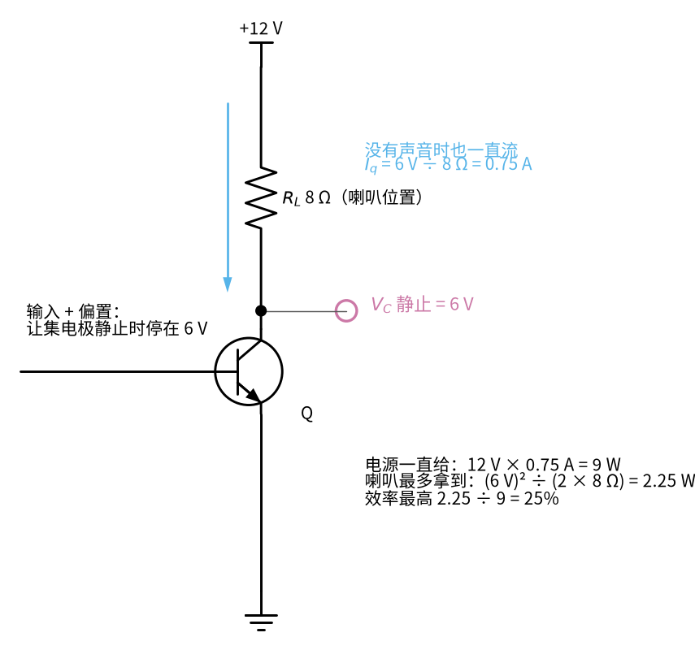
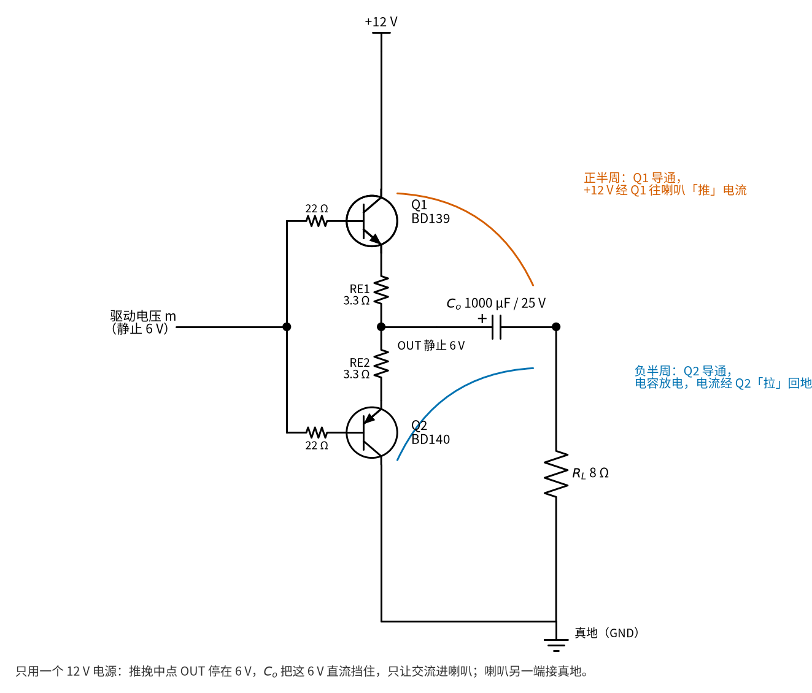
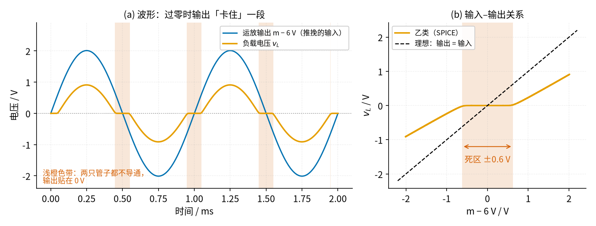
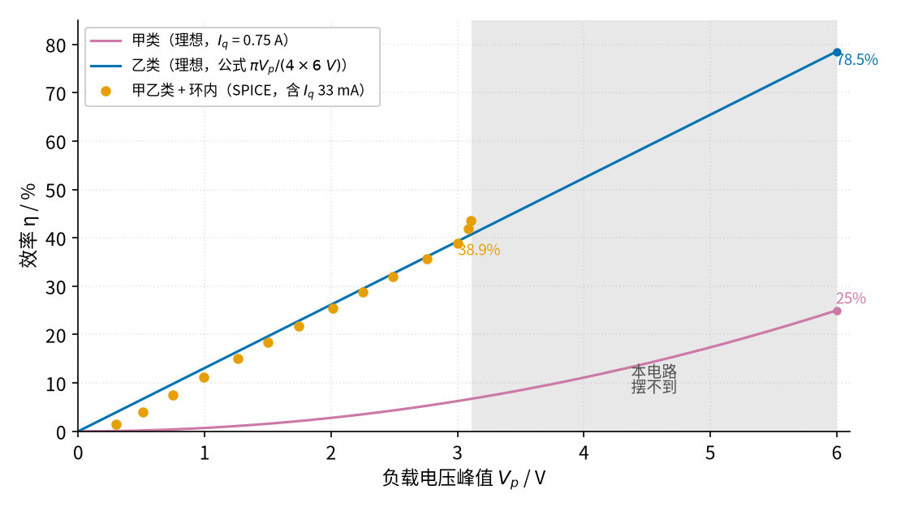

# 43 推挽功放：甲、乙、甲乙类 · 直觉篇

上一页：42 节流量计信号链总览（即将上线） · 本页：直觉篇 · [原理与实现篇](page2.md) · [参数与调试篇](page3.md) · [动手实验篇](page4.md) · [下一页：原理与实现篇](page2.md) · 前置节点：[19 射极跟随器 · 直觉篇](../19-emitter-follower/page1.md)、[08 同相放大 · 直觉篇](../08-noninverting-amp/page1.md)、[17 稳压管稳压 · 直觉篇](../17-zener-regulator/page1.md)、[01 元件速成 · 直觉篇](../01-components-basics/page1.md)

## 开头三问（先回忆，再往下读）

1. [19 射极跟随器](../19-emitter-follower/page1.md) 里，NPN 管的发射极电压和基极电压差多少？它为什么能「扛电流」？
2. 19 节参数与调试篇的练习 4 里，一只 NPN 推上、一只 PNP 拉下，输出波形在过零附近长什么样？
3. 一只 8 Ω 喇叭两端加峰值 2 V 的正弦，电流峰值是多少？平均功率是多少？

答案

1. 发射极比基极低约 0.6～0.7 V（一个 PN 结的压降）。电压增益约为 1，但电流增益很大：基极只要给一点点电流，发射极就能送出几十到几百倍的电流，所以它能把「有电压、没力气」的信号变成「有电压、有力气」的信号。
2. 过零附近有一小段「平台」：输入在 −0.6～+0.6 V 之间时，两只管子都没导通，输出卡在 0 V 不动。这一段叫**交越失真**，本节要把它治好。
3. 电流峰值 $2 / 8 = 0.25\ \text{A}$ ；平均功率 $P = V_p^2 / (2R) = 4 / 16 = 0.25\ \text{W}$ （正弦的有效值是峰值除以 $\sqrt{2}$ ，见 [13 桥式整流 · 原理与实现篇](../13-bridge-rectifier/page2.md)； $P = V^2 / R$ 见 [01 元件速成](../01-components-basics/page1.md)）。

## 痛点：运放「有电压、没力气」

前面几节的运放放大器，输出接的都是几千欧的电阻或者 Arduino 的输入脚，电流不过零点几毫安。现在想让它推一只 8 Ω 喇叭，问题马上出来了：峰值 2 V 的声音信号，要喇叭里流过 0.25 A 的峰值电流，而 TL072 的输出短路电流手册里写的典型值只有 26 mA 左右，差了十倍。运放会被「拽住」，波形削平，声音又小又破。

所以要在运放后面加一级「扛电流」的输出级。19 节的射极跟随器正好合适：电压照搬，电流放大几十上百倍。可它只有一只 NPN 管，只会往上「推」，往下「拉」只能靠电阻。想让它把喇叭电流推上去、拉下来都有力气，最直接的办法是给它一个大电流的静态点，这就是**甲类**。

*图 43-p1-1　甲类：没声音时也一直烧着 0.75 A*

图 43-p1-1 把甲类的账算清楚了：让集电极静止停在电源一半的 6 V，8 Ω 负载上就一直流着 $6 / 8 = 0.75\ \text{A}$ ，电源一直付出 $12 \times 0.75 = 9\ \text{W}$ 。而喇叭最多只能拿到峰值 6 V 的正弦，平均 2.25 W，效率最高 25%，没有声音的时候效率是零，9 W 全部变成热。再看图 43-p1-1 里的数字就明白：一个手掌大的小功放，靠甲类做，会烫得像暖手宝，还得配一个巨大的电源。

## 类比：两个人拉大锯

木工用的大锯两头各站一个人：一个人往自己这边拉，另一个人就放手；然后换过来。每个人只出半程的力，所以不累。这就是**推挽**：NPN 管负责「推」（把输出往上拉到正半周），PNP 管负责「挽」（往下拉出负半周），谁闲着谁就歇着，没声音时两个都不出力。

*图 43-p1-2　推挽：上管推、下管拉，各管半个周期*

图 43-p1-2 里两只管子的基极接在一起，由前级运放驱动。输出端的静止电压是 6 V（电源的一半），喇叭经一只大电容接到真正的地，电容挡住 6 V 的直流，只让声音通过。

可是拉大锯有个麻烦：「交接」的那一下。一个人放手、另一个人还没握紧，锯子会停一下。三极管也一样，基极比发射极高不到约 0.6 V 时，NPN 管根本不导通；PNP 管也要低约 0.6 V 才导通。于是输入在 −0.6～+0.6 V 之间时，两只管子都在「歇着」，输出卡在原地不动。

*图 43-p1-3　乙类的交越失真：过零时输出卡住一段*

图 43-p1-3 是仿真的结果（ngspice，元件模型见原理与实现篇）。运放给出峰值 2 V 的正弦，负载上只剩峰值约 0.91 V（SPICE 0.910 V），还多了一个个平台。右边的输入输出关系更直白：中间那段约 ±0.6 V 是「死区」。两只管子都只在半个周期里导通、静止电流为零的推挽，叫**乙类**。耳朵对这种平台非常敏感，小音量时尤其难听，因为小信号几乎整个落在死区里。

治法也很像大锯：让两个人**都轻轻握着**锯把，交接时就不会断。给两只管子各垫一点偏置电压，让它们没声音时也有几十毫安的小电流（本节是约 33 mA），刚好越过 0.6 V 的门槛，这就是**甲乙类**。它的静止电流比甲类的 0.75 A 小二十多倍，又消掉了死区。图 43-p1-3 里的平台在甲乙类里几乎看不见（参数与调试篇会给出失真度的数字）。

## 效率：推挽省在哪里

*图 43-p1-4　推挽的效率比甲类高得多，但本节电路只到约 3 V*

图 43-p1-4 比较了三种情况。甲类即使开到最大也只有 25%；乙类推挽理论上最高 78.5%（峰值顶到 6 V 时）。本节实际搭的甲乙类电路（橙色圆点）几乎贴着乙类的直线走，只多了一点静止电流的损耗。

注意图 43-p1-4 右边的灰色区域：本节电路的输出峰值到约 3 V 就开始削顶了：三极管基极要比输出多吃约 0.7 V，给两只管子送偏置电流的「恒流源」自己也要留一点电压余量，所以输出摆不到电源边上。所以本节电路实际能给 8 Ω 的最大功率约 0.56 W，不是理论的 2.25 W。这个「能做到多少」比「理论上多少」重要，原理与实现篇会一步步算出来。

## 一句话

**推挽 = 两只跟随器一推一拉、各管半周；垫一点偏置让它们交接时都轻轻导通（甲乙类），就同时得到了高效率和没有死区的波形。**

下一页把完整电路拆开，逐个元件算一遍：偏置怎么垫、发射极电阻干什么、放进运放的反馈环后交越失真为什么又小了几百倍。

## 参考资料

- 运放驱动推挽输出级、甲乙类偏置与交越失真（TI 应用笔记 AN-272《Op Amp Booster Designs》）：<https://www.ti.com/lit/an/snoa600b/snoa600b.pdf>
- TL072 数据手册（输出短路电流、摆幅）：<https://www.ti.com/lit/ds/symlink/tl072.pdf>
- BD139 数据手册（ST，最大电流、功耗、热阻）：<https://www.st.com/resource/en/datasheet/bd139.pdf>
- 射极跟随器高频寄生振荡与基极串联电阻（原理与实现篇会用到，Electronics StackExchange）：<https://electronics.stackexchange.com/questions/476679>
